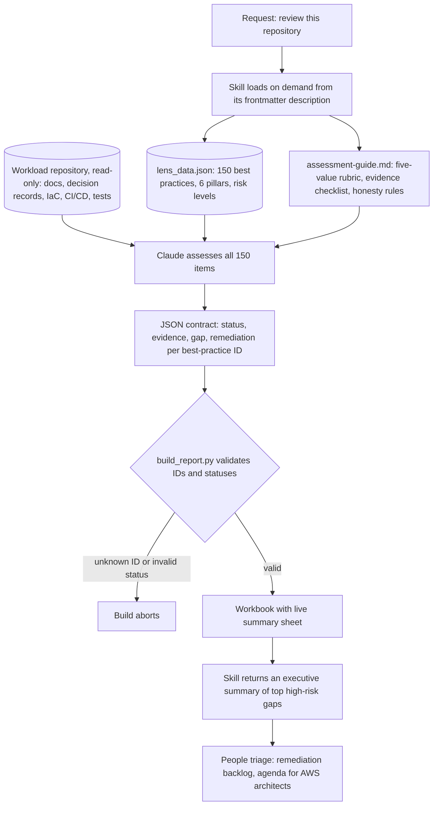

---
# Skeleton from Lead wn7o2uu5 (AWS Architecture Blog), picked 2026-10-29.
# Drafted per docs/editorial/case-study-writing-guide.md; the Author's check
# list is in the pull request. published and reviewed are the pick time, provisional: set them
# when you publish. verified: is the Author's alone (ADR-0007).
title: "Lens as data: how Smarsh automates AWS Agentic AI Lens reviews"
description: "How Smarsh runs AWS's 150-practice Agentic AI Lens as a Claude skill: a model judges, a strict script validates, and people still triage the findings."
kind: case-study
vertical: ai-ml-systems
tags: ["ai-agents", "llm", "well-architected", "aws", "smarsh"]
published: "2026-10-29T19:47:44Z"
verified: 2026-10-29
reviewed: "2026-10-29T19:47:44Z"
author: mira-vance
# Optional: an image HastCode may use, beside this file, replaces the
# generated title card. Never a Source's image.
# hero: system-name.png
# hero_alt: "What the image shows"
# Optional: related Explainer slugs and extra sources (title + url).
related: [meta-thin-orchestrator]
---

At Smarsh, [every agentic solution must pass a Well-Architected review before it reaches a customer](https://aws.amazon.com/blogs/architecture/automating-agentic-ai-well-architected-reviews-with-the-aws-agentic-ai-lens/#the-challenge-a-lens-you-can-read-but-not-run), and the AWS lens written for agents was 150 best practices with no console to run them in. So Smarsh turned the lens into a JSON file, taught Claude to grade a repository against it, and put a script in front of the output that rejects any best-practice ID the model makes up.

> Drafted with AI assistance, researched, verified and edited by the HastCode editorial team. We publish only as many pieces as the Author can verify this way.

## TL;DR

- Smarsh's reviewer is [a custom Claude skill](https://aws.amazon.com/blogs/architecture/automating-agentic-ai-well-architected-reviews-with-the-aws-agentic-ai-lens/#solution-architecture-the-lens-as-data-the-reviewer-as-a-skill) that reads a workload's GitHub repository and grades it against all 150 best practices of the AWS Agentic AI Lens, producing a review workbook in hours rather than days.
- It exists because the lens [could be read but not run](https://aws.amazon.com/blogs/architecture/automating-agentic-ai-well-architected-reviews-with-the-aws-agentic-ai-lens/#the-challenge-a-lens-you-can-read-but-not-run): manual reviews took days and every reviewer structured them differently.
- It has three parts: the lens as a dataset, an assessment guide with a five-value rubric and honesty rules, and a deterministic script that validates the model's JSON and renders the workbook. People then triage the result.
- The price is that the model still makes the judgement and sees only the repository. The surprise: baseline runs without the skill passed [8 of 16 test expectations](https://aws.amazon.com/blogs/architecture/automating-agentic-ai-well-architected-reviews-with-the-aws-agentic-ai-lens/#testing-the-tester-evaluating-the-skill-before-trusting-it); with it, 16 of 16.

## From a one-line request to a validated workbook

The diagram is ours, redrawn from the text of the post by Smarsh's Dinesh Subramani and AWS's Raghu Talakola; their own figure is in [the original](https://aws.amazon.com/blogs/architecture/automating-agentic-ai-well-architected-reviews-with-the-aws-agentic-ai-lens/#solution-architecture-the-lens-as-data-the-reviewer-as-a-skill). A review starts as [a one-line request](https://aws.amazon.com/blogs/architecture/automating-agentic-ai-well-architected-reviews-with-the-aws-agentic-ai-lens/#solution-architecture-the-lens-as-data-the-reviewer-as-a-skill): point Claude at a repository and ask for a Well-Architected review. The model's judgement happens only inside the "assess" box; the boxes before it feed it fixed inputs, and the box after it checks what it wrote.



The Step 1 to 6 sections below walk the diagram top to bottom: how the skill loads, the lens as data, the evidence, the assessment, the contract and its validator, then the people.

## A lens you can read but not run

Smarsh archives and governs electronic communications for [more than 7,000 organizations](https://aws.amazon.com/blogs/architecture/automating-agentic-ai-well-architected-reviews-with-the-aws-agentic-ai-lens/#about-smarsh), from small businesses to large multinational financial institutions. The workload under review was its first multi-agent system: [an agent review system for compliance alerts](https://aws.amazon.com/blogs/architecture/automating-agentic-ai-well-architected-reviews-with-the-aws-agentic-ai-lens/#the-challenge-a-lens-you-can-read-but-not-run), built on the runtime, gateway, registry and identity capabilities of Amazon Bedrock AgentCore.

The natural yardstick was the [Agentic AI Lens](https://docs.aws.amazon.com/wellarchitected/latest/agentic-ai-lens/agentic-ai-lens.html), which AWS published on [10 June 2026](https://docs.aws.amazon.com/wellarchitected/latest/agentic-ai-lens/document-revisions.html). It adapts the [six Well-Architected pillars](https://docs.aws.amazon.com/wellarchitected/latest/agentic-ai-lens/agentic-ai-lens.html#agentic-ai-lens-about), from operational excellence to sustainability, to systems that reason, act and remember. Its [best-practice appendix](https://docs.aws.amazon.com/wellarchitected/latest/agentic-ai-lens/appendix-a.html) lists every item with an ID, a title and a risk level.

The trouble was tooling. Other lenses, such as the Serverless Applications Lens, [can be added directly in the AWS Well-Architected Tool](https://aws.amazon.com/blogs/architecture/automating-agentic-ai-well-architected-reviews-with-the-aws-agentic-ai-lens/#the-challenge-a-lens-you-can-read-but-not-run). The Agentic AI Lens "existed only as published documentation": 150 best practices across 41 questions, each with a risk level and a desired outcome, "but with no way to run the review natively on the console."

We infer the cost of that gap is mostly consistency. A review that every reviewer structures differently cannot be compared across workloads, and a firm that gates every agent on one has to compare them.

## Days by hand, wait for AWS, or make the lens executable

The post names [two apparent options and a third](https://aws.amazon.com/blogs/architecture/automating-agentic-ai-well-architected-reviews-with-the-aws-agentic-ai-lens/#the-challenge-a-lens-you-can-read-but-not-run):

- **A manual review.** A multi-day effort, "in which every reviewer structured the assessment differently."
- **Wait for console support.** No review until AWS ships it, and Smarsh's gate does not let an agentic solution reach a customer without one.
- **Make the lens executable**, "in a way every future workload could reuse." Smarsh chose this.

There is a fourth path the post does not discuss. The lens's documentation now points to [a custom-lens file](https://docs.aws.amazon.com/wellarchitected/latest/agentic-ai-lens/agentic-ai-lens.html#agentic-ai-lens-availability) that can be imported into the Well-Architected Tool from [an AWS samples repository](https://github.com/aws-samples/sample-well-architected-custom-lens). We cannot tell whether it existed when Smarsh started. When we counted it on 30 October 2026 (our count, not AWS's), [the file](https://github.com/aws-samples/sample-well-architected-custom-lens/blob/main/agentic-ai-lens/agentic-ai-lens.json) held 40 questions and 146 best practices; the [appendix](https://docs.aws.amazon.com/wellarchitected/latest/agentic-ai-lens/appendix-a.html) lists 41 and 150, including an AGENTOPS07 question the file lacks.

We infer two lessons. An imported lens still leaves a person to find the evidence and tick the boxes, which is the multi-day part. And even AWS's own copies of the lens drift, which is why Smarsh's decision to check its dataset against the appendix matters.

## Step 1: the skill costs almost nothing until it is asked for

A Claude skill is, in the post's words, [a versioned bundle](https://aws.amazon.com/blogs/architecture/automating-agentic-ai-well-architected-reviews-with-the-aws-agentic-ai-lens/#solution-architecture-the-lens-as-data-the-reviewer-as-a-skill) of instructions, reference data and executable scripts "that Claude discovers through a frontmatter description and loads on demand."

Anthropic's documentation describes the mechanism as progressive disclosure in three levels. [The name and description load at startup](https://platform.claude.com/docs/en/agents-and-tools/agent-skills/overview#level-1-metadata-always-loaded), at about 100 tokens per skill, and the description is what a request is matched against. The body of the skill's instructions loads only when it is triggered. Bundled files load [only when read](https://platform.claude.com/docs/en/agents-and-tools/agent-skills/overview#level-3-resources-and-code-loaded-as-needed), and scripts run through bash, so "only their output enters context."

That is why Smarsh can say progressive disclosure [keeps the token cost near zero](https://aws.amazon.com/blogs/architecture/automating-agentic-ai-well-architected-reviews-with-the-aws-agentic-ai-lens/#solution-architecture-the-lens-as-data-the-reviewer-as-a-skill) until a review is requested. We infer it also explains the split between the parts: a 150-row dataset and a long rubric are files the model reads when it needs them, and the renderer is code whose source never enters the model's context at all.

## Step 2: the lens becomes a dataset

The first part is `lens_data.json`, [all 150 best practices extracted into structured JSON](https://aws.amazon.com/blogs/architecture/automating-agentic-ai-well-architected-reviews-with-the-aws-agentic-ai-lens/#solution-architecture-the-lens-as-data-the-reviewer-as-a-skill): ID, pillar, review question, title, risk level and desired outcome. The risk levels split 90 High, 59 Medium and 1 Low, and we found the same split in the [lens appendix](https://docs.aws.amazon.com/wellarchitected/latest/agentic-ai-lens/appendix-a.html), where the single Low item is AGENTPERF06-BP03, on meta-tool use and tool chaining.

Two rules make the file more than a copy. The risk levels were [cross-validated against the lens appendix](https://aws.amazon.com/blogs/architecture/automating-agentic-ai-well-architected-reviews-with-the-aws-agentic-ai-lens/#solution-architecture-the-lens-as-data-the-reviewer-as-a-skill) "to catch extraction errors." And the dataset is "the single source of truth": the skill is instructed never to invent or renumber items.

That second rule is what the whole design leans on. A model asked to review against "the Agentic AI Lens" from memory has to recall 150 items it may have half-seen. A model handed the list has only to grade it. We infer this is the main reason the baseline in the post's tests produced short, ad-hoc checklists while the skill produced the full lens.

The post does not say who extracted the data, how, or how the file will track revisions to the lens.

## Step 3: evidence comes from the repository, read-only

Claude [gathers evidence read-only from the target repository](https://aws.amazon.com/blogs/architecture/automating-agentic-ai-well-architected-reviews-with-the-aws-agentic-ai-lens/#solution-architecture-the-lens-as-data-the-reviewer-as-a-skill). The assessment guide's checklist names where to look: the README and architecture docs, decision records, infrastructure as code, continuous integration and delivery (CI/CD) workflows, and test and evaluation suites. It also lists per-pillar signals to look for.

On Smarsh's real workload, that meant [architecture and authentication documentation](https://aws.amazon.com/blogs/architecture/automating-agentic-ai-well-architected-reviews-with-the-aws-agentic-ai-lens/#what-the-first-review-found), AWS Cloud Development Kit (CDK) infrastructure definitions, GitHub Actions workflows, registry and gateway design records, and test suites.

Read-only is a design choice worth naming. We infer it keeps the reviewer from changing the system it reviews, and means the review can be pointed at any repository without new permissions beyond read access.

The limit is the other side of the same choice: the review sees what the repository says, not what runs in production. The post's own triage shows the edge of that, in Step 6.

## Step 4: the model grades against a rubric with honesty rules

The second part, `assessment-guide.md`, tells the model how to grade. Each item gets one of [five statuses](https://aws.amazon.com/blogs/architecture/automating-agentic-ai-well-architected-reviews-with-the-aws-agentic-ai-lens/#solution-architecture-the-lens-as-data-the-reviewer-as-a-skill): Compliant, Partially Compliant, Non-Compliant, Not Applicable or Not Reviewed.

Three honesty rules govern the choice:

1. Every status must cite evidence found in the repository.
2. Items with no signal are marked Not Reviewed "rather than guessed."
3. The same underlying fact must produce a consistent status wherever it appears across pillars.

The middle rule does the most work. We infer that without a status for "no evidence either way," a model asked for 150 verdicts will produce 150 verdicts, and some of them will be guesses that read like findings. Not Reviewed turns silence in the repository into a visible gap a person can chase.

The third rule matters because the lens overlaps itself. We infer a single fact, such as how agent identities are scoped, can bear on security, reliability and operations items at once, and a reviewer who grades them inconsistently loses credibility on all three.

The post does not say which Claude model ran the reviews.

## Step 5: a JSON contract and a renderer that says no

Reasoning and rendering meet in [a single JSON document](https://aws.amazon.com/blogs/architecture/automating-agentic-ai-well-architected-reviews-with-the-aws-agentic-ai-lens/#solution-architecture-the-lens-as-data-the-reviewer-as-a-skill), keyed by best-practice ID. Its shape, with our placeholders in place of the post's example values:

```json
{
  "<best-practice ID>": {
    "status": "<one of the five statuses>",
    "evidence": "<what the repository shows>",
    "gap": "<what is missing>",
    "remediation": "<what to do>"
  }
}
```

The third part, `build_report.py`, is [a deterministic Python script](https://aws.amazon.com/blogs/architecture/automating-agentic-ai-well-architected-reviews-with-the-aws-agentic-ai-lens/#solution-architecture-the-lens-as-data-the-reviewer-as-a-skill) using openpyxl. It validates its input: unknown best-practice IDs or invalid statuses abort the build, so "hallucinated items cannot silently ship." The post's workflow also has this step validate row counts and flag blank statuses, without saying whether the script or the model does it.

The workbook has a dropdown and conditional formatting per item, columns for evidence, gaps and remediation, and a summary sheet whose pillar counts and high-risk tracker are [live COUNTIF formulas](https://aws.amazon.com/blogs/architecture/automating-agentic-ai-well-architected-reviews-with-the-aws-agentic-ai-lens/#solution-architecture-the-lens-as-data-the-reviewer-as-a-skill), not hardcoded numbers. We infer the point: when a person changes a status in triage, the totals follow, so the summary cannot disagree with the rows.

This is the same line Meta draws in [its thin orchestrator](/ai-ml-systems/meta-thin-orchestrator/): the model does the judgement, and ordinary code owns everything that can be checked.

## Step 6: people triage, and AWS gets a sharper agenda

The skill [returns an executive summary](https://aws.amazon.com/blogs/architecture/automating-agentic-ai-well-architected-reviews-with-the-aws-agentic-ai-lens/#solution-architecture-the-lens-as-data-the-reviewer-as-a-skill) of the top high-risk gaps, and then people take over. On the first review, the architect brought in engineering to [triage the findings](https://aws.amazon.com/blogs/architecture/automating-agentic-ai-well-architected-reviews-with-the-aws-agentic-ai-lens/#what-the-first-review-found) in the workbook itself: validating statuses, accepting or challenging results, and ranking the backlog.

Triage changed the review. Several items collapsed into one anomaly-detection epic, and one finding was upgraded once the team pointed to evidence the review had missed: dependency scanning was already running on every pull request.

It also surfaced questions no repository can answer, about [the AWS services themselves](https://aws.amazon.com/blogs/architecture/automating-agentic-ai-well-architected-reviews-with-the-aws-agentic-ai-lens/#sharper-questions-better-aws-engagement). The team mapped each to the item it would close and took them to its AWS Solutions Architects. Among them: whether the AgentCore runtime is durable and consistent enough to serve as a session checkpoint store, the retry and idempotency semantics of the `InvokeAgentRuntime` API, and break-glass patterns for halting agent invocations. In the post's words, the deep dive "became a working session with a definition of done."

## What it costs

The design admits its trade-offs mostly by implication. We name four.

**The model still judges.** The validator checks that an ID exists and a status is one of five. It cannot check that a status is right. We infer that a wrong but well-formed verdict passes every gate the script has, which is why the post keeps [humans on judgement](https://aws.amazon.com/blogs/architecture/automating-agentic-ai-well-architected-reviews-with-the-aws-agentic-ai-lens/#conclusion).

**The repository is the whole world.** The dependency-scanning miss in Step 6 shows a review grading what is written down. The questions sent to AWS show the other edge: some best practices turn on service behaviour no repository holds.

**The dataset needs keeping.** The lens is in its [initial release](https://docs.aws.amazon.com/wellarchitected/latest/agentic-ai-lens/document-revisions.html). We infer each revision means re-extracting and re-checking `lens_data.json`, and the custom-lens count gap above shows copies can drift.

**People still pay for triage.** The post moves human time to [validation and prioritization](https://aws.amazon.com/blogs/architecture/automating-agentic-ai-well-architected-reviews-with-the-aws-agentic-ai-lens/#results-and-expected-outcomes); it does not remove it, and it does not say how long triage took.

## The evidence: 16 of 16 on fixtures, and the gaps

Smarsh [evaluated the skill before trusting it](https://aws.amazon.com/blogs/architecture/automating-agentic-ai-well-architected-reviews-with-the-aws-agentic-ai-lens/#testing-the-tester-evaluating-the-skill-before-trusting-it). The team built two synthetic repositories: a moderately mature LangGraph-style workload, and a deliberately rough proof of concept with hardcoded credentials and a runaway-cost incident in its history. Each run was graded against eight verifiable expectations per fixture, such as all 150 items present, no blank statuses, evidence for every definitive status, honest calibration, and the hardcoded credential being flagged.

With the skill, runs passed 16 of 16. Without it, 8 of 16, producing "ad-hoc 18–39 item checklists with no lens traceability." The eval set ships inside the skill, so regression testing continues as it changes.

On the real workload, the skill assessed all 150 items [in hours](https://aws.amazon.com/blogs/architecture/automating-agentic-ai-well-architected-reviews-with-the-aws-agentic-ai-lens/#what-the-first-review-found) and found strengths, such as per-agent IAM roles scoped to named runtime ARNs and SigV4-signed MCP calls through AgentCore Gateway, and high-risk gaps: the gateway's ingress authorizer running with authentication disabled under a documented risk acceptance, no prompt-injection screening, rate limiting left as a TODO, and no automated cost controls.

The gaps are real. Of the expectations the post names, most check completeness and form, not whether verdicts were right, and the fixtures were built by the team that built the skill. The post gives no agreement rate with human reviewers, no run count, no token cost, and no number for "hours." It calls its results [first internal uses](https://aws.amazon.com/blogs/architecture/automating-agentic-ai-well-architected-reviews-with-the-aws-agentic-ai-lens/#results-and-expected-outcomes) and outcomes "the team is tracking toward."

## What a lens as data makes possible

The skill has been [contributed to Smarsh's internal AI-SDLC plugin marketplace](https://aws.amazon.com/blogs/architecture/automating-agentic-ai-well-architected-reviews-with-the-aws-agentic-ai-lens/#whats-next) and run against a second, architecturally different agentic repository. Next, Smarsh plans to run reviews continuously during development rather than once at the end, to make the workbook required evidence at its production gates, and to extend the lens-as-data pattern to other Well-Architected lenses.

The lesson travels beyond AWS and beyond reviews. Any checklist your organisation runs by hand, a security standard or a launch readiness list, can be split the same way. Put the checklist in a file the model cannot rewrite. Give the model a status that means "I found nothing," and make it cite evidence for every other one. Put a dumb, strict program between the model's output and anything a person reads. Then test the reviewer on repositories where you already know the answer.

The cost is that a person still owns every verdict, and the review knows only what the repository says. What could go right is a review that is the same shape for every workload, cheap enough to run on every change, and honest about what it did not see. [The post's own summary](https://aws.amazon.com/blogs/architecture/automating-agentic-ai-well-architected-reviews-with-the-aws-agentic-ai-lens/#conclusion): "treat the lens as data, encode the reviewer's discipline as a skill with enforced honesty rules."

## Sources

- [Automating agentic AI Well-Architected reviews with the AWS Agentic AI Lens](https://aws.amazon.com/blogs/architecture/automating-agentic-ai-well-architected-reviews-with-the-aws-agentic-ai-lens/), Dinesh Subramani (Smarsh) and Raghu Talakola (AWS), AWS Architecture Blog, 28 October 2026
- [Agentic AI Lens](https://docs.aws.amazon.com/wellarchitected/latest/agentic-ai-lens/agentic-ai-lens.html), AWS Well-Architected Framework, published 10 June 2026 ([document revisions](https://docs.aws.amazon.com/wellarchitected/latest/agentic-ai-lens/document-revisions.html))
- [Appendix A: Best practice reference](https://docs.aws.amazon.com/wellarchitected/latest/agentic-ai-lens/appendix-a.html), Agentic AI Lens
- [agentic-ai-lens.json](https://github.com/aws-samples/sample-well-architected-custom-lens/blob/main/agentic-ai-lens/agentic-ai-lens.json), in [sample-well-architected-custom-lens](https://github.com/aws-samples/sample-well-architected-custom-lens), AWS Samples on GitHub, counted 30 October 2026
- [Agent Skills overview](https://platform.claude.com/docs/en/agents-and-tools/agent-skills/overview), Claude Platform documentation, Anthropic
