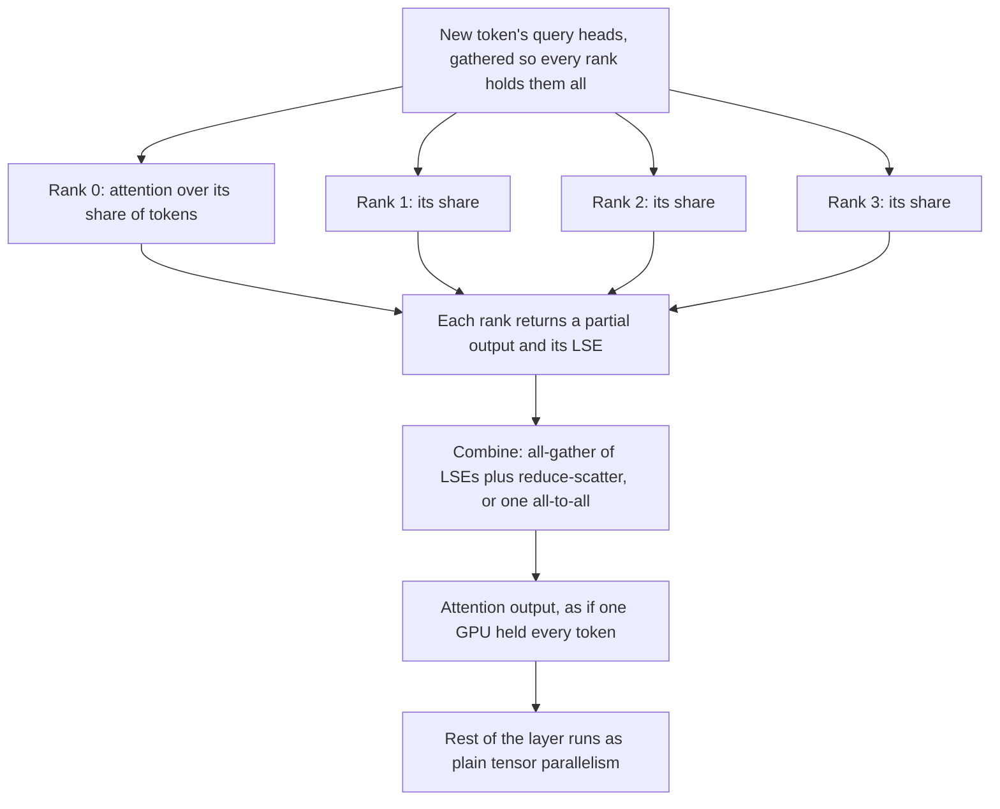

---
# Skeleton from Lead hghtpozy (vLLM blog), picked 2026-10-29.
# Follows docs/editorial/concept-writing-guide.md. published and reviewed are
# the pick time, provisional: set them when you publish. verified: is the
# Author's alone (ADR-0007).
title: "Decode context parallelism: splitting the KV cache by token"
description: "Decode context parallelism shards an LLM's KV cache across GPUs by token, so a tensor-parallel group stops storing the same cache on every GPU."
kind: concept
vertical: ai-ml-systems
tags: ["context-parallelism", "kv-cache", "llm-inference", "long-context", "vllm"]
published: "2026-10-29T19:47:44Z"
verified: 2026-10-29
reviewed: "2026-10-29T19:47:44Z"
author: mira-vance
# Optional: an image HastCode may use, beside this file, replaces the
# generated title card. Never a Source's image.
# hero: concept-name.png
# hero_alt: "What the image shows"
related: [disaggregated-inference, expert-parallelism]
---

On 29 October 2026, the day Mistral Large 4 came out, the vLLM and Mistral teams published how they serve it. One test in that post ran agentic sessions of about 100,000 tokens through a split prefill and decode setup. With 32 sessions, [a plain four-GPU tensor-parallel decode node ran out of KV cache and its time to first token climbed to 15 seconds](https://vllm.ai/blog/2026-10-29-mistral-large-4#long-context-decode-and-prefill-context-parallelism). A decode node with the same four-GPU count, configured as "TP4 DCP4", held time to first token at 0.7 seconds. What changed, we infer, was how the cache was laid out across the GPUs: the model's attention [keeps one latent KV head, so under tensor parallelism the cache is replicated on every rank](https://vllm.ai/blog/2026-10-29-mistral-large-4#long-context-decode-and-prefill-context-parallelism). Four GPUs were storing the same cache four times.

> Drafted with AI assistance, researched, verified and edited by the HastCode editorial team. We publish only as many pieces as the Author can verify this way.

## TL;DR

- **Decode context parallelism (DCP)** splits a request's KV cache across the GPUs of a tensor-parallel group by token instead of by attention head. vLLM's docs put it plainly: ["The core of decode context parallel is how to shard the KV cache across GPUs."](https://docs.vllm.ai/en/latest/serving/context_parallel_deployment/#decode-context-parallel)
- Tensor parallelism can only split the cache by KV head, so once the group has more GPUs than heads, the cache is [duplicated tp_size / H times](https://docs.vllm.ai/en/latest/serving/context_parallel_deployment/#decode-context-parallel). DCP gives each GPU its own share of tokens; each attends over its share, and an exchange in every layer merges the partial results.
- It matters for models with few KV heads. On eight GPUs, Mistral Large 4 holds [2.38 million tokens of KV without DCP and 18.88 million with it](https://vllm.ai/blog/2026-10-29-mistral-large-4#long-context-decode-and-prefill-context-parallelism) (FP8 checkpoint), about [7.9 times more](https://vllm.ai/blog/2026-10-29-mistral-large-4#highlights).
- The cost is communication on every decode step: on the same model, DCP8 [decodes about 16–28% slower per token than TP8](https://vllm.ai/blog/2026-10-29-mistral-large-4#long-context-decode-and-prefill-context-parallelism). Turn it on when KV capacity, not speed, is the limit.

## What decode context parallelism is

Start with the terms. **Decode** is the phase where a model produces output one token at a time; each step computes attention for a few new query tokens against every earlier token's keys and values, held in the **KV cache**. vLLM's docs describe the shape of the problem: each decoding step must compute ["a small amount of query tokens w.r.t. a large number of key/value tokens stored in the paged KV cache"](https://docs.vllm.ai/en/latest/serving/context_parallel_deployment/#decode-context-parallel). **Tensor parallelism (TP)** splits each layer's weights across GPUs, and for attention it splits by head.

The docs give the size of the cache: for a model with H KV heads, a request with T tokens ["needs to store H * T key/value tensors"](https://docs.vllm.ai/en/latest/serving/context_parallel_deployment/#decode-context-parallel). TP shards along H. DCP shards along T. In our words: TP gives each GPU some of the heads for all of the tokens; DCP, layered on top, gives each GPU all of the heads for some of the tokens.

Two things do not count. DCP is not more hardware: the docs note that the DCP size ["does not increase the number of GPUs we need to launch, but just reduces the KV cache duplication"](https://docs.vllm.ai/en/latest/serving/context_parallel_deployment/#decode-context-parallel). It reuses the TP group's GPUs. And it is not the prefill technique of the same family, which splits a long prompt's computation to cut time to first token; that is **prefill context parallelism**, covered below.

## One decode step on a DCP group, layer by layer

We infer the order of these steps from the operations the vLLM team lists as DCP-only work: [all-gathers of the LSE, reduce-scatters, a top-k merge and query gathers](https://vllm.ai/blog/2026-10-29-mistral-large-4#long-context-decode-and-prefill-context-parallelism). Walk it from the top.

First, every rank in the group needs the new token's queries, so they are gathered. Each rank then runs attention against only the tokens it stores. Which tokens those are matters, because the cache grows during decoding: vLLM [uses an interleaving strategy](https://docs.vllm.ai/en/latest/serving/context_parallel_deployment/#decode-context-parallel), proposed by Chao Hong of Moonshot, so that tokens not yet generated are sharded along T as they arrive. One visible effect: [a 16-token physical block with DCP=4 represents 64 tokens](https://docs.vllm.ai/en/latest/serving/context_parallel_deployment/#decode-context-parallel).

Each rank returns its partial output and an **LSE**, the log-sum-exp of its attention scores; on Mistral Large 4's sparse path, a row with no local top-k candidates is [set to `(0, -inf)`](https://github.com/vllm-project/vllm/pull/61285). We infer that the combine weights each partial output by its LSE: vLLM checks the result [against an fp32 LSE-weighted reference](https://github.com/vllm-project/vllm/pull/61285). The Helix Parallelism paper, which we infer does a comparable merge, includes [a lightweight communication step to preserve exact attention behavior](https://arxiv.org/abs/2507.07120). After the merge, the rest of the layer runs as ordinary TP.

## The worked example: Mistral Large 4 at 60,000 tokens

Mistral Large 4 makes the duplication easy to see. Its attention is MLA (multi-head latent attention) with a [KV LoRA rank of 512 and a RoPE dimension of 64](https://vllm.ai/blog/2026-10-29-mistral-large-4#model-architecture), and each token costs [47,136 bytes of KV cache](https://vllm.ai/blog/2026-10-29-mistral-large-4#model-architecture): 41,328 for the MLA latent and 5,808 for its sparse-attention indexer. MLA keeps one latent KV head, so H is 1 and an eight-GPU TP group would store eight copies.

Adding `--decode-context-parallel-size 8` [shards the latent KV cache across the 8 ranks](https://vllm.ai/blog/2026-10-29-mistral-large-4#usage). The pool grows [from 2.38M to 18.88M tokens on the FP8 checkpoint, and from 3.60M to 28.76M on NVFP4](https://vllm.ai/blog/2026-10-29-mistral-large-4#long-context-decode-and-prefill-context-parallelism). At 60,000 tokens of context, we compute, each rank stores about 7,500 of them.

The combine was the bill. Out of the box, a profile at 60k context showed [about 7 ms per decode step of DCP-only work](https://vllm.ai/blog/2026-10-29-mistral-large-4#long-context-decode-and-prefill-context-parallelism). After the team rewrote the collectives it fell to 3.2 ms, and on TP8 DCP8 FP8 (60k input, 1k output) median single-request time per output token dropped [from 17.82 ms to 12.50 ms](https://vllm.ai/blog/2026-10-29-mistral-large-4#long-context-decode-and-prefill-context-parallelism), with the decode fusions shipped at the same time.

## Where decode context parallelism shows up

vLLM's docs work through three models. [DeepSeek-R1 has 1 KV head when MLA is enabled](https://docs.vllm.ai/en/latest/serving/context_parallel_deployment/#decode-context-parallel), so a single-node `-tp 8` deployment duplicates the cache eight times, and `-dcp 8` reduces that. Kimi-K2 is similar but larger: at `-tp 16` the duplication is 16 times, and the docs offer two answers, `-dcp 16` to remove it entirely or `-dcp 8` to leave 2 times, because then ["the DCP communication only happens inside one node"](https://docs.vllm.ai/en/latest/serving/context_parallel_deployment/#decode-context-parallel). Qwen3-235B-A22B has 4 KV heads, so `-tp 8` duplicates twice and `-dcp 2` is enough. vLLM supports DCP [for both MLA and GQA models](https://docs.vllm.ai/en/latest/serving/context_parallel_deployment/#decode-context-parallel).

GLM-5.3 shows that sharding the cache need not change the answers. In the pull request that enabled the all-to-all combine for FlashMLA sparse, GLM-5.3 (FP8) on eight GB300 GPUs scored [0.918 on GSM8K at TP8 and 0.914 at TP8 with DCP8](https://github.com/vllm-project/vllm/pull/61285) on the all-to-all path.

**Helix Parallelism**, from a team of researchers publishing on arXiv, is the same idea taken further for decoding at millions of tokens. It applies [KV parallelism during attention to shard KV caches across GPUs, then reuses the same GPUs for TP, or TP times expert parallelism, for the feed-forward layers](https://arxiv.org/abs/2507.07120). For DeepSeek-R1 on Blackwell, the authors report up to 1.5 times lower token-to-token latency at fixed batch sizes, and up to 32 times larger batches under the same latency budget.

## Why serving stacks end up needing it

The cause is a feature that helps on a normal day. DeepSeek-V2 adopted MLA, which compresses ["the Key-Value (KV) cache into a latent vector"](https://arxiv.org/abs/2405.04434); DeepSeek reports it reduced the KV cache by 93.3% against DeepSeek 67B. Mistral Large 4 adopts a [DeepSeek-style sparse attention stack](https://vllm.ai/blog/2026-10-29-mistral-large-4) built on it. A compressed cache is cheaper per token, but it leaves one KV head, and one head cannot be split by head.

Meanwhile the weights push TP wider. Mistral Large 4 has [1 trillion parameters, 49 billion of them active per token](https://vllm.ai/blog/2026-10-29-mistral-large-4#highlights), and its FP8 checkpoint is served [on 8 GPUs](https://vllm.ai/blog/2026-10-29-mistral-large-4#usage). The Helix authors name the tension: TP helps with the cost of reading feed-forward weights, but ["When TP width exceeds the number of KV heads, it leads to inefficient KV duplication, limits parallelism, and constrains batch size."](https://arxiv.org/abs/2507.07120)

Contexts keep growing too. vLLM's docs frame context parallelism as mainly solving [the problem of serving long context requests](https://docs.vllm.ai/en/latest/serving/context_parallel_deployment/#context-parallel-deployment), and for long decode they want ["more space for KV cache to increase the batchsize (and hence the throughput)"](https://docs.vllm.ai/en/latest/serving/context_parallel_deployment/#context-parallel-deployment). Agentic sessions of [around 100,000 tokens](https://vllm.ai/blog/2026-10-29-mistral-large-4#long-context-decode-and-prefill-context-parallelism) are where a replicated cache runs out first.

## Practice one: widen tensor parallelism first, then add DCP

vLLM's guidance is an order of operations: ["try to increase -tp size until you get satisfactory performance, and then add -dcp to reduce the KV cache duplication."](https://docs.vllm.ai/en/latest/serving/context_parallel_deployment/#decode-context-parallel) The DCP size [should lie between 1 and tp_size / H](https://docs.vllm.ai/en/latest/serving/context_parallel_deployment/#decode-context-parallel). Going past that bound is possible in theory, but decode has few query tokens, and the docs say it is unclear what the extra GPUs would do for the non-attention layers.

So the first number to work out is the duplication factor. Divide your TP size by your model's KV-head count: 8 for DeepSeek-R1 at TP8 and 2 for Qwen3-235B-A22B at TP8, per the [docs' case studies](https://docs.vllm.ai/en/latest/serving/context_parallel_deployment/#decode-context-parallel); by the same rule, we compute 8 for Mistral Large 4 at TP8. That is the most DCP can win back.

The cost is communication, and it grows with the size: ["With larger dcp size, the KV cache duplication is reduced, but the communication overhead increases."](https://docs.vllm.ai/en/latest/serving/context_parallel_deployment/#decode-context-parallel) The Kimi-K2 example is the trade in one line: choosing DCP8 over DCP16 accepts 2 times duplication to keep the combine inside one node. Mistral Large 4 adds one more condition: its DCP [requires the default FP8 KV cache](https://vllm.ai/blog/2026-10-29-mistral-large-4#usage).

## Practice two: make the combine one exchange, not many small ones

The merge runs in every attention layer of every decode step, so its shape decides what DCP costs. With vLLM's older `ag_rs` backend, [each layer's combine is an NCCL all-gather of the LSEs plus a reduce-scatter of the outputs](https://github.com/vllm-project/vllm/pull/61285), "which means many small NCCL kernels per decode step". The `a2a` backend makes it one exchange per layer.

Mistral Large 4 adds a second exchange, because its sparse indexer picks [the top 2048 keys per query](https://vllm.ai/blog/2026-10-29-mistral-large-4#highlights) and, we infer, each rank only sees candidates from its own tokens. The team replaced the gather of those candidates with a [direct top-k exchange](https://vllm.ai/blog/2026-10-29-mistral-large-4#long-context-decode-and-prefill-context-parallelism): each rank pushes its (score, id) pairs into its peers' symmetric-memory inboxes, and a selector reads them in place. Compacting each rank's valid top-k slots cut attention in a 5k-token prefill profile from 165 ms to 38 ms.

Together with the decode fusions, median single-request time to first token on TP8 DCP8 FP8 (60k input, 1k output) fell [from 6.89 s to 4.73 s, and output throughput at 64 concurrent requests rose from 139.1 to 204.0 tokens per second (+47%)](https://vllm.ai/blog/2026-10-29-mistral-large-4#long-context-decode-and-prefill-context-parallelism). The cost is engineering, and it is not universal yet: as of that pull request, combining prefill and decode context parallelism [still required `ag_rs`](https://github.com/vllm-project/vllm/pull/61285).

## Practice three: turn it on only where KV is the limit

The vLLM team states the trade directly: ["DCP trades per-step latency for KV capacity."](https://vllm.ai/blog/2026-10-29-mistral-large-4#long-context-decode-and-prefill-context-parallelism) On eight GB300 GPUs serving the NVFP4 checkpoint without speculative decoding, [single-request time per output token](https://vllm.ai/blog/2026-10-29-mistral-large-4#long-context-decode-and-prefill-context-parallelism) was 11.1 ms with DCP8 against 8.7 ms with TP8 at 8k input, and 11.4 against 9.1 ms at 60k.

When does the slower step pay? With up to 128 concurrent requests of 8k to 60k tokens, [TP8's 3.6M-token pool is never the bottleneck](https://vllm.ai/blog/2026-10-29-mistral-large-4#long-context-decode-and-prefill-context-parallelism), so plain TP8 delivers more throughput there. DCP pays off "once KV is the limit": very long contexts, or many concurrent long-lived sessions, as in the agentic runs in the opening.

That opening test ran DCP on the decode side of a [disaggregated](/ai-ml-systems/disaggregated-inference/) setup, where prefill and decode run on separate GPUs and the KV cache is copied between them. Splitting the phases lets you choose DCP for decode nodes alone. The post's prefill-to-decode benchmarks used [NIXL on 4+4 GB300 GPUs](https://vllm.ai/blog/2026-10-29-mistral-large-4#disaggregated-serving-with-nixl), and NIXL can pull [the target KV in DCP slices](https://vllm.ai/blog/2026-10-29-mistral-large-4#dspark-speculative-decoding).

## Practice four: replicate the small caches, shard the big one

Not every cache is worth sharding. Mistral Large 4's speculative drafter, DSpark, keeps its own sliding-window cache: [3 layers of about 2,000 tokens, roughly 7 MB per request](https://vllm.ai/blog/2026-10-29-mistral-large-4#dspark-speculative-decoding). Under DCP it is replicated on every rank while the target model's cache stays sharded. On TP8 DCP8 at 60k context, that took single-request time per output token from 11.82 ms to 5.22 ms, with GSM8K-200 at 0.965.

It has a price in capacity. Under DCP8, each 64-token draft block holds a block ID whose target pages cover 512 tokens, so at 64k context [capacity falls to about 0.69 times plain DCP8](https://vllm.ai/blog/2026-10-29-mistral-large-4#dspark-speculative-decoding). The team says the limit does not bind at `max_num_seqs` 128 below an average context of about 99k, and lists a separate draft block pool [as next work](https://vllm.ai/blog/2026-10-29-mistral-large-4#whats-next).

## What decode context parallelism is not

It is not **prefill context parallelism (PCP)**. PCP splits [one prompt's tokens across ranks](https://vllm.ai/blog/2026-10-29-mistral-large-4#long-context-decode-and-prefill-context-parallelism) to [amortise the prefill computation and control time to first token](https://docs.vllm.ai/en/latest/serving/context_parallel_deployment/#context-parallel-deployment). vLLM's docs describe two variants: [partial query with full key/value, or partial query with partial key/value using techniques like ring attention](https://docs.vllm.ai/en/latest/serving/context_parallel_deployment/#prefill-context-parallel). The goal differs: PCP spends GPUs to finish a prompt sooner, DCP stops wasting memory during decode. They combine: PCP plus DCP prefill cut Mistral Large 4's time to first token [by up to 1.6 times](https://vllm.ai/blog/2026-10-29-mistral-large-4#highlights).

It is not [expert parallelism](/ai-ml-systems/expert-parallelism/). Expert parallelism places whole experts of a mixture-of-experts layer on different GPUs and moves tokens to them; DCP splits the attention cache. The two can share hardware: Helix reuses the attention GPUs for [TP times expert parallelism in the feed-forward layers](https://arxiv.org/abs/2507.07120).

And it is not KV offload. HiSparse keeps a request's full latent KV [in pinned host memory](https://vllm.ai/blog/2026-10-29-mistral-large-4#hisparse-host-memory-sparse-kv-offload) and copies selected rows to the GPU. We infer that the two solve the same shortage differently, one by removing copies, one by moving the cache off the GPU; offload deserves its own Explainer.

## What understanding decode context parallelism makes possible

You can now read a serving config and see the waste. Take your model's KV-head count and your TP size: if TP is larger, the cache is duplicated, and vLLM's docs give the fix in one flag, [`-dcp <size>`](https://docs.vllm.ai/en/latest/serving/context_parallel_deployment/#decode-context-parallel), up to tp_size / H. vLLM also reports `effective_attention_block_size`, [the full-attention block size in tokens including DCP](https://docs.vllm.ai/en/latest/serving/context_parallel_deployment/#decode-context-parallel), so you can confirm the sharding took effect.

You can also measure the trade instead of guessing it: run the same workload at TP and at TP plus DCP, and compare time per output token against how many long sessions fit. The [Mistral Large 4 recipe](https://recipes.vllm.ai/mistralai/Mistral-Large-4-1T-A52B) lists tested configurations, including multi-node and disaggregated ones.

The optimistic part: a compressed cache like MLA was meant to make long context cheap, and tensor parallelism quietly undid it by copying that cache to every GPU. DCP hands the savings back. The same eight GPUs that held 2.38 million tokens of Mistral Large 4's cache [hold 18.88 million](https://vllm.ai/blog/2026-10-29-mistral-large-4#long-context-decode-and-prefill-context-parallelism), at the price of a few milliseconds of communication per step that engineers keep shaving down.

## Sources

- Mistral and the vLLM Team, ["Day 0 support for Mistral Large 4 on vLLM"](https://vllm.ai/blog/2026-10-29-mistral-large-4), vLLM blog, 29 October 2026.
- vLLM, ["Context Parallel Deployment"](https://docs.vllm.ai/en/latest/serving/context_parallel_deployment/), documentation.
- vLLM, ["[Attention][DCP] Support a2a DCP comm backend for FlashMLA sparse"](https://github.com/vllm-project/vllm/pull/61285), pull request #61285, merged 13 October 2026.
- vLLM, ["Mistral Large 4 recipe"](https://recipes.vllm.ai/mistralai/Mistral-Large-4-1T-A52B), vLLM recipes.
- Nidhi Bhatia et al., ["Helix Parallelism: Rethinking Sharding Strategies for Interactive Multi-Million-Token LLM Decoding"](https://arxiv.org/abs/2507.07120), arXiv:2507.07120.
- DeepSeek-AI, ["DeepSeek-V2: A Strong, Economical, and Efficient Mixture-of-Experts Language Model"](https://arxiv.org/abs/2405.04434), arXiv:2405.04434.
