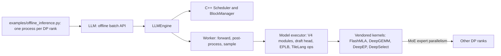

TODO(author): verify every claim against its source, then remove draft: true and this line.

DeepSeek says a single cluster running DeepInfer serves [155 trillion tokens a day](https://github.com/deepseek-ai/DeepInfer/blob/main/doc/inference_deployment_qa.md), and the same document says the KV cache store and the load balancers that make that possible are [not yet open-sourced](https://github.com/deepseek-ai/DeepInfer/blob/main/doc/inference_deployment_qa.md).

> Drafted with AI assistance, researched, verified and edited by the HastCode editorial team. We publish only as many pieces as the Author can verify this way.

## TL;DR

- DeepInfer is [the inference framework that powers DeepSeek's production services](https://github.com/deepseek-ai/DeepInfer#deepinfer), released as an offline inference engine under Apache 2.0.
- It is [derived from vLLM](https://github.com/deepseek-ai/DeepInfer/blob/main/deepinfer/engine/llm_engine.py) with DeepSeek's own kernels (FlashMLA, DeepGEMM, DeepEP, DeepSelect, TileLang), a C++ scheduler with [asynchronous, zero-overhead batch scheduling](https://github.com/deepseek-ai/DeepInfer#deepinfer), wide expert parallelism, DSpark speculative decoding and batch-invariant inference.
- It supports [one model, DeepSeek-V4.1-Flash, and two hardware targets, NVIDIA SM100 GPUs and Huawei Ascend 950 NPUs](https://github.com/deepseek-ai/DeepInfer#deepinfer).
- The release [leaves out the KV cache system, Vision Encoder/Prefill/Decode disaggregation and data-parallel load balancing](https://github.com/deepseek-ai/DeepInfer#deepinfer), and [has no online-serving wrapper](https://github.com/deepseek-ai/DeepInfer/blob/main/deepinfer/engine/llm_engine.py).
- Adopt it to run or benchmark V4.1 Flash on exactly that hardware, or to read how DeepSeek serves a MoE model. Wait if you need an API server, another model, or an older GPU.

## In 60 seconds

The [prerequisites](https://github.com/deepseek-ai/DeepInfer#prerequisites) are Linux, GCC 13 or newer, Python 3.12, and CUDA 13 (NVIDIA) or CANN 9.2 (Ascend), inside an empty, activated Python 3.12 environment. The first commands come from [Build from source](https://github.com/deepseek-ai/DeepInfer#build-from-source): `build.sh` installs the platform requirements, builds the vendored kernel submodules and the in-tree extension. The last line, from [Offline inference](https://github.com/deepseek-ai/DeepInfer#offline-inference), downloads the default checkpoint, `deepseek-ai/DeepSeek-V4.1-Flash-1017`, into the Hugging Face cache on first run; set `DEEPINFER_HF_MODEL_DIR` to use a local copy.

```sh
# Use `ascend` instead for the Ascend platform
# Keep it exported in the environment where you run DeepInfer
export DEEPINFER_ACCELERATOR=nvidia
./build.sh

python examples/offline_inference.py
```

## Architecture

The open-sourced engine is one data-parallel rank of the production system. Walk the diagram left to right. The example script [launches one process per DP rank](https://github.com/deepseek-ai/DeepInfer/blob/main/examples/README.md) and constructs an [`LLM`](https://github.com/deepseek-ai/DeepInfer/blob/main/deepinfer/entrypoints/llm.py), the offline batch API: it tokenizes prompts, adds requests and loops on `step()`. `LLM` wraps [`LLMEngine`](https://github.com/deepseek-ai/DeepInfer/blob/main/deepinfer/engine/llm_engine.py), whose docstring says this release includes no online-serving wrapper.

Each step calls the [C++ `Scheduler`](https://github.com/deepseek-ai/DeepInfer/blob/main/csrc/engine/scheduler.hpp), bound into Python with pybind11, which owns a `BlockManager` for paged KV cache blocks and a second one for per-sequence state slots. It has three [engine types](https://github.com/deepseek-ai/DeepInfer/blob/main/deepinfer/engine/engine_type.py): `NORMAL`, `PROMPT` (prefill only) and `COMPLETION` (decode only), the halves of a disaggregated deployment.

The [`Worker`](https://github.com/deepseek-ai/DeepInfer/blob/main/deepinfer/worker/worker.py) runs forward, post-process and sample on one GPU; under zero-overhead scheduling the post-process of a decode step is deferred to overlap the next forward, so [the GPU never idles between steps](https://github.com/deepseek-ai/DeepInfer/blob/main/doc/inference_deployment_qa.md). The driver worker runs in the engine process; extra workers are spawned per context-parallel rank. The model executor holds the V4 modules, the draft-token head, the [expert-parallel load balancer](https://github.com/deepseek-ai/DeepInfer/blob/main/doc/inference_deployment_qa.md) and TileLang ops, and calls the kernels vendored as [git submodules](https://github.com/deepseek-ai/DeepInfer/blob/main/.gitmodules): FlashMLA, DeepGEMM, DeepEP and DeepSelect, with Ascend variants of the last two.

Around the engine, the [deployment Q&A](https://github.com/deepseek-ai/DeepInfer/blob/main/doc/inference_deployment_qa.md) describes what is not in the repository: an Entrypoint, DeepSeek Recipe for API encoding, Prefill, Decode and Vision Encoder load balancers, and a KV cache store on 3FS.



## Use it if

- You serve DeepSeek-V4.1-Flash on [NVIDIA SM100 GPUs or Huawei Ascend 950 NPUs](https://github.com/deepseek-ai/DeepInfer#deepinfer) and want the engine and kernels DeepSeek says it runs itself, rather than a general-purpose server's port of them.
- You need reproducible outputs: [batch-invariant inference and deterministic sampling](https://github.com/deepseek-ai/DeepInfer#deepinfer) are switches (`DEEPINFER_BATCH_INVARIANT=1`, a fixed `seq_seed`), on NVIDIA only.
- You run offline batch evaluation: the [`eval/` drivers](https://github.com/deepseek-ai/DeepInfer/blob/main/eval/README.md) for AIME 2026, HLE and GPQA Diamond sit on the offline batch API and ship reference Pass@1 figures to check a deployment is configured correctly.
- You are building a disaggregated deployment and want the engine half: the prefill-only and decode-only [engine types](https://github.com/deepseek-ai/DeepInfer/blob/main/deepinfer/engine/engine_type.py) exist, and the README says [most required engine functionality is already implemented](https://github.com/deepseek-ai/DeepInfer#deepinfer).

## Don't use it if

- You need an HTTP or OpenAI-compatible API: the release [has no online-serving wrapper](https://github.com/deepseek-ai/DeepInfer/blob/main/deepinfer/engine/llm_engine.py). Use vLLM or SGLang, which ship a server.
- You run any other model: the README lists [DeepSeek-V4.1-Flash alone](https://github.com/deepseek-ai/DeepInfer#deepinfer). Use vLLM or SGLang for a broad model catalogue.
- Your GPUs are Hopper or older: the README names [SM100 GPUs and Ascend 950 NPUs](https://github.com/deepseek-ai/DeepInfer#deepinfer), with [CUDA 13 or CANN 9.2](https://github.com/deepseek-ai/DeepInfer#prerequisites). Use vLLM or TensorRT-LLM on earlier NVIDIA generations.
- You expect a complete serving system: the [KV cache system, VE/Prefill/Decode disaggregation and data-parallel load balancing are not included](https://github.com/deepseek-ai/DeepInfer#deepinfer). Build them, or use a framework that ships a router.

## Alternatives

- [vLLM](https://docs.vllm.ai/): the engine DeepInfer was [originally built primarily on](https://github.com/deepseek-ai/DeepInfer#acknowledgments); it serves many model families on many GPU generations and includes an OpenAI-compatible server, at the cost of not being tuned for one model.
- [SGLang](https://github.com/sgl-project/sglang): a serving framework the README [names as an inspiration](https://github.com/deepseek-ai/DeepInfer#acknowledgments), with its own online server and router; choose it when you need a complete serving stack today.
- [TensorRT-LLM](https://github.com/NVIDIA/TensorRT-LLM): NVIDIA's own inference library, also [named in the README](https://github.com/deepseek-ai/DeepInfer#acknowledgments); NVIDIA GPUs only, no Ascend.

## FAQ

### Is DeepInfer production ready?

DeepInfer is the framework DeepSeek says [powers its production services](https://github.com/deepseek-ai/DeepInfer#deepinfer), but the open-source release is a week old, untagged, offline-only and [omits the KV cache system and load balancers](https://github.com/deepseek-ai/DeepInfer#deepinfer). Production-proven inside DeepSeek; not yet a production server for anyone else.

### Does DeepInfer have an OpenAI-compatible API server?

No. DeepInfer's [`LLMEngine` docstring](https://github.com/deepseek-ai/DeepInfer/blob/main/deepinfer/engine/llm_engine.py) says the release has no online-serving wrapper; API protocol conversion lives in the separate [deepseek-recipe](https://github.com/deepseek-ai/deepseek-recipe) project.

### Which models does DeepInfer support?

DeepInfer supports [DeepSeek-V4.1-Flash](https://github.com/deepseek-ai/DeepInfer#deepinfer) only; DeepSeek says [future DeepSeek models' inference code will land in DeepInfer](https://github.com/deepseek-ai/DeepInfer/blob/main/doc/inference_deployment_qa.md).

### Which GPUs does DeepInfer run on?

DeepInfer runs on [NVIDIA SM100 GPUs and Huawei Ascend 950 NPUs](https://github.com/deepseek-ai/DeepInfer#deepinfer), with [Linux, GCC 13, Python 3.12 and CUDA 13 or CANN 9.2](https://github.com/deepseek-ai/DeepInfer#prerequisites).

### How does DeepInfer compare to vLLM?

DeepInfer is [derived from vLLM](https://github.com/deepseek-ai/DeepInfer/blob/main/deepinfer/entrypoints/llm.py) and narrowed to one model, two hardware targets and offline inference, adding DeepSeek's kernels, [DSpark speculative decoding and batch-invariant inference](https://github.com/deepseek-ai/DeepInfer#deepinfer); vLLM keeps broad model support and an online server.

### Does DeepInfer support speculative decoding?

Yes. DeepInfer's [DSpark](https://github.com/deepseek-ai/DeepInfer#deepinfer) drafts tokens and verifies them by confidence; `DEEPINFER_ENABLE_MTP_VARLEN=1` enables it and `DEEPINFER_USE_NEXTN_DECODE` caps the draft length, five by default.

### What are the alternatives to DeepInfer?

The main alternatives to DeepInfer are vLLM (broad model and hardware support, an online server), SGLang (a full serving stack with a router) and TensorRT-LLM (NVIDIA's own library).

### How is DeepInfer licensed?

DeepInfer is [Apache License 2.0](https://github.com/deepseek-ai/DeepInfer/blob/main/LICENSE), released by DeepSeek-AI in the `deepseek-ai` GitHub organisation with a handful of contributors so far, as Signals shows.

## Verdict

DeepInfer is the most credible look yet at how a frontier lab serves a MoE model: DeepSeek's own kernels, a C++ scheduler that keeps the GPU busy between steps, and a deployment Q&A that explains the system around it. A week-old repository can promise that much and no more. It cannot promise API stability, an upgrade path, support for your model or your older GPUs, or the serving layer, because there is no release, no online server and the KV cache store and load balancers stay internal. We recommend it for teams on SM100 or Ascend 950 hardware who want to run or benchmark V4.1 Flash with the reference engine, and for engineers building inference systems who want to read a production one. We would not build a service on it yet. A tagged release with a changelog, an online-serving wrapper and a second supported model would change that answer.

## Sources

- [DeepInfer README](https://github.com/deepseek-ai/DeepInfer#readme)
- [DeepSeek V4.1 Flash inference deployment Q&A](https://github.com/deepseek-ai/DeepInfer/blob/main/doc/inference_deployment_qa.md)
- [DeepInfer examples README](https://github.com/deepseek-ai/DeepInfer/blob/main/examples/README.md)
- [DeepInfer evaluation README](https://github.com/deepseek-ai/DeepInfer/blob/main/eval/README.md)
- [`deepinfer/entrypoints/llm.py`](https://github.com/deepseek-ai/DeepInfer/blob/main/deepinfer/entrypoints/llm.py)
- [`deepinfer/engine/llm_engine.py`](https://github.com/deepseek-ai/DeepInfer/blob/main/deepinfer/engine/llm_engine.py)
- [`deepinfer/engine/engine_type.py`](https://github.com/deepseek-ai/DeepInfer/blob/main/deepinfer/engine/engine_type.py)
- [`deepinfer/worker/worker.py`](https://github.com/deepseek-ai/DeepInfer/blob/main/deepinfer/worker/worker.py)
- [`csrc/engine/scheduler.hpp`](https://github.com/deepseek-ai/DeepInfer/blob/main/csrc/engine/scheduler.hpp)
- [`.gitmodules`](https://github.com/deepseek-ai/DeepInfer/blob/main/.gitmodules)
- [DeepInfer LICENSE](https://github.com/deepseek-ai/DeepInfer/blob/main/LICENSE)
