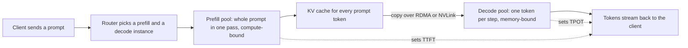

---
# Skeleton from Lead zkmxgotq (vLLM blog), picked 2026-10-27.
# published and reviewed are the pick time, provisional: set them
# when you publish. verified: is the Author's alone (ADR-0007).
title: "Disaggregated inference: why prefill and decode run on separate GPUs"
description: "Disaggregated inference runs LLM prefill and decode on separate GPUs and ships the KV cache between them, so TTFT and TPOT stop competing."
kind: concept
vertical: ai-ml-systems
tags: ["llm-inference", "kv-cache", "latency", "gpu", "vllm"]
published: "2026-10-28T12:54:21Z"
verified: 2026-10-28
reviewed: "2026-10-28T12:54:21Z"
author: mira-vance
# Optional: an image HastCode may use, beside this file, replaces the
# generated title card. Never a Source's image.
# hero: concept-name.png
# hero_alt: "What the image shows"
# Optional: related Explainer slugs and extra sources (title + url).
# related: [http-connection-reuse]
---

Put a 13-billion-parameter model on one 80 GB NVIDIA A100, ask that 90% of requests meet both a first-token deadline and a per-token deadline, and the GPU manages [about 1.6 requests per second](https://www.usenix.org/system/files/osdi24-zhong-yinmin.pdf). The DistServe team at Peking University, UC San Diego and StepFun measured that, then split the work. A GPU doing only the first phase of each request reached [5.6 requests per second, and one doing only the second reached 10](https://www.usenix.org/system/files/osdi24-zhong-yinmin.pdf). Two GPUs on the first phase and one on the second would, ideally, serve 10 requests per second: [3.3 per GPU, 2.1 times](https://www.usenix.org/system/files/osdi24-zhong-yinmin.pdf) what the shared GPU managed. The model was the same and so was the hardware. The two halves of every request had been getting in each other's way.

> Drafted with AI assistance, researched, verified and edited by the HastCode editorial team. We publish only as many pieces as the Author can verify this way.

## TL;DR

- **Disaggregated inference** runs the two phases of an LLM request, prefill and decode, on [separate GPUs](https://www.usenix.org/system/files/osdi24-zhong-yinmin.pdf), and copies the request's KV cache from the first to the second.
- It works because the phases want different hardware: prefill is [compute-bound, decode is bound by memory bandwidth](https://www.usenix.org/system/files/osdi24-zhong-yinmin.pdf), and on a shared GPU each [slows the other down](https://www.usenix.org/system/files/osdi24-zhong-yinmin.pdf). Split, each pool is tuned for its own target: time to first token (TTFT) for prefill, time per output token (TPOT) for decode.
- It pays at scale: DistServe served [up to 7.4 times more requests](https://www.usenix.org/system/files/osdi24-zhong-yinmin.pdf) within its latency targets, and Moonshot AI says its disaggregated platform lets Kimi [handle 75% more requests](https://arxiv.org/abs/2407.00079).
- The cost is the copy and its coordination. One 512-token request on OPT-66B carries [about 1.13 GB of KV cache](https://www.usenix.org/system/files/osdi24-zhong-yinmin.pdf), and how the copy is set up matters: vLLM's push-based transfer cut TTFT [about 3 times](https://vllm.ai/blog/2026-10-14-nixl-push-connector#performance-data) at 8 requests per second with 16k-token prompts.
- It is a latency tool, not a throughput one: vLLM's docs say it ["DOES NOT improve throughput"](https://docs.vllm.ai/en/latest/features/disagg_prefill/), and short prompts are often [better prefilled locally](https://docs.nvidia.com/dynamo/v-0-7-1/design-docs/disaggregated-serving).

## Prefill builds the cache, decode spends it

An LLM answers in two phases. **Prefill** processes the whole prompt in one step and produces the first output token; **decode** then generates the rest, [one token per step](https://www.usenix.org/system/files/osdi24-zhong-yinmin.pdf). Both phases produce the **KV cache**: intermediate state at every token position that later decode steps need again, so engines [keep it in GPU memory](https://www.usenix.org/system/files/osdi24-zhong-yinmin.pdf) rather than recompute it.

Two latency metrics follow. DistServe defines **TTFT** as the duration of the prefill phase and **TPOT** as [the average time to generate each token after the first](https://www.usenix.org/system/files/osdi24-zhong-yinmin.pdf). Splitwise tracks a close cousin, [time between tokens (TBT)](https://arxiv.org/abs/2311.18677), and vLLM's docs speak of [inter-token latency (ITL)](https://docs.vllm.ai/en/latest/features/disagg_prefill/).

DistServe's own one-line definition: it ["assigns prefill and decoding computation to different GPUs, hence eliminating prefill-decoding interferences"](https://www.usenix.org/system/files/osdi24-zhong-yinmin.pdf). A **prefill instance** runs only prefill and then [sends the KV cache to a decoding instance](https://www.usenix.org/system/files/osdi24-zhong-yinmin.pdf), which runs every later step. Each instance holds its own full copy of the model weights. Splitwise, from Microsoft and the University of Washington, made the same split, calling the phases [prompt computation and token generation](https://arxiv.org/abs/2311.18677); DistServe lists it as [concurrent work](https://www.usenix.org/system/files/osdi24-zhong-yinmin.pdf).

What does not count: **chunked prefill**, which cuts a long prompt into pieces and batches each piece with decode steps on the same GPU. It [reduces the interference but does not eliminate it](https://www.usenix.org/system/files/osdi24-zhong-yinmin.pdf). Adding identical replicas does not count either, because every replica still mixes both phases.

## One request, two pools, one copy

Walk the diagram from the left with DistServe's numbers. The **router** assigns each request; in vLLM's setup a [proxy routes requests](https://docs.vllm.ai/en/latest/features/nixl_connector_usage/) between the prefill and decode instances.

In the **prefill pool**, a 512-token prompt on the 13B model makes an A100 [near compute-bound](https://www.usenix.org/system/files/osdi24-zhong-yinmin.pdf). A GPU doing only this reached 5.6 requests per second within the latency target.

The **KV copy** is the new cost. The paper's sizing example uses a larger model: one 512-token request on OPT-66B carries [about 1.13 GB](https://www.usenix.org/system/files/osdi24-zhong-yinmin.pdf), so at 10 requests per second the link must move 11.3 GB a second, about 90 Gbps, to stay invisible. [InfiniBand at 800 Gbps or NVLink, at 600 GB/s between A100s,](https://www.usenix.org/system/files/osdi24-zhong-yinmin.pdf) covers that.

In the **decode pool**, each step processes one new token but moves about as much data through memory as prefill, so the GPU waits on [memory bandwidth](https://www.usenix.org/system/files/osdi24-zhong-yinmin.pdf). Decode often leaves the GPU underused, so one decoding instance can [serve several prefill instances](https://www.usenix.org/system/files/osdi24-zhong-yinmin.pdf). Here a decode-only GPU reached 10 requests per second.

Add it up: three GPUs, ten requests per second, 3.3 per GPU against 1.6 when the phases shared.

## Splitwise splits the hardware too

Microsoft's Splitwise team started from [production traces of two Azure LLM services](https://arxiv.org/abs/2311.18677), coding and conversation, taken on 11 November 2023, and released a subset in the [Azure Public Dataset](https://github.com/Azure/AzurePublicDataset). The traces showed how badly decode fills a GPU. On conversation, a machine spent [60 to 70% of its time running 20 tokens or fewer](https://arxiv.org/abs/2311.18677) in a batch. On BLOOM-176B, a 1,500-token prompt phase took [as long as generating just 6 output tokens](https://arxiv.org/abs/2311.18677).

Their conclusion, Insight VII: ["Token generation can be run on less compute-capable hardware"](https://arxiv.org/abs/2311.18677) for better performance per watt and per dollar. So Splitwise lets the pools differ. Splitwise-HA puts prompts on DGX-H100 machines and tokens on [DGX-A100s](https://arxiv.org/abs/2311.18677); Splitwise-HHcap power-caps the token machines to [70% of their rated power](https://arxiv.org/abs/2311.18677).

The payoff, against current designs: [up to 1.4 times the throughput at 20% lower cost](https://arxiv.org/abs/2311.18677), or 2.35 times the throughput for the same power and cost. Splitwise implemented its KV-cache transfer [on top of vLLM](https://arxiv.org/abs/2311.18677), which now ships disaggregated prefill as an [experimental feature](https://docs.vllm.ai/en/latest/features/disagg_prefill/) with several transfer connectors.

## Kimi and DeepSeek run it in production

Mooncake is [the serving platform for Kimi](https://arxiv.org/abs/2407.00079), Moonshot AI's LLM service, and it separates prefill and decoding clusters. A global scheduler called Conductor [selects a pair of prefill and decoding instances](https://arxiv.org/abs/2407.00079) for each request, then the prefill runs in chunks or layers and streams its KV cache to the chosen decoder. Mooncake also pools the cluster's spare CPU, DRAM and SSD as a [disaggregated cache of KV cache](https://arxiv.org/abs/2407.00079), and because it must cope with heavy overload, it [rejects some requests early](https://arxiv.org/abs/2407.00079) when no decoding slot will be free after prefill. Under real workloads, the architecture lets Kimi [handle 75% more requests](https://arxiv.org/abs/2407.00079).

DeepSeek's V3 and R1 service has [adopted prefill-decode disaggregation](https://github.com/deepseek-ai/open-infra-index/blob/main/202502OpenSourceWeek/day_6_one_more_thing_deepseekV3R1_inference_system_overview.md) and runs each phase with its own parallelism. A prefill deployment unit spans 4 nodes with routed experts spread 32 ways (EP32); a decode unit spans 18 nodes at EP144. Over 24 hours from noon on 27 February 2025 (UTC+8), each H800 node averaged about [73.7k input tokens a second in prefill, counting cache hits, or 14.8k output tokens a second in decode](https://github.com/deepseek-ai/open-infra-index/blob/main/202502OpenSourceWeek/day_6_one_more_thing_deepseekV3R1_inference_system_overview.md). Of 608B input tokens, [56.3% hit the on-disk KV cache](https://github.com/deepseek-ai/open-infra-index/blob/main/202502OpenSourceWeek/day_6_one_more_thing_deepseekV3R1_inference_system_overview.md).

## Why serving systems end up splitting the phases

The pressure comes from a feature that helps on a normal day. **Continuous batching** puts the prefill of new requests in the same batch as the decode steps of ongoing ones. It [raises GPU utilisation and total throughput](https://www.usenix.org/system/files/osdi24-zhong-yinmin.pdf), and current serving systems use it.

The price is interference. DistServe measured that adding [a single prefill job to a batch of decoding requests](https://www.usenix.org/system/files/osdi24-zhong-yinmin.pdf) slows both: the decode steps wait for the longer prefill, so TPOT stretches, and the slowdown grows with prompt length. Scheduling the phases one after the other does not help, because decode jobs then [queue behind prefill jobs](https://www.usenix.org/system/files/osdi24-zhong-yinmin.pdf) and prioritising either phase hurts the other.

Chunked prefill is the colocated fix, and it trades rather than solves. The paper says it [trades TTFT for TPOT](https://www.usenix.org/system/files/osdi24-zhong-yinmin.pdf), and splitting a prompt into N chunks means loading O(N²) chunks of KV cache instead of O(N). vLLM's docs add that ["in practice it's hard to figure out the correct chunk size value"](https://docs.vllm.ai/en/latest/features/disagg_prefill/), and call disaggregation "a much more reliable way to control tail ITL."

Sharing also couples the settings. Prefill gains from [splitting each operator across GPUs](https://www.usenix.org/system/files/osdi24-zhong-yinmin.pdf) to cut TTFT, while decode's best layout depends on its batch size. Long contexts make all of this worse: the KV cache [grows linearly with the prompt but prefill compute grows quadratically](https://www.usenix.org/system/files/osdi24-zhong-yinmin.pdf), so the copy shrinks relative to prefill while the gap between the phases widens.

## Practice one: size each pool for its own latency target

Once the phases are apart, the first job is to decide how many GPUs each gets and how each is parallelised. Given TTFT and TPOT targets, DistServe searches for the GPU count and parallelism of each phase that [maximise per-GPU goodput](https://www.usenix.org/system/files/osdi24-zhong-yinmin.pdf), the highest request rate that still meets the targets, then replicates that unit until it covers the traffic. It also places instances by bandwidth: prefill and decode segments of the same pipeline stage share a node, so the copy [travels only over NVLink](https://www.usenix.org/system/files/osdi24-zhong-yinmin.pdf).

Splitwise sizes clusters with a simulator. For its coding workload on DGX-H100s, the cheapest cluster that reached 70 requests per second had [27 prompt machines and 3 token machines](https://arxiv.org/abs/2311.18677). DeepSeek's EP32 prefill and EP144 decode units are the same principle in production.

The costs: each instance [keeps its own copy of the model weights](https://www.usenix.org/system/files/osdi24-zhong-yinmin.pdf), and a plan tuned to one workload goes stale when the mix shifts, so DistServe runs a workload profiler and [replans periodically](https://www.usenix.org/system/files/osdi24-zhong-yinmin.pdf). With only a few GPUs, or one, the authors say the design space is [significantly limited](https://www.usenix.org/system/files/osdi24-zhong-yinmin.pdf) and a colocated system may be simpler.

## Practice two: overlap the copy with prefill

A naive copy waits for prefill to finish. In Splitwise's design the prompt machine produces the first token, so a [serialized transfer](https://arxiv.org/abs/2311.18677) lands on the second token's latency instead.

Splitwise overlaps the two. At the end of each layer, it starts an [asynchronous transfer of that layer's KV cache](https://arxiv.org/abs/2311.18677) while the next layer computes. On its test machines, what stayed visible was a near-constant [8 ms on A100s and 5 ms on H100s](https://arxiv.org/abs/2311.18677), whose links run at 200 and 400 Gbps. On the coding trace, serialized transfer cost up to 3% of end-to-end latency; layer-wise cost [0.8%, and added 16.5% to the second token instead of 64%](https://arxiv.org/abs/2311.18677). Mooncake's prefill likewise [streams KV cache as it goes](https://arxiv.org/abs/2407.00079).

The cost is synchronisation. Per-layer transfer needs fine-grained coordination that can [interfere with prefill and raise TTFT](https://arxiv.org/abs/2311.18677) for small prompts, so Splitwise sends small prompts serially and large ones layer by layer.

Placement does the rest. With the prefill and decode segments of each pipeline stage kept on one machine, DistServe's KV transmission for OPT-175B was [under 0.1% of total latency](https://www.usenix.org/system/files/osdi24-zhong-yinmin.pdf), and over 95% of requests spent under 30 ms in transmission, on a testbed whose nodes were linked at only [25 Gbps](https://www.usenix.org/system/files/osdi24-zhong-yinmin.pdf).

## Practice three: choose who starts the copy, push or pull

The papers show the bytes are cheap. vLLM's October 2026 benchmark shows the bookkeeping around them is not. Its default NIXL connector [pulls](https://vllm.ai/blog/2026-10-14-nixl-push-connector): after prefill, the router relays the prefill block IDs to the decode instance, which then allocates blocks, prepares the transfer and issues a NIXL read. All of that runs serially between prefill and decoding.

The push connector, by Sunita Nadampalli of AWS and Nicolò Lucchesi of Mistral, reverses it. The decode instance [registers its destination blocks](https://vllm.ai/blog/2026-10-14-nixl-push-connector) as soon as it allocates them, while prefill is still running, and the prefill side writes the KV cache straight into them from a background thread.

On Qwen3-32B, one prefill and one decode node of 8 H200s each, prompts up to 16k tokens: at 8 requests per second and 16k, pull's TTFT reached about [1,744 ms and push's about 540 ms](https://vllm.ai/blog/2026-10-14-nixl-push-connector#performance-data). At 4 to 8 requests per second and 16k, TPOT went from about 10.4 ms to near 7. At light load the two were almost identical. The authors trace the gap to pull [posting transfer descriptors inline on the decode worker](https://vllm.ai/blog/2026-10-14-nixl-push-connector#performance-data), stalling token generation. We infer the lesson: the copy's setup had reintroduced, in miniature, the interference that disaggregation removes.

The cost: push [picks the decode instance earlier](https://vllm.ai/blog/2026-10-14-nixl-push-connector), giving up load-aware routing after prefill. DistServe chose pull on purpose, using prefill GPU memory as [a queuing buffer](https://www.usenix.org/system/files/osdi24-zhong-yinmin.pdf) so bursts do not overload decoders' memory.

## Practice four: keep short or cached prompts local

Splitting every request is not always the cheapest choice. NVIDIA's Dynamo design notes that ["if the prefill is short or the decode engine has a high prefix cache hit"](https://docs.nvidia.com/dynamo/v-0-7-1/design-docs/disaggregated-serving), it is often more efficient to prefill locally on the decode engine, skipping the copy entirely.

Dynamo's **conditional disaggregation** makes that a per-request routing decision. The router either sends a request through a prefill worker, or [straight to a decode worker](https://docs.nvidia.com/dynamo/dev/advanced-customizations/conditional-disaggregation) that runs both phases. The key quantity is **effective input length**: the prompt minus the prefix tokens already cached on the chosen decode worker. One policy keeps a request local when that length is under a threshold, 2,048 tokens by default, and also under a fraction of the raw prompt, 0.7 by default; another sends work local when the prefill worker is busy. The target is long prompts with heavy cache reuse, such as multi-turn and agentic conversations, while avoiding what the docs call ["the heavy ITL penalty"](https://docs.nvidia.com/dynamo/dev/advanced-customizations/conditional-disaggregation) of big prefills on decode workers.

The cost: the router must track every decode worker's cache, which needs KV events from the backends, and NVIDIA marks the feature [experimental](https://docs.nvidia.com/dynamo/dev/advanced-customizations/conditional-disaggregation), to be tuned against your own workload.

## What disaggregated inference is not

It is not a throughput upgrade. vLLM's docs are blunt that it ["DOES NOT improve throughput"](https://docs.vllm.ai/en/latest/features/disagg_prefill/). What it buys is the ability to tune TTFT and ITL separately. DistServe's authors agree that for offline jobs where latency matters less, [chunked prefill may be preferred](https://www.usenix.org/system/files/osdi24-zhong-yinmin.pdf), because it fills every batch to the compute-bound threshold.

It is not model or expert parallelism either. Those split one model across GPUs within a phase; disaggregation splits the phases. DeepSeek uses both at once, with [different expert-parallel sizes](https://github.com/deepseek-ai/open-infra-index/blob/main/202502OpenSourceWeek/day_6_one_more_thing_deepseekV3R1_inference_system_overview.md) on each side of the split.

And it is not KV cache tiering. Mooncake pairs the split with a [pool of cached KV in spare CPU, DRAM and SSD](https://arxiv.org/abs/2407.00079), and DeepSeek reports hits on an on-disk cache, but vLLM lists an [offloading connector](https://docs.vllm.ai/en/latest/features/disagg_prefill/) beside its transfer connectors. We infer that the two ideas are separable: you can reuse cached KV without splitting the phases, and split them without a shared cache. Tiered KV caching deserves its own Explainer.

## What understanding it makes possible

Once you see the two phases, you stop reading a serving benchmark's tokens per second as the whole story. Measure TTFT and TPOT separately, at the percentile your users feel, and count [per-GPU goodput](https://www.usenix.org/system/files/osdi24-zhong-yinmin.pdf): the requests per second that meet both targets for each GPU you pay for. That number says whether a split, a chunk size or a routing policy is worth it on your workload.

You can try it. vLLM's post ships [scripts to rerun its push-versus-pull sweep](https://vllm.ai/blog/2026-10-14-nixl-push-connector), switching modes with a single connector setting. DistServe's [code is public](https://github.com/LLMServe/DistServe), and Splitwise's [Azure traces](https://github.com/Azure/AzurePublicDataset) give you real prompt and output lengths to drive it.

The optimistic part is that the split lets hardware match the work. Token generation can run on [cheaper or power-capped GPUs](https://arxiv.org/abs/2311.18677), prefill can get the fastest ones, and as contexts grow toward millions of tokens, DistServe's authors argue the approach [stays promising](https://www.usenix.org/system/files/osdi24-zhong-yinmin.pdf) because prefill compute outgrows the copy.

## Sources

- Sunita Nadampalli, Nicolò Lucchesi, ["Push-Based KV Transfer to Improve TTFT and TPOT for Disaggregated Inference in vLLM"](https://vllm.ai/blog/2026-10-14-nixl-push-connector), vLLM blog, 14 October 2026.
- Yinmin Zhong, Shengyu Liu, Junda Chen, Jianbo Hu, Yibo Zhu, Xuanzhe Liu, Xin Jin, Hao Zhang, ["DistServe: Disaggregating Prefill and Decoding for Goodput-optimized Large Language Model Serving"](https://www.usenix.org/system/files/osdi24-zhong-yinmin.pdf), OSDI 2024 ([code](https://github.com/LLMServe/DistServe)).
- Pratyush Patel, Esha Choukse, Chaojie Zhang, Aashaka Shah, Íñigo Goiri, Saeed Maleki, Ricardo Bianchini, ["Splitwise: Efficient generative LLM inference using phase splitting"](https://arxiv.org/abs/2311.18677), arXiv:2311.18677v2, May 2024 ([Azure Public Dataset](https://github.com/Azure/AzurePublicDataset)).
- Ruoyu Qin, Zheming Li, Weiran He, Mingxing Zhang, Yongwei Wu, Weimin Zheng, Xinran Xu, ["Mooncake: A KVCache-centric Disaggregated Architecture for LLM Serving"](https://arxiv.org/abs/2407.00079), Moonshot AI and Tsinghua University, arXiv:2407.00079v5, 8 October 2026.
- DeepSeek, ["Day 6: One More Thing, DeepSeek-V3/R1 Inference System Overview"](https://github.com/deepseek-ai/open-infra-index/blob/main/202502OpenSourceWeek/day_6_one_more_thing_deepseekV3R1_inference_system_overview.md), open-infra-index, February 2025.
- vLLM, ["Disaggregated Prefilling (experimental)"](https://docs.vllm.ai/en/latest/features/disagg_prefill/), vLLM documentation.
- vLLM, ["NixlConnector Usage Guide"](https://docs.vllm.ai/en/latest/features/nixl_connector_usage/), vLLM documentation.
- NVIDIA, ["Dynamo Disaggregation: Separating Prefill and Decode for Enhanced Performance"](https://docs.nvidia.com/dynamo/v-0-7-1/design-docs/disaggregated-serving), Dynamo documentation, v0.7.1.
- NVIDIA, ["Conditional Disaggregation"](https://docs.nvidia.com/dynamo/dev/advanced-customizations/conditional-disaggregation), Dynamo documentation, development version.
