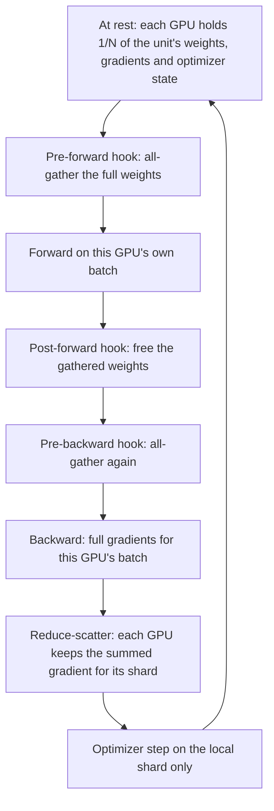

---
# Skeleton from Lead ogz6tyqu (PyTorch blog), picked 2026-10-29.
# Drafted per docs/editorial/concept-writing-guide.md. published and
# reviewed are the pick time, provisional: set them when you publish.
# verified: is the Author's alone (ADR-0007).
title: "Fully sharded data parallelism: training models no GPU can hold"
description: "Fully sharded data parallelism splits a model's weights, gradients and optimizer state across GPUs and gathers each layer only while it runs."
kind: concept
vertical: ai-ml-systems
tags: ["fsdp", "pytorch", "distributed-training", "gpu-memory", "data-parallelism"]
published: "2026-10-29T19:25:23Z"
reviewed: "2026-10-29T19:25:23Z"
author: mira-vance
# Optional: an image HastCode may use, beside this file, replaces the
# generated title card. Never a Source's image.
# hero: concept-name.png
# hero_alt: "What the image shows"
related: [expert-parallelism, meta-prometheus-supercluster]
draft: true
---

[PyTorch 2.15 shipped on 28 October 2026](https://github.com/pytorch/pytorch/releases/tag/v2.15.0) with a one-line note under backwards-incompatible changes: ["FSDP2 separates sharded and unsharded gradient dtypes."](https://pytorch.org/blog/pytorch-2-15-release-blog/) The pull request behind it spells out what that means for the most common setup, fp32 weights trained in bf16. Before, gradients were reduced in bf16. After, they are reduced in fp32, which the author marks as ["2x reduce-scatter bytes"](https://github.com/pytorch/pytorch/pull/194434). The same release lets precision-sensitive weights such as [MoE router gates and norm weights stay in fp32](https://pytorch.org/blog/pytorch-2-15-release-blog/) while the rest of the model runs in bf16, "still with one all-gather per `fully_shard`". Why would the data type of a gradient double the traffic of a training job? Because under FSDP no GPU keeps the whole model. Every step, every layer's weights are gathered from all the GPUs and every gradient is scattered back, so the bytes per number decide how much crosses the network.

> Drafted with AI assistance, researched, verified and edited by the HastCode editorial team. We publish only as many pieces as the Author can verify this way.

## TL;DR

- **Fully sharded data parallelism** (FSDP) is data-parallel training in which each GPU keeps only a shard of the model: PyTorch's `fully_shard` ["shards module parameters, gradients, and optimizer states across data parallel workers to save memory at the cost of communication"](https://docs.pytorch.org/docs/2.15/distributed.fsdp.fully_shard.html#torch.distributed.fsdp.fully_shard).
- Each layer group is **all-gathered** just before its forward and backward, freed right after, and its gradients are **reduce-scattered** so each GPU keeps only its share: in PyTorch's words, ["a decomposition of DDP's all-reduce into reduce-scatter and all-gather"](https://docs.pytorch.org/tutorials/intermediate/FSDP_tutorial.html#how-fsdp2-works).
- The saving is large. The ZeRO paper puts a 7.5B-parameter model at [120 GB of model state per GPU with plain data parallelism and 1.9 GB sharded 64 ways](https://ar5iv.labs.arxiv.org/html/1910.02054#S5.T1), and PyTorch's FSDP trained GPT-175B at [more than 173 TFLOPS per GPU](https://arxiv.org/html/2304.11277v2#S5.SS4).
- The cost is network traffic, [1.5x that of DDP](https://arxiv.org/html/2304.11277v2#S3.SS2.SSS1). The practices are about hiding and trimming it: wrap per layer so gathers overlap compute, choose when to reshard, and gather in low precision while reducing in high.

## What fully sharded data parallelism is

Start with plain **data parallelism**. In PyTorch's DistributedDataParallel (DDP), [each rank owns a model replica](https://docs.pytorch.org/tutorials/intermediate/FSDP_tutorial.html#how-fsdp2-works), processes its own batch, and uses an **all-reduce** to sync gradients. A **rank** is one worker process, usually one GPU. Every rank ends the step with the same weights, which is simple and wasteful: N GPUs hold N identical copies.

The ZeRO paper, by Samyam Rajbhandari and colleagues, named that waste. Its method ["eliminates memory redundancies in data- and model-parallel training"](https://arxiv.org/abs/1910.02054) by partitioning the **model states**, meaning parameters, gradients and optimizer state, instead of replicating them. PyTorch's FSDP, described by its Meta AI authors in a [PVLDB 2023 paper](https://arxiv.org/html/2304.11277v2), and its rewrite, FSDP2, are PyTorch's implementation of that idea.

In our words: FSDP keeps the data-parallel programming model, where each GPU runs the whole model on its own slice of the batch, but stores only 1/N of the model on each GPU between uses. Two collectives make that work. An **all-gather** gives every rank the full tensor assembled from everyone's shards. A **reduce-scatter** sums a tensor across ranks and leaves each rank only its slice of the sum.

What does not count: splitting one layer's computation across GPUs. That is tensor, pipeline or expert parallelism, and a later section draws the line.

## One layer group's round trip: gather, compute, free, scatter

The diagram is ours, drawn from PyTorch's [user contract for `fully_shard`](https://docs.pytorch.org/docs/2.15/distributed.fsdp.fully_shard.html#pytorch-fsdp2-fully-shard); the tutorial's own figure is in [the original](https://docs.pytorch.org/tutorials/intermediate/FSDP_tutorial.html#how-fsdp2-works). Walk it from the top.

At rest, `fully_shard` has turned each parameter into a **DTensor**, PyTorch's distributed tensor, [sharded on dim-0](https://docs.pytorch.org/docs/2.15/distributed.fsdp.fully_shard.html#torch.distributed.fsdp.fully_shard): each rank holds a slice of rows. A pre-forward hook all-gathers the unit's parameters into plain tensors, the forward runs, and a post-forward hook [frees the unsharded parameters, with no communication needed](https://docs.pytorch.org/docs/2.15/distributed.fsdp.fully_shard.html#pytorch-fsdp2-fully-shard).

Backward repeats the gather, computes this rank's gradients, then reduce-scatters them, so each rank holds the summed gradient for exactly the rows it owns. The optimizer [must be initialized with the DTensor parameters](https://docs.pytorch.org/docs/2.15/distributed.fsdp.fully_shard.html#pytorch-fsdp2-fully-shard) and steps only on the local shard, which is why its state is sharded too.

The FSDP paper sums up the result: memory is ["proportional to the size of the sharded model plus the size of the largest fully-materialized FSDP unit"](https://arxiv.org/html/2304.11277v2#S3).

## The arithmetic: 120 GB becomes 1.9 GB

The ZeRO paper puts numbers on the "at rest" box. Mixed-precision training with the Adam optimizer, for a model with Ψ parameters, needs [2Ψ + 2Ψ + KΨ = 16Ψ bytes](https://ar5iv.labs.arxiv.org/html/1910.02054): 2 bytes per parameter for 16-bit weights, 2 for 16-bit gradients, and K = 12 for the optimizer's state, which includes a 32-bit copy of the weights. The weights you think of as "the model" are an eighth of it. A 1.5B-parameter GPT-2 needs [3 GB for its 16-bit weights](https://ar5iv.labs.arxiv.org/html/1910.02054) and at least 24 GB of model state in total.

Take the paper's 7.5B-parameter model across 64 GPUs. With plain data parallelism, every GPU holds all 16 bytes per parameter: [120 GB](https://ar5iv.labs.arxiv.org/html/1910.02054#S5.T1). ZeRO then shards in three stages. Sharding the optimizer state brings it to [31.4 GB](https://ar5iv.labs.arxiv.org/html/1910.02054#S5.T1). Sharding gradients too brings it to 16.6 GB. Sharding the parameters as well, which is what FSDP's full sharding does, brings it to [1.88 GB](https://ar5iv.labs.arxiv.org/html/1910.02054#S5.T1). The last number is 120 GB divided by 64, because nothing is replicated any more.

On top of the shard sits the gathered unit. The paper's peak-memory term is the [largest FlatParameter](https://arxiv.org/html/2304.11277v2#S3.SS2.SSS1), the biggest group gathered at once. We infer the practical reading: for a transformer wrapped per layer, the peak is the shard plus roughly one or two full layers, depending on how far ahead the next gather is issued.

## Where it shows up: ZeRO, FSDP1 and FSDP2

**ZeRO** came first. Its authors report training models of [over 100B parameters with super-linear speedup on 400 GPUs](https://arxiv.org/abs/1910.02054), and models of up to 13B parameters with no model parallelism at all.

**FSDP1**, `FullyShardedDataParallel`, is the version in the PVLDB paper. It ran on up to [512 A100 80GB GPUs](https://arxiv.org/html/2304.11277v2#S5.SS1). On T5, [DDP ran out of memory above 2.28B parameters](https://arxiv.org/html/2304.11277v2#S5.SS2) while FSDP trained the 11B model. GPT-175B reached [more than 173 and 186 TFLOPS per GPU](https://arxiv.org/html/2304.11277v2#S5.SS4) at batch sizes 1 and 2, about 55% and 60% of the A100's BF16 peak, scaling linearly from 128 to 512 GPUs. For a recommendation model with 768B sparse parameters, FSDP handled [the 550M dense parameters](https://arxiv.org/html/2304.11277v2#S5.SS1).

**FSDP2**, `fully_shard`, is the rewrite the 2.15 release changes. Andrew Gu's November 2023 RFC traced FSDP1's limits ["mainly from the _flat parameter_ construct"](https://github.com/pytorch/pytorch/issues/114299). FSDP1 [flattens, concatenates and chunks a group of tensors together](https://docs.pytorch.org/docs/2.15/distributed.fsdp.fully_shard.html#pytorch-fsdp2-fully-shard), so it is hard to say which rows of which weight a rank holds. FSDP2 chunks each parameter on its own. That allows frozen and trainable weights in one group, [communication-free sharded state dicts](https://docs.pytorch.org/tutorials/intermediate/FSDP_tutorial.html#how-fsdp2-works) and custom all-gathers such as float8. The RFC's tracker counts [about 3k lines of non-test code against about 14k](https://github.com/pytorch/pytorch/issues/114299) for FSDP1.

## Why training jobs end up sharded

The first force is that the model state outgrows the GPU before the compute does. Of ZeRO's 16 bytes per parameter, [12 are optimizer state](https://ar5iv.labs.arxiv.org/html/1910.02054): an fp32 copy of the weights, momentum and variance, 4 bytes each, so a model whose 16-bit weights fit comfortably on one GPU can still overflow it once Adam's state is counted. The T5 runs show the cliff: [similar throughput for DDP and FSDP at 611M and 2.28B parameters](https://arxiv.org/html/2304.11277v2#S5.SS2), then out-of-memory for DDP.

The second force is that data parallelism is the easiest kind to live with. Each GPU runs unmodified model code on its own batch. FSDP2 keeps that promise: `fully_shard` [registers hooks instead of wrapping the module](https://docs.pytorch.org/docs/2.15/distributed.fsdp.fully_shard.html#pytorch-fsdp2-fully-shard), so parameter names in the state dict stay the same, and `clip_grad_norm_` works on the sharded parameters [to preserve the single device semantic](https://docs.pytorch.org/tutorials/intermediate/FSDP_tutorial.html#gradient-clipping-and-optimizer-with-dtensor).

The third is that the extra traffic can be hidden. FSDP issues its all-gathers on [a separate CUDA stream](https://arxiv.org/html/2304.11277v2#S3.SS3.SSS1) so they overlap computation. We infer the consequence: a hidden collective costs memory, not time, as long as the compute beside it is long enough to cover it. The FSDP paper's full sharding has [the lowest memory footprint but the most communication](https://arxiv.org/html/2304.11277v2#S3.SS2.SSS1), and most of the engineering since has gone into making that communication invisible.

## Practice one: wrap each layer so gathers overlap compute

PyTorch's docs are blunt about the default. If you call `fully_shard` only on the root, all communication happens ["as two large blocking operations with no overlap with compute. This is almost never what you want."](https://docs.pytorch.org/docs/2.15/distributed.fsdp.fully_shard.html#communication-grouping-and-scheduling)

Each `fully_shard` call creates one **communication group**, all-gathered in one collective and reduce-scattered in one. FSDP2 has [no `bucket_cap_mb`](https://docs.pytorch.org/docs/2.15/distributed.fsdp.fully_shard.html#communication-grouping-and-scheduling): the groups are the modules you wrap. So you apply it bottom-up, [to each transformer layer before the root](https://docs.pytorch.org/docs/2.15/distributed.fsdp.fully_shard.html#pytorch-fsdp2-fully-shard). All-gathers then run on a separate stream, and because the CPU runs ahead of the GPU, [layer i+1's gather overlaps layer i's compute](https://docs.pytorch.org/tutorials/intermediate/FSDP_tutorial.html#forward-backward-with-prefetching). In backward, FSDP2 also prefetches the next gather and runs reduce-scatters on their own stream, [with no extra configuration](https://docs.pytorch.org/docs/2.15/distributed.fsdp.fully_shard.html#communication-grouping-and-scheduling).

Prefetching pays. On GPT-175B, FSDP1's backward prefetching gave [approximately 18% speedup](https://arxiv.org/html/2304.11277v2#S5.SS2). When the CPU's lead is thin, `set_modules_to_forward_prefetch` issues gathers earlier; a longer list overlaps more [at the cost of more memory](https://docs.pytorch.org/docs/2.15/distributed.fsdp.fully_shard.html#torch.distributed.fsdp.FSDPModule.set_modules_to_forward_prefetch).

The costs: finer groups mean more, smaller collectives. The paper found that once each all-gather falls [below 33M elements, total communication time begins increasing rapidly](https://arxiv.org/html/2304.11277v2#S3.SS2.SSS1), and calls the result a memory-throughput trade-off. Each prefetched layer, we infer, is another full layer in memory.

## Practice two: choose when to reshard

The parameter `reshard_after_forward` sets the trade between memory and traffic for each group. With `True`, FSDP frees the gathered weights after forward and [re-all-gathers in backward](https://docs.pytorch.org/docs/2.15/distributed.fsdp.fully_shard.html#torch.distributed.fsdp.fully_shard). With `False`, it keeps them until backward and skips that second gather. The default is `True` for inner modules and `False` for the root, ["because the root module is typically required immediately when the backward pass begins"](https://docs.pytorch.org/docs/2.15/distributed.fsdp.fully_shard.html#torch.distributed.fsdp.fully_shard). An integer is [the world size to reshard to after forward](https://docs.pytorch.org/docs/2.15/distributed.fsdp.fully_shard.html#torch.distributed.fsdp.fully_shard), so the backward all-gather runs over a smaller world size, at the cost of more memory than `True`.

The bigger version of the same trade is **hybrid sharding**. The FSDP paper defines a **sharding factor** F: F = 1 is plain replication and F equal to the world size is full sharding. Values in between [shard within groups and replicate across them](https://arxiv.org/html/2304.11277v2#S3.SS2.SSS2), and gradients are reduce-scattered within each group, then all-reduced across groups. The paper says this can use datacenter locality and [reduce cross host traffic](https://arxiv.org/html/2304.11277v2#S3.SS2.SSS2). In FSDP2 you get it by passing a 2D device mesh, which gives [`(Replicate(), Shard(0))` placement](https://docs.pytorch.org/docs/2.15/distributed.fsdp.fully_shard.html#torch.distributed.fsdp.fully_shard), known as HSDP.

The costs: `False` and smaller shard groups both raise peak memory. The paper calls hybrid sharding a ["graduating trade-off between memory saving and throughput degradation"](https://arxiv.org/html/2304.11277v2#S3.SS2.SSS2), suited to models that only slightly overflow a GPU.

## Practice three: gather in low precision, reduce in high

FSDP's mixed precision differs from autocast. Parameter casting happens [when parameters are all-gathered](https://docs.pytorch.org/docs/2.15/distributed.fsdp.fully_shard.html#torch.distributed.fsdp.MixedPrecisionPolicy), so a bf16 `param_dtype` halves the gather's bytes. And because the sharded fp32 parameters are kept anyway, FSDP ["does not require any extra memory to keep a high-precision copy"](https://docs.pytorch.org/docs/2.15/distributed.fsdp.fully_shard.html#torch.distributed.fsdp.MixedPrecisionPolicy) for the optimizer step.

Gradients go the other way. The tutorial's example sets `reduce_dtype=torch.float32`, because gradients can vary a lot from rank to rank and ["reducing gradients in float32 can be critical for numerics"](https://docs.pytorch.org/tutorials/intermediate/FSDP_tutorial.html#enabling-mixed-precision). In 2.15 that became the default for fp32 parameters: with `reduce_dtype=None`, gradients now follow each parameter's `grad_dtype`, and [`reduce_dtype=torch.bfloat16` keeps the previous behaviour](https://docs.pytorch.org/docs/2.15/distributed.fsdp.fully_shard.html#torch.distributed.fsdp.MixedPrecisionPolicy).

The new `param_dtype_override_fn` keeps chosen weights in fp32 inside a bf16 group. The pull request groups staging copies by dtype and reuses the existing uint8 communication buffer, [keeping only one AG per fully_shard](https://github.com/pytorch/pytorch/pull/196626). On a 1.75B-parameter test model, gather copy-in was 4.2 to 4.9% slower while forward plus backward stayed at [approximately 53 ms](https://github.com/pytorch/pytorch/pull/196626).

The costs: fp32 reduction doubles reduce-scatter bytes, and the override must return the same answer on every rank, or ranks [build incompatible buffers that can fail or hang](https://docs.pytorch.org/docs/2.15/distributed.fsdp.fully_shard.html#torch.distributed.fsdp.MixedPrecisionPolicy).

## What fully sharded data parallelism is not

It is not model parallelism. Under FSDP every GPU still runs every layer, in full, on its own batch; the layer is only stored in pieces. Tensor and pipeline parallelism split the computation itself, and [expert parallelism](/ai-ml-systems/expert-parallelism/) gives each GPU whole experts of a mixture-of-experts model and moves tokens to them. FSDP moves weights to the data; those move data to the weights. We infer that boundary from the [user contract](https://docs.pytorch.org/docs/2.15/distributed.fsdp.fully_shard.html#pytorch-fsdp2-fully-shard), which all-gathers parameters into plain tensors before any compute. The styles combine: 2.15's pipelining [staggers FSDP unshards across each rank's startup bubble](https://pytorch.org/blog/pytorch-2-15-release-blog/).

It is not offloading either. `CPUOffloadPolicy` is a separate option that moves the shards to host memory and [runs the optimizer step on CPU](https://docs.pytorch.org/docs/2.15/distributed.fsdp.fully_shard.html#torch.distributed.fsdp.CPUOffloadPolicy); sharding alone keeps everything on the GPUs.

And it is not free memory. The full layer still exists, briefly, on every GPU, which is why the peak is the shard plus the largest unit, not the shard alone.

## What understanding FSDP makes possible

Once you see the round trip, the knobs stop being folklore. A job slower than its FLOPs suggest may be waiting on gathers: check the wrapping before buying bandwidth. A job that runs out of memory at the peak rather than at rest has a unit too large, or too much prefetch. FSDP1's paper suggests a third check, the `num_alloc_retries` counter in `torch.cuda.memory_stats()`, as a sign of [allocator retries that slow training](https://arxiv.org/html/2304.11277v2#S5.SS3). And after upgrading to 2.15, you now know why your reduce-scatter may have doubled, and which flag to set if you want it back.

You can try it on two GPUs: the tutorial's transformer runs with [`torchrun --nproc_per_node 2 train.py`](https://docs.pytorch.org/tutorials/intermediate/FSDP_tutorial.html#how-to-use-fsdp2), and FSDP1 users have a [migration guide](https://docs.pytorch.org/tutorials/intermediate/FSDP_tutorial.html#fsdp1-to-fsdp2-migration-guide). The same idea, at the scale of a [supercluster training in data-parallel replicas](/ai-ml-systems/meta-prometheus-supercluster/), is what lets a model far larger than any one GPU train with code that still looks like it runs on one.

## Sources

- PyTorch, ["PyTorch 2.15 Release Blog"](https://pytorch.org/blog/pytorch-2-15-release-blog/), PyTorch blog, October 2026.
- PyTorch, ["PyTorch 2.15.0 Release"](https://github.com/pytorch/pytorch/releases/tag/v2.15.0), GitHub release, 28 October 2026.
- PyTorch, ["torch.distributed.fsdp.fully_shard"](https://docs.pytorch.org/docs/2.15/distributed.fsdp.fully_shard.html), documentation, version 2.15.
- PyTorch, ["Getting Started with Fully Sharded Data Parallel (FSDP2)"](https://docs.pytorch.org/tutorials/intermediate/FSDP_tutorial.html), tutorial.
- Andrew Gu, ["[RFC] Per-Parameter-Sharding FSDP"](https://github.com/pytorch/pytorch/issues/114299), pytorch/pytorch issue #114299, November 2023.
- PyTorch, ["[FSDP2] Separate sharded and unsharded gradient dtypes"](https://github.com/pytorch/pytorch/pull/194434), pull request #194434.
- PyTorch, ["[fsdp2][mp] per-param mixed_precision policy"](https://github.com/pytorch/pytorch/pull/196626), pull request #196626.
- Yanli Zhao, Andrew Gu, Rohan Varma and others, ["PyTorch FSDP: Experiences on Scaling Fully Sharded Data Parallel"](https://arxiv.org/html/2304.11277v2), PVLDB 16(12), 2023.
- Samyam Rajbhandari, Jeff Rasley, Olatunji Ruwase and Yuxiong He, ["ZeRO: Memory Optimizations Toward Training Trillion Parameter Models"](https://arxiv.org/abs/1910.02054), arXiv 1910.02054 ([HTML](https://ar5iv.labs.arxiv.org/html/1910.02054)).
