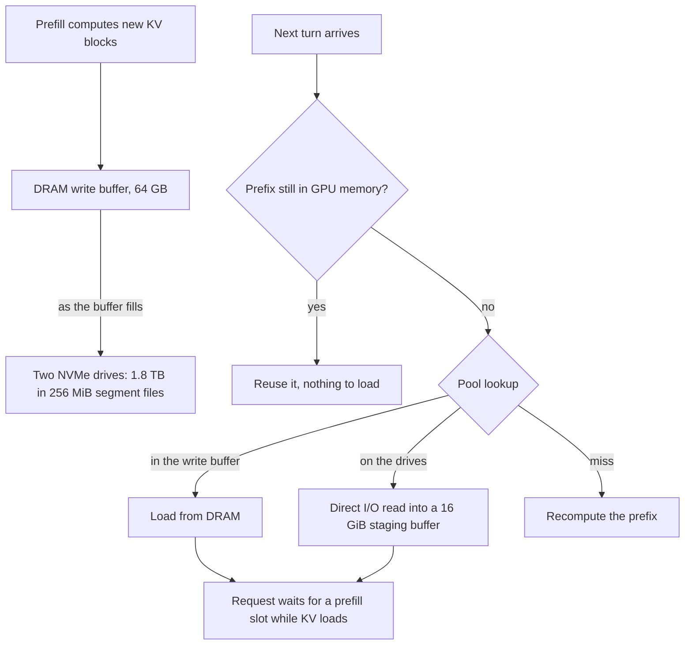

---
# Skeleton from Lead y77kclvi (vLLM blog), picked 2026-11-23.
# Follows docs/editorial/concept-writing-guide.md. published and reviewed are
# the pick time (make daily may move them to a Gap Day); make release keeps
# it (ADR-0012). verified: is the Author's alone (ADR-0007).
title: "KV cache offloading: why the prefix cache can live on NVMe"
description: "KV cache offloading keeps prefix KV the GPU evicts in DRAM or on NVMe for the next hit, and retention, not bandwidth, decides which tier pays."
kind: concept
vertical: ai-ml-systems
tags: ["kv-cache", "llm-inference", "prefix-caching", "nvme", "vllm"]
published: "2026-11-23T18:54:04Z"
reviewed: "2026-11-23T18:54:04Z"
author: mira-vance
# Optional: an image HastCode may use, beside this file, replaces the
# generated title card. Never a Source's image.
# hero: concept-name.png
# hero_alt: "What the image shows"
related: [disaggregated-inference, decode-context-parallelism]
draft: true
---

In AgentX, a benchmark that replays real Claude Code sessions, the median turn sends [142K input tokens](https://vllm.ai/blog/2026-11-23-skip-the-dram-tier), and [over 96% of them](https://vllm.ai/blog/2026-11-23-skip-the-dram-tier) are a prefix the server has already seen. Serving those sessions on vLLM, the Kimi-K3 model wrote [2.3 to 4.6 TB of KV cache an hour](https://vllm.ai/blog/2026-11-23-skip-the-dram-tier) to the pool that keeps it. A [1.8 TB pool of host DRAM, listed at about $76,000](https://vllm.ai/blog/2026-11-23-skip-the-dram-tier), holds only the last 23 to 47 minutes of that. In a post on 23 November 2026, AMD and Embedded LLM put the pool on drives instead. On AMD Instinct MI355X GPUs, a [1.8 TB NVMe pool came within 1%](https://vllm.ai/blog/2026-11-23-skip-the-dram-tier#at-the-same-size-nvme-matched-dram) of a DRAM pool of the same size. Its own DRAM use was [about 80 GB](https://vllm.ai/blog/2026-11-23-skip-the-dram-tier#tldr). This is how KV cache offloading works, why the slower tier kept up, and how to choose a tier by how long the cache must survive.

## TL;DR

- **KV cache offloading** keeps the prompt KV that GPU memory evicts in host DRAM or on local NVMe. On a later hit, vLLM [loads that KV back](https://vllm.ai/blog/2026-11-23-skip-the-dram-tier#how-a-kv-pool-works-on-vllm) instead of recomputing the prefix.
- The prefill engine saves every block it computes to the pool. vLLM [loads a hit asynchronously](https://vllm.ai/blog/2026-11-23-skip-the-dram-tier#why-nvme-keeps-up) and runs other requests meanwhile, so on a busy engine a slow load hides inside the queue wait.
- It matters because throughput follows the hit rate. On Kimi-K3, one more percent of prompt tokens served from cache was worth [about 10% more throughput](https://vllm.ai/blog/2026-11-23-skip-the-dram-tier).
- When the pool serves a small share of tokens, as in these tests, retention picks the tier, not bandwidth: [DRAM is paid per TB held, NVMe per TB written](https://vllm.ai/blog/2026-11-23-skip-the-dram-tier#what-it-costs-dram-per-tb-held-nvme-per-tb-written). NVMe's cost is wear: at 96 sessions on AgentX, the test drives would use up their rated life in about five and a half months.

## KV cache offloading extends the prefix cache past GPU memory

The idea extends one vLLM already has. The **KV cache** holds the keys and values attention computes for each token, which later steps reuse. With **prefix caching**, vLLM keeps those blocks after a request ends and names each by [a hash of its tokens and of the tokens before it](https://docs.vllm.ai/en/latest/design/prefix_caching.html#automatic-prefix-caching). A request that shares a prefix reuses the blocks. When GPU memory fills, vLLM [drops the least recently used blocks](https://vllm.ai/blog/2026-11-23-skip-the-dram-tier#how-a-kv-pool-works-on-vllm), and a session that comes back must recompute its prefix.

Offloading gives those blocks somewhere to go. vLLM's documentation says its own offloading connector ["extends the prefix cache by offloading completed KV blocks to slower but larger tiers"](https://docs.vllm.ai/en/latest/features/kv_offloading_usage/). The AMD post calls that tier a **KV pool**: KV kept [in host DRAM or on local NVMe](https://vllm.ai/blog/2026-11-23-skip-the-dram-tier#how-a-kv-pool-works-on-vllm), filled by the prefill engine and read back by vLLM. In our words, offloading turns an eviction from a loss into a move. A hit, as the post counts it, is a prompt token served [from GPU memory or the pool](https://vllm.ai/blog/2026-11-23-skip-the-dram-tier#how-a-kv-pool-works-on-vllm).

The pool here is UMBP, the ["unified memory and bandwidth pool"](https://vllm.ai/blog/2026-11-23-skip-the-dram-tier#how-a-kv-pool-works-on-vllm) in AMD's open-source [MoRI](https://github.com/ROCm/mori) library. It runs as its own server process beside the prefill engine, stores KV blocks by key, and decides where each block lives and what to evict. vLLM reaches it through `UMBPStoreConnector`.

What does not count: sending a request's KV from prefill GPUs to decode GPUs. [MoRI does that in vLLM too](https://vllm.ai/blog/2026-11-23-skip-the-dram-tier#how-a-kv-pool-works-on-vllm), but that KV is in use, not evicted.

## One prefix through an NVMe pool: saved, looked up, loaded

The diagram is ours, redrawn from the post's text; its own figure is in [the original](https://vllm.ai/blog/2026-11-23-skip-the-dram-tier#how-a-kv-pool-works-on-vllm). Walk it from the top.

**Save.** The prefill engine computes KV for the new part of a prompt. New KV lands in a [64 GB DRAM write buffer](https://vllm.ai/blog/2026-11-23-skip-the-dram-tier#how-a-kv-pool-works-on-vllm) and moves to two local NVMe drives as the buffer fills, formatted ext4 with no RAID. UMBP writes it into segment files, [256 MiB each in the tested setup](https://vllm.ai/blog/2026-11-23-skip-the-dram-tier#what-it-took-three-lessons).

**Look up.** The session's next turn arrives. A prefix still in GPU memory needs no load. Otherwise the connector [looks the blocks up in the pool](https://vllm.ai/blog/2026-11-23-skip-the-dram-tier#why-nvme-keeps-up), also asynchronously.

**Load.** A hit still in the write buffer loads from DRAM. A hit on the drives is [read with direct I/O through io_uring](https://vllm.ai/blog/2026-11-23-skip-the-dram-tier#how-a-kv-pool-works-on-vllm), so the Linux page cache never serves it. It goes into a 16 GiB staging buffer, then to GPU memory. A miss means recomputing the prefix.

**Wait.** MoRI's guide puts numbers on each path. Its single-request test ran Kimi-K2.6 under SGLang with a 128K-token prefix and no queue. The first token arrived [0.45 s after a DRAM hit, 0.84 s after an NVMe hit, and 7.7 s after a recompute](https://vllm.ai/blog/2026-11-23-skip-the-dram-tier#why-nvme-keeps-up). On a busy engine the request queues anyway. On DeepSeek-V4-Pro at 64 sessions, a load took [0.80 s from DRAM and 0.85 s from NVMe](https://vllm.ai/blog/2026-11-23-skip-the-dram-tier#why-nvme-keeps-up). It finished about 2 s before that request's prefill started.

## DeepSeek, Kimi and vLLM keep KV beyond the GPU

DeepSeek keeps its KV cache store on SSD. Its deployment notes for DeepSeek V4.1 Flash describe [roughly 100 PiB of SSD on the 3FS file system](https://github.com/deepseek-ai/DeepInfer/blob/main/doc/inference_deployment_qa.md#block-kv-cache), kept 3 days for agent traffic and 7 days for chatbot traffic. The storage cluster works out to [about 14.4 TB per GPU](https://github.com/deepseek-ai/DeepInfer/blob/main/doc/inference_deployment_qa.md#cluster--storage) in logical size. Its notes give cost as one reason: ["SSDs also cost much less than DRAM."](https://github.com/deepseek-ai/DeepInfer/blob/main/doc/inference_deployment_qa.md#block-kv-cache) We infer the same logic as the AMD post: days of retention mean many terabytes held, and DRAM is priced by the terabyte held. In February 2025, DeepSeek reported that [56.3% of 608B input tokens](https://github.com/deepseek-ai/open-infra-index/blob/main/202502OpenSourceWeek/day_6_one_more_thing_deepseekV3R1_inference_system_overview.md) on its V3 and R1 service hit its on-disk KV cache.

Kimi's serving platform, Mooncake, pools the cluster's spare CPU, DRAM and SSD as a [disaggregated cache of KV cache](https://arxiv.org/abs/2407.00079). UMBP [powers Kimi's agentic serving on AMD Instinct GPUs](https://vllm.ai/blog/2026-11-23-skip-the-dram-tier#how-a-kv-pool-works-on-vllm), co-designed by AMD and Moonshot AI.

vLLM ships offloading in its own tree. Its `OffloadingConnector` by default copies [completed GPU blocks into pinned host memory](https://docs.vllm.ai/en/latest/features/kv_offloading_usage/), and its docs point to [multi-tier setups, such as CPU plus a filesystem tier](https://docs.vllm.ai/en/latest/features/disagg_prefill/). `UMBPStoreConnector` [landed in vLLM main](https://vllm.ai/blog/2026-11-23-skip-the-dram-tier#run-it-on-vllm) in a ten-part series of pull requests that ended on 13 November.

## Agent sessions outgrow GPU memory

Agent traffic is the pressure. Each turn repeats a long prefix, and a session that [pauses between turns](https://vllm.ai/blog/2026-11-23-skip-the-dram-tier#what-nvme-buys-retention) finds its prefix only if something kept it.

As load grows, GPU memory holds less of it. Load here is [the number of sessions replayed at once](https://vllm.ai/blog/2026-11-23-skip-the-dram-tier#how-a-kv-pool-works-on-vllm). At 48, 70 and 96 sessions on AgentX, GPU memory served [96%, 90% and 79% of prompt tokens](https://vllm.ai/blog/2026-11-23-skip-the-dram-tier#at-the-same-size-nvme-matched-dram), and the pool served 1%, 5% and 16%. WEKA's kvlab corpus holds [about 3,200 recorded agent sessions](https://vllm.ai/blog/2026-11-23-skip-the-dram-tier#how-a-kv-pool-works-on-vllm) with longer prompts. On it, with GPU memory alone, the hit rate [fell from 90% at 32 sessions to 41% at 48](https://vllm.ai/blog/2026-11-23-skip-the-dram-tier#what-nvme-buys-retention), and throughput fell 80%.

Small changes in hit rate are large changes in work. At a 96% hit rate the prefill node computes 4% of prompt tokens. At 95% it computes 5%, which is [25% more prefill work](https://vllm.ai/blog/2026-11-23-skip-the-dram-tier#why-nvme-keeps-up). Across 42 Kimi-K3 runs at 70 sessions, the hit rate alone [explained 96% of the variance in throughput](https://vllm.ai/blog/2026-11-23-skip-the-dram-tier#why-nvme-keeps-up).

Misses also feed each other. The post says the fall is steep [because each miss causes more misses](https://vllm.ai/blog/2026-11-23-skip-the-dram-tier#what-nvme-buys-retention): a recompute holds up the prefill node and the queue grows. We infer the rest of the loop: while requests wait, more of their sessions' KV is evicted. In the same kvlab sweep, the DRAM pool's median time to first token (TTFT) [reached 743 s at 70 sessions](https://vllm.ai/blog/2026-11-23-skip-the-dram-tier#what-nvme-buys-retention).

## Practice one: choose the tier by retention, not bandwidth

An NVMe read is slower than a DRAM read. The post gives [three reasons](https://vllm.ai/blog/2026-11-23-skip-the-dram-tier#why-nvme-keeps-up) that gap never reached throughput. Same-size pools that evict the same way keep the same KV: across six Kimi-K3 comparisons, hit rates differed by at most 0.08% of prompt tokens. A hit is worth far more than its load: with no queue, NVMe adds about 0.4 s to a hit, and a miss adds about 7 s. And on a busy engine, the load finishes while the request queues.

The results follow. Replaying AgentX for an hour per pool, NVMe stayed [within 1% of DRAM at 48, 70 and 96 sessions](https://vllm.ai/blog/2026-11-23-skip-the-dram-tier#at-the-same-size-nvme-matched-dram). A repeat on other machines put NVMe ahead by 0.4% to 0.9%. On kvlab, with a 165K-token median prompt, NVMe came [0.6% behind at 70 sessions](https://vllm.ai/blog/2026-11-23-skip-the-dram-tier#longer-prompts) in a single run.

DRAM shrinks to a buffer. The 64 GB write buffer holds [the last one to two minutes of writes](https://vllm.ai/blog/2026-11-23-skip-the-dram-tier#dram-only-buffers-writes-and-stages-reads) and served 0.6% to 1.6% of the pool's reads. At 70 sessions the pool ran without it at no cost. At 96 sessions, dropping it cut throughput 6.7%.

The cost is in the limits. The pool served [at most 16% of prompt tokens](https://vllm.ai/blog/2026-11-23-skip-the-dram-tier#limits), most results are single runs, and every run used UMBP on MI355X. Kimi-K3 stores compressed KV through MLA, about 14 KB per token. A dense model without MLA stores many times more and [would need that much more drive bandwidth](https://vllm.ai/blog/2026-11-23-skip-the-dram-tier#limits). We infer that bandwidth matters again there.

## Practice two: size the pool as write rate times retention

A pool keeps KV for [its capacity divided by its write rate](https://vllm.ai/blog/2026-11-23-skip-the-dram-tier#what-nvme-buys-retention). At 2.3 to 4.6 TB an hour, 1.8 TB keeps 23 to 47 minutes of Kimi-K3's KV: 36 minutes at 70 sessions on AgentX, 31 at 96.

What retention is worth depends on when sessions return. The post replayed AgentX's timing through a least-recently-used model. A pool that keeps KV for 36 minutes misses [about 1% more prompt tokens](https://vllm.ai/blog/2026-11-23-skip-the-dram-tier#what-nvme-buys-retention) than one that never evicts; at one hour, 0.7%; at three hours, 0.3%. The model predicted a gain of 0.34% of prompt tokens from growing the pool from 1.8 TB to 3.0 TB. The runs measured 0.32%.

Retention also decides whether the cache survives load. On kvlab, a 1.0 TB DRAM pool [lost 81% of its throughput](https://vllm.ai/blog/2026-11-23-skip-the-dram-tier#what-nvme-buys-retention) by 70 sessions. A 4.6 TB NVMe pool across two nodes held its hit rate between 92.7% and 95.8% at every load. At 70 sessions it served 5.1 times the DRAM pool's throughput.

The post's [sizing recipe](https://vllm.ai/blog/2026-11-23-skip-the-dram-tier#size-a-pool-for-your-workload) has three steps. Measure the write rate at peak; UMBP serves its counters on `/metrics`. Pick a retention by measuring, for each reused prompt block, the time since its last use. A pool that keeps KV for time T misses every block whose gap is longer. Capacity is write rate times retention.

## Practice three: pay DRAM per TB held, NVMe per TB written

The post's [cost section](https://vllm.ai/blog/2026-11-23-skip-the-dram-tier#what-it-costs-dram-per-tb-held-nvme-per-tb-written) uses DatacenterDisk listings from 13 November 2026: about $42 per GB of server DDR5 and $666 per TB of enterprise SSD. DRAM costs about $42,000 per TB held. A drive rated for one full write a day takes 1,825 writes in five years, so each TB written uses about $0.36 of drive.

At 96 sessions, Kimi-K3 [wrote 3.5 TB an hour](https://vllm.ai/blog/2026-11-23-skip-the-dram-tier#what-it-costs-dram-per-tb-held-nvme-per-tb-written), or 83 TB a day. The test pool's two 3.84 TB drives, [rated for about one drive write per day](https://vllm.ai/blog/2026-11-23-skip-the-dram-tier#how-a-kv-pool-works-on-vllm), took about 11 drive writes a day. Their rated life would last about five and a half months. Drives rated for one write a day must total 83 TB to hold a day of KV. Up to that day, a bigger NVMe pool costs nothing extra.

Over five years, a 1.8 TB NVMe pool replaced as it wears out [costs about $59,000](https://vllm.ai/blog/2026-11-23-skip-the-dram-tier#what-it-costs-dram-per-tb-held-nvme-per-tb-written), and so does an 83 TB pool that keeps a day. A 1.8 TB DRAM pool costs about $76,000; one that keeps a day, about $3.5 million. Below about 24 minutes of retention, DRAM is cheaper. For any pool that fills its drives, drive writes per day equal [24 divided by the retention in hours](https://vllm.ai/blog/2026-11-23-skip-the-dram-tier#size-a-pool-for-your-workload).

The costs: this is list-price arithmetic for round-the-clock load, without power, rack space or servers. Checkpoints add writes: Kimi-K3's checkpoints of its linear-attention state were more than half of its NVMe writes. Dropping replaced ones [cut NVMe writes 53%](https://vllm.ai/blog/2026-11-23-skip-the-dram-tier#what-it-took-three-lessons) but cost 1.0% of throughput.

## Practice four: make the NVMe pool evict like the DRAM pool

Matching DRAM took one setting. UMBP [only appends](https://vllm.ai/blog/2026-11-23-skip-the-dram-tier#what-it-took-three-lessons): it writes each block at the end of a segment file. Space comes back only when it deletes a whole file, evicting whatever is still live in it. With the default 4 GiB files, each freed file discarded KV that sessions still used. NVMe ran 12.8% behind DRAM at 70 sessions. Moving to 256 MiB files raised the hit rate from 94.45% to 95.65% and throughput 15.6%, to 0.8% ahead of DRAM. Smaller files cost more open files.

The second change, **touch**, raises the hit rate whatever the medium. GPU memory serves the hottest prefixes itself, so the pool never sees them read and [evicts them first](https://vllm.ai/blog/2026-11-23-skip-the-dram-tier#what-it-took-three-lessons). With touch, vLLM's connector reports each GPU prefix hit to the pool, which marks those blocks as recently used ([MoRI #779](https://github.com/ROCm/mori/pull/779)). At 70 sessions, on pools with DRAM in front of NVMe, it added 2.1% and 3.9% to throughput in two tests. Both pools in the headline comparison used it.

Which blocks reach the drives also sets their wear. DeepSeek's notes say keeping hot or single-use entries in memory ["could reduce SSD wear and extend drive lifespan"](https://github.com/deepseek-ai/DeepInfer/blob/main/doc/inference_deployment_qa.md#block-kv-cache), though DeepSeek does not do it today. We infer the trade: each block kept in DRAM moves its cost from wear to capacity.

## What KV cache offloading is not

It is not the KV transfer of [disaggregated inference](/ai-ml-systems/disaggregated-inference/), where prefill GPUs send a request's KV to decode GPUs. That KV belongs to a running request; offloaded KV waits for a session to come back. The two can run together. In the AMD setup, the prefill engine runs `MoRIIOConnector` for the transfer and `UMBPStoreConnector` for the pool [side by side](https://vllm.ai/blog/2026-11-23-skip-the-dram-tier#run-it-on-vllm).

It is not sparse host-memory attention either. HiSparse, covered beside [decode context parallelism](/ai-ml-systems/decode-context-parallelism/), keeps a request's full latent KV [in pinned host memory](https://vllm.ai/blog/2026-10-29-mistral-large-4#hisparse-host-memory-sparse-kv-offload) and copies selected rows to the GPU. We infer the boundary: HiSparse moves live KV to fit a long request, while a prefix pool keeps evicted KV to skip a future prefill.

Hybrid models blur one line. Kimi-K3's [linear-attention layers keep a fixed-size running state](https://vllm.ai/blog/2026-11-23-skip-the-dram-tier#how-a-kv-pool-works-on-vllm), so its pool holds state checkpoints beside KV blocks. How to checkpoint that state deserves its own Explainer.

## What understanding offloading makes possible

Once you see the pool as retention, three numbers describe a deployment. The hit rate across GPU and pool says what a miss costs: on Kimi-K3, [about 1,280 tokens a second per GPU](https://vllm.ai/blog/2026-11-23-skip-the-dram-tier#why-nvme-keeps-up) for each point. The pool's write rate and the gap before sessions return give the capacity, and with it the drive writes per day.

You can try it. `UMBPStoreConnector` is [in vLLM main](https://vllm.ai/blog/2026-11-23-skip-the-dram-tier#run-it-on-vllm), and the AgentX traces and kvlab corpus are [public datasets](https://vllm.ai/blog/2026-11-23-skip-the-dram-tier#sources) you can replay. Check the MoRI build first: a tier policy applies the `UMBP_SSD_*` settings only from [MoRI #967](https://github.com/ROCm/mori/pull/967), and with older builds the drives [silently keep 4 GiB segment files](https://vllm.ai/blog/2026-11-23-skip-the-dram-tier#run-it-on-vllm).

The optimistic part: by the post's arithmetic, drives that keep a whole day of KV cost less than 31 minutes of DRAM. A day instead of 31 minutes [removes about 1% of prompt tokens from misses](https://vllm.ai/blog/2026-11-23-skip-the-dram-tier#what-it-costs-dram-per-tb-held-nvme-per-tb-written), worth roughly 10% of throughput. The post chains two fitted models to get there, so measure the reuse gaps on your own traces before you buy the drives.

## Sources

- AMD and Embedded LLM, ["Skip the DRAM Tier: MoRI UMBP Runs the Agentic KV Cache on NVMe"](https://vllm.ai/blog/2026-11-23-skip-the-dram-tier), vLLM blog, 23 November 2026.
- vLLM, ["Automatic Prefix Caching"](https://docs.vllm.ai/en/latest/design/prefix_caching.html), vLLM documentation.
- vLLM, ["KV Offloading Usage Guide"](https://docs.vllm.ai/en/latest/features/kv_offloading_usage/), vLLM documentation.
- vLLM, ["Disaggregated Prefilling (experimental)"](https://docs.vllm.ai/en/latest/features/disagg_prefill/), vLLM documentation.
- DeepSeek, ["DeepSeek V4.1 Flash Inference Deployment Q&A"](https://github.com/deepseek-ai/DeepInfer/blob/main/doc/inference_deployment_qa.md), DeepInfer repository.
- DeepSeek, ["Day 6: One More Thing, DeepSeek-V3/R1 Inference System Overview"](https://github.com/deepseek-ai/open-infra-index/blob/main/202502OpenSourceWeek/day_6_one_more_thing_deepseekV3R1_inference_system_overview.md), open-infra-index, February 2025.
- Ruoyu Qin, Zheming Li, Weiran He, Mingxing Zhang, Yongwei Wu, Weimin Zheng, Xinran Xu, ["Mooncake: A KVCache-centric Disaggregated Architecture for LLM Serving"](https://arxiv.org/abs/2407.00079), Moonshot AI and Tsinghua University, arXiv:2407.00079.
- Mistral and the vLLM Team, ["Day 0 support for Mistral Large 4 on vLLM"](https://vllm.ai/blog/2026-10-29-mistral-large-4), vLLM blog, 29 October 2026.
- AMD, [MoRI](https://github.com/ROCm/mori) repository, pull requests [#779](https://github.com/ROCm/mori/pull/779) and [#967](https://github.com/ROCm/mori/pull/967).
