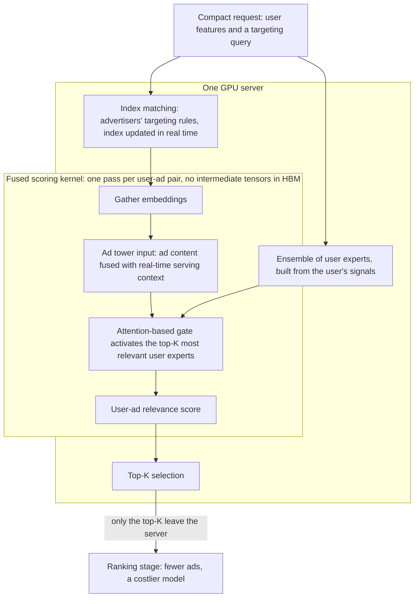

---
# Skeleton from Lead bl2brfhp (Meta Engineering, Production Engineering), picked 2026-10-29.
# Drafted per docs/editorial/case-study-writing-guide.md; the Author's check list
# is in the pull request. published and reviewed are the pick time, provisional: set them
# when you publish. verified: is the Author's alone (ADR-0007).
title: "Meta Andromeda: how Meta scores every eligible ad on one GPU server"
description: "How Meta Andromeda puts ad targeting, a mixture-of-experts model and top-K on one GPU server, and what binding model to hardware costs."
kind: case-study
vertical: ai-ml-systems
tags: ["ads-retrieval", "mixture-of-experts", "gpu-kernels", "recommendation-systems", "meta"]
published: "2026-10-29T19:47:44Z"
verified: 2026-10-29
reviewed: "2026-10-29T19:47:44Z"
author: mira-vance
# Optional: an image HastCode may use, beside this file, replaces the
# generated title card. Never a Source's image.
# hero: system-name.png
# hero_alt: "What the image shows"
# Optional: related Explainer slugs and extra sources (title + url).
related: [expert-parallelism]
---

Meta's ads retrieval system now [scores every eligible ad and surfaces the top candidates at over one billion ads per second](https://engineering.fb.com/2026/10/28/ml-applications/meta-andromeda-next-gen-ads-retrieval-gpu-co-design/), about 100 times its 2024 throughput. It got there partly by doing less arithmetic, not more: the new model needs about 300 times fewer inference-time FLOPs than the one it replaced, and the pipeline moves far less data through memory and across the network.

> Drafted with AI assistance, researched, verified and edited by the HastCode editorial team. We publish only as many pieces as the Author can verify this way.

## TL;DR

- Meta Andromeda is [Meta's machine learning system for personalized ads retrieval](https://engineering.fb.com/2026/10/28/ml-applications/meta-andromeda-next-gen-ads-retrieval-gpu-co-design/), the first stage of its ads pipeline: it narrows a vast pool of eligible ads to a few strong candidates, in milliseconds, for a costlier ranking stage.
- Meta rebuilt it because generative AI tools grew the ad pool by [hundreds of millions of ads](https://engineering.fb.com/2026/10/28/ml-applications/meta-andromeda-next-gen-ads-retrieval-gpu-co-design/), and at billions of ads a second the 2024 design ran out of memory bandwidth and network, not compute.
- A compact request reaches one GPU server, which checks advertisers' targeting rules, scores each eligible ad in one fused GPU kernel with a mixture-of-experts model, and [returns only the top-K](https://engineering.fb.com/2026/10/28/ml-applications/meta-andromeda-next-gen-ads-retrieval-gpu-co-design/).
- The price is a model and an index built for one hardware execution model, and a targeting index Meta had to redesign for the GPU. The surprise: the optimized gating kernel runs [as fast as a simple dot-product scoring kernel](https://engineering.fb.com/2026/10/28/ml-applications/meta-andromeda-next-gen-ads-retrieval-gpu-co-design/) on the same hardware.

## One request, one GPU server: Andromeda at a glance

The diagram is ours, redrawn from the text of Meta's post; Meta's own figures, including the system architecture in its Figure 2, are in [the original](https://engineering.fb.com/2026/10/28/ml-applications/meta-andromeda-next-gen-ads-retrieval-gpu-co-design/). A request enters at the top with the user's features and a targeting query. Everything inside the server box runs on one GPU server, and everything inside the kernel box runs in a single pass per user-ad pair.

Top to bottom: Step 1 is the request and index matching, Step 2 the user experts and the ad tower, Step 3 the gate inside the fused kernel, and Step 4 top-K selection and what leaves the server. We place the user experts outside the kernel and the ad tower inside it; the post does not say where either is computed.

## Why the 2024 design could not stretch to billions a second

Andromeda first shipped in 2024 on the [NVIDIA GH200 Grace Hopper Superchip](https://engineering.fb.com/2026/10/28/ml-applications/meta-andromeda-next-gen-ads-retrieval-gpu-co-design/). Its job then was selecting [from tens of millions of ad candidates into a few thousand](https://engineering.fb.com/2024/12/02/production-engineering/meta-andromeda-advantage-automation-next-gen-personalized-ads-retrieval-engine/), and it grew model capacity 10,000 times with a deep neural network, a hierarchical index and fused GPU operators.

Then the pool grew. Generative AI creative tools helped advertisers [rapidly create hundreds of millions of new ads](https://engineering.fb.com/2026/10/28/ml-applications/meta-andromeda-next-gen-ads-retrieval-gpu-co-design/). The 2024 system evaluated [tens of millions of ads per second per GPU card](https://engineering.fb.com/2026/10/28/ml-applications/meta-andromeda-next-gen-ads-retrieval-gpu-co-design/), and Meta needed multi-billion. At that rate the post names two bottlenecks, neither of them arithmetic, and elsewhere a third pressure, cost:

- **Memory traffic.** Intermediate tensors passed between GPU kernels [account for terabytes per second](https://engineering.fb.com/2026/10/28/ml-applications/meta-andromeda-next-gen-ads-retrieval-gpu-co-design/) of memory traffic.
- **The network.** Shipping ads between local CPU hosts and remote accelerators [saturates the network link](https://engineering.fb.com/2026/10/28/ml-applications/meta-andromeda-next-gen-ads-retrieval-gpu-co-design/).
- **Cost.** To keep improving the model "at a sustainable compute cost", Meta writes, it [must move beyond](https://engineering.fb.com/2026/10/28/ml-applications/meta-andromeda-next-gen-ads-retrieval-gpu-co-design/) the 2024 architecture.

Why push so hard at retrieval? Meta says small gains in retrieval [can drive large gains in advertiser value](https://engineering.fb.com/2026/10/28/ml-applications/meta-andromeda-next-gen-ads-retrieval-gpu-co-design/). We infer the reason: an ad that retrieval drops never reaches the ranking model, however good that model is.

## The designs Meta moved past

The post does not list rejected options the way a design document would. The framing here is ours: three earlier designs the post says Meta replaced, and what each cost.

- **One dense user tower.** The 2024 models [scored with a single user tower](https://engineering.fb.com/2026/10/28/ml-applications/meta-andromeda-next-gen-ads-retrieval-gpu-co-design/) and a dense interaction network. Pushing quality further without a proportional increase in cost, Meta writes, needed a new architecture.
- **Fusing only the model.** In 2024, [only operations within the model execution were fused](https://engineering.fb.com/2026/10/28/ml-applications/meta-andromeda-next-gen-ads-retrieval-gpu-co-design/) into one kernel. We infer that system work, such as gathering embeddings, ran as separate kernels whose outputs went through high-bandwidth memory (HBM).
- **Scoring on remote accelerators.** Index matching and top-K selection [ran on separate CPU hosts](https://engineering.fb.com/2026/10/28/ml-applications/meta-andromeda-next-gen-ads-retrieval-gpu-co-design/) and called a scoring service over the network.

The 2024 post adds one comparison of its own. Its jointly trained hierarchical index improved precision and recall [compared to commonly used two-tower neural networks or approximate nearest neighbor search](https://engineering.fb.com/2024/12/02/production-engineering/meta-andromeda-advantage-automation-next-gen-personalized-ads-retrieval-engine/), the usual ways to retrieve at scale.

The deciding argument is Meta's single principle: the largest gains come from [designing model, system, and hardware as one integrated stack](https://engineering.fb.com/2026/10/28/ml-applications/meta-andromeda-next-gen-ads-retrieval-gpu-co-design/), rather than optimizing each in isolation. In our reading, the last two old designs were boundaries between those layers, and each boundary cost bandwidth.

## Step 1: a compact request, and targeting checked on the GPU

The system sends [a compact request payload, user features and a targeting query](https://engineering.fb.com/2026/10/28/ml-applications/meta-andromeda-next-gen-ads-retrieval-gpu-co-design/), to a single GPU server. Instead of a candidate list crossing the network, the server builds the candidate list itself.

The first thing it does is **index matching**, which Meta defines as [enforcing advertisers' targeting rules](https://engineering.fb.com/2026/10/28/ml-applications/meta-andromeda-next-gen-ads-retrieval-gpu-co-design/). We read that as deciding which ads this user may be shown at all, and "index" here as the targeting index, not the learned hierarchical index of the 2024 post.

Meta says this step was not straightforward. Index matching [evaluates complex advertiser-defined targeting logic across tens of feature categories](https://engineering.fb.com/2026/10/28/ml-applications/meta-andromeda-next-gen-ads-retrieval-gpu-co-design/), and it must take real-time updates as ads are created, modified or expire through the day. Running it on a GPU meant redesigning the index structure for parallel execution "while preserving the full fidelity of production targeting semantics". The post does not describe the new structure.

We infer the constraint behind "full fidelity": targeting is a rule the advertiser set, not a score. Retrieval may rank an ad low, but it cannot show an ad to someone outside its audience, so this step has to be exact where the next one may be approximate.

## Step 2: a set of user experts, and an ad that knows its context

The model borrows from large language models: an [LLM-inspired mixture-of-experts (MoE) design](https://engineering.fb.com/2026/10/28/ml-applications/meta-andromeda-next-gen-ads-retrieval-gpu-co-design/), with three changes. In an MoE model a router, or gate, picks a few experts out of many for each input, so most of the model is idle on any one item; our [expert parallelism explainer](/ai-ml-systems/expert-parallelism/) walks through that routing in LLMs.

On the user side, Meta replaced the single user tower with [an ensemble of specialized user towers as experts](https://engineering.fb.com/2026/10/28/ml-applications/meta-andromeda-next-gen-ads-retrieval-gpu-co-design/). They draw on four kinds of signal the post names: sequential ad engagement events, user-cohort representations, LLM-derived semantic features and cross-surface co-engagement. The aim is to capture interests that are "diverse, time-evolving, and contextualized". We infer the reason for several towers rather than one larger one: one person has several interests, and an ad for running shoes needs a different view of them than an ad for a loan.

On the ad side, the candidate tower uses [a joint encoding that incorporates real-time serving context](https://engineering.fb.com/2026/10/28/ml-applications/meta-andromeda-next-gen-ads-retrieval-gpu-co-design/), so that downstream interaction models receive what the post calls context-aware representations. The post does not say which context signals that includes.

Here the two expert designs differ. In an LLM the experts are slices of the model a token passes through; in Andromeda, by the post's description, the experts are views of the user, and each ad chooses among them.

## Step 3: the gate, fused into one kernel per user-ad pair

The interaction layer evolved [from dense neural networks into an MoE attention-based gating network](https://engineering.fb.com/2026/10/28/ml-applications/meta-andromeda-next-gen-ads-retrieval-gpu-co-design/) that routes each candidate across the most relevant user experts. Meta's Figure 1 caption calls it an ad-aware router that activates [only the top-K most relevant experts](https://engineering.fb.com/2026/10/28/ml-applications/meta-andromeda-next-gen-ads-retrieval-gpu-co-design/) to produce the relevance score. Meta puts the result at near-ranking-level performance with about 300 times fewer inference FLOPs than the 2024 model.

Those saved FLOPs pay for the fusion. Per user-ad pair, the work is [gathering embeddings, running the interaction model, and scoring](https://engineering.fb.com/2026/10/28/ml-applications/meta-andromeda-next-gen-ads-retrieval-gpu-co-design/). Meta now runs all of it, model and system work together, in one GPU kernel. Intermediate results stay in GPU registers and thread-block shared memory and [are never materialized to HBM](https://engineering.fb.com/2026/10/28/ml-applications/meta-andromeda-next-gen-ads-retrieval-gpu-co-design/).

The reason is the arithmetic of scale. Retrieval is, in Meta's words, ["fundamentally memory-bandwidth bound"](https://engineering.fb.com/2026/10/28/ml-applications/meta-andromeda-next-gen-ads-retrieval-gpu-co-design/): at billions of ads a second, even a small intermediate tensor per ad multiplies into terabytes per second of HBM traffic. To show the shape (our numbers, not Meta's), a 1 KB intermediate per ad at 10 billion ads a second is 10 TB/s written and as much read back: the "terabytes per second" Meta describes. The fused kernel runs at [over 10 billion ads per second on a single GH200](https://engineering.fb.com/2026/10/28/ml-applications/meta-andromeda-next-gen-ads-retrieval-gpu-co-design/).

## Step 4: top-K, and only the winners leave the server

After scoring, the same server runs [top-K selection](https://engineering.fb.com/2026/10/28/ml-applications/meta-andromeda-next-gen-ads-retrieval-gpu-co-design/) and returns only the final top-K results. This is the co-location half of the design: index matching, scoring and top-K now sit together, where before index matching and top-K ran on CPU hosts and called remote accelerators.

The effect on the wire is the headline. Co-location [reduces network traffic by about 100 times](https://engineering.fb.com/2026/10/28/ml-applications/meta-andromeda-next-gen-ads-retrieval-gpu-co-design/) and, in Meta's phrase, "shifts the system back to a GPU-compute-bound regime". Measured alone, the fused kernel ran at multi-billion ads a second; split across hosts, the network was the limit.

The whole pipeline [processes over one billion ads per second on a single GPU server](https://engineering.fb.com/2026/10/28/ml-applications/meta-andromeda-next-gen-ads-retrieval-gpu-co-design/) while scoring every eligible ad, which Meta calls "a new throughput benchmark for ads retrieval-stage models". The survivors go on to ranking, which the post describes as a later, [more computationally expensive stage](https://engineering.fb.com/2026/10/28/ml-applications/meta-andromeda-next-gen-ads-retrieval-gpu-co-design/).

The post uses two wordings for the place: co-located "on the same GPU" and "a single GPU server". It does not say how many GPUs a server holds, so we cannot say whether one billion a second is one GPU's figure or a server's.

## How close to the ceiling: the work with NVIDIA

Meta put its own question this way: ["How close are we to the hardware ceiling, and how much room remains for future model growth?"](https://engineering.fb.com/2026/10/28/ml-applications/meta-andromeda-next-gen-ads-retrieval-gpu-co-design/) In early 2026 Meta and NVIDIA began optimizing each component; NVIDIA contributed kernels, Meta integrated and benchmarked them, and each component got [a 2x to 5x speedup over the baseline](https://engineering.fb.com/2026/10/28/ml-applications/meta-andromeda-next-gen-ads-retrieval-gpu-co-design/).

| Component | Reported result |
|---|---|
| Gating kernel | 5.3x, from 2.4 billion to over 10 billion ads a second, about 85% of peak HBM bandwidth |
| INT8 quantization | up to 2x more than the optimized FP16 kernels, accuracy on par with 16-bit |
| Index matching | over 2x, to over 100 billion ads a second |
| End-to-end pipeline | multiple times current production throughput on one server |

The gating result is the one Meta calls ["the co-design validation"](https://engineering.fb.com/2026/10/28/ml-applications/meta-andromeda-next-gen-ads-retrieval-gpu-co-design/): the gate runs as fast as a simple dot-product scoring kernel on the same hardware, so "the additional model complexity is essentially free on Tensor Core hardware". We read that as a consequence of the bandwidth bound: when memory sets the pace, extra arithmetic per byte costs little.

The end-to-end gain came from data layout. Profiling found that [data movement between pipeline components, not computation](https://engineering.fb.com/2026/10/28/ml-applications/meta-andromeda-next-gen-ads-retrieval-gpu-co-design/), took a significant share of end-to-end latency, and co-designing data layouts across index matching and scoring removed it.

## What it costs: a model bound to its hardware

The first cost is the one Meta calls a defining property. The model's performance is [co-designed with the underlying hardware execution model](https://engineering.fb.com/2026/10/28/ml-applications/meta-andromeda-next-gen-ads-retrieval-gpu-co-design/). We infer the flip side: a gain that depends on intermediates fitting in registers and shared memory belongs to one chip's sizes, and a model change that breaks the fit, or a new chip, means redoing kernel work. Meta is already extending its co-design work to [Grace Blackwell](https://engineering.fb.com/2026/10/28/ml-applications/meta-andromeda-next-gen-ads-retrieval-gpu-co-design/), where its work suggests the CPU-to-GPU compute ratio is an important factor.

The second cost is the targeting index. Moving index matching to the GPU [is not straightforward](https://engineering.fb.com/2026/10/28/ml-applications/meta-andromeda-next-gen-ads-retrieval-gpu-co-design/), Meta writes, and it took a redesign that had to keep real-time updates and every targeting rule exact. Exact targeting logic now lives in GPU code, which we infer is harder to change and test than the CPU service it replaced.

The third is capacity, which the post does not discuss. If one server runs the whole pipeline for a request, we infer each server must hold the eligible ads' index and embeddings in its own memory, as the 2024 design kept [all precomputed ad embeddings and features](https://engineering.fb.com/2024/12/02/production-engineering/meta-andromeda-advantage-automation-next-gen-personalized-ads-retrieval-engine/) in the Grace Hopper's local memory. How Meta shards or replicates a pool of hundreds of millions of ads across servers is not in the post.

Finally, the optimized numbers are benchmarks. Further gains are [expected as additional optimizations integrate into production](https://engineering.fb.com/2026/10/28/ml-applications/meta-andromeda-next-gen-ads-retrieval-gpu-co-design/), so not everything in the table above serves ads yet, and the post does not say which parts do.

## The evidence, and what the post leaves out

Meta's business number is [a 2.4% increase in conversions on Facebook since 2025](https://engineering.fb.com/2026/10/28/ml-applications/meta-andromeda-next-gen-ads-retrieval-gpu-co-design/). The system numbers are over one billion ads a second in production, about 100 times the 2024 system, about 300 times fewer inference FLOPs and about 100 times less network traffic. In 2024, Meta reported [+6% recall, and +8% ads quality on selected segments](https://engineering.fb.com/2024/12/02/production-engineering/meta-andromeda-advantage-automation-next-gen-personalized-ads-retrieval-engine/) for the first Andromeda.

The gaps are wide. "Near-ranking-level performance" has no metric beside it, so we cannot tell how near. The post gives no latency figure, only "the same latency budget", and no count of ads per request or of servers. The 2.4% does not say which generation of Andromeda it covers, or against what baseline. Nothing is said about failures, fallbacks when a server is slow, or what happens to retrieval while the index updates.

One shift the post does not explain: the 2024 design used a hierarchical index to [focus only on the most relevant nodes](https://engineering.fb.com/2024/12/02/production-engineering/meta-andromeda-advantage-automation-next-gen-personalized-ads-retrieval-engine/), while the 2026 pipeline scores every eligible ad. We infer that cheap enough scoring let Meta stop pruning, but the post does not say whether the hierarchical index remains. The 2024 post named Meta's own MTIA accelerator beside Grace Hopper and said [integrating Andromeda with MTIA](https://engineering.fb.com/2024/12/02/production-engineering/meta-andromeda-advantage-automation-next-gen-personalized-ads-retrieval-engine/) would push retrieval further; the 2026 post does not name MTIA, and the only hardware it names is NVIDIA's.

## What a co-designed retrieval stack makes possible

Andromeda serves ads across [Facebook and Instagram](https://engineering.fb.com/2026/10/28/ml-applications/meta-andromeda-next-gen-ads-retrieval-gpu-co-design/). Meta argues the headroom is real: with quantization adding scoring throughput and index matching running an order of magnitude above the scoring network, the design can take [deeper interaction networks, richer feature spaces, and additional retrieval pathways](https://engineering.fb.com/2026/10/28/ml-applications/meta-andromeda-next-gen-ads-retrieval-gpu-co-design/) without proportional infrastructure growth. Index matching's spare speed means it can be re-run across multiple retrieval pathways.

The lesson travels beyond ads. In our view, the move that mattered most was not the model but the boundaries: each hop between kernels, or between a CPU host and an accelerator, was paid for in bandwidth, and Meta removed them by putting the whole request on one machine. Any backend engineer who has replaced a chatty service call with work next to the data will recognize the shape.

The cost, we infer, is a stack where model, kernel and index change together, so a model team cannot move without the systems team. What could go right is retrieval that stops choosing between a good model and a large candidate pool: score every eligible ad, with a model close to the ranker, inside the same latency budget.

## Sources

- [Meta Andromeda: Powering the Next Generation of Ads Retrieval Through Model-System Co-Design](https://engineering.fb.com/2026/10/28/ml-applications/meta-andromeda-next-gen-ads-retrieval-gpu-co-design/), Haiyu Lu, Shuo Gu, Yang Yang (Tony), Jingwen Ren, Tianchen Ji, Qing Zhang, Wentian Guo, Haocheng Wu, Siqi Zeng, Yunchen Pu, Liang Wang and Chonglin Sun, Meta Engineering, 28 October 2026
- [Meta Andromeda: Supercharging Advantage+ automation with the next-gen personalized ads retrieval engine](https://engineering.fb.com/2024/12/02/production-engineering/meta-andromeda-advantage-automation-next-gen-personalized-ads-retrieval-engine/), Chonglin Sun, Nancy Yu, Haiyu Lu, Liang Wang, Yunchen Pu, Gaoxiang Liu, Neeraj Bhatia and GP Musumeci, Meta Engineering, 2 December 2024
