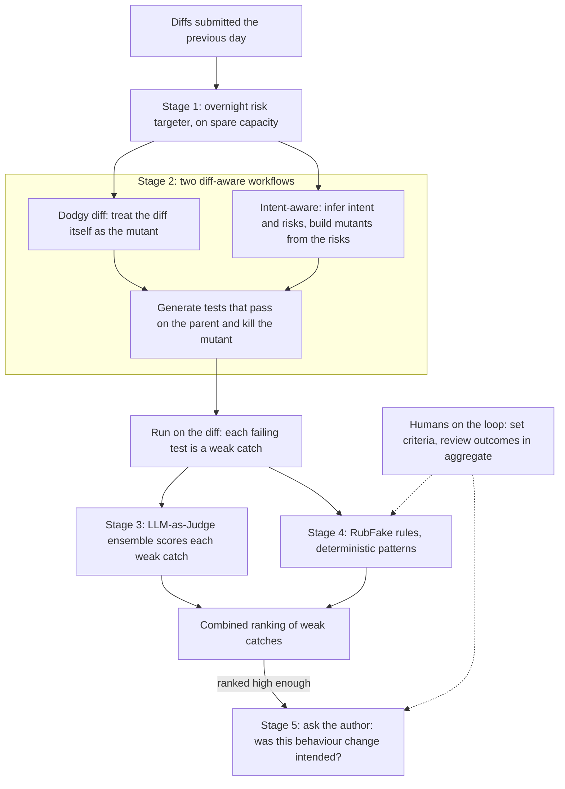

---
# Skeleton from Lead ynfwoksx (Meta Engineering, ML Applications), picked 2026-10-29.
# Follow docs/editorial/case-study-writing-guide.md; the Author's check list
# is in the pull request. published and reviewed are the pick time, provisional: set them
# when you publish. verified: is the Author's alone (ADR-0007).
title: "Catching JiTTests: how Meta writes tests meant to fail on a risky diff"
description: "How Meta's Catching JiTTests write LLM tests that fail on a risky diff, then filter false positives so an engineer answers one question: intended?"
kind: case-study
vertical: ai-ml-systems
tags: ["testing", "llm", "mutation-testing", "code-review", "meta"]
published: "2026-10-29T19:47:44Z"
verified: 2026-10-29
reviewed: "2026-10-29T19:47:44Z"
author: mira-vance
# Optional: an image HastCode may use, beside this file, replaces the
# generated title card. Never a Source's image.
# hero: system-name.png
# hero_alt: "What the image shows"
# Optional: related Explainer slugs and extra sources (title + url).
related: [meta-thin-orchestrator]
---

In the first half of 2026, tests written by large language models at Meta [played a key role in catching 74 serious privacy bugs](https://engineering.fb.com/2026/10/29/security/catching-bugs-before-they-land-jittestings-human-on-the-loop-approach-at-full-scale/) before the code landed. Every one of those tests was built to fail: a test that passes on a change has caught nothing.

> Drafted with AI assistance, researched, verified and edited by the HastCode editorial team. We publish only as many pieces as the Author can verify this way.

## TL;DR

- Catching JiTTests (Just-in-Time Tests) are [LLM-generated tests designed to fail](https://engineering.fb.com/2026/10/29/security/catching-bugs-before-they-land-jittestings-human-on-the-loop-approach-at-full-scale/) on a code change, so a bug shows up as executable proof of a behaviour change before the change lands. They are now part of Meta's infrastructure, not a research prototype.
- Meta built them because ordinary tests [harden code against future regressions](https://arxiv.org/html/2601.22832#S1) and pass when written, while LLM code review only produces a comment an engineer has to reason about.
- The pipeline has five stages: an overnight targeter picks risky diffs, two workflows generate failing tests, an LLM-as-Judge ensemble and a rule engine called RubFake rank them, and the system decides whether to ask the author one question: was this change intended?
- The price is compute and noise: [many tests must be generated](https://arxiv.org/html/2601.22832#S1) to find one real catch, and almost all failures are false positives. The surprise: engaged engineers report a [60% true-positive rate](https://engineering.fb.com/2026/10/29/security/catching-bugs-before-they-land-jittestings-human-on-the-loop-approach-at-full-scale/), and they rarely need to read the test code.

## From a risky diff to one yes-or-no question

The diagram is ours, redrawn from the text of Meta's post and paper; Meta's own architecture figure is in [the original post](https://engineering.fb.com/2026/10/29/security/catching-bugs-before-they-land-jittestings-human-on-the-loop-approach-at-full-scale/). At Meta, a revision submitted to continuous integration is [called a "diff"](https://arxiv.org/html/2601.22832#S1), and the diff's parent is the revision it is based on.

The sections below follow Meta's own [five stages](https://engineering.fb.com/2026/10/29/security/catching-bugs-before-they-land-jittestings-human-on-the-loop-approach-at-full-scale/), top to bottom, with Stage 2 split in two because its two workflows make opposite bets. The dotted lines are ours: the post says humans set criteria and review outcomes, not exactly where those criteria plug in.

## Why a test that passes cannot catch a bug in the change

With [hundreds of millions of lines of code](https://engineering.fb.com/2026/10/29/security/catching-bugs-before-they-land-jittestings-human-on-the-loop-approach-at-full-scale/) constantly changing, Meta argues, traditional testing cannot keep pace. Its paper draws the distinction that matters. Most work on unit test generation produces [hardening tests](https://arxiv.org/html/2601.22832#S1): tests that pass at generation time and land in the codebase to guard against future regressions. A catching test fails at generation time by design, so it cannot land with the change it tests: either it is discarded or the change is fixed.

That makes the hard part judging the failure. A test that crashes the code is easy to trust; the paper calls that the [implicit oracle](https://arxiv.org/html/2601.22832#S1). A catching test cannot rely on it: whether its failure reveals a bug depends on the general oracle, the intended behaviour, which the paper calls "usually vague and informal, even unstated".

A [weak catch](https://arxiv.org/html/2601.22832#S1) is any test that fails on the diff. A strong catch is one that should fail: a true positive that reveals a bug. The whole system exists to turn many weak catches into a few strong ones without slowing engineers down with [false positive test failures](https://arxiv.org/html/2601.22832), which the paper names as the primary challenge.

## The baselines Meta tried before building diff-aware tests

The post sets Catching JiTTests against LLM code review, which works [through the same review process a human reviewer would, only faster](https://engineering.fb.com/2026/10/29/security/catching-bugs-before-they-land-jittestings-human-on-the-loop-approach-at-full-scale/). The post's Table 1 contrasts the outputs: a review leaves a comment that something might be a bug, and the engineer reasons about whether it is valid; a catching test leaves a failing test, and the engineer answers whether the observed change was intended. Meta admits the test route takes more computational steps, but says it catches classes of bugs that review might not.

The paper also measured three test-generation baselines that [already existed at Meta](https://arxiv.org/html/2601.22832#S2):

| Approach | Tests that were weak catches | Diffs with a weak catch |
|---|---|---|
| Coincidental catches from ACH hardening runs | 0.2% | not reported |
| TestGen-LLM on the parent, no coverage needed | 2.0% | 3.6% |
| ACH mutation-guided, on the parent | 0.8% | 1.6% |
| Dodgy diff (diff-aware) | 2.5% | 4.0% |
| Intent-aware (diff-aware) | 6.4% | 7.9% |

The figures are from [the paper's Table 1](https://arxiv.org/html/2601.22832#S4.T1). ACH is Meta's [mutation-guided hardening tool](https://engineering.fb.com/2025/09/30/security/llms-are-the-key-to-mutation-testing-and-better-compliance/); TestGen-LLM generates tests to raise coverage. Coincidental catches were so rare that Meta [abandoned harvesting them](https://arxiv.org/html/2601.22832#S4.SS1). The hardening tools cannot know about the diff: they run on its parent, built for any future change.

The deciding argument is in the right-hand column. Using the diff and an approximation of its intent, Meta concluded, [more than doubles](https://arxiv.org/html/2601.22832#S4.SS3) the number of code changes for which it gets a weak catch.

## Stage 1: an overnight targeter picks the risky diffs

Catching tests are expensive, so they are not run on everything. The system runs [overnight on spare capacity](https://engineering.fb.com/2026/10/29/security/catching-bugs-before-they-land-jittestings-human-on-the-loop-approach-at-full-scale/) and targets diffs submitted the previous day that a mechanism similar to Diff Risk Score has deemed "risky", trained on previous code changes.

Diff Risk Score is a Meta model, [built on a fine-tuned Llama](https://engineering.fb.com/2025/08/06/developer-tools/diff-risk-score-drs-ai-risk-aware-software-development-meta/), that predicts how likely a change is to cause a production incident, which Meta calls a SEV. The paper says [every diff the targeter flags as high risk](https://arxiv.org/html/2601.22832#S1) triggers the workflow.

The reason for targeting is in the paper's own words: catching test generation is ["inherently computationally expensive"](https://arxiv.org/html/2601.22832#S1), because many tests must be generated to raise the chance of one strong catch. We infer the targeter is what makes the system affordable: it spends generation only where a bug is likeliest, on hardware that would otherwise sit idle.

Neither source says what share of diffs the targeter selects, or what risk threshold it uses.

## Stage 2: the dodgy diff workflow assumes the change is a bug

Both workflows borrow from mutation testing. A mutant is a [deliberately introduced fault](https://engineering.fb.com/2025/09/30/security/llms-are-the-key-to-mutation-testing-and-better-compliance/) in the code, and a test "kills" a mutant when it [distinguishes the mutant's behaviour from its parent's](https://arxiv.org/html/2601.22832#S3.SS3).

The dodgy diff workflow makes the bluntest possible bet. It [treats each diff as if it were a mutant](https://engineering.fb.com/2026/10/29/security/catching-bugs-before-they-land-jittestings-human-on-the-loop-approach-at-full-scale/), implicitly asserting that the change is buggy, hence "dodgy". Then it uses Meta's mutation-guided LLM test generator to write tests that tell the diff's behaviour apart from its parent's. It does not reason about what the author meant.

The paper is candid that the premise is usually false: most code changes [do not induce failures](https://arxiv.org/html/2601.22832#S3). The workflow exists anyway because it maximises the pool of weak catches, and so the chance of a strong one, leaving later stages to weed out false positives.

We infer what most dodgy-diff failures look like: when a change is meant to alter behaviour, a test pinning the old behaviour fails on it, correctly and uselessly. That is why Stages 3 and 4 need the diff's intent, not just the failure.

## Stage 2, continued: the intent-aware workflow guesses what could go wrong

The second workflow first asks an LLM what the diff is for. It [infers the diff's intention](https://engineering.fb.com/2026/10/29/security/catching-bugs-before-they-land-jittestings-human-on-the-loop-approach-at-full-scale/) from the code changes, the diff title and the summary. The paper says the first deployed version deliberately used [only those inputs](https://arxiv.org/html/2601.22832#S3.SS2), as a baseline for richer context such as engineers' discussions.

Next, the LLM describes the "risks": the ways an attempt to implement that intent could go wrong. From each risk the workflow builds a mutant, [a code modification on the parent](https://arxiv.org/html/2601.22832#S3.SS1) that captures a bug the author might plausibly have introduced. [Meta's figure](https://engineering.fb.com/2026/10/29/security/catching-bugs-before-they-land-jittestings-human-on-the-loop-approach-at-full-scale/) shows a check that a candidate mutant builds and passes the existing tests before it is kept.

Tests are then generated to kill each mutant: they must pass on the parent and fail on the mutated parent. Finally they run on the actual diff, and [any that fail are harvested](https://engineering.fb.com/2026/10/29/security/catching-bugs-before-they-land-jittestings-human-on-the-loop-approach-at-full-scale/) as weak catches.

Why should a test aimed at an imagined bug catch the real one? The paper leans on the mutation [coupling hypothesis](https://arxiv.org/html/2601.22832#S3.SS1): decades of evidence make it reasonable to suppose real faults may be coupled to such mutants. It does not expect the diff to mirror any one inferred risk. The bet paid off in [Table 1](https://arxiv.org/html/2601.22832#S4.T1): fewer tests than dodgy diff, but nearly double the diffs with a weak catch.

## Stage 3: a jury of models scores each failure

Each weak catch now goes to the [LLM-as-Judge ensemble](https://engineering.fb.com/2026/10/29/security/catching-bugs-before-they-land-jittestings-human-on-the-loop-approach-at-full-scale/), several state-of-the-art models that each review four things: the test's code, the execution outcome (failure code, message and trace), the diff, and the inferred intent. The paper names the models at the time as [including Llama3.3-70B, Gemini 3 Pro and Claude Sonnet 4](https://arxiv.org/html/2601.22832#S6.SS1), chosen as an ensemble to reduce the risk of one model's idiosyncratic errors.

The paper describes [three outputs](https://arxiv.org/html/2601.22832#S6.SS1.SSS2) per weak catch. One is a score from Llama3.3-70B's probability for the first token of a yes-or-no answer, mapped from −1 (likely false positive) to 1 (likely true positive), since token probabilities were only available for Llama. Another is every model's High, Medium or Low rating, mapped to 1, 0 and −1, taking the median. The third is each judge's short rationale, shown to reviewers separately.

On 600 weak catches, the paper reports, the judges reached over 98% precision in identifying false positives, which [cut human review load by about 70%](https://arxiv.org/html/2601.22832#S6.SS1.SSS2). Its own footnote warns that almost all the population were false positives, so high precision is expected; the useful result is the 70% saving.

## Stage 4: RubFake rules where the models cannot be checked

The judges have a weakness Meta states plainly: their judgements are [non-deterministic and challenging to verify](https://engineering.fb.com/2026/10/29/security/catching-bugs-before-they-land-jittestings-human-on-the-loop-approach-at-full-scale/). So the system pairs them with RubFake, the Rule-Based False-Positive Killing Environment, which gives "verified, deterministic judgments".

RubFake's rules came from people. Between October and November 2025, Meta engineers [manually analysed 600 weak catches](https://arxiv.org/html/2601.22832#S6.SS2), two at first and later four, checking one another's work. The resulting false-positive patterns include a broken test runner, a web server being down, tests that use reflection, type changes between parent and child, broken mocks, flakiness, and a not-implemented exception an engineer raised on purpose. A failure matching one is essentially eliminated.

Meta then [codified true-positive patterns](https://arxiv.org/html/2601.22832#S6.SS3) too, as promising signals rather than guarantees: a boolean that flipped though nothing changed its defining expression, a variable that became null, any behaviour change in a diff meant as a refactor or dead-code removal, or existing behaviour altered by a change meant only to add something, such as logging.

The two assessors agree only modestly, which the paper reads as [complementary signals](https://arxiv.org/html/2601.22832#S6.SS4), not noise. Together they produce one ranking. We see the same split Meta's data-pipeline team drew in its [thin orchestrator](/ai-ml-systems/meta-thin-orchestrator/): deterministic code where a rule can decide, a model only where judgement is needed.

## Stage 5: humans on the loop, asked one question

The system [decides whether to reach out](https://engineering.fb.com/2026/10/29/security/catching-bugs-before-they-land-jittestings-human-on-the-loop-approach-at-full-scale/) from the combined ranking. Meta calls this human-on-the-loop: rather than a person reviewing every output, "human engineers set criteria and review outcomes at an aggregate level". Its Table 2 puts the difference in scaling terms: a human-in-the-loop system grows linearly with human capacity, while an on-the-loop one scales with compute. The paper describes the initial deployment as [human-in-the-loop](https://arxiv.org/html/2601.22832#S6), with people choosing what to send and feeding patterns back to both assessors.

The question itself is the design. Rather than show a test and ask the engineer to debug it, Meta found it much better to [state what changed between parent and child](https://arxiv.org/html/2601.22832#S5.SS1) and ask whether that is expected. The paper's example message: "this expression, used to evaluate to true, but now evaluates to false; is that expected?"

Ease of dismissal feeds back into the ranking. A boolean question is quick to answer; a mismatch in the ordering of a large data structure can take orders of magnitude longer. So the rule-based approach [scores a likely true-positive pattern higher](https://arxiv.org/html/2601.22832#S5.SS1) when it is also quick to dismiss, and Meta could afford an order of magnitude more false positives per true positive for the boolean kind. Only when the engineer is surprised do they open the test code.

## What it costs: compute, a day's wait and mostly-false failures

The first cost is compute. Meta says the approach [requires more computational steps](https://engineering.fb.com/2026/10/29/security/catching-bugs-before-they-land-jittestings-human-on-the-loop-approach-at-full-scale/) than LLM code review, and the paper's numbers show why: across the five approaches in its Table 1, [22,126 generated tests produced 231 weak catches](https://arxiv.org/html/2601.22832#S4.T1), and most weak catches are not bugs. Running overnight on spare capacity is how Meta manages it.

The second is time. We infer that a diff submitted in the morning is tested that night and its author hears the next day at the earliest. The paper argues the catch arrives [when the developer has maximum mental context](https://arxiv.org/html/2601.22832#S5.SS1) on the change, because the diff has not landed; the post does not say how often a diff lands before its tests run.

The third is the engineer's attention, spent on false alarms. The paper reports that dismissing an intended change took [only a few minutes](https://arxiv.org/html/2601.22832#S5), and treats that as negligible drag. Meta manages it by shaping the question and by ranking: precision and recall are traded, the paper says, against [the friction a false positive causes](https://arxiv.org/html/2601.22832#S5.SS1).

The last is upkeep we infer but the sources do not count: RubFake's patterns are hand-written from human review, so new kinds of false positive need new rules, and the judge models will change.

## The evidence: 74 privacy bugs, and what the numbers leave out

The production numbers are in the post. As of writing, [589 engineers, 64% of Meta's outreach](https://engineering.fb.com/2026/10/29/security/catching-bugs-before-they-land-jittestings-human-on-the-loop-approach-at-full-scale/), have engaged with Catching JiTTests and report a 60% true-positive rate. In the first half of 2026 the system played a key role in catching 74 serious privacy bugs at the diff stage, and in lowering privacy SEVs by 20% over that time. From the 64%, we work out that roughly 920 engineers were contacted (our arithmetic, not Meta's).

The paper's earlier numbers are smaller and more modest. From mid-September to the end of October 2025, Meta [reached out 41 times](https://arxiv.org/html/2601.22832#S5); 8 were confirmed as strong catches, an engineer-experienced true-positive rate of 19.5%, and 4 of those would have caused serious failures. The authors call that number of bugs ["admittedly limited"](https://arxiv.org/html/2601.22832#S5).

The gaps matter. The post does not say how the 60% is counted (its impact figure labels it precision), and it comes only from engineers who engaged. It does not say how the 20% reduction was separated from everything else that changed in the half-year, or give the baseline count of privacy SEVs. Neither source publishes the compute cost, the share of diffs targeted, or how many strong catches the filters wrongly discarded. The paper believes discarding the lowest scores lost no true positives, but says ["we believe"](https://arxiv.org/html/2601.22832#S6.SS1.SSS2).

## What testing on the loop makes possible

The paper describes the system on Meta's [large-scale backend systems](https://arxiv.org/abs/2601.22832), and the post's biggest reported wins are privacy bugs. There is a by-product too: in the month to 11 December 2025, the catch workflows produced [7,987 passing tests](https://arxiv.org/html/2601.22832#S7) across 2,517 diffs, which can be kept as hardening tests. A pipeline built to catch bugs also writes the regression suite.

Meta frames the lesson as general: engineers [define success criteria early](https://engineering.fb.com/2026/10/29/security/catching-bugs-before-they-land-jittestings-human-on-the-loop-approach-at-full-scale/), let AI execute the testing, monitor outcomes in aggregate and intervene at the policy level, not per item. For a Reader running their own CI, we draw three lessons. Target the expensive check by risk, not by volume. Spend your filter budget on making a false alarm cheap to dismiss, not only on making it rare. And pair a model's judgement with rules you can verify, then let people tune the rules from aggregate results.

The cost does not go away: compute, a delay, and a stream of questions, most of them false alarms. What could go right is a codebase where an engineer never writes or reads the catching test, and still gets told, before landing, that a boolean they never touched has flipped.

## Sources

- [Catching Bugs Before They Land: JiTTesting’s Human-on-the-Loop Approach at Full Scale](https://engineering.fb.com/2026/10/29/security/catching-bugs-before-they-land-jittestings-human-on-the-loop-approach-at-full-scale/), Sreeja Thummala, Sophie Zeng, Mark Harman, Weini Liu and Eric Liu, Meta Engineering, 29 October 2026
- [Just-in-Time Catching Test Generation at Meta](https://arxiv.org/abs/2601.22832), Matthew Becker, Mark Harman, Sreeja Thummala, Sophie Zeng and 11 other Meta authors, FSE Companion 2026 (arXiv:2601.22832, 30 January 2026); cited here from [its HTML version](https://arxiv.org/html/2601.22832)
- [Diff Risk Score: AI-driven risk-aware software development](https://engineering.fb.com/2025/08/06/developer-tools/diff-risk-score-drs-ai-risk-aware-software-development-meta/), Meta Engineering, 6 August 2025
- [LLMs Are the Key to Mutation Testing and Better Compliance](https://engineering.fb.com/2025/09/30/security/llms-are-the-key-to-mutation-testing-and-better-compliance/), Mark Harman, Meta Engineering, 30 September 2025
