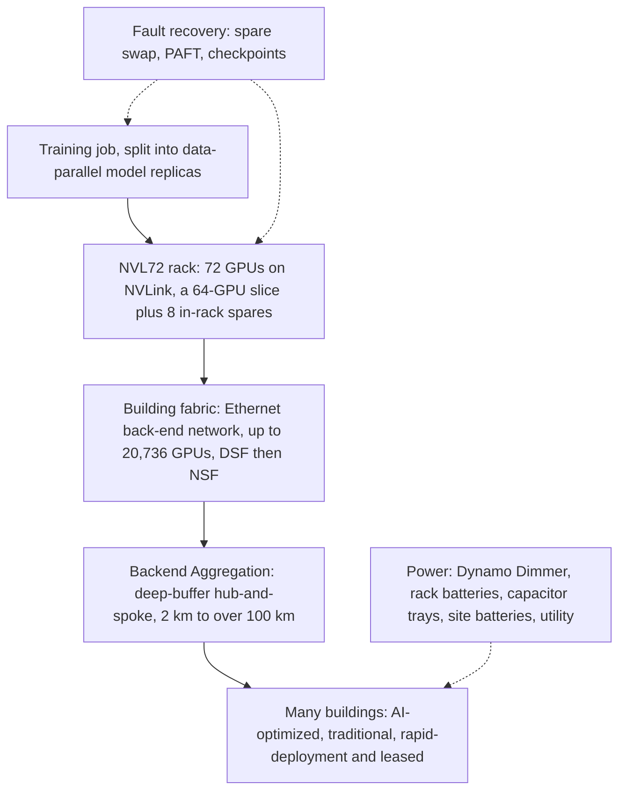

---
# Skeleton from Lead es6l4yvz (Meta Engineering, ML Applications), picked 2026-10-27.
# Follow docs/editorial/case-study-writing-guide.md; the Author's check list
# is in the pull request. published and reviewed are the pick time, provisional: set them
# when you publish. verified: is the Author's alone (ADR-0007).
title: "Prometheus: how Meta runs a gigawatt AI cluster as one machine"
description: "How Meta's Prometheus trains on hundreds of thousands of GPUs across many buildings as one machine, and the spare GPUs and power caps that costs."
kind: case-study
vertical: ai-ml-systems
tags: ["ai-infrastructure", "gpu-clusters", "datacenter-networking", "reliability", "meta"]
published: "2026-10-27T17:47:14Z"
verified: 2026-10-28
reviewed: "2026-10-27T17:47:14Z"
author: mira-vance
# Optional: an image HastCode may use, beside this file, replaces the
# generated title card. Never a Source's image.
# hero: system-name.png
# hero_alt: "What the image shows"
# Optional: related Explainer slugs and extra sources (title + url).
# related: [metastable-failures]
---

In mid-2025, Meta's new training cluster in New Albany, Ohio, saw [nearly 1,000 interruptions per 8K GPUs a day](https://engineering.fb.com/2026/10/19/data-center-engineering/inside-prometheus-meta-gigawatt-scale-supercluster/). A year later Meta reports a 99% cut, on a site that [two years ago was a conventional data center running web traffic](https://engineering.fb.com/2026/10/19/data-center-engineering/inside-prometheus-meta-gigawatt-scale-supercluster/) and now trains its frontier models.

> Drafted with AI assistance, researched, verified and edited by the HastCode editorial team. We publish only as many pieces as the Author can verify this way.

## TL;DR

- Prometheus is Meta's gigawatt-scale training supercluster: [hundreds of thousands of GPUs across multiple interconnected buildings, functioning as a single machine](https://engineering.fb.com/2026/10/19/data-center-engineering/inside-prometheus-meta-gigawatt-scale-supercluster/), on the way to roughly 1 million.
- Meta built it because frontier training needs what a web data center never did: high bandwidth, tight lock-step coordination, and tolerance for faults, since [an issue on a single host can slow down or stop the entire job](https://engineering.fb.com/2026/10/19/data-center-engineering/inside-prometheus-meta-gigawatt-scale-supercluster/).
- It stacks four layers: 72-GPU NVL72 racks, an Ethernet back-end fabric per building, a [Backend Aggregation network spanning 2 km to over 100 km](https://engineering.fb.com/2026/10/19/data-center-engineering/inside-prometheus-meta-gigawatt-scale-supercluster/) between buildings, and power management that caps GPUs instead of stopping jobs.
- The price is hardware held back: a 32,768-GPU run needs [37,656 GPUs provisioned](https://engineering.fb.com/2026/10/19/data-center-engineering/inside-prometheus-meta-gigawatt-scale-supercluster/), mostly as in-rack spares. The surprise is how much of the reliability work was maturing first-generation hardware.

## Prometheus at a glance: from one rack to many buildings

The diagram is ours, redrawn from the text of Meta's post; Meta's own figures and videos are in [the original](https://engineering.fb.com/2026/10/19/data-center-engineering/inside-prometheus-meta-gigawatt-scale-supercluster/). Read it top to bottom as a training job sees the cluster: the job is split into data-parallel model replicas, each runs on NVL72 racks, racks sit in a building fabric, and the Backend Aggregation network joins the buildings. Fault recovery acts on the racks and replicas; power management acts on the whole site.

The sections walk the diagram in that order, rack first, then turn to what it costs.

## Why a web data center could not train a frontier model

In web services, Meta writes, the network carries requests and responses between services that [typically don't require high bandwidth, high performance, and tight, lock-step coordination across many servers](https://engineering.fb.com/2026/10/19/data-center-engineering/inside-prometheus-meta-gigawatt-scale-supercluster/). Large-scale training needs all three. Every GPU in a synchronous job finishes a step before any GPU starts the next, so the slowest link sets the pace for everyone.

That turns reliability into a throughput problem. Meta's measure is goodput, which it introduces through what lowers it: [an issue on a single host can slow down or stop the entire job](https://engineering.fb.com/2026/10/19/data-center-engineering/inside-prometheus-meta-gigawatt-scale-supercluster/). Within Prometheus, an interruption is [any fault, from GPU silicon defects and network fabric anomalies to storage bottlenecks or thermal limits](https://engineering.fb.com/2026/10/19/data-center-engineering/inside-prometheus-meta-gigawatt-scale-supercluster/), that forces a job to pause and recover.

The new hardware raised the stakes. Under the H100 generation's NVL8 design, the scale-up domain, the group of GPUs tightly coupled over NVLink for tensor parallelism, was eight GPUs. NVL72 makes it 72, [increasing the fault blast radius by 9X](https://engineering.fb.com/2026/10/19/data-center-engineering/inside-prometheus-meta-gigawatt-scale-supercluster/).

Meta also had to build fast, on what it had. Prometheus mixes [traditional and AI-optimized buildings and rapid deployment structures](https://engineering.fb.com/2026/10/19/data-center-engineering/inside-prometheus-meta-gigawatt-scale-supercluster/), plus leased capacity from partners, each with its own power and cooling limits.

## The choices Meta made, and what it passed over

The post is not a decision memo, but it names three forks and why Meta went the way it did.

**Stock GB200 or the Ariel variant.** The GB200 NVL72 scaled up nearly everything relative to the H100, FLOPS, memory bandwidth and scale-up domain, while [scale-out bandwidth per GPU would have stayed at 400G](https://engineering.fb.com/2026/10/19/data-center-engineering/inside-prometheus-meta-gigawatt-scale-supercluster/). Meta "expected that imbalance to cost performance", so it chose Ariel, which pairs each GPU with its own Grace CPU and two 400G NICs for 800G per GPU. It also gave Meta more uniformity of spec as the region expanded and 800G scale-out became available.

**A scheduled fabric or a non-scheduled one.** Meta began with a fabric that sprays and reorders packets in the network, then moved to one that leaves reordering to the NIC, once [Ethernet NIC technology advanced, enabling packet re-ordering at the endpoint](https://engineering.fb.com/2026/10/19/data-center-engineering/inside-prometheus-meta-gigawatt-scale-supercluster/). Step 2 explains both.

**Stop the job or slow the GPUs.** When the cluster nears its electrical ceiling, Meta's power framework [gradually adjusts GPU power limits instead of hard-stopping workloads](https://engineering.fb.com/2026/10/19/data-center-engineering/inside-prometheus-meta-gigawatt-scale-supercluster/). A slower step costs less than a restart.

The deciding argument in all three is the same: in lock-step training, anything that idles a GPU, whether a thin NIC, a congested link or a halted job, costs the whole job.

## Step 1: the rack is the unit of compute

Prometheus builds on NVIDIA's NVL72 rack architecture, [where 72 GPUs act as a single accelerator](https://engineering.fb.com/2026/10/19/data-center-engineering/inside-prometheus-meta-gigawatt-scale-supercluster/). Two platforms are deployed today.

**Catalina** uses the GB200 NVL72 in Meta's Ariel variant: two racks of 36 GPUs joined by NVLink into one 72-GPU domain, on Meta's [Open Rack V3](https://engineering.fb.com/2022/10/18/open-source/ocp-summit-2022-grand-teton/) high-power rack shared through the [Open Compute Project](https://www.opencompute.org/). Per Meta, one domain holds [13.4 TB of HBM3e (192 GB per GPU), 720 peak PFLOPS of FP8, 130 TB/s of NVLink bandwidth](https://engineering.fb.com/2026/10/19/data-center-engineering/inside-prometheus-meta-gigawatt-scale-supercluster/), and draws about 120 kW across the pair.

**Clemente** moves to the GB300 NVL72. HBM per GPU rises 1.5x to 288 GB, and [ConnectX-8 SuperNICs deliver 800G per GPU natively](https://engineering.fb.com/2026/10/19/data-center-engineering/inside-prometheus-meta-gigawatt-scale-supercluster/), so what Ariel did early is now the baseline. With two GPUs per CPU, the whole 72-GPU domain fits in one rack at about 135 kW, with less cabling. Meta puts its gain over the GB200 NVL72 at [5-10%](https://engineering.fb.com/2026/10/19/data-center-engineering/inside-prometheus-meta-gigawatt-scale-supercluster/).

The power figures tell the physical story. Catalina's 120 kW over two racks is about 60 kW a rack (our arithmetic); Clemente puts 135 kW in one. Racks this dense need [the liquid cooling required by these high-power racks](https://engineering.fb.com/2026/10/19/data-center-engineering/inside-prometheus-meta-gigawatt-scale-supercluster/): Clemente runs on Meta's modular air-assisted liquid cooling (AALC) or on facility liquid cooling (FLC) in its newer buildings.

## Step 2: a back-end fabric in each building

GPUs talk to each other over a [second dedicated data network](https://engineering.fb.com/2026/10/19/data-center-engineering/inside-prometheus-meta-gigawatt-scale-supercluster/), the Ethernet Back-End (BE) network, separate from the data center network that carries ordinary traffic. Its shape follows the job. Pre-training splits the model into data-parallel replicas, and [latency- and bandwidth-sensitive operations concentrate within a replica](https://engineering.fb.com/2026/10/19/data-center-engineering/inside-prometheus-meta-gigawatt-scale-supercluster/), while traffic between replicas tolerates more latency. So Meta builds fast fabrics inside buildings and a slower aggregation layer between them. We infer that a replica is placed within one building fabric, though the post does not say so outright.

Each building fabric connects [up to 20,736 GPUs](https://engineering.fb.com/2026/10/19/data-center-engineering/inside-prometheus-meta-gigawatt-scale-supercluster/). The problem it solves is that training collectives produce a few large, long-lived flows that collide under hash-based load balancing. Meta's first answer, the [Disaggregated Scheduled Fabric (DSF)](https://engineering.fb.com/2025/10/20/data-center-engineering/disaggregated-scheduled-fabric-scaling-metas-ai-journey/), breaks packets into cells, sprays them across every path, reassembles them in hardware, and uses virtual output queues and credits so a sender transmits only when the receiving port has room.

The second, [Non-Scheduled Fabric (NSF)](https://engineering.fb.com/2025/10/13/data-infrastructure/ocp-summit-2025-the-open-future-of-networking-hardware-for-ai/#nsf), [uses shallow-buffer 51.2T switches](https://engineering.fb.com/2026/10/19/data-center-engineering/inside-prometheus-meta-gigawatt-scale-supercluster/), Minipack3 with Dynamic Load Balancing and Minipack3N with NVIDIA's Adaptive Routing on ConnectX NICs, and lets the NIC put packets back in order. Both run Meta's own FBOSS switch software, which Meta credits with [the control to rapidly iterate](https://engineering.fb.com/2026/10/19/data-center-engineering/inside-prometheus-meta-gigawatt-scale-supercluster/) on the fabrics.

## Step 3: Backend Aggregation joins the buildings

The [Backend Aggregation (BAG)](https://engineering.fb.com/2026/02/09/data-center-engineering/building-prometheus-how-backend-aggregation-enables-gigawatt-scale-ai-clusters/) network is a multi-layer hub-and-spoke that connects the building fabrics, [spanning 2 km to over 100 km](https://engineering.fb.com/2026/10/19/data-center-engineering/inside-prometheus-meta-gigawatt-scale-supercluster/). It runs on Arista 7800-series chassis with Broadcom Jericho3 silicon, delivering multiple Pbps per region pair; Meta's earlier BAG post gives [16-48 Pbps per region pair](https://engineering.fb.com/2026/02/09/data-center-engineering/building-prometheus-how-backend-aggregation-enables-gigawatt-scale-ai-clusters/) as an example.

The design choice worth noticing is where the buffers go. NSF building fabrics use shallow-buffer switches, and BAG's distributed layout [keeps the distance from the L2 edge small](https://engineering.fb.com/2026/02/09/data-center-engineering/building-prometheus-how-backend-aggregation-enables-gigawatt-scale-ai-clusters/), which shallow buffers need. The long BAG-to-BAG links get deep-buffer switches, whose headroom supports lossless congestion control such as PFC (priority flow control). The longer the wire, the more data is in flight when a pause takes effect.

BAG is also deliberately oversubscribed: typical L2-to-BAG oversubscription is [around 4.5:1](https://engineering.fb.com/2026/02/09/data-center-engineering/building-prometheus-how-backend-aggregation-enables-gigawatt-scale-ai-clusters/), which fits a design that sends little traffic between replicas.

Distance still bites. Light in fibre travels roughly 5 microseconds per kilometre (our figure, not Meta's), so 100 km adds about half a millisecond each way. Meta says running pre-training over BAG took [a dedicated optimization effort with Meta Superintelligence Labs](https://engineering.fb.com/2026/10/19/data-center-engineering/inside-prometheus-meta-gigawatt-scale-supercluster/) so training was not slowed. Across the whole network that means millions of optics, from 2x400G FR4 LITE pluggables inside buildings to 800G-ZR coherent optics beyond about 10 km.

## Step 4: a fault costs a GPU, a replica or a checkpoint

Meta matches the response to the blast radius of the fault.

**A failed GPU swaps for a spare.** Parallelism maps best onto power-of-two groups, so [each NVL72 domain runs a 64-GPU slice and keeps its remaining eight GPUs as in-rack spares](https://engineering.fb.com/2026/10/19/data-center-engineering/inside-prometheus-meta-gigawatt-scale-supercluster/). When a GPU fails, a spare takes over at once: the job restarts from its last checkpoint without waiting for a repair, and the rack stays in the job. About 2% extra racks cover rarer whole-rack faults.

**A failed replica drops out briefly.** With [Parallelism-Aware Fault Tolerance (PAFT)](https://arxiv.org/pdf/2602.00277), when a fault stays inside one data-parallel replica, that replica goes offline while [the remaining cluster repeats that step and continues productive training](https://engineering.fb.com/2026/10/19/data-center-engineering/inside-prometheus-meta-gigawatt-scale-supercluster/). It restarts on spare hosts and resynchronises. A halt becomes a dip in throughput.

**Anything bigger rolls back.** When the fault spans more than one replica, the whole job returns to its last checkpoint. Meta saves model state, gradients and optimizer data included, [asynchronously to multi-tier storage](https://engineering.fb.com/2026/10/19/data-center-engineering/inside-prometheus-meta-gigawatt-scale-supercluster/), with delta checkpoints and in-memory staging to keep saves from slowing training.

Inside the switch layer, Meta monitors NVLink switch and fabric health [at millisecond resolution](https://engineering.fb.com/2026/10/19/data-center-engineering/inside-prometheus-meta-gigawatt-scale-supercluster/) and reroutes around faults without interrupting the job, and BAG's planar topologies reroute around individual fibre or port failures.

## Step 5: power that swings tens of megawatts in seconds

Synchronous training makes the whole cluster breathe together. When tens of thousands of GPUs move between compute and communication in unison, the load swings [30-40% within the cluster](https://engineering.fb.com/2026/10/19/data-center-engineering/inside-prometheus-meta-gigawatt-scale-supercluster/), and starting or pausing a major job can shift more than tens of megawatts in seconds. A web fleet's load, made of millions of independent requests, averages out; this one does not.

Meta's answer comes in layers. [Dynamo Dimmer](https://arxiv.org/pdf/2605.24461), its cluster-wide power management framework, lowers GPU power limits step by step as the cluster nears its ceiling, so training continues more slowly rather than stopping. Dimmer is reinforced by [rack-level battery backup modules that handle immediate spikes, capacitor trays for peak smoothing, facility-level battery storage](https://engineering.fb.com/2026/10/19/data-center-engineering/inside-prometheus-meta-gigawatt-scale-supercluster/) and deep coordination with utility providers. We infer that the order runs fastest to slowest: capacitors and rack batteries for milliseconds to seconds, site batteries and Dimmer for longer swings, the utility for planned ones. The post lists the parts but not their time scales.

Cooling varies by building. Meta runs [AALC in its free-air buildings and rapid-deployment structures, and FLC in its purpose-built AI building](https://engineering.fb.com/2026/10/19/data-center-engineering/inside-prometheus-meta-gigawatt-scale-supercluster/). Its newest AI buildings use [closed-loop liquid cooling](https://about.fb.com/news/2026/08/closed-loop-cooling-explained-the-plumbing-behind-metas-ai/), which Meta calls the most efficient way to cool GPU servers.

## The first cost: GPUs you buy and do not train on

Meta gives a worked example. A training run with 32,768 active GPUs needs [523 NVL72 racks, or 37,656 GPUs](https://engineering.fb.com/2026/10/19/data-center-engineering/inside-prometheus-meta-gigawatt-scale-supercluster/), which Meta calls about 13% above the active footprint, and says most of that margin, 11%, "falls out of the 64-of-72 slice geometry rather than being an absolute reliability tax."

The arithmetic is worth redoing (ours, not Meta's). 32,768 divided by 64 is 512 racks; 523 adds 11 spare racks, about 2%. The 4,888 GPUs not in the active slice are 13% of the 37,656 provisioned, or about 15% on top of the 32,768 active, so Meta's percentages read as shares of the total. The eight spares in each rack are 8 of 72, the 11%.

Meta's framing is fair: the power-of-two slice leaves eight GPUs over in every rack anyway, and using them as spares turns leftover hardware into fast recovery. But the cost is real. Those GPUs draw power, take space and cooling, and train nothing until something fails. On a site where power is the ceiling, that matters.

## The second cost: maturing first-generation hardware at fleet scale

Deploying hundreds of thousands of first-generation accelerators [reveals quality issues that are hidden at lower volumes](https://engineering.fb.com/2026/10/19/data-center-engineering/inside-prometheus-meta-gigawatt-scale-supercluster/), Meta writes, and the GB200 rollout made hardware maturation "a primary engineering discipline."

The details explain why. One NVL72 domain has [5,184 differential-pair links at 200 Gbps](https://engineering.fb.com/2026/10/19/data-center-engineering/inside-prometheus-meta-gigawatt-scale-supercluster/), and the fleet has over 600,000 NVLink connections, so even marginal signal loss triggers frequent recovery cycles. NVLink signal integrity was initially the top cause of interruptions on GB200; on GB300, with more memory, HBM and LPDDR faults became a major one. Meta screens every NVLink path with stress tests before production traffic, retires degrading memory on predicted failure patterns, and quarantines every repaired system before it rejoins the pool.

It also took a new way of working with the vendor. NVIDIA teams are [deeply embedded at Meta's data centers](https://engineering.fb.com/2026/10/19/data-center-engineering/inside-prometheus-meta-gigawatt-scale-supercluster/), sharing telemetry and triaging every halt by root cause: Meta owns scheduling and infrastructure, NVIDIA firmware, signal diagnostics and memory handling. Meta built automation to push firmware and driver fixes to [more than 100k GPUs within a few hours](https://engineering.fb.com/2026/10/19/data-center-engineering/inside-prometheus-meta-gigawatt-scale-supercluster/), and cut the P90 single-pod upgrade from over seven hours to two.

## The evidence: goodput, MTBI and a 99% cut

Meta reports that Muse Wonder trained at [more than 85% goodput for pre-training and more than 90% for reinforcement learning runs](https://engineering.fb.com/2026/10/19/data-center-engineering/inside-prometheus-meta-gigawatt-scale-supercluster/), with a wall-clock mean time between interruptions (MTBI) of about 47k GPU hours, since raised above 54k by firmware fixes. Interruptions fell 99% from the mid-2025 peak, and the cluster now runs [multiple training jobs of tens of thousands of GPUs in parallel](https://engineering.fb.com/2026/10/19/data-center-engineering/inside-prometheus-meta-gigawatt-scale-supercluster/). The target is [two interruptions per 8K GPUs per day, about 100k GPU hours MTBI](https://engineering.fb.com/2026/10/19/data-center-engineering/inside-prometheus-meta-gigawatt-scale-supercluster/).

GPU hours hide what a job feels, so here is our conversion. Taking 8K as 8,192 GPUs, a day is about 197,000 GPU hours: the peak meant an interruption every 200 or so GPU hours, and 54k means about 3.6 a day per 8K GPUs. If interruptions scale with GPU count, which we assume, a 32,768-GPU job at 54k MTBI is interrupted about every 100 minutes; at the 100k target, about every three hours. That is why recovery speed matters as much as fault rate.

What the post leaves out: no model FLOPs utilisation or tokens per second, no numeric breakdown of interruptions by cause, no cost or total energy figures, and no reliability comparison with Meta's earlier H100 clusters. The goodput and MTBI numbers are Meta's own, and the post does not say how goodput is computed.

## What it makes possible

Meta says the capacity lets it [pursue larger models and longer context windows than were previously practical](https://engineering.fb.com/2026/10/19/data-center-engineering/inside-prometheus-meta-gigawatt-scale-supercluster/), and the first phase already trained the Muse models, including Muse Wonder. Next comes San Miguel, built on NVIDIA Vera Rubin NVL72 at [over 170 kW per rack](https://engineering.fb.com/2026/10/19/data-center-engineering/inside-prometheus-meta-gigawatt-scale-supercluster/), plugging into the existing fabric with a claimed 10-20% better performance per watt than GB300. Hyperion, Meta's next supercluster in Richland Parish, Louisiana, is [being designed from the ground up](https://engineering.fb.com/2026/10/19/data-center-engineering/inside-prometheus-meta-gigawatt-scale-supercluster/) with these lessons.

What we find most useful is how ordinary the principles are once the scale is stripped away. Shape the network to the traffic, fast where data is hot and oversubscribed where it is not. Size the failure response to the blast radius: a spare, a dropped replica, a rollback. Degrade gracefully instead of stopping, whether that is a power cap or a replica sitting out a step. And measure interruptions by cause, then fix the top cause, one at a time.

You will probably never run a million GPUs, but any lock-step system, a large batch pipeline or a consensus group, pays for its slowest member the same way. Prometheus shows that cost can be engineered down, at the price of hardware held back.

## Sources

- [Inside Prometheus: Meta’s Journey to a Gigawatt-Scale Supercluster](https://engineering.fb.com/2026/10/19/data-center-engineering/inside-prometheus-meta-gigawatt-scale-supercluster/), Kevin Lee, Yashar Bayani, Ahmed Sharif and Yee Jiun Song, Engineering at Meta, 19 October 2026
- [Building Prometheus: How Backend Aggregation Enables Gigawatt-Scale AI Clusters](https://engineering.fb.com/2026/02/09/data-center-engineering/building-prometheus-how-backend-aggregation-enables-gigawatt-scale-ai-clusters/), Jalpa Patel, Ankur Singh and Hany Morsy, Engineering at Meta, 9 February 2026
- [Disaggregated Scheduled Fabric: Scaling Meta’s AI Journey](https://engineering.fb.com/2025/10/20/data-center-engineering/disaggregated-scheduled-fabric-scaling-metas-ai-journey/), Ron He and Ankur Singh, Engineering at Meta, 20 October 2025
- [OCP Summit 2025: The open future of networking hardware for AI](https://engineering.fb.com/2025/10/13/data-infrastructure/ocp-summit-2025-the-open-future-of-networking-hardware-for-ai/#nsf), Engineering at Meta, 13 October 2025
- [OCP Summit 2022: Open hardware for AI infrastructure](https://engineering.fb.com/2022/10/18/open-source/ocp-summit-2022-grand-teton/), Engineering at Meta, 18 October 2022 (Open Rack V3)
- [Training LLMs with Fault Tolerant HSDP on 100,000 GPUs](https://arxiv.org/pdf/2602.00277), Omkar Salpekar et al., arXiv, January 2026; Meta's post links it for PAFT
- [Provisioning to Runtime Optimization of a 100 MW-Scale AI Cluster](https://arxiv.org/pdf/2605.24461), Ehsan K. Ardestani et al., arXiv, May 2026; Meta's post links it for Dynamo Dimmer
- [Closed-Loop Cooling Explained: The Plumbing Behind Meta’s AI](https://about.fb.com/news/2026/08/closed-loop-cooling-explained-the-plumbing-behind-metas-ai/), Meta Newsroom, 27 August 2026
- [Open Compute Project](https://www.opencompute.org/)
