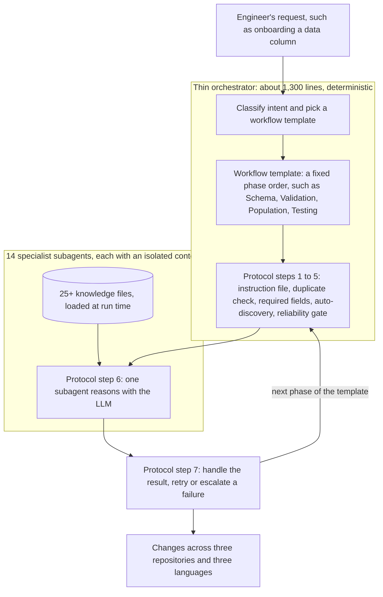

---
# Skeleton from Lead 4hevdtzk (Meta Engineering, ML Applications), picked 2026-10-27.
# Follow docs/editorial/case-study-writing-guide.md; the Author's check list
# is in the pull request. published and reviewed are the pick time, provisional: set them
# when you publish. verified: is the Author's alone (ADR-0007).
title: "Meta's thin orchestrator: how a 1,300-line router steers 14 AI agents"
description: "How Meta's thin orchestrator routes agent work by fixed rules to 14 isolated specialists, trading generality for fewer hallucinations."
kind: case-study
vertical: ai-ml-systems
tags: ["ai-agents", "llm", "orchestration", "context-engineering", "meta"]
published: "2026-10-27T17:47:15Z"
verified: 2026-10-28
reviewed: "2026-10-27T17:47:15Z"
author: mira-vance
# Optional: an image HastCode may use, beside this file, replaces the
# generated title card. Never a Source's image.
# hero: system-name.png
# hero_alt: "What the image shows"
# Optional: related Explainer slugs and extra sources (title + url).
# related: [metastable-failures]
---

The orchestrator in charge of Meta's data-pipeline agents is [1,300 lines long, routes more than 20 workflows to 14 specialised AI agents, and "performs zero domain work itself"](https://engineering.fb.com/2026/10/19/ml-applications/thin-orchestrator-ai-agent-architecture/). Meta got there by taking knowledge away: its first design was one agent that knew everything, and in production it started to hallucinate.

> Drafted with AI assistance, researched, verified and edited by the HastCode editorial team. We publish only as many pieces as the Author can verify this way.

## TL;DR

- The thin orchestrator is Meta's [two-layer agent system](https://engineering.fb.com/2026/10/19/ml-applications/thin-orchestrator-ai-agent-architecture/) for onboarding data columns across its recommendation systems: a deterministic router on top, 14 specialist subagents below.
- Meta built it because [one agent loaded with all the domain knowledge](https://engineering.fb.com/2026/10/19/ml-applications/thin-orchestrator-ai-agent-architecture/) got worse as its context grew, applying one subsystem's conventions to another.
- The router picks a workflow template, runs fixed checks with no model involved, hands one step to a specialist that loads its own knowledge files at run time, then handles the result.
- The price is generality: the system [trades it for deep domain knowledge](https://engineering.fb.com/2026/10/19/ml-applications/thin-orchestrator-ai-agent-architecture/), and about a third of its changes still need significant human edits. The surprise: a new use case shipped with no new agent code.

## A router, a template and one specialist at a time

The diagram is ours, redrawn from the text of Meta's post; Meta's own figures are in [the original](https://engineering.fb.com/2026/10/19/ml-applications/thin-orchestrator-ai-agent-architecture/). A request enters at the top. Everything inside the orchestrator box is ordinary code. A large language model (LLM) runs only inside the specialist box, at the step Meta numbers six.

The Step 1 to 5 sections below are our walk through this diagram, not Meta's seven protocol steps, which we always call "protocol step N". Top to bottom: Step 1 picks the template, Step 2 is the five deterministic checks, Step 3 is the specialist's work, Step 4 is how its knowledge arrives, and Step 5 is what the router does with the result.

## Why one agent that knew everything started to hallucinate

The job is onboarding a data column into Meta's recommendation systems. The pipeline is [config-as-code](https://engineering.fb.com/2026/10/19/ml-applications/thin-orchestrator-ai-agent-architecture/): Python configurations drive C++ code generation, which feeds data processing services, which populate analytics systems. One column touches three code repositories in three languages and passes through up to six pipeline stages that must stay in sync.

Meta's first agent carried [all of it](https://engineering.fb.com/2026/10/19/ml-applications/thin-orchestrator-ai-agent-architecture/): configuration schemas, code generation rules, pipeline routing logic, validation requirements and population patterns for more than ten data sources. In Meta's words, ["It worked in demos. In production, it started hallucinating."](https://engineering.fb.com/2026/10/19/ml-applications/thin-orchestrator-ai-agent-architecture/)

The failure had a shape. Past a certain amount of context, Meta writes, more knowledge [made the agent worse, not better](https://engineering.fb.com/2026/10/19/ml-applications/thin-orchestrator-ai-agent-architecture/). It cross-contaminated concepts: field naming conventions from one subsystem turned up in another, and a code generation pattern meant for one data source was used to populate from a different one. We infer that each mistake is plausible on its own, which is what makes it expensive: code that follows the wrong subsystem's conventions can look right to a reviewer, and only a build, a test or a person who knows both subsystems catches it.

The post does not say how often this happened, or what it cost in reverted changes.

## The designs Meta weighed before going thin

The post names three designs it argues against.

- **One agent with everything.** Rejected for the cross-contamination above. Meta points to a [study from Mount Sinai](https://www.nature.com/articles/s44401-026-00077-0) on clinical tasks, where an orchestrator handing each task to its own worker held 65.3% accuracy at batches of 80 tasks while a single agent fell to 16.6%, with up to 65-fold fewer tokens. Meta [calls its own experience "the inverse"](https://engineering.fb.com/2026/10/19/ml-applications/thin-orchestrator-ai-agent-architecture/): one agent drowning in its own knowledge.
- **A single agent with a hand-written prompt per task.** Meta evaluated this alternative, and it [succeeded 70 to 80% of the time](https://engineering.fb.com/2026/10/19/ml-applications/thin-orchestrator-ai-agent-architecture/), but only when an engineer wrote a custom system prompt for each job; without that, 10 to 20%. Meta's verdict: "This wasn't a prompt engineering problem. It was an architectural one."
- **A heavyweight orchestrator.** The conventional design makes the orchestrator [the smartest component](https://engineering.fb.com/2026/10/19/ml-applications/thin-orchestrator-ai-agent-architecture/), with all the context, reasoning about what to do and how.

The deciding argument is about where an error goes. When a heavyweight orchestrator hallucinates, [the error spreads downstream](https://engineering.fb.com/2026/10/19/ml-applications/thin-orchestrator-ai-agent-architecture/): it routes to the wrong agent, gathers the wrong fields or skips reliability checks. A router that follows a fixed protocol leaves little room for hallucination, Meta argues, because none of its routing or checks relies on a model; the risk moves into isolated specialist contexts, where failures are contained.

## Step 1: intent picks a workflow template

The orchestrator first [classifies the request's intent](https://engineering.fb.com/2026/10/19/ml-applications/thin-orchestrator-ai-agent-architecture/). Meta's advice to other teams is that routing should be deterministic, by "keyword matching, intent classification, field gathering", and that "Which subagent handles this?" is a routing decision: "Don't use an LLM for it." The post does not say how intent classification itself is implemented.

We infer that intent selects a workflow template; the post does not say how one is chosen. Meta separates [what needs to happen from how each step is performed](https://engineering.fb.com/2026/10/19/ml-applications/thin-orchestrator-ai-agent-architecture/): a template is a deterministic state machine, a fixed sequence of phases, that "constrain[s] the LLM's decision space". The post gives three:

| Workflow | Phases, in order |
|---|---|
| Column onboarding | Schema, Validation, Population, Testing |
| Event onboarding | Schema, Population, Validation, Testing, Event Processing |
| Pipeline migration | Assessment, Planning, Population, Validation, Monitoring |

All three draw on [the same pool of 14 subagents](https://engineering.fb.com/2026/10/19/ml-applications/thin-orchestrator-ai-agent-architecture/) in different orders. Note that column onboarding validates before population and event onboarding after it: the order is a fact the template owns, not a decision a model makes per request.

We infer that each phase of a template is one pass through the protocol below, which is how the diagram draws it. The post describes the template and the seven-step protocol separately and does not spell out how they nest.

## Step 2: five checks before any model runs

Every request follows [a fixed seven-step protocol](https://engineering.fb.com/2026/10/19/ml-applications/thin-orchestrator-ai-agent-architecture/), and the first five steps are ordinary code:

1. Read the relevant subagent's instruction file.
2. Check whether the target already exists, to prevent duplicates.
3. Gather required fields from the user.
4. Auto-discover what can be inferred, such as repository type and existing configurations.
5. Check the reliability gate for active warnings or required reviewers.

We infer that each step removes a way for a model to go wrong before one is involved. The duplicate check means no agent is asked to create something that is already there. Gathering fields from the user means a missing value is asked for, not guessed. Auto-discovery fills in what the codebase can answer. The gate looks for active warnings or required reviewers before work begins.

The orchestrator [never reasons about code, never generates configurations and never touches the codebase](https://engineering.fb.com/2026/10/19/ml-applications/thin-orchestrator-ai-agent-architecture/). Meta's summary: "It's a router."

The router also learns what to gather from the specialist. Every subagent declares a [pre-gathering checklist](https://engineering.fb.com/2026/10/19/ml-applications/thin-orchestrator-ai-agent-architecture/) of what the orchestrator must collect before delegation, and we infer that is what the instruction file read in protocol step 1 supplies, so the router can enforce a specialist's inputs without knowing its domain.

## Step 3: one specialist reasons, in its own context

Protocol step 6 is [the only step that involves LLM reasoning](https://engineering.fb.com/2026/10/19/ml-applications/thin-orchestrator-ai-agent-architecture/), and it runs inside one subagent with only its domain knowledge loaded. The router delegates "with full context", which we read as everything protocol steps 1 to 5 gathered.

The 14 subagents are [each a domain expert with an isolated context](https://engineering.fb.com/2026/10/19/ml-applications/thin-orchestrator-ai-agent-architecture/). A schema management agent knows configuration registries. A population agent knows how to generate code for each of ten data sources. A validation agent knows build systems and quality checks. "No agent sees the full picture," Meta writes, and calls that the feature.

Isolation is what stops the cross-contamination. The population agent for data source A [never sees data source B's patterns](https://engineering.fb.com/2026/10/19/ml-applications/thin-orchestrator-ai-agent-architecture/), so it cannot apply the wrong one.

Every subagent has [the same five-part structure](https://engineering.fb.com/2026/10/19/ml-applications/thin-orchestrator-ai-agent-architecture/): knowledge sources to load, the pre-gathering checklist, a step-by-step workflow, discovery patterns for finding relevant code in the monorepo, and troubleshooting that maps errors to fixes. That makes a new subagent "templated work, not greenfield engineering", and Meta says the 15th looks structurally identical to the first. We infer the uniformity also helps the router: it can treat all 14 alike because each declares its inputs the same way.

## Step 4: knowledge loads when the specialist runs

A specialist's knowledge is not built into it. Each subagent names [which domain files to load at run time](https://engineering.fb.com/2026/10/19/ml-applications/thin-orchestrator-ai-agent-architecture/), typically a few thousand tokens each. Meta keeps more than 25 knowledge files, organised by workflow domain.

Loading on demand has two effects the post names. An edit to a knowledge file reaches [the next session automatically](https://engineering.fb.com/2026/10/19/ml-applications/thin-orchestrator-ai-agent-architecture/), with no change to the orchestrator. And the same files serve more than one platform implementation of the agent. Meta's advice puts the alternative plainly: embed knowledge in the orchestrator and "every update requires redeployment".

Two of the post's authors, Plawan Rath and Ashwini Verma, also wrote [an April post on giving agents a map of a config-as-code data pipeline](https://engineering.fb.com/2026/04/06/developer-tools/how-meta-used-ai-to-map-tribal-knowledge-in-large-scale-data-pipelines/). There, more than 50 agents produced 59 context files of about 1,000 tokens each, written as ["compass, not encyclopedia"](https://engineering.fb.com/2026/04/06/developer-tools/how-meta-used-ai-to-map-tribal-knowledge-in-large-scale-data-pipelines/) and refreshed every few weeks by automated jobs. We infer that is the same discipline at work here, but the October post does not link the two, and its pipeline spans three repositories where April's opens by counting four (it later says three), so treat the connection as ours.

## Step 5: the router handles the result

Protocol step 7 [handles the result](https://engineering.fb.com/2026/10/19/ml-applications/thin-orchestrator-ai-agent-architecture/): surface errors, confirm success. It is deterministic again.

This is where Meta's third reason for the design applies: [failures are contained](https://engineering.fb.com/2026/10/19/ml-applications/thin-orchestrator-ai-agent-architecture/). If a subagent fails, the orchestrator retries or escalates, and the failure does not corrupt the orchestrator's state or any other subagent's context. We infer that a bad step costs one step.

The post does not say how many retries the router allows, what counts as a failure (a build error, a failed check, a model's own report), or who an escalation reaches. We infer the troubleshooting section of each subagent, which maps errors to resolutions, does some of that work before the router sees a failure at all.

Each layer can also be improved alone. A better model [improves all 14 subagents at once](https://engineering.fb.com/2026/10/19/ml-applications/thin-orchestrator-ai-agent-architecture/), a knowledge file update takes effect immediately, and a new template adds a capability without touching any agent.

## What it costs: generality, and a third of the changes

Meta names the main trade itself. The system reaches its results [by trading generality for deep domain knowledge](https://engineering.fb.com/2026/10/19/ml-applications/thin-orchestrator-ai-agent-architecture/), "a deliberate architectural choice". We infer that the router can only run workflows someone has written a template for, and that a request that fits no template, or needs a phase order no template has, goes back to a person rather than to a model that might improvise one.

The second cost is in the results. About [two-thirds of the system's changes land without significant human edits](https://engineering.fb.com/2026/10/19/ml-applications/thin-orchestrator-ai-agent-architecture/), so roughly a third still need them. Thin routing removes one source of error; it does not make the specialists right.

The third is upkeep, which the post implies but does not count. Fourteen subagents, more than 25 knowledge files and more than 20 workflows are all text that must track a changing codebase. Knowledge files that load at run time spread a fix instantly, and we infer they spread a mistake just as fast. Meta is exploring [automated feedback loops that propose knowledge changes](https://engineering.fb.com/2026/10/19/ml-applications/thin-orchestrator-ai-agent-architecture/), "with human review always gating any changes".

Finally, the router asks. Protocol step 3 gathers required fields from the user, so the design spends some of an engineer's attention up front to avoid a model guessing.

## The evidence: hours instead of days, with gaps

Meta's headline number is time. Configuration prep for a new column [took three to four days by hand](https://engineering.fb.com/2026/10/19/ml-applications/thin-orchestrator-ai-agent-architecture/), and about a day with Meta's earlier config-driven system. The thin orchestrator does it in under an hour. The second number is the share of changes that land without significant human edits: about two-thirds.

The strongest qualitative evidence is reuse. When Meta needed pipeline migration, [a completely new use case](https://engineering.fb.com/2026/10/19/ml-applications/thin-orchestrator-ai-agent-architecture/), it wrote a new workflow template that sequenced existing agents differently: "Zero new agent code."

The gaps are larger than the numbers. The post publishes no accuracy or hallucination rate for the thin design, so there is no like-for-like figure against the single agent's failures or the 70 to 80% of the prompt-per-task alternative. It does not say which model runs the subagents, how many columns or runs the numbers cover, how "significant human edits" is judged, or what a run costs in tokens or minutes of model time. The 65.3% and 16.6% figures come from [clinical tasks in another organisation's study](https://www.nature.com/articles/s44401-026-00077-0), not from Meta's pipeline.

The post shows how the system is built and that it saves days. It does not show, in numbers, that it hallucinates less.

## What a thin router makes possible

Today the system onboards data columns and events and migrates pipelines. Next, Meta is [scaling it to more data columns across new pipeline domains](https://engineering.fb.com/2026/10/19/ml-applications/thin-orchestrator-ai-agent-architecture/), betting that growth means new templates and knowledge files, not new agents.

The lesson travels to any team putting agents into production, and Meta offers it as such. Draw the line between deterministic and probabilistic work [for every component](https://engineering.fb.com/2026/10/19/ml-applications/thin-orchestrator-ai-agent-architecture/), and keep the router on the deterministic side. Make specialists structurally the same, so a new one is a form to fill in. Add capability by writing a new sequence before writing a new agent. Load knowledge when it is needed, so a fix ships without a deploy.

In our view, none of this is new to backend engineers: a workflow engine that sequences workers, with checks before each step and retries after, is an old shape, and Meta's post argues it holds when the workers are models. The cost is a narrower system that a person must extend by hand. What could go right is an agent platform whose router stays boring, so that a smarter model makes every specialist better at once without making the system harder to trust. Meta's own line: ["the most important component in our AI agent system is the one that does the least work."](https://engineering.fb.com/2026/10/19/ml-applications/thin-orchestrator-ai-agent-architecture/)

## Sources

- [The Thin Orchestrator: How We Made Our AI Agents More Reliable by Giving the Router Less to Do](https://engineering.fb.com/2026/10/19/ml-applications/thin-orchestrator-ai-agent-architecture/), Plawan Rath, Akhil Jindal and Ashwini Verma, Meta Engineering, 19 October 2026
- [How Meta Used AI to Map Tribal Knowledge in Large-Scale Data Pipelines](https://engineering.fb.com/2026/04/06/developer-tools/how-meta-used-ai-to-map-tribal-knowledge-in-large-scale-data-pipelines/), Krishna Ganeriwal, Plawan Rath and Ashwini Verma, Meta Engineering, 6 April 2026
- [Orchestrated multi agents sustain accuracy under clinical-scale workloads compared to a single agent](https://www.nature.com/articles/s44401-026-00077-0), npj Health Systems 3, article 23, published online 9 March 2026
