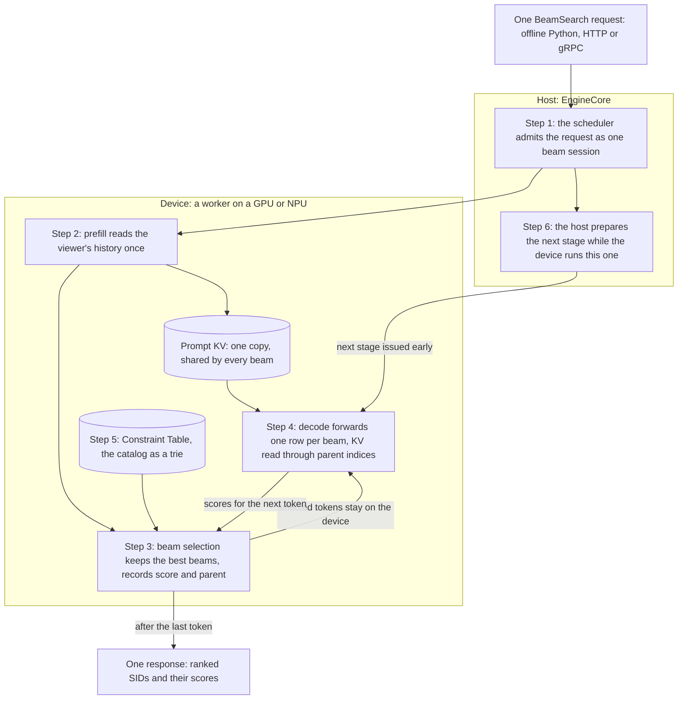

---
# Skeleton from Lead veci5pde (vLLM blog), picked 2026-11-26.
# Follows docs/editorial/case-study-writing-guide.md. published and reviewed
# are the pick time (make daily may move them to a Gap Day);
# make release keeps it (ADR-0012). verified: is the Author's alone (ADR-0007).
title: "vLLM-GR: how vLLM runs beam search inside the engine"
description: "vLLM-GR scores hundreds of candidate item IDs in one engine request over shared prompt KV; the price is fixed-length search and no model sharding."
kind: case-study
vertical: ai-ml-systems
tags: ["vllm", "generative-recommendation", "beam-search", "kv-cache", "llm-inference"]
published: "2026-11-25T07:37:22Z"
reviewed: "2026-11-25T07:37:22Z"
author: mira-vance
# Optional: an image HastCode may use, beside this file, replaces the
# generated title card. Never a Source's image.
# hero: system-name.png
# hero_alt: "What the image shows"
# Optional: related Explainer slugs and extra sources (title + url).
# related: [metastable-failures]
draft: true
---

OneRec-1.7B reads a viewer's history and returns [128 candidate item IDs](https://vllm.ai/blog/2026-11-24-vllm-gr-announcement#about), each [three tokens long](https://github.com/vllm-project/vllm-gr/blob/main/docs/configuration/constraint_tables.md): the reverse of a chat model's one long reply. vLLM-GR, announced on 24 November 2026, runs that whole search as one engine request. On an NVIDIA H20, at beam width 256 and batch size 8, its [P99 latency was 369.4 ms against SGLang's 1,280.1 ms](https://vllm.ai/blog/2026-11-24-vllm-gr-announcement#performance-evaluation). This is how a request moves through the engine, what those numbers do and do not show, and what the first release cannot do yet.

## TL;DR

- vLLM-GR is an [open-source inference and serving framework built on vLLM](https://vllm.ai/blog/2026-11-24-vllm-gr-announcement#about) for generative recommendation: a model reads a viewer's interaction history and generates the IDs of items to show next.
- The team built it to [cut the cost of wide candidate searches](https://vllm.ai/blog/2026-11-24-vllm-gr-announcement#why-vllm-gr). Upstream vLLM's beam search [loops in the frontend, resubmitting prompts at every step](https://github.com/vllm-project/vllm/blob/main/vllm/entrypoints/generate/beam_search/offline.py); vLLM-GR [submits the request to the engine once](https://github.com/vllm-project/vllm-gr#vllm-gr-is-fast-with).
- The scheduler admits [one beam session](https://vllm.ai/blog/2026-11-24-vllm-gr-announcement#inside-the-architecture) and prefill reads the history once. Beam selection, on the device, records each survivor's score and parent. Decode reads KV through those parent indices while the host prepares the next stage.
- The price: a fixed number of generated tokens, no model parallelism and one served model. The surprise: at batch size 1 on an RTX PRO 6000, [NVIDIA SID-GR was still faster](https://vllm.ai/blog/2026-11-24-vllm-gr-announcement#performance-evaluation).

## One request, one prefill, and a loop that stays on the device

The diagram is ours, redrawn from the text of the vLLM-GR team's post and the repository's design notes; the team's own figures are in [the original](https://vllm.ai/blog/2026-11-24-vllm-gr-announcement#inside-the-architecture).

Four terms first. A semantic ID (SID) is an item's ID written as a few model tokens; OneRec's model card calls them [itemic tokens](https://huggingface.co/OpenOneRec/OneRec-1.7B). Beam search keeps the best-scoring partial SIDs at each step: each one is a beam, and the beam width is how many survive. The KV cache holds the attention keys and values the model has already computed. Prefill is the pass over the prompt and decode is each later step, as our Explainer on [disaggregated inference](/ai-ml-systems/disaggregated-inference/) walks through.

The Step sections below walk the boxes in number order.

## Upstream beam search asks the engine again at every step

vLLM already has a beam search. In upstream vLLM it [runs in the entrypoint, outside the engine](https://github.com/vllm-project/vllm/blob/main/vllm/entrypoints/generate/beam_search/offline.py). A Python loop submits a new set of requests at every step, with `max_tokens=1`, `logprobs` set to twice the beam width, and one prompt per live beam. The frontend reads the log probabilities back, picks the survivors and builds the next step's prompts.

A recommender stresses exactly that loop. The history is long and the output is short. The team's overview charts hold [input at 1,024 tokens](https://vllm.ai/blog/2026-11-24-vllm-gr-announcement#performance-evaluation) at beam widths of 128 and 256. The one run described in full generates three tokens. Through the upstream loop at beam width 256, that is up to 256 prompts per viewer at each step, each returning 512 log probabilities. That count is our arithmetic from the upstream code, not a figure the team publishes.

The post names two costs it wants gone. The first is [duplicate work](https://vllm.ai/blog/2026-11-24-vllm-gr-announcement#why-vllm-gr): every beam shares one history, so the engine should hold that history's KV once. The second is coordination with the host at every step.

vLLM-GR's own entry point [never falls through to upstream vLLM's implementation](https://github.com/vllm-project/vllm-gr/blob/main/examples/offline_inference/beam_search/README.md#public-entrypoint).

## Why the team extended vLLM, and what the post leaves unargued

The post argues for one choice and against none by name. Its first goal is to [run recommendation models on the vLLM stack](https://vllm.ai/blog/2026-11-24-vllm-gr-announcement#why-vllm-gr), reusing vLLM's model execution, scheduling and paged KV cache. A team can then move from offline evaluation to online serving on NVIDIA GPUs and Ascend NPUs. The README calls vLLM-GR ["an independent extension of vLLM"](https://github.com/vllm-project/vllm-gr#about), with release 0.30.0 [built on vLLM 0.30.0](https://vllm.ai/blog/2026-11-24-vllm-gr-announcement#getting-started).

Three other backends appear, only as benchmark baselines: [SGLang Beam, NVIDIA SID-GR and xLLM](https://vllm.ai/blog/2026-11-24-vllm-gr-announcement#performance-evaluation). The post does not describe how any of them works, or say why the team did not build on one.

That leaves the upstream loop, and the argument against it is where it runs. Keep the bookkeeping between steps in the frontend and every step pays a round trip. Move it into the engine and, in the README's words, ["The frontend submits the request to EngineCore once."](https://github.com/vllm-project/vllm-gr#vllm-gr-is-fast-with)

## Step 1: the scheduler admits one beam session

A request arrives through [the offline Python interface, OpenAI-compatible HTTP or gRPC](https://vllm.ai/blog/2026-11-24-vllm-gr-announcement#key-features). vLLM-GR adds [a beam session that spans the whole search](https://vllm.ai/blog/2026-11-24-vllm-gr-announcement#inside-the-architecture) and tracks how the paths branch. EngineCore, where vLLM's scheduler runs, owns each session from admission to completion.

A session can carry more than one viewer, and the count is its batch size. The README allows [a batch of 1 to 8 requests that share generation parameters](https://github.com/vllm-project/vllm-gr/blob/main/examples/offline_inference/beam_search/README.md#current-restrictions). The scheduler then dispatches the session's prefill and decode stages to a worker on the device.

A batch runs whole or not at all. The scheduler [rejects a batch whose full extent exceeds the model context or the KV block pool](https://github.com/vllm-project/vllm-gr/blob/main/docs/design/feature/async_scheduling.md#native-request-accounting). We infer the reason: a search that ran out of KV blocks at its last decode would have wasted every stage before it. Refusing up front is cheaper.

## Step 2: prefill reads the history once

Prefill runs the model over the prompt, which here is the viewer's history, and writes the prompt KV. In vLLM-GR it does a second job. It selects the first-stage winners from one final prompt position per request.

The last position of the prompt already carries the scores for the first SID token. So the first selection needs no extra model rows. The README says prefill ["does not forward 128 Beam model rows for that first selection."](https://github.com/vllm-project/vllm-gr/blob/main/examples/offline_inference/beam_search/README.md#per-stage-beam-widths-through-the-python-api)

The README's own example makes the row counts concrete. It generates three SID tokens with per-stage beam widths of 128, then 64, then 32. At a batch of four viewers:

| Stage | Rows forwarded | Beams kept per viewer |
|---|---|---|
| Prefill | 4 prompts | 128 |
| Decode 1 | 512 | 64 |
| Decode 2 | 256 | 32 |

The 512 and 256 are the README's totals. The prefill row, and that they equal 4 × 128 and 4 × 64, are our reading. Three tokens take one prefill and two decodes, because each stage scores the token after the one it reads.

Beam width 128 does not mean 128 prefills. One prefill per viewer serves every beam.

## Step 3: beam selection records a score and a parent

After each stage the model has scores for the next token of every live beam. Beam selection keeps the best. In the post's words, ["beam selection records the score and parent of each surviving path."](https://vllm.ai/blog/2026-11-24-vllm-gr-announcement#inside-the-architecture) The parent is the beam a survivor grew from.

Selection runs on the device. [Device kernels select the highest-scoring valid continuations](https://github.com/vllm-project/vllm-gr#vllm-gr-is-fast-with), and the next decode uses the selected tokens there, with no host round trip per decision. Only the end result crosses over: the worker [ranks and packs it on the GPU and copies one compact payload to the host](https://github.com/vllm-project/vllm-gr/blob/main/examples/offline_inference/beam_search/README.md#public-entrypoint).

A per-stage beam width sets how many beams survive each step. A per-parent limit caps how many children one beam may contribute. Together they let a service [explore more partial IDs than it returns](https://vllm.ai/blog/2026-11-24-vllm-gr-announcement#key-features).

Narrowing is not free. The README says narrower intermediate widths ["intentionally prune the search"](https://github.com/vllm-project/vllm-gr/blob/main/examples/offline_inference/beam_search/README.md#per-stage-beam-widths-through-the-python-api).

## Step 4: decode reads KV through parent indices

A decode stage forwards one row per surviving beam. Each row attends to two things: the viewer's history and the beam's own earlier tokens.

The history is identical for every beam, so vLLM-GR keeps one copy. The README: ["All beams attend to the same cached prompt."](https://github.com/vllm-project/vllm-gr#vllm-gr-is-fast-with) The post says this [avoids copying the viewer's history for each candidate](https://vllm.ai/blog/2026-11-24-vllm-gr-announcement#key-features).

The beam's own tokens differ, and the survivors of one step are a reshuffled subset of the last. The parent indices from Step 3 resolve that. ["The next decode uses those parent indices to read the right KV state."](https://vllm.ai/blog/2026-11-24-vllm-gr-announcement#inside-the-architecture) The README calls the per-beam part the suffix. Each decode stage, per the design notes, ["writes current KV, selects successors and applies the parent KV mapping once before the next Forward."](https://github.com/vllm-project/vllm-gr/blob/main/docs/design/module/beam_state.md#stage-ordering-and-completion)

A count shows the size of the saving. Take the benchmark's 1,024-token history at beam width 256. A copy per beam would hold 256 × 1,024 = 262,144 token positions of KV. Shared, the search holds 1,024 positions plus a suffix of at most two per beam: 1,536 in all.

Those figures are ours. The post publishes no memory numbers. We infer the suffix length from Step 2: two decode stages, one new position each.

## Step 5: a Constraint Table keeps every SID in the catalog

A model can emit three tokens that match no item. vLLM-GR offers two modes: [search the full vocabulary, or restrict generation to SIDs in the item catalog](https://vllm.ai/blog/2026-11-24-vllm-gr-announcement#key-features). In the second, per the design notes, ["Each stage restricts the next SID token to legal continuations of the prefix."](https://github.com/vllm-project/vllm-gr/blob/main/docs/design/module/constraint_tables.md)

A build tool in the repository compiles the catalog into a Constraint Table: a trie, a tree keyed by prefix, [stored as tensors in a safetensors file](https://github.com/vllm-project/vllm-gr/blob/main/docs/design/module/constraint_tables.md#artifact-layout). It must be [built with the same model snapshot and tokenizer used for inference](https://github.com/vllm-project/vllm-gr/blob/main/docs/configuration/constraint_tables.md#build). On the device, selection takes its legal candidates from the trie. The post's figure shows one prefix dropped because no catalog item starts with it.

Keeping the catalog outside the weights lets the two change at different speeds. A service can [roll out model weights and replace item catalogs independently](https://github.com/vllm-project/vllm-gr#vllm-gr-is-flexible-and-easy-to-use-with). Under asynchronous Beam serving on CUDA, a table [can be replaced online](https://github.com/vllm-project/vllm-gr/blob/main/docs/configuration/constraint_tables.md#device-behavior-and-updates); on Ascend the engine restarts with the new one.

The mode is narrow today. Constrained generation needs [exactly three tokens](https://github.com/vllm-project/vllm-gr/blob/main/examples/offline_inference/beam_search/README.md#current-restrictions). The table operators [cap the per-parent limit at 256](https://github.com/vllm-project/vllm-gr/blob/main/examples/offline_inference/beam_search/README.md#per-stage-beam-widths-through-the-python-api), against 1,024 for unconstrained CUDA.

## Step 6: the host prepares the next stage early

A device that finishes a stage and then waits for the host is idle. vLLM-GR overlaps the two: [while the device executes one stage, the host prepares the next](https://vllm.ai/blog/2026-11-24-vllm-gr-announcement#key-features).

The puzzle is that decode 2 needs tokens that selection has not picked yet. The design notes [split the work](https://github.com/vllm-project/vllm-gr/blob/main/docs/design/feature/async_scheduling.md#cuda-dispatch-timeline). Preparing a step's input layout depends on the scheduled shape. Running its forward pass depends on the tokens the previous step selected.

The host knows the shape. The device knows the tokens. So EngineCore [can issue the next stage before the worker acknowledges the previous one](https://github.com/vllm-project/vllm-gr/blob/main/docs/design/feature/async_scheduling.md), and the notes add: "Selected tokens stay on the device."

We infer this is one reason the length is fixed. If a beam could stop early, the next stage's shape would depend on a result the host has not seen. The docs do not state that link.

The overlap is bounded: [up to two stages of the owning batch can await acknowledgement](https://github.com/vllm-project/vllm-gr/blob/main/docs/design/feature/async_scheduling.md#batch-ownership). The notes publish no measured timeline; they point to an external profiler to check the overlap.

## The first cost: every search runs a fixed number of tokens

The README says its per-stage-width path uses ["a fixed generated-token horizon"](https://github.com/vllm-project/vllm-gr/blob/main/examples/offline_inference/beam_search/README.md#per-stage-beam-widths-through-the-python-api), and that variable-length early stopping is not supported there. The roadmap lists the missing piece: [variable-length generation that can stop individual beams at EOS](https://vllm.ai/blog/2026-11-24-vllm-gr-announcement#future-roadmap), the end-of-sequence token, release their slots and KV, and admit new requests.

For three-token SIDs that costs nothing, since every item ID has the same length. It matters if your IDs vary in depth. A batch also [runs one `max_tokens`](https://github.com/vllm-project/vllm-gr/blob/main/docs/user_guide/onerec_quickstart.md), so prompts with different generation budgets cannot share a session.

The session also owns the engine while it runs. The design notes say that, meanwhile, ["ordinary requests are held back"](https://github.com/vllm-project/vllm-gr/blob/main/docs/design/feature/async_scheduling.md#batch-ownership). We infer that a vLLM-GR instance is best run as a dedicated recommender, not as a side workload on a chat deployment.

Batching can also change the answer. The quickstart warns: ["Running a list as one session does not guarantee identical beam rankings to separate B=1 calls."](https://github.com/vllm-project/vllm-gr/blob/main/docs/user_guide/onerec_quickstart.md) If you compare offline and online results, compare them at the same batch size.

## The second cost: one device, one model, no distributed KV cache

The restrictions list requires ["TP, PP, DP, DCP, and PCP sizes equal to 1."](https://github.com/vllm-project/vllm-gr/blob/main/examples/offline_inference/beam_search/README.md#current-restrictions) Those are vLLM's parallelism settings. DCP is [decode context parallelism](/ai-ml-systems/decode-context-parallelism/), which shards a request's KV cache across GPUs. With every size at 1, we read the list as one model on one device. It also rules out speculative decoding, LoRA, quantization, and hybrid, encoder-decoder and multimodal models.

KV reuse stops at the device too. Inside an instance, [vLLM's prefix cache skips prefill for matching prompt blocks](https://github.com/vllm-project/vllm-gr#vllm-gr-is-fast-with). Across instances, the roadmap only says "explore": a [distributed KV cache that lets a serving instance reuse KV blocks from another device](https://vllm.ai/blog/2026-11-24-vllm-gr-announcement#future-roadmap), on the same node or another.

The model list is one line long: [OneRec-1.7B](https://github.com/vllm-project/vllm-gr#vllm-gr-supports-the-following-models), built on [the Qwen3 backbone](https://huggingface.co/OpenOneRec/OneRec-1.7B). Mixture-of-experts (MoE) models, the subject of our Explainer on [expert parallelism](/ai-ml-systems/expert-parallelism/), are a roadmap item to explore.

Here is what vLLM-GR is not, yet: a ranker. It generates candidates. The README says ["Ranking a supplied candidate set is planned."](https://github.com/vllm-project/vllm-gr#about)

## The evidence: lowest P99 at beam width 256 from batch size 4 up

The [overview charts](https://vllm.ai/blog/2026-11-24-vllm-gr-announcement#performance-evaluation) hold input at 1,024 tokens, at batch sizes 1, 4 and 8, on four NVIDIA GPUs and two Ascend NPUs. Every figure is P99 latency: 99% of timed samples finished within it. These rows are at beam width 256:

| Device, batch size | vLLM-GR | Compared with |
|---|---|---|
| H20, 8 | 369.4 ms | NVIDIA SID-GR 428.1 ms, SGLang 1,280.1 ms |
| H20, 4 | about 191 ms | NVIDIA SID-GR about 191 ms |
| L20, 8 | 474.3 ms | NVIDIA SID-GR 790.7 ms |
| RTX PRO 6000, 1 | 29.21 ms | NVIDIA SID-GR 28.25 ms |
| A2 (Ascend), 8, catalog constraints on | 312.69 ms | xLLM 324.60 ms |

The post's claim is exact: ["At beam width 256, vLLM-GR recorded the lowest P99 among the backends shown at batch sizes 4 and 8 on all six accelerators."](https://vllm.ai/blog/2026-11-24-vllm-gr-announcement#performance-evaluation) On the H20 at batch size 8, SGLang's P99 is about 3.5 times vLLM-GR's, and SID-GR's is about 16% higher (our arithmetic).

The claim is narrower than it sounds. At batch size 1 on the RTX PRO 6000, SID-GR was faster at both widths. At beam width 128 the winner varies: on an A100 at batch size 8, SID-GR measured 199.0 ms and vLLM-GR 209.7 ms.

## What the benchmark does not show

The post is candid about method. Its figures ["summarize separate benchmark runs with different timing definitions, sample counts, and backend settings."](https://vllm.ai/blog/2026-11-24-vllm-gr-announcement#performance-evaluation)

The same section describes the RTX PRO 6000 run most fully: OneRec-1.7B, three generated tokens, whole-batch P99 over 48 timed batches after three warmups, catalog constraints off, HTTP excluded. The post gives no backend revisions for the comparisons, and no warmup counts for the other runs.

One setting differed in that run. SGLang Beam used its native candidate pool of twice the beam width; vLLM-GR and SID-GR used a pool equal to it. We infer SGLang did more selection work per step, so a gap there is not like for like. The post does not say which pool the H20 run used.

The post has no throughput, memory or recommendation-quality numbers, and no comparison with upstream vLLM's loop. It shows vLLM-GR level with or ahead of a GPU vendor's backend at wide beams and larger batches. It does not show how much each of the six steps contributes.

## What an in-engine beam search makes possible

The post credits contributors from [Inferact, the InferMatrix team, openPangu, TikTok, ByteDance and Lingquai](https://vllm.ai/blog/2026-11-24-vllm-gr-announcement#acknowledgements), and thanks teams for feedback from "large-scale production deployments". It names no production deployment of vLLM-GR itself.

Next, the roadmap aims at [a framework that serves both candidate generation and ranking](https://vllm.ai/blog/2026-11-24-vllm-gr-announcement#future-roadmap). It also lists an online scheduler that decides when to form a batch, and prefill tuned for histories of 10,000 tokens or more.

We infer the design travels beyond recommendation, to any workload shaped as one long shared prefix and many short branches. Admit the whole search as one unit. Hold the shared prefix once, with a parent index per branch. Keep selection on the device.

For your own decision, start from the shape of your IDs. If you serve fixed-length SIDs at beam widths in the hundreds from one GPU or NPU, benchmark vLLM-GR on your own histories and at your own batch size. If you need variable-length IDs, a model spread over several devices, or ranking, the roadmap says to wait.

What could go right is recommendation serving that shares an engine, a scheduler and a KV cache with LLM serving, so that work on one arrives in the other.

## Sources

- [Announcing vLLM-GR: Efficient Inference for Generative Recommendation](https://vllm.ai/blog/2026-11-24-vllm-gr-announcement), vLLM-GR Team, vLLM blog, 24 November 2026
- [vllm-project/vllm-gr README](https://github.com/vllm-project/vllm-gr), Apache-2.0
- [vLLM-GR: offline beam search example README](https://github.com/vllm-project/vllm-gr/blob/main/examples/offline_inference/beam_search/README.md)
- [vLLM-GR design notes: asynchronous scheduling](https://github.com/vllm-project/vllm-gr/blob/main/docs/design/feature/async_scheduling.md)
- [vLLM-GR design notes: beam state](https://github.com/vllm-project/vllm-gr/blob/main/docs/design/module/beam_state.md)
- [vLLM-GR design notes: constraint table layout and execution](https://github.com/vllm-project/vllm-gr/blob/main/docs/design/module/constraint_tables.md)
- [vLLM-GR configuration: constraint tables](https://github.com/vllm-project/vllm-gr/blob/main/docs/configuration/constraint_tables.md)
- [vLLM-GR user guide: OneRec quickstart](https://github.com/vllm-project/vllm-gr/blob/main/docs/user_guide/onerec_quickstart.md)
- [vLLM: offline beam search entrypoint, source](https://github.com/vllm-project/vllm/blob/main/vllm/entrypoints/generate/beam_search/offline.py)
- [OpenOneRec/OneRec-1.7B model card](https://huggingface.co/OpenOneRec/OneRec-1.7B), Hugging Face
