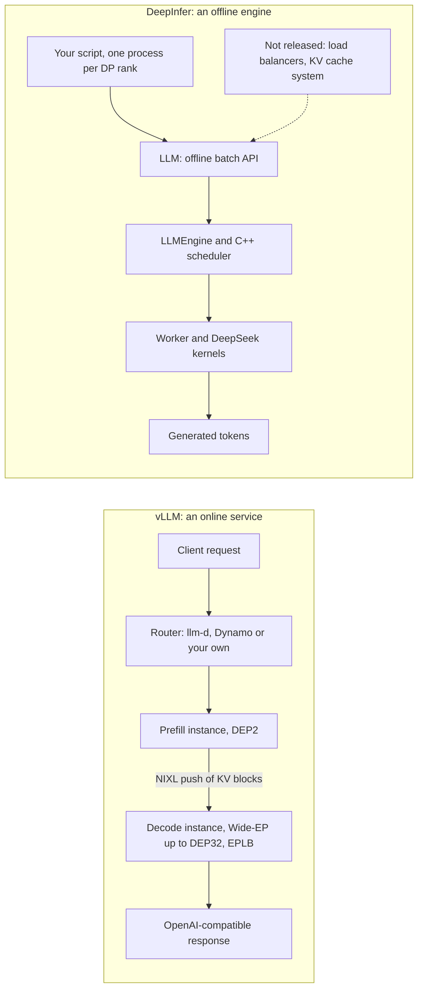

---
# Skeleton from Lead dq4uvlhm (vLLM blog), picked 2026-10-27.
# Follows docs/editorial/comparison-writing-guide.md.
# published and reviewed are the pick time, provisional: set them
# when you publish. verified: is the Author's alone (ADR-0007).
title: "vLLM vs DeepInfer: general-purpose or model-specific MoE serving"
description: "vLLM and DeepInfer both serve DeepSeek-V4.1-Flash: who ran each benchmark, how close they are, and what each ships around the engine."
kind: comparison
vertical: ai-ml-systems
tags: ["llm-inference", "vllm", "mixture-of-experts", "expert-parallelism", "gpu-serving"]
published: "2026-10-27T17:47:19Z"
reviewed: "2026-10-27T17:47:19Z"
author: mira-vance
# Optional: an image HastCode may use, beside this file, replaces the
# generated title card. Never a Source's image.
# hero: option-a-vs-option-b.png
# hero_alt: "What the image shows"
# Optional: related Explainer slugs and extra sources (title + url).
related: [deepinfer]
draft: true
---

On 23 October 2026, Inferact and the vLLM team reported that vLLM's decode throughput on DeepSeek-V4.1-Flash is [within 6% of DeepInfer's published results across batch sizes 8 to 256](https://vllm.ai/blog/2026-10-23-deepseek-v41-flash-pd-wide-ep#compared-to-deepinfer), at 131K context with nextn=3 (in DeepInfer's settings, a [maximum draft length](https://github.com/deepseek-ai/DeepInfer#deepinfer) of three tokens), on NVIDIA GB200. DeepInfer is DeepSeek's own engine for that model, the framework DeepSeek says [powers its large-scale production services](https://github.com/deepseek-ai/DeepInfer#deepinfer). That number is vLLM's measurement, set against values the vLLM team [read from the charts in DeepInfer's README](https://vllm.ai/blog/2026-10-23-deepseek-v41-flash-pd-wide-ep#compared-to-deepinfer); DeepInfer's own documents publish its curves and make no comparison. If a general-purpose engine lands that close to the model-specific one, what is left to choose? We answer the same six questions for both: who measured what, which models and hardware each runs, what ships for online serving, how each parallelises the model, how each balances load, and whether outputs are reproducible.

> Drafted with AI assistance, researched, verified and edited by the HastCode editorial team. We publish only as many pieces as the Author can verify this way.

## TL;DR

- **vLLM** is a general-purpose engine and server for [200+ model architectures](https://github.com/vllm-project/vllm#about); for DeepSeek-V4.1-Flash it adds DeepSeek's open kernels and model-specific work, and its team measured decode within 6% of DeepInfer.
- **DeepInfer** is DeepSeek's production engine, open-sourced as [offline inference for one model on NVIDIA SM100 GPUs or Huawei Ascend 950 NPUs](https://github.com/deepseek-ai/DeepInfer#deepinfer), without the KV cache system, disaggregation or load balancing a service needs.
- They differ most in what surrounds the engine: vLLM ships an OpenAI-compatible server, while DeepInfer [has no online-serving wrapper](https://github.com/deepseek-ai/DeepInfer/blob/main/deepinfer/engine/llm_engine.py).
- We infer: pick vLLM to serve V4.1-Flash behind an API today, or alongside other models; pick DeepInfer for reference offline runs, Ascend 950, or reproducible outputs on this model.

## One request through each engine, from a shared family tree

The two engines are related in both directions. DeepInfer [was originally built primarily on vLLM](https://github.com/deepseek-ai/DeepInfer#acknowledgments), and vLLM has [continuously integrated kernels from DeepSeek's libraries, including MegaAttn, MegaMoE and Mega-mHC](https://vllm.ai/blog/2026-10-23-deepseek-v41-flash-pd-wide-ep#compared-to-deepinfer). Both run the attention layers data-parallel and the experts expert-parallel: DeepSeek's deployment Q&A says [attention uses data parallelism (#DP = #EP)](https://github.com/deepseek-ai/DeepInfer/blob/main/doc/inference_deployment_qa.md#inference-system-overview), and vLLM's DEPn means [data-parallel attention plus expert parallelism over n GPUs](https://vllm.ai/blog/2026-10-23-deepseek-v41-flash-pd-wide-ep#footnote-label).

The diagram follows one request. In vLLM's rack-scale setup, a router sends it to a prefill instance, which pushes the KV cache to a decode instance over NIXL, and the answer streams back through an OpenAI-style API. In DeepInfer, your own script batches the prompt into the offline `LLM` API on each data-parallel rank; the pieces that would make it a service are described in DeepSeek's Q&A but are not in the repository.

## vLLM: one engine for many models, tuned here for one

vLLM describes itself as [a fast and easy-to-use library for LLM inference and serving](https://github.com/vllm-project/vllm#about), with an OpenAI-compatible API server, tensor, pipeline, data, expert and context parallelism, and disaggregated prefill, decode and encode. Its model list includes [`DeepseekV4ForCausalLM`](https://docs.vllm.ai/en/latest/models/supported_models/#text-generation).

For DeepSeek-V4.1-Flash, the vLLM team's [first post](https://vllm.ai/blog/2026-10-07-deepseek-v41-flash#kernels) integrated DeepSeek's new kernels from DeepSelect, DeepGEMM and FlashMLA, and applied [SWA bounded replay](https://vllm.ai/blog/2026-10-07-deepseek-v41-flash#swa-bounded-replay), which rebuilds the sliding-window (SWA) KV cache by rerunning only the last 128 tokens instead of storing it; it is [on by default for DeepSeek-V4.1](https://vllm.ai/blog/2026-10-07-deepseek-v41-flash#cuda-graphs-for-the-trimmed-layers).

The Lead scales that to [one NVIDIA GB300 NVL72 rack with prefill/decode (P/D) disaggregation and Wide-EP](https://vllm.ai/blog/2026-10-23-deepseek-v41-flash-pd-wide-ep): P/D disaggregation runs the two phases on separate instances, and Wide-EP spreads experts across many GPUs. Prefill runs on [small DEP2 instances](https://vllm.ai/blog/2026-10-23-deepseek-v41-flash-pd-wide-ep#prefill-dep2-works-best) and decode on [Wide-EP up to DEP32](https://vllm.ai/blog/2026-10-23-deepseek-v41-flash-pd-wide-ep#the-scaling-of-wide-ep). KV moves through the [NIXL push connector](https://vllm.ai/blog/2026-10-14-nixl-push-connector#architecture-overview): the decode instance registers its blocks with the prefill instance, which writes KV into them. The result was [954K tokens/s per GPU at a P90 of 196 tokens/s per user](https://vllm.ai/blog/2026-10-23-deepseek-v41-flash-pd-wide-ep) on SemiAnalysis AgentX, counting [cached input, uncached input and output tokens](https://vllm.ai/blog/2026-10-23-deepseek-v41-flash-pd-wide-ep#performance-overview).

## DeepInfer: DeepSeek's production engine, released offline

DeepInfer's README calls it [the high-performance inference framework that powers DeepSeek's large-scale production services](https://github.com/deepseek-ai/DeepInfer#deepinfer), and says "This open-source release provides offline inference with the core features needed for serving at scale." Those features are attention data parallelism with balanced context parallelism, MoE expert parallelism with EPLB (expert-parallel load balancing), DSpark speculative decoding with confidence-scheduled verification, SWA bounded replay, an asynchronous zero-overhead batch scheduler, batch-invariant inference, deterministic sampling and structured outputs. The kernels are DeepSeek's own: [FlashMLA, DeepGEMM, DeepEP, TileKernels, DeepSelect and custom TileLang kernels](https://github.com/deepseek-ai/DeepInfer#deepinfer).

The [deployment Q&A](https://github.com/deepseek-ai/DeepInfer/blob/main/doc/inference_deployment_qa.md) describes the production system the engine sits in: disaggregated vision-encoder, prefill and decode instances plus dedicated storage nodes, with [EP2–8 for prefill and EP64–128 for decode](https://github.com/deepseek-ai/DeepInfer/blob/main/doc/inference_deployment_qa.md#inference-system-overview). DeepSeek says [a single cluster currently serves 155 trillion tokens per day](https://github.com/deepseek-ai/DeepInfer/blob/main/doc/inference_deployment_qa.md). Our [DeepInfer Repo Profile](/ai-ml-systems/deepinfer/) walks the open-sourced engine from the code, from the `LLM` API down to the vendored kernels.

## Benchmarks: vLLM ran the comparison, DeepSeek published its curves

Every head-to-head number comes from the vLLM team. For decode, it ran vLLM on GB200 under [DeepSeek's decode configuration (131K context, nextn=3)](https://vllm.ai/blog/2026-10-23-deepseek-v41-flash-pd-wide-ep#compared-to-deepinfer) and compared it with DeepInfer's charted results. For prefill, [the setups differ](https://vllm.ai/blog/2026-10-23-deepseek-v41-flash-pd-wide-ep#compared-to-deepinfer): DeepInfer's curve uses EP4DP4 with 32 redundant experts and a 140-token replay, and vLLM's uses DEP2 on GB300 with no redundant experts, a 128-token replay and its own prompts. The vLLM team is explicit: ["we do not read the gap between the two curves as an engine-to-engine speedup."](https://vllm.ai/blog/2026-10-23-deepseek-v41-flash-pd-wide-ep#compared-to-deepinfer) Its claim is that vLLM's prefill tracks DeepSeek's curve.

The vLLM post says DeepInfer's prefill chart [does not state its hardware](https://vllm.ai/blog/2026-10-23-deepseek-v41-flash-pd-wide-ep#compared-to-deepinfer); the README text under the charts says they were [measured on 4 SM100 GPUs for prefill and 64 for decode, each within one scale-up domain](https://github.com/deepseek-ai/DeepInfer#performance-benchmarks). They are offline benchmarks, and DeepSeek says its production load balancing reaches [roughly 80% of a perfectly balanced offline benchmark](https://github.com/deepseek-ai/DeepInfer/blob/main/doc/inference_deployment_qa.md#data-parallel-load-balancing). Both curves also sit on public kernels, which DeepSeek says are [at most 5% apart end-to-end](https://github.com/deepseek-ai/DeepInfer/blob/main/doc/inference_deployment_qa.md#kernel-implementation) from its internal versions.

Both sides quote a cost figure near $38. vLLM reports [$38.96 per GPU-hour at DeepSeek's off-peak prices](https://vllm.ai/blog/2026-10-23-deepseek-v41-flash-pd-wide-ep) for its AgentX run; DeepSeek reports [overall revenue of US$38 per GPU-hour (at valley pricing)](https://github.com/deepseek-ai/DeepInfer/blob/main/doc/inference_deployment_qa.md) for a production cluster. One is a benchmark on one rack and the other a cluster's revenue, so we would not rank the engines on them.

## Models and hardware: hundreds of architectures, or one model on two chips

vLLM supports [200+ model architectures on Hugging Face](https://github.com/vllm-project/vllm#about), from dense decoders to MoE, hybrid and multimodal models. Its README lists [NVIDIA, AMD and Intel GPUs and x86, ARM and PowerPC CPUs, plus hardware plugins including Google TPUs and Huawei Ascend](https://github.com/vllm-project/vllm#about). Every DeepSeek-V4.1-Flash number in [the Lead](https://vllm.ai/blog/2026-10-23-deepseek-v41-flash-pd-wide-ep) was measured on NVIDIA systems: GB200, GB300 and B300. The Sources we read do not say whether the Ascend plugin runs V4.1-Flash.

DeepInfer lists one supported model, [DeepSeek-V4.1-Flash, and two hardware targets, NVIDIA SM100 GPUs and Huawei Ascend 950 NPUs](https://github.com/deepseek-ai/DeepInfer#deepinfer), with [CUDA 13 or CANN 9.2](https://github.com/deepseek-ai/DeepInfer#prerequisites). Supporting accelerators from several vendors was [one of the system's three goals from the start](https://github.com/deepseek-ai/DeepInfer/blob/main/doc/inference_deployment_qa.md), and DeepSeek says [inference code for future DeepSeek models](https://github.com/deepseek-ai/DeepInfer/blob/main/doc/inference_deployment_qa.md) will continue to land in DeepInfer.

So the two are narrow in different directions. vLLM is broad across models, and its published numbers for this model are on NVIDIA. DeepInfer is narrow on models, but it is the one of the two whose own documentation names Ascend 950 for this model.

## Online serving: what ships, and what you build

vLLM ships the server. `vllm serve` with `--data-parallel-size` exposes [a single API endpoint](https://docs.vllm.ai/en/latest/serving/data_parallel_deployment/#internal-load-balancing) over several data-parallel engines, and the docs add hybrid and external load-balancing modes for larger deployments. Disaggregation is less finished. vLLM's docs mark disaggregated prefilling [experimental and subject to change](https://docs.vllm.ai/en/latest/features/disagg_prefill/#disaggregated-prefilling-experimental), and the expert-parallel guide's P/D example uses a client-side orchestration script, adding ["We are actively working on routing solutions."](https://docs.vllm.ai/en/latest/serving/expert_parallel_deployment/#setup-steps) A disaggregation guide on the vLLM blog, by Martin Hickey of IBM Research, says its example proxy is ["fine for development but not for production"](https://vllm.ai/blog/2026-09-29-disaggregated-serving-guide#running-prefilldecode) and points to llm-d or NVIDIA Dynamo.

DeepInfer ships the engine. Its `LLMEngine` docstring says ["This release does not include an online-serving wrapper."](https://github.com/deepseek-ai/DeepInfer/blob/main/deepinfer/engine/llm_engine.py) The README lists what a complete service needs and the release leaves out: [a KV cache system, VE/Prefill/Decode disaggregation and load balancing across data-parallel replicas](https://github.com/deepseek-ai/DeepInfer#deepinfer), though "most required engine functionality is already implemented" for disaggregation. DeepSeek says its KV cache management and load balancing components are [tightly coupled to our internal infrastructure](https://github.com/deepseek-ai/DeepInfer/blob/main/doc/inference_deployment_qa.md). It did release [deepseek-recipe](https://github.com/deepseek-ai/deepseek-recipe) separately, which converts between API protocols and token sequences.

We infer that neither gives you a production P/D system by itself: vLLM gives you a server and hands routing to llm-d or Dynamo; DeepInfer gives you an engine and a written design.

## Parallelism: narrow for prefill, wide for decode, in both

Here the two teams agree. DeepSeek's rule is [the smallest EP/DP that HBM allows for prefill (EP2–8) and the largest the available GPUs allow for decode (EP64–128, Wide-EP)](https://github.com/deepseek-ai/DeepInfer/blob/main/doc/inference_deployment_qa.md#inference-system-overview). It puts the smallest efficient deployment unit at [64 GPUs of prefill plus 64 of decode](https://github.com/deepseek-ai/DeepInfer/blob/main/doc/inference_deployment_qa.md#inference-system-overview).

The vLLM team reached the same shape by measuring. In an AgentX prefill-only run at concurrency 256, [DEP4 gave only 83% of DEP2's per-GPU throughput (53.3K vs. 64.4K tokens/s)](https://vllm.ai/blog/2026-10-23-deepseek-v41-flash-pd-wide-ep#prefill-dep2-works-best), and replays pointed at data-parallel imbalance, so DEP2 became its default. For decode, going from [DEP4 to DEP32 cut the target model's MegaMoE time from 13.4 to 6.0 ms](https://vllm.ai/blog/2026-10-23-deepseek-v41-flash-pd-wide-ep#the-scaling-of-wide-ep) while the rest of the step stayed around 10 ms, so per-GPU gains diminish; at DEP32 the draft model's communication starts to offset them.

The width differs. vLLM's measured decode [tops out at DEP32](https://vllm.ai/blog/2026-10-23-deepseek-v41-flash-pd-wide-ep#the-scaling-of-wide-ep) inside one NVL72 rack; DeepSeek recommends [EP64 or above](https://github.com/deepseek-ai/DeepInfer/blob/main/doc/inference_deployment_qa.md#inference-system-overview). We infer that this reflects the hardware each team describes, an NVL72 rack for vLLM and [64–128-GPU supernodes](https://github.com/deepseek-ai/DeepInfer/blob/main/doc/inference_deployment_qa.md) for DeepSeek, rather than a difference between the engines.

## Load balancing: experts and requests

Both engines move hot experts with EPLB, at different cadences. DeepSeek's decode setting starts from [1 redundant expert per GPU, a 1,000-step statistics window and a re-assignment every 10,000 steps](https://github.com/deepseek-ai/DeepInfer/blob/main/doc/inference_deployment_qa.md#expert-parallel-load-balancing). In the Lead, vLLM [rearranged experts every 3,000 steps based on the previous 1,000](https://vllm.ai/blog/2026-10-23-deepseek-v41-flash-pd-wide-ep#eplb), the defaults in [its EPLB configuration](https://docs.vllm.ai/en/latest/serving/expert_parallel_deployment/#eplb-parameters), and balanced the DSpark draft model's experts as well as the target's. The two report the same ratio upside down: DeepSeek's `moe_lb` is slowest rank over mean, vLLM's balancedness is mean over max. The setups differ, so we do not compare the values.

Balancing requests across data-parallel ranks shows a real design difference. DeepSeek's Decode Load Balancer [balances request count and total KV cache length](https://github.com/deepseek-ai/DeepInfer/blob/main/doc/inference_deployment_qa.md#data-parallel-load-balancing), because KV length sets the cost of attention. The vLLM team measured that for this model, [6.7× the context adds only 0.6 ms (+7%)](https://vllm.ai/blog/2026-10-23-deepseek-v41-flash-pd-wide-ep#measure-the-model-first) to the target's decode forward, so balancing can be ["least-load by request count per rank"](https://vllm.ai/blog/2026-10-23-deepseek-v41-flash-pd-wide-ep#measure-the-model-first). vLLM's built-in balancer uses [the running and waiting queues in each engine](https://docs.vllm.ai/en/latest/serving/data_parallel_deployment/#internal-load-balancing). DeepInfer's balancers are not in the release.

## Reproducible outputs: a switch, or a beta

DeepInfer makes reproducibility a documented switch for this model. `DEEPINFER_BATCH_INVARIANT=1` keeps [model results identical across different batch compositions](https://github.com/deepseek-ai/DeepInfer#deepinfer), and deterministic sampling adds a fixed `seq_seed` with `DEEPINFER_ENABLE_MTP_VARLEN=0`, the switch that turns DSpark off. Both are NVIDIA only.

vLLM's batch invariance, enabled with `VLLM_BATCH_INVARIANT=1`, is [in beta](https://docs.vllm.ai/en/latest/features/batch_invariance/#batch-invariance) and runs on NVIDIA GPUs of compute capability 8.0 or higher, AMD Instinct and Intel XPUs. Its [tested-models list](https://docs.vllm.ai/en/latest/features/batch_invariance/#tested-models) names DeepSeek-V3, V3-0324, R1 and V3.1, but no V4 model, and the docs warn it ["may impact performance"](https://docs.vllm.ai/en/latest/features/batch_invariance/#implementation-details).

We infer that if you need identical outputs from DeepSeek-V4.1-Flash, for evaluation or reinforcement-learning rollouts, DeepInfer is the only one of the two that documents it for this model today.

## Trade-offs

Each cell summarises a section above, where its source is linked.

| Question | vLLM | DeepInfer |
|---|---|---|
| Who measured the head-to-head | The vLLM team, against DeepInfer's README charts | No comparison published; its own offline curves |
| Decode throughput on V4.1-Flash | Within 6% at batch sizes 8 to 256 (vLLM's measurement) | Published curve, 64 SM100 GPUs |
| Prefill throughput | Tracks DeepInfer's curve; setups differ | Published curve, 4 SM100 GPUs |
| Models | 200+ architectures, including DeepSeek-V4 | DeepSeek-V4.1-Flash only |
| Hardware for this model | NVIDIA GB200, GB300 and B300 in the Lead | NVIDIA SM100 GPUs, Huawei Ascend 950 NPUs |
| Online API | OpenAI-compatible server built in | None; deepseek-recipe released separately |
| P/D disaggregation | NIXL connectors, experimental; routing from llm-d or Dynamo | Engine support mostly there; orchestration not released |
| Prefill and decode width | DEP2 prefill; decode measured up to DEP32 | EP2–8 prefill; EP64–128 decode |
| Expert rebalancing | EPLB every 3,000 steps in the Lead | EPLB every 10,000 steps for decode |
| Request balancing across ranks | Running and waiting queues; request count suffices for this model | Request count and total KV length; not released |
| Batch invariance | Beta; not tested on DeepSeek-V4 | Documented switch, NVIDIA only |

## When to pick vLLM or DeepInfer for DeepSeek-V4.1-Flash

Everything in this section is our inference from the facts above.

**vLLM wins when you need to serve V4.1-Flash behind an API now**, or run it next to other models on one stack. You get a server, data-parallel load balancing and P/D connectors, and the vLLM team's own numbers put decode within a few percent of DeepSeek's engine. Watch two things: the head-to-head is the vLLM team's, measured against values read off charts, so benchmark your own workload; and production disaggregation still needs a router from llm-d, Dynamo or your own code.

**DeepInfer wins when you want DeepSeek's reference behaviour**: offline batch evaluation, a baseline to check another engine against, identical outputs on NVIDIA, or Ascend 950 hardware. Watch the gaps: no server, no KV cache system, no load balancers, and one model. Teams that adopt it for online traffic take on building what DeepSeek kept internal.

The encouraging part is how much the two now share. Kernels flow from DeepSeek into vLLM, the engine design flowed from vLLM into DeepInfer, and both teams arrived at narrow prefill and wide decode. Whichever you choose, the other is a working reference to measure it against.

## Sources

- Inferact and the vLLM Team, [Serving DeepSeek-V4.1-Flash at Scale: vLLM Matches DeepInfer and Scales to GB300 NVL72](https://vllm.ai/blog/2026-10-23-deepseek-v41-flash-pd-wide-ep), vLLM blog, 23 October 2026: TL;DR, Performance overview, Compared to DeepInfer, Measure the model first, Prefill: DEP2 works best, The scaling of Wide-EP, EPLB, footnotes.
- Inferact and the vLLM Team, [DeepSeek-V4.1-Flash on vLLM: 5x Agentic Throughput Since Day 0](https://vllm.ai/blog/2026-10-07-deepseek-v41-flash), vLLM blog, 7 October 2026: SWA bounded replay, CUDA graphs for the trimmed layers, Kernels.
- Sunita Nadampalli (AWS) and Nicolò Lucchesi (Mistral), [Push-Based KV Transfer to Improve TTFT and TPOT for Disaggregated Inference in vLLM](https://vllm.ai/blog/2026-10-14-nixl-push-connector), vLLM blog, 14 October 2026: Architecture overview.
- Martin Hickey (IBM Research), [Taking vLLM Apart: A Practical Guide to Disaggregated Serving](https://vllm.ai/blog/2026-09-29-disaggregated-serving-guide), vLLM blog, 29 September 2026: Running Prefill/Decode.
- [vLLM README](https://github.com/vllm-project/vllm#about): About.
- vLLM documentation: [Supported Models](https://docs.vllm.ai/en/latest/models/supported_models/) (Text Generation), [Data Parallel Deployment](https://docs.vllm.ai/en/latest/serving/data_parallel_deployment/) (Internal Load Balancing), [Expert Parallel Deployment](https://docs.vllm.ai/en/latest/serving/expert_parallel_deployment/) (EPLB Parameters, Setup Steps), [Disaggregated Prefilling](https://docs.vllm.ai/en/latest/features/disagg_prefill/), [Batch Invariance](https://docs.vllm.ai/en/latest/features/batch_invariance/) (Hardware Requirements, Tested Models, Implementation Details).
- [DeepInfer README](https://github.com/deepseek-ai/DeepInfer#readme): supported models, features and hardware, Prerequisites, Performance benchmarks, Acknowledgments.
- DeepSeek-AI, [DeepSeek V4.1 Flash Inference Deployment Q&A](https://github.com/deepseek-ai/DeepInfer/blob/main/doc/inference_deployment_qa.md): introduction, Inference system overview, Expert-parallel load balancing, Data-parallel load balancing, Kernel implementation.
- DeepInfer, [`deepinfer/engine/llm_engine.py`](https://github.com/deepseek-ai/DeepInfer/blob/main/deepinfer/engine/llm_engine.py), `LLMEngine` docstring.
- [deepseek-recipe](https://github.com/deepseek-ai/deepseek-recipe), DeepSeek-AI.
