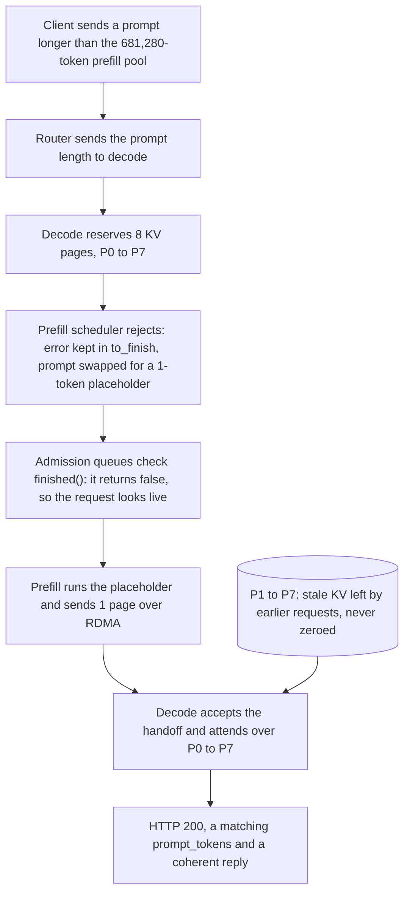

---
# Skeleton from Lead qdxbo7cb (Cloudflare blog), picked 2026-10-30.
# Follows docs/editorial/case-study-writing-guide.md; the Author's check list
# is in the pull request. published and reviewed are the pick time, provisional: set them
# when you publish. verified: is the Author's alone (ADR-0007).
title: "Workers AI KV cache exposure: how a rejected prompt read stale pages"
description: "How a KV pool smaller than GLM-5.3's context and an ignored SGLang abort let Workers AI decode read stale pages, and what the fixes cost."
kind: case-study
vertical: ai-ml-systems
tags: ["llm-inference", "kv-cache", "sglang", "security", "cloudflare"]
published: "2026-10-30T10:03:55Z"
reviewed: "2026-10-30T10:03:55Z"
author: mira-vance
# Optional: an image HastCode may use, beside this file, replaces the
# generated title card. Never a Source's image.
# hero: system-name.png
# hero_alt: "What the image shows"
# Optional: related Explainer slugs and extra sources (title + url).
related: [disaggregated-inference]
draft: true
---

From 27 August to 9 September 2026, the GLM-5.3 model on Cloudflare Workers AI answered [155 very long prompts](https://blog.cloudflare.com/kv-cache-exposure-remediation/) with responses that could carry data from other customers' requests made shortly before. Each one looked like a success: Cloudflare writes that the client got ["HTTP 200 instead of HTTP 400"](https://blog.cloudflare.com/kv-cache-exposure-remediation/), with a matching prompt token count and a coherent reply.

> Drafted with AI assistance, researched, verified and edited by the HastCode editorial team. We publish only as many pieces as the Author can verify this way.

## TL;DR

- Workers AI serves GLM-5.3 with [SGLang in a disaggregated setup](https://blog.cloudflare.com/kv-cache-exposure-remediation/): prefill GPUs build a prompt's KV cache, decode GPUs receive it over RDMA and generate the reply. A prompt that should have been rejected instead made decode read cache pages another request had left behind.
- Two faults lined up. The prefill KV pool held [681,280 tokens against a 1,048,576-token context window](https://blog.cloudflare.com/kv-cache-exposure-remediation/), so valid long prompts were rejected; and SGLang's rejection was [invisible to the disaggregated admission queues](https://blog.cloudflare.com/kv-cache-exposure-remediation/), so the request ran anyway.
- Decode had reserved eight pages; prefill filled one. Pages are [not zeroed between requests](https://blog.cloudflare.com/kv-cache-exposure-remediation/), so attention read seven pages of stale data and the reply came back as a success.
- Cloudflare grew the pool to about 2.04 million tokens, pushed an admission fix that [SGLang merged](https://github.com/sgl-project/sglang/pull/38935), and is prototyping per-page ownership tags that cost [under 1% in its tests](https://blog.cloudflare.com/kv-cache-exposure-remediation/). The surprise: the bug had been [reported upstream](https://github.com/sgl-project/sglang/issues/30233) two months earlier.

## Eight pages reserved, one written, eight read

The diagram is ours, redrawn from the text of Cloudflare's post; Cloudflare's own walkthrough is in [the original](https://blog.cloudflare.com/kv-cache-exposure-remediation/). It follows one over-length prompt, using the post's own example of a request that reserves eight KV pages.

Step 1 below covers the reservation, Step 2 the rejection that looked alive, and Step 3 the read that returned a success. The sections after them cover the fixes, what they cost, and what Cloudflare is building next.

If prefill and decode on separate GPUs is new to you, our explainer on [disaggregated inference](/ai-ml-systems/disaggregated-inference/) covers why serving stacks split them and what the KV cache handoff carries.

## A pool smaller than the window, and tests that checked status codes

The KV cache holds intermediate state for every token a model has seen. In SGLang it lives in GPU memory as [a shared pool of fixed-size pages](https://blog.cloudflare.com/kv-cache-exposure-remediation/): a request gets pages when it is admitted and gives them back when it finishes.

The pool's size is not a setting an operator writes down. SGLang [derives it at startup](https://blog.cloudflare.com/kv-cache-exposure-remediation/) from the GPU memory left after loading the weights, and nothing forces it to agree with the model's configured context length. For GLM-5.3, launched on 27 August, the prefill pool came out at 681,280 tokens while the context window was 1,048,576. SGLang prints the pool size at startup and exposes it as a metric.

Cloudflare saw the gap. ["We were aware of this mismatch before launch,"](https://blog.cloudflare.com/kv-cache-exposure-remediation/) the post says. Pre-launch benchmarks at long contexts returned success codes and streams with no error frames, so the team took it that the engine handled the gap gracefully. The post names the hole itself: the tests checked [HTTP response codes and engine performance](https://blog.cloudflare.com/kv-cache-exposure-remediation/) without validating model output and coherence.

We infer this is the root of the whole incident. A prompt between 681,280 and 1,048,576 tokens was legal by the model's advertised limit but could not fit in the pool, so it had to take SGLang's rejection path. That path was rarely exercised, and in a disaggregated deployment it was broken.

## The defences Cloudflare could reach for

The post does not set out alternatives and reject them in turn, but its fixes, recommendations and open work name six defences.

- **Make the pool fit.** Matching GLM-5.3's configuration to GLM-5.2's [freed enough GPU memory](https://blog.cloudflare.com/kv-cache-exposure-remediation/) for a prefill pool of about 2.04 million tokens, roughly twice the context window, so valid prompts never reach the rejection path. The post does not say which setting changed.
- **Lower the context length** to fit the pool, which is the [advice to operators](https://blog.cloudflare.com/kv-cache-exposure-remediation/) whose pool is smaller.
- **Enforce the limit in a proxy.** Cloudflare [advises against relying on this](https://blog.cloudflare.com/kv-cache-exposure-remediation/), or on assuming the engine will reject oversized prompts.
- **Reject at admission in the engine,** before any handoff state exists. Cloudflare calls the upgrade that does this [the backstop](https://blog.cloudflare.com/kv-cache-exposure-remediation/) for the day the pool-size check is wrong.
- **Zero pages on release.** This is [still a draft](https://github.com/sgl-project/sglang/pull/46435); Cloudflare says not zeroing is [necessary for the best performance](https://blog.cloudflare.com/kv-cache-exposure-remediation/).
- **Check integrity:** [checksums on each transfer, canary markers, and per-page ownership tags](https://blog.cloudflare.com/kv-cache-exposure-remediation/).

In our reading, the deciding argument is depth. Configuration makes the bad path unreachable; the engine fix makes it harmless if a configuration slips; integrity checks catch the class of bug neither one anticipates. We infer Cloudflare chose all three because the first had already failed once while every test passed.

## Step 1: decode reserves pages before prefill decides

In Workers AI's setup, prefill GPUs process the prompt and produce its KV cache, and decode GPUs receive that cache and generate the reply. The cache moves between them [over RDMA, using Mooncake](https://blog.cloudflare.com/kv-cache-exposure-remediation/).

The order of operations matters. The router [sends decode the prompt length](https://blog.cloudflare.com/kv-cache-exposure-remediation/), and decode reserves pages for the whole prompt before prefill has run. Cloudflare calls this first step bootstrap. In the post's example, an eight-page prompt gets eight pages, P0 to P7.

We infer why the design reserves early: decode must have room ready for the RDMA writes before prefill starts sending, because an RDMA write lands directly in the receiver's memory. The SGLang team's post makes the related point that one-sided writes bypass the receiver's CPU, so decode gets [no signal for each write](https://www.lmsys.org/blog/2026-10-26-cf-security) that it could wait on.

The consequence is that decode commits memory on a promise. It holds eight pages and trusts prefill to fill them. Nothing at this stage checks whether prefill will accept the request at all, so the reservation is made for prompts that prefill is about to reject.

## Step 2: a rejection the admission queues could not see

On prefill, a prompt longer than the pool was rejected through SGLang's `Req.set_finish_with_abort`. It [recorded the error for the client](https://blog.cloudflare.com/kv-cache-exposure-remediation/) and swapped the prompt for a one-token placeholder, so the request could drain through normal batching without allocating real memory.

On a single node that works: the placeholder runs, the batch finishes, and the client receives an error. Disaggregation added two admission queues, one on prefill and one on decode, and both [checked `req.finished()`](https://blog.cloudflare.com/kv-cache-exposure-remediation/) to decide whether a request was live. The rejection was stored in `to_finish`, not `finished_reason`, so `finished()` returned false and both queues admitted the request.

The upstream pull request that closed the admission gap describes the same thing from the engine side: the rejection was recorded in `to_finish`, so [the request looked live](https://github.com/sgl-project/sglang/pull/38935) and could complete a bootstrap handshake, reserve a metadata buffer and run a forward pass on a one-token stub.

In our view this is the bug's real shape. Two fields meant "this request is over", and code written for one deployment mode checked only one of them. Nothing crashed, because the rejected request was well-formed in every way a queue could see.

## Step 3: one page arrives, eight are read, and the reply is a success

Prefill ran its forward pass on the placeholder, [sent one page of KV and signalled completion](https://blog.cloudflare.com/kv-cache-exposure-remediation/). Decode accepted the handoff as complete and attention read all eight reserved pages. P0 held the placeholder's state. In Cloudflare's words, pages P1 to P7 ["still held what earlier requests left in them"](https://blog.cloudflare.com/kv-cache-exposure-remediation/).

They held it because KV pages are [not zeroed between requests](https://blog.cloudflare.com/kv-cache-exposure-remediation/): the next owner simply overwrites a page. Cloudflare says that approach is [common among inference engines](https://blog.cloudflare.com/kv-cache-exposure-remediation/), and it makes the engine responsible for knowing exactly who owns each page, including pages a remote prefill node writes into.

We infer how stale state becomes another customer's text. Decode generates by attending over the keys and values in its pages, so pages from someone else's prompt condition the reply on that prompt. Cloudflare says only that generation attended over the old data.

To the client it looked like a success, though the reply arrived [faster than an eight-page prefill should take](https://blog.cloudflare.com/kv-cache-exposure-remediation/). Another operator had seen a version of this in July. Issue [#30233](https://github.com/sgl-project/sglang/issues/30233), opened 6 July on GLM-5.2-FP8, reported decode output "unrelated to the input" after an over-length abort. A bot closed it for inactivity on 5 September, three days before Cloudflare's report arrived.

## The fixes: pool, admission, and the race next door

A researcher, Gadi Evron of Knostic, reported the issue [through HackerOne on 8 September](https://blog.cloudflare.com/kv-cache-exposure-remediation/). The next day Cloudflare's Product Security reproduced the leak from two independent accounts within 25 minutes; Cloudflare took the model offline within 40 minutes of declaring an incident, moved every prefill node to the larger pool, and restored the model that evening.

The engine fix landed upstream in two parts. [#36988](https://github.com/sgl-project/sglang/pull/36988) retires aborted prefill requests before results reach decode. [#38935](https://github.com/sgl-project/sglang/pull/38935), merged 16 September, [follows Cloudflare's draft patch](https://blog.cloudflare.com/kv-cache-exposure-remediation/) and retires intake-rejected requests at both admission queues, so they never enter the handoff. In its author's test with both workers rejecting, decode's response went from a 300-second timeout to an immediate 400. Cloudflare recommends [v0.5.22 or later](https://blog.cloudflare.com/kv-cache-exposure-remediation/), which carries both.

The incident also exposed a second bug class. When a request aborts while prefill is still writing over RDMA, the writes already sent [cannot be recalled](https://blog.cloudflare.com/kv-cache-exposure-remediation/); if decode frees those pages at once, late writes land in the next owner's cache. SGLang says this race affected default disaggregated setups with RDMA backends [from the v0.4.x line until v0.5.21](https://www.lmsys.org/blog/2026-10-26-cf-security) (v0.5.22 for MORI), and each occurrence was silent. The fix is deferred release: decode holds the pages until prefill confirms the transfer drained, or a timeout fires. It is [on by default after #41023](https://blog.cloudflare.com/kv-cache-exposure-remediation/).

## What the fixes cost

Each layer has a price, and the post is open about most of them.

**Memory.** A pool sized at twice the context window is memory not spent on something else. We infer that matching GLM-5.2's configuration gave something up to free it; the post does not say what.

**Held pages.** Deferred release keeps pages reserved after an abort until the transfer drains or times out. SGLang suggests [timeouts of 60 to 120 seconds](https://www.lmsys.org/blog/2026-10-26-cf-security) for operators setting it by hand on v0.5.19 or v0.5.20 and a metric to watch the timeout ratio. We infer those held pages reduce the room left for live requests under abort-heavy load. Cloudflare also changed its load balancer so a client disconnect no longer aborts mid-transfer: it [holds the prefill connection until prefill finishes](https://blog.cloudflare.com/kv-cache-exposure-remediation/), avoiding the abort in the first place.

**Detection that is opt-in.** The per-transfer checksum (`--disaggregation-enable-kv-checksum`) and the KV canary are switches an operator must turn on, and Cloudflare says [coverage is incomplete](https://blog.cloudflare.com/kv-cache-exposure-remediation/); it is still extending them to GLM-5.3, GLM-5.3 Flash and DeepSeek V4. The post gives no overhead figure for either.

**Zeroing, not taken.** Zeroing pages on free would make a buggy read get [zeros instead of stale data](https://github.com/sgl-project/sglang/pull/46435), but that pull request is still an opt-in draft, and Cloudflare says not zeroing is [necessary for the best performance](https://blog.cloudflare.com/kv-cache-exposure-remediation/).

## The evidence, and what the post leaves out

Cloudflare's evidence is a count and a test. It found [155 affected responses](https://blog.cloudflare.com/kv-cache-exposure-remediation/), all to prompts over 681,280 tokens, and says, "We found no evidence of deliberate exploitation": after excluding its own and the researcher's testing, timing and volume looked like ordinary long-context use. The fixed deployment was validated against the researcher's reproduction script and Cloudflare's canary-marker tests, and a canary prefill node with a larger pool was confirmed not susceptible before the rollout.

The gaps are worth naming. The post says stale pages held [other users' prompts and partial generations](https://blog.cloudflare.com/kv-cache-exposure-remediation/), but not how much of any one prompt leaked or what kind of data it was. It says "a small number of customers" and gives no count, and it does not say whether affected customers were notified. It gives no page size in tokens, no GPU or node counts, and no measured overhead for checksums or deferred release. The one performance number, under 1% for page tags, comes from a prototype Cloudflare [tested on GLM-5.2](https://blog.cloudflare.com/kv-cache-exposure-remediation/), not GLM-5.3.

Two Sources also differ in emphasis. SGLang's post describes the rejection path and the RDMA race as [two linked problems](https://www.lmsys.org/blog/2026-10-26-cf-security) and spends most of its length on the race; Cloudflare's says the incident bug was the rejection path, which hit [every time, not by timing accident](https://blog.cloudflare.com/kv-cache-exposure-remediation/).

## What page ownership tags make possible

Cloudflare's next step is to make a stale read fail by construction. In its prototype, [each physical KV page carries a tag](https://blog.cloudflare.com/kv-cache-exposure-remediation/) that changes whenever the page is reallocated, each request records the tags it expects, and the mapping is checked before decode reads the cache. The aim is to fail that one request rather than return someone else's data. The cost in Cloudflare's tests was under 1% in throughput and tail latency. It is not shipped: the team tested it on GLM-5.2 in mid-August but [disabled it shortly afterwards](https://blog.cloudflare.com/kv-cache-exposure-remediation/) for reliability issues, and it was tied to specific attention backends and model architectures. Unlike the transfer checksum, tags [check every read](https://blog.cloudflare.com/kv-cache-exposure-remediation/), including reads long after the transfer.

Further out, Cloudflare plans to [model and prove the safety](https://blog.cloudflare.com/kv-cache-exposure-remediation/) of an RDMA-based KV transfer protocol, as it did for [Topaz](https://blog.cloudflare.com/topaz-policy-engine-design/) and [Meerkat](https://blog.cloudflare.com/meerkat-introduction/), then model its production SGLang KV cache system on Mooncake and track and fix any divergence from the safety properties it wants.

The lesson travels beyond LLM serving. Reuse buffers without clearing them and ownership is your only isolation; split the system and two places must agree on it. Test the error path for its output, not its status code. What could go right is an inference engine where a request can only ever read pages it was handed, so a bug like this one becomes a failed request instead of a leak.

## Sources

- [Cross-request KV cache exposure in the GLM-5.3 Workers AI model, and our remediation with SGLang](https://blog.cloudflare.com/kv-cache-exposure-remediation/), Michelle Chen, Cloudflare blog, 26 October 2026
- [SGLang security update: improving request isolation](https://www.lmsys.org/blog/2026-10-26-cf-security), SGLang Team, LMSYS blog, 26 October 2026
- [#38935: Do not admit intake-rejected requests to a PD handoff](https://github.com/sgl-project/sglang/pull/38935), SGLang pull request, merged 16 September 2026
- [#36988](https://github.com/sgl-project/sglang/pull/36988), SGLang pull request: retire aborted prefill requests before results reach decode
- [#30233: PD disaggregation: aborted prefill requests (input too long) cause decode to generate garbage from incomplete KV cache](https://github.com/sgl-project/sglang/issues/30233), SGLang issue, opened 6 July 2026
- [#46435: mem_cache: Optionally zero KV pages on free](https://github.com/sgl-project/sglang/pull/46435), SGLang draft pull request
- [How we prevent conflicts in authoritative DNS configuration using formal verification](https://blog.cloudflare.com/topaz-policy-engine-design/), Cloudflare blog, and [Introducing Meerkat: an experiment in global consensus](https://blog.cloudflare.com/meerkat-introduction/), Cloudflare blog: earlier formal verification work the Lead cites
