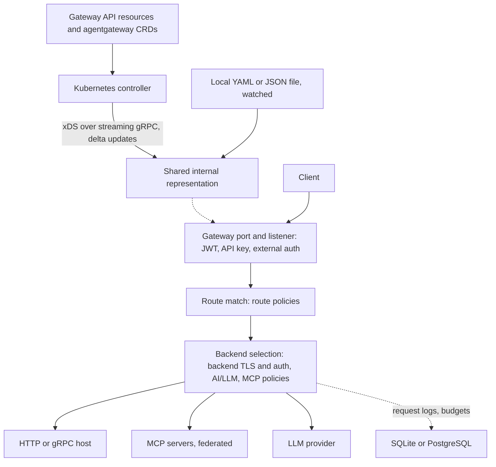

Agentgateway's control plane talks to its proxies over Envoy's xDS transport protocol but sends none of Envoy's types: [one `HTTPRoute` rule becomes one `Route`, and one Pod becomes one `Workload`](https://github.com/agentgateway/agentgateway/blob/main/architecture/configuration.md), so a one-field change ships as one small message instead of a multi-megabyte route list.

> Drafted with AI assistance, researched, verified and edited by the HastCode editorial team. We publish only as many pieces as the Author can verify this way.

## TL;DR

- Agentgateway is an [open source proxy built on MCP and A2A](https://github.com/agentgateway/agentgateway#readme) that is also a [general-purpose HTTP and gRPC data plane with load balancing, timeouts, retries, TLS and rate limits](https://agentgateway.dev/docs/standalone/latest/documentation/about/introduction/), written in [Rust on Tokio and Hyper](https://agentgateway.dev/blog/2026-06-04-designing-agentgateway-unified-gateway/).
- One configuration model, two ways in: a watched YAML or JSON file, or a Kubernetes controller that turns Gateway API resources into [purpose-built xDS types](https://github.com/agentgateway/agentgateway/blob/main/architecture/configuration.md) rather than Envoy's.
- Solo.io created it, [donated it to the Linux Foundation in August 2025](https://agentgateway.dev/blog/2025-08-25-solo-contributes-agentgateway-to-lf/), and it [joined the Agentic AI Foundation](https://agentgateway.dev/blog/2026-06-04-agentgateway-joins-aaif/) in 2026.
- Adopt it if you want one Gateway API gateway for services, LLM providers and MCP servers. Wait if you need quiet upgrades: [1.6.0](https://github.com/agentgateway/agentgateway/releases/tag/v1.6.0) and [1.5.0](https://github.com/agentgateway/agentgateway/releases/tag/v1.5.0) each opened with a list of breaking changes.

## In 60 seconds

The README has no install commands; it [links to the quickstarts](https://github.com/agentgateway/agentgateway#getting-started). These four, from the standalone [non-agentic HTTP quickstart](https://agentgateway.dev/docs/standalone/latest/documentation/quickstart/non-agentic-http/), install the binary, start httpbin on port 8000, start agentgateway (with no config it [bootstraps one](https://agentgateway.dev/docs/standalone/latest/documentation/setup/install/binary/) with a gateway on port 4000 and serves its UI at `http://localhost:4000/ui/`) and send a request through the gateway. Between the third and fourth command the quickstart uses the UI to add a gateway named `httpbin` on port 3000 and a route to `127.0.0.1:8000`.

```sh
curl -sL https://agentgateway.dev/install | bash

docker run --rm -d -p 8000:80 --name httpbin kennethreitz/httpbin

agentgateway

curl -i http://localhost:3000/headers
```

## Architecture

Configuration arrives in [one of three forms](https://github.com/agentgateway/agentgateway/blob/main/architecture/configuration.md): static settings (ports, logging) set once; a local YAML or JSON file, watched, that can define every gateway, route, backend and policy; or xDS from a remote control plane. The last two translate into one shared internal representation the proxy runs on.

On Kubernetes that control plane is the [controller](https://agentgateway.dev/docs/kubernetes/latest/documentation/about/architecture/), Go under [`controller/`](https://github.com/agentgateway/agentgateway/tree/main/controller). It watches Gateway API resources (Gateways, HTTPRoutes, GRPCRoutes, TCPRoutes, TLSRoutes) and its CRDs (AgentgatewayBackend, AgentgatewayParameters, AgentgatewayPolicy), turns them into Binds, Listeners, Routes, Backends, Policies and Addresses, and streams them to each proxy over gRPC as delta updates. A deployer runs one proxy Deployment per Gateway in the `agentgateway` GatewayClass. Resources point up to their parent, and policies travel as-is with a reference to where they attach, so the proxy resolves precedence at request time.

Inside the proxy, a request enters a gateway (a named port) and listener, where [gateway-level policies](https://agentgateway.dev/docs/standalone/latest/documentation/configuration/policies/attachment/) such as JWT, API key and external auth run before route selection; route policies run once a route matches; backend policies (backend TLS and auth, AI/LLM, MCP authentication and authorization) run after backend selection. A backend is a plain host, an [MCP server or an LLM provider](https://agentgateway.dev/docs/standalone/latest/documentation/configuration/overview/). [CEL expressions](https://github.com/agentgateway/agentgateway/blob/main/architecture/cel.md) drive authorization, header and body changes, rate-limit keys and log fields; parsed on configuration change, they tell the proxy which request data to keep. Routing needs no database; LLM request logs, API-key budgets and UI edits in hybrid mode go to [SQLite or PostgreSQL](https://agentgateway.dev/docs/standalone/latest/documentation/setup/database/).



## Use it if

- You run the Kubernetes Gateway API and want LLM providers and MCP servers behind the same Gateway as your services: the controller handles [HTTPRoute, GRPCRoute, TCPRoute and TLSRoute](https://agentgateway.dev/docs/kubernetes/latest/documentation/about/architecture/), and the v1.0 post says it [passes all Gateway API conformance tests, standard, extended and experimental](https://agentgateway.dev/blog/2026-03-12-agentgateway-v1.0/).
- You want one OpenAI-compatible endpoint in front of [many providers](https://agentgateway.dev/docs/standalone/latest/documentation/llm/about/) (OpenAI, Anthropic, Bedrock, Azure, Gemini, Vertex AI, Cohere and more), with virtual models for traffic splits and failover and [per-key token or dollar budgets](https://github.com/agentgateway/agentgateway/releases/tag/v1.5.0).
- You federate MCP servers: the README lists [stdio, HTTP, SSE and Streamable HTTP transports, OpenAPI integration and OAuth](https://github.com/agentgateway/agentgateway#key-features), and the docs [expose several servers on one endpoint or on separate paths](https://agentgateway.dev/docs/standalone/latest/documentation/mcp/about/).
- Proxy overhead matters. The project's own benchmark, a mock backend under Fortio at 32 connections, measured [36,933 requests a second at 0.831 ms p50 against LiteLLM's 3,198](https://agentgateway.dev/blog/2026-06-26-benchmarking-agentgateway-vs-litellm/); repeat it on your hardware before you believe it.

## Don't use it if

- You need configuration that holds still across minor versions. [1.6.0](https://github.com/agentgateway/agentgateway/releases/tag/v1.6.0) changed Anthropic-to-OpenAI conversion, provider base URLs and path matching; [1.5.0](https://github.com/agentgateway/agentgateway/releases/tag/v1.5.0) changed token counts, JWT claim rules and policy merging. Pin a version and read every breaking list, or pick Envoy Gateway for a slower-moving surface.
- Your proxy logic needs Lua or WASM. Agentgateway's in-proxy extension point is [CEL](https://github.com/agentgateway/agentgateway/blob/main/architecture/cel.md), which its own docs call "not as powerful as alternatives like Lua or WASM", plus external auth and external processing callouts; use Envoy where you need scripting in the data path.
- You expect upgrades without a blip from one replica. The upgrade docs say [every upgrade restarts the process](https://agentgateway.dev/docs/standalone/latest/documentation/operations/upgrade/) and to expect a brief interruption at the Helm default of one replica; run several replicas, and back up the database first in hybrid mode.
- You rely on Gateway API session persistence, multi-cluster services or retry budgets: the [Gateway API page](https://agentgateway.dev/docs/kubernetes/latest/documentation/about/gateway-api/) lists GEP-1619, GEP-1748 and GEP-3388 as unsupported.

## Alternatives

- [Envoy Gateway](https://gateway.envoyproxy.io): the Gateway API implementation on Envoy; agentgateway's creators [evaluated Envoy first](https://agentgateway.dev/blog/2025-08-25-solo-contributes-agentgateway-to-lf/) and judged MCP and A2A would need a significant re-architecture, so choose it when the traffic is HTTP and gRPC and Envoy's ecosystem matters more than protocol awareness.
- [Envoy AI Gateway](https://aigateway.envoyproxy.io): the Envoy project's LLM gateway, built on Envoy Gateway; the choice when you already run Envoy Gateway and want LLM routing without a second proxy.
- [kgateway](https://kgateway.dev): the Envoy-based project that [delivered agentgateway's Kubernetes controller until v1.0](https://agentgateway.dev/blog/2026-03-12-agentgateway-v1.0/); the same lineage with an Envoy data plane.
- [LiteLLM](https://github.com/BerriAI/litellm): a Python LLM proxy with broad provider coverage; agentgateway's [own benchmark](https://agentgateway.dev/blog/2026-06-26-benchmarking-agentgateway-vs-litellm/) puts it far behind on proxy overhead, while noting the test measured a mock backend, not features.

## FAQ

### Is agentgateway production ready?

Agentgateway reached [v1.0.0 in March 2026](https://agentgateway.dev/blog/2026-03-12-agentgateway-v1.0/) and ships Docker images, Helm charts and binaries with every release, but [1.5.0](https://github.com/agentgateway/agentgateway/releases/tag/v1.5.0) and [1.6.0](https://github.com/agentgateway/agentgateway/releases/tag/v1.6.0) each listed breaking changes and the [README](https://github.com/agentgateway/agentgateway#roadmap) still calls it "in active development". Pin a version and read each release's breaking list before upgrading.

### Does agentgateway support MCP?

Yes. Agentgateway's README lists [tool federation and stdio, HTTP, SSE and Streamable HTTP transports](https://github.com/agentgateway/agentgateway#key-features), and the docs [expose several MCP servers on one endpoint or on separate paths](https://agentgateway.dev/docs/standalone/latest/documentation/mcp/about/).

### Does agentgateway work with the Kubernetes Gateway API?

Yes. Agentgateway's controller handles [HTTPRoute, GRPCRoute, TCPRoute and TLSRoute](https://agentgateway.dev/docs/kubernetes/latest/documentation/about/architecture/), and the v1.0 post says it [passes all Gateway API conformance tests](https://agentgateway.dev/blog/2026-03-12-agentgateway-v1.0/); session persistence, multi-cluster services and retry budgets are [unsupported](https://agentgateway.dev/docs/kubernetes/latest/documentation/about/gateway-api/).

### How does agentgateway compare to Envoy?

Agentgateway is not built on Envoy: Solo.io [evaluated Envoy first](https://agentgateway.dev/blog/2025-08-25-solo-contributes-agentgateway-to-lf/) and judged MCP and A2A would need a significant re-architecture, so it wrote a Rust proxy that keeps Envoy's xDS transport but [uses its own resource types](https://github.com/agentgateway/agentgateway/blob/main/architecture/configuration.md).

### What are the alternatives to agentgateway?

The main alternatives to agentgateway are Envoy Gateway (the Gateway API on Envoy, without MCP awareness), Envoy AI Gateway (LLM routing on Envoy Gateway), kgateway (the Envoy-based project its controller was split from) and LiteLLM (a Python LLM proxy).

### How is agentgateway licensed?

Agentgateway is under the [Apache License 2.0](https://github.com/agentgateway/agentgateway/blob/main/LICENSE); Solo.io [donated it to the Linux Foundation in 2025](https://agentgateway.dev/blog/2025-08-25-solo-contributes-agentgateway-to-lf/), a [Technical Steering Committee](https://github.com/agentgateway/agentgateway/blob/main/CHARTER.md) oversees it, and it [joined the Agentic AI Foundation](https://agentgateway.dev/blog/2026-06-04-agentgateway-joins-aaif/) in 2026.

## Verdict

Agentgateway is the most complete answer we have seen to "one gateway for services, models and tools": a Rust data plane that treats MCP and A2A as first-class protocols, a Kubernetes controller that speaks the Gateway API and passes its conformance suite, and a configuration model whose xDS resources mirror the objects you wrote. We recommend it for platform teams already on the Gateway API who are about to put LLM providers and MCP servers behind the same front door, and for anyone whose current LLM proxy is the bottleneck. We would hold off where configuration stability matters more than features: 1.5.0 and 1.6.0 both changed behaviour you would have relied on, upgrades restart the process, and in-proxy extension stops at CEL. A few consecutive minors without a breaking list, or a published deprecation policy, would change that answer.

## Sources

- [agentgateway README](https://github.com/agentgateway/agentgateway#readme)
- [agentgateway architecture notes: configuration](https://github.com/agentgateway/agentgateway/blob/main/architecture/configuration.md)
- [agentgateway architecture notes: CEL](https://github.com/agentgateway/agentgateway/blob/main/architecture/cel.md)
- [agentgateway Technical Charter](https://github.com/agentgateway/agentgateway/blob/main/CHARTER.md)
- [agentgateway LICENSE](https://github.com/agentgateway/agentgateway/blob/main/LICENSE)
- [agentgateway `controller/` directory](https://github.com/agentgateway/agentgateway/tree/main/controller)
- [Kubernetes documentation: architecture](https://agentgateway.dev/docs/kubernetes/latest/documentation/about/architecture/)
- [Kubernetes documentation: Gateway API support](https://agentgateway.dev/docs/kubernetes/latest/documentation/about/gateway-api/)
- [Kubernetes documentation: install with Helm](https://agentgateway.dev/docs/kubernetes/latest/documentation/install/helm/)
- [Standalone documentation: introduction](https://agentgateway.dev/docs/standalone/latest/documentation/about/introduction/)
- [Standalone documentation: non-agentic HTTP quickstart](https://agentgateway.dev/docs/standalone/latest/documentation/quickstart/non-agentic-http/)
- [Standalone documentation: install the binary](https://agentgateway.dev/docs/standalone/latest/documentation/setup/install/binary/)
- [Standalone documentation: configuration overview](https://agentgateway.dev/docs/standalone/latest/documentation/configuration/overview/)
- [Standalone documentation: policy attachment](https://agentgateway.dev/docs/standalone/latest/documentation/configuration/policies/attachment/)
- [Standalone documentation: database](https://agentgateway.dev/docs/standalone/latest/documentation/setup/database/)
- [Standalone documentation: upgrade](https://agentgateway.dev/docs/standalone/latest/documentation/operations/upgrade/)
- [Standalone documentation: LLM gateway](https://agentgateway.dev/docs/standalone/latest/documentation/llm/about/)
- [Standalone documentation: MCP](https://agentgateway.dev/docs/standalone/latest/documentation/mcp/about/)
- [Designing agentgateway: a unified high-performance gateway for AI and API traffic](https://agentgateway.dev/blog/2026-06-04-designing-agentgateway-unified-gateway/)
- [Solo.io contributes agentgateway to Linux Foundation](https://agentgateway.dev/blog/2025-08-25-solo-contributes-agentgateway-to-lf/)
- [A year in: agentgateway hits v1.0.0](https://agentgateway.dev/blog/2026-03-12-agentgateway-v1.0/)
- [agentgateway joins AAIF](https://agentgateway.dev/blog/2026-06-04-agentgateway-joins-aaif/)
- [Benchmarking agentgateway vs LiteLLM](https://agentgateway.dev/blog/2026-06-26-benchmarking-agentgateway-vs-litellm/)
- [v1.6.0 release page](https://github.com/agentgateway/agentgateway/releases/tag/v1.6.0)
- [v1.5.0 release page](https://github.com/agentgateway/agentgateway/releases/tag/v1.5.0)
