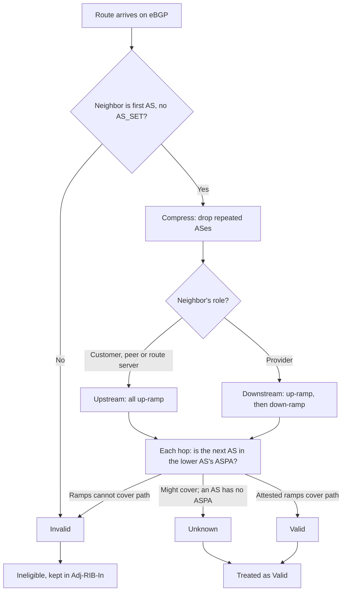

---
# Skeleton from Lead rn3u6ylb (APNIC blog), picked 2026-10-27.
# Follow docs/editorial/concept-writing-guide.md and replace every
# author placeholder line. published and reviewed are the pick time, provisional: set them
# when you publish. verified: is the Author's alone (ADR-0007).
title: "ASPA: how BGP routers check the AS path for route leaks"
description: "ASPA lets a network sign the list of its transit providers, so routers can reject AS paths that climb, dip and climb again: the shape of a route leak."
kind: concept
vertical: apis-networking
tags: ["bgp", "rpki", "aspa", "route-leaks", "routing-security"]
published: "2026-10-27T17:47:18Z"
verified: 2026-10-28
reviewed: "2026-10-27T17:47:18Z"
author: mira-vance
# Optional: an image HastCode may use, beside this file, replaces the
# generated title card. Never a Source's image.
# hero: concept-name.png
# hero_alt: "What the image shows"
# Optional: related Explainer slugs and extra sources (title + url).
# related: [http-connection-reuse]
---

At 10:30 UTC on 24 June 2019, an Internet provider in Pennsylvania, DQE Communications (AS33154), was running a ["BGP Optimizer"](https://blog.cloudflare.com/how-verizon-and-a-bgp-optimizer-knocked-large-parts-of-the-internet-offline-today/) that split routes into smaller pieces, turning Cloudflare's 104.20.0.0/20 into two /21s. DQE announced those pieces to its customer, Allegheny Technologies (AS396531). Allegheny passed them to its other transit provider, Verizon (AS701), and Verizon [told the entire Internet](https://blog.cloudflare.com/how-verizon-and-a-bgp-optimizer-knocked-large-parts-of-the-internet-offline-today/). Traffic for Cloudflare, Amazon and Linode poured towards networks that could not carry it, and at the worst point Cloudflare lost [about 15% of its global traffic](https://blog.cloudflare.com/how-verizon-and-a-bgp-optimizer-knocked-large-parts-of-the-internet-offline-today/). Cloudflare's verdict: Verizon ["should never have forwarded those routes to the rest of the Internet"](https://blog.cloudflare.com/how-verizon-and-a-bgp-optimizer-knocked-large-parts-of-the-internet-offline-today/). The route had gone down from a provider to a customer and back up to another provider. Nothing in BGP itself let Verizon see that.

> Drafted with AI assistance, researched, verified and edited by the HastCode editorial team. We publish only as many pieces as the Author can verify this way.

## TL;DR

- **ASPA** (Autonomous System Provider Authorization) is a [signed RPKI object](https://www.ietf.org/archive/id/draft-ietf-sidrops-aspa-profile-29.html#section-1) in which a network lists the networks it buys transit from. Routers use those lists to [verify the AS path](https://www.ietf.org/archive/id/draft-ietf-sidrops-aspa-verification-29.html#section-1) of each route and detect route leaks.
- The check is about the path's shape: a legitimate path climbs from customer to provider, crosses at most one peering, and descends. A path whose [up-ramp and down-ramp cannot meet](https://www.ietf.org/archive/id/draft-ietf-sidrops-aspa-verification-29.html#section-5.2) is Invalid.
- It fills a gap that origin validation leaves open: ROAs check who originated a prefix, but [not the route's AS path](https://blog.apnic.net/2026/07/09/aspa-at-apnic-strengthening-bgp-path-validation/). About [2,400 ASPA objects](https://www.ietf.org/archive/id/draft-ietf-sidrops-aspa-profile-29.html#section-8.1) were published worldwide as of July 2026.
- What to do: publish one ASPA that lists every provider, validate on ingress, and add [BGP Roles and the OTC attribute](https://www.rfc-editor.org/rfc/rfc9234.html#section-5). The cost: a provider missing from your ASPA can make [your routes falsely Invalid](https://www.ietf.org/archive/id/draft-ietf-sidrops-aspa-verification-29.html#section-7.2).

## A route leak is a route that went the wrong way

RFC 7908 gives the working definition: a route leak is ["the propagation of routing announcement(s) beyond their intended scope"](https://www.rfc-editor.org/rfc/rfc7908.html#section-2). The scope usually comes from the business relationship between two networks, or **autonomous systems** (ASes): customer, transit provider or peer. A provider carries traffic to and from the whole Internet for its customers. Peers [exchange only their own customers' routes](https://www.rfc-editor.org/rfc/rfc7908.html#section-3.2). Leaks [most often arise from accidental misconfigurations](https://www.rfc-editor.org/rfc/rfc7908.html#section-2).

The 2019 incident took the shape of a common form, a **hairpin turn**: a network with two upstream providers [learns a route from one and propagates it to the other](https://www.rfc-editor.org/rfc/rfc7908.html#section-3.1).

The RFC lists six types, and [four of them](https://www.rfc-editor.org/rfc/rfc7908.html#section-4) are the same violation in different contexts: routes [learned from a peer sent to a transit provider](https://www.rfc-editor.org/rfc/rfc7908.html#section-3.4), routes from a provider sent to a peer, routes passed from one peer to another. In our reading, every one is a route that should only have travelled down towards customers turning back up or sideways. That is the pattern ASPA is built to see.

## ASPA is a customer's signed list of its providers

The ASPA profile draft defines the object as ["a cryptographically verifiable attestation signed by the holder of an Autonomous System identifier"](https://www.ietf.org/archive/id/draft-ietf-sidrops-aspa-profile-29.html#section-1). The signer is the **Customer AS** (CAS). The object holds the **set of Provider ASes** (SPAS) that the customer [authorizes as its providers](https://www.ietf.org/archive/id/draft-ietf-sidrops-aspa-profile-29.html#section-3). It lives in the same Resource Public Key Infrastructure (RPKI) as the ROAs that route origin validation uses, and a relying party must [validate the ASPA itself](https://www.ietf.org/archive/id/draft-ietf-sidrops-aspa-profile-29.html#section-4) before using it to check any route.

A **provider**, in the draft's definition, is a network that may propagate routes [from any direction to its customer](https://www.ietf.org/archive/id/draft-ietf-sidrops-aspa-profile-29.html#section-1), and the customer's routes in any direction. APNIC's Tom Harrison stresses the consequence: an AS counts as a provider even if it provides transit [only some of the time, at some locations, or for some routes](https://blog.apnic.net/2026/10/22/your-most-pressing-questions-about-aspa-answered/), so partial and backup transit belong in the list.

What does not count: peers. A lateral peer is never listed. A transparent Internet Exchange Point (IXP) route server, which does not add its AS number to the path, [need not be listed either](https://www.ietf.org/archive/id/draft-ietf-sidrops-aspa-profile-29.html#section-1). A non-transparent one is. A network with no transit providers at all publishes a provider list holding only [AS 0](https://www.ietf.org/archive/id/draft-ietf-sidrops-aspa-verification-29.html#section-4).

## The check: one climb, at most one step across, one descent

Walk it from the top. The verification draft first requires that the most recently added AS [matches the neighbor](https://www.ietf.org/archive/id/draft-ietf-sidrops-aspa-verification-29.html#section-5.1), so a leaker cannot simply strip itself from the path; a path with an AS_SET is Invalid. It then removes consecutive duplicates, such as prepends, to get the [compressed path](https://www.ietf.org/archive/id/draft-ietf-sidrops-aspa-verification-29.html#section-5.2).

The draft reads the path as two ramps. The **up-ramp** starts at the origin and climbs hop by hop from customer to provider. The **down-ramp** starts at the neighbor and climbs the same way, read backwards. The path is valid only if the two apexes are [no more than one hop apart](https://www.ietf.org/archive/id/draft-ietf-sidrops-aspa-verification-29.html#section-5.2). We read that one hop as the single peering a route may cross at the top.

Each hop is a lookup in the lower AS's ASPA, with [three answers](https://www.ietf.org/archive/id/draft-ietf-sidrops-aspa-verification-29.html#section-5.3): Provider+, Not Provider+, or No Attestation when that AS has published nothing. A route from a customer or peer [must be all up-ramp](https://www.ietf.org/archive/id/draft-ietf-sidrops-aspa-verification-29.html#section-5.5), because nothing it sends you should have come down from above. A route from a provider [may have both ramps](https://www.ietf.org/archive/id/draft-ietf-sidrops-aspa-verification-29.html#section-5.6).

## Walking APNIC's example through the check

Harrison's July 2026 post gives a [worked example](https://blog.apnic.net/2026/07/09/aspa-at-apnic-strengthening-bgp-path-validation/) with figures. AS2 is a customer of both AS1 and AS3. AS1 has published an ASPA listing AS5 as its only provider. AS2 learns a route to 192.0.2.0/24 from AS1 and mistakenly sends it to AS3. To put the draft's arithmetic on it, we take AS1 as the origin.

**At AS3.** The route arrives from a customer, so the upstream check applies. The compressed path is {AS2, AS1}, two ASes long. The first hop climbs from AS1 to AS2. AS1's ASPA does not list AS2, so the lookup returns Not Provider+ and the up-ramp stops at length 1. One is less than two: [Invalid](https://www.ietf.org/archive/id/draft-ietf-sidrops-aspa-verification-29.html#section-5.5).

**At AS4.** Now AS3 does not validate and passes the leak to its customer AS4. AS3 has published an ASPA listing only AS6. AS4 receives {AS3, AS2, AS1} from a provider and runs the downstream check. The up-ramp from AS1 stops at 1, as before. The down-ramp starts at AS3: AS3's ASPA does not list AS2, so it also stops at 1. Two is less than three: [Invalid](https://www.ietf.org/archive/id/draft-ietf-sidrops-aspa-verification-29.html#section-5.6). In APNIC's words, the route moved ["from a provider, to a customer, to another provider"](https://blog.apnic.net/2026/07/09/aspa-at-apnic-strengthening-bgp-path-validation/).

Now remove AS1's ASPA. We infer from the draft's bounds that the first hop then returns No Attestation, the result at AS3 is Unknown, and Unknown is [treated like Valid](https://www.ietf.org/archive/id/draft-ietf-sidrops-aspa-verification-29.html#section-5.7). The leak was caught because AS1, the network that handed the route down to the leaker, had published its providers.

## Where ASPA runs today

**The registries.** APNIC added ASPA management to MyAPNIC [in June 2026](https://blog.apnic.net/2026/10/22/your-most-pressing-questions-about-aspa-answered/), and by 22 October 538 ASPA objects were published under its trust anchor. Harrison writes that since November 2025 the RIPE NCC, ARIN and APNIC [have deployed support](https://blog.apnic.net/2026/07/09/aspa-at-apnic-strengthening-bgp-path-validation/), with all five registries expected to support it by the end of 2026.

**The routers.** The verification draft's implementation list names [OpenBGPD 7.8 and later](https://www.ietf.org/archive/id/draft-ietf-sidrops-aspa-verification-29.html#section-10), an early field trial on Cisco IOS-XR in 2025, a BIRD side branch whose release waits on version 2 of the RPKI-to-Router protocol, and work in FRRouting, FreeRTR, RTRlib and NIST's BGP-SRx. The BIRD entry lags: APNIC's July post already counts BIRD among routers with ["good support"](https://blog.apnic.net/2026/07/09/aspa-at-apnic-strengthening-bgp-path-validation/).

**The IXPs.** Harrison's October post covers the two route server designs. At a transparent Layer 2 exchange, participants [do not list the IXP](https://blog.apnic.net/2026/10/22/your-most-pressing-questions-about-aspa-answered/), but a participant that buys transit from another participant still lists it. At a non-transparent Layer 3 exchange the IXP adds its AS number to the path, so participants list it, and the IXP's own ASPA holds a single AS 0 entry.

The honest caveat: ["so far the level of validation observed in the public internet is low"](https://blog.apnic.net/2026/07/09/aspa-at-apnic-strengthening-bgp-path-validation/). Both drafts are still Internet-Drafts, at revision 29.

## Why leaks get past origin validation

Route origin validation (ROV) answers one question: may this AS originate this prefix? RFC 6811 gives each route [one of three states](https://www.rfc-editor.org/rfc/rfc6811.html#section-2), NotFound, Valid or Invalid, by comparing the prefix and origin AS against ROAs. APNIC puts it plainly: ROAs have reduced many accidental errors, but they do [not protect against problems related to a route's AS path](https://blog.apnic.net/2026/07/09/aspa-at-apnic-strengthening-bgp-path-validation/).

A hairpin leak changes neither: RFC 7908 notes that in a Type 1 leak [neither the prefix nor the AS path is altered](https://www.rfc-editor.org/rfc/rfc7908.html#section-3.1).

In 2019, ROV would have helped only because the optimizer had split the prefixes. Cloudflare signs its prefixes for [a maximum length of /20](https://blog.cloudflare.com/how-verizon-and-a-bgp-optimizer-knocked-large-parts-of-the-internet-offline-today/), so the /21s were invalid, and Verizon could have dropped them had it validated. We infer that a leak of the /20 itself, with Cloudflare still the origin, would have been ROV Valid.

The other force is the one RFC 7908 names: a provider [prefers a customer's announcement](https://www.rfc-editor.org/rfc/rfc7908.html#section-3.1) of a prefix over a peer's. That preference is what makes transit pay on a normal day. It is also what turned Allegheny's mistake into Verizon's.

## Practice one: publish one ASPA that lists every provider

The verification draft says a registration [MUST list the union](https://www.ietf.org/archive/id/draft-ietf-sidrops-aspa-verification-29.html#section-4) of every provider and every non-transparent route server, whether the provider carries IPv4, IPv6 or both. In a **complex** relationship, where two networks are each other's customer for different prefixes, each lists the other. Keep all providers in [a single object per customer AS](https://www.ietf.org/archive/id/draft-ietf-sidrops-aspa-profile-29.html#section-5.1), because several objects for the same AS can race during updates. Standby providers, such as a DDoS mitigation service you switch to under attack, should be [added in advance](https://www.ietf.org/archive/id/draft-ietf-sidrops-aspa-verification-29.html#section-4).

The cost is upkeep, and errors cut both ways. If a provider is [included in error](https://www.ietf.org/archive/id/draft-ietf-sidrops-aspa-verification-29.html#section-7.2), leak detection weakens; if one is missing, your routes may become falsely Invalid. Harrison warns that a misconfigured ASPA can mean ["the potential invalidation of all routes that involve their customer ASN"](https://blog.apnic.net/2026/10/22/your-most-pressing-questions-about-aspa-answered/). MyAPNIC mitigates this with recommendations based on BGP observations and by checking each change against existing routes before it is submitted.

The work also falls on providers: the draft says providers should [monitor that their AS number appears](https://www.ietf.org/archive/id/draft-ietf-sidrops-aspa-verification-29.html#section-7.2) in their customers' ASPAs.

## Practice two: validate on ingress and drop what is Invalid

The draft's recommended policy is short. An Invalid route [should be ineligible for route selection](https://www.ietf.org/archive/id/draft-ietf-sidrops-aspa-verification-29.html#section-5.7) but must be kept in the Adj-RIB-In for later re-evaluation. An Unknown route is preferred exactly as a Valid one would be.

Run the check where routes enter: on [edge routers, on the ingress side](https://www.ietf.org/archive/id/draft-ietf-sidrops-aspa-verification-29.html#section-6.2), for IPv4 and IPv6 unicast only, never on internal BGP sessions. The router must know whether each neighbor is a customer, peer or provider to choose the check, and the draft recommends [BGP Roles](https://www.ietf.org/archive/id/draft-ietf-sidrops-aspa-verification-29.html#section-6.3), which RFC 9234 negotiates in the session's OPEN message, to set and cross-check that automatically. Where one session carries a complex relationship, the operator may run the [downstream check](https://www.ietf.org/archive/id/draft-ietf-sidrops-aspa-verification-29.html#section-6.4) to avoid false Invalids.

Harrison argues for starting now. Before enabling validation an operator must make sure misconfigured ASPAs will not cut its connectivity, and that effort grows with the number of ASPAs; while there are relatively few, misconfigurations are [easier to identify and correct](https://blog.apnic.net/2026/10/22/your-most-pressing-questions-about-aspa-answered/). The cost: a legitimate route that is Invalid only because an ASPA [is missing a provider](https://www.ietf.org/archive/id/draft-ietf-sidrops-aspa-verification-29.html#section-7.2) is dropped too, until its owner fixes the record.

## Practice three: add OTC to stop your own leaks

ASPA judges routes that others leaked. The verification draft is explicit that it [cannot prevent the local AS](https://www.ietf.org/archive/id/draft-ietf-sidrops-aspa-verification-29.html#section-8.4) from initiating a leak towards its neighbor, and it may miss leaks when complex relationships sit on the path. It recommends RFC 9234's **Only to Customer** (OTC) attribute alongside.

OTC is a mark that travels with the route. Its purpose is that once a route is sent to a customer, a peer or a route server client, it [goes only to customers after that](https://www.rfc-editor.org/rfc/rfc9234.html#section-5). A route that already carries OTC must not be sent to providers, peers or route servers, which stops your own router from making the hairpin turn. A route carrying OTC that arrives from a customer is a leak and is ineligible.

Had Allegheny's routers marked the routes learned from DQE this way, we infer they would have refused to send them to Verizon. The cost is the same as for ASPA: every session's role must be configured and correct, and RFC 9234 warns that incorrect Roles or OTC [may affect prefix propagation](https://www.rfc-editor.org/rfc/rfc9234.html#section-6).

## What ASPA is not

**It is not BGPsec.** BGPsec signs each hop so a receiver knows the update [traveled the path it claims](https://www.ietf.org/archive/id/draft-ietf-sidrops-aspa-verification-29.html#section-8.2). It does not detect route leaks, because a leaked update really did travel that path. The draft calls the two complementary.

**It is not a defence against your own provider.** A provider can forge paths for its customers' prefixes or manipulate what it sends them, and such attacks [may not be detectable with ASPA](https://www.ietf.org/archive/id/draft-ietf-sidrops-aspa-verification-29.html#section-7.3). The authors consider it unrealistic, because the contract between customer and provider is the remedy. ASPA also [cannot detect added or removed prepends](https://www.ietf.org/archive/id/draft-ietf-sidrops-aspa-verification-29.html#section-7.4).

**It is not a blame tool.** Even where ASPA is guaranteed to detect a leak, it [may not identify the AS that caused it](https://www.ietf.org/archive/id/draft-ietf-sidrops-aspa-verification-29.html#appendix-B).

It does reach beyond leaks. A forged-origin hijack, where an attacker announces a path that ends in the rightful origin, passes ROV. If the origin has published an ASPA that does not list the attacker, the path [fails ASPA](https://blog.apnic.net/2026/07/09/aspa-at-apnic-strengthening-bgp-path-validation/). An attacker can forge a longer path to hide, but a longer path is less attractive, and the trick fails once the next AS up also publishes.

## What understanding ASPA makes possible

With the ramps in mind, an AS path stops being a string to filter with regular expressions and becomes a shape you can check. You can read a leak report and ask the question ASPA asks: which hop climbed to a network that is not that AS's provider?

You can also reason about partial deployment, which is where ASPA will live for years. The draft proves that if any two ASes register and validate, a route sent from one to a customer or peer, leaked, and then received by the other from a customer or peer is [always detected](https://www.ietf.org/archive/id/draft-ietf-sidrops-aspa-verification-29.html#appendix-B), whatever the networks in between do. Its conclusion for the larger picture: ["if most major ISPs are compliant, the propagation of route leaks in the Internet will be severely limited"](https://www.ietf.org/archive/id/draft-ietf-sidrops-aspa-verification-29.html#appendix-B).

Where to try it: list your providers today, including backup and partial transit, and compare them with what BGP shows. The [rpki-client console](https://console.rpki-client.org/aspa.html) lists published ASPAs. The draft's [verification examples](https://github.com/ksriram25/IETF/blob/main/ASPA_path_verification_examples.pdf) let you test a validator's answers by hand.

The optimistic part is the arithmetic of the 2019 leak. It took one customer turning a route around and one provider not checking. We infer from the draft's rules that ASPA needs neither of them to cooperate: an ASPA from DQE, which would not list Allegheny as a provider, and validation at Verizon, or failing that at any Verizon peer that validated, would have marked the path Invalid.

## Sources

- Tom Harrison, ["Your most pressing questions about ASPA, answered"](https://blog.apnic.net/2026/10/22/your-most-pressing-questions-about-aspa-answered/), APNIC blog, 22 October 2026.
- Tom Harrison, ["ASPA at APNIC: Strengthening BGP path validation"](https://blog.apnic.net/2026/07/09/aspa-at-apnic-strengthening-bgp-path-validation/), APNIC blog, 9 July 2026.
- A. Azimov, E. Bogomazov, R. Bush, K. Patel, J. Snijders, K. Sriram, ["BGP AS_PATH Verification Based on Autonomous System Provider Authorization (ASPA) Objects"](https://www.ietf.org/archive/id/draft-ietf-sidrops-aspa-verification-29.html), draft-ietf-sidrops-aspa-verification-29, 16 October 2026 ([datatracker](https://datatracker.ietf.org/doc/draft-ietf-sidrops-aspa-verification/)).
- J. Snijders, A. Azimov, E. Uskov, R. Bush, R. Housley, B. Maddison, ["A Profile for Autonomous System Provider Authorization"](https://www.ietf.org/archive/id/draft-ietf-sidrops-aspa-profile-29.html), draft-ietf-sidrops-aspa-profile-29, 29 July 2026 ([datatracker](https://datatracker.ietf.org/doc/draft-ietf-sidrops-aspa-profile/)).
- K. Sriram, D. Montgomery, D. McPherson, E. Osterweil, B. Dickson, [RFC 7908: "Problem Definition and Classification of BGP Route Leaks"](https://www.rfc-editor.org/rfc/rfc7908.html), June 2016.
- A. Azimov, E. Bogomazov, R. Bush, K. Patel, K. Sriram, [RFC 9234: "Route Leak Prevention and Detection Using Roles in UPDATE and OPEN Messages"](https://www.rfc-editor.org/rfc/rfc9234.html), May 2022.
- P. Mohapatra, J. Scudder, D. Ward, R. Bush, R. Austein, [RFC 6811: "BGP Prefix Origin Validation"](https://www.rfc-editor.org/rfc/rfc6811.html), January 2013.
- Tom Strickx, ["How Verizon and a BGP Optimizer Knocked Large Parts of the Internet Offline Today"](https://blog.cloudflare.com/how-verizon-and-a-bgp-optimizer-knocked-large-parts-of-the-internet-offline-today/), Cloudflare blog, 24 June 2019.
- K. Sriram, ["ASPA-based AS Path Verification Examples"](https://github.com/ksriram25/IETF/blob/main/ASPA_path_verification_examples.pdf), cited by the verification draft.
- rpki-client, [ASPA overview](https://console.rpki-client.org/aspa.html).
