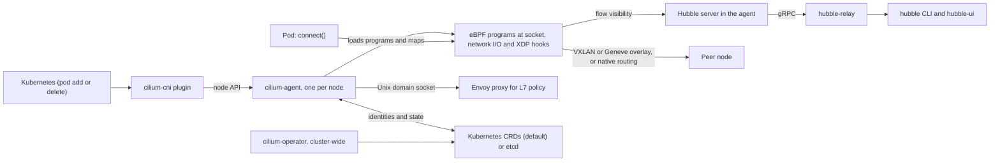

Cilium picks a Service backend at the moment your application calls `connect()`: the [README](https://github.com/cilium/cilium#load-balancing) says east-west connections are rewritten at the socket level to avoid per-packet NAT, and the [kube-proxy replacement guide](https://docs.cilium.io/en/stable/network/kubernetes/kubeproxy-free/) adds that the kernel socket ends up connected straight to the backend address.

> Drafted with AI assistance, researched, verified and edited by the HastCode editorial team. We publish only as many pieces as the Author can verify this way.

## TL;DR

- Cilium is a [networking, observability and security layer for Kubernetes with an eBPF dataplane](https://github.com/cilium/cilium#readme): a CNI plugin, a load balancer that can [fully replace kube-proxy](https://github.com/cilium/cilium#load-balancing), network policy from L3 to L7, [transparent encryption and a Gateway API data plane](https://github.com/cilium/cilium#service-mesh), and Hubble for flow visibility.
- What sets it apart: policy is enforced on a [security identity assigned to groups of pods that share a policy](https://github.com/cilium/cilium#network-policy), carried with every packet, rather than on IP addresses.
- It is a [CNCF graduated project](https://github.com/cilium/cilium#readme) that [maintains three stable branches](https://github.com/cilium/cilium#stable-releases), with [feature releases about every six months and patch releases around the middle of each month](https://docs.cilium.io/en/stable/contributing/release/organization/).
- Adopt it if your nodes run [Linux kernel 5.10 or newer](https://docs.cilium.io/en/stable/operations/system_requirements/) and you can upgrade [one minor version at a time](https://docs.cilium.io/en/stable/operations/upgrade/). Keep kube-proxy beside it if you need [SCTP](https://docs.cilium.io/en/stable/network/kubernetes/kubeproxy-free/), and keep your current CNI if you cannot own that upgrade cycle.

## In 60 seconds

The README has no install commands; it links to the docs' [Quick Installation](https://docs.cilium.io/en/stable/gettingstarted/k8s-install-default/), the shortest route the project gives. These commands, copied from that page, install the `cilium` CLI on Linux, install Cilium into the cluster your current `kubectl` context points at (the installer [picks the configuration for the Kubernetes distribution it detects](https://docs.cilium.io/en/stable/gettingstarted/k8s-install-default/#install-cilium)), then wait for it and run the connectivity test. The page's stated requirements are a cluster configured to use CNI and a Linux kernel of 5.10 or newer; `1.20.3` is the version the stable docs pinned when we copied them, so match it to the latest release in Signals. The two validation commands appear on the page with a `$` prompt and sample output, omitted here.

```sh
CILIUM_CLI_VERSION=$(curl -s https://raw.githubusercontent.com/cilium/cilium-cli/main/stable.txt)
CLI_ARCH=amd64
if [ "$(uname -m)" = "aarch64" ]; then CLI_ARCH=arm64; fi
curl -L --fail --remote-name-all https://github.com/cilium/cilium-cli/releases/download/${CILIUM_CLI_VERSION}/cilium-linux-${CLI_ARCH}.tar.gz{,.sha256sum}
sha256sum --check cilium-linux-${CLI_ARCH}.tar.gz.sha256sum
sudo tar xzvfC cilium-linux-${CLI_ARCH}.tar.gz /usr/local/bin
rm cilium-linux-${CLI_ARCH}.tar.gz{,.sha256sum}

cilium install 1.20.3

cilium status --wait
cilium connectivity test
```

## Architecture

Walk the diagram from the left. When Kubernetes schedules or terminates a pod, it [invokes the `cilium-cni` plugin, which calls the node's Cilium API](https://docs.cilium.io/en/stable/overview/component-overview/) to set up the datapath for networking, load balancing and policy. The `cilium-agent` on that node listens for orchestration events and [manages the eBPF programs that control traffic into and out of containers](https://docs.cilium.io/en/stable/overview/component-overview/); it [needs `CAP_SYS_ADMIN` and the host network namespace](https://docs.cilium.io/en/stable/operations/system_requirements/), which the standard DaemonSet grants.

Those programs attach at [kernel hook points: network I/O, application sockets and tracepoints](https://github.com/cilium/cilium#readme). East-west load balancing runs at `connect()`; north-south can use [XDP, Direct Server Return and Maglev hashing](https://github.com/cilium/cilium#load-balancing). An [in-kernel verifier checks each program before a JIT compiles it](https://docs.cilium.io/en/stable/overview/component-overview/), and Cilium probes the kernel to use newer features where it finds them. L3 and L4 policy is enforced there. HTTP and other L7 policy goes to an [Envoy proxy the agent starts as a separate process inside its own pod](https://docs.cilium.io/en/stable/security/network/proxy/envoy/), over Unix domain sockets, or to an independently life-cycled `cilium-envoy` DaemonSet.

Agents share identities and state through a [data store: Kubernetes CRDs by default, or etcd](https://docs.cilium.io/en/stable/overview/component-overview/) for larger clusters. The `cilium-operator` handles cluster-wide duties such as IP address management and is [not in the critical path for any forwarding or policy decision](https://docs.cilium.io/en/stable/overview/component-overview/). A [Hubble server embedded in every agent](https://docs.cilium.io/en/stable/overview/component-overview/) serves flows over gRPC; `hubble-relay` joins them into one cluster-wide API for the `hubble` CLI and `hubble-ui`. Between nodes, pods reach each other over a [VXLAN or Geneve overlay, or native routing](https://github.com/cilium/cilium#cni-container-network-interface) of pod IPs.



## Use it if

- You want to run Kubernetes without kube-proxy: Cilium's [socket-level load balancing](https://github.com/cilium/cilium#load-balancing) handles east-west traffic, and the [kube-proxy replacement guide](https://docs.cilium.io/en/stable/network/kubernetes/kubeproxy-free/) adds SNAT, DSR and hybrid modes, Maglev hashing and XDP acceleration for north-south.
- You need policy that follows workloads rather than addresses: [identity-based L3/L4 rules, DNS-name policies and L7 rules on HTTP method, path or gRPC call](https://github.com/cilium/cilium#network-policy), plus the upstream [Kubernetes ClusterNetworkPolicy tiers added in 1.20](https://github.com/cilium/cilium/releases/tag/v1.20.0).
- You run more than one cluster: [Cluster Mesh](https://github.com/cilium/cilium#cluster-mesh) gives global service discovery and one identity model across clusters, and its [Multi-Cluster Services API support went stable in 1.20](https://github.com/cilium/cilium/releases/tag/v1.20.0).
- You want the network layer to be the observability layer: [Hubble](https://github.com/cilium/cilium#observability-and-troubleshooting) shows flows with identity and label metadata, drop reasons and Prometheus metrics without touching applications.

## Don't use it if

- Your nodes run kernels older than 5.10: the [system requirements](https://docs.cilium.io/en/stable/operations/system_requirements/) recommend 5.10 or later (or RHEL 8.10's 4.18 equivalent), and newer features want more, such as [netkit on 6.8+](https://docs.cilium.io/en/stable/operations/system_requirements/). Stay on the CNI your distribution or cloud ships until the kernels move.
- You cannot upgrade at least yearly. [Only three stable branches are maintained](https://github.com/cilium/cilium#stable-releases), [feature releases land about every six months](https://docs.cilium.io/en/stable/contributing/release/organization/), [the only tested upgrade path is between consecutive minors](https://docs.cilium.io/en/stable/operations/upgrade/), and [Cluster Mesh certificates now default to one year](https://docs.cilium.io/en/stable/operations/upgrade/). We infer a minor leaves support roughly eighteen months after release. Use a managed CNI whose upgrades ride your cloud's control-plane upgrade.
- You depend on SCTP, or on TCP Fast Open with Direct Server Return: the [kube-proxy replacement](https://docs.cilium.io/en/stable/network/kubernetes/kubeproxy-free/) supports SCTP only in a few basic cases and its DSR mode does not operate well with TFO. Keep kube-proxy; [Helm's default `kubeProxyReplacement=false`](https://docs.cilium.io/en/stable/network/kubernetes/kubeproxy-free/) runs Cilium beside it.
- Your L7 policies or Gateway API routes cannot take a reset during upgrades: [upgrading restarts the user-space proxy and resets its connections](https://docs.cilium.io/en/stable/operations/upgrade/). Run Envoy as the [independently life-cycled `cilium-envoy` DaemonSet](https://docs.cilium.io/en/stable/security/network/proxy/envoy/), or keep L7 enforcement in a dedicated gateway.

## Alternatives

- [Calico](https://github.com/projectcalico/calico): the other widely deployed CNI with network policy, with a choice of dataplanes including a standard Linux one, where Cilium is eBPF-only.
- [Flannel](https://github.com/flannel-io/flannel): a plain overlay network that gives pods addresses and nothing more; it has no network policy of its own, which is most of what Cilium adds.
- [Antrea](https://antrea.io): a CNI with network policy built on Open vSwitch rather than eBPF, for teams already invested in OVS.
- [Istio](https://istio.io): a full service mesh with sidecar and ambient modes that runs on top of a CNI; it overlaps Cilium's service-mesh and Gateway API features but does not replace the CNI underneath.

## FAQ

### Is Cilium production ready?

Yes. Cilium is a [CNCF graduated project](https://github.com/cilium/cilium#readme) with [three maintained stable branches](https://github.com/cilium/cilium#stable-releases) and a [public list of production adopters](https://github.com/cilium/cilium/blob/main/USERS.md). The open question is fit, not maturity: your kernels and your upgrade cadence.

### Does Cilium replace kube-proxy?

Yes, with [`kubeProxyReplacement=true` plus `k8sServiceHost` and `k8sServicePort`](https://docs.cilium.io/en/stable/network/kubernetes/kubeproxy-free/); the Helm default is `false`, which keeps kube-proxy. In replacement mode the agent refuses to start if the kernel lacks the support it needs.

### What Linux kernel version does Cilium need?

Cilium's [system requirements](https://docs.cilium.io/en/stable/operations/system_requirements/) recommend kernel 5.10 or later (or 4.18 on RHEL 8.10) on AMD64 or AArch64; IPv6 BIG TCP needs 5.19, IPv4 BIG TCP 6.3 and netkit devices 6.8.

### How does Cilium compare to Calico?

Both are Kubernetes CNIs with network policy. Cilium is eBPF-only and bundles kube-proxy replacement, Hubble and Gateway API support; [Calico](https://github.com/projectcalico/calico) offers more than one dataplane, including a standard Linux one.

### How is Cilium licensed?

Cilium's [user-space components are Apache License 2.0; its BPF code templates are dual-licensed GPL-2.0-only and BSD-2-Clause](https://github.com/cilium/cilium#license), at your option. GitHub classifies the repository as Apache-2.0, as Signals shows.

### Who maintains Cilium?

A [group of maintainers and committers](https://github.com/cilium/cilium#governance) under the CNCF, chosen by the [community governance document](https://github.com/cilium/community/blob/main/GOVERNANCE.md); the [1.20 release](https://github.com/cilium/cilium/releases/tag/v1.20.0) credits engineers from Datadog, Google, Microsoft and others. Contributor counts are in Signals.

## Verdict

For a platform team on Linux kernel 5.10 or newer, Cilium is the default we would start from: one project supplies the CNI, a kube-proxy replacement, identity-based policy up to L7, encryption, multi-cluster connectivity and the Hubble visibility to debug all of it, from a CNCF graduated community that ships patch releases for three branches every month. The price is an upgrade cycle you own, one minor at a time, at least yearly, and a kernel floor that rises with the features you turn on. Turn those features on in stages: start as a plain CNI with kube-proxy still running, then replace kube-proxy, then add L7 policy and Cluster Mesh once you have practised an upgrade. We would not adopt it on kernels below the floor, for SCTP-heavy workloads, or in a team that cannot schedule the yearly upgrade; a managed CNI is the honest alternative there. A longer support window per minor, or a tested multi-minor upgrade path, would soften that caveat.

## Sources

- [Cilium README](https://github.com/cilium/cilium#readme)
- [Cilium component overview](https://docs.cilium.io/en/stable/overview/component-overview/)
- [Cilium Quick Installation](https://docs.cilium.io/en/stable/gettingstarted/k8s-install-default/)
- [Cilium system requirements](https://docs.cilium.io/en/stable/operations/system_requirements/)
- [Kubernetes without kube-proxy](https://docs.cilium.io/en/stable/network/kubernetes/kubeproxy-free/)
- [Cilium upgrade guide and 1.20 upgrade notes](https://docs.cilium.io/en/stable/operations/upgrade/)
- [Cilium release organization](https://docs.cilium.io/en/stable/contributing/release/organization/)
- [Envoy proxy in Cilium](https://docs.cilium.io/en/stable/security/network/proxy/envoy/)
- [Cilium 1.20.0 release page](https://github.com/cilium/cilium/releases/tag/v1.20.0)
- [Cilium 1.20.3 release page](https://github.com/cilium/cilium/releases/tag/v1.20.3)
- [Cilium adopters (USERS.md)](https://github.com/cilium/cilium/blob/main/USERS.md)
