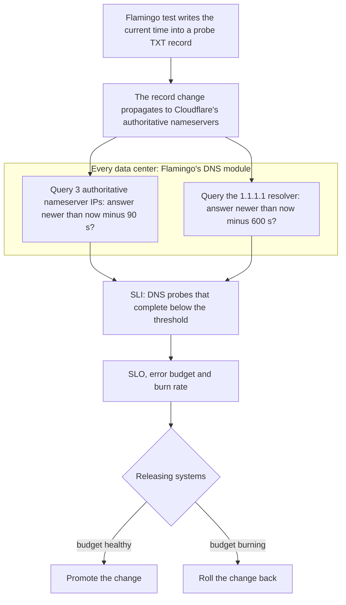

---
# Skeleton from Lead xwrxscx2 (Cloudflare blog), picked 2026-11-23.
# Drafted per docs/editorial/case-study-writing-guide.md. published and
# reviewed are the pick time (make daily may move them to a Gap Day);
# make release keeps it (ADR-0012). verified: is the Author's alone (ADR-0007).
title: "Flamingo DNS probes: how Cloudflare tests DNS as customers see it"
description: "Cloudflare's Flamingo reads a timestamped DNS record back from every data center, so stale answers burn SLO budget and can roll a release back."
kind: case-study
vertical: apis-networking
tags: ["dns", "synthetic-monitoring", "slo", "testing", "cloudflare"]
published: "2026-11-24T18:54:04Z"
verified: 2026-11-24
reviewed: "2026-11-24T16:32:07Z"
author: mira-vance
# Optional: an image HastCode may use, beside this file, replaces the
# generated title card. Never a Source's image.
# hero: system-name.png
# hero_alt: "What the image shows"
# Optional: related Explainer slugs and extra sources (title + url).
# related: [metastable-failures]
---

In one rollout of the service that publishes DNS records to Cloudflare's edge, [a scheduling bug left some record changes unpublished for hours](https://blog.cloudflare.com/probing-dns-at-cloudflare/). In Cloudflare's words, "The service stayed up and was healthy," but new hostnames were slow to resolve and certificates could not be issued until the bug was fixed. This is how Cloudflare now tests DNS by its output instead of its health, and how those tests decide whether a release ships.

## TL;DR

- Flamingo is Cloudflare's [end-to-end testing framework, already running hundreds of millions of tests a day](https://blog.cloudflare.com/probing-dns-at-cloudflare/) against its edge; a DNS module lets it probe DNS the way customers see it.
- Cloudflare built the probe because DNS failures are [slow, spread across the network and partial](https://blog.cloudflare.com/probing-dns-at-cloudflare/): a publishing service can look healthy while its records go stale.
- The test [writes a timestamp into a TXT record](https://blog.cloudflare.com/probing-dns-at-cloudflare/) and reads it back from every data center, through three authoritative nameserver IPs and the 1.1.1.1 resolver. An answer older than 90 or 600 seconds fails.
- Results feed SLOs, and the burn rate of their error budgets lets Cloudflare tell its releasing systems to [promote a change or roll it back](https://blog.cloudflare.com/probing-dns-at-cloudflare/). The price is a synthetic signal standing in for customers. The surprise: the DNS team built no new service at all.

## One timestamp's round trip, from DNS write to release decision

The diagram is ours, redrawn from the text of Cloudflare's post; Cloudflare's own figures are in [the original](https://blog.cloudflare.com/probing-dns-at-cloudflare/). Read it top to bottom. A test writes the time into a record, the change travels to the edge, and every data center reads it back. The reads become a service-level indicator (SLI). An objective (SLO) judges the SLI, and Cloudflare's releasing systems act on the result.

Step 1 covers the Flamingo framework that runs the test everywhere. Step 2 is the Rust module that makes it speak DNS. Step 3 is the read-back and its two thresholds, and Step 4 is the path from probe results to a release decision.

## Why a healthy service still served stale records

Cloudflare opens with a familiar scene: a release [passes its unit tests, the dashboards stay green, and production breaks anyway](https://blog.cloudflare.com/probing-dns-at-cloudflare/). The DNS publishing bug was that scene. The service process was fine. Its output was not.

A DNS change passes through several layers. Edits to a Cloudflare zone [must reach the authoritative nameservers](https://blog.cloudflare.com/probing-dns-at-cloudflare/) (the servers that hold the zone's records) before they are widely available. Caches sit closer to users, and each record's [TTL, its time to live, tells a cache](https://blog.cloudflare.com/probing-dns-at-cloudflare/) how long to wait before fetching it again. Cloudflare names two things that wait on propagation: [certificate issuance and traffic failover](https://blog.cloudflare.com/probing-dns-at-cloudflare/).

Those layers explain [the post's diagnosis](https://blog.cloudflare.com/probing-dns-at-cloudflare/): "DNS failures are hard to catch because they are slow, spread across the network, and partial in where they cause impact." A stalled change raises no error. It shows up as an answer that is older than it should be, in some places.

We infer the general lesson from the incident. A health check asks whether a service runs; it cannot ask whether the service did its job. Cloudflare's goal was to test DNS [the way customers experience it: "constantly, from every data center, and against production."](https://blog.cloudflare.com/probing-dns-at-cloudflare/) The post gives no date for the incident, how many records it touched, or how long "hours" was.

## The three approaches Cloudflare set aside

The post does not lay out a formal comparison, but it names three approaches and why each fell short.

- **More unit tests and dashboards.** Both were green in the opening scene. Cloudflare calls unit testing alone [not nearly enough](https://blog.cloudflare.com/probing-dns-at-cloudflare/) to judge a distributed system; it wants constant, automated tests against real systems.
- **Tests in a general-purpose language.** If users write tests in a traditional programming language, then when a test fails [they must debug both the upstream system and the test itself](https://blog.cloudflare.com/probing-dns-at-cloudflare/). So Flamingo uses "a custom domain-specific language (DSL) consisting of a simple setup-request-response format."
- **A probing service of the DNS team's own.** Extending Flamingo meant [no new probing service to manage](https://blog.cloudflare.com/probing-dns-at-cloudflare/) and no new integration with the reporting pipelines. In Cloudflare's words: "By doing so we got everything else for free."

The deciding argument was reuse. Cloudflare [added code that extended Flamingo](https://blog.cloudflare.com/probing-dns-at-cloudflare/), and the DNS team inherited Flamingo's scheduler, its reach into every data center, and the reporting that SLOs read. We infer those were the expensive parts, and that rebuilding them would have left Cloudflare a second test system to run.

## Step 1: Flamingo runs a test anywhere on the edge

Flamingo was [originally built around complex multi-step HTTP testing](https://blog.cloudflare.com/probing-dns-at-cloudflare/) and has grown since. Its [control plane and scheduler](https://blog.cloudflare.com/probing-dns-at-cloudflare/) let teams target specific environments, data centers or "percentages of metals," which we infer means a share of bare-metal servers. It needed predictable performance and had to run well on bare-metal servers in resource-constrained environments. A 2025 Cloudflare post describes the same system running [thousands of full end-to-end test requests concurrently](https://blog.cloudflare.com/20-percent-internet-upgrade/#step-2-testing-and-automated-rollouts) against production and pre-production.

Teams write each test in the DSL, in three parts: setup, request, response. [The post's example](https://blog.cloudflare.com/probing-dns-at-cloudflare/) checks that plain HTTP to `www.cloudflare.com` redirects to HTTPS. It sets the hostname, sends a GET, and asserts a 301 status and a `Location` header pointing at the HTTPS address. That is [five lines that can run anywhere on Cloudflare's edge](https://blog.cloudflare.com/probing-dns-at-cloudflare/) "and scale to thousands of requests per minute."

The design target, [in Cloudflare's words](https://blog.cloudflare.com/probing-dns-at-cloudflare/): "Internal tooling should be as easy as possible to use, but also powerful enough to handle over 80% of all use cases." We infer the ceiling is deliberate. A test that cannot express arbitrary logic also cannot hide a bug of its own, the debugging problem the DSL exists to avoid.

## Step 2: a Rust module swaps the request for a DNS query

The DNS probe needed one change to that format. Cloudflare replaced the middle "request" step with a general [action, whose outcome Flamingo measures](https://blog.cloudflare.com/probing-dns-at-cloudflare/). The pluggable units that perform actions are called modules.

Flamingo is written in Rust, [according to Cloudflare](https://blog.cloudflare.com/probing-dns-at-cloudflare/), "due to its consistent performance characteristics and strong type system." The types carry the modularity. [The post shows](https://blog.cloudflare.com/probing-dns-at-cloudflare/) an `Action` enumeration with two variants: `Query`, holding an HTTP method, URL and parameters, and `DnsQuery`, holding a query name, query type and parameters. A matching `ActionOutput` enumeration returns either an HTTP fetch response or a DNS query response.

A lookup table maps each action to its handler, an asynchronous function that is [dynamically dispatched](https://blog.cloudflare.com/probing-dns-at-cloudflare/), chosen at run time. Flamingo's runner looks up the handler for an action, calls it and awaits the result. That split makes [test scheduling and resource management](https://blog.cloudflare.com/probing-dns-at-cloudflare/) higher-level operations a module's author need not worry about, so "All the author needs to focus on is the logic."

Cloudflare built the DNS module for this probe and calls it [one of the first and most impactful modules in use today](https://blog.cloudflare.com/probing-dns-at-cloudflare/). We infer the typed output is what lets one reporting path serve both protocols. An assertion reads a DNS response or an HTTP response; the framework treats the rest alike.

## Step 3: the probe reads its own timestamp back

The test [continuously updates a TXT record with a timestamp](https://blog.cloudflare.com/probing-dns-at-cloudflare/), queries three authoritative nameserver IPs and 1.1.1.1 from every data center, and asserts freshness "within 90s (authoritative) and 600s (resolver)." A TXT record [holds descriptive text](https://www.rfc-editor.org/rfc/rfc1035.html#section-3.3.14), and 1.1.1.1 is [Cloudflare's public DNS resolver](https://developers.cloudflare.com/1.1.1.1/).

[The post's example test](https://blog.cloudflare.com/probing-dns-at-cloudflare/) is named for its target, the nameserver at `108.162.193.62`. It loads the DNS module, queries a probe hostname's TXT record on that server's port 53, and asserts three things:

- The response code is NOERROR, [RCODE 0, "No error condition"](https://www.rfc-editor.org/rfc/rfc1035.html#section-4.1.1).
- The AA (Authoritative Answer) flag is set, meaning the responding server is [an authority for the name](https://www.rfc-editor.org/rfc/rfc1035.html#section-4.1.1).
- The first answer is greater than the current time minus 90.

This is not an uptime check. A server that answers promptly, with NOERROR and the AA flag, still fails if its timestamp is old.

A worked example, with our numbers: at 12:05:00 a probe needs an answer later than 12:03:30. If publishing stalls and the newest timestamp on the authoritative servers is 12:00:00, every data center fails. That is the incident's shape: the servers answer, and the answer is stale. We infer the probe's write takes the same publishing path as customer changes, which is what it sets out to measure.

The resolver gets 600 seconds. We infer the larger window covers 1.1.1.1's cache, which can hold an older answer until its [TTL](https://www.rfc-editor.org/rfc/rfc1035.html#section-3.2.1) runs out; HastCode's [DNS provider comparison](/apis-networking/dns-provider-redundancy/) covers resolver caches and TTLs. The post shows neither the record's TTL nor the 600-second check.

## Step 4: burn rate turns probe results into a release decision

Flamingo's synthetic traffic is meant to [build a picture of what users experience](https://blog.cloudflare.com/probing-dns-at-cloudflare/) and feed that data to SLOs. Cloudflare's definition reads: "SLOs are a percentage of some metric that is used as a target." SLIs are what an SLO is measured through: the actual measurements of a user's end-to-end experience. Here the SLI tracks DNS probes that complete below the required threshold, and [the post charts it over time](https://blog.cloudflare.com/probing-dns-at-cloudflare/).

The error budget is [the percentage of downtime a service will tolerate](https://blog.cloudflare.com/probing-dns-at-cloudflare/), and the burn rate is how fast that budget changes. [The post contrasts two cases](https://blog.cloudflare.com/probing-dns-at-cloudflare/). Burning 10% of the budget over three days might be a long-running issue that is not urgent but affects customers and needs dealing with. Burning 10% within an hour "means an incident is occurring."

The arithmetic shows why rate beats total (our calculation). At 10% per three days, the whole budget lasts 30 days. At 10% per hour, it lasts 10 hours. The same 10% burns 72 times faster.

During a deployment, Cloudflare checks its SLOs and [can tell its releasing systems to promote a change or roll it back](https://blog.cloudflare.com/probing-dns-at-cloudflare/). The 2025 post describes such a rollout: [gradual stages with increasing traffic](https://blog.cloudflare.com/20-percent-internet-upgrade/#step-2-testing-and-automated-rollouts), each evaluated automatically and paused or rolled back if tests fail. The post gives no SLO target and no burn-rate threshold for either decision.

## What the probe costs, and what it cannot see

The post admits few costs, so most of this section is our reading of the design.

- **A proxy, not a customer.** Cloudflare's confidence is worded with care: when synthetic traffic hits issues, ["we can be pretty confident that Cloudflare customers are also hitting issues"](https://blog.cloudflare.com/probing-dns-at-cloudflare/). The reverse does not follow. We infer that a fault touching only some zones, or some record types, can pass a probe that watches one TXT record.
- **Blind below the threshold.** A change that reaches the authoritative servers in 80 seconds (our number) passes the 90-second test. We infer that a slow drift in propagation time stays invisible until it crosses the line.
- **A DSL ceiling.** Flamingo aims at over 80% of use cases, and DNS needed [code that extended Flamingo](https://blog.cloudflare.com/probing-dns-at-cloudflare/), not a test script. We infer each new kind of check means a framework change.
- **Constant writes to production.** The probe changes a live record without pause. We infer that is the point: only the real path proves the real path. We also infer the writer must update more often than every 90 seconds, or the test would fail on its own schedule. The post gives no interval.

## The evidence it works, and what the post leaves out

Cloudflare's evidence is mostly qualitative. Adding DNS cost the team no new service and no new reporting integration, and ["It all just worked."](https://blog.cloudflare.com/probing-dns-at-cloudflare/) Cloudflare ranks the module [among its most impactful](https://blog.cloudflare.com/probing-dns-at-cloudflare/). The post shows [an SLI chart](https://blog.cloudflare.com/probing-dns-at-cloudflare/) of DNS probes completing under the threshold, but its text quotes no numbers from it.

The gaps are wide. The post does not give:

- the probe interval or the number of data centers probing;
- the other two authoritative IPs, or the probe record's TTL;
- the SLO target or the burn-rate thresholds that promote or roll back;
- any release this probe stopped, or any false alarm it raised;
- the date, scope or length of the publishing incident, or whether this probe would have caught it.

That last gap matters most. The worked example in Step 3 is our reconstruction of how the probe would fail during such a stall. Cloudflare never says the probe has met a stall like it. The post shows a sound design and its plumbing; it does not show, in numbers, how often it has saved a release.

## What output probes make possible

Cloudflare calls DNS ["just the start for extending Flamingo"](https://blog.cloudflare.com/probing-dns-at-cloudflare/), and already has modules for TCP, UDP, WebSockets and more. Under "The road ahead," it names a canary halt. A canary data center gets a new version early. If Flamingo sees a propagation-latency spike in one, Cloudflare [can automatically halt the rollout](https://blog.cloudflare.com/probing-dns-at-cloudflare/) before the rest of the Internet sees it. The post says "can"; it does not say whether that halt is live.

The pattern travels to any system that publishes something: DNS records, configuration, feature flags, cache purges. Four moves carry it.

1. Name the promise as a number a customer would notice, such as a change that is answerable within 90 seconds.
2. Write a known value through the real publishing path and read it back from where users are.
3. Count stale reads against an error budget, and let its burn rate, not a person watching a graph, gate the release.
4. Build the probe as a module of a test platform you already run, so scheduling and reporting come free.

The cost is a synthetic signal that sees one path, and only past its threshold. What could go right is a release that stops itself when a publisher stops publishing, even while every health check says it is fine.

## Sources

- [Probing DNS at Cloudflare](https://blog.cloudflare.com/probing-dns-at-cloudflare/), Cloudflare blog, 23 November 2026
- [Cloudflare just got faster and more secure, powered by Rust](https://blog.cloudflare.com/20-percent-internet-upgrade/#step-2-testing-and-automated-rollouts), Cloudflare blog, 26 September 2025
- [RFC 1035: Domain Names, Implementation and Specification](https://www.rfc-editor.org/rfc/rfc1035.html), P. Mockapetris, IETF, November 1987
- [1.1.1.1 (DNS Resolver)](https://developers.cloudflare.com/1.1.1.1/), Cloudflare Developers documentation
