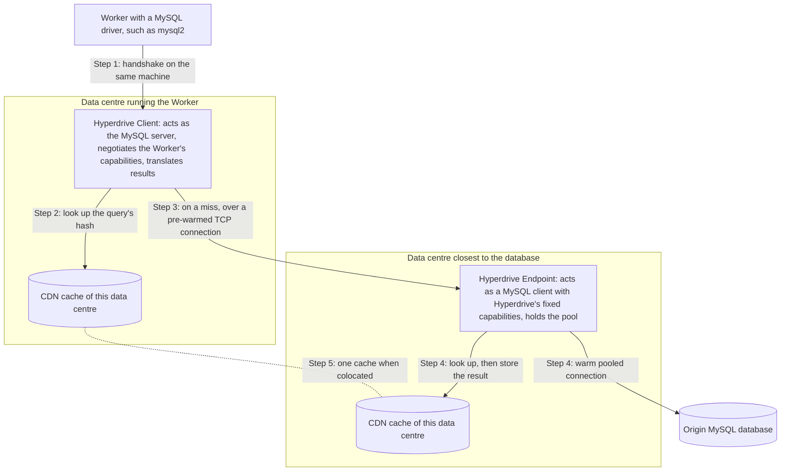
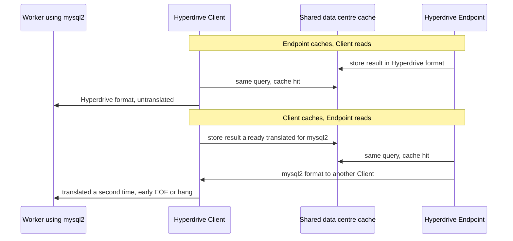

---
# Skeleton from Lead tn3uyznd (Cloudflare blog), picked 2026-10-27.
# Follow docs/editorial/case-study-writing-guide.md; no author notes
# are left. published and reviewed are the pick time, provisional: set them
# when you publish. verified: is the Author's alone (ADR-0007).
title: "Hyperdrive: how Cloudflare pools and caches MySQL for Workers"
description: "How Cloudflare Hyperdrive pools and caches MySQL for Workers, and why its shared cache must hold one canonical encoding of every result."
kind: case-study
vertical: apis-networking
tags: ["mysql", "connection-pooling", "caching", "wire-protocol", "cloudflare"]
published: "2026-10-27T17:47:15Z"
reviewed: "2026-10-27T17:47:15Z"
author: mira-vance
# Optional: an image HastCode may use, beside this file, replaces the
# generated title card. Never a Source's image.
# hero: system-name.png
# hero_alt: "What the image shows"
related: [cloudflare-d1, http-connection-reuse]
draft: true
---

During the beta of Hyperdrive's MySQL support, Cloudflare's highest-volume MySQL customer saw queries that should always return rows come back empty, [about 0.001% of the time](https://blog.cloudflare.com/hyperdrive-mysql/). No network issue explained it: two halves of Hyperdrive were reading each other's cache entries, written in two different dialects of the MySQL protocol.

> Drafted with AI assistance, researched, verified and edited by the HastCode editorial team. We publish only as many pieces as the Author can verify this way.

## TL;DR

- Hyperdrive is Cloudflare's [distributed database connection pooler for Workers](https://blog.cloudflare.com/hyperdrive-mysql/): it keeps warm SQL connections open across Cloudflare's network and can cache common queries in its global CDN cache. MySQL support is now generally available.
- It exists because opening a SQL connection takes [at least five network round trips](https://blog.cloudflare.com/how-hyperdrive-speeds-up-database-access/), too slow and too costly to repeat on every serverless request.
- A Client next to the Worker impersonates the database and checks its data centre's cache; on a miss, a pre-warmed link carries the query to an Endpoint near the database, which holds the pool and its own cache.
- The price is a translation layer: the Client rewrites MySQL results into whatever format each Worker's driver negotiated, and when Client and Endpoint shared one cache, each could read bytes in the other's format. The fix was to cache one canonical encoding, after which [Client connection success reached 99.99%](https://blog.cloudflare.com/hyperdrive-mysql/).

## A query's path through a split pooler and two caches

The diagram is ours, redrawn from the text of Cloudflare's posts; Cloudflare's own figures are in [the GA post](https://blog.cloudflare.com/hyperdrive-mysql/) and [the architecture deep dive](https://blog.cloudflare.com/how-hyperdrive-speeds-up-database-access/). Hyperdrive splits each instance into [two nodes, a Client and an Endpoint](https://blog.cloudflare.com/hyperdrive-mysql/), and each uses the Cloudflare CDN cache of the data centre it runs in.

The sections below walk Steps 1 to 5 in order; Step 5 is the shared cache where the bug lived.

## Why a serverless Worker cannot open its own MySQL connections

Before a database driver sends its first query it must complete a TCP handshake, a TLS handshake and authentication, which [Cloudflare counts as a bare minimum of five round trips](https://blog.cloudflare.com/how-hyperdrive-speeds-up-database-access/). Its quick benchmark measured about 125 ms per round trip from Chicago to London, so 625 ms to start a connection, which "is not viable in a distributed serverless environment". Queries can start in any of Cloudflare's [over 300 data centre locations](https://developers.cloudflare.com/hyperdrive/concepts/how-hyperdrive-works/), and a stateless Worker that connects directly pays those round trips on every invocation.

Opening one per request also costs the database. Many open connections [incur high per-connection resource costs](https://blog.cloudflare.com/hyperdrive-mysql/), even for MySQL, which does not use an OS process per connection. Traditional databases usually cap connections, and [distributed traffic exhausts them easily](https://developers.cloudflare.com/hyperdrive/concepts/how-hyperdrive-works/).

Hyperdrive started with Postgres. Supporting MySQL meant [parsing a second wire protocol](https://blog.cloudflare.com/building-global-mysql-apps-with-cloudflare-workers-and-hyperdrive/), with its own authentication plugins and capability flags, and the [beta's goal](https://blog.cloudflare.com/hyperdrive-mysql/) was to show that real customer traffic met Cloudflare's production availability target of 99.99%. Getting there took, in Cloudflare's words, "just 20 bug fixes in a trenchcoat".

## The designs Cloudflare turned down

The architecture post weighs [four choices](https://blog.cloudflare.com/how-hyperdrive-speeds-up-database-access/):

- **Run an existing regional pooler.** Connecting from Workers to a pooler in one region "has the same major downside as connecting to regional databases: network latency and round trips".
- **Write a serverless driver.** Other teams cut round trips with custom drivers. Cloudflare wanted to support the popular drivers people already use rather than fragment the ecosystem with a competing one, and it wanted to cache queries, which needs control over where results are stored.
- **Session or statement pooling.** Session mode gives each client a connection until it disconnects, cutting concurrency; statement mode forbids multi-statement transactions. Hyperdrive is a [transaction-mode pooler](https://developers.cloudflare.com/hyperdrive/concepts/how-hyperdrive-works/#pooling-mode), lending a connection for one query or transaction.
- **One pool per region.** Earlier Hyperdrive kept a pool in each region of Worker traffic, picked by rendezvous hashing, with no guarantee it sat near the database. It now runs [a single global Endpoint](https://blog.cloudflare.com/how-hyperdrive-speeds-up-database-access/) as close to the origin as possible.

The argument behind all four: do every round trip over the shortest distance available, and keep the drivers developers already run. The second half, we infer, is what later exposed the bug.

## Step 1: the Client poses as a MySQL server next to the Worker

A Worker reaches Hyperdrive through a connection string that the Workers runtime [generates on the fly](https://blog.cloudflare.com/how-hyperdrive-speeds-up-database-access/), pointing at a Hyperdrive Client process on the same Cloudflare server. The driver runs its usual handshake with the Client playing the database. Cloudflare measured that handshake at a p90 of 4 ms and a p50 of 2 ms, against 625 ms across the Atlantic.

For MySQL, the handshake is the [Connection Phase](https://dev.mysql.com/doc/dev/mysql-server/8.0.46/page_protocol_connection_phase.html), where client and server agree on authentication and on capabilities. Each capability is a protocol feature, and [each side must use only features the other supports](https://blog.cloudflare.com/hyperdrive-mysql/), or the protocol desynchronises.

That is where Hyperdrive has two faces. To the Worker it is a server and adapts to the capabilities the Worker's driver expects. To the database it is a client with [a fixed set of capability flags](https://blog.cloudflare.com/hyperdrive-mysql/), so it can always parse what the origin sends. When the two sets differ, Hyperdrive translates every origin response into the format the Worker expects.

## Step 2: the Client checks its own data centre's cache

The Client [buffers protocol messages](https://blog.cloudflare.com/how-hyperdrive-speeds-up-database-access/) until it knows whether a query can be served from cache. Hyperdrive [parses the wire protocol to tell reads from writes](https://developers.cloudflare.com/hyperdrive/concepts/query-caching/#what-does-hyperdrive-cache), caches eligible read-only responses, and skips writes and queries that use non-deterministic functions such as `NOW()`. Caching is on by default, with a [`max_age` of 60 seconds and `stale_while_revalidate` of 15 seconds](https://developers.cloudflare.com/hyperdrive/concepts/query-caching/#default-cache-settings).

The cache key is [a hash of the contents of the query's wire messages, with some normalization](https://blog.cloudflare.com/hyperdrive-mysql/); the value is the result bytes. Note what the key describes: the question, not the format of the answer. That is the seam Step 5 tears.

Client-side caching arrived with the move to global Endpoints, because otherwise users far from the single Endpoint [would get cache hits served from almost as far away as the origin](https://blog.cloudflare.com/how-hyperdrive-speeds-up-database-access/). A hit in the Client's data centre never leaves it, which cut query latency from 20 to 70 ms to an average of about 4 ms in Cloudflare's measurements.

## Step 3: a pre-warmed link carries the miss to the Endpoint

On a miss, the Client needs the Endpoint, possibly an ocean away. Opening a fresh connection there would repeat the round-trip problem, so the Client asks Cloudflare's networking platform, which [keeps a pool of ready TCP connections between all of Cloudflare's data centres](https://blog.cloudflare.com/how-hyperdrive-speeds-up-database-access/).

The Client's first message carries every query message the Worker has buffered, like a SYN and a payload bundled together. The Endpoint streams the response back and keeps the channel open for follow-up queries until the Client disconnects, so the long haul runs with "zero wasted round trips".

There are now two handshakes per logical connection, Worker to Client and Endpoint to origin, and Cloudflare argues that is the point: the same five-plus round trips still happen, but [over the smallest possible distances](https://blog.cloudflare.com/how-hyperdrive-speeds-up-database-access/).

## Step 4: the Endpoint pools connections near the database

The Endpoint lives in [the data centre closest to the origin database](https://blog.cloudflare.com/hyperdrive-mysql/). A connection string does not say where a database is, so after a Hyperdrive is created a subsystem called Placement [connects to the origin a handful of times from every eligible data centre](https://blog.cloudflare.com/how-hyperdrive-speeds-up-database-access/) and keeps the fastest.

The Endpoint plays the MySQL client, checks its own cache, and on a miss takes a warm connection from its pool, "usable in a matter of microseconds", returning it as soon as the result is back. The pool is capped at [about 20 origin connections per configuration on the Free plan and about 100 on Paid](https://developers.cloudflare.com/hyperdrive/platform/limits/#connection-limits), with a 10-minute idle timeout. Results from the origin are [stored in both the Client's and the Endpoint's caches](https://blog.cloudflare.com/how-hyperdrive-speeds-up-database-access/), so the Endpoint's cache shields the origin for Clients everywhere.

A shared connection must not leak one user's session into the next. Hyperdrive cleans up with [`COM_RESET_CONNECTION`](https://dev.mysql.com/doc/dev/mysql-server/9.7.2/page_protocol_com_reset_connection.html), which resets session state without re-authenticating or closing the connection. It also [reset the character set to the server's default](https://blog.cloudflare.com/hyperdrive-mysql/), such as latin1, undoing the `utf8mb4` Hyperdrive had negotiated (itself a fix: plain `utf8` is a [deprecated alias for the 3-byte `utf8mb3`](https://dev.mysql.com/doc/refman/9.7/en/charset-unicode-utf8.html), which broke emoji). Hyperdrive now sets `utf8mb4` again after every reset.

## Step 5: one cache, two encodings of the same result

The bug [only occurred on instances with caching enabled](https://blog.cloudflare.com/hyperdrive-mysql/), and the caching code carried a Postgres-era assumption: the Client could cache exactly the bytes it wrote back to the Worker. MySQL broke it through one capability, [`CLIENT_DEPRECATE_EOF`](https://dev.mysql.com/doc/dev/mysql-server/8.0.46/group__group__cs__capabilities__flags.html#gaad8e6e886899e90e820d6c2e0248469d). Without it, a [text result set](https://dev.mysql.com/doc/dev/mysql-server/8.0.46/page_protocol_com_query_response_text_resultset.html) has an EOF packet after the column definitions and another after the rows. With it, the first EOF is dropped and the last becomes an OK packet.

Hyperdrive supports the flag; [mysql2 does not currently](https://blog.cloudflare.com/hyperdrive-mysql/), so for mysql2 the Client rewrites results to add the EOFs and turn OK packets into EOFs. The Endpoint always works in Hyperdrive's format. Each node's cache entries were in its own format, and when both nodes ran in one data centre they shared one cache. The post walks two failures:

The fix: [always cache a canonical version of the result bytes](https://blog.cloudflare.com/hyperdrive-mysql/), in Hyperdrive's capabilities, whichever node stores it. The post names no alternatives. Two we can see, our analysis and not Cloudflare's: add the capability set to the cache key, which splits one entry per driver dialect, or stop sharing caches between colocated nodes, which gives up hits. A canonical encoding keeps one entry per query.

## What it costs: stale reads, translation and soft limits

The cache trades freshness for load. Hyperdrive [does not purge or invalidate cached results when your application writes](https://developers.cloudflare.com/hyperdrive/concepts/query-caching/#read-after-write-behavior), so a later read can return the old result until `max_age` expires, plus the `stale_while_revalidate` window. Cloudflare's answer is a second, cache-disabled Hyperdrive configuration for reads that must be fresh, such as authentication, permissions and reads right after a write.

Translation is a standing cost. Every capability a driver lacks is code Hyperdrive must get right, in both directions, for every result. After the fix, we infer, a Client serving a mysql2 Worker from cache must rewrite the cached bytes on each hit rather than send them as stored; the post does not say what that costs. The charset fix also adds a command after every connection reset, which the post does not measure either.

Pooling semantics leak into application code. In transaction mode, [`SET` statements last only for a transaction or a query](https://developers.cloudflare.com/hyperdrive/concepts/how-hyperdrive-works/#pooling-mode), and wrapping many operations in one transaction to keep them hurts scaling. Connection caps are soft: a Client that cannot reach an existing pool gets a new one, so [counts may occasionally exceed the limits](https://developers.cloudflare.com/hyperdrive/platform/limits/), a choice of availability over strict enforcement.

## The evidence: one success rate, and Postgres benchmarks

For MySQL, the post reports two numbers. The empty responses occurred [about 0.001% of the time](https://blog.cloudflare.com/hyperdrive-mysql/) for one high-volume customer, rare enough that raising the trace rate did not catch an end-to-end trace; the bug was found by reading telemetry, the MySQL protocol documentation and Hyperdrive's code. After the fix, the empty rows "went away" and the success rate for Client connections reached 99.99%, the production target.

The latency evidence is older and from Postgres. In Cloudflare's simplest benchmark, an insert and a select from Chicago to a database in London [took an average of 1,200 ms directly, 500 ms through Hyperdrive and 320 ms with caching](https://blog.cloudflare.com/how-hyperdrive-speeds-up-database-access/).

The gaps: no success rate before the fix, no list of the 20 bug fixes, no MySQL latency figures, no cache hit rates, and no count of how many customers or queries the shared-cache bug touched. The post also does not say how often Client and Endpoint share a data centre, which is how often the bug could fire. We infer it was mostly Workers running near their database, which is what [Placement](https://developers.cloudflare.com/hyperdrive/concepts/how-hyperdrive-works/#2-connection-pooling) encourages for Workers that make multiple sequential queries per request.

## What it makes possible

MySQL support is now generally available: you can [create a Hyperdrive to an existing MySQL-compatible database](https://blog.cloudflare.com/hyperdrive-mysql/) from the dashboard or Wrangler, or connect a new PlanetScale database. Cloudflare's own billing, D1, R2 and Workers KV teams [use Hyperdrive to reach their Postgres clusters](https://blog.cloudflare.com/how-hyperdrive-speeds-up-database-access/) for control-plane work; [D1's control plane](/databases-storage/cloudflare-d1/) leans on its cache to keep heartbeats off Postgres.

The lesson travels to any proxy that speaks a protocol on both sides. When a component translates between dialects, every cache behind it needs one agreed encoding, and the cache key must name everything that changes the bytes. An assumption that held for one protocol, here "the bytes I sent are the bytes I can store", is worth writing down before you port it.

What it buys is a MySQL database in one region that a Worker anywhere can query with the driver it already uses.

## Sources

- [Inside Hyperdrive: How we solved a rare Hyperdrive MySQL caching bug](https://blog.cloudflare.com/hyperdrive-mysql/), Pranoy Dutta, Cloudflare blog, 14 October 2026
- [Pools across the sea: how Hyperdrive speeds up access to databases and why we're making it free](https://blog.cloudflare.com/how-hyperdrive-speeds-up-database-access/), Andrew Repp and Matt Alonso, Cloudflare blog, 8 April 2025
- [Build global MySQL apps using Cloudflare Workers and Hyperdrive](https://blog.cloudflare.com/building-global-mysql-apps-with-cloudflare-workers-and-hyperdrive/), Thomas Gauvin, Andrew Repp, Kirk Nickish and Yagiz Nizipli, Cloudflare blog, 8 April 2025
- [Hyperdrive docs: How Hyperdrive works](https://developers.cloudflare.com/hyperdrive/concepts/how-hyperdrive-works/)
- [Hyperdrive docs: Query caching](https://developers.cloudflare.com/hyperdrive/concepts/query-caching/)
- [Hyperdrive docs: Limits](https://developers.cloudflare.com/hyperdrive/platform/limits/)
- [MySQL source documentation: Capabilities flags](https://dev.mysql.com/doc/dev/mysql-server/8.0.46/group__group__cs__capabilities__flags.html)
- [MySQL source documentation: Text Resultset](https://dev.mysql.com/doc/dev/mysql-server/8.0.46/page_protocol_com_query_response_text_resultset.html)
- [MySQL source documentation: Connection Phase](https://dev.mysql.com/doc/dev/mysql-server/8.0.46/page_protocol_connection_phase.html)
- [MySQL source documentation: COM_RESET_CONNECTION](https://dev.mysql.com/doc/dev/mysql-server/9.7.2/page_protocol_com_reset_connection.html)
- [MySQL 9.7 Reference Manual: The utf8 Character Set (Deprecated alias for utf8mb3)](https://dev.mysql.com/doc/refman/9.7/en/charset-unicode-utf8.html)
