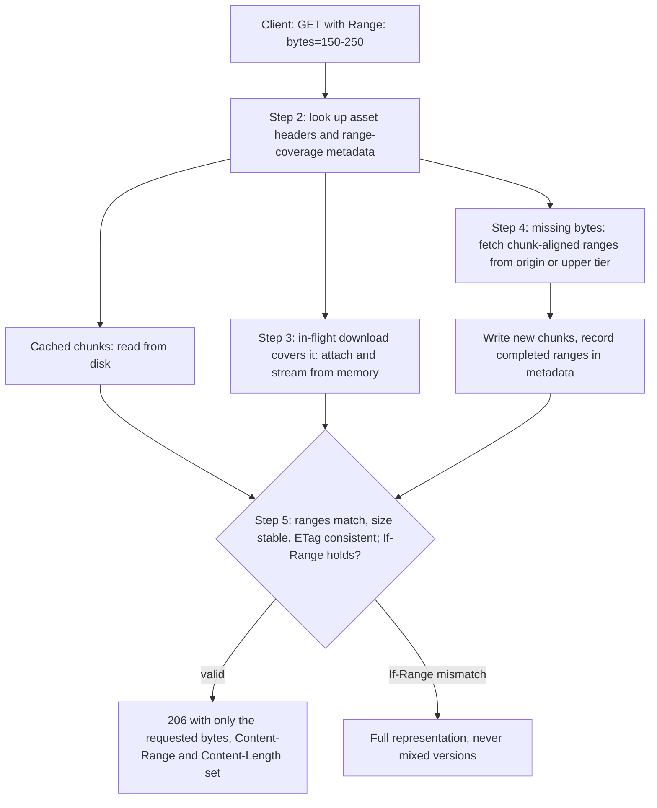

---
# Skeleton from Lead wmhapkux (Cloudflare blog), picked 2026-10-30.
# Follow docs/editorial/case-study-writing-guide.md; the Author's check list
# is in the pull request. published and reviewed are the pick time, provisional: set them
# when you publish. verified: is the Author's alone (ADR-0007).
title: "Origin Range Requests: how Cloudflare serves ranges from cache chunks"
description: "Cloudflare's Origin Range Requests fetches big files by the cache chunk, stitching cached and in-flight bytes: small over-fetch, no tuning."
kind: case-study
vertical: apis-networking
tags: ["caching", "http", "cdn", "pingora", "cloudflare"]
published: "2026-10-30T10:42:23Z"
reviewed: "2026-10-30T10:42:23Z"
author: mira-vance
# Optional: an image HastCode may use, beside this file, replaces the
# generated title card. Never a Source's image.
# hero: system-name.png
# hero_alt: "What the image shows"
# Optional: related Explainer slugs and extra sources (title + url).
# related: [metastable-failures]
draft: true
---

Under Cloudflare's old range caching, R2's slice size was 64 MiB, so [a small read that crossed a slice boundary could move 128 MiB between data centers](https://blog.cloudflare.com/origin-range-requests/). In October 2026 Cloudflare described the replacement: no slice size at all, and R2's [p99 time to first byte dropped by roughly half](https://blog.cloudflare.com/origin-range-requests/) on both cache hits and misses.

> Drafted with AI assistance, researched, verified and edited by the HastCode editorial team. We publish only as many pieces as the Author can verify this way.

## TL;DR

- Origin Range Requests is a Cache Rule setting that lets Cloudflare [fetch large files from the origin in cache-aligned byte ranges](https://developers.cloudflare.com/cache/how-to/cache-rules/settings/#origin-range-requests) instead of whole files or customer-sized slices. It is [self-service on all plans](https://blog.cloudflare.com/origin-range-requests/).
- Cloudflare built it because the old design, which [resembled nginx-style cache slicing](https://blog.cloudflare.com/origin-range-requests/), made each zone pick one slice size, and no size suited small seeks and long downloads alike.
- It works in five moves: the on-disk chunk Pingora already used becomes the range unit; a coordinator checks what is cached, attaches to downloads already in flight, fetches missing chunks with aligned ranges, and [validates every piece before stitching one response](https://blog.cloudflare.com/origin-range-requests/).
- The price is that [a request smaller than a chunk can still fetch the whole chunk](https://blog.cloudflare.com/origin-range-requests/). The surprise: once disk and upstream bytes could share a response, tiered cache traffic for R2 and similar workloads [fell about 6% week over week](https://blog.cloudflare.com/origin-range-requests/).

## One range request, three sources of bytes

The diagram is ours, redrawn from the text of Cloudflare's post; Cloudflare's own figures are in [the original](https://blog.cloudflare.com/origin-range-requests/). A client asks for some bytes of a large file. The coordinator answers from up to three places, then checks that the pieces belong together before it writes a single response header. The Step sections below walk the diagram top to bottom.

Step 1 is the decision behind the whole design: the boxes labelled "chunk" are the same fixed-size chunks [Pingora already stored on disk](https://blog.cloudflare.com/origin-range-requests/).

## Why fixed slices cost R2 128 MiB for a small read

A range request asks for part of a file: a video player seeking to the middle of a film, a download resuming. HTTP answers with [206 Partial Content](https://www.rfc-editor.org/rfc/rfc9110#section-15.3.7) and a [Content-Range](https://www.rfc-editor.org/rfc/rfc9110#section-14.4) header saying which bytes these are. A cache that misses has to decide what to ask the origin for.

Cloudflare's answer for years was [range caching through per-zone static configuration](https://blog.cloudflare.com/origin-range-requests/): each client request mapped onto fixed-size slices, with the slice size and file extensions set per zone. nginx works the same way with its [slice module](https://nginx.org/en/docs/http/ngx_http_slice_module.html), which splits a request into subrequests for fixed ranges and [adds the slice range to the cache key](https://nginx.org/en/docs/http/ngx_http_slice_module.html#example).

That shape caused five problems, [per Cloudflare](https://blog.cloudflare.com/origin-range-requests/). The slice size was part of the cache key, so changing it invalidated cached entries. Requests landing in the same slice could block each other even when they wanted distant bytes. Range caching could not run with [concurrent streaming](https://blog.cloudflare.com/introducing-concurrent-streaming-acceleration/), which lets several clients read a file still being written: turning both on "cut responses short", [Cloudflare writes](https://blog.cloudflare.com/origin-range-requests/), so each slice had to finish downloading before anyone could read it. Popular files needed a separate origin fetch for every range. And wasted bytes compounded across every hop, from origin to data center, between cache tiers, and out to the client.

Range sizes configured on the old system ran [from tens of kilobytes to tens of gigabytes](https://blog.cloudflare.com/origin-range-requests/), and both extremes caused real operational incidents.

## Why no slice size was ever right

The post weighs the only knob the old design offered, the slice size, and shows both ends failing.

**Small slices.** Each client request becomes [a long chain of tiny origin requests](https://blog.cloudflare.com/origin-range-requests/), each holding memory while it waited. nginx's own documentation warns of the same thing: a value too low [may cause excessive memory use and many open files](https://nginx.org/en/docs/http/ngx_http_slice_module.html#slice).

**Large slices.** Fewer requests, but the cache fetches far more than anyone asked for, sometimes [after the viewer had already left](https://blog.cloudflare.com/origin-range-requests/). [Cloudflare's own image](https://blog.cloudflare.com/origin-range-requests/) for it: "a request that wouldn't fill a floppy disk" could pull a few DVDs' worth of data.

**Tuning per zone.** The middle path was to set it per zone, which is what the old system did. [Cloudflare's verdict](https://blog.cloudflare.com/origin-range-requests/) is blunt: "No value works equally well" for a small seek, a sequential download, a large media file and every origin and cache topology. Tuning also exposed internal limits to customers, who [should not need to understand Cloudflare's capabilities in depth](https://blog.cloudflare.com/origin-range-requests/) to have files served efficiently.

The deciding argument was that a better unit already existed. Moving from the nginx-based cache to [Pingora](https://blog.cloudflare.com/how-we-built-pingora-the-proxy-that-connects-cloudflare-to-the-internet/), Cloudflare's in-house Rust proxy, gave the cache its own storage layout, and that layout already had a natural range size.

## Step 1: the chunk becomes the range unit

Pingora stores every cached file on disk in fixed-size chunks, [to make interrupted downloads easy to resume](https://blog.cloudflare.com/origin-range-requests/). Cloudflare's insight was that the cache was already working in units of that size, so the range unit could be the chunk instead of a customer setting.

The post does not give the chunk size. Cloudflare's range-request reference says it [aligns origin range requests to 1 MiB cache boundaries](https://developers.cloudflare.com/cache/reference/range-requests/#origin-request-behavior), and we infer that 1 MiB is the chunk. On that reading, the read that cost R2 128 MiB under 64 MiB slices would now cost at most 2 MiB, two chunks (our arithmetic, not Cloudflare's).

Using the chunk also removes the reasons a slice size was a setting at all. Nothing about it is customer-specific, so there is [no range size to tune](https://blog.cloudflare.com/origin-range-requests/), and the design reuses the cache's existing data model: headers identify the asset version, bodies sit in bounded chunks, and metadata records which ranges were written successfully.

## Step 2: the coordinator checks what it already has

Cloudflare says [parsing the Range header is straightforward](https://blog.cloudflare.com/origin-range-requests/). The hard part is one correct response when the bytes come from disk, from the origin and from downloads already under way. A coordinator does that work in [five steps](https://blog.cloudflare.com/origin-range-requests/): look up the asset's headers and range-coverage metadata; read what it can from disk or from in-memory streams; fetch missing coverage from the origin with aligned ranges; write the new bytes and record the completed range; then assemble the response with accurate Content-Range and Content-Length.

The metadata lookup is what makes partial hits cheap. Because the cache records which ranges of a file it holds, a request can be served as [a cached prefix, an in-flight download and a newly fetched suffix](https://blog.cloudflare.com/origin-range-requests/) in one response.

That last capability came in a follow-up change. Before it, a request was served [entirely from cache or entirely from upstream](https://blog.cloudflare.com/origin-range-requests/). We infer that, before the change, a request touching one missing chunk refetched bytes the cache already held, which is the traffic the 6% figure in the evidence section measures.

## Step 3: in-flight downloads are shared, not repeated

If a download already in progress covers the bytes a new request wants, the new request [attaches to it instead of starting another origin fetch](https://blog.cloudflare.com/origin-range-requests/). Cloudflare frames this as sharing work during bursts on popular large files: think of a model release or a package everyone pulls at once (our examples).

This is concurrent streaming finally working with ranges. Cloudflare's [Concurrent Streaming Acceleration](https://blog.cloudflare.com/introducing-concurrent-streaming-acceleration/) removed the cache lock that made other viewers wait until a file was fully cached, letting clients read a file while it is still being written. Under the old slices, combining the two cut responses short. Under the coordinator, a reader joins whatever stream holds its bytes.

The post does not say how attachment is decided when an in-flight download covers only part of a request. We infer the coordinator streams the covered part from memory and fetches the rest, since it already composes mixed sources.

## Step 4: missing chunks come from the origin, aligned

For bytes it lacks, the coordinator [fetches origin ranges aligned to chunk boundaries](https://blog.cloudflare.com/origin-range-requests/), stores them in the same chunks, and returns only what the client asked for. A request for bytes 150 to 250 fetches the whole aligned chunk around them; the client gets 101 bytes. The origin response may be larger than the client's, but the status and headers sent downstream [describe only the requested range](https://blog.cloudflare.com/origin-range-requests/).

The docs add the origin's side of the contract. Cloudflare [may split a client range into several single-range origin requests](https://developers.cloudflare.com/cache/reference/range-requests/#origin-request-behavior) and asks for unencoded bytes with `Accept-Encoding: identity`. To be cached, an origin 206 [must be unencoded, start where Cloudflare asked, and report a consistent full size](https://developers.cloudflare.com/cache/reference/range-requests/#partial-response-requirements). An origin that ignores Range and returns 200 still works, but [Cloudflare must download the whole file](https://developers.cloudflare.com/cache/reference/range-requests/#origin-responses-that-do-not-honor-range).

With [tiered cache](https://developers.cloudflare.com/cache/how-to/tiered-cache/), a lower-tier data center asks an upper tier before the origin. We infer the aligned fetch runs at each hop, which is why the old slices wasted bytes at every tier and the new chunks save them at every tier.

## Step 5: validate before stitching

Stitching bytes from three sources is only safe if they are bytes of the same file version. Before composing, the coordinator checks that [each origin response matches the requested range, the total size is stable, and the entity tag stays consistent across subrequests](https://blog.cloudflare.com/origin-range-requests/). An ETag (entity tag) is the origin's identifier for one version of a representation.

Clients can ask for the same guarantee. [If-Range](https://www.rfc-editor.org/rfc/rfc9110#section-13.1.5) says: send this range only if the representation still matches my validator, otherwise send all of it. When the validator does not match, Cloudflare [returns the full representation instead of mixing bytes from different versions](https://blog.cloudflare.com/origin-range-requests/); its docs specify that only [an exact match on the cached ETag or Last-Modified](https://developers.cloudflare.com/cache/reference/range-requests/#conditional-requests) keeps range behaviour.

Compression is the other trap: byte offsets in a compressed body are not offsets in the file. Cloudflare [avoids composing ranges for a representation it is about to decompress](https://blog.cloudflare.com/origin-range-requests/) and serves the full transformed response. A satisfiable range gets 206; an unsatisfiable one gets [416](https://www.rfc-editor.org/rfc/rfc9110#section-15.5.17). With the setting on, the docs say [2 to 300 ascending, non-overlapping ranges](https://developers.cloudflare.com/cache/reference/range-requests/#multiple-ranges) return a multipart 206.

## What it costs

The design still over-fetches. [A request smaller than a chunk can still fetch the entire chunk](https://blog.cloudflare.com/origin-range-requests/), and ranges that do not line up with chunks take more work. [Cloudflare's defence](https://blog.cloudflare.com/origin-range-requests/) is that "the extra work is bounded and predictable", set by the chunk, not by a customer's guess. We read that as a trade of a small, fixed waste for the old open-ended one.

The scope is narrower than "large files". The setting [does not make a request or response cacheable](https://developers.cloudflare.com/cache/how-to/cache-rules/settings/#origin-range-requests), and partial fetches help only when [the origin supports byte ranges](https://blog.cloudflare.com/origin-range-requests/). Compressed or transformed representations are served whole. Size limits apply to [the complete object, not the requested range](https://developers.cloudflare.com/cache/reference/range-requests/#caching-limitations), so a small range cannot slip a huge file into cache. And [Cache Reserve does not support it](https://developers.cloudflare.com/cache/advanced-configuration/cache-reserve/#limits).

The origin also sees a different workload. It may receive [ranges that differ from the client's Range header](https://developers.cloudflare.com/cache/how-to/cache-rules/settings/#origin-range-requests), split into several requests and asked for unencoded. An origin tuned around client access patterns, or one that serves only compressed bodies, should be checked before the rule is switched on.

## The evidence: R2's p99 halved, and what the post leaves out

Cloudflare migrated existing range-caching users before opening the feature, [starting with the workloads that caused the most trouble](https://blog.cloudflare.com/origin-range-requests/): many concurrent range requests against very large files, with spiky traffic. R2, Cloudflare's object storage, was the largest internal user.

After R2 moved, [p99 time to first byte dropped by roughly half on both cache hits and misses](https://blog.cloudflare.com/origin-range-requests/), across R2's storage regions. p99 is the latency 99% of requests beat; HastCode's [HDR histograms Explainer](/distributed-systems/hdr-histograms-tail-latency/) covers how tail percentiles are measured. The post does not explain why hits improved too; we infer it is the blocking problem going away, since under slices a request could wait on a neighbour's fetch even when its own bytes were nearby.

The follow-up change that mixes disk and upstream bytes in one response cut [tiered cache traffic for R2 and similar workloads by about 6% week over week](https://blog.cloudflare.com/origin-range-requests/), which [Cloudflare puts at](https://blog.cloudflare.com/origin-range-requests/) "petabytes less data" moving between its data centers every day.

The gaps are real. The post gives no absolute latencies, only "roughly half". It names no regions, no measurement window for the p99 result, no chunk size, and no workloads beyond R2. It reports no origin-side effect: how many fewer bytes customer origins served, or how request counts changed now that one client range can become several origin requests.

## What it makes possible

Cloudflare lists the good fits: [seekable video such as MP4, resumable large downloads, package repositories, disk images and archives, AI model artifacts](https://blog.cloudflare.com/origin-range-requests/), and clients that read metadata or small regions of big files. To try it, create a Cache Rule matching large-file traffic and set Origin Range Requests to On, or send [`origin_range_requests: { "mode": "on" }`](https://developers.cloudflare.com/cache/how-to/cache-rules/settings/#origin-range-requests) through the API. Cloudflare intends to make it [the default for certain file types](https://blog.cloudflare.com/origin-range-requests/), still adjustable by Cache Rules.

What we find most useful is how the fix was found. The old system asked customers to tune a number that encoded the cache's internals. The new one asks what unit the storage layer already uses, and makes that the unit on the wire too. If you run a cache in front of large objects, the lesson is to look for the size your storage already chose before exposing one, and to treat requests that wait on each other as a design smell, not a tuning problem. Sharing a fetch, as [connection reuse](/apis-networking/http-connection-reuse/) shares a socket, turns a burst of demand into one piece of upstream work.

## Sources

- [Origin Range Requests: Serving large files without range-request tuning](https://blog.cloudflare.com/origin-range-requests/), Cloudflare blog, 23 October 2026
- [Cache Rules settings: Origin Range Requests](https://developers.cloudflare.com/cache/how-to/cache-rules/settings/#origin-range-requests), Cloudflare docs
- [Range request behavior](https://developers.cloudflare.com/cache/reference/range-requests/), Cloudflare docs
- [Tiered Cache](https://developers.cloudflare.com/cache/how-to/tiered-cache/), Cloudflare docs
- [Cache Reserve: limits](https://developers.cloudflare.com/cache/advanced-configuration/cache-reserve/#limits), Cloudflare docs
- [Introducing Concurrent Streaming Acceleration](https://blog.cloudflare.com/introducing-concurrent-streaming-acceleration/), Cloudflare blog
- [How we built Pingora, the proxy that connects Cloudflare to the Internet](https://blog.cloudflare.com/how-we-built-pingora-the-proxy-that-connects-cloudflare-to-the-internet/), Cloudflare blog, 14 September 2022
- [Module ngx_http_slice_module](https://nginx.org/en/docs/http/ngx_http_slice_module.html), nginx documentation
- [RFC 9110: HTTP Semantics](https://www.rfc-editor.org/rfc/rfc9110), IETF
