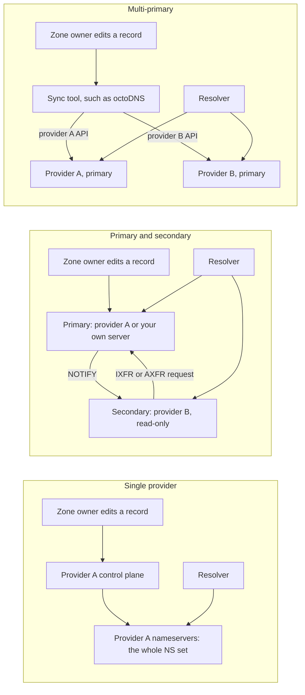

---
# Skeleton from Lead b4tqkigm (Fastly blog), picked 2026-10-27.
# Follow docs/editorial/comparison-writing-guide.md; no author notes
# are left. published and reviewed are the pick time, provisional: set them
# when you publish. verified: is the Author's alone (ADR-0007).
title: "Single, secondary or multi-primary DNS: surviving a provider outage"
description: "One DNS provider, a primary with a secondary, or two primaries: how each keeps the zone in sync, what a provider outage does, and which to pick."
kind: comparison
vertical: apis-networking
tags: ["dns", "zone-transfer", "dnssec", "multi-provider", "resilience"]
published: "2026-10-27T17:47:20Z"
verified: 2026-10-28
reviewed: "2026-10-27T17:47:20Z"
author: mira-vance
# Optional: an image HastCode may use, beside this file, replaces the
# generated title card. Never a Source's image.
# hero: option-a-vs-option-b.png
# hero_alt: "What the image shows"
# Optional: related Explainer slugs and extra sources (title + url).
# related: [metastable-failures]
---

"Every web request starts with a DNS lookup," Matt Rinehart writes in [Fastly's 20 October 2026 post on its secondary DNS](https://www.fastly.com/blog/building-resilience-why-we-started-with-secondary-dns/), and when the authoritative servers for your zone stop answering, your application is unreachable even if your origin and CDN are healthy. Fastly started with secondary DNS rather than the bigger primary DNS build, arguing that a second authoritative provider "addresses the failure that actually happens, depending on one authoritative provider." That leaves a choice for anyone who owns a zone. You can stay on one provider. You can add a second provider as a secondary that copies the zone by zone transfer. Or you can run two primaries and push every change to both. We answer the same questions for all three, from the RFCs and the providers' own documentation.

> Drafted with AI assistance, researched, verified and edited by the HastCode editorial team. We publish only as many pieces as the Author can verify this way.

## TL;DR

- **Single provider**: every nameserver in your NS set belongs to one provider, and you edit the zone in one place. It is the simplest setup, and that provider is the one failure you cannot route around.
- **Primary and secondary**: one server holds the zone, and a second provider pulls read-only copies by zone transfer (AXFR or IXFR) when a NOTIFY says it changed. Both sit in the NS set, so losing one costs capacity, not resolution.
- **Multi-primary**: you push the same records to each provider through its own API, and each one serves, and signs, independently. It keeps features zone transfer cannot carry, at the price of keeping the copies identical yourself.
- The three differ most in how a change reaches every nameserver: one write, a standard pull protocol, or your own sync tool.
- We infer: a secondary is the default second provider for a zone of standard records; multi-primary is for zones that depend on provider-specific features or providers that must sign with their own keys.

## One change and one lookup, through each setup

All three setups look the same from outside. A resolver finds your nameservers through the NS records delegated from the parent zone, and [RFC 2182](https://www.rfc-editor.org/rfc/rfc2182.html#section-3) says the primary and secondary distinction matters only to the zone's own servers: "to the rest of the DNS there are simply multiple servers." The same RFC notes that [registration rules require at least two servers per zone](https://www.rfc-editor.org/rfc/rfc2182.html#section-5) and recommends three for most organisation-level zones.

What differs is behind the NS set. The diagram follows one record edit and one lookup. With a single provider, the edit goes to one control plane, and every nameserver the resolver can ask belongs to it. With a primary and secondary, the primary tells the secondary a change exists, and the secondary pulls it. With multi-primary, a tool you run writes the same edit to each provider separately, and the resolver may ask either.

## Single provider: one control plane, one failure domain

The simplest setup puts every listed nameserver with one provider. You edit records in one place, and the provider serves them. RFC 9199, written for large authoritative operators, describes how such providers spread a service out: [name server replication (multiple NS records) and IP anycast](https://www.rfc-editor.org/rfc/rfc9199.html#section-3.1.1), where one address is announced from many physical locations.

That spreads servers across the world, but not across operators. [RFC 2182 asks](https://www.rfc-editor.org/rfc/rfc2182.html#section-3.1) that secondary servers be placed at "topologically and geographically dispersed locations," connected by diverse paths so that a failure of routing within "some segment of the network (such as a service provider)" does not make all of them unreachable. We infer that a zone served only by one DNS provider has exactly that single segment: however many anycast sites it runs, one operator's outage, misconfiguration or attack reaches every listed server at once.

[RFC 8901](https://www.rfc-editor.org/rfc/rfc8901.html#section-1) names the motive for leaving this setup: enterprises use multiple DNS providers primarily for redundancy and availability, so the service can "survive a complete, catastrophic failure of any single provider." The other two setups are two ways to get there.

## Primary and secondary: NOTIFY, then a zone transfer

This is the model the DNS was designed with. [RFC 1034](https://www.rfc-editor.org/rfc/rfc1034.html#section-4.3.5) makes one server the primary, where changes are made, while secondaries check the SERIAL field of the zone's SOA record and fetch a new copy when it has advanced. [RFC 1996](https://www.rfc-editor.org/rfc/rfc1996.html#section-2) is blunt: "There is by definition only one primary master server per zone," named in the SOA's MNAME field.

Polling alone is slow, so RFC 1996 adds [NOTIFY](https://www.rfc-editor.org/rfc/rfc1996.html#section-1), "an interrupt as opposed to poll model": the primary tells each secondary the zone changed. The secondary then asks for the data. AXFR sends [the whole zone, over TCP](https://www.rfc-editor.org/rfc/rfc5936.html#section-4); IXFR, from [RFC 1995](https://www.rfc-editor.org/rfc/rfc1995.html#section-2), sends only the differences since the secondary's serial, and a server may answer it with the full zone instead.

Fastly's service works exactly this way. [Its post](https://www.fastly.com/blog/building-resilience-why-we-started-with-secondary-dns/) says your primary sends a NOTIFY, Fastly requests the zone by AXFR or IXFR, and "Fastly cannot create or edit records": the primary stays the source of truth. Both providers go in your NS set.

The catch is the primary. Fastly says you must run one that supports zone transfers: "Not every provider does, and that is the one thing worth confirming before you plan this out." Where a provider does, it may not be on every plan; Cloudflare, for one, says [zone transfers are only available on its Enterprise plan](https://developers.cloudflare.com/dns/zone-setups/zone-transfers/).

## Multi-primary: the same records pushed to every provider

In the third setup there is no transfer. [RFC 8901](https://www.rfc-editor.org/rfc/rfc8901.html#section-2) describes it: "the multiple providers each act like primary servers," and the zone owner [uses provider-specific APIs to update zone content identically](https://www.rfc-editor.org/rfc/rfc8901.html#section-2.1) at each one.

The RFC gives two reasons to choose it over a secondary. Either [nonstandard DNS features are in use that are incompatible with zone transfer](https://www.rfc-editor.org/rfc/rfc8901.html#section-1), or a provider must be able to sign records with its own keys, such as one that supports only online signing.

GitHub ran this setup across two providers and built a tool for it. In [Ross McFarland's 2017 post](https://github.blog/engineering/enabling-split-authority-dns-with-octodns/), GitHub calls splitting authority "one of the best options available," and describes octoDNS: zones and records live as YAML in a Git repository, a config maps each zone to its target providers (`dyn` and `route53` in the example), and `octodns-sync` builds a plan of changes, applying it only when run with `--doit`. The [octoDNS project](https://github.com/octodns/octodns) still describes itself as "Tools for managing DNS across multiple providers."

The specifications are wary. [RFC 2182](https://www.rfc-editor.org/rfc/rfc2182.html#section-3) warns that "some unusual configurations use multiple primary servers, that can result in data inconsistencies, and is not advisable." RFC 8901, 23 years later, treats the setup as a deployment model to support rather than avoid. We infer the difference is tooling: the warning still holds for anything not generated from one source.

## When one provider goes down

**Single provider**: every listed server is down together. Only answers already in resolver caches still work. RFC 9199 cites measurements showing [caching protects users from short outages](https://www.rfc-editor.org/rfc/rfc9199.html#section-3.5.1) and that a DDoS on DNS does less harm "provided that the caches last longer than the attack," and it passes on a recommendation of [TTLs of at least one hour, ideally 4, 8 or 24 hours](https://www.rfc-editor.org/rfc/rfc9199.html#section-3.5.2), for general zone owners. A cache buys time; it does not replace a server.

**Primary and secondary**: resolvers move to the provider that still answers. Fastly is careful here: "This is not a failover." The [NS set has no priority order](https://www.fastly.com/blog/building-resilience-why-we-started-with-secondary-dns/), so resolvers already spread queries across both providers, and "losing one costs you capacity rather than resolution." [RFC 9199](https://www.rfc-editor.org/rfc/rfc9199.html#section-3.1.1) reports that resolvers "query all available authoritative servers, regardless of the observed latency," favouring faster ones and switching when one is unavailable. If the primary is the provider that fails, the secondary keeps answering, but [RFC 1034](https://www.rfc-editor.org/rfc/rfc1034.html#section-4.3.5) makes it discard its copy once it has been unable to check the serial for the SOA's EXPIRE interval. Until then, nobody can change a record, because the secondary is read-only.

**Multi-primary**: each provider holds its own complete copy, so we infer there is no EXPIRE clock tied to the other, and you can keep editing through the healthy provider's API. The cost is that the two copies now differ until your sync tool catches the failed provider up.

## How a change reaches every nameserver

**Single provider**: one write. How the provider copies it among its own servers is not something the Sources describe.

**Primary and secondary**: a change is a new serial. [RFC 2182](https://www.rfc-editor.org/rfc/rfc2182.html#section-7) says the serial "must be incremented every time a change, or group of changes, is made," and never simply decreased: secondaries ignore a smaller serial, and every later one, until the old high value is passed. NOTIFY over UDP is best effort, retried; [RFC 1996](https://www.rfc-editor.org/rfc/rfc1996.html#section-3) suggests a 60-second interval and at most 5 retransmissions as reasonable defaults. If every NOTIFY is lost, the secondary still polls after the SOA's [REFRESH interval](https://www.rfc-editor.org/rfc/rfc1035.html#section-3.3.13). Each transfer is all or nothing: [RFC 5936](https://www.rfc-editor.org/rfc/rfc5936.html#section-6) says a client MUST serve only a successfully transferred copy, and on error MUST keep serving the previous version.

**Multi-primary**: the protocol gives you nothing, so consistency is your tool's job. GitHub's post says keeping records in sync across providers [can be "complex to set up or a completely manual process"](https://github.blog/engineering/enabling-split-authority-dns-with-octodns/), which is why octoDNS plans changes and runs as a dry run by default. We infer the risks to watch are a sync that half-applies, or an emergency edit made by hand in one provider's dashboard and never copied to the other.

## Securing the zone between providers

**Single provider**: no zone crosses between providers, so there is no transfer path to protect.

**Primary and secondary**: the transfer is the exposure. [RFC 5936](https://www.rfc-editor.org/rfc/rfc5936.html#section-5) says an implementation SHOULD let you restrict AXFR to specific clients and SHOULD NOT default to "open to all," and it recommends access control based on TSIG. [TSIG, in RFC 8945](https://www.rfc-editor.org/rfc/rfc8945.html), authenticates DNS transactions with a shared secret and a one-way hash, the secret configured out of band, and [one use the RFC names is protecting zone transfers](https://www.rfc-editor.org/rfc/rfc8945.html#section-1.1). TSIG proves who is asking, not who is listening: [RFC 9103](https://www.rfc-editor.org/rfc/rfc9103.html) says "DNS zone transfers are transmitted in cleartext," that TSIG "does not add confidentiality," and defines XFR over TLS (XoT) to stop passive collection of the zone. [RFC 5936](https://www.rfc-editor.org/rfc/rfc5936.html#section-6) also suggests dedicated links or a VPN among the authoritative servers where the operator can arrange one.

**Multi-primary**: no zone transfer runs between providers. We infer the exposure moves to the sync tool, which holds write credentials for every provider's API at once.

## DNSSEC and the features zone transfer cannot carry

**Single provider**: one operator signs and serves. [RFC 8901](https://www.rfc-editor.org/rfc/rfc8901.html#section-2.1.1) even notes a single-provider variant of its first model, where the zone owner keeps the key-signing key (KSK) so it can authorize or revoke the provider's zone-signing keys (ZSKs).

**Primary and secondary**: DNSSEC needs nothing new. If standard zone transfer can be used, RFC 8901 says [multiple providers require no change to the normal deployment models](https://www.rfc-editor.org/rfc/rfc8901.html#section-2): one entity signs, and the providers serve the signed zone as secondaries. The limit is the other side of the same coin: a secondary serves only what a zone transfer carries, and features that [RFC 8901 calls incompatible with zone transfer](https://www.rfc-editor.org/rfc/rfc8901.html#section-1) stay with the primary.

**Multi-primary**: each provider signs with its own keys, and the keys must agree. RFC 8901 describes [Model 1](https://www.rfc-editor.org/rfc/rfc8901.html#section-2.1.1) (the owner holds one KSK, each provider has its own ZSKs) and [Model 2](https://www.rfc-editor.org/rfc/rfc8901.html#section-2.1.2) (each provider has its own KSK and ZSKs). In both, every provider's DNSKEY set must hold every provider's ZSKs. Otherwise a resolver that cached provider A's keys [cannot validate an answer signed by provider B](https://www.rfc-editor.org/rfc/rfc8901.html#section-3), and pays extra round trips or fails. Providers must also [use a common signing algorithm](https://www.rfc-editor.org/rfc/rfc8901.html#section-4), and the [DNSKEY responses grow](https://www.rfc-editor.org/rfc/rfc8901.html#section-10).

## Trade-offs

Each cell summarises a section above, where its source is linked.

| Question | Single provider | Primary and secondary | Multi-primary |
|---|---|---|---|
| Where the zone is edited | One provider | The primary only; the secondary is read-only | Every provider, through its API, usually from one tool |
| How a change spreads | One write | NOTIFY, then IXFR or AXFR; SOA polling as backup | Your sync tool writes to each provider |
| Consistency guarantee | One copy | Serial numbers; all-or-nothing transfers | None from the protocol; RFC 2182 calls it "not advisable" |
| One provider fails | Only cached answers survive | The other keeps answering; capacity drops | The other keeps answering; copies may drift |
| Primary fails for long | Not applicable | Secondary stops at EXPIRE; no edits meanwhile | Not applicable; edit through the healthy provider |
| Securing the path | No transfer path | Restrict AXFR, TSIG, XoT for confidentiality | Write credentials for every provider in one tool |
| DNSSEC | One signer | One signer; no change needed | Multi-signer: shared ZSKs, one algorithm, larger DNSKEY sets |
| Provider-specific features | All of one provider's | Only what zone transfer carries | Possible, if each provider can sign them |
| What you need | One provider | A primary that supports zone transfers | A sync tool and each provider's API |

## Which setup to choose for your zone

Everything in this section is our inference from the facts above, not a recommendation the Sources make.

**A single provider wins when the zone is small, the stakes are low, and a cached answer covers a short outage.** Raise your TTLs toward the hours RFC 9199 passes on, and know that a full provider outage is one you wait out.

**Primary and secondary wins for most zones of standard records.** It is the DNS's own replication model, with all-or-nothing transfers and one signer, and Fastly's point holds: adding it changes nothing about how you edit. Watch three things: whether your primary supports zone transfers on your plan, TSIG on every transfer, and an EXPIRE long enough to outlast a primary outage.

**Multi-primary wins when the zone depends on features a transfer cannot carry, or a provider insists on signing with its own keys.** Generate every provider's records from one source, as octoDNS does, never edit a dashboard by hand, and if you sign, plan the RFC 8901 key exchange before you turn DNSSEC on.

The good news is that a second provider no longer means rebuilding your DNS. Any of the three can be the step up from the one before.

## Sources

- Matt Rinehart, [Building Resilience: Why We Started with Secondary DNS](https://www.fastly.com/blog/building-resilience-why-we-started-with-secondary-dns/), Fastly blog, 20 October 2026 (sections "Why Secondary, and Why First", "How it works", "What it Takes").
- [RFC 1034: Domain Names, Concepts and Facilities](https://www.rfc-editor.org/rfc/rfc1034.html), section 4.3.5, Zone maintenance and transfers.
- [RFC 1035: Domain Names, Implementation and Specification](https://www.rfc-editor.org/rfc/rfc1035.html), section 3.3.13, SOA RDATA format.
- [RFC 1995: Incremental Zone Transfer in DNS](https://www.rfc-editor.org/rfc/rfc1995.html), sections 1 and 2.
- [RFC 1996: A Mechanism for Prompt Notification of Zone Changes (DNS NOTIFY)](https://www.rfc-editor.org/rfc/rfc1996.html), sections 1, 2 and 3.
- [RFC 2182: Selection and Operation of Secondary DNS Servers](https://www.rfc-editor.org/rfc/rfc2182.html), sections 3, 3.1, 5 and 7.
- [RFC 5936: DNS Zone Transfer Protocol (AXFR)](https://www.rfc-editor.org/rfc/rfc5936.html), sections 4, 5 and 6.
- [RFC 8901: Multi-Signer DNSSEC Models](https://www.rfc-editor.org/rfc/rfc8901.html), sections 1, 2, 2.1, 3, 4 and 10.
- [RFC 8945: Secret Key Transaction Authentication for DNS (TSIG)](https://www.rfc-editor.org/rfc/rfc8945.html), abstract and section 1.1.
- [RFC 9103: DNS Zone Transfer over TLS](https://www.rfc-editor.org/rfc/rfc9103.html), abstract.
- [RFC 9199: Considerations for Large Authoritative DNS Server Operators](https://www.rfc-editor.org/rfc/rfc9199.html), sections 3.1 and 3.5.
- Ross McFarland, [Enabling DNS split authority with OctoDNS](https://github.blog/engineering/enabling-split-authority-dns-with-octodns/), The GitHub Blog, 27 April 2017.
- [octoDNS](https://github.com/octodns/octodns), project README.
- Cloudflare, [DNS zone transfers](https://developers.cloudflare.com/dns/zone-setups/zone-transfers/), developer documentation.
