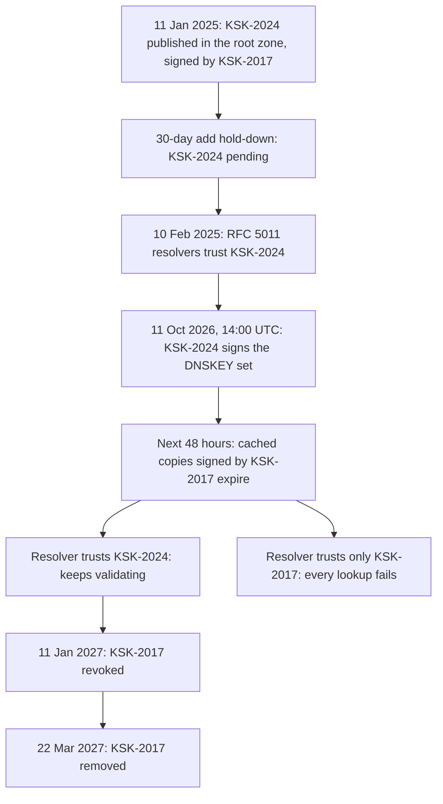

---
# Skeleton from Lead a4pqfsqf (APNIC blog), picked 2026-10-30.
# Drafted per docs/editorial/concept-writing-guide.md; no author notes
# are left. published and reviewed are the pick time, provisional: set them
# when you publish. verified: is the Author's alone (ADR-0007).
title: "Root KSK rollover: how validating resolvers learn a new trust anchor"
description: "A root KSK rollover replaces the key every DNSSEC validator trusts. How resolvers learn the new one, and what the October 2026 roll showed."
kind: concept
vertical: apis-networking
tags: ["dnssec", "dns", "trust-anchors", "key-rollover", "rfc-5011"]
published: "2026-10-30T10:42:23Z"
verified: 2026-10-30
reviewed: "2026-10-30T10:42:23Z"
author: mira-vance
# Optional: an image HastCode may use, beside this file, replaces the
# generated title card. Never a Source's image.
# hero: concept-name.png
# hero_alt: "What the image shows"
# Optional: related Explainer slugs and extra sources (title + url).
# related: [http-connection-reuse]
---

On 9 October 2026, two days before the DNS root changed its signing key, APNIC Labs [reached a major Indian ISP](https://blog.apnic.net/2026/10/21/rolling-the-root-key-what-happened/) whose resolvers did not yet trust the incoming key. The roll began at [14:00 UTC on 11 October](https://blog.apnic.net/2026/10/21/rolling-the-root-key-what-happened/). The ISP fixed its resolvers in time, and the share of measured Indian users behind DNSSEC-validating resolvers rose [from 55% to 59%](https://blog.apnic.net/2026/10/21/rolling-the-root-key-what-happened/) across the roll. APNIC's Geoff Huston writes that they were ["not so fortunate"](https://blog.apnic.net/2026/10/21/rolling-the-root-key-what-happened/) contacting ISPs in Brazil, where the rate [fell from 54% to 50%](https://blog.apnic.net/2026/10/21/rolling-the-root-key-what-happened/). Brazil lost [7,780,266 validating users](https://blog.apnic.net/2026/10/21/rolling-the-root-key-what-happened/), more than any other economy, while India gained 45,423,360, the most of any. Same key, same minute, opposite results.

> Drafted with AI assistance, researched, verified and edited by the HastCode editorial team. We publish only as many pieces as the Author can verify this way.

## TL;DR

- A **root KSK rollover** replaces the key that every DNSSEC-validating resolver holds as its **trust anchor**, the one key it accepts without looking it up. IANA's schedule puts it plainly: [validating resolvers must have updated trust anchors](https://www.iana.org/dnssec/files) to keep validating the root zone.
- Resolvers learn the new key through **RFC 5011**: the old key signs a key set containing the new one, and after a [30-day add hold-down](https://www.rfc-editor.org/rfc/rfc5011.html#section-2.4.1) the resolver trusts it. On the day of the roll, the old signatures linger in caches for about [48 hours](https://blog.apnic.net/2026/10/21/rolling-the-root-key-what-happened/).
- The October 2026 roll worked: the global validation rate went [from 39.7% to 40.6%](https://blog.apnic.net/2026/10/21/rolling-the-root-key-what-happened/), and about 1.70 billion of 4.31 billion users sat behind validating resolvers afterwards.
- To be safe: keep automatic updates on with writable key storage, check for the new key tag before the roll, and measure from the user's side with the **KSK Sentinel** ([RFC 8509](https://www.rfc-editor.org/rfc/rfc8509.html)). The cost: a month of lead time, and outreach for the resolvers that miss it.

## A trust anchor is the one key a validator cannot look up

A DNSSEC-validating resolver checks signatures along a chain from the root down to the name you asked for. The chain has to start somewhere. The **Key Signing Key (KSK)** at the root signs the root zone's set of keys, its **DNSKEY RRset**, and the resolver holds a copy of the root KSK in its configuration as a **trust anchor**. Each key is named by a short number, its **key tag**: [20326 for KSK-2017 and 38696 for KSK-2024](https://www.iana.org/dnssec/files).

RFC 5011 exists because that configured copy must change one day. It describes ["automated, authenticated, and authorized updating of DNSSEC 'trust anchors'"](https://www.rfc-editor.org/rfc/rfc5011.html): the resolver accepts a new key only when a key it already trusts vouches for it. In our words, a rollover is a handover of trust, done in-band, through DNS answers the resolver already knows how to check.

What does not count: the 2026 roll ["is not a change of algorithm"](https://blog.apnic.net/2026/10/09/rolling-the-root-key-2/), Huston writes, only a new key pair. And getting it wrong is not a partial failure. A validating resolver that trusts only the old key, Huston wrote of the 2018 roll, ["is unable to resolve any name, whether or not the name is DNSSEC-signed"](https://blog.apnic.net/2018/10/31/analyzing-the-ksk-roll/), once its cached copy of the old DNSKEY record expires.

## Old signs new: the 2026 roll, step by step

Walk it from the top, with [IANA's dates](https://www.iana.org/dnssec/files). KSK-2024 was generated in April 2024 and published in the root zone's DNSKEY RRset on 11 January 2025. KSK-2017 signed that set, so any resolver trusting KSK-2017 could validate the new key's arrival.

RFC 5011 does not accept it on sight. The add hold-down is ["30 days or the expiration time of the original TTL"](https://www.rfc-editor.org/rfc/rfc5011.html#section-2.4.1), whichever is greater, and the resolver must see [at least two validated DNSKEY RRsets](https://www.rfc-editor.org/rfc/rfc5011.html#section-2.4.1) containing the key. IANA's schedule has RFC 5011 resolvers trusting KSK-2024 from [10 February 2025](https://www.iana.org/dnssec/files), thirty days on.

Then nothing visible happens for twenty months. At 14:00 UTC on 11 October 2026, KSK-2024 began signing and KSK-2017 stopped. Resolvers still held DNSKEY records signed by the old key, so APNIC watched the [48 hours that cover their cached lifetime](https://blog.apnic.net/2026/10/21/rolling-the-root-key-what-happened/). By 14:00 UTC on 13 October, we infer, every resolver had fetched the new set, and its trust anchors decided whether it kept working.

The roll is not over. KSK-2017 gets its REVOKE bit on [11 January 2027](https://www.iana.org/dnssec/files) and leaves the zone on 22 March 2027.

## Two root rolls, and how anyone could see them

The 2026 roll is the second. The first was scheduled for 11 October 2017 and [halted by early trust anchor data](https://blog.apnic.net/2018/10/31/analyzing-the-ksk-roll/); Verisign's Duane Wessels and ICANN's Roy Arends say it was postponed a year ["out of an abundance of caution"](https://blog.verisign.com/security/2024-2026-root-zone-ksk-rollover-updates-observations/). KSK-2017 took over on [11 October 2018](https://www.iana.org/dnssec/files). Huston estimated the impact at [about 0.2% to 0.3% of end users](https://blog.apnic.net/2018/10/31/analyzing-the-ksk-roll/), under the design team's 0.5% rollback threshold.

That data came from **RFC 8145**, which lets a validating resolver [signal the key tags it trusts](https://www.rfc-editor.org/rfc/rfc8145.html) in its queries, so root operators can monitor a rollover's progress. Verisign's chart showed adoption of each incoming key [above 95% after about 500 days](https://blog.verisign.com/security/2024-2026-root-zone-ksk-rollover-updates-observations/), in both 2017 and 2024.

RFC 8145 counts resolvers, not people. RFC 8509's authors say such reports show how many resolvers may be affected, but ["not what the user impact of the KSK roll will be"](https://www.rfc-editor.org/rfc/rfc8509.html). The gap was real in 2026: Verisign saw [around 90% of reporting resolvers](https://blog.apnic.net/2026/10/09/rolling-the-root-key-2/) with KSK-2024, while APNIC found [around 70% of tests](https://blog.apnic.net/2026/10/09/rolling-the-root-key-2/) from Sentinel-capable users reporting it loaded. We infer the reason: one busy ISP resolver weighs the same as an idle one in the first count, and as all its users in the second.

## The KSK Sentinel asks a resolver what it trusts

RFC 8509, by [Huston, Joao Damas and Warren Kumari](https://www.rfc-editor.org/rfc/rfc8509.html), adds two special labels: `root-key-sentinel-is-ta-<key-tag>` and `root-key-sentinel-not-ta-<key-tag>`, with the key tag [zero-padded to five digits](https://www.rfc-editor.org/rfc/rfc8509.html#section-2.1). A resolver that supports it answers [SERVFAIL](https://www.rfc-editor.org/rfc/rfc8509.html#section-2.2) for an `is-ta` name whose key it does not trust, and for a `not-ta` name whose key it does. Otherwise it returns the normal answer.

A client asks [three names](https://www.rfc-editor.org/rfc/rfc8509.html#section-4.3): one with a broken signature, a `not-ta` name for a key it expects trusted, and an `is-ta` name for the key in question. The [answers sort the resolver](https://www.rfc-editor.org/rfc/rfc8509.html#section-3): **Vnew** has loaded the key, **Vold** validates without it, **Vind** validates but does not support the Sentinel, and **nonV** does not validate at all. APNIC checks 20326 to detect support, then 38696 to see whether [KSK-2024 is loaded](https://blog.apnic.net/2026/10/09/rolling-the-root-key-2/).

The questions reach users through online ads. APNIC's system serves [15 to 20 million ad impressions a day](https://blog.apnic.net/2023/10/31/how-we-measure-dnssec-validation/), each with its own DNS label so no cache interferes, and weights results by each economy's user count. Before the roll, about [6 million daily tests reached validating resolvers](https://blog.apnic.net/2026/10/09/rolling-the-root-key-2/) and about 1.8 million gave a clear RFC 8509 signal. We infer that this is the signal that showed APNIC, by 9 October, which networks to call.

## What the October 2026 roll showed

Huston's verdict: the roll [was a success](https://blog.apnic.net/2026/10/21/rolling-the-root-key-what-happened/), with no major DNS outage. The numbers, all from his 21 October post:

- **Globally**, validation rose from [39.7% before the roll to 40.6% after](https://blog.apnic.net/2026/10/21/rolling-the-root-key-what-happened/). Users behind validating resolvers grew by [45.8 million](https://blog.apnic.net/2026/10/21/rolling-the-root-key-what-happened/), to 1,700,275,794 of 4,308,517,174.
- **India** gained 45,423,360 of those. We infer from the two figures that the one economy's gain was almost the whole net global gain; other gains and losses nearly cancelled.
- **The 50 riskiest networks**, those with the [lowest acceptance of KSK-2024](https://blog.apnic.net/2026/10/21/rolling-the-root-key-what-happened/) the week before, all added it between 7 and 13 October. "Surprisingly, none of these networks was stranded," Huston writes.
- **Across 13,538 networks**, [58 saw validation fall by 50% or more](https://blog.apnic.net/2026/10/21/rolling-the-root-key-what-happened/) and 35 saw it rise by more than 50%. For the rises, his likely explanation is resolvers that trusted the incoming KSK but not the incumbent. The post gives no explanation for the falls, nor for Brazil.

That second group is a trap worth naming. We infer that a resolver configured only with the new key failed validation for twenty months, then started working at the roll: a trust anchor can be wrong in either direction.

## Why resolvers miss a new key

The roll asks every validating resolver on the Internet to act, and nobody can make them. In Huston's words, ["The DNS is a highly distributed but loosely coupled system."](https://blog.apnic.net/2026/10/21/rolling-the-root-key-what-happened/) No one coordinates the resolvers; each operator's configuration decides.

Automation has preconditions. Verisign tells operators to [confirm automatic trust anchor updates are enabled](https://blog.verisign.com/security/2024-2026-root-zone-ksk-rollover-updates-observations/) and that the resolver can write to its key storage directory. We infer the failure: a resolver that sees KSK-2024 but cannot save it starts from the old file at its next restart. The anchors live in files named per resolver: `bind.keys` for BIND, `root.key` for Unbound and PowerDNS Recursor, `root.keys` for Knot Resolver.

Rolls are rare. KSK-2017 signed the root from [11 October 2018 to 11 October 2026](https://www.iana.org/dnssec/files), eight years. We infer that many resolver configurations, images and operators were set up after the last roll and had never been through one.

Old anchors linger too. About [3.5% of sources still retain KSK-2010](https://blog.verisign.com/security/2024-2026-root-zone-ksk-rollover-updates-observations/), revoked in 2019. We infer that a stale anchor costs nothing on a normal day, which is why it survives.

## Practice one: let RFC 5011 do the work, and give it room

RFC 5011 is how [most resolvers pick up the new key](https://blog.verisign.com/security/2024-2026-root-zone-ksk-rollover-updates-observations/) automatically. A resolver re-queries the trust point's DNSKEY RRset on a timer, [`MAX(1 hr, MIN(15 days, 1/2*OrigTTL, 1/2*RRSigExpirationInterval))`](https://www.rfc-editor.org/rfc/rfc5011.html#section-2.3). We infer from the 48-hour cache lifetime that a root resolver following this formula checks at least once a day.

Each key moves through [states](https://www.rfc-editor.org/rfc/rfc5011.html#section-4): Start, AddPend during the hold-down, Valid, and Revoked when its owner sets the [REVOKE flag, bit 8](https://www.rfc-editor.org/rfc/rfc5011.html#section-3) of the DNSKEY flags. A revoked key ["MUST permanently be considered invalid"](https://www.rfc-editor.org/rfc/rfc5011.html#section-4.2), and after a [30-day remove hold-down](https://www.rfc-editor.org/rfc/rfc5011.html#section-2.4.2) it is gone. The RFC suggests [one active key and one stand-by key](https://www.rfc-editor.org/rfc/rfc5011.html#section-6) at each trust point.

The costs: the new key must be published at least a month before it is needed, so a rollover is planned in years, not days. The resolver needs persistent, writable state. And RFC 5011 cannot rescue a resolver that has already lost every anchor: if all are compromised, [a manual or other out-of-band update](https://www.rfc-editor.org/rfc/rfc5011.html#section-8.2) of all resolvers is required.

## Practice two: check the key tag before the caches run out

Look before the roll, not after. Verisign's advice was to [verify KSK-2024 is present now](https://blog.verisign.com/security/2024-2026-root-zone-ksk-rollover-updates-observations/), by key tag 38696, in your resolver's trust anchor file. For a manual update, IANA publishes the anchors as [root-anchors.xml](https://www.iana.org/dnssec/files), with an S/MIME signature and the ICANN CA bundle to check it, plus a [retrieval tool](https://github.com/iana-org/get-trust-anchor).

Then check from the user's side. Cloudflare's [KSK-2024 test page](https://dnstest.dev/ksk-2024) uses RFC 8509 sentinels to ask the resolver your browser uses whether it trusts the new key. If all three sentinel names resolve, it reports that Sentinel support was not detected, so the answer says nothing about the key.

For an operator of many resolvers, the outside view is APNIC's per-network data: the [50 lowest-acceptance networks](https://blog.apnic.net/2026/10/09/rolling-the-root-key-2/) were published on 9 October, and the [per-network results](https://blog.apnic.net/2026/10/21/rolling-the-root-key-what-happened/) after the roll.

The costs: a manual anchor is only as good as your check of its signature, and a Sentinel result depends on resolver support. Outreach does not scale. It worked for one Indian ISP that [reacted in time](https://blog.apnic.net/2026/10/21/rolling-the-root-key-what-happened/) and did not in Brazil.

## What a trust anchor rollover is not

It is not an outage of the root. Huston reports [no major DNS outage](https://blog.apnic.net/2026/10/21/rolling-the-root-key-what-happened/); the failure, where it happened, sat in a resolver that could not validate what it received. We infer the consequence for architecture: adding a second authoritative DNS provider, which we compare in [Single, secondary or multi-primary DNS](/apis-networking/dns-provider-redundancy/), protects you from a provider outage but not from your users' resolvers distrusting the root.

It is not an algorithm rollover. In 2026 the [algorithm stayed the same](https://blog.apnic.net/2026/10/09/rolling-the-root-key-2/) and only the key pair changed. Changing the signing algorithm as well adds questions about which algorithms each resolver supports; that deserves its own Explainer.

It is not trust anchor signalling. RFC 8145 and RFC 8509 only observe the roll. A resolver that sends no signal and supports no Sentinel can still update correctly through RFC 5011; it is simply invisible to the people measuring.

## What understanding a rollover makes possible

You can now read a roll from three angles: the schedule ([IANA](https://www.iana.org/dnssec/files)), the resolver count ([RFC 8145](https://www.rfc-editor.org/rfc/rfc8145.html)), and the user count ([RFC 8509](https://www.rfc-editor.org/rfc/rfc8509.html)). When they disagree, as 90% of resolvers and 70% of Sentinel tests did in 2026, the difference tells you where the users are.

You can test your own path today: open Cloudflare's [test page](https://dnstest.dev/ksk-2024), or check your resolver's anchor file for 38696. Then watch the next step. On [11 January 2027](https://www.iana.org/dnssec/files) KSK-2017 is revoked, and RFC 5011 resolvers should drop it after the remove hold-down. We infer from KSK-2010's 3.5% tail that some will not.

The optimistic part: the root of a global trust hierarchy changed its key, in public, on a published schedule, and [1.70 billion users](https://blog.apnic.net/2026/10/21/rolling-the-root-key-what-happened/) behind validating resolvers came through it with validation higher than before. The cost was a month of hold-down, eight years between practice runs, and a few phone calls that, in India, made the difference.

## Sources

- Geoff Huston, ["Rolling the root key: What happened?"](https://blog.apnic.net/2026/10/21/rolling-the-root-key-what-happened/), APNIC blog, 21 October 2026.
- Geoff Huston, ["Rolling the root key"](https://blog.apnic.net/2026/10/09/rolling-the-root-key-2/), APNIC blog, 9 October 2026.
- Geoff Huston, ["Rolling the root key"](https://blog.apnic.net/2026/05/05/rolling-the-root-key/), APNIC blog, 5 May 2026.
- Geoff Huston, ["Analyzing the KSK roll"](https://blog.apnic.net/2018/10/31/analyzing-the-ksk-roll/), APNIC blog, 31 October 2018.
- Geoff Huston, ["How we measure: DNSSEC validation"](https://blog.apnic.net/2023/10/31/how-we-measure-dnssec-validation/), APNIC blog, 31 October 2023.
- Duane Wessels and Roy Arends, ["The 2024-2026 Root Zone KSK Rollover: Updates and Observations"](https://blog.verisign.com/security/2024-2026-root-zone-ksk-rollover-updates-observations/), Verisign blog, 28 July 2026.
- IANA, ["DNSSEC Trust Anchors and Rollovers"](https://www.iana.org/dnssec/files), key details and rollover timeline; [get-trust-anchor](https://github.com/iana-org/get-trust-anchor).
- M. StJohns, [RFC 5011: Automated Updates of DNS Security (DNSSEC) Trust Anchors](https://www.rfc-editor.org/rfc/rfc5011.html), September 2007.
- D. Wessels, W. Kumari, P. Hoffman, [RFC 8145: Signaling Trust Anchor Knowledge in DNS Security Extensions (DNSSEC)](https://www.rfc-editor.org/rfc/rfc8145.html), April 2017.
- G. Huston, J. Damas, W. Kumari, [RFC 8509: A Root Key Trust Anchor Sentinel for DNSSEC](https://www.rfc-editor.org/rfc/rfc8509.html), December 2018.
- Cloudflare, [KSK-2024 resolver test](https://dnstest.dev/ksk-2024).
