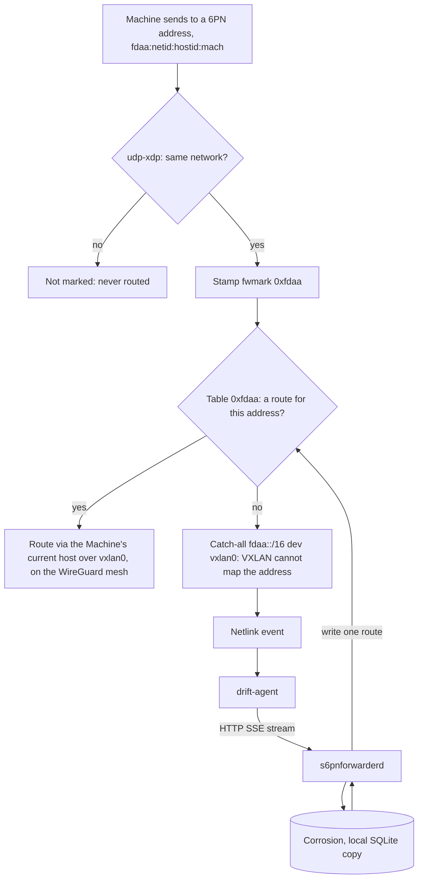

---
# Skeleton from Lead bp4azrzr (Fly.io blog), picked 2026-11-15.
# Follow docs/editorial/case-study-writing-guide.md; the Author's check list
# is in the pull request. published and reviewed are the pick time, provisional: set them
# when you publish. verified: is the Author's alone (ADR-0007).
title: "Fly.io 6PN: how lazy routing replaced a fleet-wide phonebook"
description: "How Fly.io's 6PN replaced a fleet-wide eBPF phonebook with routes looked up on demand, at the price of a slow first packet to a new peer."
kind: case-study
vertical: apis-networking
tags: ["networking", "ipv6", "ebpf", "vxlan", "fly-io"]
published: "2026-11-15T07:09:16Z"
reviewed: "2026-11-15T07:09:16Z"
author: mira-vance
# Optional: an image HastCode may use, beside this file, replaces the
# generated title card. Never a Source's image.
# hero: system-name.png
# hero_alt: "What the image shows"
related: [cilium, fly-io-sbd]
draft: true
---

Until this year, every host in Fly.io's fleet kept a phonebook: a kernel map of every Machine that had ever moved and where it lives now, with [hundreds of thousands of entries on every host, kept up to date in real time](https://fly.io/blog/throwing-out-the-phonebook/). Its replacement holds [between 100 and 200 routes on most hosts](https://fly.io/blog/throwing-out-the-phonebook/#what-changed), and learns each one only when a packet asks for it.

> Drafted with AI assistance, researched, verified and edited by the HastCode editorial team. We publish only as many pieces as the Author can verify this way.

## TL;DR

- 6PN is Fly.io's [private IPv6 network between the apps in one organization](https://docs.fly.io/networking/private-networking). Its new routing [installs one route per peer, on demand](https://fly.io/blog/throwing-out-the-phonebook/#ask-write-it-down-move-on), in a dedicated routing table, `0xfdaa`, instead of keeping the whole fleet's map on every host.
- Fly.io rebuilt it because the old design held [a BPF map of every migrated Machine on every host](https://fly.io/blog/throwing-out-the-phonebook/#machines-learn-to-move), fed from its Corrosion database. The map grew towards its cap, differed from host to host, and gave no clean signal when it went stale.
- Now `udp-xdp` checks a packet stays inside its network and marks it, table `0xfdaa` sends it to `vxlan0`, and an unknown address makes VXLAN [raise a netlink event](https://fly.io/blog/throwing-out-the-phonebook/#the-network-already-asks) that `drift-agent` passes to `s6pnforwarderd`, which looks it up in Corrosion and writes one route.
- The price: the first connection between two Machines that have never spoken [can take about a second](https://fly.io/blog/throwing-out-the-phonebook/#what-it-costs). The surprise: Fly.io swapped the network [live, host by host, behind a feature flag](https://fly.io/blog/throwing-out-the-phonebook/#changing-the-engine-at-cruising-altitude), with traffic going out one path and back another.

## The path a 6PN packet takes now

The diagram is ours, redrawn from the text of Fly.io's post; Fly.io's own illustrations are in [the original](https://fly.io/blog/throwing-out-the-phonebook/). It follows one packet from a Machine to a peer on another host. The left branch is the common case, a route that already exists. The right branch is the miss: the first packet to a peer this host has never needed.

Step 1 below is the check at the top. Step 2 is the routing table and the miss. Step 3 is the lookup by `drift-agent` and `s6pnforwarderd`. Step 4 is what happens to the route once it exists. First, why Fly.io needed any of this.

## How moving Machines broke "the address is the route"

A 6PN address has the shape [`fdaa:netid:netid:hostid:hostid:mach:mach:2`](https://fly.io/blog/throwing-out-the-phonebook/#the-address-is-the-route): the organization's network, the physical server where the Machine was born, and the Machine itself. Fly.io's docs describe the same layout behind a [`fdaa` unique local prefix](https://docs.fly.io/networking/private-networking#6pn-addresses-in-detail), and `.internal` DNS names resolve to these addresses.

Fly.io's servers are joined by [a fully connected WireGuard mesh](https://fly.io/blog/throwing-out-the-phonebook/#the-address-is-the-route), and each host owns a `/48`, `fdaa:hostid:hostid::/48`. The host ID in a Machine's address sits in the wrong place for that, so `udp-xdp`, an eBPF program on every Machine's interface, swapped the network and host fields on the way out and the far side swapped them back. No lookups, no state, no database. In Fly.io's words, ["The address is the route."](https://fly.io/blog/throwing-out-the-phonebook/#the-address-is-the-route) (eBPF [runs sandboxed programs inside the kernel](https://ebpf.io/what-is-ebpf/), checked by a verifier before they load; our [Cilium explainer](/apis-networking/cilium/) shows a whole dataplane built on it.)

Then Machines started moving. Fly.io [sometimes migrates Machines between hosts](https://fly.io/blog/throwing-out-the-phonebook/#machines-learn-to-move), "for a long list of reasons" it does not list. A migrated Machine still carries its birth host in its address, so the address now points at the wrong server. The scheme that needed no state suddenly needed to know where every moved Machine had gone.

## Why a phonebook in the kernel could not last

Fly.io's answer was to keep a Machine's original address as [its permanent, canonical address](https://fly.io/blog/throwing-out-the-phonebook/#machines-learn-to-move) and have `udp-xdp` translate it, using the host the Machine is on now. That meant every host had to know where every migrated Machine was. The phonebook was [a BPF map on every host](https://fly.io/blog/throwing-out-the-phonebook/#machines-learn-to-move), fed by a subscription to every Machine update across the fleet from Corrosion, Fly.io's [gossip-replicated SQLite database](https://fly.io/blog/corrosion/).

The post lists what went wrong. eBPF code cannot call out to user space to fetch an entry when it needs one, so [every entry had to be preloaded](https://fly.io/blog/throwing-out-the-phonebook/#a-phonebook-in-elvish), and the map kept growing; when Fly.io last looked it was "within the same order of magnitude as the cap" it had set. Hosts drifted apart: "Every host had a different phonebook." There was no good way to monitor the map, and the sync from Corrosion had broken during incidents, with problems Fly.io might not have heard about. Rewritten addresses meant sender and receiver saw different addresses, which made debugging harder. And routing around a bad link would have meant more logic in `udp-xdp`.

Fly.io's own summary is the hardest kind of problem: [a real-time copy of an eventually consistent database, on every host, inside the kernel](https://fly.io/blog/throwing-out-the-phonebook/#a-phonebook-in-elvish). Corrosion's own post says it [converges in seconds](https://fly.io/blog/corrosion/); we infer that every one of those seconds was a window in which some host's phonebook could be wrong.

## Preload every peer, or answer when asked

The post names three ways to find a moved Machine, in the order Fly.io tried them.

- **Remember old addresses.** The first fix, `dnat6pn`, [remembered every past address and rewrote traffic to the current one](https://fly.io/blog/throwing-out-the-phonebook/#machines-learn-to-move). Its table grew fast, broke when an app moved to another organization, and even broke Fly.io's own apps. "Mistakes had, indeed, been made."
- **Preload the fleet.** The phonebook above: correct when synced, but sized to the fleet, not to the host.
- **Ask on demand.** Look up a Machine only when a host first needs it.

Asking on demand needs something to notice the miss, and eBPF could not do the asking. The deciding fact was already running. For Egress IPs, Fly.io had [put a Layer 2 network, VXLAN, on top of the WireGuard mesh](https://fly.io/blog/throwing-out-the-phonebook/#the-network-already-asks). VXLAN, the tunnelling protocol of [RFC 7348 as the kernel documents it](https://docs.kernel.org/networking/vxlan.html), needs only [a UDP port](https://fly.io/blog/throwing-out-the-phonebook/#the-network-already-asks), but it cannot shout across an IP network the way ARP or Neighbor Discovery does on Ethernet. Fly.io puts the choice plainly: ["You either tell it about every peer in advance, or you fake the answer."](https://fly.io/blog/throwing-out-the-phonebook/#the-network-already-asks) Telling it in advance is the phonebook again. Fly.io chose to fake the answer.

## Step 1: udp-xdp checks the network and stamps the packet

`udp-xdp` survived the redesign with one job left: checking that [the source and destination 6PN addresses belong to the same network](https://fly.io/blog/throwing-out-the-phonebook/#safer-too). That is the line Fly.io's docs promise, that the platform [won't forward packets between different 6PNs unless you allow it](https://docs.fly.io/networking/private-networking).

A packet that passes gets a `0xfdaa` fwmark, a tag the kernel can match on, and only marked packets are routed through table `0xfdaa` to `vxlan0`. The order matters. If `udp-xdp` fails to load, nothing is marked and nothing crosses: ["The network fails closed."](https://fly.io/blog/throwing-out-the-phonebook/#safer-too) We infer the opposite order, routing everything and filtering afterwards, would turn a failed filter into an open network between organizations.

Why keep eBPF for this at all? The post argues against `nftables` here because the check [compares fields inside the same packet](https://fly.io/blog/throwing-out-the-phonebook/#safer-too), which a few lines of eBPF do with no outside data. That is the point: the check needs no phonebook. Fly.io adds that it would eventually like to move UDP encapsulation out of eBPF too.

## Step 2: table 0xfdaa routes the packet, or VXLAN asks

Machine 6PN traffic uses a routing table of its own, `0xfdaa`, which [starts with a single rule, `fdaa::/16 dev vxlan0`](https://fly.io/blog/throwing-out-the-phonebook/#ask-write-it-down-move-on). Every other entry in it is a route learned on demand.

When a specific route exists, the packet goes to the Machine's current host over VXLAN, as the diagram's left branch shows. No address is rewritten on the way: ["No translation needs to happen either."](https://fly.io/blog/throwing-out-the-phonebook/#ask-write-it-down-move-on) Sender and receiver now see the same addresses, which removes the debugging complaint from the old design.

When no specific route exists, the catch-all sends the packet to `vxlan0`, and VXLAN finds an address it cannot map to a peer. It then [emits a netlink event](https://fly.io/blog/throwing-out-the-phonebook/#the-network-already-asks), the kernel's message channel to user space. Fly.io notes the event fires for any unknown address VXLAN sees; we read that as what lets 6PN borrow it.

The post does not name the kernel option involved. We infer it is the VXLAN flag that iproute2's manual calls `l3miss`, which [specifies "if netlink IP ADDR miss notifications are generated"](https://man7.org/linux/man-pages/man8/ip-link.8.html). The miss is the question a phonebook used to answer in advance; now the network asks it out loud.

## Step 3: drift-agent and s6pnforwarderd look the address up

Two daemons answer the question. `drift-agent` [listens for the netlink events](https://fly.io/blog/throwing-out-the-phonebook/#the-network-already-asks) and [handles host peers itself](https://fly.io/blog/throwing-out-the-phonebook/#ask-write-it-down-move-on). Everything else it passes on, over [an HTTP SSE (server-sent events) stream](https://fly.io/blog/throwing-out-the-phonebook/#ask-write-it-down-move-on), to `s6pnforwarderd`.

`s6pnforwarderd` used to preload every migrated Machine; now it only acts when asked. For each address it [queries Corrosion's local SQLite copy](https://fly.io/blog/throwing-out-the-phonebook/#ask-write-it-down-move-on) for two answers: does this 6PN address exist, and which host is the Machine on now? Then it writes one route into table `0xfdaa`, with that host as the `via` next hop.

Corrosion is still the source of truth, as it was for the phonebook. What changed is how much of it reaches the kernel. Instead of a fleet-wide subscription, a host [learns only about the Machines its own Machines talk to](https://fly.io/blog/throwing-out-the-phonebook/#what-changed). Corrosion [propagates a SQLite database by gossip](https://fly.io/blog/corrosion/), so the host already has a local copy to read; we infer that is why the lookup needs no call across the network. Fly.io puts the lookup at ["usually under 100ms on our side"](https://fly.io/blog/throwing-out-the-phonebook/#what-it-costs), mostly database I/O.

## Step 4: one route, re-checked, and a forward when it goes stale

A route is not written once and trusted forever. `s6pnforwarderd` [periodically re-checks the routes it has loaded](https://fly.io/blog/throwing-out-the-phonebook/#ask-write-it-down-move-on), and can use Corrosion's per-row update notifications to catch a move sooner; Fly.io calls that optional.

When a route does go stale, the damage is small. A host that receives traffic for a Machine it no longer runs can [forward it to the host that does](https://fly.io/blog/throwing-out-the-phonebook/#what-changed), so a stale route costs an extra hop instead of a dropped connection.

Failure is recoverable by design. A failed lookup [is retried by the next loop or by the sender's own retransmission](https://fly.io/blog/throwing-out-the-phonebook/#what-changed), which raises another event. Fly.io's verdict: "Nothing is permanently fatal." It has also [added monitoring for the new path](https://fly.io/blog/throwing-out-the-phonebook/#what-changed), which the phonebook lacked.

The result is a table sized to what a host actually does. On most hosts `0xfdaa` holds [between 100 and 200 routes](https://fly.io/blog/throwing-out-the-phonebook/#what-changed), against the old map's hundreds of thousands of entries. We infer the gap measures how few of the fleet's Machines any one host's Machines ever talk to.

## The first cost: the first packet waits

Laziness moves work to the moment it is needed, and someone waits for it. The first packet to a new peer [can wait on the lookup](https://fly.io/blog/throwing-out-the-phonebook/#what-it-costs). The lookup itself is fast, but with TCP the retry is up to the sender's kernel, and Linux's default retransmission timeout is one second, so the first connection between two Machines that have never spoken can take about a second. Later connections are fast.

One second is the initial retransmission timeout [RFC 6298 tells TCP senders to use](https://www.rfc-editor.org/rfc/rfc6298) (down from the three seconds of the RFC it replaced). We infer the cost lands hardest on short-lived, first-contact traffic, such as a new replica opening its first connection to a database, and that senders without TCP's retransmission, such as one-shot UDP, depend on their own retries; the post discusses only TCP.

Fly.io's planned fix is to [hold the first few packets, up to a cap, while the lookup runs](https://fly.io/blog/throwing-out-the-phonebook/#what-it-costs), so the first packet is delivered rather than retransmitted.

There is a second, quieter cost: two new daemons on the path. If `drift-agent` or `s6pnforwarderd` crashes, [existing routes keep working](https://fly.io/blog/throwing-out-the-phonebook/#what-it-costs), but new conversations and freshly migrated Machines are affected until they return. The phonebook pushed that risk into a sync nobody could see; lazy routing puts it in two processes Fly.io can watch.

## The second cost: changing the network while it carried traffic

Fly.io did not cut over. Old and new ran [side by side, and each host opted in](https://fly.io/blog/throwing-out-the-phonebook/#changing-the-engine-at-cruising-altitude). Because the new path only carries packets with the `0xfdaa` mark, the gate is in `udp-xdp`, which marks a packet only when three things hold:

1. The new `s6pnforwarderd` and `drift-agent` are running on the host.
2. `s6pnforwarderd` has set a feature flag in `udp-xdp`.
3. The packet is outgoing 6PN traffic to another host, or incoming on `vxlan0` rather than `wg0`.

Hosts not yet upgraded kept replying over WireGuard, and Fly.io kept the old map up to date the whole time. In Fly.io's words, ["The route is asymmetric for a while."](https://fly.io/blog/throwing-out-the-phonebook/#changing-the-engine-at-cruising-altitude) Out over VXLAN, back over WireGuard. Fly.io says it told the kernel to accept that; the post does not say which setting it changed.

We infer that the flag is what made the rollout reversible: a host whose new daemons are not running never marks a packet, so it falls back to the old path by default, the same fail-closed shape as Step 1 applied to the migration.

The rollout [was not noticeable in most regions](https://fly.io/blog/throwing-out-the-phonebook/#changing-the-engine-at-cruising-altitude), with "some temporary Flycast trouble in `yyz`". Once every host had moved, the old swapping-based 6PN code was removed, "as of last month" in the post's words.

## The evidence, and what the post leaves out

Fly.io's numbers are few and structural: [hundreds of thousands of entries before, 100 to 200 routes on most hosts after](https://fly.io/blog/throwing-out-the-phonebook/#what-changed); lookups usually under 100ms; about a second for a first connection. The old swapping code is [gone](https://fly.io/blog/throwing-out-the-phonebook/#changing-the-engine-at-cruising-altitude), which we read as evidence that the new path held across the fleet.

The strongest claim is qualitative. The old design knew where every Machine was but could not tell Fly.io when it was wrong. Of the new one, Fly.io writes: ["it's the first version of 6PN we can trust to tell us when it breaks."](https://fly.io/blog/throwing-out-the-phonebook/#rerouting-on-purpose)

The gaps are real. The post gives no fleet size, no cap value for the old map and no exact entry count. It publishes no latency distribution for lookups beyond "usually", no count of first connections that hit the one-second wait, and no rate of stale routes or forwarded hops. It does not describe the incidents in which the phonebook sync broke, or what the `yyz` Flycast trouble was. It does not say how often routes are re-checked or when unused ones are removed, and the post page shows no date beside "this year" and "last month" (Fly.io's [blog feed](https://fly.io/blog/feed.xml) dates it 13 November 2026).

## What lazy routing makes possible

A route in table `0xfdaa` only says "send this address to that host over VXLAN", and [the next hop does not have to be the final host](https://fly.io/blog/throwing-out-the-phonebook/#rerouting-on-purpose). That opens two things Fly.io names: detours around a degraded link, on purpose, and highly available gateways that need no full copy of the fleet.

Fly.io's load balancer, `fly-proxy`, already reroutes, but [only for Anycast and Flycast traffic](https://fly.io/blog/throwing-out-the-phonebook/#rerouting-on-purpose), and it took "what felt like a thousand state machines". Network-level rerouting covers nearly everything more simply, so the `fly-proxy` version is slated for retirement.

The lesson travels beyond Fly.io. If every node of yours holds a copy of global state, ask how much of it each node ever reads. Fly.io found the answer was 100 to 200 routes on most hosts, out of hundreds of thousands, and that the system already had a place to notice a miss. A cache filled on demand from a local replica gave it a smaller table, a gate that fails closed and failures it can see. The price is a slow first packet, paid once per new peer, and two daemons that must stay up. What could go right is a network that grows with what each host does, not with the size of the fleet. Fly.io's own closing line: ["Good riddance to the phonebook!"](https://fly.io/blog/throwing-out-the-phonebook/#rerouting-on-purpose)

## Sources

- [Throwing Out The Phonebook](https://fly.io/blog/throwing-out-the-phonebook/), Fly.io blog, 13 November 2026 (date from the [blog feed](https://fly.io/blog/feed.xml))
- [Corrosion](https://fly.io/blog/corrosion/), Fly.io blog
- [What is eBPF?](https://ebpf.io/what-is-ebpf/), ebpf.io
- [Private networking](https://docs.fly.io/networking/private-networking), Fly.io documentation
- [Virtual eXtensible Local Area Networking documentation](https://docs.kernel.org/networking/vxlan.html), Linux kernel documentation
- [ip-link(8)](https://man7.org/linux/man-pages/man8/ip-link.8.html), iproute2 manual page
- [RFC 6298: Computing TCP's Retransmission Timer](https://www.rfc-editor.org/rfc/rfc6298), IETF
