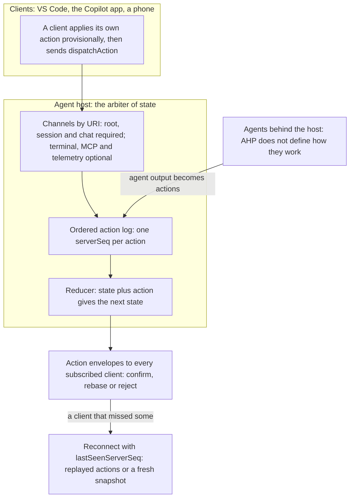

---
# Skeleton from Lead 34ixi7cn (GitHub Engineering), picked 2026-11-18.
# Drafted per docs/editorial/case-study-writing-guide.md; the claims to check
# first are in the draft's check list. published and reviewed are the pick time (make daily may move them to a Gap Day);
# make release keeps it (ADR-0012). verified: is the Author's alone (ADR-0007).
title: "Agent Host Protocol: how GitHub syncs one session across devices"
description: "GitHub's AHP keeps agent state on a host that orders every client's actions, so a closed window no longer ends the agent; the cost is two hosts."
kind: case-study
vertical: apis-networking
tags: ["ai-agents", "protocols", "state-synchronization", "json-rpc", "github"]
published: "2026-11-17T06:32:29Z"
verified: 2026-11-18
reviewed: "2026-11-18T09:57:43Z"
author: mira-vance
# Optional: an image HastCode may use, beside this file, replaces the
# generated title card. Never a Source's image.
# hero: system-name.png
# hero_alt: "What the image shows"
# Optional: related Explainer slugs and extra sources (title + url).
# related: [metastable-failures]
---

Two teams wrote an agent host for the same protocol: [about 369,000 lines of TypeScript in VS Code and about 305,000 lines of Rust at GitHub](https://github.blog/engineering/engineering-principles/building-the-agent-host-protocol-for-sessions-that-continue-across-devices/). That protocol, the Agent Host Protocol (AHP), is what lets a Copilot agent session [start in one place and continue in another](https://github.blog/engineering/engineering-principles/building-the-agent-host-protocol-for-sessions-that-continue-across-devices/). This is how AHP keeps one session in step across clients, the alternatives it rules out, and what the post leaves unmeasured.

## TL;DR

- AHP is an open standard in which an agent host holds the state of each agent session, so [every client sees the same agents, history and state](https://github.blog/engineering/engineering-principles/building-the-agent-host-protocol-for-sessions-that-continue-across-devices/).
- GitHub built it because Copilot's agent lived inside a VS Code extension, and each other product [integrated with cloud agents on its own](https://github.blog/engineering/engineering-principles/building-the-agent-host-protocol-for-sessions-that-continue-across-devices/).
- The host exposes URI-identified channels. Each channel's state comes from a reducer, a pure function fed by an ordered action log. Clients apply their own actions provisionally, and the host [confirms or rejects them](https://microsoft.github.io/agent-host-protocol/guide/reconciliation.html#reconciliation-algorithm).
- The price is a new agent stack under VS Code and two hosts to maintain, and the post publishes no latency or reliability numbers. The surprise: writing a second host exposed gaps in the protocol itself.

## One host, URI-identified channels and an ordered action log

The diagram is ours, redrawn from the text of [GitHub's post](https://github.blog/engineering/engineering-principles/building-the-agent-host-protocol-for-sessions-that-continue-across-devices/) and [the AHP specification](https://microsoft.github.io/agent-host-protocol/specification/overview.html) as published on 18 November 2026; GitHub's own figure is in the original. Read it top to bottom. A client applies its own action at once and sends it to the agent host. The host routes the action to a channel, adds it to that channel's ordered log and runs a reducer. The host then sends the ordered action to every subscribed client. A client that missed some reconnects and catches up.

Steps 1 to 4 below walk those boxes in order. Step 5 covers what the protocol leaves outside: the agents themselves, and extensions. One term first: the post says agent host and sometimes server, and the specification often says server. We say agent host, or host, throughout.

## Why an agent tied to an editor window could not continue

GitHub Copilot [began as a VS Code extension with its own bundled harness](https://github.blog/engineering/engineering-principles/building-the-agent-host-protocol-for-sessions-that-continue-across-devices/). A harness is [everything in an AI agent except the model itself](/languages-runtimes/agentic-development/). That design tied the agent's lifetime to the editor. In the post's words: "Close that window, and the agent is gone." An update to VS Code stopped every agent as the application restarted. Connecting to a remote machine brought an entirely new extension host, locked to the version of the VS Code workbench in use.

That mattered more as agents ran longer. The post opens on models that can [work for hours or days without supervision](https://github.blog/engineering/engineering-principles/building-the-agent-host-protocol-for-sessions-that-continue-across-devices/), while their owner still wants to check in from any device.

The other products met the same problem and solved it apart. GitHub was building [the Copilot app](https://github.com/features/ai/github-app) beside its iOS and Android apps. Each product did [its own integration with cloud-based agents](https://github.blog/engineering/engineering-principles/building-the-agent-host-protocol-for-sessions-that-continue-across-devices/) to get session continuity, and each integration served one product.

The post's [own illustration](https://github.blog/engineering/engineering-principles/building-the-agent-host-protocol-for-sessions-that-continue-across-devices/) shows the goal. One session, "Fix the flaky login test", starts in the Copilot app at 9:02 AM. Its owner approves a tool call from a phone at 9:40 and reviews the diff in VS Code at 11:15. A cloud agent lands the pull request at 11:32. No single client owns that session.

## The alternatives AHP rules out, and why

The post lists no rejected designs. We read three alternatives out of it; the AHP docs supply a fourth.

- **One integration per product.** The status quo. The post's heading counts five clients and two hosts; its body never lists the five. Pair by pair, that is up to 5 × 2 = 10 integrations; one protocol needs 5 + 2 = 7 implementations (our arithmetic, not GitHub's). Coordinating sessions across a user's devices and cloud sandboxes is what the post calls ["the `N:M` problem that AHP was built to solve"](https://github.blog/engineering/engineering-principles/building-the-agent-host-protocol-for-sessions-that-continue-across-devices/).
- **Reusing the Copilot Chat extension.** It had grown past [400,000 lines of TypeScript, not counting tests](https://github.blog/engineering/engineering-principles/building-the-agent-host-protocol-for-sessions-that-continue-across-devices/). It also depended on the VS Code window lifecycle and extension API, and a standalone host process has neither.
- **A protocol that fixes agent behaviour.** The post contrasts agents with the domains that produced the [Language Server Protocol](https://microsoft.github.io/language-server-protocol/) and the [Debug Adapter Protocol](https://microsoft.github.io/debug-adapter-protocol/): agents are changing quickly. So AHP ["avoids encoding how agents work, and instead focuses on how you want to interact with them"](https://github.blog/engineering/engineering-principles/building-the-agent-host-protocol-for-sessions-that-continue-across-devices/).
- **A point-to-point agent protocol alone.** The AHP docs say the Agent Client Protocol (ACP) ["defines how a single client talks to a single AI coding agent"](https://microsoft.github.io/agent-host-protocol/guide/ahp-and-acp.html). They place AHP above it, not instead of it: "AHP is a coordination layer. ACP is a communication layer."

In our reading, the deciding argument is the number of clients. Once several clients share a session, something must put their changes in one order, and that job needs a home.

## Step 1: channels split the host into subscribable resources

The post calls channels ["the coarsest unit of functionality in the protocol"](https://github.blog/engineering/engineering-principles/building-the-agent-host-protocol-for-sessions-that-continue-across-devices/). A channel is one resource a client can subscribe to, named by a URI. The specification [lists the schemes](https://microsoft.github.io/agent-host-protocol/specification/subscriptions.html#channel-uris): `ahp-root://` for the root, `ahp-session:/<uuid>` for a session, `ahp-chat:/<cid>` for a chat.

The post requires three channels. In its words, "Every server must implement the root, session, and chat channels". The specification's table says what each holds. The root holds agents, terminals and host configuration. A session holds metadata and its list of chats. A chat holds turns, streaming output, tool calls and input requests. Optional channels add [terminal support, MCP additions or OTel reporting](https://github.blog/engineering/engineering-principles/building-the-agent-host-protocol-for-sessions-that-continue-across-devices/): a shared terminal, Model Context Protocol (MCP) servers, and OpenTelemetry (OTel) telemetry.

Routing stays small because every command and notification carries [a top-level `channel` field](https://microsoft.github.io/agent-host-protocol/specification/overview.html#channels-are-the-routing-key). A receiver routes on the method name and that URI, nothing else.

A client [subscribes on demand](https://microsoft.github.io/agent-host-protocol/guide/what-is-ahp.html#design-requirements). It first receives [a snapshot of the channel's state, then the channel's messages](https://microsoft.github.io/agent-host-protocol/specification/subscriptions.html#channels). The snapshot carries a sequence number, `fromSeq`, and every later action has a higher one. We infer the benefit: a phone can follow one chat without loading every terminal.

Underneath, AHP uses [JSON-RPC 2.0 for framing over any reliable, ordered, bidirectional stream](https://microsoft.github.io/agent-host-protocol/specification/overview.html#base-protocol). WebSocket is [the common choice, and the one VS Code uses](https://microsoft.github.io/agent-host-protocol/specification/transport.html#common-transports).

## Step 2: a reducer turns an ordered action log into state

Inside each channel is what the post calls ["a reducer-based state object"](https://github.blog/engineering/engineering-principles/building-the-agent-host-protocol-for-sessions-that-continue-across-devices/). A reducer is a function that takes the current state and one action and returns the next state. AHP's reducers are pure: ["no side effects, no I/O"](https://microsoft.github.io/agent-host-protocol/guide/actions.html#reducers).

An action is a small typed record, such as `chat/turnStarted` or `chat/delta`. The guide is strict about its role: ["Actions are the sole mutation mechanism for subscribable state."](https://microsoft.github.io/agent-host-protocol/guide/actions.html#actions)

The host wraps each action in [an envelope](https://microsoft.github.io/agent-host-protocol/guide/actions.html#action-envelope) with the channel URI, a `serverSeq` and an `origin`. `serverSeq` is a number the host assigns, and it only rises. `origin` names the client that sent the action; it is absent when the host or an agent produced it. That sequence of envelopes is the ordered action log.

Two properties follow. [The same reducer code runs on the host and on every client](https://microsoft.github.io/agent-host-protocol/guide/actions.html#reducers), so the same log gives each of them the same state. And the work that touches the outside world, such as beginning to process a turn, sits in a separate dispatch layer on the host.

The idea is older than agents. [Durable execution](/distributed-systems/durable-execution/) rebuilds a crashed workflow by replaying a log; AHP rebuilds a client's view the same way. The post adds a practical point: reducer-based state ["plays nicely with popular UI frameworks like React"](https://github.blog/engineering/engineering-principles/building-the-agent-host-protocol-for-sessions-that-continue-across-devices/).

## Step 3: clients apply actions provisionally and the host decides

["The server is the arbiter of the state"](https://github.blog/engineering/engineering-principles/building-the-agent-host-protocol-for-sessions-that-continue-across-devices/), the post says. A client still shows its own action at once, provisionally (the guide says optimistically). The guide calls this write-ahead reconciliation, and each client keeps [three things per subscription](https://microsoft.github.io/agent-host-protocol/guide/reconciliation.html#client-side-state):

- `confirmedState`: the last state the host acknowledged.
- `pendingActions`: actions applied locally that the host has not yet echoed.
- `optimisticState`: the confirmed state with the pending actions replayed on top. The UI renders this one.

Take the guide's [own timeline](https://microsoft.github.io/agent-host-protocol/guide/reconciliation.html#example). Client A dispatches `turnStarted` and holds it as pending. The host applies it and broadcasts it as sequence 10. Client A sees its own echo and drops the pending entry. The agent then produces a delta, which the host broadcasts as sequence 11. Clients A and B both apply it.

[Three cases](https://microsoft.github.io/agent-host-protocol/guide/reconciliation.html#reconciliation-algorithm) cover every envelope. An echo of the client's own action confirms it. An action from another client or the host goes into the confirmed state, and the client applies its pending actions again on top. An envelope with a `rejectionReason` removes the pending action, so it vanishes from the screen.

Conflicts are rare because [most chat actions are append-only](https://microsoft.github.io/agent-host-protocol/guide/reconciliation.html#why-rebasing-is-simple). When two clients answer the same tool-call approval, [the first confirmation wins and the host rejects later ones](https://microsoft.github.io/agent-host-protocol/guide/ahp-and-acp.html#the-mutex-analogy).

Note what this is not. It is not a merge between equal peers: no client's copy outranks the host's log.

## Step 4: a dropped client replays from a sequence number

The post says AHP should tolerate ["network interruptions, reconnections, and concurrent client mutations"](https://github.blog/engineering/engineering-principles/building-the-agent-host-protocol-for-sessions-that-continue-across-devices/). The specification's [example](https://microsoft.github.io/agent-host-protocol/specification/lifecycle.html#reconnection) shows how. A client's connection drops after it has seen sequence 42. It reconnects and sends one `reconnect` request with `lastSeenServerSeq` set to 42 and its list of subscriptions. The host answers in one of two ways:

- **Replay.** If the host still holds the missed actions, it returns them: sequences 43 and 44 in the example. The client applies them in order.
- **Snapshot.** If the gap is larger than the host's replay buffer, it returns fresh snapshots: `fromSeq` 50 in the example. The client starts again from there.

Either way, ["The server MUST include all replayed data in the response."](https://microsoft.github.io/agent-host-protocol/guide/reconciliation.html#reconnection) The client then resets its confirmed state and clears its pending actions.

Not everything comes back. The host [does not replay protocol notifications](https://microsoft.github.io/agent-host-protocol/guide/reconciliation.html#reconnection) such as `sessionAdded`, so the client fetches the session list again.

Here the post and the guide read differently. The post says a client ["sends all queued actions"](https://github.blog/engineering/engineering-principles/building-the-agent-host-protocol-for-sessions-that-continue-across-devices/) and waits for the host to acknowledge them. The guide says the client clears its pending actions. We infer one part: a replayed envelope with the client's own `origin` tells it that action landed before the drop. The specification's lifecycle page does not say whether a client should send an unacknowledged action again.

## Step 5: agents stay behind the host, extras travel in `_meta`

AHP says nothing about the agent itself. Its doctrine lists what it [intentionally does not define](https://microsoft.github.io/agent-host-protocol/guide/doctrine.html#anti-goals): how agents reason, plan or call tools, which model provider they use, and how agents coordinate with each other. The host translates agent events into AHP actions and state.

That clears a common confusion. AHP is not an agent runtime, a tool schema or a replacement for ACP. It is the protocol between a host and the screens that show a session.

For everything the core omits, the post names two escape hatches: [custom methods and `_meta` data on objects](https://github.blog/engineering/engineering-principles/building-the-agent-host-protocol-for-sessions-that-continue-across-devices/). The specification reserves [an `x-` prefix](https://microsoft.github.io/agent-host-protocol/specification/overview.html#extensions) for channel schemes, methods and action types that an implementation defines for itself. `_meta` holds [optional, implementation-specific data](https://microsoft.github.io/agent-host-protocol/specification/lifecycle.html#connection-handshake), and a client ignores what it does not recognise. GitHub's host, for one, uses metadata to link to project boards.

The doctrine sets the limit: escape hatches ["should not be required for the baseline experience"](https://microsoft.github.io/agent-host-protocol/guide/doctrine.html#ahp-keeps-escape-hatches-explicit). A feature that interoperable clients need should move into typed state, or sit behind a capability check.

## What it costs: a new agent stack, built twice

The first cost is a rewrite. Adopting AHP in VS Code [required a new harness and agentic stack underneath it](https://github.blog/engineering/engineering-principles/building-the-agent-host-protocol-for-sessions-that-continue-across-devices/), because the old extension could not run outside a window. The team started in early 2026, with the Copilot SDK as the foundation, and was using the agent host to develop the agent host after the first couple of weeks. The hard part came later: "It's easy to build a harness implementation that says hello and can edit files". Matching every feature developers had come to expect is the harder job.

The second cost is duplication. VS Code's host [runs locally and deploys over SSH, containers, WSL or Dev Tunnels](https://github.blog/engineering/engineering-principles/building-the-agent-host-protocol-for-sessions-that-continue-across-devices/). GitHub's runs in the cloud, under wider infrastructure and security constraints. So they are separate codebases: about 369,000 lines of TypeScript and about 305,000 lines of Rust, tests excluded, on the post's chart. For scale, the same chart puts the Copilot Chat extension at about 415,000 lines.

The third is churn. The versioning page is blunt: ["Backwards-incompatible changes to AHP are inevitable."](https://microsoft.github.io/agent-host-protocol/specification/versioning.html)

The fourth is ours to name. We infer that every confirmation now depends on the host: a client cut off from it can show a provisional action but cannot confirm one. And not all state fits the model. Terminal input skips the provisional step, because write-ahead reconciliation is [unsafe for a stateful pseudo-terminal](https://microsoft.github.io/agent-host-protocol/guide/terminals.html#data-flow) (PTY).

## The evidence: two independent hosts, and no latency numbers

GitHub's evidence is interoperability. Two teams implemented the protocol independently, which the post calls ["a good acid-test for the protocol itself"](https://github.blog/engineering/engineering-principles/building-the-agent-host-protocol-for-sessions-that-continue-across-devices/). Its verdict: "Pretty well, it turns out."

The test [found a real gap and a bad assumption](https://github.blog/engineering/engineering-principles/building-the-agent-host-protocol-for-sessions-that-continue-across-devices/). The gap: early versions "could not accurately represent shell-type tool output that wasn't backed by a PTY". The assumption: VS Code's client expected a particular structure for the session URIs the host sent it. We infer that one implementation on each side had hidden both. That is the post's point: "A protocol with only one implementation isn't truly portable".

The post also reports reach. AHP now provides continuity [across all VS Code and GitHub surfaces](https://github.blog/engineering/engineering-principles/building-the-agent-host-protocol-for-sessions-that-continue-across-devices/), with libraries in Rust, TypeScript, Kotlin, Swift, .NET and Go.

What it leaves out is larger. The post gives no latency for an action's round trip and no reconnect time. It gives no reliability or failure figures, and no count of sessions, users or connected clients. It does not say how large a host's replay buffer is, or how often a reconnect falls back to a snapshot.

Its only measurements are lines of code. Those show effort. They do not show behaviour on a poor network, which is the case the design exists for.

## What a shared session protocol makes possible

A session that outlives its window changes what a client can be. One of the post's authors keeps [a macropad on the desk that shows the agent's state in real time](https://github.blog/engineering/engineering-principles/building-the-agent-host-protocol-for-sessions-that-continue-across-devices/). Others have built smart watch apps and Kanban-style task tools against the protocol.

You can try it. Running `code agent host` starts a standalone copy of VS Code's agent host, and [the samples repository](https://github.com/microsoft/agent-host-protocol-samples/) has starting points. The protocol's repository, [microsoft/agent-host-protocol](https://github.com/microsoft/agent-host-protocol), takes questions and suggestions.

The decision for your own system is narrower than "adopt AHP". If several clients show the same long-running work, pick one arbiter and give every change a sequence number. Make each client's view a pure function of that log. Reconnection then becomes a number and a replay, not a custom sync per client. Before you commit, measure what the post does not: the round trip for one confirmation, and how often a client misses the replay buffer and needs a snapshot.

## Sources

- [Building the Agent Host Protocol for sessions that continue across devices](https://github.blog/engineering/engineering-principles/building-the-agent-host-protocol-for-sessions-that-continue-across-devices/), Connor Peet and Rob Lourens, The GitHub Blog, 17 November 2026
- [Agent Host Protocol specification: Overview](https://microsoft.github.io/agent-host-protocol/specification/overview.html), Microsoft
- [Agent Host Protocol specification: Channels and Subscriptions](https://microsoft.github.io/agent-host-protocol/specification/subscriptions.html), Microsoft
- [Agent Host Protocol specification: Connection Lifecycle](https://microsoft.github.io/agent-host-protocol/specification/lifecycle.html), Microsoft
- [Agent Host Protocol specification: Transport](https://microsoft.github.io/agent-host-protocol/specification/transport.html), Microsoft
- [Agent Host Protocol specification: Versioning](https://microsoft.github.io/agent-host-protocol/specification/versioning.html), Microsoft
- [Agent Host Protocol guide: What is the Agent Host Protocol?](https://microsoft.github.io/agent-host-protocol/guide/what-is-ahp.html), Microsoft
- [Agent Host Protocol guide: Actions](https://microsoft.github.io/agent-host-protocol/guide/actions.html), Microsoft
- [Agent Host Protocol guide: Write-Ahead Reconciliation](https://microsoft.github.io/agent-host-protocol/guide/reconciliation.html), Microsoft
- [Agent Host Protocol guide: Terminals](https://microsoft.github.io/agent-host-protocol/guide/terminals.html), Microsoft
- [Agent Host Protocol Doctrine](https://microsoft.github.io/agent-host-protocol/guide/doctrine.html), Microsoft
- [AHP and the Agent Client Protocol](https://microsoft.github.io/agent-host-protocol/guide/ahp-and-acp.html), Microsoft
- [Language Server Protocol](https://microsoft.github.io/language-server-protocol/), Microsoft
- [Debug Adapter Protocol](https://microsoft.github.io/debug-adapter-protocol/), Microsoft
- [microsoft/agent-host-protocol](https://github.com/microsoft/agent-host-protocol), GitHub repository
- [microsoft/agent-host-protocol-samples](https://github.com/microsoft/agent-host-protocol-samples/), GitHub repository
- [GitHub Copilot app](https://github.com/features/ai/github-app), GitHub
