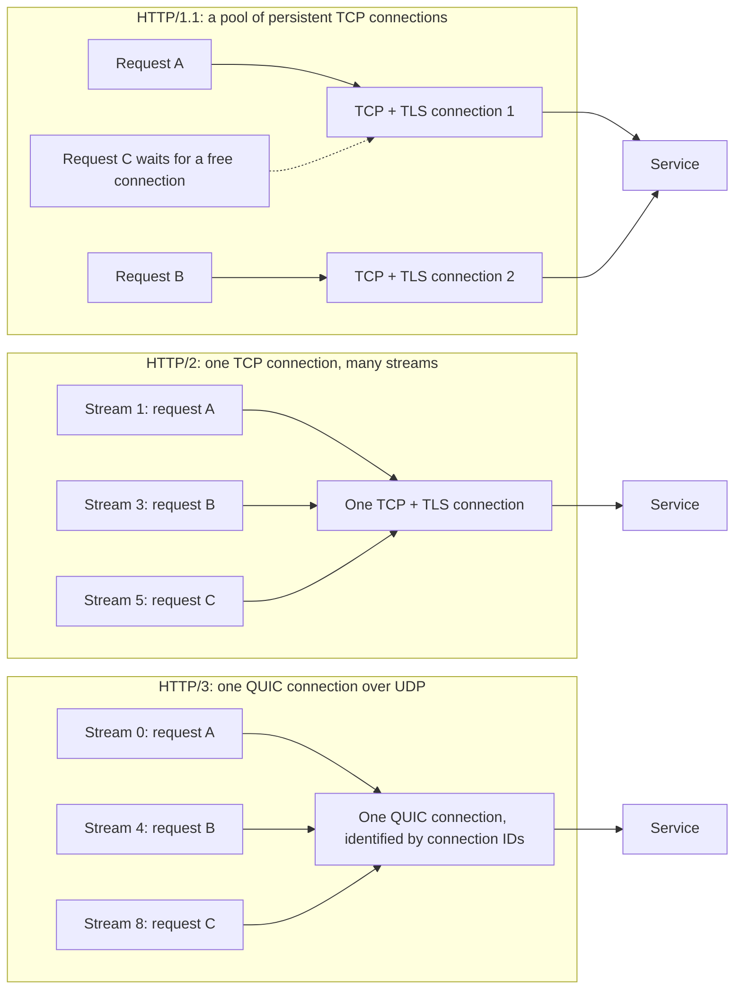

A four-line Go function that fetches a URL and returns only its status code, called 100 times over HTTP/1, took about 710 milliseconds on Go 1.26 and about 150 milliseconds on Go 1.27, on one machine, in [the Go team's own test against index.golang.org](https://go.dev/blog/http-connection-reuse). The function did not change. Go 1.27's `net/http` now [drains an unread HTTP/1 response body in the background, for up to 50 ms or 256 KB](https://go.dev/blog/http-connection-reuse#the-current-state-and-conclusion), so the connection can be reused instead of thrown away. That fix opens a bigger question for anyone whose backend calls other services: how do HTTP/1.1, HTTP/2 and HTTP/3 each reuse a connection, how does each one fail, and which should you use? We answer the same questions for all three, from the specifications.

> Drafted with AI assistance, researched, verified and edited by the HastCode editorial team. We publish only as many pieces as the Author can verify this way.

## TL;DR

- **HTTP/1.1** reuses a connection for one exchange at a time. Connections persist by default, but the client must read each response body to the end before the next request, so concurrency means a pool of connections.
- **HTTP/2** carries many concurrent requests as streams on one TCP connection per host. The limits move to the server's stream cap and to TCP itself, where one lost packet stalls every stream.
- **HTTP/3** does the same over QUIC, where a lost packet stalls only the streams it carried, and connection IDs let a connection survive a client address change.
- For service-to-service calls, we infer: HTTP/2 is the default to reach for between services you control; HTTP/1.1 with a pool sized to your concurrency is fine for short requests; HTTP/3 pays off on lossy or changing paths, and Go's `net/http` does not speak it.

## Three ways to reuse one connection

Reuse exists because a new connection is expensive. The Go blog post counts it out: a TCP handshake costs 1 round trip, a TLS 1.2 handshake 2 more, so [the first request leaves after 3 round trips](https://go.dev/blog/http-connection-reuse#the-cost-of-establishing-http-connections), or 300 ms of setup at a 100 ms cross-region round trip. QUIC folds the cryptographic and transport handshakes into one [to minimise connection establishment latency](https://www.rfc-editor.org/rfc/rfc9000.html#section-7), but a reused connection skips the handshake entirely in all three protocols.

The diagram shows what "reuse" means in each. HTTP/1.1 keeps a pool of connections, each carrying one exchange at a time. HTTP/2 puts every request on its own stream inside one TCP connection, with [odd-numbered client stream IDs](https://www.rfc-editor.org/rfc/rfc9113.html#section-5.1.1). HTTP/3 does the same inside one QUIC connection over UDP, with [client requests on streams 0, 4, 8 and so on](https://www.rfc-editor.org/rfc/rfc9114.html#section-6.1).

## HTTP/1.1: one exchange at a time, many connections

[RFC 9112 makes connections persistent by default](https://www.rfc-editor.org/rfc/rfc9112.html#section-9.3): a connection carries request after request until either side sends `Connection: close`. There is a catch in the same section: "a client MUST read the entire response message body if it intends to reuse the same connection for a subsequent request." The reason is that [HTTP/1.1 has no request identifier](https://www.rfc-editor.org/rfc/rfc9112.html#section-9.2); responses are matched to requests purely by arrival order on the connection.

That is exactly the trap the Go post describes. Through Go 1.26, closing a response body that had not been read to the end made `net/http` [abandon the connection and dial a new one](https://go.dev/blog/http-connection-reuse#when-connection-reuse-fails). Even code that reads the body can miss: `encoding/json.Decoder` stops at the closing brace, so a trailing newline left a healthy connection, in Nicholas Husin and Damien Neil's words, "[a single byte away from being reusable](https://go.dev/blog/http-connection-reuse#where-failed-connection-reuse-hurts)."

[Pipelining](https://www.rfc-editor.org/rfc/rfc9112.html#section-9.3.2) lets a client send several requests without waiting, but the server must answer in order, and RFC 9113 says pipelining [only partially addressed request concurrency and still suffers from application-layer head-of-line blocking](https://www.rfc-editor.org/rfc/rfc9113.html#section-1). In practice, [clients open several connections per server](https://www.rfc-editor.org/rfc/rfc9112.html#section-9.4) for concurrency, and RFC 9112 asks them to be conservative without naming a maximum.

In Go, the [`Transport` caches connections for reuse](https://pkg.go.dev/net/http#Transport), keeping at most [`MaxIdleConnsPerHost`](https://pkg.go.dev/net/http#Transport.MaxIdleConnsPerHost) idle per host, which [defaults to 2](https://pkg.go.dev/net/http#DefaultMaxIdleConnsPerHost).

## HTTP/2: one connection, many streams

HTTP/2 gives [each request and response its own stream](https://www.rfc-editor.org/rfc/rfc9113.html#section-2) inside one TCP connection, and frames from different streams interleave. Streams are largely independent, "so a blocked or stalled request or response does not prevent progress on other streams," as the [RFC 9113 overview](https://www.rfc-editor.org/rfc/rfc9113.html#section-2) puts it. That is why the Go post notes that an unread body on one HTTP/2 stream [does not block other requests](https://go.dev/blog/http-connection-reuse#when-connection-reuse-fails), and that [draining HTTP/2 bodies is unnecessary](https://go.dev/blog/http-connection-reuse#the-manual-solution).

Reuse is the design, not an optimisation. [HTTP/2 connections are persistent](https://www.rfc-editor.org/rfc/rfc9113.html#section-9.1), and clients should not open more than one per host and port. A client opens a replacement only when the old one is close to running out of stream IDs, needs fresh TLS keys, or has hit an error. Stream IDs [cannot be reused](https://www.rfc-editor.org/rfc/rfc9113.html#section-5.1.1), so a long-lived connection does eventually run out.

Sharing one connection needs a way to stop one stream hogging it. HTTP/2 has [credit-based flow control per stream and per connection](https://www.rfc-editor.org/rfc/rfc9113.html#section-5.2.1), starting at 65,535 octets each.

In Go, the `Transport` uses [HTTP/1.1 for `http://` URLs and HTTP/1.1 or HTTP/2 for `https://` URLs](https://pkg.go.dev/net/http#Transport), depending on the server and the configuration. The [`DefaultTransport`](https://pkg.go.dev/net/http#DefaultTransport) attempts HTTP/2, but a `Transport` you build yourself with [`Protocols`](https://pkg.go.dev/net/http#Transport.Protocols) left nil is usually HTTP/1 only unless [`ForceAttemptHTTP2`](https://pkg.go.dev/net/http#Transport.ForceAttemptHTTP2) is set. Plaintext HTTP/2 needs `Protocols` set to unencrypted HTTP/2 without HTTP/1.

## HTTP/3: QUIC streams that survive a new address

HTTP/3 maps [each request-response pair onto one QUIC stream](https://www.rfc-editor.org/rfc/rfc9114.html#section-2). QUIC itself provides the multiplexing and per-stream flow control that HTTP/2 had to build on top of TCP, and it [carries TLS 1.3 inside the transport](https://www.rfc-editor.org/rfc/rfc9114.html#section-1.2). Reuse follows HTTP/2's rules: [connections are persistent](https://www.rfc-editor.org/rfc/rfc9114.html#section-3.3), and a client should not open more than one per IP address and UDP port.

What is new is that the connection is not tied to an address. A QUIC connection has a set of [connection IDs](https://www.rfc-editor.org/rfc/rfc9000.html#section-5.1), chosen so that changes at the UDP and IP layers do not deliver its packets to the wrong endpoint. That lets a connection [survive a change of address and port](https://www.rfc-editor.org/rfc/rfc9000.html#section-9), whether the client moves on purpose or a NAT rebinds it. Only clients start a migration, never before the handshake is confirmed, and a server can forbid active migration with the `disable_active_migration` transport parameter.

Two limits matter for a backend. First, UDP can be blocked, and RFC 9114 tells clients to [fall back to TCP-based HTTP](https://www.rfc-editor.org/rfc/rfc9114.html#section-3.1) when a QUIC connection fails. Second, Go's `net/http` [supports HTTP/1.0, HTTP/1.1 and HTTP/2](https://go.dev/blog/http-connection-reuse#the-cost-of-establishing-http-connections), and its [`Transport` documentation](https://pkg.go.dev/net/http#Transport) names only HTTP/1.1 and HTTP/2. We infer that a Go service calling over HTTP/3 needs a client from outside the standard library.

## Head-of-line blocking moves down a layer each time

Head-of-line blocking means one slow item holds up everything queued behind it. Each protocol fixes it at one layer and meets it at the next.

**HTTP/1.1** blocks at the application layer. RFC 9112 says clients open extra connections to avoid exactly this: [a slow or very large response blocks the requests behind it on the same connection](https://www.rfc-editor.org/rfc/rfc9112.html#section-9.4). An unread body blocks reuse the same way.

**HTTP/2** removes that by interleaving streams, but every stream shares one TCP byte stream. RFC 9113 says so plainly: "[TCP head-of-line blocking is not addressed by this protocol](https://www.rfc-editor.org/rfc/rfc9113.html#section-1)." RFC 9114 spells out the cost: because TCP cannot see HTTP/2's streams, "[a lost or reordered packet causes all active transactions to experience a stall](https://www.rfc-editor.org/rfc/rfc9114.html#section-1.1)" whether or not they lost data.

**HTTP/3** moves reliability to the stream. In QUIC, [only streams with data in a lost packet wait for its retransmission](https://www.rfc-editor.org/rfc/rfc9000.html#section-13); the rest keep going. Two caveats from the same specifications: a packet that carries data from several streams blocks all of them when lost, and [within one stream, bytes are still delivered in order](https://www.rfc-editor.org/rfc/rfc9000.html#section-2.2). Header compression also needed care: HTTP/3 uses QPACK, which [gives the encoder some control over how much head-of-line blocking compression can cause](https://www.rfc-editor.org/rfc/rfc9114.html#section-4.2.1).

## Running out: pools, streams and stream limits

Each protocol has a ceiling on concurrent requests, and each behaves differently at it.

**HTTP/1.1** runs out of connections. In Go, [`MaxConnsPerHost`](https://pkg.go.dev/net/http#Transport.MaxConnsPerHost) caps dialing, active and idle connections per host, and when it is reached, "dials will block"; zero, the default, means no limit. Without a cap, RFC 9112 warns that [many parallel connections can congest the network, and a server may reject them as abusive](https://www.rfc-editor.org/rfc/rfc9112.html#section-9.4). With the idle cap at its default of two, we infer that a burst of more than two concurrent requests to one host closes the extra connections once they go idle, and the next burst dials again.

**HTTP/2** runs out of streams. A server sets [`SETTINGS_MAX_CONCURRENT_STREAMS`](https://www.rfc-editor.org/rfc/rfc9113.html#section-5.1.2), and a client that exceeds it gets a stream error. Go's [`StrictMaxConcurrentRequests`](https://pkg.go.dev/net/http#HTTP2Config.StrictMaxConcurrentRequests) picks the response: by default the `Transport` opens another connection when every connection is at its limit; set to true, new requests block until one completes.

**HTTP/3** runs out of streams too. QUIC caps the [cumulative number of streams a peer may open](https://www.rfc-editor.org/rfc/rfc9000.html#section-4.6) and raises the cap with `MAX_STREAMS` frames; a blocked endpoint should say so with `STREAMS_BLOCKED`. RFC 9114 asks servers to [permit at least 100 request streams at a time](https://www.rfc-editor.org/rfc/rfc9114.html#section-6.1).

## Idle connections and the close race

A reused connection sits idle between requests, and either side may close it.

**HTTP/1.1** gives no signal. Servers [time out inactive connections](https://www.rfc-editor.org/rfc/rfc9112.html#section-9.5) at a length the specification leaves open, and RFC 9112 names the race: "a client might have started to send a new request at the same time that the server has decided to close the 'idle' connection." Go's `Transport` [retries such a request only](https://pkg.go.dev/net/http#Transport) if the connection had been used successfully, the method is idempotent (or carries an `Idempotency-Key`), and the body can be replayed. We infer that setting the client's [`IdleConnTimeout`](https://pkg.go.dev/net/http#Transport.IdleConnTimeout) below the server's idle timeout makes the race rarer.

**HTTP/2** adds a goodbye. A closing endpoint should send [`GOAWAY` with the last stream it may have processed](https://www.rfc-editor.org/rfc/rfc9113.html#section-6.8); anything above it [was not processed and can be retried on a new connection](https://www.rfc-editor.org/rfc/rfc9113.html#section-8.7), even a POST. A [`PING` frame tests an idle connection](https://www.rfc-editor.org/rfc/rfc9113.html#section-8.7) that a NAT or load balancer may have silently dropped; Go's [`SendPingTimeout`](https://pkg.go.dev/net/http#HTTP2Config.SendPingTimeout) turns that check on.

**HTTP/3** negotiates the timeout. Each QUIC endpoint advertises one, and [the smaller wins](https://www.rfc-editor.org/rfc/rfc9000.html#section-10.1); past it, the connection closes silently. Clients [need a new connection once it has passed, and should open one as it approaches](https://www.rfc-editor.org/rfc/rfc9114.html#section-5.1), and [`GOAWAY`](https://www.rfc-editor.org/rfc/rfc9114.html#section-5.2) works as in HTTP/2. RFC 9000 adds that middleboxes can drop UDP state sooner, and that [packets every 30 seconds](https://www.rfc-editor.org/rfc/rfc9000.html#section-10.1.2) keep most of them from doing so.

## Coalescing: one connection for several hostnames

HTTP/2 and HTTP/3 can go further than reuse per host: one connection [may carry requests for several origins](https://www.rfc-editor.org/rfc/rfc9113.html#section-9.1.1), as long as the server is authoritative for each. Over TLS, that means the certificate must be valid for every host the client sends on it; without TLS, the hosts must resolve to the same IP address. HTTP/3 has [the same rule](https://www.rfc-editor.org/rfc/rfc9114.html#section-3.3), and adds that if a certificate fails validation for a reason that could apply to other origins on the connection, such as expiry or revocation, the client should revalidate it for those origins too.

Coalescing can misroute. RFC 9113 gives the case of [a middlebox that terminates TLS and picks the backend by Server Name Indication](https://www.rfc-editor.org/rfc/rfc9113.html#section-9.1.1): a request for another hostname can then reach a server that was not its intended target. A server that does not want its connections reused this way answers `421 (Misdirected Request)` to say it is not authoritative for that request.

HTTP/1.1 has no such rule: RFC 9112's connection management section [does not describe sharing a connection across origins](https://www.rfc-editor.org/rfc/rfc9112.html#section-9), and Go's pool limits are [per host](https://pkg.go.dev/net/http#Transport.MaxIdleConnsPerHost). We infer that coalescing is a concern only once HTTP/2 or HTTP/3 is on, typically when several internal services share one wildcard certificate behind one proxy.

## Trade-offs

Each cell summarises a section above, where its source is linked.

| Question | HTTP/1.1 | HTTP/2 | HTTP/3 |
|---|---|---|---|
| What is reused | A TCP connection, one exchange at a time | One TCP connection, many streams | One QUIC connection over UDP, many streams |
| Concurrency to one host | More connections (a pool) | More streams, up to the server's limit | More streams, up to the peer's stream limit |
| Connections per host | Several; no fixed maximum | One, plus replacements | One per IP address and UDP port |
| Reuse breaks when | A response body is not read to the end, or `Connection: close` | Stream IDs run out, or `GOAWAY` | Idle timeout passes, or `GOAWAY` |
| Head-of-line blocking | Application layer: one slow response blocks the connection | TCP layer: one lost packet stalls every stream | Only streams with data in the lost packet |
| At the limit | Dials block or more connections open | Stream error, or Go opens another connection | Peer waits for `MAX_STREAMS` |
| Idle close signal | None; requests can race the close | `GOAWAY`, `PING` to test liveness | Negotiated idle timeout, `GOAWAY` |
| Several hostnames on one connection | Not described | Allowed if authoritative; `421` to refuse | Allowed if authoritative; `421` to refuse |
| Survives a client address change | No | No | Yes, through connection IDs |
| In Go's `net/http` | Yes | Yes (`https://` with `DefaultTransport`) | No |

## When each wins for service-to-service calls

Everything in this section is our inference from the facts above, not a benchmark.

**HTTP/2 wins when you control both ends** and one service sends many small, concurrent requests to a few others. One connection per host means one handshake, no pool to size, no unread-body trap, and `GOAWAY` tells the client which requests are safe to retry. Watch two things: a lossy link stalls every stream at once, and one connection gives a TCP load balancer only one backend to pick per client.

**HTTP/1.1 wins when requests are short, the peer speaks nothing else, or you call plain `http://` inside a cluster**, where Go defaults to it. Size `MaxIdleConnsPerHost` to your real concurrency, close every response body, and upgrade to Go 1.27 so `net/http` drains what you leave unread.

**HTTP/3 wins when the path is lossy or the client's address changes**, the cases its stream-level recovery and connection migration were built for. Inside one data centre, with low loss and fixed addresses, we expect it to gain less, and a Go backend would need a client outside the standard library.

The good news is that each step solved a real problem. You can pick the protocol whose remaining failure mode you can live with.

## Sources

- Nicholas Husin and Damien Neil, [Better HTTP/1 connection reuse](https://go.dev/blog/http-connection-reuse), The Go Blog, 14 October 2026 (CC BY 4.0).
- [RFC 9112: HTTP/1.1](https://www.rfc-editor.org/rfc/rfc9112.html), section 9, Connection Management.
- [RFC 9113: HTTP/2](https://www.rfc-editor.org/rfc/rfc9113.html), sections 1, 2, 5, 6.8, 8.7 and 9.
- [RFC 9114: HTTP/3](https://www.rfc-editor.org/rfc/rfc9114.html), sections 1, 2, 3, 4.2.1, 5 and 6.1.
- [RFC 9000: QUIC: A UDP-Based Multiplexed and Secure Transport](https://www.rfc-editor.org/rfc/rfc9000.html), sections 2, 4.6, 5, 7, 9, 10.1 and 13.
- Go standard library, [`net/http` package documentation](https://pkg.go.dev/net/http) (`Transport`, `HTTP2Config`, `DefaultMaxIdleConnsPerHost`), go1.27.3.
