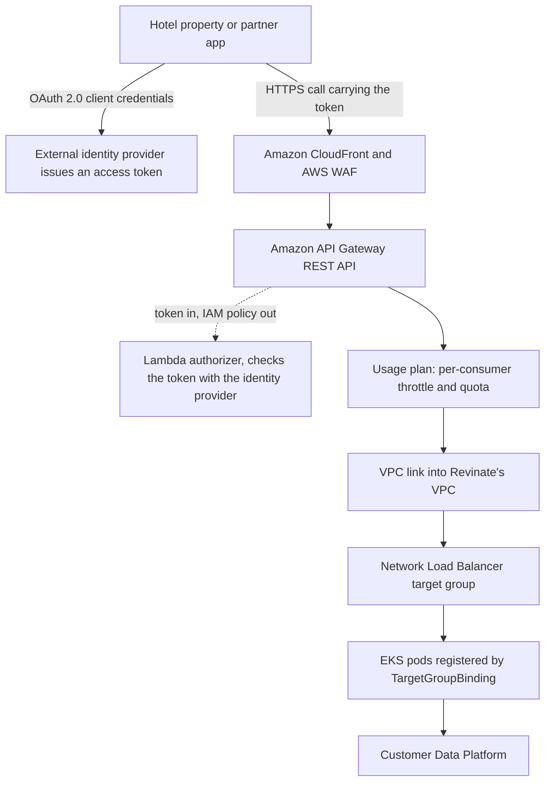

---
# Case Study from Lead d6cvy4h7 (AWS Architecture Blog), picked 2026-10-29,
# drafted per docs/editorial/case-study-writing-guide.md. published and
# reviewed are the pick time, provisional: set them when you publish.
# verified: is the Author's alone (ADR-0007).
title: "Revinate's partner API: how API Gateway reaches EKS with no ingress"
description: "How Revinate fronts EKS with API Gateway, a Lambda authorizer, usage plans and NLB target group binding, and what the managed path costs."
kind: case-study
vertical: apis-networking
tags: ["api-gateway", "aws", "kubernetes", "oauth", "rate-limiting"]
published: "2026-10-29T19:04:11Z"
reviewed: "2026-10-29T19:04:11Z"
author: mira-vance
# Optional: an image HastCode may use, beside this file, replaces the
# generated title card. Never a Source's image.
# hero: system-name.png
# hero_alt: "What the image shows"
related: [agentgateway]
draft: true
---

Revinate's Customer Data Platform serves [over 12,500 hotels and powers more than 1.25 billion guest profiles](https://aws.amazon.com/blogs/architecture/how-revinate-accelerated-api-adoption-with-amazon-api-gateway/). When the team opened that data to hotels and partners as an API, the design question it wrote up in most detail was not authentication or pricing but one network hop: [how a request gets from Amazon API Gateway into a Kubernetes pod](https://aws.amazon.com/blogs/architecture/how-revinate-accelerated-api-adoption-with-amazon-api-gateway/#connecting-api-gateway-to-eks).

> Drafted with AI assistance, researched, verified and edited by the HastCode editorial team. We publish only as many pieces as the Author can verify this way.

## TL;DR

- Revinate's public API lets hotel properties and partners [read guest profiles, reservation data and other hospitality data programmatically](https://aws.amazon.com/blogs/architecture/how-revinate-accelerated-api-adoption-with-amazon-api-gateway/), through a managed Amazon API Gateway in front of services on Amazon EKS (Elastic Kubernetes Service).
- It replaced in-house plumbing where [each new partner integration required manual provisioning, custom security configuration, and ongoing maintenance](https://aws.amazon.com/blogs/architecture/how-revinate-accelerated-api-adoption-with-amazon-api-gateway/#business-need-evolving-api-infrastructure-to-match-growth).
- A call passes CloudFront and AWS WAF, a [Lambda authorizer that turns an OAuth 2.0 client-credentials token into an IAM policy](https://aws.amazon.com/blogs/architecture/how-revinate-accelerated-api-adoption-with-amazon-api-gateway/#security-implementation), a per-consumer usage plan, then a VPC link to a Network Load Balancer whose targets are EKS pods bound directly with TargetGroupBinding.
- The price is AWS-specific wiring and limits AWS calls best-effort. The post publishes no traffic, latency or cost numbers; its one before-and-after figure is [onboarding cut from weeks to days](https://aws.amazon.com/blogs/architecture/how-revinate-accelerated-api-adoption-with-amazon-api-gateway/#improved-developer-experience).

## The path a partner request takes

The diagram is ours, redrawn from the text of the post; the post's own figures are in [the original](https://aws.amazon.com/blogs/architecture/how-revinate-accelerated-api-adoption-with-amazon-api-gateway/#architecture-overview). Per the post, hotel properties call the API [through Amazon CloudFront, protected by AWS WAF, into API Gateway as the unified entry point](https://aws.amazon.com/blogs/architecture/how-revinate-accelerated-api-adoption-with-amazon-api-gateway/#architecture-overview); a Lambda authorizer checks each request against an identity provider; then API Gateway routes to services on EKS, which call the Customer Data Platform. The sections below walk it top to bottom, then turn to what it costs.

## Why per-partner plumbing stopped scaling

As the platform grew, Revinate needed to expose guest data so [hotel properties and partners can programmatically access guest profiles, reservation data, and other critical hospitality information](https://aws.amazon.com/blogs/architecture/how-revinate-accelerated-api-adoption-with-amazon-api-gateway/). The in-house approach made each integration a project: manual provisioning, custom security configuration and ongoing maintenance, [every time](https://aws.amazon.com/blogs/architecture/how-revinate-accelerated-api-adoption-with-amazon-api-gateway/#business-need-evolving-api-infrastructure-to-match-growth). The cost of that grows with the partner count, and engineers paid it in time not spent on the product.

The team turned four business drivers into four technical requirements, [per the post](https://aws.amazon.com/blogs/architecture/how-revinate-accelerated-api-adoption-with-amazon-api-gateway/#evaluating-alternatives):

- **On-demand pricing**, with cost attributable to each consumer, so spend tracks usage and can be allocated across hotels and partners.
- **Authentication federation** with Revinate's existing identity provider, so partners onboard without new auth infrastructure.
- **Rate limiting**, to protect backends and enforce fair use across consumers.
- **Threat protection, audit logging and access controls**, for compliance on sensitive guest data.

The second and third are the interesting ones for a backend engineer. Federation means the gateway does not own identities; it asks someone else. Rate limiting per consumer means the gateway must know who each caller is before it can count them. The steps below show how those two needs meet.

## Why not self-managed, custom-built or an enterprise platform

Revinate [weighed three approaches](https://aws.amazon.com/blogs/architecture/how-revinate-accelerated-api-adoption-with-amazon-api-gateway/#evaluating-alternatives) before choosing a managed gateway.

A **self-managed gateway** (an open-source proxy you run yourself, such as [agentgateway](/apis-networking/agentgateway/)) avoids licence fees but brings [ongoing infrastructure management, security patching, scaling, and monitoring](https://aws.amazon.com/blogs/architecture/how-revinate-accelerated-api-adoption-with-amazon-api-gateway/#self-managed-api-management), and the team would still have to build a developer portal from scratch.

A **custom-built gateway** gives the most control, but [routing, authentication, rate limiting, and documentation](https://aws.amazon.com/blogs/architecture/how-revinate-accelerated-api-adoption-with-amazon-api-gateway/#custom-built) would all be built and maintained in-house.

An **enterprise API management platform** has the features, but the post objects to [vendor dependencies, higher costs, and fixed-term licensing](https://aws.amazon.com/blogs/architecture/how-revinate-accelerated-api-adoption-with-amazon-api-gateway/#enterprise-api-management-platforms) whose cost does not follow revenue.

The deciding argument was the common drawback: each would spend engineering time or budget on [capabilities that don't differentiate Revinate's product](https://aws.amazon.com/blogs/architecture/how-revinate-accelerated-api-adoption-with-amazon-api-gateway/#enterprise-api-management-platforms). Revinate's backend services [run on EKS](https://aws.amazon.com/blogs/architecture/how-revinate-accelerated-api-adoption-with-amazon-api-gateway/#native-aws-integration), so a gateway that charges per request and integrates natively with the AWS services it already runs won. That reasoning is honest about its premise: it holds for a team already committed to AWS, and the post's next steps [say as much](https://aws.amazon.com/blogs/architecture/how-revinate-accelerated-api-adoption-with-amazon-api-gateway/#next-steps).

## Step 1: the edge filters before anything is authorised

Requests enter through [Amazon CloudFront for edge caching and low latency, with AWS WAF protecting against common web threats and bots](https://aws.amazon.com/blogs/architecture/how-revinate-accelerated-api-adoption-with-amazon-api-gateway/#architecture-overview). AWS WAF is a web application firewall: a list of rules that allow, block or count requests. On API Gateway, AWS documents that [WAF rules are evaluated before other access control features](https://docs.aws.amazon.com/apigateway/latest/developerguide/apigateway-control-access-aws-waf.html), including Lambda authorizers. So a blocked request never costs an authorizer invocation, and the cheapest filter runs first.

WAF also brings a second kind of rate limit. Its rate-based rules count [requests from each client IP over a trailing five-minute window](https://docs.aws.amazon.com/apigateway/latest/developerguide/apigateway-control-access-aws-waf.html). That is a different key from the per-consumer limit in Step 3: an IP, not an identity. The post lists [deeper integration with AWS WAF](https://aws.amazon.com/blogs/architecture/how-revinate-accelerated-api-adoption-with-amazon-api-gateway/#future-enhancements) as future work, so we read today's rules as a baseline.

The post does not say where the web ACL is attached, or which endpoint type the API uses. AWS's [edge-optimized endpoint](https://docs.aws.amazon.com/apigateway/latest/developerguide/api-gateway-api-endpoint-types.html#api-gateway-api-endpoint-types-edge-optimized) already routes through a CloudFront point of presence, while a [Regional endpoint can sit behind your own CloudFront distribution](https://docs.aws.amazon.com/apigateway/latest/developerguide/api-gateway-api-endpoint-types.html#api-gateway-api-endpoint-types-regional). Either matches the post's description.

## Step 2: a Lambda authorizer turns a token into a policy

Partners are machines, not people, so Revinate uses [OAuth 2.0 client credentials for machine-to-machine authentication](https://aws.amazon.com/blogs/architecture/how-revinate-accelerated-api-adoption-with-amazon-api-gateway/#security-implementation) with an external identity provider. In that grant, defined in [RFC 6749 section 4.4](https://www.rfc-editor.org/rfc/rfc6749.html#section-4.4), the client requests an access token using only its own credentials; no user signs in. The partner then [passes the bearer token](https://docs.aws.amazon.com/apigateway/latest/developerguide/apigateway-use-lambda-authorizer.html#api-gateway-lambda-authorizer-flow) with each call.

API Gateway hands the token to a Lambda authorizer, a function you write that [takes the caller's identity as the input and returns an IAM policy as the output](https://aws.amazon.com/blogs/architecture/how-revinate-accelerated-api-adoption-with-amazon-api-gateway/#security-implementation). AWS's workflow is concrete: the function returns [an IAM policy and a principal identifier, API Gateway evaluates the policy, and a denied call gets a status such as 403](https://docs.aws.amazon.com/apigateway/latest/developerguide/apigateway-use-lambda-authorizer.html#api-gateway-lambda-authorizer-flow). The policy can allow `execute-api:Invoke` on specific methods and paths, so the authorizer decides not just who you are but [which routes you may call](https://docs.aws.amazon.com/apigateway/latest/developerguide/api-gateway-lambda-authorizer-output.html).

This is where federation pays off: the identity provider stays the source of truth, and the gateway only translates. Revinate deploys the authorizer functions [through Terraform](https://aws.amazon.com/blogs/architecture/how-revinate-accelerated-api-adoption-with-amazon-api-gateway/#security-implementation), like the rest of the gateway.

The post does not say whether the authorizer's result is cached. API Gateway can [cache the returned policy for a TTL you set, and a TTL of zero turns caching off](https://docs.aws.amazon.com/apigateway/latest/developerguide/configure-api-gateway-lambda-authorization.html). That one setting trades how fast a revoked token stops working against how often every call reaches Lambda and the identity provider.

## Step 3: usage plans count each consumer

A usage plan is API Gateway's per-customer contract: it [specifies who can access which API stages and methods, and optionally a request rate at which to start throttling](https://docs.aws.amazon.com/apigateway/latest/developerguide/api-gateway-api-usage-plans.html#api-gateway-api-usage-plans-overview), identifying each client by an API key. Revinate uses plans to [enforce configurable throttling and quota limits](https://aws.amazon.com/blogs/architecture/how-revinate-accelerated-api-adoption-with-amazon-api-gateway/#security-implementation), and plans plus API keys to [attribute API cost per consumer](https://aws.amazon.com/blogs/architecture/how-revinate-accelerated-api-adoption-with-amazon-api-gateway/#cost-optimization). One mechanism does both the fairness job and the billing-visibility job.

Throttling is a token bucket: the rate is how fast [tokens are added to the bucket, in requests per second, and the burst is the bucket's capacity](https://docs.aws.amazon.com/apigateway/latest/developerguide/api-gateway-request-throttling.html#apigateway-api-level-throttling-in-usage-plan). Over the limit, clients may receive 429 Too Many Requests. Per-client limits sit inside account limits, which in most Regions default to [10,000 requests per second with a bucket of 5,000](https://docs.aws.amazon.com/apigateway/latest/developerguide/limits.html#apigateway-account-level-limits-table) across all APIs in a Region (2,500 and 1,250 in some). Revinate's own values are not published.

API keys are not for authentication, and AWS says so plainly: [don't use them to control access](https://docs.aws.amazon.com/apigateway/latest/developerguide/api-gateway-api-usage-plans.html#apigateway-usage-plans-best-practices). A key can come from [the caller's `X-API-Key` header](https://docs.aws.amazon.com/apigateway/latest/developerguide/api-gateway-api-key-source.html), or from the authorizer, which then [must return one of the plan's keys as `usageIdentifierKey`](https://docs.aws.amazon.com/apigateway/latest/developerguide/api-gateway-lambda-authorizer-output.html). The post does not say which source Revinate uses. We infer the authorizer source is the natural fit for an OAuth-only API, because it ties the counted identity to the authenticated one, but that is our reading.

## Step 4: target group binding puts pods behind the load balancer

After authorisation, API Gateway must reach services inside a private VPC. Revinate keeps that traffic [on the AWS network using VPC Link](https://aws.amazon.com/blogs/architecture/how-revinate-accelerated-api-adoption-with-amazon-api-gateway/#connecting-api-gateway-to-eks), and [weighed four ways](https://aws.amazon.com/blogs/architecture/how-revinate-accelerated-api-adoption-with-amazon-api-gateway/#connecting-api-gateway-to-eks) to land it in EKS:

| Option | Why it lost, or won |
|---|---|
| NGINX ingress controller | Flexible routing, but an extra latency hop and manual upgrades and scaling |
| AWS Load Balancer Controller Ingress | AWS-managed load balancer, but an additional hop (API Gateway → LB → service) |
| **TargetGroupBinding to an NLB** | Chosen: no ingress overhead, lowest latency, direct control of health checks |
| Kubernetes LoadBalancer Service | Simplest, but no path routing and a load balancer per service |

TargetGroupBinding is a custom resource of the AWS Load Balancer Controller that [exposes pods through an existing ALB or NLB target group](https://kubernetes-sigs.github.io/aws-load-balancer-controller/latest/guide/targetgroupbinding/targetgroupbinding/), so the load balancer is provisioned outside Kubernetes while Kubernetes manages only the targets. We infer that is why it suits Revinate, which uses [Terraform exclusively for production](https://aws.amazon.com/blogs/architecture/how-revinate-accelerated-api-adoption-with-amazon-api-gateway/#infrastructure-as-code-with-terraform): Terraform owns the NLB, Kubernetes keeps its pod list current.

An NLB [works at layer 4](https://docs.aws.amazon.com/elasticloadbalancing/latest/network/introduction.html#network-load-balancer-overview), and a listener forwards by protocol and port. We infer that path routing therefore lives in API Gateway's resources and methods, not in the cluster.

## The costs Revinate accepts

**AWS-specific wiring.** The post's own cons for TargetGroupBinding are [a more complex initial setup and a design less Kubernetes-native](https://aws.amazon.com/blogs/architecture/how-revinate-accelerated-api-adoption-with-amazon-api-gateway/#connecting-api-gateway-to-eks). AWS's containers team adds that it is [a custom resource not native to a Kubernetes installation](https://aws.amazon.com/blogs/containers/patterns-for-targetgroupbinding-with-aws-load-balancer-controller/), such as a local development cluster. The controller's documentation warns that in a multi-tenant cluster, anyone allowed to create a binding [could route traffic to target groups belonging to other workloads](https://kubernetes-sigs.github.io/aws-load-balancer-controller/latest/guide/targetgroupbinding/targetgroupbinding/), and recommends restricting it with RBAC.

**One NLB or many.** The post lists both "shared NLB across multiple Target Groups" as a benefit and "different applications will need individual NLB" as a drawback, in the [same option](https://aws.amazon.com/blogs/architecture/how-revinate-accelerated-api-adoption-with-amazon-api-gateway/#connecting-api-gateway-to-eks). We read it as one NLB carrying several target groups per application, but the post does not settle it.

**Limits that are targets.** AWS states that usage plan throttling and quotas [are not hard limits and are applied on a best-effort basis](https://docs.aws.amazon.com/apigateway/latest/developerguide/api-gateway-api-usage-plans.html#api-gateway-api-usage-plans-overview), and advises against relying on them to control costs or block access. Revinate's per-consumer attribution rides on the same plans, so we infer it measures usage well but cannot cap it hard. AWS points to AWS Budgets and WAF for that.

**Portal scope.** With a developer portal, [all APIs in a usage plan can be subscribed to](https://docs.aws.amazon.com/apigateway/latest/developerguide/api-gateway-api-usage-plans.html#apigateway-usage-plans-best-practices), even ones not shown. Plan membership becomes an access decision.

## The evidence, and what the post leaves out

The post calls its results [qualitative](https://aws.amazon.com/blogs/architecture/how-revinate-accelerated-api-adoption-with-amazon-api-gateway/#results-and-benefits). Its main before-and-after is that self-service discovery and interactive documentation [cut onboarding time from weeks to days](https://aws.amazon.com/blogs/architecture/how-revinate-accelerated-api-adoption-with-amazon-api-gateway/#improved-developer-experience). For comparison, AWS's launch note for the portal claimed [weeks to minutes](https://aws.amazon.com/about-aws/whats-new/2025/11/api-gateway-developer-portal-capabilities/); Revinate's real-world figure is the more modest one. The single performance claim is that the chosen EKS path keeps [sub-second latency at scale](https://aws.amazon.com/blogs/architecture/how-revinate-accelerated-api-adoption-with-amazon-api-gateway/#connecting-api-gateway-to-eks), a loose bound for an API call.

What is missing: request volumes, latency percentiles, throttle and quota values, authorizer cache settings, error or 429 rates, cost figures, the number of consumers on the API today, and how versions are exposed. The post says the setup [centralized control over documentation, versioning and access policies](https://aws.amazon.com/blogs/architecture/how-revinate-accelerated-api-adoption-with-amazon-api-gateway/#enhanced-governance-and-control), but not the scheme.

Read the source for what it is. It appears on AWS's Architecture Blog under [Customer Solutions](https://aws.amazon.com/blogs/architecture/how-revinate-accelerated-api-adoption-with-amazon-api-gateway/), and of its four authors three work at AWS; the fourth, [Jakarry Williams, leads Revinate's Engineering Integration team](https://aws.amazon.com/blogs/architecture/how-revinate-accelerated-api-adoption-with-amazon-api-gateway/). The design choices are Revinate's; the framing is partly a product story.

## What it makes possible

The managed portal, [released in November 2025](https://aws.amazon.com/about-aws/whats-new/2025/11/api-gateway-developer-portal-capabilities/), is where partners now [browse REST APIs, test endpoints and find code samples](https://aws.amazon.com/blogs/architecture/how-revinate-accelerated-api-adoption-with-amazon-api-gateway/#developer-portal-experience) without a support ticket. The portal [respects the authorizers already configured on each API](https://aws.amazon.com/blogs/compute/improve-api-discoverability-with-the-new-amazon-api-gateway-portal/), so, we infer, its "Try it" calls pass the same Lambda authorizer as production traffic.

Next, Revinate plans to [extend the gateway to inbound APIs](https://aws.amazon.com/blogs/architecture/how-revinate-accelerated-api-adoption-with-amazon-api-gateway/#future-enhancements), where partners push data in, and is exploring request and response transformation and caching. Our view: inbound traffic turns the authorizer and usage plans from a read gate into a write gate, where a hard cap matters more.

The lesson we take is about where each job lives. Identity stays with the identity provider; the gateway translates tokens into policies, counts callers and routes paths; the load balancer only moves packets; Kubernetes only keeps the pod list current. Each layer does one thing, and the gateway and its authorizers are declared in Terraform. If you already run on EKS, that split lets a team ship a partner API without operating a gateway, as long as you remember the gateway's limits are targets, not walls.

## Sources

- [How Revinate accelerated API adoption with Amazon API Gateway](https://aws.amazon.com/blogs/architecture/how-revinate-accelerated-api-adoption-with-amazon-api-gateway/), Abe Raghib, Giedrius Praspaliauskas, Jakarry Williams and Satish Katpally, AWS Architecture Blog, 28 October 2026
- [Use API Gateway Lambda authorizers](https://docs.aws.amazon.com/apigateway/latest/developerguide/apigateway-use-lambda-authorizer.html), Amazon API Gateway Developer Guide
- [Output from an API Gateway Lambda authorizer](https://docs.aws.amazon.com/apigateway/latest/developerguide/api-gateway-lambda-authorizer-output.html), Amazon API Gateway Developer Guide
- [Configure an API Gateway Lambda authorizer](https://docs.aws.amazon.com/apigateway/latest/developerguide/configure-api-gateway-lambda-authorization.html), Amazon API Gateway Developer Guide
- [Usage plans and API keys for REST APIs in API Gateway](https://docs.aws.amazon.com/apigateway/latest/developerguide/api-gateway-api-usage-plans.html), Amazon API Gateway Developer Guide
- [Choose an API key source in API Gateway](https://docs.aws.amazon.com/apigateway/latest/developerguide/api-gateway-api-key-source.html), Amazon API Gateway Developer Guide
- [Throttle requests to your REST APIs for better throughput in API Gateway](https://docs.aws.amazon.com/apigateway/latest/developerguide/api-gateway-request-throttling.html), Amazon API Gateway Developer Guide
- [Amazon API Gateway quotas](https://docs.aws.amazon.com/apigateway/latest/developerguide/limits.html), Amazon API Gateway Developer Guide
- [Use AWS WAF to protect your REST APIs in API Gateway](https://docs.aws.amazon.com/apigateway/latest/developerguide/apigateway-control-access-aws-waf.html), Amazon API Gateway Developer Guide
- [API endpoint types for REST APIs in API Gateway](https://docs.aws.amazon.com/apigateway/latest/developerguide/api-gateway-api-endpoint-types.html), Amazon API Gateway Developer Guide
- [What is a Network Load Balancer?](https://docs.aws.amazon.com/elasticloadbalancing/latest/network/introduction.html), Elastic Load Balancing documentation
- [TargetGroupBinding](https://kubernetes-sigs.github.io/aws-load-balancer-controller/latest/guide/targetgroupbinding/targetgroupbinding/), AWS Load Balancer Controller documentation
- [Patterns for TargetGroupBinding with AWS Load Balancer Controller](https://aws.amazon.com/blogs/containers/patterns-for-targetgroupbinding-with-aws-load-balancer-controller/), AWS Containers Blog
- [Improve API discoverability with the new Amazon API Gateway Portal](https://aws.amazon.com/blogs/compute/improve-api-discoverability-with-the-new-amazon-api-gateway-portal/), AWS Compute Blog
- [Amazon API Gateway adds Developer Portal capabilities](https://aws.amazon.com/about-aws/whats-new/2025/11/api-gateway-developer-portal-capabilities/), AWS What's New, 19 November 2025
- [RFC 6749: The OAuth 2.0 Authorization Framework, section 4.4](https://www.rfc-editor.org/rfc/rfc6749.html#section-4.4), IETF
