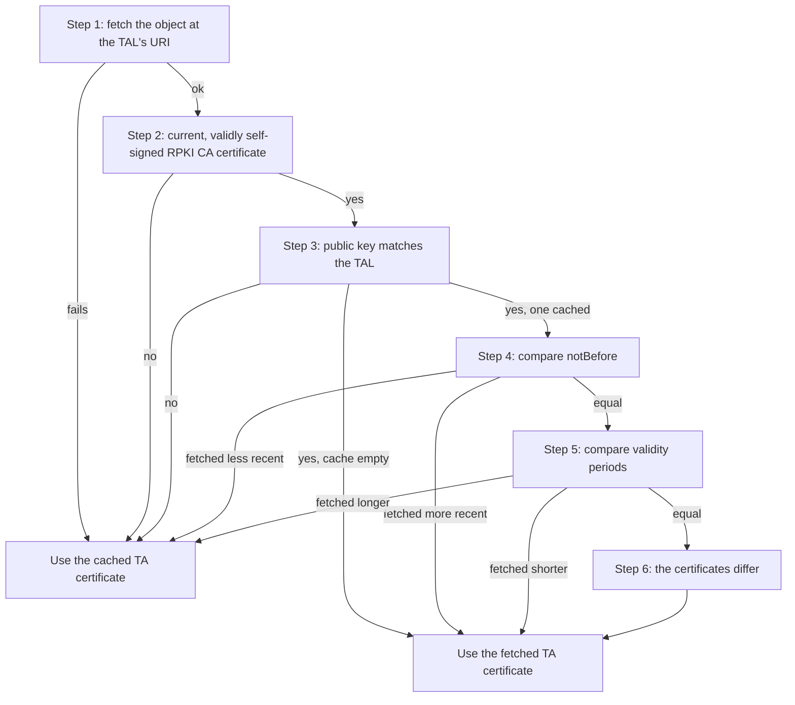

---
# Skeleton from Lead curzdjy2 (RFC Editor), picked 2026-11-26.
# Drafted per docs/editorial/concept-writing-guide.md; no author notes
# are left. published and reviewed are the pick time (make daily may move them to a Gap Day);
# make release keeps it (ADR-0012). verified: is the Author's alone (ADR-0007).
title: "RPKI trust anchor tiebreaking: why an old TA certificate loses"
description: "RFC 10097 tells RPKI relying parties which trust anchor certificate to keep when two are valid, so a replayed old one cannot displace a newer one."
kind: concept
vertical: apis-networking
tags: ["rpki", "bgp", "trust-anchors", "routing-security", "rfc-10097"]
published: "2026-11-26T07:37:21Z"
reviewed: "2026-11-26T07:37:21Z"
author: mira-vance
# Optional: an image HastCode may use, beside this file, replaces the
# generated title card. Never a Source's image.
# hero: concept-name.png
# hero_alt: "What the image shows"
# Optional: related Explainer slugs and extra sources (title + url).
# related: [http-connection-reuse]
draft: true
---

On 24 June 2024, Job Snijders [told the IETF's SIDROPS mailing list](https://mailarchive.ietf.org/arch/msg/sidrops/NxzvSFH0sPXEmyfOS99cLApFKqM/) what he had found: old trust anchor certificates from two of the five Regional Internet Registries. ARIN's ran from 1 October 2015 to 1 October 2025, and AfriNIC's from 22 December 2016 to 20 December 2026. Both registries had since published newer certificates, but [nobody can revoke an old one](https://www.rfc-editor.org/rfc/rfc10097.html#section-1), so both were still valid. Suppose copies came back into circulation. Relying parties without a tiebreak or a cached copy, he wrote, were ["likely to end up rejecting 100% of subordinate products"](https://mailarchive.ietf.org/arch/msg/sidrops/NxzvSFH0sPXEmyfOS99cLApFKqM/) under AfriNIC. Under ARIN, he put it at about 50%. This is how a relying party chooses between two valid certificates from the same trust anchor, and the order RFC 10097 now requires.

## TL;DR

- **Trust anchor tiebreaking** is how an RPKI relying party (RP) picks one certificate when it holds several valid ones from the same trust anchor (TA). An RP is the software that validates the RPKI's signed routing data. [RFC 10097](https://www.rfc-editor.org/rfc/rfc10097.html#section-1), published in November 2026, makes the order mandatory.
- The RP compares the certificate it fetched with the one in its cache. The fetched one wins only with a [more recent notBefore](https://www.rfc-editor.org/rfc/rfc10097.html#section-2), then a shorter validity period, then by being the one currently published. If the fetch, the validation or the key check fails, the cached one stays.
- It matters because a TA certificate [cannot be revoked](https://www.rfc-editor.org/rfc/rfc10097.html#section-1), and some were issued for "up to a century". In June 2024, [LACNIC's and the RIPE NCC's ran 100 years](https://mailarchive.ietf.org/arch/msg/sidrops/NxzvSFH0sPXEmyfOS99cLApFKqM/).
- What to do: run an RP that implements it, such as [rpki-client 9.1 or later](https://ftp.openbsd.org/pub/OpenBSD/rpki-client/rpki-client-9.1.txt), and keep its cache. The cost: an RP with an empty cache has nothing to compare, and the old certificate stays valid until its notAfter.

## A tiebreak chooses between certificates that are all valid

The RPKI (Resource Public Key Infrastructure) lets an entity ["verifiably assert that it is the legitimate holder"](https://www.rfc-editor.org/rfc/rfc6480.html#section-1) of IP addresses or Autonomous System (AS) numbers. A **relying party (RP)** is the software that checks those assertions (you may know it as a validator). Routers act on its output, for example in [ASPA](/apis-networking/aspa-bgp-route-leaks/) path checks.

Checking has to start somewhere. ["In any PKI, each relying party (RP) chooses its own set of trust anchors (TAs)"](https://www.rfc-editor.org/rfc/rfc6480.html#section-2.4). In the RPKI a TA is [a self-signed X.509 CA certificate](https://www.rfc-editor.org/rfc/rfc10097.html), one signed with its own key: the **TA certificate**. Here the TA operators are the [five Regional Internet Registries](https://mailarchive.ietf.org/arch/msg/sidrops/-Y5NfXnGfDbeGOCAFj5xHgU90Zo/). A certificate's **validity period** runs from [its notBefore date to its notAfter date](https://www.rfc-editor.org/rfc/rfc6487.html#section-4.6).

The RP is configured not with that certificate but with a **Trust Anchor Locator (TAL)**: [one or more URIs and a public key](https://www.rfc-editor.org/rfc/rfc8630.html#section-2.2). The RP downloads the certificate from a URI and checks its key against the TAL.

So an RP can meet more than one valid certificate for the same TA: one fetched today, one cached earlier. RFC 10097 ["specifies a tiebreaking scheme for RPs"](https://www.rfc-editor.org/rfc/rfc10097.html#section-1) to pick one. Its authors say the scheme ["establishes a preorder over TA certificates issued by the same TA"](https://www.rfc-editor.org/rfc/rfc10097.html#section-1). In our words: any two certificates from one TA can be ranked, and the RP keeps the higher.

What does not count: a certificate whose key differs from the TAL's is [never in the tie](https://www.rfc-editor.org/rfc/rfc10097.html#section-2), and certificates from different TAs are never compared.

## Six steps: the cached certificate stays unless the fetched one is newer

RFC 10097 [rewrites Section 3 of RFC 8630](https://www.rfc-editor.org/rfc/rfc10097.html#section-2), the procedure for using a TAL. The old text began "an RP SHOULD:" and listed [four steps](https://www.rfc-editor.org/rfc/rfc8630.html#section-3): retrieve the object, confirm it is a certificate, match its key, apply local checks. It mentioned a cached copy only to say when to fetch again, not which certificate to keep. The new text begins "an RP MUST:" and has six steps.

Steps 1 to 3 are gates. The RP retrieves the object at one of the TAL's URIs. It confirms the object is ["a current, validly self-signed RPKI CA certificate"](https://www.rfc-editor.org/rfc/rfc10097.html#section-2). It checks that the public key matches the TAL. If any gate fails, the RP uses its locally cached copy. If all three pass and the cache is empty, it uses the fetched certificate.

Steps 4 to 6 are the tiebreak. The RP reaches them only when the fetched certificate passed the gates and the cache holds one too.

- **Step 4, notBefore.** The certificate with the more recent notBefore wins.
- **Step 5, validity period.** With equal notBefore dates, the shorter validity period wins.
- **Step 6, what is published.** With equal validity periods and different certificates, the fetched one wins. The RFC calls this case unlikely and reasons that the operator meant RPs ["to use the TA that is currently published"](https://www.rfc-editor.org/rfc/rfc10097.html#section-2).

## Worked through: AfriNIC's 2016 certificate loses at step 4

Take the certificates in Snijders' June 2024 message. The certificate AfriNIC published at the time [ran from 30 March 2020 to 28 March 2030](https://mailarchive.ietf.org/arch/msg/sidrops/NxzvSFH0sPXEmyfOS99cLApFKqM/). The old one ran from 22 December 2016 to 20 December 2026.

Suppose that in June 2024 an RP has the 2020 certificate cached, and something on the path answers its fetch with the 2016 one. Follow the diagram down.

1. The retrieval succeeds.
2. The 2016 certificate is current then: its notAfter is 20 December 2026. We infer it is validly self-signed, since Snijders expected RPs to accept it.
3. We infer the key matches too, because RFC 8630 requires ["a stable key that does not change when the certificate is reissued"](https://www.rfc-editor.org/rfc/rfc8630.html#section-2.3).
4. 22 December 2016 is less recent than 30 March 2020. The rule: ["If the notBefore of the newly retrieved TA is less recent, use the locally cached TA."](https://www.rfc-editor.org/rfc/rfc10097.html#section-2)

The replay ends at step 4. Before the tiebreak, rpki-client would have taken the 2016 certificate: its release notes describe the earlier behaviour as ["always using newly-retrieved trust anchors"](https://ftp.openbsd.org/pub/OpenBSD/rpki-client/rpki-client-9.1.txt).

Run it the other way. An RP that cached the 2016 certificate fetches the 2020 one, finds a more recent notBefore, and switches. A later certificate can replace an earlier one, never the reverse.

ARIN's pair ends the same way. Its old certificate started on 1 October 2015, and the one it published in June 2024 [started on 30 January 2024](https://mailarchive.ietf.org/arch/msg/sidrops/NxzvSFH0sPXEmyfOS99cLApFKqM/). The lengths never come into it: step 5 runs only when the notBefore dates are equal.

## Two relying parties shipped the tiebreak before the RFC did

**rpki-client**, OpenBSD's RP, added it in version 9.1 under the heading ["Introduce tiebreaking for trust anchors"](https://ftp.openbsd.org/pub/OpenBSD/rpki-client/rpki-client-9.1.txt). Its release notes give the rule in one line: "Later notBefore and earlier notAfter are used to identify a trust anchor certificate as newer." The working group's draft [dates that release to June 2024](https://www.ietf.org/archive/id/draft-ietf-sidrops-rpki-ta-tiebreaker-06.txt). The rpki-client manual now lists [RFC 10097 among its standards](https://man.openbsd.org/rpki-client).

**rpki-prover** merged [a pull request on 3 September 2024](https://github.com/lolepezy/rpki-prover/pull/218) titled "Allow using cache TA certificate when it's impossible to fetch one for a TA". One of its commits is named "Implement some tiebreaker scheme", and the repository's owner wrote that it would support "some version of" the draft, cited under its earlier draft-spaghetti name.

The last draft before publication [listed those two as its implementations](https://www.ietf.org/archive/id/draft-ietf-sidrops-rpki-ta-tiebreaker-06.txt), in an appendix the published RFC no longer carries.

The certificates being ranked differ widely. In June 2024, Snijders [listed the five registries' validity periods](https://mailarchive.ietf.org/arch/msg/sidrops/NxzvSFH0sPXEmyfOS99cLApFKqM/): ARIN's about 2 years, APNIC's 5, AfriNIC's 10, and LACNIC's and the RIPE NCC's 100 each. LACNIC's ran from 5 March 2024 to 5 March 2124.

## Why one trust anchor has several valid certificates

The TAL is built to stay the same while the certificate changes. RFC 8630 says a TA's set of INRs ["is likely to change over time"](https://www.rfc-editor.org/rfc/rfc8630.html#section-2.1). The TAL need not follow, because ["the TAL is constant so long as the TA's public key and its location do not change"](https://www.rfc-editor.org/rfc/rfc8630.html#section-2.1). INRs (Internet Number Resources) are the IP addresses and AS numbers the certificate covers. RFC 10097 adds that operators ["periodically reissue TA certificates to update the validity period"](https://www.rfc-editor.org/rfc/rfc10097.html#section-1) and other fields.

Every reissue leaves the previous certificate valid. A TA certificate is self-signed, so, in RFC 8630's words, ["there is no corresponding CRL that can be used to revoke it"](https://www.rfc-editor.org/rfc/rfc8630.html#section-2.3). A CRL is a Certificate Revocation List.

Long validity periods stretch the problem. RFC 10097 records that some TA certificates were issued with ["unreasonably long validity periods: in some cases, up to a century"](https://www.rfc-editor.org/rfc/rfc10097.html#section-1).

RFC 8630 reasoned that a man in the middle ["cannot produce a CA certificate that would be considered valid"](https://www.rfc-editor.org/rfc/rfc8630.html#section-4). Such an attacker, it added, ["can prevent the RP from learning about an updated CA certificate"](https://www.rfc-editor.org/rfc/rfc8630.html#section-4). An old certificate needs no forging. We infer that replaying one is the cheapest way to do the second thing.

No attacker is required. Snijders thought it more probable that [an operator would publish an older issuance by accident](https://mailarchive.ietf.org/arch/msg/sidrops/NxzvSFH0sPXEmyfOS99cLApFKqM/), or that a CDN node would serve a stale copy. RFC 10097 itself names two sources of an old certificate: ["an on-path adversary or a caching network element"](https://www.rfc-editor.org/rfc/rfc10097.html#section-1).

## Practice one: run a relying party that keeps its cache

If you run an RP, run a version that implements the six steps, and let it keep its cache between runs. RFC 10097's security section says the scheme ["prevents RPs from accepting a previous certificate presented by an on-path adversary"](https://www.rfc-editor.org/rfc/rfc10097.html#section-3). It adds that a standard scheme helps RP and TA operators ["arrive at deterministic outcomes"](https://www.rfc-editor.org/rfc/rfc10097.html#section-3).

The fallback also helps when a fetch goes wrong. If the TAL's URI cannot be reached, or returns something that fails validation, the RP [carries on with the cached certificate](https://www.rfc-editor.org/rfc/rfc10097.html#section-2).

The cost sits in the rest of that security sentence: the protection holds ["in the presence of other TA certificate material"](https://www.rfc-editor.org/rfc/rfc10097.html#section-3). Step 3 says an RP with no cached certificate [uses the fetched one](https://www.rfc-editor.org/rfc/rfc10097.html#section-2). Snijders put both gaps in one phrase: the exposed RPs are those ["without the ta-tiebreaker mechanism or without a cached copy"](https://mailarchive.ietf.org/arch/msg/sidrops/NxzvSFH0sPXEmyfOS99cLApFKqM/).

We infer the practical rule. An RP that starts from an empty cache on every run, such as a fresh container, gets nothing from the tiebreak. Keep the cache on storage that survives a restart.

One gap stays open. Steps 1 and 2 [do not say](https://www.rfc-editor.org/rfc/rfc10097.html#section-2) what an RP with an empty cache does when the fetch or the validation fails.

## Practice two: reissue so the new certificate outranks the old

For a TA operator, the tiebreak is a tool. The RFC describes it as ["permitting the issuance of a certificate that is preferred over any previous certificate"](https://www.rfc-editor.org/rfc/rfc10097.html#section-1).

The recipe follows from the steps. A certificate generated today carries a later notBefore: the profile says notBefore ["SHOULD be no earlier than the time of certificate generation"](https://www.rfc-editor.org/rfc/rfc6487.html#section-4.6.1). That wins at step 4, whatever the certificate's length. Two more rules come from RFC 8630: the key stays the same, and the replacement ["MUST be accessible using the same URI"](https://www.rfc-editor.org/rfc/rfc8630.html#section-2.3).

The cost: the ranking only goes forward. Snijders lists [restoring an old backup](https://mailarchive.ietf.org/arch/msg/sidrops/-Y5NfXnGfDbeGOCAFj5xHgU90Zo/) among the ways an old certificate returns. We infer what that means for a rollback: RPs that hold the newer certificate will ignore the restored one. The way back is a fresh issuance with the old contents and a new notBefore.

A TAL may list several URIs, and ["the same self-signed CA certificate MUST be found at each referenced location"](https://www.rfc-editor.org/rfc/rfc8630.html#section-2.3). We infer that a mirror left behind after a reissue now loses at step 4, where before it could win.

## Practice three: shorten validity periods, so a replay runs out of time

The tiebreak protects an RP with a cache. For every other RP, an old certificate stays usable until its notAfter passes. In December 2024 Snijders set out [a roadmap towards shorter-lived TA certificates](https://mailarchive.ietf.org/arch/msg/sidrops/-Y5NfXnGfDbeGOCAFj5xHgU90Zo/), with the RP's preference for shorter-lived ones as its first step.

rpki-client adopted it. Version 9.4 announced it would ["gradually stop accepting ultra long-lived TA certificates"](https://ftp.openbsd.org/pub/OpenBSD/rpki-client/rpki-client-9.4.txt). Its notes say it warns about a TA certificate that expires more than 15 years ahead, and will reject such certificates after 2 February 2026. From 3 March 2027 it will reject validity periods over 3 years. The stated aim is ["to encourage reasonably frequent reissuance of TA certificates"](https://ftp.openbsd.org/pub/OpenBSD/rpki-client/rpki-client-9.4.txt).

The roadmap [gave each registry a deadline](https://mailarchive.ietf.org/arch/msg/sidrops/-Y5NfXnGfDbeGOCAFj5xHgU90Zo/): LACNIC and the RIPE NCC before 2 February 2026, APNIC and AfriNIC before 3 March 2027, and ARIN nothing to do. APNIC's Tom Harrison replied that ["APNIC will reissue its TA certificate with a shorter validity period"](https://mailarchive.ietf.org/arch/msg/sidrops/AVZ09BFaN0SNCyQAPQlAjKZt3m0/). AfriNIC's David Njuki wrote ["We'll schedule to reissue"](https://mailarchive.ietf.org/arch/msg/sidrops/T3RxVOL5yx1Z-GbfhlYMM_IBYRY/). The RIPE NCC's Tim Bruijnzeels saw no ["blocking issue"](https://mailarchive.ietf.org/arch/msg/sidrops/zeleBN8M5i3P8lCUvtf9zvzgDQs/).

The costs: this is one RP's policy, not the RFC's, which [sets no maximum](https://www.rfc-editor.org/rfc/rfc10097.html). A deadline can also be missed. We infer that an RP enforcing it then drops the registry's whole tree.

## What tiebreaking is not: revocation, or a key rollover

It is not revocation. The losing certificate stays valid until its notAfter, and an RP with an empty cache will still accept it. The tiebreak ranks certificates; it cancels none.

It is not a key rollover. Every certificate in the tie carries the TAL's key, and step 3 [sends a mismatched key back to the cached TA](https://www.rfc-editor.org/rfc/rfc10097.html#section-2). Changing the key is the job of [RFC 9691](https://www.rfc-editor.org/rfc/rfc9691.html), whose Trust Anchor Key objects help ["support planned key rollovers"](https://www.rfc-editor.org/rfc/rfc9691.html). That deserves its own Explainer.

It is not the DNSSEC root rollover either. In [a root KSK rollover](/apis-networking/dnssec-root-key-rollover/), validating resolvers learn a new key because the old key vouches for it. We infer the contrast: here the key is fixed, and only the certificate around it is ranked, by two dates.

And it is not a check on what a TA claims. RFC 8630 warns that a TAL [does not list the resources](https://www.rfc-editor.org/rfc/rfc8630.html#section-5) its TA covers. We infer that the latest certificate wins whatever resources it lists.

## What understanding the tiebreak makes possible

You can now predict your RP. Given two certificates for one TA, compare notBefore, then the validity period, and you know which one it keeps.

You can measure your exposure. For each TAL you configure, read the certificate's notBefore and notAfter. We infer that the validity period is how long a replay stays possible against an RP with no cache. In June 2024 that was [about 2 years for ARIN and 100 for LACNIC](https://mailarchive.ietf.org/arch/msg/sidrops/NxzvSFH0sPXEmyfOS99cLApFKqM/).

You can rehearse it. rpki-client's `-P` option [sets the time used to validate certificates](https://mailarchive.ietf.org/arch/msg/sidrops/k35gLBYwP95dP5BNU-s6fXmqt3k/). Snijders used it to simulate 2 February 2026, and the output for the RIPE NCC's certificate said "TA cert rejected".

The optimistic part: the RPKI still cannot revoke a TA certificate, yet an operator can now outrank one. Two date fields that every certificate already carries do the work, with no new object and no new protocol. The price is a cache you must keep, and certificates reissued more often.

## Sources

- J. Snijders, T. Buehler, T. de Kock, [RFC 10097: Tiebreaking Resource Public Key Infrastructure (RPKI) Trust Anchors](https://www.rfc-editor.org/info/rfc10097/), RFC Editor, November 2026 ([HTML](https://www.rfc-editor.org/rfc/rfc10097.html)).
- G. Huston, S. Weiler, G. Michaelson, S. Kent, T. Bruijnzeels, [RFC 8630: Resource Public Key Infrastructure (RPKI) Trust Anchor Locator](https://www.rfc-editor.org/rfc/rfc8630.html), August 2019.
- G. Huston, G. Michaelson, R. Loomans, [RFC 6487: A Profile for X.509 PKIX Resource Certificates](https://www.rfc-editor.org/rfc/rfc6487.html), February 2012.
- M. Lepinski, S. Kent, [RFC 6480: An Infrastructure to Support Secure Internet Routing](https://www.rfc-editor.org/rfc/rfc6480.html), February 2012.
- C. Martinez, G. Michaelson, T. Harrison, T. Bruijnzeels, R. Austein, [RFC 9691: A Profile for Resource Public Key Infrastructure (RPKI) Trust Anchor Keys (TAKs)](https://www.rfc-editor.org/rfc/rfc9691.html), December 2024.
- J. Snijders, T. Buehler, T. de Kock, [draft-ietf-sidrops-rpki-ta-tiebreaker-06](https://www.ietf.org/archive/id/draft-ietf-sidrops-rpki-ta-tiebreaker-06.txt), Internet-Draft, 17 June 2026.
- Job Snijders, ["current state of TA certificate issuances & validity periods"](https://mailarchive.ietf.org/arch/msg/sidrops/NxzvSFH0sPXEmyfOS99cLApFKqM/), IETF SIDROPS mailing list, 24 June 2024.
- Job Snijders, ["Roadmap towards shorter-lived Trust Anchor certificates"](https://mailarchive.ietf.org/arch/msg/sidrops/-Y5NfXnGfDbeGOCAFj5xHgU90Zo/), IETF SIDROPS mailing list, 18 December 2024.
- Replies in the same thread, December 2024 to January 2025: [Job Snijders](https://mailarchive.ietf.org/arch/msg/sidrops/k35gLBYwP95dP5BNU-s6fXmqt3k/), [Tom Harrison](https://mailarchive.ietf.org/arch/msg/sidrops/AVZ09BFaN0SNCyQAPQlAjKZt3m0/) (APNIC), [Tim Bruijnzeels](https://mailarchive.ietf.org/arch/msg/sidrops/zeleBN8M5i3P8lCUvtf9zvzgDQs/) (RIPE NCC), [David Njuki](https://mailarchive.ietf.org/arch/msg/sidrops/T3RxVOL5yx1Z-GbfhlYMM_IBYRY/) (AfriNIC).
- OpenBSD, [rpki-client 9.1 release notes](https://ftp.openbsd.org/pub/OpenBSD/rpki-client/rpki-client-9.1.txt), [rpki-client 9.4 release notes](https://ftp.openbsd.org/pub/OpenBSD/rpki-client/rpki-client-9.4.txt) and the [rpki-client manual](https://man.openbsd.org/rpki-client).
- rpki-prover, [pull request 218](https://github.com/lolepezy/rpki-prover/pull/218), merged 3 September 2024.
