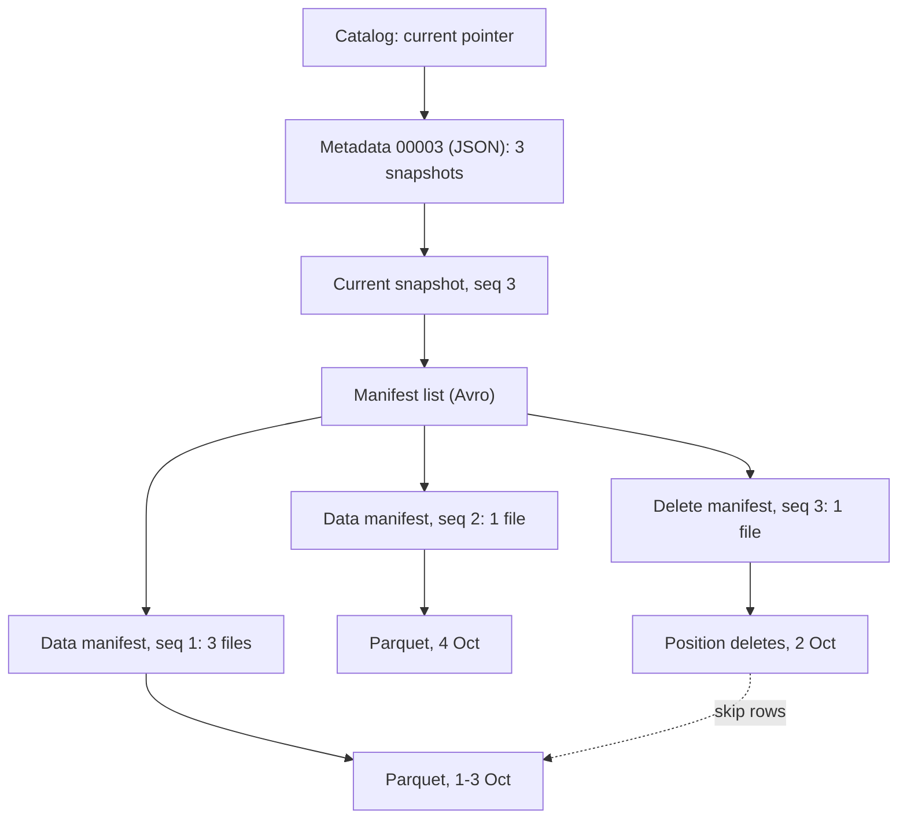
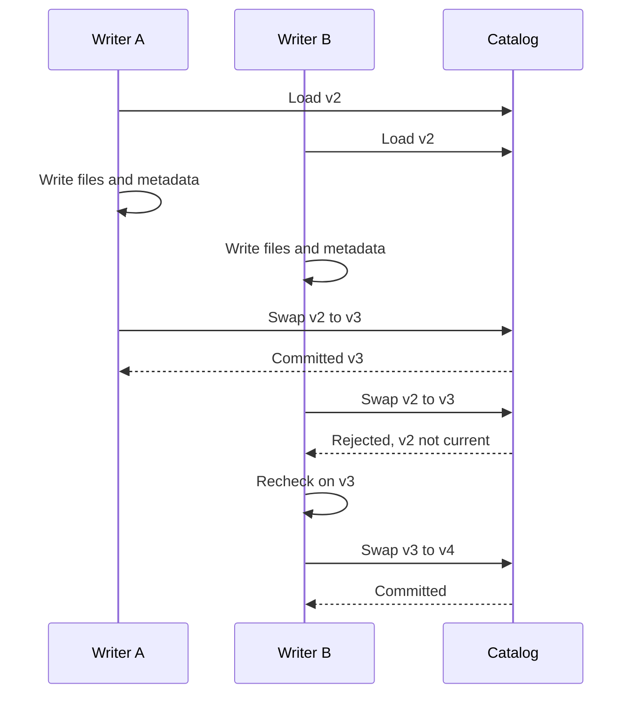

---
# Skeleton from Lead p4cqqxvi (DuckDB blog), picked 2026-10-27.
# published and reviewed are the pick time, provisional: set them
# when you publish. verified: is the Author's alone (ADR-0007).
title: "Open table formats: how Iceberg turns files into a table"
description: "An open table format such as Apache Iceberg turns immutable files in object storage into one table, with snapshots, atomic commits and file skipping."
kind: concept
vertical: databases-storage
tags: ["iceberg", "open-table-formats", "object-storage", "snapshots", "parquet"]
published: "2026-10-28T12:54:21Z"
verified: 2026-10-28
reviewed: "2026-10-28T12:54:21Z"
author: mira-vance
# Optional: an image HastCode may use, beside this file, replaces the
# generated title card. Never a Source's image.
# hero: concept-name.png
# hero_alt: "What the image shows"
# Optional: related Explainer slugs and extra sources (title + url).
# related: [http-connection-reuse]
---

In a [walkthrough published on 13 October 2026](https://duckdb.org/2026/10/13/inside-iceberg-table.html), the DuckDB team builds a small Apache Iceberg table of train services and changes it three times: an insert of 9,000 rows, an insert of 3,000 more, and a delete of the [1,000 rows from 2 October that ran four minutes late](https://duckdb.org/2026/10/13/inside-iceberg-table.html#a-table-with-history). A query returns 11,000 rows, as you'd expect. The metadata tells a stranger story. After the delete, the table's own summary still counts [12,000 records in four data files](https://duckdb.org/2026/10/13/inside-iceberg-table.html#layer-1-the-metadata-file). The delete did not touch a single data file. It wrote one new file listing 1,000 rows to ignore, and a fourth version of the table's metadata. Nothing was changed in place: in the DuckDB team's words, ["Every change writes new files and a new metadata.json, then commits by moving the catalog pointer to it."](https://duckdb.org/2026/10/13/inside-iceberg-table.html#the-tree)

> Drafted with AI assistance, researched, verified and edited by the HastCode editorial team. We publish only as many pieces as the Author can verify this way.

## TL;DR

- An **open table format** is a published specification for metadata that makes a collection of immutable files behave as one table. Iceberg's spec is designed to manage ["a large, slow-changing collection of files in a distributed file system or key-value store as a table"](https://iceberg.apache.org/spec/#iceberg-table-spec).
- Inside an Iceberg table is a tree: a catalog pointer to a JSON metadata file that lists snapshots, then a manifest list per snapshot, then manifests that list the Parquet data and delete files. A commit writes new files and [atomically swaps the pointer](https://iceberg.apache.org/spec/#optimistic-concurrency).
- It holds up at scale: Iceberg is [used in production where a single table can contain tens of petabytes](https://iceberg.apache.org/docs/latest/performance/), and aims to plan a scan in [O(1) remote calls, not O(n)](https://iceberg.apache.org/spec/#goals), by skipping manifests and files on metadata alone.
- What to do: expire snapshots, compact small files and manifests, and keep delete files in check. The cost: each is a rewrite job you run, and expired snapshots are [no longer available for time travel](https://iceberg.apache.org/docs/latest/maintenance/#expire-snapshots).

## A table format decides which files are the table

Iceberg's site calls it ["the open table format for analytic datasets"](https://iceberg.apache.org/). The spec's overview gives the core move: ["This table format tracks individual data files in a table instead of directories."](https://iceberg.apache.org/spec/#overview) Writers create data files in place, and those files join the table only in an explicit commit. Table state lives in metadata files, and every change creates a new one that replaces the old [with an atomic swap](https://iceberg.apache.org/spec/#overview).

A few terms, from the [spec's glossary](https://iceberg.apache.org/spec/#terms). A **snapshot** is the state of a table at some point in time, including the set of all its data files. A **manifest** is an immutable file that lists some of those files with their [partition data and metrics](https://iceberg.apache.org/spec/#manifests). A **manifest list** names the manifests of one snapshot, one per snapshot. A **catalog** holds the one piece of mutable state, a [pointer to the current metadata file](https://duckdb.org/2026/10/13/inside-iceberg-table.html#getting-started).

"Open" is about who can read it. The project names Spark, Trino, Flink, Presto, Hive and Impala as engines that can [safely work with the same tables, at the same time](https://iceberg.apache.org/); DuckDB [reads and writes them too](https://duckdb.org/2026/10/13/inside-iceberg-table.html#a-table-with-history).

## The tree, from catalog pointer to Parquet file

Walk it from the top. The catalog stores [a single pointer per table](https://duckdb.org/2026/10/13/inside-iceberg-table.html#layer-1-the-metadata-file). In the DuckDB example it names `00003-b79b5ffd-….metadata.json`, the fourth version, counting from `00000` at creation.

The metadata file is JSON. Besides the schema and partition spec, it lists [every snapshot that is still around](https://duckdb.org/2026/10/13/inside-iceberg-table.html#layer-1-the-metadata-file): here format version 2, three snapshots and three earlier metadata files in its log.

Snapshot 3 points to a manifest list naming [three manifests](https://duckdb.org/2026/10/13/inside-iceberg-table.html#layer-2-the-manifest-list): two for data files and one for delete files. The two older ones are reused, not rewritten, as the spec intends: manifests are ["reused across snapshots"](https://iceberg.apache.org/spec/#overview).

## Manifests list the files, and a delete is a file too

One level down, a manifest holds [one entry per file](https://duckdb.org/2026/10/13/inside-iceberg-table.html#layer-3-the-manifests), with its partition values, row count and per-column statistics. The three manifests hold five entries: four Parquet data files of 3,000 rows each, one per day from 1 to 4 October, and one delete file of 1,000 rows in the 2 October partition.

That delete file is a **position delete file**. It marks rows deleted [by data file path and row position](https://iceberg.apache.org/spec/#row-level-deletes). DuckDB implements DELETE and UPDATE this way, leaving the data file alone, a strategy called [merge-on-read](https://duckdb.org/2026/10/13/inside-iceberg-table.html#layer-4-data-files-and-delete-files): every reader combines the two files to get the right rows.

Which data files does a delete apply to? The spec answers with [sequence numbers](https://iceberg.apache.org/spec/#sequence-numbers), assigned to every successful commit and inherited by every file it writes. A position delete applies to a data file when the path and partition match and the data file's sequence number is [less than or equal to the delete's](https://iceberg.apache.org/spec/#scan-planning). Here the delete, written at sequence 3, applies to the 2 October file written at sequence 1. In general, the spec says, deletes apply ["only to data files that are older and in the same partition"](https://iceberg.apache.org/spec/#scan-planning).

Format version 3 changes the encoding. Deletes become a [deletion vector](https://iceberg.apache.org/spec/#deletion-vectors), a bitmap of deleted positions stored in a [Puffin](https://iceberg.apache.org/puffin-spec/) file, at most one per data file per snapshot. New position delete files [must not be added to v3 tables](https://iceberg.apache.org/spec/#delete-formats).

## A commit is one pointer swap

A write never edits a file. DuckDB [reads the current snapshot, writes new data and metadata files alongside the old ones](https://duckdb.org/2026/10/13/inside-iceberg-table.html#a-table-with-history), then asks the catalog to move the pointer: "That move is the commit." The spec calls this [optimistic concurrency](https://iceberg.apache.org/spec/#optimistic-concurrency). A writer assumes the current version will not change before it commits, then swaps the pointer from its base version to its new one.

Writer B's commit names version 2 as the snapshot it replaces, which is [no longer current](https://duckdb.org/2026/10/13/inside-iceberg-table.html#a-table-with-history), so it is rejected and must [retry on the new current version](https://iceberg.apache.org/spec/#optimistic-concurrency).

A retry is rarely a full redo. [Appends "have no requirements and can always be applied"](https://iceberg.apache.org/spec/#commit-conflict-resolution-and-retry); deletes of specific files and compactions first check that the files they remove are still in the table.

## How a reader skips most of the tree

The tree doubles as an index. Planning a scan filters twice.

First, the manifest list stores [the range of values for each partition field](https://iceberg.apache.org/docs/latest/performance/#metadata-filtering) in each manifest, so a reader can drop whole manifests unread. In the DuckDB table the three manifests, in the order they were written, cover 1 to 3 October, 4 October, and 2 October. A query for `service_date = DATE '2026-10-04'` [rules out the first and third manifests](https://duckdb.org/2026/10/13/inside-iceberg-table.html#partition-statistics) without reading a single manifest entry.

Second, every manifest entry carries each column's [lower and upper bounds](https://iceberg.apache.org/docs/latest/performance/#data-filtering). The example spread `service_id` across the first three days round-robin, so each of those files spans roughly 1 to 9,000, while the 4 October file spans [9,001 to 12,000](https://duckdb.org/2026/10/13/inside-iceberg-table.html#column-statistics). A query with `WHERE service_id > 10000` only has to open that one file. The DuckDB team's advice follows: data written in the order of a commonly filtered column gets narrower bounds and more skipping.

## Three formats, one idea

Iceberg is one of several open table formats, and the others shape their metadata differently.

**Delta Lake** keeps a [transaction log](https://github.com/delta-io/delta/blob/master/PROTOCOL.md#delta-log-entries): JSON files in a `_delta_log` directory, one per version, each holding the actions, such as adding or removing a file, that turn the previous version into the next. Its stated aims match Iceberg's: [serializable writes and snapshot isolation for reads](https://github.com/delta-io/delta/blob/master/PROTOCOL.md#overview), with writers that write files optimistically and then commit.

**Apache Hudi** records every change as an action on its [timeline](https://hudi.apache.org/docs/timeline/), "a log of all actions performed on the table at different instants", which it treats as the source of truth for the table's state.

**Iceberg version 4**, [under active development and not formally adopted](https://iceberg.apache.org/spec/#format-versioning), reshapes its own tree. It replaces the manifest list with [a single root manifest per snapshot](https://iceberg.apache.org/spec/#overview) and adds an adaptive metadata tree for [efficient small commits](https://iceberg.apache.org/spec/#version-4-metadata-structure-and-representation).

We infer the shared idea: an immutable record of which files make up each version, extended by one atomic commit. Iceberg's record is a tree read from the top; Delta Lake's and Hudi's are logs read forward.

## Why tables became metadata over files

The pressure came from putting tables on object stores. Iceberg, its docs say, was designed to solve [correctness problems that affect Hive tables running in S3](https://iceberg.apache.org/docs/latest/reliability/). A Hive table tracks partitions in a central metastore and individual files in the file system. That made atomic changes to a table's contents impossible, and an eventually consistent store could return wrong results to anyone rebuilding the table from a file listing. Listing was slow too: [O(n) calls with the number of partitions](https://iceberg.apache.org/docs/latest/reliability/).

A table format's answer is to ask little of storage. Iceberg needs only [in-place writes, seekable reads and deletes](https://iceberg.apache.org/spec/#file-system-operations): no random-access writes and no rename. The spec marks the older rename-based commit scheme as deprecated, ["unsafe in object stores and local file systems"](https://iceberg.apache.org/spec/#file-system-tables), and describes the atomic step instead as a [check-and-put on a pointer in a metastore or database](https://iceberg.apache.org/spec/#metastore-tables).

## Practice one: expire snapshots and old metadata files

The metadata file [grows with every commit](https://duckdb.org/2026/10/13/inside-iceberg-table.html#layer-1-the-metadata-file), because it keeps the snapshot list and a log of earlier metadata files. On a table with thousands of small commits, the DuckDB team warns, it can grow large enough to slow down loading the table.

Iceberg's maintenance guide recommends [expiring snapshots](https://iceberg.apache.org/docs/latest/maintenance/#expire-snapshots) regularly. Expiry removes snapshots from metadata, and data files are deleted once no snapshot that may be used for time travel or rollback still references them. The spec sets the [retention policy](https://iceberg.apache.org/spec/#snapshot-retention-policy): branches and tags keep their referenced snapshots, tuned by `min-snapshots-to-keep`, `max-snapshot-age-ms` and `max-ref-age-ms`.

Old metadata files are handled separately. Each one tracks its predecessors in `metadata-log`, up to `write.metadata.previous-versions-max`, [100 by default](https://iceberg.apache.org/docs/latest/maintenance/#remove-old-metadata-files). With `write.metadata.delete-after-commit.enabled` set, the writer deletes the oldest after each commit. Files that no metadata references, often left by failed jobs, need [orphan file deletion](https://iceberg.apache.org/docs/latest/maintenance/#delete-orphan-files).

The costs: expired snapshots are gone for time travel. Orphan deletion with a retention interval shorter than your longest write can [corrupt the table](https://iceberg.apache.org/docs/latest/maintenance/#delete-orphan-files) by deleting files still being written; the default interval is 3 days.

## Practice two: compact small files and manifests

Cheap commits make for slower reads. In the DuckDB example every write added its own manifest, which keeps a commit cheap but [costs read performance as small manifests accumulate](https://duckdb.org/2026/10/13/inside-iceberg-table.html#layer-2-the-manifest-list). Merging additions into an existing manifest costs the writer more and serves the reader better. The DuckDB team's check for a table that gets slower over time: [count the manifests and delete files](https://duckdb.org/2026/10/13/inside-iceberg-table.html#why-look-at-this-at-all).

Iceberg's guide offers two rewrites. [Compacting data files](https://iceberg.apache.org/docs/latest/maintenance/#compact-data-files) combines small files into larger ones, because small files mean more metadata and more file-open cost. [Rewriting manifests](https://iceberg.apache.org/docs/latest/maintenance/#rewrite-manifests) re-groups data files when the write pattern does not match the query pattern; the guide calls the metadata tree "an index over a table's data", and this keeps the index aligned with your filters.

The costs are compute and conflicts. A compaction is a replace operation: before it commits, it must verify that the files it deletes are [still in the table](https://iceberg.apache.org/spec/#commit-conflict-resolution-and-retry). In the reliability docs' example, rewriting `file_a.avro` and `file_b.avro` as `merged.parquet` [must fail](https://iceberg.apache.org/docs/latest/reliability/#retry-validation) if a concurrent commit deleted either one.

## Practice three: keep delete files from piling up

Merge-on-read makes deletes cheap and hands the bill to readers. The DuckDB team puts it plainly: ["Writes are cheap, and reads pay a small cost, which grows with the number of delete files."](https://duckdb.org/2026/10/13/inside-iceberg-table.html#layer-4-data-files-and-delete-files)

Iceberg gives you three levers. Format version 3 replaces position delete files with deletion vectors, which the spec calls [more efficient at execution time](https://iceberg.apache.org/spec/#delete-formats); with at most one per data file, writers must merge new deletes into the existing vector. [Rewriting position delete files](https://iceberg.apache.org/docs/latest/maintenance/#rewrite-position-delete-files) compacts small ones and drops records that point at data files no longer live. Removing [dangling delete files](https://iceberg.apache.org/docs/latest/maintenance/#remove-dangling-delete-files), whose deletes no longer apply to any live data file, is a metadata-only operation, and data file compaction can do it as it runs.

The costs: a format upgrade is a compatibility decision, because the version number goes up when [older readers would not read newer table features correctly](https://iceberg.apache.org/spec/#format-versioning), and tables may stay on an older version so engines that lack the new features can still use them. The rewrites are jobs you schedule and pay for.

## What a table format is not

It is not a file format. Parquet, Avro and ORC decide how rows sit inside one file; Iceberg's first version was defined to manage tables [built from those immutable file formats](https://iceberg.apache.org/spec/#version-1-analytic-data-tables).

It is not a catalog. The catalog holds [one pointer](https://duckdb.org/2026/10/13/inside-iceberg-table.html#getting-started), and the spec says the atomic operation that moves it [is not standardized by this spec](https://iceberg.apache.org/spec/#table-metadata): it depends on how the table is tracked. Everything else lives in files.

It is not a database server. No process owns the table: readers [will not acquire locks](https://iceberg.apache.org/spec/#goals), and job planning is handled primarily by clients so it does not bottleneck on a central metadata store. We infer the boundary from those goals: the format describes state, and engines do the work.

## What understanding a table format makes possible

Once you can read the tree, the table stops being a black box. The DuckDB team lists [when it pays off](https://duckdb.org/2026/10/13/inside-iceberg-table.html#why-look-at-this-at-all): a query reads more files than expected, a table slows over time, row counts look off, or another engine wrote the table. Each answer is a SQL query away, through `iceberg_snapshots`, `iceberg_metadata`, `iceberg_column_stats` or `read_avro` on the files themselves.

History comes nearly free. Because snapshots are kept, a table [can roll back if a job produces bad data](https://iceberg.apache.org/docs/latest/reliability/), and a time-travel query looks up [the snapshot current at a given timestamp](https://iceberg.apache.org/spec/#point-in-time-reads-time-travel) in the snapshot log.

You can try the whole walk on a laptop: the DuckDB post runs the Iceberg REST catalog fixture in Docker, with [no cloud account and no authentication](https://duckdb.org/2026/10/13/inside-iceberg-table.html#getting-started). The optimistic part: a table on plain object storage, with no server, gets atomic commits, consistent reads and file skipping from a few JSON and Avro files and one pointer swap. The price is maintenance you now own, and knowing the tree tells you which kind a slow table needs.

## Sources

- The DuckDB team, ["What Is Inside an Iceberg Table?"](https://duckdb.org/2026/10/13/inside-iceberg-table.html), DuckDB blog, 13 October 2026.
- Apache Iceberg, ["Iceberg Table Spec"](https://iceberg.apache.org/spec/).
- Apache Iceberg, [project home page](https://iceberg.apache.org/).
- Apache Iceberg, ["Reliability"](https://iceberg.apache.org/docs/latest/reliability/), documentation.
- Apache Iceberg, ["Performance"](https://iceberg.apache.org/docs/latest/performance/), documentation.
- Apache Iceberg, ["Maintenance"](https://iceberg.apache.org/docs/latest/maintenance/), documentation.
- Apache Iceberg, ["Puffin file format"](https://iceberg.apache.org/puffin-spec/).
- Delta Lake, ["Delta Transaction Log Protocol"](https://github.com/delta-io/delta/blob/master/PROTOCOL.md).
- Apache Hudi, ["Timeline"](https://hudi.apache.org/docs/timeline/), documentation.
