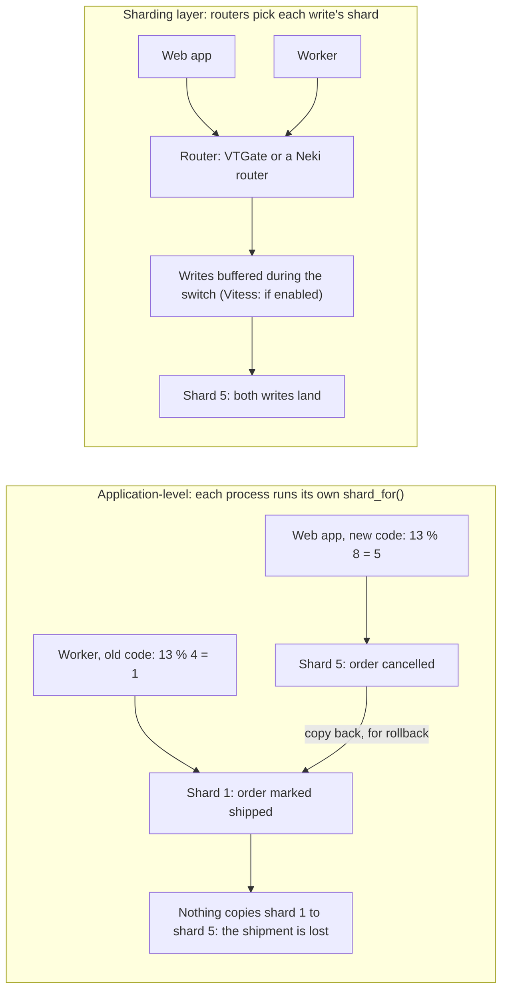

---
# Skeleton from Lead d3p7osdu (PlanetScale blog), picked 2026-11-23.
# Follows docs/editorial/comparison-writing-guide.md (placeholders
# replaced). published and reviewed are the pick time (make daily may move them to a Gap Day);
# make release keeps it (ADR-0012). verified: is the Author's alone (ADR-0007).
title: "Application-level sharding vs a sharding layer: what you build"
description: "Where sharding logic lives, in your code or in Vitess or Neki, decides who builds resharding, IDs, fan-out, cross-shard writes, DDL and failover."
kind: comparison
vertical: databases-storage
tags: ["sharding", "vitess", "neki", "postgres", "mysql"]
published: "2026-11-21T18:54:04Z"
reviewed: "2026-11-21T18:54:04Z"
author: mira-vance
# Optional: an image HastCode may use, beside this file, replaces the
# generated title card. Never a Source's image.
# hero: option-a-vs-option-b.png
# hero_alt: "What the image shows"
# Optional: related Explainer slugs and extra sources (title + url).
# related: [metastable-failures]
draft: true
---

PlanetScale's Ahmed Darwich starts a growing marketplace's sharding with one function. `shard_for` takes a `user_id` [modulo 4 and picks one of four databases](https://planetscale.com/blog/why-you-shouldnt-do-app-level-sharding#sharding-in-the-application), and writing it takes an afternoon. By day 1000, the team runs [reshard tooling, an ID scheme, a lookup table, a saga, a schema rollout tool, a failover orchestrator and a pooler on every shard](https://planetscale.com/blog/why-you-shouldnt-do-app-level-sharding#you-built-a-sharding-layer-anyway). The post's verdict: "You ended up building a sharding layer, even though your team's actual job is running a marketplace." PlanetScale sells such a layer, so we check the argument against the layers' own documentation. Should the sharding logic live in your application code, or in a sharding layer such as Vitess or Neki, and what does each leave you to build? We answer the same six questions for application code, Vitess and Neki.

## TL;DR

- **Application-level sharding** puts routing in your code. Every web app, worker and cron job runs a function such as `shard_for(user_id)` and connects to every shard, and you build the rest.
- **A sharding layer** puts a router between your app and the shards, and the app talks to it like one database. Vitess does this for MySQL, Neki for Postgres.
- They differ most at resharding. In your code, every process must switch to the new shard map; a layer switches in one place, with a brief write pause it can buffer.
- Neither makes cross-shard writes atomic by default. Vitess has an opt-in two-phase commit mode; Neki has no atomic mode, so a purchase that spans shards stays your saga.
- We infer: shard in your code only if nearly every query carries the shard key and you can staff the tooling; otherwise adopt a layer before you need the shards.

## One user's writes during a reshard, in each design

Both designs shard the same way: pick a shard key, the column that decides where a row lives, then map each key to a shard. How the key maps, by hash, range or lookup, is a separate choice, covered in [Hash, range and directory sharding](/distributed-systems/hash-vs-range-vs-directory-sharding/). This piece is about where the mapping runs, and who runs everything around it.

The diagram follows the post's riskiest moment. Four shards become eight, so user 13 moves from shard 1 (13 % 4) to shard 5 (13 % 8). In application code, the web app gets the new `shard_for` first and cancels an order on shard 5. A worker still on the old code marks the same order shipped on shard 1. Copying now runs only from shard 5 back to shard 1, so [the shipment is lost](https://planetscale.com/blog/why-you-shouldnt-do-app-level-sharding#resharding-from-four-shards-to-eight). In a sharding layer, both processes send their writes to the router. In Neki, the router [buffers queries during the switch](https://planetscale.com/blog/why-you-shouldnt-do-app-level-sharding#use-a-sharding-layer-instead), so the post says the lost shipment "can't happen"; we infer both writes land on shard 5.

## Application-level sharding: a function in every process

The first version is small. The post's `shard_for` [takes `user_id` modulo 4](https://planetscale.com/blog/why-you-shouldnt-do-app-level-sharding#sharding-in-the-application), and each user's data, such as a buyer's orders or a seller's payouts, lives on that user's shard. Queries look the same as before, as long as the code has a `user_id`. The post adds that production teams would use [something like consistent hashing](https://planetscale.com/blog/why-you-shouldnt-do-app-level-sharding#sharding-in-the-application) instead of `% 4`, with similar problems.

The routing is code, so it runs wherever your code runs. In the post, [web apps, workers and cron jobs each have their own `shard_for`](https://planetscale.com/blog/why-you-shouldnt-do-app-level-sharding#resharding-from-four-shards-to-eight), and each one [holds its own connection pool to every shard](https://planetscale.com/blog/why-you-shouldnt-do-app-level-sharding#failover-backups-and-connections).

Moving data is code too. Each user moves to their shard in [six steps](https://planetscale.com/blog/why-you-shouldnt-do-app-level-sharding#sharding-in-the-application). Copy the user's rows and advance the shard's ID counter past them. Keep copying new writes, and check that both sides match. Deploy `shard_for`, copy writes back to the original for rollback, and finally delete the originals.

The appeal is that nothing new sits between your app and the database. On day 1, the post's only new infrastructure is [three more databases](https://planetscale.com/blog/why-you-shouldnt-do-app-level-sharding#sharding-in-the-application).

## A sharding layer: one router in front of the shards

A sharding layer (also called a [sharding proxy](https://planetscale.com/blog/why-you-shouldnt-do-app-level-sharding#whats-the-alternative-to-application-level-sharding)) moves `shard_for` out of your processes and into a service they all share.

In Vitess, that service is VTGate, a proxy that routes traffic to the right tablets: "[your applications can connect to VTGate as if it is a MySQL Server](https://vitess.io/docs/24.0/concepts/vtgate/)." Vitess [works out each query's sharding key](https://vitess.io/docs/24.0/reference/features/sharding/#sharding-scheme) and routes it. Each shard runs [a `mysqld` process beside a `vttablet` process](https://vitess.io/docs/24.0/concepts/tablet/), and a topology service lets Vitess [find tablets and route queries to them](https://vitess.io/docs/24.0/concepts/topology-service/).

Neki is PlanetScale's sharded Postgres, built, the post says, [by the team behind Vitess](https://planetscale.com/blog/why-you-shouldnt-do-app-level-sharding#use-a-sharding-layer-instead). Applications reach it [over a single connection string](https://planetscale.com/blog/the-architecture-of-neki). A Neki router [takes Postgres connections and picks the shard or shards for each statement](https://planetscale.com/docs/neki/overview#routers), and no router is the primary. Neki is in [Platform Preview, with no service level agreement](https://planetscale.com/docs/neki).

The shard key stays yours in both. The post says you keep "[control over how your data is sharded and the compute size of every shard](https://planetscale.com/blog/why-you-shouldnt-do-app-level-sharding#use-a-sharding-layer-instead)," and both layers can start as one primary with replicas.

## Resharding: the switch is where writes get lost

**Application code** reshards by redeploying. [Changing `% 4` to `% 8`](https://planetscale.com/blog/why-you-shouldnt-do-app-level-sharding#resharding-from-four-shards-to-eight) sends half the users on the original shards to empty shards, and the six steps run again. The post calls step 4, the deploy, the riskiest part: processes deploy at different times, "so for a few minutes they can disagree about where user 13 lives." Both of its fixes stop writes. Read-only old shards block checkout; a config service that every process watches shrinks the window, but writes for moved users still pause.

**Vitess** runs a Reshard workflow. It [runs online without blocking reads or writes](https://vitess.io/docs/24.0/user-guides/configuration-advanced/resharding/#start-the-reshard), and VDiff [checks that source and target shards are consistent](https://vitess.io/docs/24.0/user-guides/configuration-advanced/resharding/#validate-correctness). At `SwitchTraffic`, Vitess [makes the source read-only until the targets catch up](https://vitess.io/docs/24.0/reference/vreplication/reshard/#--max-replication-lag-allowed), "[only a few seconds of read-only downtime](https://vitess.io/docs/24.0/reference/features/sharding/#resharding)." VTGate [can buffer those queries](https://vitess.io/docs/24.0/reference/vreplication/reshard/#switchtraffic), but buffering is [not enabled by default](https://vitess.io/docs/24.0/reference/features/vtgate-buffering/#vtgate-flags-to-enable-buffering). Reverse replication starts [by default](https://vitess.io/docs/24.0/reference/vreplication/reshard/#--enable-reverse-replication), so `ReverseTraffic` rolls back.

**Neki** [copies existing rows, then streams new changes](https://planetscale.com/docs/neki/data-migration#from-copy-to-streaming). During the write switch, it [buffers affected queries and blocks source writes to the moved tables; going back after that is not a documented Platform Preview rollback path](https://planetscale.com/docs/neki/data-migration#moving-traffic).

We infer that neither layer removes the write pause the post's team improvised. It shortens the pause, takes it in one place, and can hold queries instead of failing them.

## Queries without the shard key fan out in both designs

A support ticket arrives with only order number 1042, and `orders` is sharded by its buyer's `user_id`.

**Application code** could pass `user_id` into every function, but this ticket carries only an order ID. The post offers [three ways to find the shard](https://planetscale.com/blog/why-you-shouldnt-do-app-level-sharding#when-a-query-doesnt-have-a-user_id). [Ask every shard](https://planetscale.com/blog/why-you-shouldnt-do-app-level-sharding#ask-every-shard), a fan-out costing eight queries per lookup. Put the shard in the ID, covered below. Or [keep a lookup table](https://planetscale.com/blog/why-you-shouldnt-do-app-level-sharding#keep-a-lookup-table) that every request checks first; it must stay in sync through reshards, and if it is down, the store is down. A seller's weekly dashboard spans every shard regardless, so the app [queries all eight, then merges, sorts and pages](https://planetscale.com/blog/why-you-shouldnt-do-app-level-sharding#what-none-of-these-fix) the results.

**Vitess** does the fan-out for you. Its docs say that without a secondary Vindex, a second column-to-keyspace-ID map, "[VTGate would have to scatter the query to all shards](https://vitess.io/docs/24.0/reference/features/vindexes/#secondary-vindexes)." A lookup Vindex avoids that for [an extra write on inserts and deletes, and an extra lookup on reads](https://vitess.io/docs/24.0/reference/features/vindexes/#independence).

**Neki** sends a query on `orders` by `id` [to every shard](https://planetscale.com/blog/shard-groups-the-unit-of-co-location#queries-without-shard-keys), and the router [combines their results](https://planetscale.com/docs/neki/overview#routers) into one. Its global secondary index does the lookup table's job, but Neki "[shards the index like any other table and keeps it in sync on every write](https://planetscale.com/blog/why-you-shouldnt-do-app-level-sharding#use-a-sharding-layer-instead)."

We infer that a layer moves the fan-out code, not the fan-out: all eight shards still run the dashboard query.

## Unique IDs: per-shard counters collide, so the layers keep one

**Application code** inherits a counter per shard. In the post, `bigserial` gives each of the eight `orders` tables its own counter. "[Shard 1 and shard 5 both reached 1042 at some point, for two different customers](https://planetscale.com/blog/why-you-shouldnt-do-app-level-sharding#ask-every-shard)." UUIDs do not collide, but [nothing in them names a shard](https://planetscale.com/blog/why-you-shouldnt-do-app-level-sharding#put-the-shard-in-the-id). Instagram's fix, as the same section describes it, packs 41 bits of milliseconds, 13 bits of shard ID and 10 bits of sequence into 64 bits. A reshard would leave old IDs pointing to the wrong shard, so Instagram's IDs named one of a few thousand logical shards, mapped to servers by a table.

**Vitess** keeps one counter. Each sequence is backed by a MySQL table that [must sit in an unsharded keyspace](https://vitess.io/docs/24.0/reference/features/vitess-sequences/#vitess-sequences), a Vitess logical database that is not split. Vitess reserves IDs in chunks, so a chunk [could be lost if the tablet crashes](https://vitess.io/docs/24.0/reference/features/vitess-sequences/#initializing-a-sequence), and sequences [differ from MySQL's `auto_increment`](https://vitess.io/docs/24.0/reference/features/vitess-sequences/#sequence-limitations) in places.

**Neki** keeps sequences in its single-shard `main` group, [where database-wide metadata lives](https://planetscale.com/blog/shard-groups-the-unit-of-co-location#differently-sharded-tables). The post says Neki "[hands out unique IDs from a sequence and can find their shard with a global index](https://planetscale.com/blog/why-you-shouldnt-do-app-level-sharding#how-do-you-generate-unique-ids-across-shards)." Our explainer on [expression volatility](/databases-storage/volatile-expressions-sharded-sql/) shows `nextval()` running on the router, once per row.

We infer the same trade in both layers: IDs are unique but carry no shard, so a lookup by ID needs an index or a fan-out.

## Cross-shard writes: not atomic by default, and not yet in Neki

The post's store credit [makes one purchase touch two shards](https://planetscale.com/blog/why-you-shouldnt-do-app-level-sharding#cross-shard-transactions): user 14 on shard 6 (14 % 8) pays seller 27 on shard 3 (27 % 8). Each shard commits and can fail independently, so a balance can end up wrong.

**Application code** must build one of [two things](https://planetscale.com/blog/why-you-shouldnt-do-app-level-sharding#cross-shard-transactions). Two-phase commit (2PC) needs a coordinator, with a reliable log and crash recovery, that asks each shard to prepare and then commits; a crash after the votes leaves rows locked. A saga splits the purchase into two separate saves. It commits the debit with an outbox row, a record of work still owed, and a worker retries an idempotent credit, running an undo if retrying cannot fix it. The app shows "pending" meanwhile.

**Vitess** has [three transaction modes](https://vitess.io/docs/24.0/reference/features/distributed-transaction/#transaction-modes). `single` keeps a transaction on one shard. `multi`, [the default](https://vitess.io/docs/24.0/reference/features/distributed-transaction/#vtgate), spans shards with best-effort commits and "No atomicity". `twopc` makes commits atomic, but [costs commit latency](https://vitess.io/docs/24.0/reference/features/distributed-transaction/#overview) and [needs semi-sync replication](https://vitess.io/docs/24.0/reference/features/distributed-transaction/#mysql-prerequisites). Even then, a cross-shard read [can be fractured](https://vitess.io/docs/24.0/reference/features/distributed-transaction/#understanding-isolation-levels).

**Neki** [commits on each shard on its own, with no two-phase commit](https://planetscale.com/docs/neki/transactions#multi-shard-writes-are-not-atomic). The post is plain: "[One thing Neki doesn't do today is make writes across shards atomic.](https://planetscale.com/blog/why-you-shouldnt-do-app-level-sharding#use-a-sharding-layer-instead)" User 14's purchase stays your saga, and the post's advice is a shard key that keeps most writes on one shard. Setting `__neki.tx_mode` to `single` [keeps a transaction on one shard](https://planetscale.com/docs/neki/transactions#enforce-a-one-shard-transaction).

## Schema changes run on every shard either way

**Application code** runs `ALTER TABLE orders ADD COLUMN refunded_at timestamptz;` [once per shard](https://planetscale.com/blog/why-you-shouldnt-do-app-level-sharding#schema-changes-across-every-shard), nine times in the post's store. Each run can fail and must be tracked and retried, and the app must work with and without the column meanwhile. One shard can stall it: the brief lock waits behind a [20-minute report on shard 5](https://planetscale.com/blog/why-you-shouldnt-do-app-level-sharding#schema-changes-across-every-shard), and later `orders` queries queue behind the lock. The team ends up writing a rollout tool.

**Vitess** [finds the affected servers itself](https://vitess.io/docs/24.0/user-guides/schema-changes/#locate) and, for direct schema changes, [runs a synchronous `ALTER TABLE` on each relevant shard](https://vitess.io/docs/24.0/user-guides/schema-changes/#execute). Its [preferred approach](https://vitess.io/docs/24.0/user-guides/schema-changes/#the-various-approaches) is managed online schema changes, with [automated cut-overs](https://vitess.io/docs/24.0/user-guides/schema-changes/#cut-overcomplete) by default.

**Neki** [sends native DDL to every managed shard](https://planetscale.com/docs/neki/schema-changes), where Postgres runs it at once, with no progress tracking. Its Online DDL [builds a shadow table beside the original](https://planetscale.com/blog/the-architecture-of-neki#replicator). In a workflow, each shard commits its own transaction: completion is coordinated, "[but it is not one atomic transaction across the whole Neki database](https://planetscale.com/docs/neki/schema-changes#one-workflow-across-all-shards)." If one shard fails, Neki keeps the per-shard status.

We infer that a layer replaces the rollout tool, not the rollout: the app must still tolerate both schemas until the last shard finishes.

## Failover and connections: per shard in your code, central in a layer

**Application code** multiplies both. With nine primaries, a failover happens "[about nine times more often](https://planetscale.com/blog/why-you-shouldnt-do-app-level-sharding#failover-backups-and-connections)," and every web server, worker and cron job must reconnect to the new one. Most teams build an orchestrator. Every process also pools connections to every shard. In 2023, Notion ran [about 100 PgBouncer instances, each able to open up to 6 connections to each space shard](https://www.notion.com/blog/the-great-re-shard). Before growing from 32 to 96 machines, it sharded PgBouncer rather than [cut connections or "increase our total connections per database by 3x."](https://www.notion.com/blog/the-great-re-shard)

**Vitess** fails over through VTOrc, "[the automated fault detection and repair tool of Vitess](https://vitess.io/docs/24.0/reference/vtorc/architecture/#overview)," which [detects a dead primary and fails over to an eligible replica](https://vitess.io/docs/24.0/user-guides/configuration-basic/reparenting/). VTGate buffering is ["not intended for, nor active during, unplanned failovers"](https://vitess.io/docs/24.0/reference/features/vtgate-buffering/). Apps connect to VTGate, as above, and each VTTablet [pools connections to its MySQL](https://vitess.io/docs/24.0/reference/features/connection-pools/).

**Neki**'s Admin [coordinates an emergency failover and promotes a replica](https://planetscale.com/blog/the-architecture-of-neki#admin). During an unplanned failure, the router [holds queries for a limited time](https://planetscale.com/docs/neki/overview#how-failure-looks-to-a-client), then returns errors. A sidecar [pools connections so many clients share fewer Postgres backends](https://planetscale.com/blog/the-architecture-of-neki#sidecar).

## Trade-offs

Each cell summarises a section above, where its source is linked.

| Question | Application code | Vitess (MySQL) | Neki (Postgres) |
|---|---|---|---|
| Where routing runs | `shard_for()` in every web app, worker and cron job | VTGate, which apps reach as one MySQL server | Neki routers, behind one connection string |
| Resharding | Six steps per move; processes can disagree after the deploy | Online copy, VDiff, seconds read-only at the switch; buffering opt-in; `ReverseTraffic` | Copy then stream; writes buffered at the switch; no documented rollback after it |
| Query without the shard key | Pass the key everywhere, ask every shard, or run a lookup table | Scatter to all shards, or a lookup Vindex (extra write and read) | Fan out and combine, or a global secondary index |
| Unique IDs | Per-shard counters collide; encode a logical shard | Sequence in an unsharded keyspace, reserved in chunks | Router hands out IDs from a sequence in the `main` group |
| Cross-shard writes | Build 2PC or a saga | `multi` by default, not atomic; `twopc` opt-in | Not atomic, no 2PC; the saga stays yours |
| Schema changes | Run per shard, track and retry yourself | Shards found automatically; managed online changes | Sent to every shard; per-shard status, not atomic |
| Failover | Build an orchestrator; every process reconnects | VTOrc; buffering only for planned failovers | Admin promotes a replica; router buffers for a limited time |
| Connections | Every process pools to every shard | Apps to VTGate; VTTablet pools to MySQL | Apps to routers; sidecar pools to Postgres |

## Application code, Vitess or Neki: when to use each

Everything in this section is our inference from the facts above, not a benchmark.

**Application-level sharding wins when the shard key is in nearly every request and the shard count rarely changes**, such as tenants that never write across each other. No new service joins the query path. Before the first shard, put the shard map in one config every process reads, choose IDs that carry a logical shard, and budget for the rollout and failover tools. Leaving later is slow: Slack's move to Vitess began in 2017, and three years in it was "[sitting at 99% of all Slack MySQL traffic](https://slack.engineering/scaling-datastores-at-slack-with-vitess/)."

**Vitess wins on MySQL when you need online resharding and, for a few write paths, atomic commits.** Turn VTGate buffering on, since it is off by default. Keep `multi` where partial commits are tolerable, and use `twopc` where they are not, with semi-sync on and commit latency measured.

**Neki wins on Postgres when you want to start on one primary and reshard later** without changing the app's connection. Watch three things: Platform Preview carries no SLA, cross-shard writes are not yet atomic, and there is no documented way back after a write switch. Set `__neki.tx_mode` to `single` on paths that must stay on one shard.

Whichever you pick, you still choose the shard key, and that choice decides how often you meet the hard rows of the table.

## Sources

- Ahmed Darwich, [Why you shouldn't do application-level sharding](https://planetscale.com/blog/why-you-shouldnt-do-app-level-sharding), PlanetScale blog, 23 November 2026: every section and the FAQs.
- Harshit Gangal, [The architecture of Neki](https://planetscale.com/blog/the-architecture-of-neki), PlanetScale blog, 18 September 2026: Router, Sidecar, Admin, Replicator.
- Rohit Nayak, [Shard design doesn't start from your tables](https://planetscale.com/blog/shard-groups-the-unit-of-co-location), PlanetScale blog, 23 October 2026: Queries without shard keys, Differently sharded tables.
- PlanetScale, Neki documentation: [Neki](https://planetscale.com/docs/neki), [Overview](https://planetscale.com/docs/neki/overview) (Routers, How failure looks to a client), [Transactions](https://planetscale.com/docs/neki/transactions), [Schema changes](https://planetscale.com/docs/neki/schema-changes), [Data migration](https://planetscale.com/docs/neki/data-migration) (From copy to streaming, Moving traffic).
- Vitess v24.0 documentation: [VTGate](https://vitess.io/docs/24.0/concepts/vtgate/), [Tablet](https://vitess.io/docs/24.0/concepts/tablet/), [Topology Service](https://vitess.io/docs/24.0/concepts/topology-service/), [Sharding](https://vitess.io/docs/24.0/reference/features/sharding/), [Resharding](https://vitess.io/docs/24.0/user-guides/configuration-advanced/resharding/), [Reshard](https://vitess.io/docs/24.0/reference/vreplication/reshard/), [VTGate Buffering](https://vitess.io/docs/24.0/reference/features/vtgate-buffering/), [Vindexes](https://vitess.io/docs/24.0/reference/features/vindexes/), [Vitess Sequences](https://vitess.io/docs/24.0/reference/features/vitess-sequences/), [Distributed Transactions](https://vitess.io/docs/24.0/reference/features/distributed-transaction/), [Making Schema Changes](https://vitess.io/docs/24.0/user-guides/schema-changes/), [VTOrc Architecture](https://vitess.io/docs/24.0/reference/vtorc/architecture/), [Reparenting](https://vitess.io/docs/24.0/user-guides/configuration-basic/reparenting/), [Connection Pools](https://vitess.io/docs/24.0/reference/features/connection-pools/).
- Arka Ganguli, Tanner Johnson, Ben Kraft and Nathan Northcutt, [The Great Re-shard](https://www.notion.com/blog/the-great-re-shard), Notion blog, 17 July 2023: Solution: Add more databases!, Verification.
- Arka Ganguli, Guido Iaquinti, Maggie Zhou and Rafael Chacón, [Scaling Datastores at Slack with Vitess](https://slack.engineering/scaling-datastores-at-slack-with-vitess/), Slack Engineering, 1 December 2020: introduction, Disadvantages.
