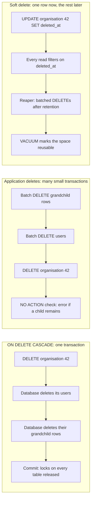

---
# Skeleton from Lead ddftdwnr (PlanetScale blog), picked 2026-10-27.
# Follow docs/editorial/comparison-writing-guide.md and replace every
# TODO(author) line. published and reviewed are the pick time, provisional: set them
# when you publish. verified: is the Author's alone (ADR-0007).
title: "ON DELETE CASCADE vs application deletes vs soft deletes"
description: "How ON DELETE CASCADE, application deletes and soft deletes remove related rows, where each locks, replicates and breaks, and when to pick which."
kind: comparison
vertical: databases-storage
tags: ["postgresql", "mysql", "foreign-keys", "soft-deletes", "logical-replication"]
published: "2026-10-28T12:54:21Z"
verified: 2026-10-28
reviewed: "2026-10-28T12:54:21Z"
author: mira-vance
# Optional: an image HastCode may use, beside this file, replaces the
# generated title card. Never a Source's image.
# hero: option-a-vs-option-b.png
# hero_alt: "What the image shows"
# Optional: related Explainer slugs and extra sources (title + url).
# related: [metastable-failures]
---

In a scenario PlanetScale's Tom Pang walks through ("Then one day, you get paged"), a schema change that adds one nullable column leaves nearly all writes to most tables timing out, because the `ALTER TABLE` is [stuck behind a very large `ON DELETE CASCADE`](https://planetscale.com/blog/i-dont-like-delete-cascade#cascade-plus-migration-equals-outage) and new queries pile up behind the `ALTER TABLE`. In larger environments, the same post says, PlanetScale has seen "hundreds of gigabytes of WAL written by a single transaction." The delete was one line of SQL. The question is who removes the rows that point at it: the database through a cascade, your application through explicit deletes, or nobody yet, through a soft delete. We answer the same four questions for all three, from the PostgreSQL and MySQL documentation and PlanetScale's own posts.

> Drafted with AI assistance, researched, verified and edited by the HastCode editorial team. We publish only as many pieces as the Author can verify this way.

## TL;DR

- **`ON DELETE CASCADE`** lets the database delete every referencing row, recursively, inside the transaction of the one `DELETE` you issue, so the work and the locks grow with the size of the tree.
- **Application deletes** keep the foreign keys on `NO ACTION` or `RESTRICT` and have your code delete children before parents, so you choose how many rows each transaction touches, and the constraint catches any child you missed.
- **Soft deletes** mark the parent with a `deleted_at` timestamp in a one-row `UPDATE` and reap the real rows later in small batches, at the price of filtering every read.
- They differ most in transaction size: one unbounded transaction, many bounded ones you write, or one row now and bounded batches later.
- We infer: cascade small, owned components; use application deletes when trees are large and you can write the ordering; use soft deletes for large customer-level data you may need to restore or replicate cheaply.

## One organisation deleted three ways

All three options start from the same schema: child tables whose foreign keys point at a parent, such as the Lead's `customer_users.organization_id` referencing `customer_organizations`. A foreign key requires that the child's columns [match values in the referenced columns of some row](https://www.postgresql.org/docs/current/sql-createtable.html#SQL-CREATETABLE-PARMS-REFERENCES) of the parent. The options differ only in what happens when the parent row goes away, and when.

The diagram deletes organisation 42 in each. With a cascade, one `DELETE` becomes deletes of users and their grandchildren in a single transaction. With application deletes, your code walks the tree bottom-up in batches, each its own transaction, and deletes the organisation last. With a soft delete, one `UPDATE` hides the organisation now, and a background reaper deletes the rows later.

## ON DELETE CASCADE: the database follows the tree

[`CASCADE`](https://www.postgresql.org/docs/current/sql-createtable.html#SQL-CREATETABLE-PARMS-REFERENCES-REFACT-CASCADE) tells PostgreSQL to "delete any rows referencing the deleted row." [MySQL's InnoDB](https://dev.mysql.com/doc/refman/8.4/en/create-table-foreign-keys.html#foreign-key-referential-actions) does the same, deleting "the matching rows in the child table," and performs cascades with a depth-first search on the foreign key's index.

PostgreSQL's documentation says [when a cascade fits](https://www.postgresql.org/docs/current/ddl-constraints.html#DDL-CONSTRAINTS-FK): when the referencing table "represents something that is a component of what is represented by the referenced table and cannot exist independently." Its example is order items, which go with their order, while deleting a product should not silently delete order items.

The cascade runs inside your statement: [referential actions are executed as part of the data-changing command, even if the constraint is deferred](https://www.postgresql.org/docs/current/sql-createtable.html#SQL-CREATETABLE-PARMS-REFERENCES). The Lead describes how this grows. Tables are added over time, [each cascading to the organisation, some recursively](https://planetscale.com/blog/i-dont-like-delete-cascade#how-cascades-grow), so the application "doesn't need to think about the relationship tree when deleting." The Lead calls the result "fully integrity checked, atomic deletion." The same property means one `DELETE` of one row can, as PlanetScale's earlier post warns, [delete gigabytes of data](https://planetscale.com/blog/the-only-scalable-delete#deletes-hurt).

MySQL adds one caveat worth knowing before you rely on triggers for auditing: "[Cascaded foreign key actions do not activate triggers](https://dev.mysql.com/doc/refman/8.4/en/create-table-foreign-keys.html#foreign-key-referential-actions)."

## Application deletes: your code walks the tree

Here the foreign keys stay, but with an action that refuses rather than deletes. In PostgreSQL the default, [`NO ACTION`](https://www.postgresql.org/docs/current/sql-createtable.html#SQL-CREATETABLE-PARMS-REFERENCES-REFACT-NO-ACTION), produces an error if a delete would leave a referencing row; [`RESTRICT`](https://www.postgresql.org/docs/current/sql-createtable.html#SQL-CREATETABLE-PARMS-REFERENCES-REFACT-RESTRICT) does the same but [does not allow the check to be deferred](https://www.postgresql.org/docs/current/ddl-constraints.html#DDL-CONSTRAINTS-FK). The documentation names this pattern for independent objects: an application that wants to delete both [must "be explicit about this and run two delete commands"](https://www.postgresql.org/docs/current/ddl-constraints.html#DDL-CONSTRAINTS-FK).

The order matters. Without deferral, children go first. A foreign key [declared `DEFERRABLE INITIALLY DEFERRED`](https://www.postgresql.org/docs/current/sql-createtable.html#SQL-CREATETABLE-PARMS-INITIALLY) is checked only at commit, so the `NO ACTION` setting lets later commands in the same transaction [delete the now-dangling rows](https://www.postgresql.org/docs/current/ddl-constraints.html#DDL-CONSTRAINTS-FK) before the check.

In [MySQL's InnoDB](https://dev.mysql.com/doc/refman/8.4/en/create-table-foreign-keys.html#foreign-key-referential-actions), `NO ACTION` is the same as `RESTRICT`, and "the delete or update operation for the parent table is immediately rejected" while a child exists. The check is immediate, so children always go first. Leaving `ON DELETE` out gives `NO ACTION` in both databases.

What you gain is control over transaction boundaries. PlanetScale's advice for large deletions is [many isolated batched deletes in a loop, "e.g., 10,000 rows at a time"](https://planetscale.com/blog/the-only-scalable-delete#a-performant-one-off-delete), to keep transactions short and let autovacuum keep up. We infer that the cost is code: every new child table needs a step in the delete path, and the constraint error is what tells you a step is missing.

## Soft deletes: mark now, delete later

A soft delete replaces the delete with an update. The Lead's example is [one statement on one row](https://planetscale.com/blog/i-dont-like-delete-cascade#soft-deletes-are-the-better-alternative): `UPDATE customer_organizations SET deleted_at = now() WHERE id = 42;`, "instead of having to synchronously delete millions of rows in one transaction."

The work moves elsewhere, and the Lead lists it. Reads, "even to child tables," must check `deleted_at` on the relevant rows. Code must later run real deletes, possibly after a retention period ("keep deleted rows for 30 days, or more depending on business requirements"). That background reaping can run slowly, at times of low traffic, in batches that keep transactions fast, followed by a vacuum to mark the space reusable. Tom Pang argues the approach is "much better in many ways" for customer data deletion at scale, and that it can help restore data after an accidental deletion.

The database does not know about `deleted_at`. To PostgreSQL, a soft-deleted organisation is still [a row in the referenced table](https://www.postgresql.org/docs/current/sql-createtable.html#SQL-CREATETABLE-PARMS-REFERENCES), so we infer that its foreign keys still accept new children pointing at it until the reaper runs. One tool helps with uniqueness: a [partial unique index](https://www.postgresql.org/docs/current/indexes-partial.html#INDEXES-PARTIAL-EX3) "enforces uniqueness among the rows that satisfy the index predicate," so a predicate such as `deleted_at IS NULL` lets a new row reuse a name a soft-deleted row still holds. That use of the predicate is our inference from the documented feature.

## Locks and transaction size: who holds what, for how long

**A cascade** holds locks for the whole tree, for the whole delete. PostgreSQL takes [`ROW EXCLUSIVE` on each table that `DELETE` modifies](https://www.postgresql.org/docs/current/explicit-locking.html#LOCKING-TABLES), and the Lead says a cascade holds it [on every table involved](https://planetscale.com/blog/i-dont-like-delete-cascade#cascade-plus-migration-equals-outage). Many forms of `ALTER TABLE` take `ACCESS EXCLUSIVE`, which conflicts with every mode, and locks are [normally held until the end of the transaction](https://www.postgresql.org/docs/current/explicit-locking.html#LOCKING-TABLES). So the migration waits for the cascade, and, per the Lead, new `INSERT`s wait behind the migration. The Lead's workaround is a short [`lock_timeout`](https://www.postgresql.org/docs/current/runtime-config-client.html#GUC-LOCK-TIMEOUT) on migrations, retried until they get through; the setting aborts any statement that waits longer than its limit for a lock. MySQL [extends metadata locks to tables related by a foreign key](https://dev.mysql.com/doc/refman/8.4/en/create-table-foreign-keys.html#foreign-key-locking), to stop conflicting DML and DDL running on them at the same time.

**Application deletes** hold the same lock mode, but only for one batch at a time. We infer that a migration waits at most one batch, which is the outcome the Lead describes for batched reaping: the `ALTER TABLE` and the queries behind it [wait only for a moment](https://planetscale.com/blog/i-dont-like-delete-cascade#soft-deletes-are-the-better-alternative).

**Soft deletes** lock one row's table for one `UPDATE`, then hand the rest to the same kind of batched reaper.

## Finding the children: indexes on the referencing side

Every option has to find the child rows of the parent being removed, and how fast it finds them depends on an index the databases treat differently.

**A cascade in PostgreSQL** can be slow for a reason that is easy to miss. A delete from the parent [requires a scan of the referencing table](https://www.postgresql.org/docs/current/ddl-constraints.html#DDL-CONSTRAINTS-FK) for matching rows, and declaring a foreign key "does not automatically create an index on the referencing columns." The Lead calls an unindexed foreign key under a cascade ["an even worse failure mode"](https://planetscale.com/blog/i-dont-like-delete-cascade#unindexed-foreign-keys): full sequential scans during single-row deletes. MySQL avoids this by construction: it [requires an index on the foreign key and creates one automatically](https://dev.mysql.com/doc/refman/8.4/en/create-table-foreign-keys.html#foreign-key-restrictions) if none exists.

**Application deletes** need the same index twice. The `NO ACTION` check scans for children just as a cascade would, and the application's own `DELETE ... WHERE organization_id = ...` needs it to find each batch. We infer the index is not optional here either.

**Soft deletes** move the cost to reads. Every query that must hide deleted rows carries a `deleted_at` condition, so we infer that its indexes have to serve that condition too; [partial indexes](https://www.postgresql.org/docs/current/indexes-partial.html#INDEXES-PARTIAL-EX2) are one documented way to index only the live rows. The reaper later needs the referencing-column index like any other delete.

## Logical replication: what reaches the subscriber

PostgreSQL's logical replication [streams row changes from a publisher to subscribers](https://planetscale.com/blog/i-dont-like-delete-cascade#cascades-and-logical-replication), and the three options look very different on the wire.

**A cascade** arrives as ordinary row deletes: the Lead says deleting org 42 shows up as [one transaction deleting the org, then users, then grandchildren](https://planetscale.com/blog/i-dont-like-delete-cascade#cascades-and-logical-replication). The subscriber's apply worker runs with [`session_replication_role = replica`](https://www.postgresql.org/docs/current/runtime-config-client.html#GUC-SESSION-REPLICATION-ROLE), and since foreign keys are implemented as triggers, that "disables all foreign key checks." A child table that exists only on the subscriber, or one left out of the publication, is orphaned with no error. On the publisher, a table in a publication that replicates deletes needs a [replica identity](https://www.postgresql.org/docs/current/logical-replication-publication.html#LOGICAL-REPLICATION-PUBLICATION-REPLICA-IDENTITY); without one, the delete errors, and the Lead shows an organisation delete failing because one cascade child had no primary key, even when it had no matching rows.

**Application deletes** replicate the same ordinary row deletes. We infer that both traps remain: a subscriber-only child still needs its own cleanup, and each table you delete from still needs a replica identity.

**Soft deletes** shrink the problem: marking the org deleted replicates as [a one-row `UPDATE`](https://planetscale.com/blog/i-dont-like-delete-cascade#cascades-and-logical-replication), and "the real deletes come later, in batches you control."

## What the database guarantees in between

**A cascade** gives the strongest guarantee: the parent and every child disappear in [one atomic, integrity-checked step](https://planetscale.com/blog/i-dont-like-delete-cascade), with no moment when a reader sees half the tree. The cost is that you cannot stop halfway without rolling all of it back.

**Application deletes** keep integrity but give up atomicity across batches. The foreign key still guarantees no orphans, since a parent delete with children left [produces an error](https://www.postgresql.org/docs/current/sql-createtable.html#SQL-CREATETABLE-PARMS-REFERENCES-REFACT-NO-ACTION). We infer that between batches, readers can see an organisation with some of its users already gone, a crash leaves the job half done until it is retried, and a committed batch cannot be undone.

**Soft deletes** keep every row until the reaper runs, so integrity is never at risk, and data can be [restored after an accidental deletion](https://planetscale.com/blog/i-dont-like-delete-cascade#soft-deletes-are-the-better-alternative). The guarantee that deleted data is hidden, though, lives only in your queries.

On space, all three end in real deletes. In PostgreSQL, neither an `UPDATE` nor a `DELETE` [immediately removes the old row version](https://www.postgresql.org/docs/current/routine-vacuuming.html#VACUUM-FOR-SPACE-RECOVERY); `VACUUM` later marks the space available for reuse.

## Trade-offs

Each cell summarises a section above, where its source is linked.

| Question | ON DELETE CASCADE | Application deletes | Soft deletes |
|---|---|---|---|
| Who deletes the children | The database, recursively, inside your `DELETE` | Your code, children first (or deferred `NO ACTION` in PostgreSQL) | A background reaper, after a retention period |
| Rows per transaction | The whole tree | One batch, sized by you | One row now, then batches |
| Locks and migrations | `ROW EXCLUSIVE` on every table until commit; DDL queues behind it | Held one batch at a time | One-row `UPDATE`, then batches |
| Unindexed foreign key | PostgreSQL scans the child table; MySQL always indexes | Same scan, plus your own lookup | Reads also need to serve `deleted_at` |
| Logical replication | Ordinary row deletes; subscriber-only children orphaned | Ordinary row deletes; same traps | One-row `UPDATE`; deletes later |
| Guarantee while it runs | Atomic and integrity-checked | No orphans; partial state between batches | Every row kept; hiding is up to your queries |
| Undo | Roll back before commit only | None once a batch commits | Clear `deleted_at` before the reaper runs |
| Code you write | None | A delete path per child table | Read filters and a reaper |

## Cascade, application delete or soft delete: when to use each

Everything in this section is our inference from the facts above, not a benchmark.

**`ON DELETE CASCADE` wins for small, owned components** of a row, the case PostgreSQL's own documentation describes: order items that cannot exist without their order. Watch the tree's size, not its shape: index every referencing column in PostgreSQL, set a short `lock_timeout` on migrations, and revisit the cascade once one parent can own millions of rows or once logical replication is in play.

**Application deletes win when the tree is large but you want the database to keep checking.** Keep `NO ACTION` foreign keys as a safety net, delete in batches sized for your workload, and treat a constraint error as a missing step in your delete path rather than something to work around. Watch for readers that may see a half-deleted tree between batches.

**Soft deletes win for customer-level data at scale**, where an accidental delete should be recoverable and a deletion should replicate as one row. Watch every read path, including child tables, and remember the foreign key still sees the row.

The Lead's closing rule covers all three: keep transactions short and bounded, starting from ["hundreds to low thousands"](https://planetscale.com/blog/i-dont-like-delete-cascade#keep-transactions-short-and-bounded) of rows. Each option is a different way of getting there, and you can mix them across tables.

## Sources

- Tom Pang, [I don't trust ON DELETE CASCADE](https://planetscale.com/blog/i-dont-like-delete-cascade), PlanetScale blog, 21 October 2026.
- Tom Pang, [The only scalable delete in Postgres is DROP TABLE](https://planetscale.com/blog/the-only-scalable-delete), PlanetScale blog, 11 June 2026 ("Deletes hurt", "A performant one-off delete").
- PostgreSQL 18 documentation, [5.5. Constraints](https://www.postgresql.org/docs/current/ddl-constraints.html#DDL-CONSTRAINTS-FK), section 5.5.5, Foreign Keys.
- PostgreSQL 18 documentation, [CREATE TABLE](https://www.postgresql.org/docs/current/sql-createtable.html#SQL-CREATETABLE-PARMS-REFERENCES): `REFERENCES`, referential actions, `DEFERRABLE` and `INITIALLY DEFERRED`.
- PostgreSQL 18 documentation, [13.3. Explicit Locking](https://www.postgresql.org/docs/current/explicit-locking.html#LOCKING-TABLES), section 13.3.1, Table-Level Locks.
- PostgreSQL 18 documentation, [19.11. Client Connection Defaults](https://www.postgresql.org/docs/current/runtime-config-client.html#GUC-LOCK-TIMEOUT): `lock_timeout` and `session_replication_role`.
- PostgreSQL 18 documentation, [29.1. Publication](https://www.postgresql.org/docs/current/logical-replication-publication.html#LOGICAL-REPLICATION-PUBLICATION-REPLICA-IDENTITY), section 29.1.1, Replica Identity.
- PostgreSQL 18 documentation, [11.8. Partial Indexes](https://www.postgresql.org/docs/current/indexes-partial.html#INDEXES-PARTIAL-EX3), Examples 11.2 and 11.3.
- PostgreSQL 18 documentation, [24.1. Routine Vacuuming](https://www.postgresql.org/docs/current/routine-vacuuming.html#VACUUM-FOR-SPACE-RECOVERY), section 24.1.2, Recovering Disk Space.
- MySQL 8.4 Reference Manual, [FOREIGN KEY Constraints](https://dev.mysql.com/doc/refman/8.4/en/create-table-foreign-keys.html): Referential Actions, Conditions and Restrictions, Locking.
