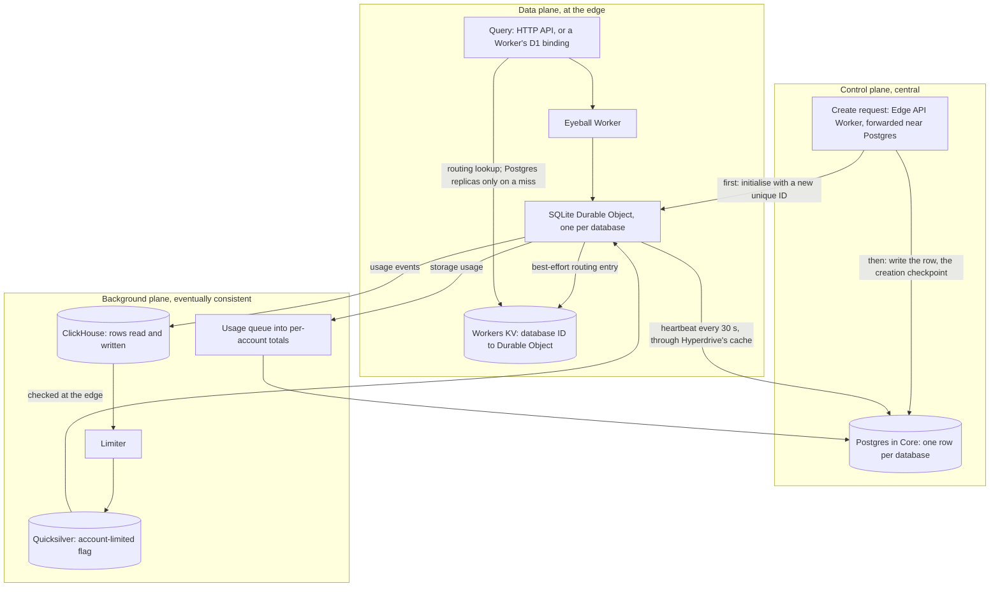

---
# Skeleton from Lead g7w5f2tx (Cloudflare blog), picked 2026-10-26.
# Follow docs/editorial/case-study-writing-guide.md; the one author note
# left sits under the first H2. published and reviewed are the pick time, provisional: set them
# when you publish. verified: is the Author's alone (ADR-0007).
title: "How Cloudflare D1 runs millions of SQLite databases"
description: "How Cloudflare D1 keeps its central Postgres off the query path of millions of SQLite databases, at the price of limits that act seconds late."
kind: case-study
vertical: databases-storage
tags: ["sqlite", "serverless", "control-plane", "eventual-consistency", "cloudflare"]
published: "2026-10-26T19:11:55Z"
reviewed: "2026-10-26T19:11:55Z"
author: mira-vance
# Optional: an image HastCode may use, beside this file, replaces the
# generated title card. Never a Source's image.
# hero: system-name.png
# hero_alt: "What the image shows"
related: [metastable-failures]
draft: true
---

Cloudflare's serverless SQLite database, D1, has [15 times as many live databases as a year ago and 65 times as many as two years ago](https://blog.cloudflare.com/d1-control-plane/), and its control plane was rebuilt for platforms with millions of databases. Every one is recorded in a central Postgres cluster, yet a query to any of them is built to stay away from it.

> Drafted with AI assistance, researched, verified and edited by the HastCode editorial team. We publish only as many pieces as the Author can verify this way.

## TL;DR

- D1 is Cloudflare's [managed, serverless database based on SQLite](https://blog.cloudflare.com/d1-control-plane/); each database is [one SQLite-backed Durable Object](https://blog.cloudflare.com/d1-read-replication-beta/#under-the-hood-how-d1-read-replication-is-implemented), so creating millions is cheap.
- The hard part is the control plane: AI-built apps want a database per user, preview environment or tenant, and a central lookup on every query would slow them all.
- Creation initialises the Durable Object before writing Postgres, 30-second heartbeats let each database correct itself, queries find their database through Workers KV, and usage limits flow through a queue, ClickHouse and Quicksilver, never the query path.
- The price is staleness by design: [limits react a little late](https://blog.cloudflare.com/d1-control-plane/), orphaned objects live until their next heartbeat, and the post reports growth, not latency.

## Three planes, with one Durable Object per database

TODO(author): verify every claim against its source, then set verified: and remove draft: true and this line.

The diagram is ours, redrawn from the text of Cloudflare's post; Cloudflare's own figures are in [the original](https://blog.cloudflare.com/d1-control-plane/). Cloudflare sorts every D1 operation into [three planes](https://blog.cloudflare.com/d1-control-plane/). The data plane is any query, and "should be as fast as possible and always at the edge". The control plane is the rest of the HTTP API (create, delete, list, import, export, time travel) and may depend on central, single-region components. The background plane runs analytics and billing, and may be eventually consistent.

Top to bottom: Step 1 creates a database, Step 2 is the heartbeat that keeps it honest, Step 3 is the query path, and Steps 4 and 5 are the background flows that enforce storage and row limits.

## Why a database per tenant strains the control plane

Traditional architecture, [Cloudflare writes](https://blog.cloudflare.com/d1-control-plane/), "assumes you have one or two big database clusters per application". AI-assisted development and vibe coding platforms turn that inside out: one small database per user, application, preview environment or tenant. D1's docs name the same target, [scale-out across many smaller databases](https://developers.cloudflare.com/d1/platform/limits/#storage) of up to 10 GB each, each ["inherently single-threaded"](https://developers.cloudflare.com/d1/platform/limits/#concurrency-and-throughput). An application grows by adding databases, not by growing one.

Small databases are cheap to run but expensive to keep track of. Each has a [metadata row in a Postgres cluster](https://blog.cloudflare.com/d1-control-plane/) in Cloudflare's central data centres, which it calls "Core". If every query asked that cluster where its database lives, one region would sit on the path of every query in the world. Accounts compound it: summing an account's storage is a query whose cost [grows with every database on the account](https://blog.cloudflare.com/d1-control-plane/), and some agentic coding platforms hold millions.

The post describes no outage behind the change. Cloudflare frames it as preparation, [load-testing against a target well above its expected growth](https://blog.cloudflare.com/d1-control-plane/) and fixing what the tests exposed.

## The shortcuts Cloudflare turned down

The post answers [five "why not" questions](https://blog.cloudflare.com/d1-control-plane/):

- **One Postgres transaction for creation.** It "cannot scale": it holds a connection while the Durable Object initialises, possibly on the other side of the world.
- **Durable Objects addressed by name.** A [name-derived ID](https://developers.cloudflare.com/durable-objects/api/namespace/#idfromname) still needs a central name-to-object lookup per query, plus metadata to pick the namespace: "we would replace one lookup with two". Cloudflare still recommends names as everyone else's starting point.
- **Routing cached in Hyperdrive alone.** Workers KV is a durable store, so a miss is served from KV's own storage, not Postgres. With a cache alone, a mass purge would send a million databases to Postgres at once, which "would lead to [metastable failures](/distributed-systems/metastable-failures/)".
- **A limit query keyed by account and database.** Exact, but with poor cache hit rates.
- **The account total updated on every usage report.** Write-lock contention on one row for large accounts.

One argument decides all five. Postgres stays the source of truth, nothing on the query path waits for it, and every decision that can tolerate seconds of staleness reads a cache, a queue or a precomputed total instead.

## Step 1: creation writes the Durable Object first

The Edge API Worker runs at the nearest Cloudflare location and checks the account's database count against Postgres read replicas through [Hyperdrive](https://developers.cloudflare.com/hyperdrive/concepts/query-caching/), cached for a few seconds. Creation needs several Postgres round trips, so the Worker then [forwards the request to a data centre near Postgres](https://blog.cloudflare.com/d1-control-plane/): hundreds of milliseconds per round trip from afar, a few from nearby. To still place the database near the user, as D1 does [by default](https://developers.cloudflare.com/d1/configuration/data-location/#automatic-recommended), it invokes the Durable Object from a data centre close to the original request.

The order is the design. The Worker generates a D1 UUID and a Durable Object ID with [`newUniqueId()`](https://developers.cloudflare.com/durable-objects/api/namespace/#newuniqueid), and calls `init` on the new object, which keeps its metadata in its own storage. Only then does it write the Postgres row, the ["creation checkpoint"](https://blog.cloudflare.com/d1-control-plane/): from that write on, the database exists, even if the reply never reaches the user. Both steps sit in a retry loop that uses fresh IDs each time.

A last call, inside [`waitUntil()`](https://developers.cloudflare.com/workers/runtime-apis/context/#waituntil), tells the object it is active and is allowed to fail; the object then writes its own Workers KV entry. Cloudflare's example `wrangler d1 create` [took 1.6 seconds end to end](https://blog.cloudflare.com/d1-control-plane/).

## Step 2: heartbeats let each database correct itself

Every D1 Durable Object [calls the control plane every 30 seconds, plus a per-database jitter](https://blog.cloudflare.com/d1-control-plane/), to learn whether its database is active or deleted and what its account's limits are. A heartbeat tolerates slightly old data, so Hyperdrive's caches or a Postgres replica can answer it.

That loop makes Step 1 safe. Say the Worker initialises object A and the Postgres write fails. The retry initialises object B and succeeds. Only B is in Postgres, so only B can be queried, and within 30 seconds A's heartbeat is told its database does not exist, and A marks itself deleted. Fresh UUIDs on each retry matter: reusing one would leave several objects believing they own the same database. And the object is initialised before the row is written, or queries could reach an uninitialised object and be rejected.

The heartbeat also repairs Workers KV, which is [eventually consistent](https://developers.cloudflare.com/kv/concepts/how-kv-works/#consistency) with no consistent read. So each Durable Object is [the single writer of its own KV entry](https://blog.cloudflare.com/d1-control-plane/): best-effort on creation and deletion, rewritten on the next heartbeat if that failed. It also keeps its active or deleted state in its own storage, to turn away a query that a stale KV entry let through.

## Step 3: queries stay off Postgres

A query over the HTTP API [runs the Edge API Worker near the caller](https://blog.cloudflare.com/d1-control-plane/), which handles authentication, authorisation, rate limits, validation and entitlements, then reads the database's metadata from Workers KV. On a rare miss it falls back to Hyperdrive, which tries its cache near the caller, then its cache near Postgres, and only then a read replica. It then calls the Eyeball Worker, D1's proxy for everything a Durable Object handles, which forwards the query to the database's object.

A user's Worker skips most of that. Its D1 binding is a [Service Binding](https://developers.cloudflare.com/workers/runtime-apis/bindings/service-bindings/) to the Eyeball Worker that carries encoded authorisation for one specific database, so it needs no routing lookup at all.

Inside the object, the database is a SQLite file on local disk in [write-ahead log (WAL) mode](https://www.sqlite.org/wal.html), where changes are appended to a separate log and a commit is a record added to it. Cloudflare's Storage Relay Service [replicates each WAL entry to five followers in other data centres](https://blog.cloudflare.com/d1-read-replication-beta/#under-the-hood-how-d1-read-replication-is-implemented) and lets the write commit once three have stored it.

Unique IDs keep this path short: a name-derived ID's first use needs a global uniqueness check that [can take a few hundred milliseconds](https://developers.cloudflare.com/durable-objects/api/namespace/#newuniqueid), which `newUniqueId()` skips. D1 stores the ID, and a KV read replaces the central lookup.

## Step 4: storage limits ride a queue into a running total

D1 caps storage at [5 GB per account on the Free plan and 1 TB on Workers Paid](https://developers.cloudflare.com/d1/platform/limits/). Each Durable Object [publishes its storage usage to an internal, Kafka-like queue](https://blog.cloudflare.com/d1-control-plane/), aggregated per edge server. Consumers in Core write each database's latest size to a `database_stats` table, and Cloudflare caps their number so a spike cannot overload Postgres. A stale total is acceptable; an overloaded Postgres is not.

To avoid summing per account, a trigger writes each size change as a delta row into `account_database_stats_changes`. A job runs every second: in one statement it deletes all pending deltas with `DELETE ... RETURNING`, sums them per account, and adds each sum to that account's row in `account_database_stats`. Postgres runs a data-modifying [common table expression](https://www.postgresql.org/docs/current/queries-with.html) exactly once and to completion, so the deltas are consumed atomically, and each account's row takes one update per second, not one per report.

The heartbeat reads that total through Hyperdrive and, when the account is over, the object forbids writes that would grow the database. Hyperdrive's cache key is the query plus its parameters, so with the account ID as the only parameter, every database on an account shares one cached answer and [most heartbeats never reach Postgres](https://blog.cloudflare.com/d1-control-plane/). Hyperdrive's [default cache lifetime is 60 seconds](https://developers.cloudflare.com/hyperdrive/concepts/query-caching/#default-cache-settings); to read fresher, Cloudflare adds a `dynamic_ttl` parameter, the current time in X-second buckets, so the cache key changes every X seconds.

## Step 5: row limits are set centrally and read at the edge

Free-tier accounts also have [daily execution limits](https://blog.cloudflare.com/d1-control-plane/), enforced another way. Each Durable Object counts the rows every query reads and writes, index updates included, and sends a usage event to ClickHouse, which also drives row-based billing.

A central [Limiter](https://blog.cloudflare.com/d1-control-plane/) in Core periodically asks ClickHouse which accounts are over since the start of the day; ClickHouse handles that analytical query better than Postgres, and it keeps the load off Postgres. For each free-tier account over the limit, the Limiter emails the owner at most once a day and sets a key in [Quicksilver](https://blog.cloudflare.com/quicksilver-v2-evolution-of-a-globally-distributed-key-value-store-part-1/), Cloudflare's internal, globally distributed key-value store with sub-second replication, expiring at the end of the day. Upgrading to Workers Paid clears it. Each Durable Object periodically checks Quicksilver at the edge and rejects queries while the key is set.

No step touches Postgres. Cloudflare may [move other limits to this pattern](https://blog.cloudflare.com/d1-control-plane/), and developers get a version through [Workers KV Instant](https://blog.cloudflare.com/workers-kv-instant/), built on Quicksilver. The post does not say how often the Limiter runs or objects check.

## What it costs: limits that lag, and more parts to run

Cloudflare is plain about the first cost: storage enforcement is ["slightly slower than it could be in terms of reaction to usage changes, but this is acceptable"](https://blog.cloudflare.com/d1-control-plane/). Add the delays on that path: a queue, a one-second job, an X-second cache bucket and a 30-second heartbeat. We infer an account can write past its limit for something like a minute before its databases notice; the post gives no figure. An orphaned object from a failed creation also lives until its next heartbeat. For D1, the alternative was a central check on every write.

The second cost is moving parts. One database's state spans Postgres, Workers KV, ClickHouse, Quicksilver, a queue and the object's own storage, which Cloudflare calls [the right data store for each job](https://blog.cloudflare.com/d1-control-plane/). Each is another system to run and another place for state to drift, and the heartbeat pulls them back together.

Heartbeats are steady load. Take 300,000 active databases (our number, not Cloudflare's): one heartbeat each every 30 seconds is 10,000 a second, most absorbed by the account-keyed cache. The post does not say whether idle databases heartbeat. Durable Objects are [evicted from memory after a period without requests](https://developers.cloudflare.com/durable-objects/concepts/durable-object-lifecycle/#durable-object-lifecycle-state-transitions), so we infer the load follows active databases, not every one created.

## The evidence: growth and load tests, not latency

What the post measures is demand. As of 8 October 2026, D1 had [15 times as many live databases as a year earlier, 65 times as many as two years earlier, and 18 times as many daily active ones as a year earlier](https://blog.cloudflare.com/d1-control-plane/), counting a database as active if it ran a query that day. OpenAI's ChatGPT Sites builds on it; its Jon Abrams [calls D1](https://blog.cloudflare.com/d1-control-plane/) "a simple, scalable way" for users to add metrics, leaderboards and comments. Cloudflare load-tested against a target well above expected growth.

The gap: no query latency percentiles, no Postgres load before and after, no cache hit rates, no heartbeat rate, no count of failed creations, and growth given as ratios, not absolute counts. The post shows how the system is built and that it is growing, not how fast or how reliably it runs.

## What it makes possible

The users Cloudflare names are platforms that give each of their own users a database: vibe coding and agentic coding platforms, and services such as ChatGPT Sites. For them a database is closer to a file than a cluster: created in seconds, placed near its user, and [paid for only as it is used](https://blog.cloudflare.com/d1-control-plane/).

Cloudflare offers the patterns to [anyone building on its Developer Platform](https://blog.cloudflare.com/d1-control-plane/), and they travel further. Keep your source of truth central but off the hot path. Order multi-store writes so a half-finished attempt is harmless, and let a periodic check clean up behind it. Precompute aggregates instead of scanning at request time. Choose cache keys for hit rate over exactness.

Each pattern buys scale with staleness and more systems to run. Where seconds of lag in a limit or a deletion are acceptable, as they are for most of what a control plane decides, the payoff is a query path whose cost does not grow with the number of databases.

## Sources

- [Under the hood, off the hot path: How D1 scales to millions of databases](https://blog.cloudflare.com/d1-control-plane/), David Laban and Lambros Petrou, Cloudflare blog, 13 October 2026
- [Sequential consistency without borders: how D1 implements global read replication](https://blog.cloudflare.com/d1-read-replication-beta/), Justin Mazzola Paluska and Lambros Petrou, Cloudflare blog, 10 April 2025
- [Quicksilver v2: evolution of a globally distributed key-value store (Part 1)](https://blog.cloudflare.com/quicksilver-v2-evolution-of-a-globally-distributed-key-value-store-part-1/), Cloudflare blog
- [Workers KV Instant](https://blog.cloudflare.com/workers-kv-instant/), Cloudflare blog
- [Cloudflare D1 docs: Limits](https://developers.cloudflare.com/d1/platform/limits/)
- [Cloudflare D1 docs: Data location](https://developers.cloudflare.com/d1/configuration/data-location/)
- [Durable Objects docs: Durable Object Namespace](https://developers.cloudflare.com/durable-objects/api/namespace/)
- [Durable Objects docs: Lifecycle of a Durable Object](https://developers.cloudflare.com/durable-objects/concepts/durable-object-lifecycle/)
- [Workers KV docs: How KV works](https://developers.cloudflare.com/kv/concepts/how-kv-works/)
- [Hyperdrive docs: Query caching](https://developers.cloudflare.com/hyperdrive/concepts/query-caching/)
- [Workers docs: Context, waitUntil](https://developers.cloudflare.com/workers/runtime-apis/context/#waituntil)
- [Workers docs: Service bindings](https://developers.cloudflare.com/workers/runtime-apis/bindings/service-bindings/)
- [SQLite: Write-Ahead Logging](https://www.sqlite.org/wal.html)
- [PostgreSQL documentation: WITH queries (Common Table Expressions)](https://www.postgresql.org/docs/current/queries-with.html)
