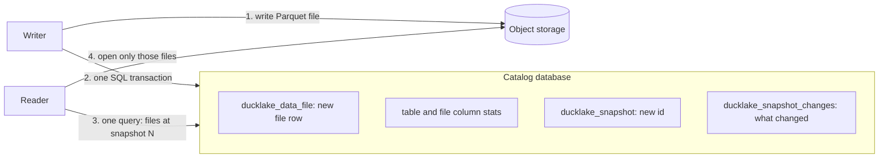

---
# Skeleton from Lead qnhema2q (DuckDB blog), picked 2026-10-29.
# Drafted per docs/editorial/concept-writing-guide.md. published and reviewed
# are the pick time, provisional: set them when you publish.
# verified: is the Author's alone (ADR-0007).
title: "DuckLake: a lakehouse format that keeps its metadata in SQL tables"
description: "DuckLake keeps a lakehouse's metadata in a SQL database, not files, so one transaction commits a change and one query plans a read."
kind: concept
vertical: databases-storage
tags: ["ducklake", "lakehouse", "open-table-formats", "duckdb", "parquet"]
published: "2026-10-29T19:05:10Z"
reviewed: "2026-10-29T19:05:10Z"
author: mira-vance
# Optional: an image HastCode may use, beside this file, replaces the
# generated title card. Never a Source's image.
# hero: concept-name.png
# hero_alt: "What the image shows"
related: [apache-iceberg-table-format]
draft: true
---

Matt Martin's data career began in 2008 with spreadsheets, when [assembling a single report could take three hours](https://duckdb.org/2026/10/29/from-spreadsheets-to-ducklake.html#from-copy-paste-to-code). Years later he was running Apache Iceberg and Delta Lake, and hit the trouble that [starts when the metadata grows](https://duckdb.org/2026/10/29/from-spreadsheets-to-ducklake.html#why-ducklake). Iceberg writes several metadata files per transaction, so over time a query must resolve thousands of them before it can plan, and planning that once took seconds slows down. Then he tried DuckLake. In his experience, catalog operations that take seconds with Iceberg [resolve in under a millisecond with DuckLake](https://duckdb.org/2026/10/29/from-spreadsheets-to-ducklake.html#why-ducklake), "because they are queries against indexed tables." That clause is the whole idea. DuckLake answers "which files make up this table right now?" with one SQL query, not a walk through files on object storage.

> Drafted with AI assistance, researched, verified and edited by the HastCode editorial team. We publish only as many pieces as the Author can verify this way.

## TL;DR

- **DuckLake** is an open lakehouse format that keeps table data as Parquet files on storage and puts [all metadata in a SQL database](https://ducklake.select/manifesto/#ducklake): file lists, statistics, schemas and snapshots are rows in ordinary tables.
- A write stages its Parquet files, then [runs a single SQL transaction](https://ducklake.select/manifesto/#speed) in the catalog database. A read [sends one query](https://ducklake.select/manifesto/#speed) that prunes by schema, partition and statistics and returns the files to open.
- Small writes need no files at all: [data inlining](https://ducklake.select/docs/stable/duckdb/advanced_features/data_inlining) stores changes of up to 10 rows in the catalog by default. In the DuckDB team's own streaming benchmark, inserts ran [105× faster than Iceberg](https://ducklake.select/2026/04/02/data-inlining-in-ducklake/#we-need-to-talk-about-iceberg).
- What to do: pick the catalog database for your writers, expire snapshots, and flush and merge small files. The cost: a SQL database becomes part of your lake, and maintenance is still yours.

## DuckLake puts the table's bookkeeping in a database

Mark Raasveldt and Hannes Mühleisen of DuckDB introduced it in [the DuckLake manifesto](https://ducklake.select/manifesto/), published in [May 2025](https://ducklake.select/2026/04/13/ducklake-10/). Its basic design is ["to move all metadata structures into a SQL database, both for catalog and table data"](https://ducklake.select/manifesto/#ducklake). The format is defined as a set of relational tables and pure-SQL transactions on them.

In our words: a **lakehouse format** makes a pile of immutable files in object storage behave like database tables. Iceberg, which we [took apart in an earlier piece](/databases-storage/apache-iceberg-table-format/), keeps that bookkeeping in JSON and Avro files. DuckLake keeps it in tables such as `ducklake_data_file` and `ducklake_snapshot`.

The [specification, now version 1.1](https://ducklake.select/docs/stable/specification/introduction), names two building blocks. The **catalog database** must support transactions and primary key constraints as defined by SQL-92. **Data storage** holds Parquet files on object, block or file storage. A **snapshot** is one committed change: one `BEGIN`…`COMMIT` block with data or DDL changes [is one snapshot](https://ducklake.select/docs/stable/duckdb/advanced_features/transactions).

What does not count: the catalog does not store the bulk of your rows. Its job is metadata, whose volume the manifesto puts at ["several orders of magnitude smaller than the actual data changes"](https://ducklake.select/manifesto/#scalability). The one exception, small inlined writes, comes later.

## One INSERT is one Parquet file and one transaction



The manifesto walks [one `INSERT` of two values, 42 and 43](https://ducklake.select/manifesto/#ducklake), into a new, empty table. Step 1 writes the Parquet file; that write ["happens beforehand"](https://ducklake.select/manifesto/#ducklake) and is not part of the transaction.

Step 2 is one SQL transaction. It inserts the new file's path, updates the table's row count and the column's global minimum and maximum, records per-file column statistics (here `'42'` and `'43'`), creates snapshot 2 and logs the change as `inserted_into_table:1`. The manifesto's point: ["no matter how many values are added, this sequence has the same (low) cost."](https://ducklake.select/manifesto/#ducklake)

The [Queries page](https://ducklake.select/docs/stable/specification/queries#snapshot-creation) gives the rule for the new id: it should be `max(snapshot_id) + 1`. Schema, table, column and file rows each carry a `begin_snapshot` and an `end_snapshot`, so step 3 is [a filter](https://ducklake.select/docs/stable/specification/queries#select): the rows visible at snapshot N are those with `begin_snapshot <= N` and an `end_snapshot` after N or `NULL`.

## Reads, deletes and time travel are WHERE clauses

A reader finds the current snapshot with [`SELECT max(snapshot_id)`](https://ducklake.select/docs/stable/specification/queries#get-current-snapshot), then joins `ducklake_data_file` with `ducklake_delete_file` for that snapshot. To prune, it checks the filter value against the min and max in [`ducklake_file_column_stats`](https://ducklake.select/docs/stable/specification/queries#select-with-file-pruning). A file with missing bounds cannot be excluded.

Deletes are **merge-on-read**: a delete writes a Parquet file of deleted row indexes and [registers it in `ducklake_delete_file`](https://ducklake.select/docs/stable/specification/queries#delete), with [at most one delete file per data file](https://ducklake.select/docs/stable/specification/queries#select) in a snapshot. An `UPDATE` is a delete followed by an insert [in the same transaction](https://ducklake.select/docs/stable/specification/queries#update).

The docs' own example shows all of it. With inlining switched off, they load the Netherlands train stations and rename one station. Three files now sit in storage: [the original data file, the deleted rows and the inserted rows](https://ducklake.select/docs/stable/duckdb/introduction#example), and the delete file marks row 29. There are three snapshots: catalog initialization (0), table creation with the insert (1), and the update (2). Querying the table `AT (VERSION => 1)` reads it as of snapshot 1, before the rename.

Time travel costs little because nothing is overwritten. Dropping a table [sets `end_snapshot`](https://ducklake.select/docs/stable/specification/queries#drop-table) on its rows, and old snapshots keep their files.

## Two writers race for the same snapshot id

Concurrency rides on a primary key. `ducklake_snapshot` has a [PRIMARY KEY on `snapshot_id`](https://ducklake.select/docs/stable/duckdb/advanced_features/conflict_resolution), so when two connections commit, both try to write the same next id and one fails with a constraint violation.

The loser does not start over. It reads `ducklake_snapshot_changes` to see what the other snapshots changed. If nothing conflicts logically, it [retries in the metadata catalog without rewriting any data files](https://ducklake.select/docs/stable/duckdb/advanced_features/conflict_resolution). Two inserts into one table resolve this way.

The docs list the logical conflicts. Two snapshots that [delete from the same underlying data file](https://ducklake.select/docs/stable/duckdb/advanced_features/conflict_resolution#data) conflict; deletes from different files in the same table are permitted. Compacting a file that another snapshot deleted from or compacted [conflicts too](https://ducklake.select/docs/stable/duckdb/advanced_features/conflict_resolution#compaction).

We infer that this is the same optimistic scheme as Iceberg's [atomic pointer swap](/databases-storage/apache-iceberg-table-format/), with the check done by a database constraint. The manifesto's claim is that DuckLake ["supports as many table changes as the catalog database can commit"](https://ducklake.select/manifesto/#speed), and that PostgreSQL can run thousands of transactions per second. We have no independent measurement of that ceiling.

## Small writes can skip Parquet entirely

Because the catalog is a database, it can hold rows too. With **data inlining**, small inserts go to [a per-table inlined data table](https://ducklake.select/docs/stable/duckdb/advanced_features/data_inlining#insertion-inlining) in the catalog, and small deletes from Parquet files go to an inlined deletion table. The default limit is [10 rows](https://ducklake.select/docs/stable/duckdb/advanced_features/data_inlining#configuring-data-inlining), set globally, per attach or per table. For queries, inlined data behaves the same as data in Parquet.

The DuckDB team's [sensor example](https://ducklake.select/2026/04/02/data-inlining-in-ducklake/#example-streaming-sensor-data) shows the difference. A hundred one-row appends to an Iceberg table through pyiceberg left 401 files: 100 Parquet, 200 Avro and 101 JSON. The same hundred inserts into DuckLake left zero Parquet files.

Their benchmark streamed autonomous-car sensor data against Iceberg with Apache Polaris, scaled down to [10,000 rows in 1,000 batches](https://ducklake.select/2026/04/02/data-inlining-in-ducklake/#we-need-to-talk-about-iceberg) because the full run took prohibitively long for Iceberg:

| Step | Iceberg (Polaris) | DuckLake, inlined |
|---|---|---|
| Insert | 1,148.77 s | 10.88 s |
| Aggregation | 83.06 s | 0.09 s |
| Checkpoint | 52.83 s | 0.28 s |

They attribute the gap to an extra REST hop and around four S3 files written per batch, against zero. This is a vendor's benchmark of its own format; run your workload before relying on it.

## Why the metadata moved into a database

The manifesto's argument starts with a pointer. Finding a table's latest version is tricky on blob stores, so Iceberg and Delta Lake gained a [catalog service backed by a database](https://ducklake.select/manifesto/#catalogs), whose table holds a single row per table with the current version. The manifesto calls it "the saddest table of all time". Iceberg's spec describes the same step as a [check-and-put on a pointer in a metastore or database](https://iceberg.apache.org/spec/#metastore-tables).

Those formats were ["specifically designed to not require a database"](https://ducklake.select/manifesto/#a-database-you-say), and the design carried costs. Every root file in Iceberg holds all existing snapshots, so each change writes a new file with the complete history, and metadata is batched into two layers of manifests to avoid many small files on blob stores. Once a database was in the stack anyway, the authors argue, the rest of the design was never revisited.

Reads pay too. Following the metadata path takes [many separate sequential HTTP requests](https://ducklake.select/manifesto/#speed), which puts a lower bound on how fast a read or commit can run. Small changes are where it hurts most: the inlining post describes how [a thousand inserts per second](https://ducklake.select/2026/04/02/data-inlining-in-ducklake/) become a thousand little files and forced compaction.

The idea is not new to closed systems. The manifesto notes that [BigQuery uses Spanner and Snowflake uses FoundationDB](https://ducklake.select/manifesto/#ducklake) for metadata, "just without the open formats at the bottom".

## Practice one: choose the catalog database by who writes

The catalog can be [any SQL database with ACID and primary keys](https://ducklake.select/manifesto/#simplicity), and the docs map the choice to [the number of writers](https://ducklake.select/docs/stable/duckdb/usage/choosing_a_catalog_database):

- **DuckDB** for one client on one machine. Only one process can attach it at a time, unless every process attaches it read-only.
- **SQLite** for several local clients. It allows one writer at a time, and DuckLake retries lock conflicts.
- **PostgreSQL**, version 12 or newer, for a multi-user lakehouse with remote clients.
- **Quack**, experimental, to serve a DuckDB catalog to many clients. Matt Martin [serves a DuckLake on EC2 this way](https://duckdb.org/2026/10/29/from-spreadsheets-to-ducklake.html#looking-forward-to-duckdb-v20), so users need only an address and a token.

The docs warn of known issues with MySQL and [do not recommend it](https://ducklake.select/docs/stable/duckdb/usage/choosing_a_catalog_database#mysql).

The cost: the catalog is now a database you operate, back up and tune. The docs put its upkeep on that database; for PostgreSQL, [occasional `VACUUM`](https://ducklake.select/docs/stable/duckdb/maintenance/recommended_maintenance) is likely sufficient. Lock-in is limited: moving catalogs [needs no table data movement](https://ducklake.select/manifesto/#simplicity).

## Practice two: expire snapshots, then delete the files

DuckLake in normal operation [never removes any data](https://ducklake.select/docs/stable/duckdb/maintenance/expire_snapshots), even when a table is dropped, because time travel can still reach it. Snapshots are only rows, so the manifesto says there is [no need to proactively prune them](https://ducklake.select/manifesto/#speed). Storage still grows.

Removal takes two steps. [`ducklake_expire_snapshots`](https://ducklake.select/docs/stable/duckdb/maintenance/expire_snapshots) expires snapshots by id or age, or catalog-wide with the `expire_older_than` option, and supports a dry run. Expired files are then [scheduled for deletion, not deleted](https://ducklake.select/docs/stable/duckdb/maintenance/cleanup_of_files), because active queries may still be scanning them. `ducklake_cleanup_old_files` removes them later; the docs call it generally safe for files scheduled more than a few days ago, if no read transaction lasts that long. `ducklake_delete_orphaned_files` removes Parquet and Puffin files that the catalog does not track at all, such as those left by a failure.

The costs: an expired snapshot is gone for time travel, and cleanup run sooner than your longest read can delete files still in use.

## Practice three: flush inlined rows and merge small files

Inlining moves the small-file problem into the catalog; it does not abolish it. `CHECKPOINT` [flushes inlined data to object storage](https://ducklake.select/2026/04/13/ducklake-10/#data-inlining), and the docs recommend it to [run the maintenance functions periodically](https://ducklake.select/docs/stable/duckdb/maintenance/recommended_maintenance).

Without inlining, every small insert writes a small Parquet file. The docs recommend files of [at least a few megabytes](https://ducklake.select/docs/stable/duckdb/maintenance/merge_adjacent_files) and provide `ducklake_merge_adjacent_files`. It merges without expiring snapshots: the merged file records which snapshot wrote each row, so time travel and change feeds still work. Files with deletes are skipped and need `ducklake_rewrite_data_files`. The docs sketch a tiered schedule for streaming: merge files under 1 MiB often, larger ones less often.

The costs: compaction ["can be a very memory intensive operation"](https://ducklake.select/docs/stable/duckdb/maintenance/merge_adjacent_files#advanced-options), so the docs suggest batches with `max_compacted_files`. Each run competes with writers: compacting a file another snapshot just deleted from is a conflict.

## What DuckLake is not

It is not Iceberg with a database bolted on. It is its own specification with its own tables. The link is at the data level: the data and positional delete files DuckLake writes are [fully compatible with Apache Iceberg](https://ducklake.select/manifesto/#features), "allowing for metadata-only migrations", and DuckLake 1.0 added Iceberg v3 [deletion vectors in Puffin files](https://ducklake.select/2026/04/13/ducklake-10/#deletion-vectors), as an experimental feature.

It is not a catalog service. Iceberg and Delta Lake added [a catalog service that talks to a database](https://ducklake.select/manifesto/#catalogs); DuckLake has ["no additional catalog server or additional API"](https://ducklake.select/manifesto/#simplicity). Clients speak SQL to the catalog database directly.

It is not a data warehouse with constraints. Like other lakehouse formats, DuckLake [does not support indexes, primary keys, foreign keys, or UNIQUE and CHECK constraints](https://ducklake.select/docs/stable/duckdb/introduction#using-ducklake); upserts go through [`MERGE INTO`](https://ducklake.select/docs/stable/duckdb/unsupported_features). We infer the boundary: the catalog's primary keys guard the metadata, not your rows.

## What SQL metadata makes possible

The metadata stops being a format you decode. The spec says ["DuckLake is not a black box"](https://ducklake.select/docs/stable/specification/queries#reading-data): every catalog table is yours to query. Why did a scan open so many files? Ask `ducklake_data_file` and `ducklake_file_column_stats`, or list commits with [`snapshots()`](https://ducklake.select/docs/stable/duckdb/usage/snapshots).

Streaming into a lake becomes practical, because small batches land in the catalog and flush to Parquet later. Engines beyond DuckDB are arriving: the DuckDB team lists clients for [DataFusion, Spark, Trino and pandas](https://ducklake.select/2026/04/13/ducklake-10/#adoption), and DuckLake had [more than 1.5 million downloads](https://ducklake.select/2026/10/21/ducklake-11/) in the week of 12 to 18 October 2026.

You can try it on a laptop. DuckLake 1.1 [requires DuckDB v2.0.0 or later](https://ducklake.select/docs/stable/duckdb/introduction#installation), and this creates a DuckDB-backed lake whose Parquet files go in a folder beside it:

```sql
INSTALL ducklake;
ATTACH 'ducklake:my_ducklake.ducklake' AS my_ducklake;
```

Swap the path for a PostgreSQL connection string and an S3 `DATA_PATH`, and the same tables serve a team. The price is a database to run and snapshots to expire. What you get is a lake whose every commit is one transaction you can read.

## Sources

- Matt Martin, Geertjan Wielenga and Tim Cox, ["From Spreadsheets to DuckLake: A Data Engineer's Road to DuckDB"](https://duckdb.org/2026/10/29/from-spreadsheets-to-ducklake.html), DuckDB blog, 29 October 2026.
- Mark Raasveldt and Hannes Mühleisen, ["The DuckLake Manifesto: SQL as a Lakehouse Format"](https://ducklake.select/manifesto/), DuckLake.
- DuckLake, ["Specification: Introduction"](https://ducklake.select/docs/stable/specification/introduction) and ["Queries"](https://ducklake.select/docs/stable/specification/queries), version 1.1.
- DuckLake documentation: ["Introduction"](https://ducklake.select/docs/stable/duckdb/introduction), ["Transactions"](https://ducklake.select/docs/stable/duckdb/advanced_features/transactions), ["Conflict Resolution"](https://ducklake.select/docs/stable/duckdb/advanced_features/conflict_resolution), ["Data Inlining"](https://ducklake.select/docs/stable/duckdb/advanced_features/data_inlining), ["Snapshots"](https://ducklake.select/docs/stable/duckdb/usage/snapshots), ["Choosing a Catalog Database"](https://ducklake.select/docs/stable/duckdb/usage/choosing_a_catalog_database), ["Unsupported Features"](https://ducklake.select/docs/stable/duckdb/unsupported_features).
- DuckLake maintenance documentation: ["Recommended Maintenance"](https://ducklake.select/docs/stable/duckdb/maintenance/recommended_maintenance), ["Expire Snapshots"](https://ducklake.select/docs/stable/duckdb/maintenance/expire_snapshots), ["Cleanup of Files"](https://ducklake.select/docs/stable/duckdb/maintenance/cleanup_of_files), ["Merge Adjacent Files"](https://ducklake.select/docs/stable/duckdb/maintenance/merge_adjacent_files).
- Pedro Holanda, ["Data Inlining in DuckLake: Unlocking Streaming for Data Lakes"](https://ducklake.select/2026/04/02/data-inlining-in-ducklake/), DuckLake blog, 2 April 2026.
- The DuckDB team, ["DuckLake 1.0: The Lakehouse Format Built on SQL Reaches Production-Readiness"](https://ducklake.select/2026/04/13/ducklake-10/), DuckLake blog, 13 April 2026.
- Pedro Holanda, ["What's New in DuckLake 1.1"](https://ducklake.select/2026/10/21/ducklake-11/), DuckLake blog, 21 October 2026.
- Apache Iceberg, ["Iceberg Table Spec"](https://iceberg.apache.org/spec/).
- The SQL snippet is from the DuckLake documentation ([duckdb/ducklake-web](https://github.com/duckdb/ducklake-web)), MIT License, Copyright 2018-2025 Stichting DuckDB Foundation.
