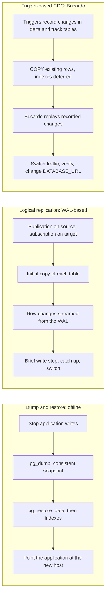

---
# Skeleton from Lead 66tamqmo (PlanetScale blog), picked 2026-11-16, drafted
# per docs/editorial/comparison-writing-guide.md. published and reviewed are the pick time (make daily may move them to a Gap Day);
# make release keeps it (ADR-0012). verified: is the Author's alone (ADR-0007).
title: "Postgres migration: dump/restore vs logical vs trigger replication"
description: "Dump and restore, logical replication or Bucardo triggers: how each moves a large Postgres database, the downtime each costs and when to pick which."
kind: comparison
vertical: databases-storage
tags: ["postgresql", "migrations", "logical-replication", "bucardo", "heroku"]
published: "2026-11-14T09:41:24Z"
verified: 2026-11-16
reviewed: "2026-11-16T10:04:38Z"
author: mira-vance
# Optional: an image HastCode may use, beside this file, replaces the
# generated title card. Never a Source's image.
# hero: option-a-vs-option-b.png
# hero_alt: "What the image shows"
# Optional: related Explainer slugs and extra sources (title + url).
# related: [metastable-failures]
---

Twelve hours into a data copy, PlanetScale's Heroku Migrator hit one row whose index entry was too large for the target's B-tree, and because [the whole copy ran in one transaction](https://planetscale.com/blog/migrate-from-heroku-to-planetscale#copy-restarting-from-zero), the next run would empty every table and start over. The migrator exists because a typical offline migration ["requires several hours of downtime"](https://planetscale.com/blog/migrate-from-heroku-to-planetscale), and because Heroku's standard tiers ["don't give you WAL access or logical replication"](https://planetscale.com/blog/migrate-from-heroku-to-planetscale#why-leaving-heroku-is-unique). The fix, building indexes after the copy instead of during it, took the copy from about 60 GB/h to nearly 300 GB/h. If you are moving a large Postgres database to a new host, you have three ways to do it: dump and restore it offline, stream it with logical replication, or capture changes with triggers, as Bucardo does. We answer the same five questions for all three (downtime, prerequisites, load on the source, copy speed and failure modes), from the PostgreSQL and Heroku documentation, Bucardo's own pages and PlanetScale's account of its migrator.

## TL;DR

- **Dump and restore** exports a consistent snapshot with `pg_dump` and rebuilds it with `pg_restore`, loading data before indexes; nothing written after the snapshot arrives, so writes stop for the whole copy.
- **Logical replication** copies each table once, then streams row changes to the new host, so writes stop only for the switch; the source must run with `wal_level = logical`, and Heroku offers logical replication only on Postgres Advanced.
- **Trigger-based CDC with Bucardo** has the source record every insert, update and delete in its own tables, copies the data, then replays the changes; it runs on standard Heroku plans but needs a key on every table and a schema freeze.
- They differ most in downtime: the whole copy, or only the switch at the end.
- We infer: dump and restore when hours offline are acceptable; logical replication whenever the source gives you WAL access; triggers when it does not, with indexes deferred and connections watched.

## One database moved three ways

All three options start the same way: the target needs the schema before it can take rows. Logical replication does not copy it, and PostgreSQL's manual points to [`pg_dump --schema-only`](https://www.postgresql.org/docs/current/logical-replication-restrictions.html#LOGICAL-REPLICATION-RESTRICTIONS) for the initial schema; PlanetScale's migrator copies the schema from [a `pg_dump --schema-only` run against Heroku](https://planetscale.com/blog/migrate-from-heroku-to-planetscale#the-heroku-migrator). Then each one bulk-loads the existing rows. The difference is what happens to the writes that arrive meanwhile.

The diagram moves one database each way. Dump and restore stops the writes, copies a snapshot and rebuilds indexes, then lets the application back in on the new host. Logical replication copies while the source keeps writing, then streams the changes until you switch. Trigger-based CDC does the same with changes captured by triggers into tables on the source. PlanetScale's post has [its own figure of the Bucardo flow](https://planetscale.com/blog/migrate-from-heroku-to-planetscale#the-heroku-migrator); ours is redrawn from the text.

## Dump and restore: one snapshot, copied while writes wait

[`pg_dump`](https://www.postgresql.org/docs/current/app-pgdump.html) "makes consistent exports even if the database is being used concurrently," and it "does not block other users accessing the database (readers or writers)." A consistent export is a snapshot, so we infer that a row written after the dump starts is not in it. That is why a migration by dump stops the application's writes first and keeps them stopped until the new host is loaded.

The archive formats (custom, directory and tar) are [restored with `pg_restore`](https://www.postgresql.org/docs/current/app-pgdump.html). Both ends can run in parallel. `pg_dump --jobs` dumps several tables at once, but only in the directory format, and opens one connection per job plus one. [`pg_restore --jobs`](https://www.postgresql.org/docs/current/app-pgrestore.html) runs "those that load data, create indexes, or create constraints" concurrently, from custom or directory archives.

Index deferral is built in. By default, the manual says, `pg_dump` uses `COPY` and [is "careful to load data before creating indexes and foreign keys"](https://www.postgresql.org/docs/current/populate.html#POPULATE-PG-DUMP). The reason is in the same chapter: ["Creating an index on pre-existing data is quicker than updating it incrementally as each row is loaded."](https://www.postgresql.org/docs/current/populate.html#POPULATE-RM-INDEXES)

## Logical replication: copy once, then stream the WAL

PostgreSQL defines [logical replication](https://www.postgresql.org/docs/current/logical-replication.html) as replicating data objects and their changes "based upon their replication identity (usually a primary key)." A source database publishes tables; the new host subscribes. When replication of a table starts, PostgreSQL copies a snapshot of its data to the subscriber, and after that, changes since the copy "are sent continually." The subscriber applies them in the publisher's order, so transactional consistency holds within one subscription. The manual lists replicating between major versions and between platforms among its uses.

It moves rows, not everything. The [restrictions](https://www.postgresql.org/docs/current/logical-replication-restrictions.html#LOGICAL-REPLICATION-RESTRICTIONS) include: "The database schema and DDL commands are not replicated," "Sequence data is not replicated," and large objects are not replicated either. Only tables, including partitioned tables, can be published.

On the source, three settings must allow it. The publisher needs [`wal_level` set to `logical`](https://www.postgresql.org/docs/current/logical-replication-config.html#LOGICAL-REPLICATION-CONFIG-PUBLISHER), `max_replication_slots` at least the number of subscriptions plus a reserve for table synchronisation, and `max_wal_senders` at least as high, plus any physical replicas. On a managed host, those are the provider's to grant. Heroku documents logical replication from a Postgres Advanced database [to an external Postgres database](https://devcenter.heroku.com/articles/logical-replication-on-heroku-postgres-advanced#use-cases), which is the migration case.

## Trigger-based CDC with Bucardo: the source records its own changes

[Bucardo](https://bucardo.org/Bucardo/) is an "asynchronous PostgreSQL replication system, allowing for multi-source, multi-target operations," released under the BSD licence. Its [overview](https://bucardo.org/Bucardo/Overview) describes a Perl daemon "that listens for NOTIFY requests and acts on them," with triggers that store which rows changed in the tables of interest.

PlanetScale's [Heroku Migrator](https://github.com/planetscale/heroku-migrator) is built on it. After the schema copy, [the migrator installs a `bucardo_delta` trigger on every source table](https://planetscale.com/blog/migrate-from-heroku-to-planetscale#the-heroku-migrator), so that "every insert, update and delete is recorded in per-table delta and track tables." A one-time `COPY` loads the existing data into PlanetScale, and then Bucardo "reads the recorded deltas and applies them." Small and medium databases can run the migrator on a Heroku dyno; larger ones, "starting from 500 GB," should use a high-performance EC2 instance.

The Lead is plain about why: triggers are ["the only change-capture mechanism available on a standard Heroku plan"](https://planetscale.com/blog/migrate-from-heroku-to-planetscale#the-heroku-migrator), and the approach ["tends to be more fragile than WAL-based replication."](https://planetscale.com/blog/migrate-from-heroku-to-planetscale#why-leaving-heroku-is-unique) Before starting, a [discovery CLI](https://planetscale.com/docs/postgres/imports/discovery-tool) collects configuration, schema and size statistics without reading row data, and [Liftoff](https://planetscale.com/blog/migrate-from-heroku-to-planetscale#before-you-migrate-the-discovery-tool-and-liftoff) turns them into an assessment in the browser. The migration ends with a step that [removes the triggers from Heroku](https://planetscale.com/blog/migrate-from-heroku-to-planetscale#the-migration-path-step-by-step).

## Downtime: the whole copy, or only the switch

**Dump and restore** keeps writes stopped from the moment `pg_dump` starts until `pg_restore` has loaded the data and built every index. PlanetScale puts a typical offline migration at [several hours of downtime](https://planetscale.com/blog/migrate-from-heroku-to-planetscale). The Lead's copy rates were measured for its migrator's `COPY`, not for `pg_dump`, but as a rough scale, we infer that 1 TB (1,000 GB) takes about 17 hours at 60 GB/h and about 3.3 hours at 300 GB/h, before any index build.

**Logical replication** copies and catches up while the source keeps taking writes. We infer the window is the switch itself: stop writes, wait for the subscriber to apply what remains, set the sequences on the target (their data is [not replicated](https://www.postgresql.org/docs/current/logical-replication-restrictions.html#LOGICAL-REPLICATION-RESTRICTIONS)), and point the application at the new host. That is the ["clean, seconds-scale cutover"](https://planetscale.com/blog/migrate-from-heroku-to-planetscale#why-leaving-heroku-is-unique) the Lead says most online migrations, built on logical replication, end on.

**Trigger-based CDC** has the same shape, and the migrator documents it step by step. [After Switch Traffic](https://planetscale.com/blog/migrate-from-heroku-to-planetscale#the-migration-path-step-by-step), "writes to Heroku will fail, while reads still work," and for a production app the Lead says to turn on Heroku maintenance mode first. Verify Migration compares the two sides; if it reports pending changes, "wait a minute and run it again." Then you point `DATABASE_URL` at PlanetScale. We infer the write outage runs from the switch until the application restarts on the new URL.

## Prerequisites: a connection, WAL access or a key on every table

**Dump and restore** needs a connection that can read every table. We infer that it works against any host you can connect to, standard Heroku plans included. A parallel dump [opens one connection per job plus one](https://www.postgresql.org/docs/current/app-pgdump.html), so `max_connections` needs headroom.

**Logical replication** needs the [publisher settings above](https://www.postgresql.org/docs/current/logical-replication-config.html#LOGICAL-REPLICATION-CONFIG-PUBLISHER), which is where Heroku's tiers part. Heroku's feature table lists Managed Logical Replication as an [Advanced-only feature](https://devcenter.heroku.com/articles/heroku-postgres-advanced#postgres-advanced-and-classic-postgres), "Not Supported" on Classic Postgres. The Lead says it has been [available on Advanced since October 2026](https://planetscale.com/blog/migrate-from-heroku-to-planetscale#why-leaving-heroku-is-unique), so a standard-plan customer would first have to move tiers: "yet another migration!" Tables need a [replica identity](https://www.postgresql.org/docs/current/logical-replication-publication.html#LOGICAL-REPLICATION-PUBLICATION-REPLICA-IDENTITY) to replicate `UPDATE` and `DELETE`: the primary key by default, another unique index, or `FULL` as a fallback, where without a suitable index the subscriber's search "can be very inefficient." Without one, those statements error on the publisher; `INSERT` proceeds regardless.

**Trigger-based CDC** asks for more and runs on less. It works on a standard Heroku plan, but in the migrator ["every replicated table needs a primary key or a unique index"](https://planetscale.com/blog/migrate-from-heroku-to-planetscale#the-heroku-migrator). The Lead describes no fallback like `FULL`; Liftoff [flags tables without either](https://planetscale.com/blog/migrate-from-heroku-to-planetscale#before-you-migrate-the-discovery-tool-and-liftoff), because trigger-based replication cannot migrate them.

## Load on the source: reads, retained WAL or extra writes

**Dump and restore** reads every table once. It does not block readers or writers, but the leader of a [parallel dump takes shared locks](https://www.postgresql.org/docs/current/app-pgdump.html) on the objects its workers will dump, so a client asking for an exclusive lock queues behind it, and that request can make the dump fail. We infer that schema changes have to wait for the dump, which matters little when writes are stopped anyway.

**Logical replication** reads each table for the initial copy and then decodes the WAL. Heroku warns that [replication slots retain WAL on the publisher](https://devcenter.heroku.com/articles/logical-replication-on-heroku-postgres-advanced#caveats-and-limitations), and a disconnected subscriber holds it "until it reconnects or drops the slot." Schema changes do not stream, so we infer that any DDL during the migration has to be applied to both sides by hand, and freezing it is simpler.

**Trigger-based CDC** adds writes. Since every insert, update and delete is [recorded in delta and track tables](https://planetscale.com/blog/migrate-from-heroku-to-planetscale#the-heroku-migrator), we infer each write on the source now writes extra rows too; the Lead gives no measurement of that overhead. Bucardo then queries those tables, running [`bucardo_delta_check()`](https://planetscale.com/blog/migrate-from-heroku-to-planetscale#the-delta_check-stall) at the start of every sync cycle. DDL is frozen outright: Bucardo's [FAQ](https://bucardo.org/Bucardo/FAQ) answers "No" to replicating schema changes, and the migrator says ["don't run any DDL on Heroku, including your framework's auto-migrations"](https://planetscale.com/blog/migrate-from-heroku-to-planetscale#the-migration-path-step-by-step), and to pause `pg_partman` maintenance too.

## Copy speed: building indexes after the rows

The one measurement in our Sources is the Lead's. With [all the indexes in place on the target](https://planetscale.com/blog/migrate-from-heroku-to-planetscale#copy-restarting-from-zero), the migrator's rate fluctuated between 50 and 100 GB/h. Its fix drops every secondary and unique index before the copy, saves their definitions and rebuilds them afterwards with parallel workers; primary keys stay. The copy went from about 60 GB/h to nearly 300 GB/h, the rebuild took about 2 hours, and the whole process ran roughly 2.5 times faster.

**Dump and restore** already works this way: it loads [data before indexes and foreign keys](https://www.postgresql.org/docs/current/populate.html#POPULATE-PG-DUMP). With `-j`, [the manual says](https://www.postgresql.org/docs/current/populate.html#POPULATE-PG-DUMP) parallel dump and restore "should give you a significantly higher performance over the serial mode." It gives no throughput figure.

**Logical replication** parallelises the initial copy across tables: [`max_sync_workers_per_subscription`](https://www.postgresql.org/docs/current/logical-replication-config.html#LOGICAL-REPLICATION-CONFIG-SUBSCRIBER) "controls the amount of parallelism of the initial data copy." No figure either. Because you create the target schema yourself, we infer you can defer secondary indexes there too, keeping the primary keys the subscriber uses to find rows. The manual's caution applies: without a unique index, ["the error checking afforded by the unique constraint will be lost"](https://www.postgresql.org/docs/current/populate.html#POPULATE-RM-INDEXES) until it is rebuilt.

**Trigger-based CDC** is the Lead's measured case. Its own guide puts the copy step at [minutes to hours depending on data size](https://planetscale.com/blog/migrate-from-heroku-to-planetscale#the-migration-path-step-by-step).

## Failure modes: what breaks and what you redo

**Dump and restore** fails safe: the source is untouched. We infer a failed restore means emptying the target and starting again while the downtime continues; `pg_restore` [cannot combine `--jobs` with `--single-transaction`](https://www.postgresql.org/docs/current/app-pgrestore.html), so a parallel restore leaves partial work behind.

**Logical replication** stops on a [conflict](https://www.postgresql.org/docs/current/logical-replication-conflicts.html#LOGICAL-REPLICATION-CONFLICTS): "If incoming data violates any constraints the replication will stop," and the user must resolve it by hand. Skipping the conflicting transaction also skips its valid changes, which "can easily make the subscriber inconsistent." Meanwhile the source keeps [retaining WAL](https://devcenter.heroku.com/articles/logical-replication-on-heroku-postgres-advanced#caveats-and-limitations) for the slot.

**Trigger-based CDC** showed the Lead three ways to break. The [one-transaction copy](https://planetscale.com/blog/migrate-from-heroku-to-planetscale#copy-restarting-from-zero) rolled back 12 hours of work on "index row size 3328 exceeds btree version 4 maximum 2704"; deferring indexes and running Bucardo with `transaction_timeout=0` addressed it. [Silent network drops](https://planetscale.com/blog/migrate-from-heroku-to-planetscale#silent-network-drops) killed one copy about 30 hours in and, on another migration, left a replication worker waiting "for a reply on a connection that looked open"; shorter keepalives turn a drop into an error in about a minute. And [`bucardo_delta_check()` could not use the track tables' index](https://planetscale.com/blog/migrate-from-heroku-to-planetscale#the-delta_check-stall), so the backlog of unreplicated changes on the source kept growing until a B-tree index on `txntime` was added to every track table.

## Trade-offs

Each cell summarises a section above, where its source is linked.

| Question | Dump and restore | Logical replication | Trigger-based CDC (Bucardo) |
|---|---|---|---|
| Downtime | Writes stop for dump, restore and index builds: hours | We infer only the switch: catch up, set sequences | The switch: writes fail on the source until verified and repointed |
| Source must offer | A connection; `max_connections` headroom for `--jobs` | `wal_level = logical`, slots, WAL senders; Advanced only on Heroku | Works on standard Heroku plans |
| Tables must have | Nothing | A replica identity for `UPDATE`/`DELETE`; `FULL` as a fallback | A primary key or unique index, no exception |
| Load on the source | One full read; shared locks queue DDL | Initial copy, then retained WAL in slots | Extra writes into delta and track tables on every change |
| Schema changes | Moot: writes are stopped | Not replicated; apply by hand or freeze | Frozen, auto-migrations and `pg_partman` paused |
| Copy speed | Data before indexes by default, parallel with `--jobs`; no figure | Parallel across tables; no figure | 50–100 GB/h with indexes; about 60 to nearly 300 GB/h deferred |
| How it fails | Source untouched; restart the restore | Stops on a conflict; skipping can desync | Copy rollback, silent drops, delta-check stalls |

## Dump, logical or trigger replication: which to use for a large Postgres move

Everything in this section is our inference from the facts above, not a benchmark.

**Dump and restore wins when you can schedule the downtime.** It needs nothing from the source but a connection, it fails safe, and a dump already loads data before indexes. Watch the arithmetic: measure your own dump and restore rate on a copy first, because the window is your whole database at that rate, plus the index builds.

**Logical replication wins whenever the source gives you WAL access.** It is the WAL-based path the Lead holds triggers up against, it needs keys only for tables that see updates or deletes, and it adds no trigger writes to the source's tables. Watch the slot's retained WAL during a long initial copy, plan the sequences for cutover, and freeze DDL. On Heroku, it means Postgres Advanced first.

**Trigger-based CDC wins when the host offers neither WAL access nor a long window,** the standard Heroku plan the migrator was built for. Fix every table without a key before you start, freeze schema changes and auto-migrations, defer secondary indexes, and set keepalives that turn a dead connection into an error. The Lead's three failures are a good check list: each one stalled or restarted a copy that had already run for hours.

Whichever you pick, the copy is the long part. Building indexes after the rows is what moved the Lead's migrator from about 60 GB/h to nearly 300, and it is the default `pg_dump` already gives you.

## Sources

- Dmitrii Anisovich, [How we migrate TBs from Heroku without logical replication](https://planetscale.com/blog/migrate-from-heroku-to-planetscale), PlanetScale blog, 11 November 2026 (intro, "Why leaving Heroku is unique", "Before you migrate", "The Heroku Migrator", "The migration path, step by step", "Three problems, three solutions").
- PlanetScale, [Heroku Migrator](https://github.com/planetscale/heroku-migrator), GitHub; [discovery tool](https://planetscale.com/docs/postgres/imports/discovery-tool) documentation; [Liftoff](https://planetscale.com/liftoff).
- PostgreSQL 18 documentation, [pg_dump](https://www.postgresql.org/docs/current/app-pgdump.html): Description, `--jobs`, `--schema-only`, `--format`.
- PostgreSQL 18 documentation, [pg_restore](https://www.postgresql.org/docs/current/app-pgrestore.html): `--jobs`, `--single-transaction`.
- PostgreSQL 18 documentation, [14.4. Populating a Database](https://www.postgresql.org/docs/current/populate.html#POPULATE-RM-INDEXES), sections 14.4.3, Remove Indexes, and 14.4.9, Some Notes about pg_dump.
- PostgreSQL 18 documentation, [Chapter 29. Logical Replication](https://www.postgresql.org/docs/current/logical-replication.html), with [29.1.1 Replica Identity](https://www.postgresql.org/docs/current/logical-replication-publication.html#LOGICAL-REPLICATION-PUBLICATION-REPLICA-IDENTITY), [29.7 Conflicts](https://www.postgresql.org/docs/current/logical-replication-conflicts.html#LOGICAL-REPLICATION-CONFLICTS), [29.8 Restrictions](https://www.postgresql.org/docs/current/logical-replication-restrictions.html#LOGICAL-REPLICATION-RESTRICTIONS) and [29.12 Configuration Settings](https://www.postgresql.org/docs/current/logical-replication-config.html#LOGICAL-REPLICATION-CONFIG-PUBLISHER) (Publishers, Subscribers).
- Heroku Dev Center, [Heroku Postgres Advanced](https://devcenter.heroku.com/articles/heroku-postgres-advanced#postgres-advanced-and-classic-postgres): feature table and Advanced-only features.
- Heroku Dev Center, [Logical Replication on Heroku Postgres Advanced](https://devcenter.heroku.com/articles/logical-replication-on-heroku-postgres-advanced#caveats-and-limitations): Use Cases, Caveats and Limitations.
- Bucardo, [project page](https://bucardo.org/Bucardo/), [Overview](https://bucardo.org/Bucardo/Overview) and [FAQ](https://bucardo.org/Bucardo/FAQ).
