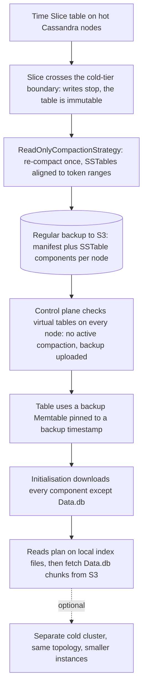

---
# Skeleton from Lead fi2xuufa (Netflix TechBlog), picked 2026-10-27.
# Follow docs/editorial/case-study-writing-guide.md; every author
# placeholder is filled in. published and reviewed are the pick time, provisional: set them
# when you publish. verified: is the Author's alone (ADR-0007).
title: "TimeSeries cold tier: how Netflix serves reads from Cassandra backups"
description: "How Netflix's TimeSeries tiers old data by reading Cassandra's own S3 backups, trading S3 latency and CPU for a fraction of the attached disk."
kind: case-study
vertical: databases-storage
tags: ["cassandra", "tiered-storage", "s3", "time-series", "netflix"]
published: "2026-10-27T17:47:15Z"
reviewed: "2026-10-27T17:47:15Z"
author: mira-vance
# Optional: an image HastCode may use, beside this file, replaces the
# generated title card. Never a Source's image.
# hero: system-name.png
# hero_alt: "What the image shows"
# Optional: related Explainer slugs and extra sources (title + url).
# related: [metastable-failures]
draft: true
---

Netflix's TimeSeries Abstraction now keeps [over 15 PB of compressed data in Cassandra cold storage](https://netflixtechblog.com/timeseries-tiered-storage-journey-kafka-flink-streams-to-native-cassandra-cold-reads-e59d597c9d60), and a chart of the rollout shows disk usage falling [from 80% to 7%](https://netflixtechblog.com/timeseries-tiered-storage-journey-kafka-flink-streams-to-native-cassandra-cold-reads-e59d597c9d60). The cold tier is not a new copy of the data. Cassandra reads it straight out of the disaster-recovery backups Netflix was already writing to S3.

> Drafted with AI assistance, researched, verified and edited by the HastCode editorial team. We publish only as many pieces as the Author can verify this way.

## TL;DR

- TimeSeries is Netflix's [platform for storing and querying temporal event data](https://netflixtechblog.com/timeseries-tiered-storage-journey-kafka-flink-streams-to-native-cassandra-cold-reads-e59d597c9d60) on Cassandra; its cold tier moves older, rarely read data to S3 behind the same query API.
- Keeping multi-petabyte datasets on hot nodes was [prohibitively expensive](https://netflixtechblog.com/timeseries-tiered-storage-journey-kafka-flink-streams-to-native-cassandra-cold-reads-e59d597c9d60), and a first cold tier built on Kafka and Flink saved money but added its own infrastructure and on-call load.
- The second design freezes a Time Slice, re-compacts it once with [ReadOnlyCompactionStrategy](https://netflixtechblog.com/timeseries-tiered-storage-journey-kafka-flink-streams-to-native-cassandra-cold-reads-e59d597c9d60), checks the backup is complete on every node, then points a custom backup Memtable at S3, keeping only small index files on local disk.
- The price is S3 latency and CPU on the read path, managed with an optional separate cold cluster. The surprise: p90 latency [improved by about 30%](https://netflixtechblog.com/timeseries-tiered-storage-journey-kafka-flink-streams-to-native-cassandra-cold-reads-e59d597c9d60) over the streaming tier.

## How a Time Slice goes from hot disk to S3-backed table

The diagram is ours, redrawn from the text of Netflix's post; Netflix's own figures are in [the original](https://netflixtechblog.com/timeseries-tiered-storage-journey-kafka-flink-streams-to-native-cassandra-cold-reads-e59d597c9d60). It follows one Time Slice, a table that holds one window of time, through the lifecycle the TimeSeries control plane [automates](https://netflixtechblog.com/timeseries-tiered-storage-journey-kafka-flink-streams-to-native-cassandra-cold-reads-e59d597c9d60): the slice turns immutable, ROCS re-compacts it, the backup is confirmed, a backup Memtable takes over, and reads go to S3.

The sections below take the problem, the first design and why Netflix moved on, then walk the diagram top to bottom and end with what it costs.

## Why petabytes on hot Cassandra nodes stopped paying

TimeSeries has become [the operational backbone for Netflix's largest datasets, which span multiple petabytes](https://netflixtechblog.com/timeseries-tiered-storage-journey-kafka-flink-streams-to-native-cassandra-cold-reads-e59d597c9d60), on hot storage [tuned for low-millisecond access](https://netflixtechblog.com/dynamically-splitting-wide-partitions-in-cassandra-for-time-series-workloads-0eded064f456). Netflix lists [five pressures](https://netflixtechblog.com/timeseries-tiered-storage-journey-kafka-flink-streams-to-native-cassandra-cold-reads-e59d597c9d60) that compound:

- **Retention keeps growing**, because users ask to keep data longer for more use cases.
- **Dense clusters cost too much** when they mostly hold history nobody reads.
- **Access is sparse.** Most queries hit recent events, but old data must stay available for audits and investigations.
- **Density hurts operations.** Packed hot nodes complicate scaling, deployment and cluster stability.
- **History still needs speed.** Some internal tools need sub-second queries on old data.

The goal Netflix set follows from that list: keep recent data on fast storage, move older data to cheaper storage, and [preserve a consistent API](https://netflixtechblog.com/timeseries-tiered-storage-journey-kafka-flink-streams-to-native-cassandra-cold-reads-e59d597c9d60) so callers never notice the move. In our reading, the last pressure rules out a data lake queried in batch: an audit tool cannot wait minutes for a scan, which we infer is why both designs serve point and range lookups.

## The first cold tier: Kafka and Flink into Parquet

The first design [streamed data to S3 in real time while also writing it to Cassandra](https://netflixtechblog.com/timeseries-tiered-storage-journey-kafka-flink-streams-to-native-cassandra-cold-reads-e59d597c9d60), using [Apache Kafka](https://kafka.apache.org/) and [Apache Flink](https://flink.apache.org/). Time Series IDs were hash-partitioned into buckets, each handled by dedicated Flink tasks, which batched events into [Parquet](https://parquet.apache.org/) files grouped by event time within the hour. Netflix notes those files suit high-throughput writes, not low-latency reads.

A daily compaction job fixed that by merging them into [one optimised daily Parquet file per namespace](https://netflixtechblog.com/timeseries-tiered-storage-journey-kafka-flink-streams-to-native-cassandra-cold-reads-e59d597c9d60). Three choices made the file readable at lookup speed:

- **Small row groups** of 4 to 8 MB, read by range from S3. Parquet's own documentation [recommends 512 MB to 1 GB](https://parquet.apache.org/docs/file-format/configurations/); Netflix went far below it on purpose, because its reads are point and range lookups, not full scans.
- **Events sorted by time** within each row group, so a time-range query skips the rest.
- **Bloom filters and file metadata cached** in [EVCache](https://netflix.github.io/EVCache/), so the query planner can skip S3 reads outright.

Once compaction finished, the files were recorded in the control plane and [the hot slices could be truncated](https://netflixtechblog.com/timeseries-tiered-storage-journey-kafka-flink-streams-to-native-cassandra-cold-reads-e59d597c9d60). On some of the largest datasets the job [typically took about 12 hours](https://netflixtechblog.com/timeseries-tiered-storage-journey-kafka-flink-streams-to-native-cassandra-cold-reads-e59d597c9d60), a choice of lower compute cost over speed.

## What the streaming tier delivered

On the read side, the TimeSeries data plane [fans a query out to the hot and cold tiers and merges the results](https://netflixtechblog.com/timeseries-tiered-storage-journey-kafka-flink-streams-to-native-cassandra-cold-reads-e59d597c9d60), behind the same query interface. Compaction metadata let the cold side prune hard: a full day of data took [at most three sequential S3 reads](https://netflixtechblog.com/timeseries-tiered-storage-journey-kafka-flink-streams-to-native-cassandra-cold-reads-e59d597c9d60), even when an ID spanned two row groups. Netflix reports [about 150 ms at p50 and about 500 ms at p99 per read](https://netflixtechblog.com/timeseries-tiered-storage-journey-kafka-flink-streams-to-native-cassandra-cold-reads-e59d597c9d60), at up to 1,250 cold reads per second globally.

It saved money, [shrinking both Cassandra's EBS footprint and its backup footprint in S3](https://netflixtechblog.com/timeseries-tiered-storage-journey-kafka-flink-streams-to-native-cassandra-cold-reads-e59d597c9d60). But it was a second storage system: Kafka, Flink jobs, a compaction job and an EVCache layer. In [Netflix's words](https://netflixtechblog.com/timeseries-tiered-storage-journey-kafka-flink-streams-to-native-cassandra-cold-reads-e59d597c9d60), the streaming infrastructure "is expensive and adds moving pieces that widen the team's on-call scope."

The lesson we draw: a tier can work and still be the wrong shape. Every cold byte was written twice, once to Cassandra and once through the stream.

## Why Netflix replaced its own working design

Netflix framed the next step as [two questions](https://netflixtechblog.com/timeseries-tiered-storage-journey-kafka-flink-streams-to-native-cassandra-cold-reads-e59d597c9d60): could it avoid streaming data into the object store and paying for that transfer, and could it cut the compute and operational overhead of new components? Those [led to](https://netflixtechblog.com/timeseries-tiered-storage-journey-kafka-flink-streams-to-native-cassandra-cold-reads-e59d597c9d60) "a more radical question: Can we read directly from existing Cassandra backups in S3?"

The deciding fact is one Netflix already had. It [backs up Cassandra to S3 at regular intervals for disaster recovery](https://netflixtechblog.com/timeseries-tiered-storage-journey-kafka-flink-streams-to-native-cassandra-cold-reads-e59d597c9d60), so the old data was already in S3, in Cassandra's own file format, at no extra transfer cost. If Cassandra could read those files once a slice stopped changing, Netflix could delete the on-disk copy with [minimal changes to the TimeSeries read path](https://netflixtechblog.com/timeseries-tiered-storage-journey-kafka-flink-streams-to-native-cassandra-cold-reads-e59d597c9d60).

The post weighs only these two designs, and in our reading the contest is about operations more than speed. The streaming tier was a parallel system to build, feed and page on; the Cassandra tier reuses the database, backup pipeline and control plane Netflix already ran. The rest of the post answers [a series of "How…?" questions](https://netflixtechblog.com/timeseries-tiered-storage-journey-kafka-flink-streams-to-native-cassandra-cold-reads-e59d597c9d60) that this idea raised.

## Step 1: the Time Slice becomes immutable

TimeSeries splits each dataset into [multiple tables, each covering a window of time it calls a Time Slice](https://netflixtechblog.com/timeseries-tiered-storage-journey-kafka-flink-streams-to-native-cassandra-cold-reads-e59d597c9d60), introduced in Netflix's [earlier TimeSeries post](https://netflixtechblog.com/introducing-netflix-timeseries-data-abstraction-layer-31552f6326f8). The slices are listed in a dedicated metadata table. The control plane creates new slices and maintains that metadata, and the data plane uses it to route reads and writes to the right table.

The property everything else depends on is that a table can [become immutable once it crosses the write boundary](https://netflixtechblog.com/timeseries-tiered-storage-journey-kafka-flink-streams-to-native-cassandra-cold-reads-e59d597c9d60). For the cold tier, once a slice crosses a user-configured cold-tier boundary, TimeSeries stops accepting writes for it.

Immutability is what makes reading from a backup safe: a snapshot of a table that still changes goes stale. Netflix encodes the guarantee in the table definition: the backup Memtable carries a timestamp that marks [the point at which the backup is guaranteed to cover the full table, and the table is guaranteed to be immutable](https://netflixtechblog.com/timeseries-tiered-storage-journey-kafka-flink-streams-to-native-cassandra-cold-reads-e59d597c9d60). We infer the design needed time-partitioned tables first, since a table that takes writes forever never stops changing.

## Step 2: ROCS lines SSTables up with token ranges

Cassandra persists data in [SSTables, "the immutable data files that Cassandra uses for persisting data on disk"](https://cassandra.apache.org/doc/4.0/cassandra/architecture/storage_engine.html#sstables). The standard compaction strategies, LCS and TWCS in Netflix's examples, [often produce SSTables that overlap in token space](https://netflixtechblog.com/timeseries-tiered-storage-journey-kafka-flink-streams-to-native-cassandra-cold-reads-e59d597c9d60), so one partition key can live in several files. A read must touch every SSTable that covers the key's token range, so one point read becomes several lookups.

On local disk that fan-out costs a few extra seeks. Against S3, we infer, each extra SSTable is another round trip at object-store latency, which is why Netflix fixed it before the move.

Netflix's fix is a new compaction strategy, [ReadOnlyCompactionStrategy (ROCS)](https://netflixtechblog.com/timeseries-tiered-storage-journey-kafka-flink-streams-to-native-cassandra-cold-reads-e59d597c9d60). Because the slice no longer takes writes, ROCS can re-compact all its SSTables once, aligning them precisely with token ranges, so, we infer, each key lives in one file. The post says ROCS now applies to all TimeSeries use cases, [driving tail latency down on all storage tiers](https://netflixtechblog.com/timeseries-tiered-storage-journey-kafka-flink-streams-to-native-cassandra-cold-reads-e59d597c9d60), hot ones included. Only after the immutable slice is optimised are backups triggered, so the files that land in S3 are the aligned ones.

## Step 3: the backup is already laid out to be read

Netflix's backups store [every node's data in S3 as a declarative manifest plus the SSTables](https://netflixtechblog.com/timeseries-tiered-storage-journey-kafka-flink-streams-to-native-cassandra-cold-reads-e59d597c9d60) behind the keyspace's tables. The layout the post shows is keyed by cluster, then by the node's ring token, with one manifest per snapshot and the SSTable files grouped by backup timestamp, keyspace, table, compression and encryption. The manifest lists the S3 path of every component of every SSTable.

That matters because an SSTable is not one file. Cassandra's documentation lists its parts: [Data.db holds "the contents of rows"](https://cassandra.apache.org/doc/4.0/cassandra/architecture/storage_engine.html#sstables), Index.db maps partition keys to positions in Data.db, Summary.db samples the index, Filter.db is a Bloom filter of the partition keys, and CompressionInfo.db records the offsets of compression chunks in Data.db.

Netflix's point is that everything except Data.db is small. Since the manifest catalogs every path, the node can [download most components, but not Data.db](https://netflixtechblog.com/timeseries-tiered-storage-journey-kafka-flink-streams-to-native-cassandra-cold-reads-e59d597c9d60), where they take negligible space and let Cassandra plan a query before it reads anything from S3. The Bloom filter rules out SSTables, the index and summary locate the partition, and the compression metadata, we infer, turns that position into the exact byte range to request.

## Step 4: the control plane checks the whole ring first

Before a table may point at a backup, Netflix [confirms two things across the whole ring](https://netflixtechblog.com/timeseries-tiered-storage-journey-kafka-flink-streams-to-native-cassandra-cold-reads-e59d597c9d60): that the ROCS re-compaction succeeded, and that the backup was fully captured. It checks both through Cassandra [virtual tables](https://cassandra.apache.org/doc/4.1/cassandra/new/virtualtables.html), which are "backed by an API instead of data explicitly managed and stored as SSTables."

The first query reads `sstable_tasks` for each host and expects no active compaction. The second reads a [`complete_backups` view](https://netflixtechblog.com/timeseries-tiered-storage-journey-kafka-flink-streams-to-native-cassandra-cold-reads-e59d597c9d60) per table and backup timestamp, which counts tokens against tokens uploaded and marks the backup `uploaded` only when they match; in Netflix's example, a backup with two of three tokens uploaded shows `False`.

Cassandra's documentation says virtual tables are ["local only, non-distributed, and thus not replicated"](https://cassandra.apache.org/doc/4.1/cassandra/new/virtualtables.html). Netflix's queries go through a `netflix_views` keyspace whose `cluster_view` returns one row per host, so we infer it is Netflix's own layer that gathers each node's local view into one cluster-wide answer.

The control plane runs this whole transition as slices cross the boundary. Netflix says [each slice can be at any lifecycle stage without affecting availability](https://netflixtechblog.com/timeseries-tiered-storage-journey-kafka-flink-streams-to-native-cassandra-cold-reads-e59d597c9d60), and the system tolerates delayed backups and lagging compactions; we infer a slice that is not ready simply waits.

## Step 5: a backup Memtable downloads everything but Data.db

A Cassandra read normally combines the [Memtable, the in-memory buffer of recent writes](https://cassandra.apache.org/doc/4.0/cassandra/architecture/storage_engine.html#memtables), with flushed SSTables on disk. Since Cassandra 4.1, [pluggable Memtables](https://cassandra.apache.org/_/blog/Apache-Cassandra-4.1-Features-Pluggable-Memtable-Implementations.html) let each table choose its Memtable implementation through a `memtable` table option. Netflix uses that hook to [redirect reads from cold tables to the backup in S3](https://netflixtechblog.com/timeseries-tiered-storage-journey-kafka-flink-streams-to-native-cassandra-cold-reads-e59d597c9d60): a Time Slice table names a custom `backupmemtable` with the backup timestamp as its parameter.

In our reading, this is the design's neatest move: an extension point for in-memory write buffers becomes the seam where a table's storage is swapped.

Opening a backup Memtable starts a [state machine that pulls the index data from S3 once](https://netflixtechblog.com/timeseries-tiered-storage-journey-kafka-flink-streams-to-native-cassandra-cold-reads-e59d597c9d60), with five safeguards:

- **Retries with exponential backoff** on every S3 operation and cache write.
- **A dedicated thread pool**, isolated from normal Cassandra work.
- **Size checks**: a component whose size does not match the manifest is deleted and fetched again.
- **A `.timestamp` file** ties a finished initialisation to its backup timestamp; if the table's timestamp changes, initialisation restarts.
- **Bounded waiting**: reads to a Memtable still initialising block for at most half the read RPC timeout.

## Step 6: a read plans locally, then fetches chunks from S3

Once every component except Data.db is on local disk, the Memtable [serves reads](https://netflixtechblog.com/timeseries-tiered-storage-journey-kafka-flink-streams-to-native-cassandra-cold-reads-e59d597c9d60). To hide S3's latency, it parallelises reads across requests, SSTables and individual chunks, and a shared cache deduplicates fetches and prefetches chunks before they are needed.

Netflix also tuned cluster and table settings to [cut the number of S3 calls](https://netflixtechblog.com/timeseries-tiered-storage-journey-kafka-flink-streams-to-native-cassandra-cold-reads-e59d597c9d60):

- **Larger compression chunks**, so a partition needs fewer, bigger reads, accepting some over-fetch on small reads.
- **Read repair off**, because the backup data is immutable and already repaired, so repair traffic would be pure cost.
- **Speculative retries off**, so S3's higher latency does not trigger redundant, overlapping reads.

In our reading, the last two protect a live, changing table and turn harmful against a frozen one in S3: a speculative retry fired because S3 is slower than disk adds load just when the tier is slowest. The general rule we infer is to revisit every safety mechanism that assumed local-disk latency.

The caller sees none of this. As in the streaming design, the TimeSeries data plane routes by slice metadata and the [read path barely changed](https://netflixtechblog.com/timeseries-tiered-storage-journey-kafka-flink-streams-to-native-cassandra-cold-reads-e59d597c9d60).

## The cost: S3 on the read path, and CPU to pay for it

The trade-off Netflix names is load. Serving data from S3 is [much more CPU-intensive than reading from local storage](https://netflixtechblog.com/timeseries-tiered-storage-journey-kafka-flink-streams-to-native-cassandra-cold-reads-e59d597c9d60), and a sudden spike in read requests could overwhelm the cluster and hurt the hot path, "turning a cost-saving feature into a reliability risk."

The answer is isolation. Cold reads can [optionally run on a separate Cassandra cluster](https://netflixtechblog.com/timeseries-tiered-storage-journey-kafka-flink-streams-to-native-cassandra-cold-reads-e59d597c9d60) whose backup Memtables point at the hot cluster's backups. It must match the hot cluster's topology but not its hardware, so it can run on smaller, cheaper, storage-light instances. Backups are laid out by node token, so we infer the topology must match so that each cold node reads exactly the token ranges its hot counterpart backed up.

The other costs are smaller: Netflix [accepts some over-fetch on small reads](https://netflixtechblog.com/timeseries-tiered-storage-journey-kafka-flink-streams-to-native-cassandra-cold-reads-e59d597c9d60) from larger compression chunks, and cold reads stay slower than hot ones. A p99 near 500 ms is, in our reading, fine for an audit tool but far from the low-millisecond hot tier.

Two costs the post does not discuss, we infer from the design. The backups are now production data, not just insurance: a backup retention or lifecycle rule that deletes old snapshots would delete readable data. And the cold tier's freshness rests on the immutability contract; a late write to a frozen slice has nowhere to go.

## The evidence, and what the post leaves out

Netflix rolled the Cassandra cold tier out to [its most storage-intensive TimeSeries clusters](https://netflixtechblog.com/timeseries-tiered-storage-journey-kafka-flink-streams-to-native-cassandra-cold-reads-e59d597c9d60). It reports:

- **Over 15 PB** of compressed data in Cassandra cold storage.
- **Attached storage cut significantly** on every affected cluster; a figure caption gives disk usage falling from 80% to 7% during the rollout.
- **Thousands of cold reads per second** in any given region; for comparison (ours, not Netflix's), the post gives the streaming tier up to 1,250 a second globally.
- **About 30% better p90 latency** than the streaming tier, credited to more efficient S3 access patterns and smaller reads, with p99 kept under about 500 ms.

Netflix adds that Cassandra's [chunk cache already absorbs bursts of cold reads](https://netflixtechblog.com/timeseries-tiered-storage-journey-kafka-flink-streams-to-native-cassandra-cold-reads-e59d597c9d60), so the S3-backed tier keeps that resilience.

The gaps, plainly: the post gives no money, before or after, and no cost for the streaming tier's infrastructure. It does not say whether the Kafka and Flink tier is retired, or give the cold cluster's size, S3 calls per read, or how often reads hit the half-timeout bound. The latency numbers come from dashboards in the post, not a published benchmark.

## What reading from backups makes possible

The design's real asset is a data model that tells the storage layer when data stops changing. Once a Time Slice is immutable, Netflix can [re-compact it once, trust a snapshot of it, and switch off machinery built for mutable tables](https://netflixtechblog.com/timeseries-tiered-storage-journey-kafka-flink-streams-to-native-cassandra-cold-reads-e59d597c9d60). Everything in the cold tier follows from that one guarantee.

The second lesson is reuse. The first cold tier duplicated work the backup pipeline already did. The second asks the database to read files it already wrote, through an [extension point Cassandra already offered](https://cassandra.apache.org/_/blog/Apache-Cassandra-4.1-Features-Pluggable-Memtable-Implementations.html), coordinated by a control plane that already tracked slices. ROCS paid off twice, lowering tail latency on hot tiers too.

If you run time-partitioned data on Cassandra or a similar LSM-tree store, the question to ask is what your backups already contain, and when your tables stop changing. If the answers are "everything" and "on a schedule", your disaster-recovery copy might also be your cold tier, as long as you treat those backups as production data, guard the immutability boundary, and keep cold reads off the hot path.

## Sources

- [TimeSeries Tiered Storage Journey: Kafka/Flink Streams to Native Cassandra Cold Reads](https://netflixtechblog.com/timeseries-tiered-storage-journey-kafka-flink-streams-to-native-cassandra-cold-reads-e59d597c9d60), Oleksii Tkachuk, Rajiv Shringi, Chris Lohfink, Abe Ratnofsky and Kartik Sathyanarayanan, Netflix TechBlog, 14 October 2026
- [Introducing Netflix's TimeSeries Data Abstraction Layer](https://netflixtechblog.com/introducing-netflix-timeseries-data-abstraction-layer-31552f6326f8), Netflix TechBlog
- [Dynamically splitting wide partitions in Cassandra for time-series workloads](https://netflixtechblog.com/dynamically-splitting-wide-partitions-in-cassandra-for-time-series-workloads-0eded064f456), Netflix TechBlog
- [Apache Cassandra 4.0 documentation: Storage Engine (memtables, SSTables and their components)](https://cassandra.apache.org/doc/4.0/cassandra/architecture/storage_engine.html#sstables)
- [Apache Cassandra 4.1 Features: Pluggable Memtable Implementations](https://cassandra.apache.org/_/blog/Apache-Cassandra-4.1-Features-Pluggable-Memtable-Implementations.html), Apache Cassandra blog
- [Apache Cassandra 4.1 documentation: Virtual Tables](https://cassandra.apache.org/doc/4.1/cassandra/new/virtualtables.html)
- [Apache Parquet: Configurations](https://parquet.apache.org/docs/file-format/configurations/)
- [EVCache](https://netflix.github.io/EVCache/), Netflix
- [Apache Kafka](https://kafka.apache.org/)
- [Apache Flink](https://flink.apache.org/)
