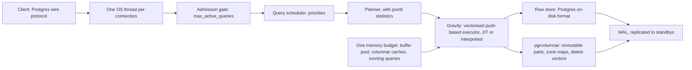

TODO(author): verify every claim against its source, then remove draft: true and this line.

pgrust's [launch post](https://malisper.me/pgrust-rebuilding-postgres-in-rust-with-ai/) says its author stopped reading most of the code the coding agents wrote; six months on, its [README](https://github.com/malisper/pgrust#testing) says 1,397 of Postgres's 3,400 user-facing functions have been proven to behave identically with Kani.

> Drafted with AI assistance, researched, verified and edited by the HastCode editorial team. We publish only as many pieces as the Author can verify this way.

## TL;DR

- pgrust is a [re-implementation of Postgres in Rust](https://github.com/malisper/pgrust#readme), wire-compatible and SQL-dialect-compatible, that reports itself as PostgreSQL 18.6.
- It re-architects the parts of Postgres that cause outages: [threads instead of processes, a query scheduler, one machine-sized memory budget](https://github.com/malisper/pgrust#implementation), plus Gravity, a vectorised, JIT-compiled executor with a [columnar table access method](https://github.com/malisper/pgrust#columnar-tables).
- The code was written mostly by AI coding agents: the [launch post](https://malisper.me/pgrust-rebuilding-postgres-in-rust-with-ai/) and a [later post](https://pgrust.com/blog/postgres-in-rust-regression-suite/) describe the author directing dozens of agents at once.
- The speed numbers are the project's own: [up to 1,600x faster than PostgreSQL on ClickBench](https://github.com/malisper/pgrust#performance) and [as much as 3x faster than ClickHouse](https://github.com/malisper/pgrust/releases/tag/v0.4-beta), measured by the project, not yet by us.
- Try it as an analytical replica or in tests. Its own README says [use Postgres if you need production Postgres today](https://github.com/malisper/pgrust#status).

## In 60 seconds

These commands come from the README's [Docker section](https://github.com/malisper/pgrust#docker), which describes the image as a drop-in replacement for the official `postgres` image: same environment variables, same `/docker-entrypoint-initdb.d` scripts, same data volume. The first starts a server; the next two connect with your own `psql` or the one in the container. Pin the tag: the README says `malisper/pgrust:latest` still points at v0.3.

```sh
docker run -d --name pgrust -e POSTGRES_PASSWORD=secret -p 5432:5432 malisper/pgrust:v0.4-beta

psql -h localhost -p 5432 -U postgres
docker exec -it pgrust psql -U postgres
```

## Architecture

Walk the diagram left to right. A client speaks the [Postgres wire protocol](https://github.com/malisper/pgrust#readme) and gets [one OS thread, not one process](https://github.com/malisper/pgrust/blob/main/docs/design/connection-scaling.md); that design doc rejects a built-in pooler and instead caps concurrent transactions with an admission gate, `max_active_queries`, fed by a bounded connection queue. A [query scheduler](https://github.com/malisper/pgrust#implementation) gives each query a priority and lowers it for long-running ones, so heavy queries interfere less with fast ones.

The planner is Postgres's, plus [statistics on the keys and values inside `jsonb` columns](https://github.com/malisper/pgrust#whats-new-in-v04-beta), which `ANALYZE` collects since v0.4-beta.

Execution is Gravity, a [vectorised, push-based executor](https://github.com/malisper/pgrust#whats-new-in-v04-beta) that compiles each plan to AArch64 or x86-64 machine code (WebAssembly in the browser build), or interprets it when compiling would not pay off. The JIT's code generator, `crates/tpde/`, is [ported from TPDE](https://github.com/malisper/pgrust#license). Parallel query uses [work stealing](https://github.com/malisper/pgrust#implementation): idle threads join queries already in flight.

Storage is two table access methods. The row store keeps Postgres's on-disk format: a data directory from [stock PostgreSQL 18 `initdb` still works](https://github.com/malisper/pgrust#building-from-source). `pgrcolumnar` stores [compressed, immutable parts with zone maps, delete vectors and background compaction](https://github.com/malisper/pgrust#whats-new-in-v04-beta); small inserts land in a row-store front that is folded into parts later. Both are written to the WAL and replicate to standbys. Over everything sits [one memory budget](https://github.com/malisper/pgrust#whats-new-in-v04-beta) for the buffer pool, the columnar caches and running queries: near the limit, pgrust cancels the statement holding the most memory instead of letting the OS kill the server. Extensions are [in-tree Rust ports, never `dlopen`](https://github.com/malisper/pgrust/blob/main/docs/design/carve-ratifications.md), because a C extension assumes a private process.



## Use it if

- You want Postgres's dialect and wire protocol for analytics on a copy of your data: the [v0.4-beta post](https://pgrust.com/blog/pgrust-v0-4-beta/) suggests analytical replicas and tests, and `pgrcolumnar` tables [are WAL-logged and replicate to standbys](https://github.com/malisper/pgrust#whats-new-in-v04-beta).
- Postgres's process-per-connection model and the OOM killer are your recurring pain: the [connection-scaling design](https://github.com/malisper/pgrust/blob/main/docs/design/connection-scaling.md) measures per-connection memory against C Postgres, and the [memory manager](https://github.com/malisper/pgrust#implementation) cancels one statement rather than lose the server.
- The extensions you need are on the [in-tree list](https://github.com/malisper/pgrust#status): pgvector, pg_cron, pg_stat_statements, pg_trgm, hstore, pgcrypto, postgres_fdw and most of contrib.
- You will measure it on your own hardware before believing a number: the README's figure is [one instance type, cold runs](https://github.com/malisper/pgrust#performance), and the [v0.2 notes](https://github.com/malisper/pgrust/releases/tag/v0.2-release) revised their own OLTP claim from 50% to 30%.

## Don't use it if

- You need production Postgres today. The README says [use Postgres](https://github.com/malisper/pgrust#status), and the [v0.3.1 release](https://github.com/malisper/pgrust/releases/tag/v0.3.1) calls pgrust still experimental and not for production.
- You depend on out-of-tree extensions or on PL/Python, PL/Perl or PL/Tcl: there is [no stable extension ABI](https://github.com/malisper/pgrust#status) and [no `dlopen`](https://github.com/malisper/pgrust/blob/main/docs/design/carve-ratifications.md). Stay on PostgreSQL.
- You need a team behind the project or an in-place upgrade path. Signals shows one contributor account; the README says it is [not accepting pull requests](https://github.com/malisper/pgrust#contributing), and [columnar tables from v0.3 must be dumped and restored](https://github.com/malisper/pgrust#whats-new-in-v04-beta) for v0.4-beta. Use PostgreSQL or a managed Postgres.
- AGPL-3.0 does not fit how you ship software: pgrust is [AGPL-3.0](https://github.com/malisper/pgrust#license); PostgreSQL's own licence is permissive.

## Alternatives

- [PostgreSQL](https://www.postgresql.org): the original, with the extension ecosystem and the process model pgrust leaves behind; pgrust's own README says to use it for production today.
- [ClickHouse](https://clickhouse.com): the column store pgrust benchmarks itself against, a purpose-built analytical database with its own SQL dialect rather than a Postgres replacement.
- [DuckDB](https://duckdb.org): an in-process analytical database for the same vectorised scan-and-aggregate workloads, embedded in your program instead of served over the Postgres wire.
- [OrioleDB](https://github.com/orioledb/orioledb): a storage engine for PostgreSQL that attacks vacuum and bloat with an undo log, as an extension to the C server rather than a rewrite.

## FAQ

### Is pgrust production ready?

No. pgrust's README says [keep Postgres as the source of truth](https://github.com/malisper/pgrust#status), the [v0.3.1 release](https://github.com/malisper/pgrust/releases/tag/v0.3.1) calls it experimental, and [pgrust.com](https://pgrust.com) says not to put data you care about in it.

### Is pgrust really faster than Postgres and ClickHouse?

Those are pgrust's own numbers: [up to 1,600x faster than PostgreSQL on ClickBench, cold runs, one instance type](https://github.com/malisper/pgrust#performance) and [up to 3x faster than ClickHouse](https://github.com/malisper/pgrust/releases/tag/v0.4-beta); the [v0.2 notes](https://github.com/malisper/pgrust/releases/tag/v0.2-release) revised an OLTP claim from 50% to 30%. We have not reproduced them.

### Was pgrust written by AI?

Mostly. pgrust's [launch post](https://malisper.me/pgrust-rebuilding-postgres-in-rust-with-ai/) says coding agents did most of the work; a [later post](https://pgrust.com/blog/postgres-in-rust-regression-suite/) describes up to 40 agents at once. Its answer is verification: [Kani proofs for 1,397 user-facing functions](https://github.com/malisper/pgrust#testing) and [11 divergences across a 164,000-case corpus](https://pgrust.com/blog/pgrust-v0-3/).

### Does pgrust support Postgres extensions?

Not out of the box: pgrust has [no stable extension ABI](https://github.com/malisper/pgrust#status). It ships in-tree ports of pgvector, pg_cron, pg_stat_statements, pg_trgm, hstore, pgcrypto, postgres_fdw and most of contrib; PL/Python, PL/Perl and PL/Tcl are not supported.

### What are the alternatives to pgrust?

The main alternatives to pgrust are PostgreSQL itself, ClickHouse and DuckDB for analytics, and OrioleDB for a vacuum-free storage engine inside Postgres.

### How is pgrust licensed?

pgrust is [AGPL-3.0](https://github.com/malisper/pgrust#license); code derived from PostgreSQL stays under the PostgreSQL License, and the JIT code generator carries TPDE's Apache-2.0 with LLVM exception.

### Who maintains pgrust?

[pgrust.com](https://pgrust.com) credits Michael Malis and Jason Seibel. GitHub shows one contributor account because the code was [developed privately until v0.4-beta](https://github.com/malisper/pgrust#developing-in-the-open); pgrust is [not accepting pull requests](https://github.com/malisper/pgrust#contributing).

## Verdict

pgrust is the most ambitious answer we have seen to "what would Postgres look like if it were built now": threads, a scheduler, one memory budget and a JIT-compiled columnar engine, wire-compatible with the original. It is also a codebase its author says was [mostly written by agents](https://malisper.me/pgrust-rebuilding-postgres-in-rust-with-ai/), developed [privately until this week](https://github.com/malisper/pgrust#developing-in-the-open), with one account in the contributor graph and [no pull requests accepted](https://github.com/malisper/pgrust#contributing). Every performance number is the project's own, from one instance type, and the [v0.2 notes](https://github.com/malisper/pgrust/releases/tag/v0.2-release) show those numbers can move. We recommend it for exactly what its README recommends: an analytical replica or a test environment beside a Postgres that stays the source of truth, for teams who can accept AGPL-3.0 and will run their own benchmarks. We would not put data we cannot lose in it. Two things would change that answer: a published, independent reproduction of the benchmarks on commodity hardware, and a year of open development with more than one pair of hands.

## Sources

- [pgrust README](https://github.com/malisper/pgrust#readme)
- [v0.4-beta release page](https://github.com/malisper/pgrust/releases/tag/v0.4-beta)
- [v0.3.1 release page](https://github.com/malisper/pgrust/releases/tag/v0.3.1)
- [v0.2 release page](https://github.com/malisper/pgrust/releases/tag/v0.2-release)
- [pgrust v0.4-beta release post](https://pgrust.com/blog/pgrust-v0-4-beta/)
- [pgrust v0.3 release post](https://pgrust.com/blog/pgrust-v0-3/)
- [Postgres in Rust: three dead ends before we passed 100% of the regression suite](https://pgrust.com/blog/postgres-in-rust-regression-suite/)
- [pgrust: Rebuilding Postgres in Rust with AI](https://malisper.me/pgrust-rebuilding-postgres-in-rust-with-ai/)
- [Design doc: connection scaling without a pooler](https://github.com/malisper/pgrust/blob/main/docs/design/connection-scaling.md)
- [Design doc: carve ratifications](https://github.com/malisper/pgrust/blob/main/docs/design/carve-ratifications.md)
- [pgrust.com](https://pgrust.com)
