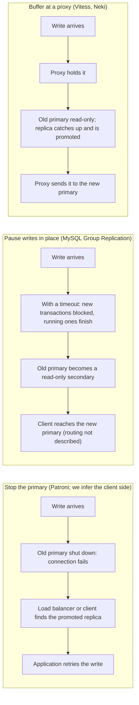

---
# Skeleton from Lead szbtnxma (PlanetScale blog), picked 2026-10-29.
# Drafted per docs/editorial/comparison-writing-guide.md. published and
# reviewed are the pick time, provisional: set them when you publish.
# verified: is the Author's alone (ADR-0007).
title: "Planned switchover: stop the primary, pause writes or buffer queries"
description: "Stopping the primary, pausing writes in place or buffering at a proxy: how each planned switchover freezes writes and what your application sees."
kind: comparison
vertical: databases-storage
tags: ["postgresql", "mysql", "vitess", "high-availability", "replication"]
published: "2026-10-29T19:47:44Z"
verified: 2026-10-29
reviewed: "2026-10-29T19:47:44Z"
author: mira-vance
# Optional: an image HastCode may use, beside this file, replaces the
# generated title card. Never a Source's image.
# hero: option-a-vs-option-b.png
# hero_alt: "What the image shows"
related: [etcd, metastable-failures]
---

PostgreSQL's own documentation recommends switching roles on purpose: [regular switching from primary to standby](https://www.postgresql.org/docs/current/warm-standby-failover.html) "allows regular downtime on each system for maintenance" and tests the failover path before you need it. PlanetScale's Shlomi Noach, describing how its Neki Postgres shards do it, names the price of every such move: a planned switchover ["comes at an unavoidable cost"](https://planetscale.com/blog/designing-a-planned-switchover-for-minimum-disruption), a window in which writes cannot reliably go to either the old or the new primary. You cannot remove that window. You choose how the old primary is frozen and where your application waits while it lasts. We compare three answers: stop the primary, pause writes in place, or hold queries at a proxy, from the PlanetScale post and the Patroni, PostgreSQL, MySQL and Vitess documentation.

> Drafted with AI assistance, researched, verified and edited by the HastCode editorial team. We publish only as many pieces as the Author can verify this way.

## TL;DR

- **Stop the primary** (Patroni's approach): a clean shutdown fixes the final write-ahead log position beyond doubt, a replica is promoted, and clients reconnect through a health-checked load balancer or a multi-host connection string.
- **Pause writes in place** (MySQL Group Replication's `group_replication_set_as_primary()`): the old primary stays up, finishes or cuts off running transactions, and becomes a read-only secondary; MySQL's page does not say how clients find the new primary.
- **Buffer at a proxy** (Vitess `PlannedReparentShard` with VTGate buffering, PlanetScale's Neki): the proxy holds queries bound for the primary, makes the old primary read-only, promotes a caught-up replica and replays the held queries there.
- They differ most in what the application sees: a failed connection (we infer), a blocked or cut-off transaction, or a slower query.
- We infer: stop the primary when simplicity matters more than seconds, pause in place when the database runs its own group, and buffer when a proxy already sits in the query path.

## One write during the switchover, three ways

All three start from the same shard: one primary that takes writes and replicas that follow it. In the Lead's terms, a switchover has [three parts](https://planetscale.com/blog/designing-a-planned-switchover-for-minimum-disruption#the-three-parts-of-a-switchover): preflight validation while the primary still serves, then convergence and promotion, then client recovery. Only the last two disrupt anything. Because the switchover is planned, none of the options needs [failure detection](https://planetscale.com/blog/designing-a-planned-switchover-for-minimum-disruption#planned-switchover-does-not-need-failure-detection): the system already knows the primary is stepping aside.

The diagram follows one write that arrives during the disruption. When the primary is stopped, we infer the write's connection fails and the client has to find the promoted replica. When writes are paused in place with a timeout, new transactions cannot start while the old primary becomes a read-only secondary. With a proxy, the write never reaches the old primary at all: the proxy holds it until the new primary is ready.

## Stop the primary: a clean shutdown, then a leader race

The Lead calls stopping Postgres on the primary [the obvious way](https://planetscale.com/blog/designing-a-planned-switchover-for-minimum-disruption#establishing-a-final-wal-position) to stop the write-ahead log (WAL) position from moving, and says Patroni, the open-source Postgres cluster manager, takes this approach. "A clean shutdown produces an unambiguous final WAL position," with nothing left to account for. Noach calls it a well-considered design that is "proven at large scale."

Patroni's [`/switchover` endpoint](https://patroni.readthedocs.io/en/latest/rest_api.html#switchover) only works when the cluster is healthy, meaning there is a leader, and can be scheduled for a given time. You may name a candidate; if you do not, "all the eligible nodes of the cluster will participate in the leader race after the leader stepped down." [`patronictl switchover`](https://patroni.readthedocs.io/en/latest/patronictl.html#patronictl-switchover) expects synchronous standbys to be available in a synchronous cluster. The race is for a [leader lock](https://patroni.readthedocs.io/en/latest/dynamic_configuration.html) held in a Distributed Configuration Store such as [etcd](https://patroni.readthedocs.io/en/latest/yaml_configuration.html#etcd); our [etcd profile](/distributed-systems/etcd/) covers its lock and election APIs.

Clients find the winner from outside the database. Patroni's REST API serves [health checks for HAProxy or any other load balancer](https://patroni.readthedocs.io/en/latest/rest_api.html#health-check-endpoints): `GET /primary` returns 200 only on the node running as primary with the leader lock. Without a load balancer, libpq accepts [several hosts and tries them in order](https://www.postgresql.org/docs/current/libpq-connect.html#LIBPQ-MULTIPLE-HOSTS), and [`target_session_attrs=read-write`](https://www.postgresql.org/docs/current/libpq-connect.html#LIBPQ-CONNECT-TARGET-SESSION-ATTRS) accepts only a server that is not in hot standby and has `default_transaction_read_only` off.

## Pause writes in place: the old primary steps down without stopping

MySQL Group Replication runs the switchover inside the group. Calling [`group_replication_set_as_primary()`](https://dev.mysql.com/doc/refman/8.4/en/group-replication-functions-for-new-primary.html) on any member makes the current primary "a read-only secondary," and the member you name "the read-write primary." The function [waits for all ongoing transactions and DML operations](https://dev.mysql.com/doc/refman/8.4/en/group-replication-functions-for-new-primary.html) to finish before electing the new primary, and in MySQL 8.4 also for running DDL such as `ALTER TABLE`.

How long it waits is up to you. The optional timeout runs [up to 3,600 seconds](https://dev.mysql.com/doc/refman/8.4/en/group-replication-functions-for-new-primary.html), and there is no default: without one, the wait has no upper limit and new transactions can keep starting. Once you set a timeout, new transactions cannot start on the primary. When it expires, sessions whose transactions have not reached their commit phase [are disconnected](https://dev.mysql.com/doc/refman/8.4/en/group-replication-change-primary.html); transactions already committing are allowed to finish. Explicit `BEGIN` transactions are blocked even if they would only read, while single statements that change nothing may still run.

The same idea can be built by hand on PostgreSQL. [`default_transaction_read_only`](https://www.postgresql.org/docs/current/runtime-config-client.html#GUC-DEFAULT-TRANSACTION-READ-ONLY) sets the read-only status of each new transaction, and [`pg_promote()`](https://www.postgresql.org/docs/current/functions-admin.html#FUNCTIONS-RECOVERY-CONTROL) promotes a standby, waiting up to 60 seconds by default. How clients reach the new primary is [not described](https://dev.mysql.com/doc/refman/8.4/en/group-replication-change-primary.html) on MySQL's change-primary page; we infer it falls to whatever routing sits in front of the group.

## Buffer at a proxy: hold the query, move the primary underneath

Vitess manages sharded MySQL, and queries reach it through [VTGate](https://vitess.io/docs/24.0/reference/features/vtgate-buffering/#how-does-it-work), where all buffering is done. Its [`PlannedReparentShard`](https://vitess.io/docs/24.0/user-guides/configuration-advanced/reparenting/#plannedreparentshard-planned-reparenting) needs both the current and the new primary up and running. It puts the current primary in read-only mode, shuts down its query service, reads its executed GTID position, waits for the primary-elect to catch up, and promotes it. Every replica, including the old primary, then follows the new one.

VTGate can [buffer queries for the duration](https://vitess.io/docs/24.0/reference/features/vtgate-buffering/#what-happens-during-a-plannedreparentshard-with-buffering): it holds anything sent to the primary, waits for the reparent, then drains the held queries to the new primary. The reparenting guide calls buffering optional but "highly recommended," and says that with the proper settings it can handle [all non-transactional queries with zero errors](https://vitess.io/docs/24.0/user-guides/configuration-advanced/reparenting/#plannedreparentshard-planned-reparenting).

The Lead's Neki works the same way on Postgres. Admin, Neki's control plane, first [asks the Routers to buffer](https://planetscale.com/blog/designing-a-planned-switchover-for-minimum-disruption#establishing-a-final-wal-position) queries that would go to the primary, then sets the primary's default for new transactions to read-only. When the switchover completes, Routers [replan each buffered query](https://planetscale.com/blog/designing-a-planned-switchover-for-minimum-disruption#what-does-the-application-see) against the new topology and send it to the new primary. Noach calls this proactive buffering: after an unplanned failure, buffering can only start once a query finds the primary gone; in a planned switchover it starts before anything changes.

## Freezing the final position: how each knows the replica has everything

A replica can be promoted safely only once it has every change the primary wrote. The hard part is that the primary keeps writing while you check.

**Stopping the primary** settles it by force: once Postgres is down, its final WAL position [cannot move](https://planetscale.com/blog/designing-a-planned-switchover-for-minimum-disruption#establishing-a-final-wal-position). Patroni bounds the stop with [`primary_stop_timeout`](https://patroni.readthedocs.io/en/latest/dynamic_configuration.html), which, with synchronous mode on, sends `SIGKILL` to the postmaster when stopping takes longer.

**Pausing in place** lets the work drain. MySQL's function [waits for ongoing transactions, DML and DDL](https://dev.mysql.com/doc/refman/8.4/en/group-replication-functions-for-new-primary.html) before the new primary is elected, and the timeout decides what happens to stragglers.

**Buffering** needs one more step, because a read-only default is not a full stop. Vitess [shuts down the old primary's query service](https://vitess.io/docs/24.0/user-guides/configuration-advanced/reparenting/#plannedreparentshard-planned-reparenting) before it reads the GTID position. Neki keeps Postgres running, and the Lead lists what still writes: [existing transactions can commit, sessions can override the default, and background processes generate WAL](https://planetscale.com/blog/designing-a-planned-switchover-for-minimum-disruption#establishing-a-final-wal-position). So Admin disconnects every other replica, records each one's last received position, takes the highest of those and the sampled primary position, and waits for the target to replay through it. With nobody else streaming, the target is the only synchronous standby still streaming, so [no further commit can be acknowledged](https://planetscale.com/blog/designing-a-planned-switchover-for-minimum-disruption#preserving-synchronous-replication) unless the target has flushed it.

## What the application sees: an error, a block or a pause

**Stopping the primary.** The sources describe the cluster side, not the client's. We infer that connections to the old primary fail when it stops, that writes fail until the load balancer's [`/primary` check](https://patroni.readthedocs.io/en/latest/rest_api.html#health-check-endpoints) passes on the new node or libpq [finds a read-write host](https://www.postgresql.org/docs/current/libpq-connect.html#LIBPQ-CONNECT-TARGET-SESSION-ATTRS), and that every client then retries at once; our piece on [metastable failures](/distributed-systems/metastable-failures/) explains why such waves need backoff and a budget.

**Pausing in place.** With a timeout set, new transactions [cannot start](https://dev.mysql.com/doc/refman/8.4/en/group-replication-change-primary.html), and at expiry sessions with uncommitted transactions are disconnected. How the client then reconnects, the page does not describe.

**Buffering.** Vitess says the application sees [a pause in query processing](https://vitess.io/docs/24.0/reference/features/vtgate-buffering/#what-the-application-sees). Transactions are the exception: they [cannot be buffered](https://vitess.io/docs/24.0/user-guides/configuration-advanced/reparenting/#plannedreparentshard-planned-reparenting) "because transaction state is held in the backing MySQL." Vitess buffers new `BEGIN`s, gives in-flight transactions a grace period, then kills the rest with an error clients should treat as fatal. Neki's promise is that the query ["took longer to complete, but did not fail because the primary changed"](https://planetscale.com/blog/designing-a-planned-switchover-for-minimum-disruption#what-does-the-application-see); reads served by replicas are unaffected, and VTGate [buffers only requests to the primary](https://vitess.io/docs/24.0/reference/features/vtgate-buffering/#types-of-queries-that-can-be-buffered).

## When the target does not catch up: how fast you can back out

A switchover can stall after the primary is frozen. The Lead's example is a target that passes every preflight check but [never replays through the final position](https://planetscale.com/blog/designing-a-planned-switchover-for-minimum-disruption#what-if-the-target-does-not-catch-up).

**Stopping the primary** makes the retreat slowest. Returning to the old primary means [starting Postgres again and perhaps rewinding it](https://planetscale.com/blog/designing-a-planned-switchover-for-minimum-disruption#establishing-a-final-wal-position), and until then "there is no primary to take writes." [`pg_rewind`](https://www.postgresql.org/docs/current/app-pgrewind.html) resynchronises a data directory whose timeline has diverged, and Patroni's [`use_pg_rewind`](https://patroni.readthedocs.io/en/latest/dynamic_configuration.html) needs data page checksums or `wal_log_hints` on.

**Pausing in place.** MySQL's change-primary page describes waiting and the timeout but [not a rollback](https://dev.mysql.com/doc/refman/8.4/en/group-replication-change-primary.html). We infer the old primary, still running, is the fallback.

**Buffering.** Neki's switchover has a deadline, and on timeout Admin can [make the old primary writable with a configuration reload](https://planetscale.com/blog/designing-a-planned-switchover-for-minimum-disruption#what-if-the-target-does-not-catch-up) and reconnect the other replicas: "This immediately restores service." Keeping that path open is why Neki [chose not to stop Postgres](https://planetscale.com/blog/designing-a-planned-switchover-for-minimum-disruption#establishing-a-final-wal-position). Vitess's reparenting guide does not describe a rollback; its buffer [stops and returns errors](https://vitess.io/docs/24.0/reference/features/vtgate-buffering/#vtgate-flags-to-enable-buffering) after `--buffer-max-failover-duration`, 20 seconds by default.

## Acknowledged commits and the limits you configure

**Stopping the primary.** Patroni replicates [asynchronously by default](https://patroni.readthedocs.io/en/latest/replication_modes.html#replication-modes), and in that mode the cluster [may lose some committed transactions](https://patroni.readthedocs.io/en/latest/replication_modes.html#asynchronous-mode-durability) to stay available. In [synchronous mode](https://patroni.readthedocs.io/en/latest/replication_modes.html#synchronous-mode) it will not promote a standby "unless it is certain that the standby contains all transactions that may have returned a successful commit status."

**Pausing in place.** Transactions that reached their commit phase [are allowed to complete](https://dev.mysql.com/doc/refman/8.4/en/group-replication-change-primary.html); the timeout is your one knob.

**Buffering.** Vitess does not depend on semi-synchronous replication [but encourages it](https://vitess.io/docs/24.0/user-guides/configuration-advanced/reparenting/#plannedreparentshard-planned-reparenting). Neki lists every eligible replica as [`ANY 1 (...)`](https://planetscale.com/blog/designing-a-planned-switchover-for-minimum-disruption#preserving-synchronous-replication), PostgreSQL's [quorum syntax](https://www.postgresql.org/docs/current/runtime-config-replication.html#GUC-SYNCHRONOUS-STANDBY-NAMES), and with `synchronous_commit = on`, every acknowledged commit is [on the target when it is promoted](https://planetscale.com/blog/designing-a-planned-switchover-for-minimum-disruption#nothing-acknowledged-is-lost). The buffer has limits. VTGate's is [off by default](https://vitess.io/docs/24.0/reference/features/vtgate-buffering/#vtgate-flags-to-enable-buffering), holds 1,000 requests, and keeps each for at most 10 seconds; client read and write timeouts should exceed the failover duration. Neki's buffer is [finite with a per-query deadline](https://planetscale.com/blog/designing-a-planned-switchover-for-minimum-disruption#what-does-the-application-see), and Admin does not wait for every Router to acknowledge it.

## Trade-offs

Each cell summarises a section above, where its source is linked.

| Question | Stop the primary | Pause writes in place | Buffer at a proxy |
|---|---|---|---|
| Example | Patroni switchover | MySQL `group_replication_set_as_primary()` | Vitess `PlannedReparentShard` + VTGate; Neki |
| Final position fixed by | Clean shutdown | Waiting for transactions, DML and DDL | Read-only, then stopping query service (Vitess) or disconnecting replicas (Neki) |
| A write sees | A failed connection, then a retry (we infer) | Blocked, or disconnected at the timeout | A pause; errors if the buffer fills or times out |
| An open transaction sees | Its connection lost (we infer) | Finished if committing, else disconnected | A grace period, then a fatal error (Vitess) |
| Clients find the new primary by | Load-balancer health check or libpq `read-write` | Not described | The proxy re-routes |
| Backing out | Restart, maybe `pg_rewind` | Not described | Neki: config reload; Vitess: not described |
| Acknowledged commits | Kept in Patroni synchronous mode | Committing transactions finish | Neki: kept under its sync policy |
| Knobs | `primary_stop_timeout` | Timeout, up to 3,600 s | Buffer size 1,000, window 10 s, 20 s max (Vitess) |

## Stop, pause or buffer: when to use each

Everything in this section is our inference from the facts above, not a benchmark.

**Stopping the primary wins when you want the fewest moving parts.** There is one unambiguous final position and less state to reason about, and Patroni with a health-checked load balancer is a well-trodden path. Watch two things: your application must retry writes cleanly after a dropped connection, and a stalled switchover leaves no writable primary until the old one is restarted, so turn on checksums or `wal_log_hints` before you need `pg_rewind`.

**Pausing in place wins when the database already coordinates its members**, as a MySQL Group Replication group does. The old primary never stops, so it stays a fallback. Always set a timeout, since without one new transactions keep arriving and the wait is unbounded, and decide in advance how clients will find the new primary.

**Buffering wins when a proxy already carries your queries**, as VTGate or Neki's Routers do. It is the only option where a plain query can see latency instead of an error. Watch transactions, which still fail in Vitess, and size the buffer and client timeouts for your peak write rate, because a full buffer returns errors.

What all three make possible is maintenance on a schedule: kernel upgrades, pod replacements and resizes without an unplanned outage.

## Sources

- Shlomi Noach, [Designing a planned switchover for minimum disruption](https://planetscale.com/blog/designing-a-planned-switchover-for-minimum-disruption), PlanetScale blog, 29 October 2026 (all sections).
- Patroni 4.1.5 documentation, [REST API](https://patroni.readthedocs.io/en/latest/rest_api.html#switchover): Health check endpoints, Switchover.
- Patroni documentation, [patronictl switchover](https://patroni.readthedocs.io/en/latest/patronictl.html#patronictl-switchover).
- Patroni documentation, [Dynamic Configuration Settings](https://patroni.readthedocs.io/en/latest/dynamic_configuration.html): `ttl`, `primary_stop_timeout`, `use_pg_rewind`.
- Patroni documentation, [Replication modes](https://patroni.readthedocs.io/en/latest/replication_modes.html#synchronous-mode): Replication modes, Asynchronous mode durability, Synchronous mode.
- Patroni documentation, [YAML Configuration Settings](https://patroni.readthedocs.io/en/latest/yaml_configuration.html#etcd): Etcd.
- PostgreSQL 18 documentation, [26.3. Failover](https://www.postgresql.org/docs/current/warm-standby-failover.html).
- PostgreSQL 18 documentation, [32.1. Database Connection Control Functions](https://www.postgresql.org/docs/current/libpq-connect.html#LIBPQ-MULTIPLE-HOSTS): Specifying Multiple Hosts, `target_session_attrs`.
- PostgreSQL 18 documentation, [19.11. Client Connection Defaults](https://www.postgresql.org/docs/current/runtime-config-client.html#GUC-DEFAULT-TRANSACTION-READ-ONLY): `default_transaction_read_only`.
- PostgreSQL 18 documentation, [19.6. Replication](https://www.postgresql.org/docs/current/runtime-config-replication.html#GUC-SYNCHRONOUS-STANDBY-NAMES): `synchronous_standby_names`.
- PostgreSQL 18 documentation, [9.28. System Administration Functions](https://www.postgresql.org/docs/current/functions-admin.html#FUNCTIONS-RECOVERY-CONTROL): Recovery Control Functions, `pg_promote`.
- PostgreSQL 18 documentation, [pg_rewind](https://www.postgresql.org/docs/current/app-pgrewind.html).
- MySQL 8.4 Reference Manual, [20.5.1.1 Changing the Primary](https://dev.mysql.com/doc/refman/8.4/en/group-replication-change-primary.html).
- MySQL 8.4 Reference Manual, [14.18.1.1 Function which Configures Group Replication Primary](https://dev.mysql.com/doc/refman/8.4/en/group-replication-functions-for-new-primary.html): `group_replication_set_as_primary()`.
- Vitess 24.0 documentation, [Reparenting](https://vitess.io/docs/24.0/user-guides/configuration-advanced/reparenting/#plannedreparentshard-planned-reparenting): MySQL requirements, PlannedReparentShard.
- Vitess 24.0 documentation, [VTGate Buffering](https://vitess.io/docs/24.0/reference/features/vtgate-buffering/): flags, Types of queries that can be buffered, What happens during a PlannedReparentShard with Buffering, How does it work, What the application sees.
