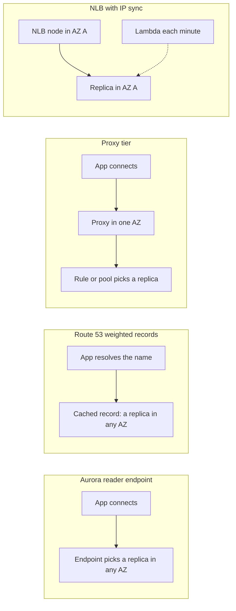

---
# Skeleton from Lead pxs4bbg7 (AWS Database Blog), picked 2026-11-23.
# Written to docs/editorial/comparison-writing-guide.md. published and reviewed are the pick time (make daily may move them to a Gap Day);
# make release keeps it (ADR-0012). verified: is the Author's alone (ADR-0007).
title: "RDS read replica load balancing: Aurora, DNS, proxy or NLB"
description: "Aurora reader endpoint, Route 53 weighted records, a proxy tier or an NLB: how each spreads RDS reads, what it costs across AZs, and which to pick."
kind: comparison
vertical: databases-storage
tags: ["aws", "rds", "read-replicas", "load-balancing", "dns"]
published: "2026-11-20T09:31:07Z"
reviewed: "2026-11-20T09:31:07Z"
author: mira-vance
# Optional: an image HastCode may use, beside this file, replaces the
# generated title card. Never a Source's image.
# hero: option-a-vs-option-b.png
# hero_alt: "What the image shows"
# Optional: related Explainer slugs and extra sources (title + url).
# related: [metastable-failures]
draft: true
---

Spread connections evenly across three RDS read replicas in three Availability Zones (AZs), and only one connection in three lands in the caller's AZ. That is the starting point of [the AWS Database Blog's cost estimate](https://aws.amazon.com/blogs/database/distribute-amazon-rds-traffic-between-read-replicas-using-network-load-balancer/#cost-estimate). At 10 GB an hour, about 7 TB a month, the other two-thirds come to "7 TB × 0.667 ≈ 4.7 TB" of inter-AZ traffic every month. The post's fix is a Network Load Balancer (NLB) whose targets a Lambda function keeps in step with the replicas' DNS names. It joins three older options: Aurora's reader endpoint, Route 53 weighted records, and a ProxySQL or PgBouncer proxy tier. Which of the four keeps a read in its AZ, balances queries rather than connections, notices a dead replica first, reaches on-premises clients and costs least to run? We answer the same questions for all four, from AWS's documentation and the proxies' own.

## TL;DR

- **Aurora's reader endpoint** balances each new connection among up to 15 Aurora Replicas with nothing extra to run, but only on Aurora, and not per query.
- **Route 53 weighted records** give one DNS name a share per replica on any RDS engine; client DNS caching skews the shares, and the records know nothing about AZs.
- **A proxy tier** puts ProxySQL or PgBouncer between application and replicas. ProxySQL can route each query and skip lagging replicas, at the price of a fleet you run.
- **An NLB with IP sync** gives any RDS engine one stable name and keeps connections in the caller's AZ. It picks up replica changes within 60 seconds, but balances connections, not queries.
- We infer: use the reader endpoint on Aurora, and the NLB when cross-AZ cost or on-premises clients matter. Pick a proxy for per-query routing or lag checks, and weighted records for a small, stable fleet.

## One read from an application in AZ A, four ways

All four start from the same fleet: read replicas, read-only copies of a DB instance, which applications connect to [just as to any DB instance](https://docs.aws.amazon.com/AmazonRDS/latest/UserGuide/USER_ReadRepl.html). They differ in who picks the replica for a new connection, and what that picker knows about AZs, DNS caches and replica health.

The diagram follows one read from an application in AZ A. Aurora's reader endpoint picks an Aurora Replica per connection, in any AZ. Route 53 returns one replica's record by weight, which resolvers cache for the record's time to live (TTL). A proxy tier takes the connection on a host in one AZ and picks the replica itself. An NLB with IP sync resolves its name to the NLB node in the caller's AZ, which forwards to a replica in that AZ. A Lambda function runs every minute to keep the NLB's targets matched to the replicas.

## Aurora reader endpoint: Aurora picks a replica per connection

"If you run Aurora, you can use its built-in reader endpoints," [the Lead](https://aws.amazon.com/blogs/database/distribute-amazon-rds-traffic-between-read-replicas-using-network-load-balancer/#aurora-reader-endpoint) begins. The [reader endpoint](https://docs.aws.amazon.com/AmazonRDS/latest/AuroraUserGuide/Aurora.Endpoints.Reader.html) "balances each connection request among the Aurora Replicas," and a cluster can have [up to 15 of them](https://docs.aws.amazon.com/AmazonRDS/latest/AuroraUserGuide/Aurora.Overview.Endpoints.html). With no healthy or available replica, it connects to the primary, and writes then work through it.

[Custom endpoints](https://docs.aws.amazon.com/AmazonRDS/latest/AuroraUserGuide/Aurora.Endpoints.Custom.html), up to five per cluster, each cover a set of DB instances you pick. They "distribute connections across instances passively, using DNS to return the IP address of one of the instances randomly."

The RDS read replica guide describes no such shared endpoint for a DB instance's read replicas.

## Route 53 weighted records: one name, a share per replica

[Weighted routing](https://docs.aws.amazon.com/Route53/latest/DeveloperGuide/routing-policy-weighted.html) (weighted DNS) lets you "link multiple resources to a single domain name" and choose each one's share. You create records with the same name and type, one per replica, each with a [weight from 0 to 255](https://docs.aws.amazon.com/Route53/latest/DeveloperGuide/resource-record-sets-values-weighted.html). Each record gets its weight's share of the group's total, and weight 0 stops traffic to it. The records can sit in a private hosted zone.

The Lead calls this ["straightforward to set up"](https://aws.amazon.com/blogs/database/distribute-amazon-rds-traffic-between-read-replicas-using-network-load-balancer/#route-53-weighted-routing), for every RDS engine, given a Route 53 hosted zone.

Two settings shape the rest. The TTL is how long recursive resolvers cache an answer, and the whole group shares one. A health check per record makes Route 53 answer with it only while its endpoint is healthy.

## Proxy tier: ProxySQL or PgBouncer between application and replicas

The Lead [groups the two](https://aws.amazon.com/blogs/database/distribute-amazon-rds-traffic-between-read-replicas-using-network-load-balancer/#connection-pooling-with-proxysql-and-pgbouncer) as open-source proxies that support read/write splitting and spread connections across replicas.

[ProxySQL](https://proxysql.com/documentation/main-runtime/mysql-tables) tests each incoming query against query rules, regular expressions over the query text or its digest, in `rule_id` order. A match can send the query to a hostgroup, a numbered set of backend servers. Within it, the default algorithm is "random-weighted" by each server's `weight`. ProxySQL speaks MySQL, and [its PostgreSQL guide](https://proxysql.com/documentation/proxysql-configuration-postgresql) says it "supports the PostgreSQL protocol."

[PgBouncer](https://www.pgbouncer.org/config.html) pools PostgreSQL connections. Its `pool_mode` returns a server connection to the pool when the client disconnects (session, the default), after each transaction, or after each statement. Since [version 1.17.0](https://www.pgbouncer.org/changelog.html), March 2022, one database entry can list several hosts, and "connections are made in a round-robin manner." Its configuration and feature pages describe no read/write routing. Our [Hyperdrive explainer](/apis-networking/cloudflare-hyperdrive-mysql-caching/) shows why a shared pool keeps database connections warm.

## NLB with IP sync: a Lambda function keeps the targets current

The [Lead's design](https://aws.amazon.com/blogs/database/distribute-amazon-rds-traffic-between-read-replicas-using-network-load-balancer/#solution-overview) makes an NLB "the stable entry point for read replica traffic," for any RDS engine with read replicas. For TCP, an NLB [picks a target by flow hash](https://docs.aws.amazon.com/elasticloadbalancing/latest/network/introduction.html), and "Each individual TCP connection is routed to a single target for the life of the connection." The targets are replica IPs, which an IP target group [accepts for databases](https://docs.aws.amazon.com/elasticloadbalancing/latest/network/load-balancer-target-groups.html).

An [EventBridge rule runs the function every minute](https://aws.amazon.com/blogs/database/distribute-amazon-rds-traffic-between-read-replicas-using-network-load-balancer/#how-it-works), or more often, so scaling, failovers and maintenance reach the targets within 60 seconds. Each run resolves the configured replica names and compares the IPs with two JSON files in S3: the last known-good IPs, and IPs pending removal with a count of runs. "Registration is immediate, while deregistration follows a cautious approach." A wrongly added IP fails its health check and gets no traffic.

## AZ affinity: only the NLB with IP sync routes by the caller's AZ

Traffic between EC2 and RDS [in the same AZ is free](https://aws.amazon.com/rds/pricing/). Across AZs, the EC2 side pays "$0.01 per GB in/out" as of November 2026, and [Aurora's pricing](https://aws.amazon.com/rds/aurora/pricing/) applies the same EC2 charges. We infer the Lead's 4.7 TB comes to roughly $47 a month, rising with read throughput. The Lead also cites lower latency for local reads.

**Aurora's reader endpoint**: its page describes no AZ preference, so we infer it spreads like the Lead's even example. We also infer that a custom endpoint listing one AZ's replicas would keep that AZ's reads local.

**Route 53 weighted records** have, in the Lead's words, "no awareness of the caller's Availability Zone."

**A proxy tier** breaks AZ affinity: "A single proxy instance is pinned to one Availability Zone," the Lead says, so reads cross into it wherever client and replica sit.

**An NLB with IP sync** is built for this. With [AZ DNS affinity](https://aws.amazon.com/blogs/database/distribute-amazon-rds-traffic-between-read-replicas-using-network-load-balancer/#key-design-decisions), clients resolving through Route 53 Resolver "receive load balancer IP addresses within their own Availability Zone." The [`dns_record.client_routing_policy`](https://docs.aws.amazon.com/elasticloadbalancing/latest/network/network-load-balancers.html#load-balancer-attributes) attribute sets 100, 85 or 0 percent zonal affinity. Cross-zone load balancing is off by default, so each NLB node serves only its own AZ's targets; the Lead says to keep it off.

## DNS caching: a cached answer pins new connections until it expires

**Aurora's** [cluster endpoint page](https://docs.aws.amazon.com/AmazonRDS/latest/AuroraUserGuide/Aurora.Endpoints.Cluster.html) warns that with pooling you should "be prepared to flush or reduce the time-to-live for any cached DNS information." AWS's [Java SDK guide](https://docs.aws.amazon.com/sdk-for-java/latest/developer-guide/jvm-ttl-dns.html) adds that the JVM caches lookups, on some configurations until restart, and recommends a 5-second TTL. We infer that a client holding a cached answer sends new connections to the same replica until it expires.

**Route 53 weighted records** carry the Lead's warning: the approach is ["prone to client-side DNS caching that causes uneven traffic distribution,"](https://aws.amazon.com/blogs/database/distribute-amazon-rds-traffic-between-read-replicas-using-network-load-balancer/#route-53-weighted-routing) eased by a low TTL. With health checks, Route 53 [asks for 60 seconds or less](https://docs.aws.amazon.com/Route53/latest/DeveloperGuide/resource-record-sets-values-weighted.html#rrsets-values-weighted-ttl).

**A proxy tier** moves the cache into the proxy. PgBouncer keeps lookups for [`dns_max_ttl`](https://www.pgbouncer.org/config.html#dns_max_ttl), 15 seconds by default, and "The actual DNS TTL is ignored." We infer the application's own cache then holds only the proxy's address.

**An NLB with IP sync** gives clients static IPs, but its name still goes through DNS. In Amazon EKS, CoreDNS answers pods' queries, and it [can break the zonal affinity](https://aws.amazon.com/blogs/database/distribute-amazon-rds-traffic-between-read-replicas-using-network-load-balancer/#considerations-and-limitations) when pod and CoreDNS node sit in different AZs. The Lead's fix is NodeLocal DNSCache.

## Connections or queries: only ProxySQL balances each query

**Aurora's reader endpoint** ["doesn't balance individual queries"](https://docs.aws.amazon.com/AmazonRDS/latest/AuroraUserGuide/Aurora.Endpoints.Reader.html). To spread each query, AWS says to "open a new connection to the reader endpoint for each query."

**Route 53 weighted records** answer a DNS lookup, not a query. We infer every query on a connection goes to the replica it resolved at connect time.

**A proxy tier** is the only place a query is routed on its own, and ProxySQL takes care. Its [read/write split guide](https://proxysql.com/documentation/proxysql-read-write-split-howto/) marks generic `^SELECT` routing "Do not use in production," since it causes "problems with transactions, session state, and consistency." The recommended path starts with everything on the primary, then moves chosen queries. PgBouncer's [host list](https://www.pgbouncer.org/config.html) "only affects how the destinations of new connections are chosen." In transaction mode a server connection is [assigned only during a transaction](https://www.pgbouncer.org/features.html), so we infer successive transactions can reach different replicas.

**An NLB with IP sync** pins each TCP connection to one target. "Note that the Network Load Balancer balances connections, not queries," the Lead says in the same limitations section, and it advises recycling connections periodically.

## A failed replica: each option detects it on a different schedule

**Aurora's** endpoints ["automatically change which DB instance they connect to"](https://docs.aws.amazon.com/AmazonRDS/latest/AuroraUserGuide/Aurora.Overview.Endpoints.html#Aurora.Overview.Endpoints.HA) when one becomes unavailable, with no timing given. During a failover, the reader endpoint "might direct connections to the new primary DB instance" briefly.

**Route 53's** [private endpoint health check](https://docs.aws.amazon.com/Route53/latest/DeveloperGuide/dns-failover-determining-health-of-endpoints.html#dns-failover-determining-health-of-endpoints-private-endpoint) sends TCP, HTTP or HTTPS requests from a source in your VPC. It runs every 30 seconds, or every 10 as [paid fast checks](https://docs.aws.amazon.com/Route53/latest/DeveloperGuide/health-checks-creating-values.html), and fails after 3 consecutive misses by default. The page shows it only with failover routing; if it serves weighted records too, we infer about 90 seconds at the standard interval, plus up to one TTL in caches.

**A proxy tier** checks for itself. ProxySQL [pings every backend](https://proxysql.com/documentation/global-variables/mysql-monitor-variables/) every 8,000 ms by default. PgBouncer's [host list](https://www.pgbouncer.org/config.html) warns that "all hosts must be available at all times," and "There are no mechanisms to skip unreachable hosts."

**An NLB with IP sync** [health-checks targets](https://docs.aws.amazon.com/elasticloadbalancing/latest/network/target-group-health-checks.html) every 30 seconds by default, from 5 to 300, and fails one after 2 misses. We infer about 60 seconds at the defaults, or 10 at the minimum. By default it [closes connections to an unhealthy target](https://docs.aws.amazon.com/elasticloadbalancing/latest/network/load-balancer-target-groups.html#target-group-attributes).

## New and lagging replicas: only ProxySQL checks replication lag

**Aurora's** endpoint pages give no timing for a new replica joining, and say nothing of lag.

**Route 53** learns of a new replica when someone adds its record. RDS does not autoscale read replicas: "You must manually create read replicas," [its guide](https://docs.aws.amazon.com/AmazonRDS/latest/UserGuide/USER_ReadRepl.html) says. We infer the record is one more step in that change.

**A proxy tier** can watch lag. For servers with `max_replication_lag` above 0, ProxySQL [checks every 10,000 ms](https://proxysql.com/documentation/global-variables/mysql-monitor-variables/#mysql-monitor_replication_lag_interval) by default and shuns a lagging server until it catches up. On Aurora, it [polls the cluster every 1,000 ms](https://proxysql.com/documentation/aws-aurora-configuration), finds new replicas in `INFORMATION_SCHEMA.REPLICA_HOST_STATUS`, and disables replicas at or over `max_lag_ms`. PgBouncer's hosts come from its configuration.

**An NLB with IP sync** registers a new IP [within 60 seconds](https://aws.amazon.com/blogs/database/distribute-amazon-rds-traffic-between-read-replicas-using-network-load-balancer/#trigger-mechanism). The function reads replica names from its configuration, so we infer a new replica's name is added there first. A removed target drains for the [deregistration delay](https://docs.aws.amazon.com/elasticloadbalancing/latest/network/load-balancer-target-groups.html#target-group-attributes), 300 seconds by default. The Lead describes no lag handling.

## On-premises clients: the NLB needs no extra DNS setup

**Aurora's** endpoint pages cited here do not discuss on-premises clients.

**Route 53 weighted records** sit in a private hosted zone, and ["On-premises clients don't natively resolve"](https://aws.amazon.com/blogs/database/distribute-amazon-rds-traffic-between-read-replicas-using-network-load-balancer/#hybrid-and-on-premises-connectivity) one. An [inbound Resolver endpoint](https://docs.aws.amazon.com/Route53/latest/DeveloperGuide/resolver-forwarding-inbound-queries.html) lets your network forward DNS queries into the VPC over Direct Connect or a VPN. Paired with on-premises forwarders, the Lead says, it adds "significant operational overhead."

**A proxy tier**: the Lead does not cover on-premises clients for it.

**An NLB with IP sync** is the Lead's answer. NLBs [accept clients](https://docs.aws.amazon.com/elasticloadbalancing/latest/network/network-load-balancers.html) over VPC peering, AWS managed VPN, Direct Connect and third-party VPNs. In the Lead, a private NLB's name resolves through public DNS to private, static IPs. Without a custom domain, "no additional DNS infrastructure, no Resolver endpoints, and no private hosted zone configuration are needed."

## What you operate: nothing extra, records, a proxy fleet or a function

**Aurora** runs the reader endpoint and its failover for you.

**Route 53 weighted records** need a hosted zone, a record and a health check per replica, with fast checks charged extra.

**A proxy tier** is a fleet: "you must deploy, patch, and scale the proxy tier yourself," the Lead says, and high availability needs more instances. PgBouncer "is [single-threaded and uses one CPU core per instance](https://www.pgbouncer.org/config.html#so_reuseport)."

**An NLB with IP sync** runs an NLB, a function, an EventBridge rule and S3 state; the Lead suggests watching Lambda errors and unhealthy targets in CloudWatch. An NLB bills [NLB Capacity Units (NLCUs)](https://aws.amazon.com/elasticloadbalancing/pricing/) on whichever of three dimensions is highest each hour. For TCP to IP targets, one NLCU is 800 new connections a second, 100,000 active ones, or 1 GB an hour. On the Lead's cost assumptions, our arithmetic:

- New connections: 500 a second ÷ 800 ≈ 0.6 NLCU.
- Active connections: 500 a second × 120 seconds ≈ 60,000 open, ÷ 100,000 = 0.6 NLCU.
- Bytes: 10 GB an hour ÷ 1 GB = 10 NLCUs, the billed dimension.

## Trade-offs

Each cell summarises a section above, where its source is linked.

| Question | Aurora reader endpoint | Route 53 weighted records | Proxy tier | NLB with IP sync |
|---|---|---|---|---|
| Engines | Aurora only | Any RDS engine | ProxySQL: MySQL, PostgreSQL; PgBouncer: PostgreSQL | Any RDS engine with read replicas |
| What it balances | Connections | Connections, through DNS | ProxySQL: queries; PgBouncer: new connections | Connections |
| AZ affinity | None described | None | Through the proxy's AZ | 85 or 100 percent, cross-zone off |
| DNS caching | Cached answers pin connections | Uneven shares; TTL 60 s or less | PgBouncer caches 15 s | Static IPs; EKS CoreDNS can break affinity |
| A failed replica | Automatic; no timing given | About 90 s, plus one TTL | ProxySQL pings every 8 s; PgBouncer cannot skip | About 60 s; 10 s at the minimum |
| A new replica | No timing given | Add a record | ProxySQL finds Aurora replicas; PgBouncer by config | Within 60 s, once configured |
| Replication lag | Not described | Not described | ProxySQL shuns lagging servers | Not handled |
| On-premises clients | Not covered | Resolver endpoint and forwarders | Not covered | One name, static IPs |
| What you run | Nothing extra | Zone, records, health checks | A proxy fleet | NLB, Lambda, EventBridge, S3 |

## Reader endpoint, weighted records, proxy or NLB: when to use each

Everything in this section is our inference from the facts above, not a benchmark.

**The Aurora reader endpoint wins when you run Aurora** and cross-AZ reads are a small part of the bill. Keep client DNS caches short, recycle long-lived connections so new replicas get load, and try a custom endpoint per AZ if cross-AZ traffic grows.

**Route 53 weighted records win for a small, stable fleet of RDS replicas** with clients in the VPC, especially when replicas differ in size. Keep the TTL at 60 seconds or less, health-check every record, and add a record whenever you add a replica.

**A proxy tier wins when routing must be per query or aware of lag**, such as an application that cannot separate reads from writes. Run more than one proxy in each AZ, and remember that PgBouncer keeps a dead host in its list.

**An NLB with IP sync wins for non-Aurora replicas across several AZs, or with on-premises clients.** Watch connections that never close, the 300-second deregistration delay and the lag it cannot see.

Before you choose, measure two things: the share of your read connections that land in another AZ, and how long your client runtime caches DNS. Those two numbers decide most of the table above.

## Sources

- Vijay Chakraborty, Debapriyo Jogi and Arun Kumar N C, [Distribute Amazon RDS traffic between read replicas using Network Load Balancer](https://aws.amazon.com/blogs/database/distribute-amazon-rds-traffic-between-read-replicas-using-network-load-balancer/), AWS Database Blog, 17 November 2026. Sections used: existing approaches, solution overview, how it works, key design decisions, cost estimate, considerations and limitations.
- Amazon Aurora User Guide: [Reader endpoints](https://docs.aws.amazon.com/AmazonRDS/latest/AuroraUserGuide/Aurora.Endpoints.Reader.html); [Endpoint connections](https://docs.aws.amazon.com/AmazonRDS/latest/AuroraUserGuide/Aurora.Overview.Endpoints.html); [Cluster endpoints](https://docs.aws.amazon.com/AmazonRDS/latest/AuroraUserGuide/Aurora.Endpoints.Cluster.html); [Custom endpoints](https://docs.aws.amazon.com/AmazonRDS/latest/AuroraUserGuide/Aurora.Endpoints.Custom.html).
- Amazon RDS User Guide, [Working with DB instance read replicas](https://docs.aws.amazon.com/AmazonRDS/latest/UserGuide/USER_ReadRepl.html).
- AWS SDK for Java developer guide, [Set the JVM TTL for DNS name lookups](https://docs.aws.amazon.com/sdk-for-java/latest/developer-guide/jvm-ttl-dns.html).
- Amazon Route 53 Developer Guide: [Weighted routing](https://docs.aws.amazon.com/Route53/latest/DeveloperGuide/routing-policy-weighted.html); [Values for weighted records](https://docs.aws.amazon.com/Route53/latest/DeveloperGuide/resource-record-sets-values-weighted.html) (Weight, TTL, health check).
- Amazon Route 53 Developer Guide: [How Route 53 determines health](https://docs.aws.amazon.com/Route53/latest/DeveloperGuide/dns-failover-determining-health-of-endpoints.html) (private endpoints); [Values for health checks](https://docs.aws.amazon.com/Route53/latest/DeveloperGuide/health-checks-creating-values.html); [Inbound DNS queries](https://docs.aws.amazon.com/Route53/latest/DeveloperGuide/resolver-forwarding-inbound-queries.html).
- ProxySQL documentation: [MySQL tables](https://proxysql.com/documentation/main-runtime/mysql-tables) (`mysql_query_rules`, `mysql_servers`); [Read/write split](https://proxysql.com/documentation/proxysql-read-write-split-howto/); [Monitor variables](https://proxysql.com/documentation/global-variables/mysql-monitor-variables/); [AWS Aurora](https://proxysql.com/documentation/aws-aurora-configuration); [PostgreSQL](https://proxysql.com/documentation/proxysql-configuration-postgresql).
- PgBouncer: [Configuration](https://www.pgbouncer.org/config.html) (`pool_mode`, `host`, `dns_max_ttl`, `so_reuseport`); [Features](https://www.pgbouncer.org/features.html); [Changelog](https://www.pgbouncer.org/changelog.html) (1.17.0).
- Elastic Load Balancing, Network Load Balancers: [Network Load Balancers](https://docs.aws.amazon.com/elasticloadbalancing/latest/network/network-load-balancers.html) (attributes, cross-zone); [Overview](https://docs.aws.amazon.com/elasticloadbalancing/latest/network/introduction.html); [Health checks](https://docs.aws.amazon.com/elasticloadbalancing/latest/network/target-group-health-checks.html); [Target groups](https://docs.aws.amazon.com/elasticloadbalancing/latest/network/load-balancer-target-groups.html) (target type, attributes).
- Pricing pages as read on 23 November 2026: [Amazon RDS](https://aws.amazon.com/rds/pricing/) and [Amazon Aurora](https://aws.amazon.com/rds/aurora/pricing/) (data transfer); [Elastic Load Balancing](https://aws.amazon.com/elasticloadbalancing/pricing/) (NLCU details).
