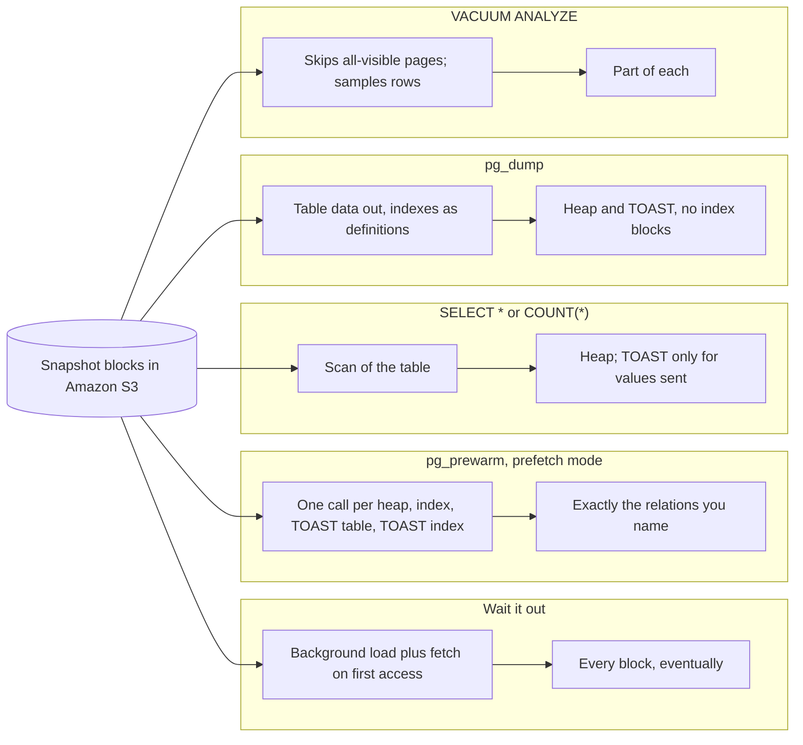

---
# Skeleton from Lead j6jsx3qt (AWS Database Blog), picked 2026-10-30.
# Drafted per docs/editorial/comparison-writing-guide.md. published and
# reviewed are the pick time, provisional: set them when you publish.
# verified: is the Author's alone (ADR-0007).
title: "RDS for PostgreSQL snapshot restore: pg_prewarm vs scans vs waiting"
description: "Waiting, pg_prewarm, scans, pg_dump or VACUUM ANALYZE after an RDS for PostgreSQL snapshot restore: what each hydrates, how fast, and which to pick."
kind: comparison
vertical: databases-storage
tags: ["postgresql", "amazon-rds", "pg-prewarm", "snapshot-restore", "aws"]
published: "2026-10-30T10:03:53Z"
reviewed: "2026-10-30T10:03:53Z"
author: mira-vance
# Optional: an image HastCode may use, beside this file, replaces the
# generated title card. Never a Source's image.
# hero: option-a-vs-option-b.png
# hero_alt: "What the image shows"
# Optional: related Explainer slugs and extra sources (title + url).
# related: [metastable-failures]
draft: true
---

AWS restored one snapshot of a 1,200 GiB PostgreSQL database to two identical db.m5.4xlarge instances. On the one where 15 parallel sessions ran `pg_prewarm`, the storage was fully hydrated in about 5 hours. The other, left alone, was 23% done after 5 hours, with more than 24 hours estimated, in [AWS's own test](https://aws.amazon.com/blogs/database/reducing-storage-initialization-impact-in-amazon-rds-for-postgresql-after-snapshot-restore/). Once prewarming finished, a large table scan took 44 seconds on the prewarmed instance and 571 seconds on the other. The gap exists because a restored volume is usable before its data has arrived: blocks come from Amazon S3 the first time something reads them. The Lead lists four ways to pull them in sooner, and waiting is the fifth. We answer the same four questions for all five (what each loads, how fast, what it costs, and how you know it worked) from AWS's post and documentation and the PostgreSQL 18 manual.

> Drafted with AI assistance, researched, verified and edited by the HastCode editorial team. We publish only as many pieces as the Author can verify this way.

## TL;DR

- **Waiting it out** costs no work: RDS loads every block in the background and fetches any block a query touches first, but AWS says affected queries can run 10x to 15x slower for hours.
- **`pg_prewarm` in `prefetch` mode** reads exactly the relations you name (heap, each index, the TOAST table and its index) with asynchronous I/O; AWS's 15 sessions took 1,200 GiB to full hydration in about 5 hours.
- **`SELECT *` or `COUNT(*)` scans and `pg_dump`** read table heaps (`pg_dump`, we infer, also every TOAST value) but no index blocks; **`VACUUM ANALYZE`** reads only part of each, and earns its place through planner statistics, not hydration.
- They differ most on indexes: apart from waiting, only `pg_prewarm` loads them all, and AWS measured only `pg_prewarm` against waiting.
- We infer: prefetch the tables and indexes your first queries need, run `ANALYZE` for statistics, let the background load finish the rest, and watch `StorageOperationPercentProgress` until it reaches 100.

## One restored table, five ways to fill it

All five options start from the same state. RDS restores a snapshot to a new instance that you can use [as soon as its status is `available`](https://docs.aws.amazon.com/AmazonRDS/latest/UserGuide/USER_RestoreFromSnapshot.html), while it "continues to load data in the background", which AWS calls lazy loading. The underlying EBS volume must download each block from S3, and until it has, it [might experience increased I/O latency and decreased performance](https://docs.aws.amazon.com/ebs/latest/userguide/initalize-volume.html). The Lead says the same applies after point-in-time recovery, read replica creation, Single-AZ to Multi-AZ conversion and Blue/Green deployments, and that Amazon EBS Fast Snapshot Restore "isn't available for RDS managed Amazon EBS volumes."

The diagram takes one table with an index and a TOAST table, which holds [values too wide for the main row, out of line](https://www.postgresql.org/docs/current/storage-toast.html#STORAGE-TOAST-ONDISK), and shows which of its parts each option pulls from S3.

## Waiting it out: RDS loads every block, eventually

Doing nothing still hydrates the volume. If a query reads data that has not arrived, [the instance downloads it from S3 immediately](https://docs.aws.amazon.com/AmazonRDS/latest/UserGuide/USER_RestoreFromSnapshot.html) and keeps loading the rest in the background. EBS reaches full performance [only once all storage blocks have been downloaded](https://docs.aws.amazon.com/ebs/latest/userguide/initalize-volume.html), and its default initialization rate "fluctuates throughout the initialization process, which could make completion times unpredictable."

The Lead quantifies the wait. Affected queries "can run 10x to 15x slower," and the window "typically lasts hours depending on storage type." In AWS's test, the instance without prewarming, which the Lead's notes call "Passive hydration only", was 23% complete after 5 hours, with more than 24 hours estimated in total.

What you get for free is completeness. The background load is not choosing tables, so we infer it eventually reaches blocks that the SQL-level methods skip unless you name them, such as non-main forks and the system catalogs. What you give up is order: nothing makes the tables your application needs first arrive first.

## pg_prewarm: name each relation and fetch it

[`pg_prewarm`](https://www.postgresql.org/docs/current/pgprewarm.html#PGPREWARM-FUNCS) is a contrib extension whose function takes a relation, a mode, a fork ("usually `main`") and an optional block range, and returns the number of blocks prewarmed. It has three modes:

- **`prefetch`** "issues asynchronous prefetch requests to the operating system, if this is supported, or throws an error otherwise."
- **`read`** reads the blocks synchronously; it is supported everywhere "but may be slower."
- **`buffer`** reads the blocks into PostgreSQL's own buffer cache.

The Lead calls `pg_prewarm` the most targeted PostgreSQL-native method and recommends `prefetch` for hydration, with `buffer` optionally on hot tables afterwards for cache warming. Its sample runs `CREATE EXTENSION IF NOT EXISTS pg_prewarm`, then four steps per table, all `prefetch` on the `main` fork: the table heap, each of its indexes, the TOAST table (found through `pg_class.reltoastrelid`) and the TOAST index (found through `pg_index`). The user needs `SELECT` privilege on the target tables.

The precision is the point and the burden. A relation you do not list is not read, so we infer you must enumerate indexes and TOAST relations yourself or they stay cold. Every TOAST table has [a unique index on `chunk_id` and `chunk_seq`](https://www.postgresql.org/docs/current/storage-toast.html#STORAGE-TOAST-ONDISK), which is why the Lead lists it as a separate step.

## SELECT * and COUNT(*): read the table the way a query would

The oldest advice is in the RDS user guide itself: for tables you need quickly, ["perform operations that involve full-table scans, such as `SELECT *`"](https://docs.aws.amazon.com/AmazonRDS/latest/UserGuide/USER_RestoreFromSnapshot.html), so RDS downloads all of the backed-up table data. It needs nothing but a connection.

The Lead's table rates these scans as hydrating the heap only, no indexes and TOAST "Partial", without explaining the TOAST rating. The PostgreSQL manual suggests why: the big values of TOASTed columns ["will only be pulled out (if selected at all) at the time the result set is sent to the client"](https://www.postgresql.org/docs/current/storage-toast.html#STORAGE-TOAST-ONDISK). We infer that `COUNT(*)` never reads the TOAST table, and `SELECT *` reads it only for rows it actually sends.

`COUNT(*)` has a second catch, also our inference. PostgreSQL can answer a query from an [index-only scan](https://www.postgresql.org/docs/current/indexes-index-only-scans.html) when the query needs only indexed columns and the heap pages' visibility-map bits are set, "without any heap access." `COUNT(*)` needs no columns at all, so on a mostly static table the planner may count from an index and leave the heap cold. Run `EXPLAIN` first and look for a sequential scan.

## pg_dump: export the data, skip the indexes

[`pg_dump`](https://www.postgresql.org/docs/current/app-pgdump.html) exports a database and "does not block other users accessing the database (readers or writers)." The Lead's table puts "All heap" in both its heap and TOAST columns and "No" for indexes, recommends it for "full database heap hydration in one operation," and gives no further detail.

The manual explains the "No" for indexes. A dump carries indexes as post-data items, which ["include definitions of indexes"](https://www.postgresql.org/docs/current/app-pgdump.html), not their contents, so we infer `pg_dump` never needs to read an index block. Table data, by contrast, is written out in full, so we infer every TOASTed value has to be fetched.

It can run in parallel. `--jobs` dumps that many tables at once, works only with the directory output format, opens "*njobs* + 1 connections," and, the manual warns, "increases the load on the database server." `--table` limits the dump to tables matching a pattern, which we infer is the way to aim it at critical tables. In a parallel dump, the leader takes `ACCESS SHARE` locks on the objects the workers will dump.

## VACUUM ANALYZE: useful for statistics, weak for hydration

The Lead is blunt: "VACUUM isn't reliable for hydration." Standard `VACUUM` typically skips pages marked as visible, so its benefit "depends entirely on the dead-tuple ratio when the snapshot was taken." A mostly static table has few dead tuples and few pages to read.

The manual gives the mechanism. `VACUUM` [skips pages based on the visibility map](https://www.postgresql.org/docs/current/sql-vacuum.html), and normally skips index vacuuming "when there are very few dead tuples in the table." It processes the TOAST table by default. We infer that is why the Lead rates heap, index and TOAST all "Partial". The `DISABLE_PAGE_SKIPPING` option turns skipping off, but the manual says it is intended only "when the contents of the visibility map are suspect," and AWS did not test it.

[`ANALYZE`](https://www.postgresql.org/docs/current/sql-analyze.html) on a large table "takes a random sample of the table contents, rather than examining every row." The sample grows with the largest statistics target, default 100. The Lead rates its hydration value "Minimal," and puts its worth elsewhere: fresh planner statistics, so queries get good plans right after the restore.

## Coverage: heap, indexes and TOAST

A table's data lives in three places a query might need: the heap, its indexes, and its TOAST table with that table's index. Each option reaches a different set.

**Waiting** reaches all of them, and everything else on the volume, once the background load completes.

**`pg_prewarm`** reaches each one you list, and nothing you do not. The Lead rates it "Targeted" in all three columns.

**`SELECT *` and `COUNT(*)`** reach the heap. TOAST is read only for values sent to the client, and indexes not at all, unless the planner picks an index-only scan, in which case we infer the index is read instead of the heap.

**`pg_dump`** reaches, we infer, every heap and TOAST block of the tables it dumps, and no index blocks.

**`VACUUM ANALYZE`** reaches part of each: heap pages that are not all-visible, indexes only when there are enough dead tuples, and a sample of rows.

The gap that matters is indexes. We infer that after a full-scan or `pg_dump` warm-up, the first index lookup on each page still waits on S3, which is the kind of query an OLTP workload runs most.

## Speed: what AWS measured on 1,200 GiB

The Lead rates `pg_prewarm` "Fast" and the other three methods "Medium", but its test measured only `pg_prewarm` against waiting. Both instances were db.m5.4xlarge on gp3 storage provisioned at 20,000 IOPS and 600 MiBps.

**Waiting**: 23% after 5 hours, more than 24 hours estimated.

**`pg_prewarm`**: about 5 hours to full hydration with 15 parallel sessions. Afterwards, a large table scan ran in 44 seconds against 571, a complex join in 123 seconds against 1,531, and ReadLatency sat at 2–3 ms against up to 40 ms. We infer the other instance was still hydrating then, since it was 23% done at 5 hours. The Lead rates `prefetch` fastest for hydration: it queues multiple I/O requests in parallel, where `read` goes one block at a time.

**Scans, `pg_dump` and `VACUUM ANALYZE`**: no measurements in the Lead.

The storage sets the ceiling for every option. On RDS for PostgreSQL, gp3 volumes of 400 GiB or more have a [baseline of 12,000 IOPS and 500 MiB/s](https://docs.aws.amazon.com/AmazonRDS/latest/UserGuide/CHAP_Storage.html#gp3-storage), provisionable to 64,000 IOPS; [io2 Block Express](https://docs.aws.amazon.com/AmazonRDS/latest/UserGuide/CHAP_Storage.html#USER_PIOPS.io2) goes to 256,000 IOPS with sub-millisecond average latency. The instance class caps it too: an instance cannot exceed its [instance-level IOPS maximum](https://docs.aws.amazon.com/AmazonRDS/latest/UserGuide/CHAP_Storage.html#baseline-max-iops-rate), whatever the volumes allow.

## Cost: what each spends while it runs

**Waiting** spends your users' time. AWS's announcement of the progress fields warns you [may notice increased I/O latency](https://aws.amazon.com/about-aws/whats-new/2026/08/amazon-rds-storage-volume-initialization-visibility) until initialization completes, and in the Lead's test the same queries took 12x to 13x as long on the instance that waited.

**`pg_prewarm`** spends latency up front. The prewarmed instance showed sustained elevated ReadLatency during prewarming, which the Lead calls "expected and intentional": paying the first-access cost in a controlled way. It also spends cache. The manual warns that prewarming more blocks than fit [evicts the earlier ones](https://www.postgresql.org/docs/current/pgprewarm.html#PGPREWARM-FUNCS), and "may also evict other data from cache."

**`SELECT *`** ships every row to a client, and **`pg_dump`** writes the whole export somewhere; we infer both pay in network transfer and client disk or CPU for data you will throw away. **`VACUUM ANALYZE`** is the cheapest, because it reads the least.

In dollars, none of the options is billed per read in what we found. Provisioned IOPS storage is [charged for the provisioned resources whether or not you use them](https://docs.aws.amazon.com/AmazonRDS/latest/UserGuide/CHAP_Storage.html#Overview.ProvisionedIOPS-cost), and on gp3 you pay for [only the additional provisioned storage performance](https://docs.aws.amazon.com/AmazonRDS/latest/UserGuide/CHAP_Storage.html#gp3-storage). EBS sells a [per-GiB Provisioned Rate for Volume Initialization](https://docs.aws.amazon.com/ebs/latest/userguide/initalize-volume.html#volume-initialization-rate) for volumes you create yourself; none of the RDS pages we read offers it.

## Knowing when you are done

RDS reports progress for the volume, not for your tables. [`DescribeDBInstances`](https://docs.aws.amazon.com/AmazonRDS/latest/UserGuide/USER_RestoreFromSnapshot.html) returns `StorageOperationStatus`, set to `Initializing` during the load, and `StorageOperationPercentProgress`; both fields are absent once initialization is complete. With additional storage volumes, the fields are [reported per volume](https://docs.aws.amazon.com/AmazonRDS/latest/UserGuide/CHAP_Storage.html#Welcome.AdditionalStorageVolumes.Monitoring). The Lead shows the same status on the console's Configuration tab and an AWS CLI query returning 65 percent.

That signal is the same whatever you run, so it is the only completion test for **waiting**, **scans**, **`pg_dump`** and **`VACUUM ANALYZE`**: none of them tells you which blocks it caused to load.

**`pg_prewarm`** gives one more receipt. Each call [returns the number of blocks prewarmed](https://www.postgresql.org/docs/current/pgprewarm.html#PGPREWARM-FUNCS), so we infer you can check a relation's count against its size and know that table was read in full, even while the volume as a whole is still below 100.

## Trade-offs

Each cell summarises a section above, where its source is linked.

| Question | Waiting | pg_prewarm | SELECT * / COUNT(*) | pg_dump | VACUUM ANALYZE |
|---|---|---|---|---|---|
| Heap | All, eventually | Tables you list | Yes | Yes | Pages not all-visible |
| Indexes | All, eventually | Indexes you list | No | No | Only with enough dead tuples |
| TOAST | All, eventually | TOAST table and index you list | Only values sent | Yes | Partial |
| AWS speed rating | Not rated | Fast | Medium | Medium | Medium |
| Measured on 1,200 GiB | 23% at 5 h, over 24 h estimated | About 5 h with 15 sessions | Not measured | Not measured | Not measured |
| Cost while it runs | Slow queries throughout | High read latency up front; cache eviction | Rows shipped to a client | Export written; extra connections with `--jobs` | Least I/O |
| Proof it worked | Volume progress only | Blocks returned per relation | Volume progress only | Volume progress only | Volume progress only |
| Other value | None needed | `buffer` mode warms the cache | Needs only a connection | A usable export | Fresh planner statistics |

## Which to run after an RDS for PostgreSQL restore

Everything in this section is our inference from the facts above, except where it cites the Lead's own recommendations.

**Waiting wins when nothing is in a hurry**: a restore for analysis, a test copy, or a replica that will not take traffic for a day. Watch `StorageOperationPercentProgress` before you send it latency-sensitive work.

**`pg_prewarm` in `prefetch` mode wins for production restores**, and it is the Lead's own recommendation. List the tables your first traffic needs, with every index, TOAST table and TOAST index, run sessions in parallel, and check each call's block count. Watch the latency you cause while it runs, and switch to `read` if `prefetch` throws an error.

**`SELECT *` scans win when you cannot install an extension** or want something any client can run. Run `EXPLAIN` first so `COUNT(*)` does not quietly read an index instead, and expect indexes to stay cold.

**`pg_dump` wins when you also want the export**, not as a hydration tool on its own. It reads data you will discard and never touches index blocks.

**`VACUUM ANALYZE` belongs in every restore runbook for its statistics**, not for hydration; the Lead recommends it for statistics refresh in production disaster recovery.

The Lead adds one choice that sits outside all five: for production disaster recovery, it recommends io1 or io2 storage for "higher throughput and reduced latency." Faster storage shortens every option here, including waiting.

## Sources

- Sandeep Modappady, Arunkumar Pattabiraman and Mahesh Thakur, [Reducing storage initialization impact in Amazon RDS for PostgreSQL after snapshot restore](https://aws.amazon.com/blogs/database/reducing-storage-initialization-impact-in-amazon-rds-for-postgresql-after-snapshot-restore/), AWS Database Blog, 14 October 2026: approaches table, `pg_prewarm` modes and sample commands, `VACUUM ANALYZE`, monitoring, test results, conclusion.
- Amazon RDS User Guide, [Restoring to a DB instance](https://docs.aws.amazon.com/AmazonRDS/latest/UserGuide/USER_RestoreFromSnapshot.html): lazy loading, full-table scans, `StorageOperationStatus` and `StorageOperationPercentProgress`.
- Amazon RDS User Guide, [Amazon RDS DB instance storage](https://docs.aws.amazon.com/AmazonRDS/latest/UserGuide/CHAP_Storage.html): gp3 storage, io2 Block Express, Provisioned IOPS storage costs, instance-level IOPS, monitoring storage operations per volume.
- AWS What's New, [Amazon RDS now provides visibility into storage volume initialization status](https://aws.amazon.com/about-aws/whats-new/2026/08/amazon-rds-storage-volume-initialization-visibility), 6 August 2026.
- Amazon EBS User Guide, [Initialize Amazon EBS volumes](https://docs.aws.amazon.com/ebs/latest/userguide/initalize-volume.html): volume initialization, Provisioned Rate for Volume Initialization and its billing.
- PostgreSQL 18 documentation, [F.30. pg_prewarm](https://www.postgresql.org/docs/current/pgprewarm.html#PGPREWARM-FUNCS), section F.30.1, Functions.
- PostgreSQL 18 documentation, [66.2. TOAST](https://www.postgresql.org/docs/current/storage-toast.html#STORAGE-TOAST-ONDISK), section 66.2.1, Out-of-Line, On-Disk TOAST Storage.
- PostgreSQL 18 documentation, [11.9. Index-Only Scans and Covering Indexes](https://www.postgresql.org/docs/current/indexes-index-only-scans.html).
- PostgreSQL 18 documentation, [pg_dump](https://www.postgresql.org/docs/current/app-pgdump.html): `--section`, `--jobs`, `--table`.
- PostgreSQL 18 documentation, [VACUUM](https://www.postgresql.org/docs/current/sql-vacuum.html): `DISABLE_PAGE_SKIPPING`, `INDEX_CLEANUP`, `PROCESS_TOAST`.
- PostgreSQL 18 documentation, [ANALYZE](https://www.postgresql.org/docs/current/sql-analyze.html), Notes.
