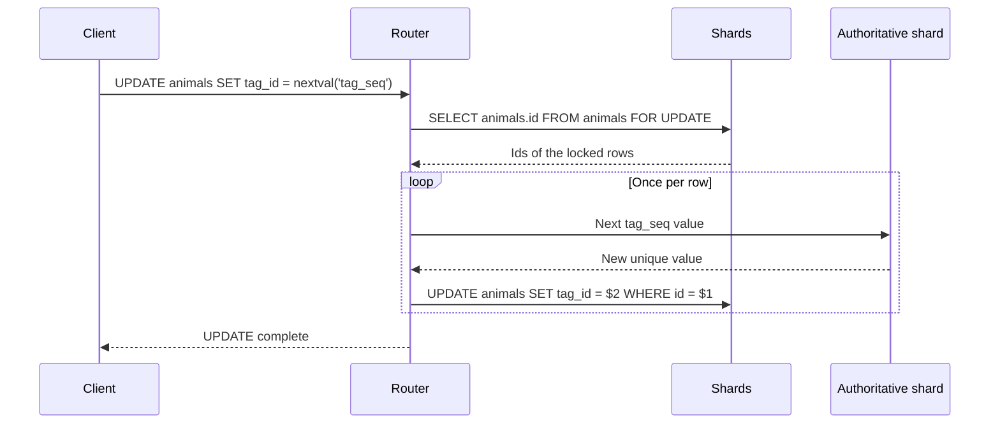

---
# Skeleton from Lead tzijl3al (PlanetScale blog), picked 2026-10-30.
# published and reviewed are the pick time, provisional: set them
# when you publish. verified: is the Author's alone (ADR-0007).
title: "Expression volatility: what a sharded SQL router can push to shards"
description: "Expression volatility tells a sharded SQL router what it may push to shards: immutable work goes down, now() runs once, nextval() runs per row."
kind: concept
vertical: databases-storage
tags: ["postgres", "sharding", "query-planning", "sequences", "neki"]
published: "2026-10-30T10:42:23Z"
verified: 2026-10-30
reviewed: "2026-10-30T10:42:23Z"
author: mira-vance
# Optional: an image HastCode may use, beside this file, replaces the
# generated title card. Never a Source's image.
# hero: concept-name.png
# hero_alt: "What the image shows"
# Optional: related Explainer slugs and extra sources (title + url).
# related: [http-connection-reuse]
---

On 14 October 2026, Mats Rydberg [walked through one short statement](https://planetscale.com/blog/neki-volatile-expressions#putting-it-all-together) on the PlanetScale blog: `UPDATE animals SET tag_id = nextval('tag_seq');`. On one Postgres server it is one statement. In [Neki](https://planetscale.com/blog/the-architecture-of-neki), PlanetScale's sharding layer for Postgres, it becomes a `SELECT animals.id FROM animals FOR UPDATE` sent to the shards, a fresh sequence value for every row that comes back, and one `UPDATE animals SET tag_id = $2 WHERE id = $1` per row, sent back to the shard that holds it. Swap `nextval('tag_seq')` for `lower(name)` and, we infer, none of that machinery is needed: the post shows immutable expressions [running on the shards](https://planetscale.com/blog/neki-volatile-expressions#putting-it-all-together). What separates the two plans is one property Postgres attaches to every expression: its volatility.

> Drafted with AI assistance, researched, verified and edited by the HastCode editorial team. We publish only as many pieces as the Author can verify this way.

## TL;DR

- **Expression volatility** is Postgres's promise about calling a function twice: an immutable function returns the same result for the same arguments ["forever"](https://www.postgresql.org/docs/current/xfunc-volatility.html), a stable one for all rows within a single statement, and a volatile one can return a different result on every call.
- In a sharded SQL router the class decides placement. In Neki, immutable work can run on the shards, `now()` is [evaluated once on the router](https://planetscale.com/blog/neki-volatile-expressions#putting-it-all-together), and `nextval()` runs on the router [once per row of the table expression](https://planetscale.com/blog/neki-volatile-expressions#table-expressions).
- It is old ground for sharded Postgres: a pg_shard issue about `now()` in modifications was opened in [May 2015 and closed in April 2016](https://github.com/citusdata/citus/issues/240), and a function created without a category is [`VOLATILE` by default](https://www.postgresql.org/docs/current/xfunc-volatility.html).
- What to do: push immutable work down, evaluate stable expressions once and keep the settings they read identical on every shard, and draw volatile values from one authority per row. The cost is router round trips and row locks on every volatile write.

## Volatility is a promise about calling a function twice

The Postgres documentation defines the three classes. A `VOLATILE` function ["can return different results on successive calls with the same arguments"](https://www.postgresql.org/docs/current/xfunc-volatility.html). A `STABLE` function cannot modify the database and is guaranteed to return the same results for the same arguments ["for all rows within a single statement"](https://www.postgresql.org/docs/current/xfunc-volatility.html). An `IMMUTABLE` function makes that guarantee forever. Postgres records the class per function in the [`provolatile` column of `pg_proc`](https://www.postgresql.org/docs/current/catalog-pg-proc.html): `i`, `s` or `v`.

Rydberg's post states the same promises in plain terms. Immutable expressions ["will produce the same output each time they operate on the same inputs"](https://planetscale.com/blog/neki-volatile-expressions#the-immutable-class); a stable one ["produces the same output within a statement"](https://planetscale.com/blog/neki-volatile-expressions#the-stable-class); a volatile one ["may produce a different output on every single invocation"](https://planetscale.com/blog/neki-volatile-expressions#enter-volatility). Postgres gives every expression one of the classes [during semantic analysis](https://planetscale.com/blog/neki-volatile-expressions#how-postgres-classifies-expressions), one of the phases of query planning.

In our words: the class tells the planner how many times it must actually run something. Immutable can be run once, even at planning time. Stable can be run once per statement. Volatile must be run every time the query asks for it.

Two things do not count. Volatility is not about side effects alone: `random()` changes nothing yet must be volatile, and any function with side effects [must be labeled `VOLATILE`](https://www.postgresql.org/docs/current/xfunc-volatility.html) so calls cannot be optimized away. And volatility says when an expression runs, not where; the next sections show why a router needs both.

## One UPDATE, traced from router to shards and back

Walk it from the top. The client talks only to the router, Neki's [single Postgres wire-protocol endpoint](https://planetscale.com/blog/the-architecture-of-neki#router), which parses and plans each query against the current sharding layout.

The router cannot hand the statement to the shards as written: sequence evaluation needs [centralized governance](https://planetscale.com/blog/neki-volatile-expressions#enter-volatility) to avoid duplicate values across shards. Neither can it fetch a batch of values first: Neki does not know how many rows each shard will return, so, in Rydberg's words, ["we cannot generate the sequence values in advance and then draw from a cache"](https://planetscale.com/blog/neki-volatile-expressions#putting-it-all-together).

So it reads first. A `SELECT animals.id FROM animals FOR UPDATE` locks the target rows [until the per-row updates arrive](https://planetscale.com/blog/neki-volatile-expressions#putting-it-all-together), and the shards return their ids to the router. For each row, the router takes a new value of `tag_seq`. The [authoritative shard](https://planetscale.com/blog/the-architecture-of-neki#shards), one per cluster, is ["the physical host for all sequences"](https://planetscale.com/blog/neki-volatile-expressions#enter-volatility). The post does not say whether those requests are batched; the diagram draws one per value. Then the router sends `UPDATE animals SET tag_id = $2 WHERE id = $1`, which the post labels [what Neki sends per row](https://planetscale.com/blog/neki-volatile-expressions#putting-it-all-together), to the shard that owns `$1`.

## Where volatility decides placement in real systems

**Neki.** Rydberg's [Query 6](https://planetscale.com/blog/neki-volatile-expressions#putting-it-all-together) puts all three classes in one select list: `age + 1` and `lower(name)` run on the shards, `now()` once on the router, and `nextval('tag_seq')` on the router per row.

**Citus.** Its predecessor, pg_shard, hit the same wall with modifications. In the 2015 thread, Jason Petersen warned: ["If that query had e.g. a `now()` call, the output might differ among replicas, resulting in data divergence."](https://github.com/citusdata/citus/issues/240) In March 2016 Andres Freund proposed ["evaluating _all_ functions on the master"](https://github.com/citusdata/citus/issues/240), so that sequences and `now()` would work; the issue closed through pull request #472 in April 2016.

**WarehousePG.** EDB's documentation for WarehousePG says a `STABLE` or `VOLATILE` function [cannot run on the segments](https://www.enterprisedb.com/docs/warehousepg/latest/ref_guide/sql_commands/CREATE_FUNCTION/) if it contains SQL or modifies the database, and that `random()` and `timeofday()` may not run on distributed data, "because they could potentially cause inconsistent data between the segment instances". Its summary is the cleanest we found: volatility indicates when a function runs, and its `EXECUTE ON` attribute indicates where.

**Vitess.** On MySQL, Vitess keeps each sequence in a table that [must live in an unsharded keyspace](https://vitess.io/docs/24.0/reference/features/vitess-sequences/#vitess-sequences). vtgate fills in the next value on insert and routes the row. The same one-authority shape, from a different database.

## Why a sharded router has to care

Pushing work down is the goal. Each Neki shard ["is its own complete database system with its own query planner"](https://planetscale.com/blog/neki-volatile-expressions#can-postgres-handle-sequences-for-us), and the post is direct: ["if we can relay the entire query to the shard, that is the best possible case"](https://planetscale.com/blog/neki-volatile-expressions#can-postgres-handle-sequences-for-us). Network transfer between router and shard is [a very large cost](https://planetscale.com/blog/neki-volatile-expressions#the-neki-case-a-distributed-query-planner), so the less raw data that crosses it, the better.

The fallback is always correct and always expensive. ["In the most general case, each shard only needs to provide raw data"](https://planetscale.com/blog/neki-volatile-expressions#the-general-case-of-neki-query-planning), and the router does the rest. For `SELECT age + 1, lower(name), now() FROM animals`, we infer, that means the router computes every column of every row.

Between those two plans sits the classification. The features that make a single Postgres server pleasant are the ones that break when copied to N servers: a transaction-wide `now()`, a session's `TimeZone`, a sequence that never repeats. On one server, we infer, they hold because there is one clock, one session and one sequence. We infer the general rule from the Neki and Citus accounts: anything whose value depends on state outside its arguments has to be pinned to one place, or N shards will each produce their own answer.

## Practice one: push immutable work down to the shards

An immutable expression gives the same answer wherever it runs, so the router can hand it to the shard holding the row. That is what Neki does with [`age + 1` and `lower(name)`](https://planetscale.com/blog/neki-volatile-expressions#the-immutable-class): the shard returns finished values, not raw columns. Postgres goes further on a single server, folding `WHERE x = 2 + 2` to [`WHERE x = 4`](https://www.postgresql.org/docs/current/xfunc-volatility.html) before the query runs.

Postgres recommends labeling each function [with the strictest volatility category that is valid](https://www.postgresql.org/docs/current/xfunc-volatility.html). For a sharded router, we infer, that label is also the licence to push the function down, so an unlabeled function, `VOLATILE` by default, stays on the router.

The cost is trusting the label. Calling a function `IMMUTABLE` when it is not can get it [folded to a constant during planning](https://www.postgresql.org/docs/current/xfunc-volatility.html) and reused stale. The docs name the common error: labeling a function `IMMUTABLE` when its results depend on a configuration parameter such as `TimeZone`. On a single server that serves a stale value; on a sharded one, we infer, it could also let each shard compute the function under its own settings.

## Practice two: evaluate now() once, and match what stable functions read

`now()` returns ["the wall clock time recorded at the start of the transaction"](https://planetscale.com/blog/neki-volatile-expressions#router-only-expressions). Postgres calls the fixed value [a feature](https://www.postgresql.org/docs/current/functions-datetime.html#FUNCTIONS-DATETIME-CURRENT): one transaction has a consistent notion of the current time, so its modifications share a timestamp.

Pushed down, that breaks: ["the natural clock drift and the different arrival times of the request would produce different values on different shards"](https://planetscale.com/blog/neki-volatile-expressions#router-only-expressions). So Neki evaluates `now()` on the router, and in Query 6 [once, one value for every outgoing row](https://planetscale.com/blog/neki-volatile-expressions#putting-it-all-together).

Other stable expressions read session settings. Rydberg's [Table 1](https://planetscale.com/blog/neki-volatile-expressions#the-stable-class) shows the same `now()` as `2026-09-09 00:00:00+00` under `TimeZone` UTC and `2026-09-09 12:00:00+12` under Pacific/Auckland. Table 2 renders `to_char('2026-09-09'::date, 'TMDay')` as Wednesday, Onsdag or 星期三 depending on `lc_time`. Neki therefore cannot push stable expressions down blindly; it [must make sure their dependencies match](https://planetscale.com/blog/neki-volatile-expressions#the-stable-class) on every shard.

The cost: the router must track session settings and keep every shard in step, and router-only expressions add work on the router. Citus's 2015 thread put the condition for `STABLE` functions plainly: allowed ["so long as we can ensure the snapshots on each replica are identical"](https://github.com/citusdata/citus/issues/240).

## Practice three: run volatile expressions once per row of the table expression

`nextval()` ["takes the name of a sequence and returns a new, unique value each time it's evaluated"](https://planetscale.com/blog/neki-volatile-expressions#enter-volatility). Postgres re-evaluates a volatile function [at every row where its value is needed](https://www.postgresql.org/docs/current/xfunc-volatility.html). So the question becomes: which rows?

The answer is the **table expression**: the `FROM`, `JOIN` and `WHERE` clauses, plus `GROUP BY` and `HAVING`, which [form one logical unit](https://planetscale.com/blog/neki-volatile-expressions#table-expressions). Each select-list expression runs once per row of it, and a volatile one [must be evaluated afresh on each row](https://planetscale.com/blog/neki-volatile-expressions#table-expressions). For `SELECT … nextval('tag_seq') FROM animals JOIN feedings ON animals.id = feedings.id`, the count is the number of joined rows.

Building that table expression is a placement question too. When the join predicate uses the shard index, each shard [assembles its part locally](https://planetscale.com/blog/neki-volatile-expressions#the-neki-case-a-distributed-query-planner); otherwise the router does. Our [sharding schemes Explainer](/distributed-systems/hash-vs-range-vs-directory-sharding/) shows which keys keep a join on one shard.

The cost lands on writes. Neki's `UPDATE` takes row locks, a sequence value per row from the authoritative shard, and one `UPDATE` per row. Vitess trades differently: its sequence owner reserves blocks of values, the `cache` column, [1,000 suggested](https://vitess.io/docs/24.0/reference/features/vitess-sequences/#initializing-a-sequence), so the backing table is written only once per block. A crash can lose the reserved block, and throughput is limited only by [RPC latency](https://vitess.io/docs/24.0/reference/features/vitess-sequences/#vitess-sequences) to that one owner.

## What volatility is not

It is not placement. `now()` is stable, yet Neki keeps it [router-only](https://planetscale.com/blog/neki-volatile-expressions#router-only-expressions) for clock reasons, and `to_char()` is stable yet, we infer, could run on a shard whose `lc_time` matches. Volatility says how often an expression may be evaluated; the router still decides where, from facts the class does not carry, such as whose clock is involved.

It is not a promise of gapless numbers. A unique value from `nextval()` is not reclaimed if the transaction aborts, so Postgres sequences [cannot be used to obtain "gapless" sequences](https://www.postgresql.org/docs/current/functions-sequence.html), and Rydberg notes the same: a sequence [does not guarantee consecutive output](https://planetscale.com/blog/neki-volatile-expressions#implementing-postgres-sequences-in-neki). Vitess says values may be ["burned"](https://vitess.io/docs/24.0/reference/features/vitess-sequences/#mysql-auto_increment-feature) by rolled-back transactions.

It is not a promise of identical results across engines. Swapping the order of `JOIN` and `WHERE` is valid, and ["it is not guaranteed that Neki and Postgres agree on the order of evaluation"](https://planetscale.com/blog/neki-volatile-expressions#the-neki-case-a-distributed-query-planner). With a volatile expression in a predicate, results can be nondeterministic and still correct.

And it is not `clock_timestamp()`. That function returns the actual current time and [changes even within a single statement](https://www.postgresql.org/docs/current/functions-datetime.html#FUNCTIONS-DATETIME-CURRENT); `now()` does not.

## What understanding volatility makes possible

You can now read a sharded plan and predict it. For any statement, list its expressions, look up each class in `pg_proc.provolatile`, and you know which columns the shards can compute, which value the router fixes once, and how many times a volatile call must run. A plan that pulls raw rows to the router for an immutable expression is a question to ask your vendor; we infer that one evaluating `nextval()` separately on each shard would risk the duplicate values Neki's router exists to prevent.

You can also design for pushdown. Label your own functions with the strictest class that is true, keep session settings such as `TimeZone` and `lc_time` uniform, and keep volatile calls out of hot write paths that would otherwise fan out one statement per row.

Rydberg ends with an exercise worth trying: how would a stable expression such as `now()` be handled in [a variation of that `UPDATE`](https://planetscale.com/blog/neki-volatile-expressions#putting-it-all-together)? If you can answer it from the three classes alone, you understand the idea. The optimistic part: with one per-function label, a router can keep Postgres's single-server promises across many servers, one transaction time and one never-repeating sequence, while pushing everything else down to where the data lives.

## Sources

- Mats Rydberg, ["Sequences and other volatiles in Neki"](https://planetscale.com/blog/neki-volatile-expressions), PlanetScale blog, 14 October 2026.
- Harshit Gangal, ["The architecture of Neki"](https://planetscale.com/blog/the-architecture-of-neki), PlanetScale blog, 18 September 2026.
- PostgreSQL, ["36.7. Function Volatility Categories"](https://www.postgresql.org/docs/current/xfunc-volatility.html), documentation.
- PostgreSQL, ["9.9.5. Current Date/Time"](https://www.postgresql.org/docs/current/functions-datetime.html#FUNCTIONS-DATETIME-CURRENT), documentation.
- PostgreSQL, ["9.17. Sequence Manipulation Functions"](https://www.postgresql.org/docs/current/functions-sequence.html), documentation.
- PostgreSQL, ["pg_proc"](https://www.postgresql.org/docs/current/catalog-pg-proc.html), system catalog documentation.
- Citus, ["Allow modification commands which don't contain unpure functions" (#240)](https://github.com/citusdata/citus/issues/240), GitHub issue.
- EDB, ["CREATE FUNCTION"](https://www.enterprisedb.com/docs/warehousepg/latest/ref_guide/sql_commands/CREATE_FUNCTION/), WarehousePG documentation.
- Vitess, ["Vitess Sequences"](https://vitess.io/docs/24.0/reference/features/vitess-sequences/), documentation.
