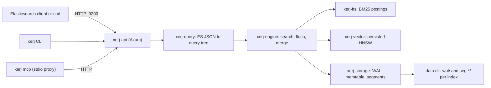

TODO(author): verify every claim against its source, then remove draft: true and this line.

XERJ ships an embedded Raft ring in the same binary as its search engine, and its own [clustering docs](https://xerj.org/docs/clustering/) answer "when not to cluster" with "today, almost always": leader election is real, replication of your data is not.

> Drafted with AI assistance, researched, verified and edited by the HastCode editorial team. We publish only as many pieces as the Author can verify this way.

## TL;DR

- XERJ is a [local-first search engine in one Rust binary](https://github.com/xerj-org/xerj#readme): BM25 full-text, dense-vector kNN and hybrid search behind an Elasticsearch-compatible REST API on port 9200, with a CLI and an MCP server for coding agents on the side.
- It is [written from scratch and shares no code with Elasticsearch or Lucene](https://github.com/xerj-org/xerj/blob/main/docs/ARCHITECTURE.md): one write-ahead log per index feeds a sharded memtable that flushes to immutable, mmap'd segments, and vectors live in a persisted HNSW graph with exact rescoring.
- Wire compatibility is the bridge, not the product: the [design rationale](https://github.com/xerj-org/xerj/blob/main/docs/WHY_XERJ.md) names an AI agent as the primary user, and `xerj autoindex <folder>` turns a folder into typed indices with no mappings to write.
- Adopt it for a single-node search box you control: code search, log analytics, RAG. Wait if you need replication, Painless scripts or whole-index scrolls: [cluster mode elects a leader but replicates no data yet](https://xerj.org/docs/clustering/).

## In 60 seconds

These commands from the top of the [README](https://github.com/xerj-org/xerj#readme) install the binary, start a development node with TLS and authentication off, register XERJ with Claude Code or Cursor, index a project and run two searches. The README calls `--insecure` a trust boundary: every caller that can reach the port is a superuser, so keep the node on a laptop and the data directory outside any folder you index.

```sh
curl -fsSL https://xerj.org/get | sh
xerj --insecure --data-dir ~/xerj-data &
xerj init                                        # wire XERJ into Claude Code/Cursor (MCP + skill), one command
xerj autoindex ~/my-project
xerj search "how do we rotate the WAL segment"   # ranked passages, file:line
xerj def "euler_to_rotationmatrix"               # go-to-definition: file:line + signature
xerj gain                                        # what it did for you — counted, not estimated
```

## Architecture

Walk the diagram left to right. Every client reaches one HTTP listener: an Elasticsearch client or `curl` on port 9200, the `xerj` CLI, or `xerj mcp`, which [speaks MCP over stdio and proxies to the node over plain HTTP](https://github.com/xerj-org/xerj#connect-an-agent-over-mcp) without starting one. `xerj-api` holds the ES-compatible handlers and a native API ([ARCHITECTURE.md](https://github.com/xerj-org/xerj/blob/main/docs/ARCHITECTURE.md)).

On a search, `xerj-query` parses the ES JSON into a query tree and `xerj-engine` [runs it against both the in-memory memtable and the on-disk segments](https://github.com/xerj-org/xerj/blob/main/docs/ARCHITECTURE.md#the-search-path), so a freshly written document is searchable at once. The vector part of a kNN or hybrid query goes to `xerj-vector`: an unfiltered cosine kNN on a field with at least 1,024 documents uses the [persisted HNSW graph with exact rescoring](https://xerj.org/docs/vectors/); filters, other metrics, quantised fields and small indices take an exact scan.

On a write, the document is [appended to the index's write-ahead log and placed in a sharded memtable](https://github.com/xerj-org/xerj/blob/main/docs/ARCHITECTURE.md#the-ingest-path); a flush drains each shard into an immutable segment with full-text and doc-values sidecars, and a background merge compacts small segments. State is one data directory with [one WAL per index and a list of immutable, mmap'd segments](https://xerj.org/docs/storage/). By default (`wal_sync = batched`) writes reach the kernel at once and are fsynced every 100 ms, so a power loss can drop the last 100 ms of acknowledged writes; `sync` matches Elasticsearch's request-level durability. On restart the engine [replays the WAL](https://github.com/xerj-org/xerj/blob/main/docs/ARCHITECTURE.md#recovery) with no external coordinator. `xerj-cluster`, an embedded Raft log for cluster metadata, [elects a leader and replicates no index data today](https://xerj.org/docs/clustering/).



## Use it if

- You want full-text, vector and hybrid search from one process with no JVM, no separate vector database and no embedding API: the [README](https://github.com/xerj-org/xerj#install-by-hand) ships one static binary for Linux, macOS and Windows, and the [default embedder runs offline](https://xerj.org/docs/vectors/).
- Your clients already speak Elasticsearch: the [conformance suite](https://github.com/xerj-org/xerj#elasticsearch-compatibility) runs the ES 8.13 REST-spec YAML tests on every commit and [gates on zero failures](https://github.com/xerj-org/xerj/blob/main/docs/ARCHITECTURE.md#wire-compatibility-and-conformance), so a change-the-URL trial costs an afternoon.
- You need an unfamiliar folder searchable fast: `xerj autoindex` [sniffs code, logs, CSV, JSON, SQLite, PDF and mail into typed indices](https://github.com/xerj-org/xerj#index-a-folder), with tree-sitter symbols and line numbers for source files.
- A coding agent is your main reader: the MCP server is the same binary, and the project's [reference-coding case study](https://xerj.org/case-studies/reference-coding.html) is a measurement to repeat on your own corpus before you believe it.

## Don't use it if

- You need a second live copy of your data. [Cluster mode elects a leader and replicates nothing](https://xerj.org/docs/clustering/): indices and documents are node-local, and the docs' own advice on clustering today is "almost always" not to. Use Elasticsearch or OpenSearch, whose replicas are the point.
- Your tooling scrolls whole indices. [Scroll is a bounded 10,000-document snapshot](https://xerj.org/docs/api-es-compat/) that refuses larger result sets with a 400; `helpers.scan()`, reindex scripts and exporters must move to `search_after`. Stay on Elasticsearch until they have.
- You depend on Painless scripts, runtime fields, ILM or cross-cluster search: the [migration page](https://xerj.org/docs/migration-from-es/) lists each as not implemented. Keep Elasticsearch, or OpenSearch for the same model under Apache-2.0.
- Your reads must hold p99 under heavy writes. The project's own [benchmark against Elasticsearch 8.13.4](https://github.com/xerj-org/xerj#benchmarks) loses four cells, all read p99 while a high-rate writer runs, and the [roadmap](https://github.com/xerj-org/xerj/blob/main/ROADMAP.md) keeps that gap on the GA gate.

## Alternatives

- [Elasticsearch](https://github.com/elastic/elasticsearch): the Lucene-based original on the JVM, with replication, Painless, ILM and the widest client ecosystem; XERJ speaks its 8.13 wire protocol but shares none of its internals.
- [OpenSearch](https://opensearch.org): the Apache-2.0 fork of Elasticsearch 7.10 started by AWS, with the same clustered Lucene architecture; choose it for the Elasticsearch model with replicas today.
- [Quickwit](https://github.com/quickwit-oss/quickwit): a Rust log-search engine on Tantivy that keeps indexes on object storage and separates indexers from searchers; built for append-only logs at scale rather than a local mixed-corpus box.
- [Meilisearch](https://github.com/meilisearch/meilisearch): a Rust engine for typo-tolerant, instant application search with its own API rather than Elasticsearch's; pick it for product and site search, not log analytics.
- [Qdrant](https://github.com/qdrant/qdrant): a Rust vector database with filtered HNSW and distributed deployment; the choice when vectors are the whole workload and you want clustering now.

## FAQ

### Is XERJ production ready?

Not where you need a second copy of the data: XERJ is still a 1.0 release candidate, its [roadmap](https://github.com/xerj-org/xerj/blob/main/ROADMAP.md) keeps a read-under-write p99 gap on the GA gate, and [replication is not shipped](https://xerj.org/docs/clustering/). On one node, a newer binary [opens an older data directory in place](https://xerj.org/docs/upgrades/), and the [latest release](https://github.com/xerj-org/xerj/releases/tag/v1.0.0-rc.98) names its own CVE-2026-97406 fix.

### How does XERJ compare to Elasticsearch?

XERJ is a from-scratch Rust binary that [shares no code with Elasticsearch or Lucene](https://github.com/xerj-org/xerj/blob/main/docs/WHY_XERJ.md) and [advertises Elasticsearch 8.13](https://xerj.org/docs/migration-from-es/) as an adoption bridge. Its own [benchmark](https://github.com/xerj-org/xerj#benchmarks) wins on ingest and disk and loses on read p99 under writes; [scrolls over 10,000 documents](https://xerj.org/docs/api-es-compat/), Painless, runtime fields and ILM are not implemented.

### Does XERJ support clustering and replication?

Partly: XERJ's [embedded Raft](https://xerj.org/docs/clustering/) elects a leader, but indices and documents stay node-local; replication is tracked in [issue #1170](https://github.com/xerj-org/xerj/issues/1170).

### Does XERJ do semantic search without an embedding API?

Yes, but the [default embedder is lexical feature hashing](https://xerj.org/docs/vectors/), not a neural model; meaning-based recall needs `--embed-mode neural` (an in-process encoder, about 90 MB on first use), chosen before you index.

### What are the alternatives to XERJ?

The main alternatives to XERJ are Elasticsearch, OpenSearch (its Apache-2.0 fork), Quickwit (Rust log search on object storage), Meilisearch (Rust application search) and Qdrant (a Rust vector database with clustering).

### How is XERJ licensed, and who maintains it?

XERJ is [Apache-2.0](https://github.com/xerj-org/xerj/blob/main/LICENSE), developed in the `xerj-org` GitHub organisation, whose own account makes most commits; [xerj.org](https://xerj.org/pricing/) sells Professional and Enterprise tiers, and code changes need a [CLA](https://github.com/xerj-org/xerj#contributing).

## Verdict

XERJ is a more serious search engine than its agent-first marketing suggests: a from-scratch Rust storage stack with a per-index WAL, immutable mmap'd segments, its own BM25 postings and a persisted HNSW graph, behind an Elasticsearch API that gates the upstream conformance suite on zero failures, with its limits written down more plainly than most projects manage. We recommend it for a single-node search box you control: code and document search, log analytics and RAG, where one binary and no embedding service matter more than replicas. We would not move a production Elasticsearch cluster onto it: there is no replication, scroll is capped, and the project's own benchmark loses on read p99 under write load. Shipped document replication, or a 1.0 with the "known partials" list closed, would change that answer; so would an independent benchmark, since every number above is the project's own.

## Sources

- [XERJ README](https://github.com/xerj-org/xerj#readme)
- [XERJ architecture document (docs/ARCHITECTURE.md)](https://github.com/xerj-org/xerj/blob/main/docs/ARCHITECTURE.md)
- [Why XERJ: design rationale (docs/WHY_XERJ.md)](https://github.com/xerj-org/xerj/blob/main/docs/WHY_XERJ.md)
- [XERJ roadmap (ROADMAP.md)](https://github.com/xerj-org/xerj/blob/main/ROADMAP.md)
- [XERJ docs: Storage & WAL](https://xerj.org/docs/storage/)
- [XERJ docs: Clustering](https://xerj.org/docs/clustering/)
- [XERJ docs: Vectors & kNN](https://xerj.org/docs/vectors/)
- [XERJ docs: ES-compatible API](https://xerj.org/docs/api-es-compat/)
- [XERJ docs: Migrate from Elasticsearch](https://xerj.org/docs/migration-from-es/)
- [XERJ docs: Upgrades](https://xerj.org/docs/upgrades/)
- [XERJ pricing and editions](https://xerj.org/pricing/)
- [Reference coding case study](https://xerj.org/case-studies/reference-coding.html)
- [v1.0.0-rc.98 release page](https://github.com/xerj-org/xerj/releases/tag/v1.0.0-rc.98)
