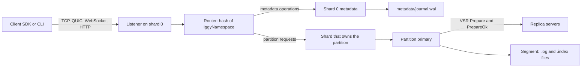

TODO(author): verify every claim against its source, then remove draft: true and this line.

Apache Iggy's 0.9.0 release put [Viewstamped Replication](https://iggy.apache.org/blogs/2026/09/21/release-0.9.0) into the same `iggy-server` binary that runs a single node, and one configuration key, [`cluster.enabled`](https://github.com/apache/iggy#clustering), decides which one you get.

> Drafted with AI assistance, researched, verified and edited by the HastCode editorial team. We publish only as many pieces as the Author can verify this way.

## TL;DR

- Apache Iggy is a [persistent, append-only message streaming log written in Rust](https://github.com/apache/iggy#what-is-apache-iggy): streams group topics, topics split into partitions, and consumer groups read them, over QUIC, WebSocket, TCP or HTTP.
- It is [built from the ground up, not on top of Kafka or a SQL database](https://github.com/apache/iggy#what-is-apache-iggy), with a thread-per-core, shared-nothing design on `io_uring`.
- Since [0.9.0](https://iggy.apache.org/blogs/2026/09/21/release-0.9.0), the standard server can run as a replicated cluster; single node stays the default.
- Adopt it for new Linux workloads that want Kafka's shape in one binary. Wait if you need stable upgrades: [until 1.0.0, an upgrade means a fresh data directory](https://iggy.apache.org/blogs/2026/09/21/release-0.9.0).

## In 60 seconds

These two commands from the README's [Docker section](https://github.com/apache/iggy#docker) start a server reachable from the host with root credentials `iggy`/`iggy`, then list streams with the CLI inside the container. The README says the `SYS_NICE` capability, the seccomp setting and unlimited locked memory are required.

```sh
docker run -d --name iggy \
  --cap-add=SYS_NICE --security-opt seccomp=unconfined --ulimit memlock=-1:-1 \
  -e IGGY_ROOT_USERNAME=iggy -e IGGY_ROOT_PASSWORD=iggy \
  -e IGGY_TCP_ADDRESS=0.0.0.0:8090 -e IGGY_HTTP_ADDRESS=0.0.0.0:3000 \
  -e IGGY_NODE_ADVERTISED_ADDRESS=localhost \
  -p 8090:8090 -p 3000:3000 \
  -v iggy:/app/local_data \
  apache/iggy

docker exec -it iggy iggy -u iggy -p iggy stream list
```

## Architecture

Walk the diagram left to right. A client connects over TCP, QUIC, WebSocket or HTTP; [shard 0 accepts the connection and the connection's owning shard decodes the request](https://iggy.apache.org/docs/introduction/architecture). A shard has its own single-threaded `compio` runtime, and requests move between shards by message passing rather than shared locks.

The router sends each partition request to the shard that owns that partition, chosen by hashing its `IggyNamespace`; every shard, shard 0 included, owns partitions. Metadata (streams, topics, users, consumer groups) takes the other branch: it commits only on shard 0 and is written to `metadata/journal.wal`, the VSR write-ahead log ([architecture docs](https://iggy.apache.org/docs/introduction/architecture)).

On the write path, the partition's primary admits the write and replicates it through [Viewstamped Replication](https://iggy.apache.org/docs/clustering/vsr): it numbers the operation, sends `Prepare` and commits once a quorum answers `PrepareOk`. The data is flushed with vectored I/O to the partition's current segment, a `.log` file paired with an `.index` file that tracks offsets and timestamps. Consumer offsets live on the server, in each partition's `offsets/` directory.

Two policies decide what an acknowledgement means: `durability` for messages and `consumer_offset_durability` for offsets. Both default to `replicated`, a quorum commit that does not wait for stable storage; `persisted` also requires stable-storage copies on the quorum ([README](https://github.com/apache/iggy#configuration)).



## Use it if

- You want Kafka's model (streams, topics, partitions, consumer groups, server-side offsets) as a [single binary with no external broker or database](https://github.com/apache/iggy#features).
- You run Linux and care about tail latency: the [README](https://github.com/apache/iggy#architecture) names sub-millisecond tail latency as a primary goal, and the project publishes runs on its [benchmarking platform](https://benchmarks.iggy.apache.org) for you to compare against your own hardware.
- Your services are polyglot: there are [SDKs](https://github.com/apache/iggy#supported-languages-sdk) for Rust, C#, Java, Python, Node.js and Go.

## Don't use it if

- Existing Kafka clients and connectors must work unchanged. The [Kafka gateway](https://github.com/apache/iggy#kafka-gateway) is in development and not yet in a release; use Kafka or a Kafka-API-compatible broker.
- You need in-place upgrades between versions. [Until 1.0.0, an upgrade means starting from a fresh data directory](https://iggy.apache.org/blogs/2026/09/21/release-0.9.0); use a broker with a stable on-disk format.
- You rely on broker-side compression. [Server-side message compression is not supported yet](https://github.com/apache/iggy#features); use Kafka, or compress in your producers.

## Alternatives

- [Apache Kafka](https://kafka.apache.org): the reference partitioned log, on the JVM, with the largest client and connector ecosystem; choose it when ecosystem beats footprint.
- [Redpanda](https://github.com/redpanda-data/redpanda): a Kafka-API-compatible broker in C++, so existing Kafka clients work today, which Iggy's unreleased gateway cannot yet promise.
- [NATS JetStream](https://docs.nats.io/nats-concepts/jetstream): the persistence layer of the NATS server, a fit when you want messaging and streams from one lightweight system rather than a dedicated log.
- [Apache Pulsar](https://pulsar.apache.org): separates serving brokers from storage, a heavier deployment that Iggy's single binary avoids.

## FAQ

### Is Apache Iggy production ready?

Apache Iggy has not reached 1.0: its own [clustering docs](https://iggy.apache.org/docs/clustering/vsr) say the cluster protocol and configuration can still change between pre-release versions. Until 1.0.0, [an upgrade means starting from a fresh data directory](https://iggy.apache.org/blogs/2026/09/21/release-0.9.0), so plan for that before storing data you must keep.

### Does Apache Iggy support clustering and replication?

Yes. Since 0.9.0, Apache Iggy ships [Viewstamped Replication in the standard `iggy-server` binary](https://iggy.apache.org/blogs/2026/09/21/release-0.9.0); clustering is off by default and enabled with `cluster.enabled`. The [docs](https://iggy.apache.org/docs/clustering/vsr) recommend at least three replicas, which tolerate one unavailable replica.

### Can Kafka clients connect to Apache Iggy?

Not yet. Apache Iggy's [Kafka gateway](https://github.com/apache/iggy#kafka-gateway), a Kafka wire-protocol listener, is in development and not part of a release; the [0.9.0 release post](https://iggy.apache.org/blogs/2026/09/21/release-0.9.0) calls it a foundation layer, not a working bridge.

### Which languages have Apache Iggy SDKs?

Apache Iggy has [SDKs](https://github.com/apache/iggy#supported-languages-sdk) for Rust, C#, Java, Python, Node.js (TypeScript) and Go, with C++ and PHP in progress.

### Does Apache Iggy compress messages?

Not on the server yet. Apache Iggy's [README](https://github.com/apache/iggy#features) says topic compression values are reserved for future support, and points to message headers for manual compression today.

### What are the alternatives to Apache Iggy?

The main alternatives to Apache Iggy are Apache Kafka (the largest ecosystem), Redpanda (Kafka-API-compatible today), NATS JetStream (messaging plus persistence in one server) and Apache Pulsar (brokers separated from storage).

### How is Apache Iggy licensed?

Apache Iggy is released under the [Apache License 2.0](https://github.com/apache/iggy/blob/master/LICENSE) and developed in the Apache Software Foundation's `apache` GitHub organisation.

## Verdict

Apache Iggy is a serious, carefully documented take on the partitioned log: a thread-per-core Rust server that now replicates with Viewstamped Replication in the same binary that runs a single node. We recommend it for new, Linux-hosted workloads where you control the clients and want a small operational footprint, and for teams curious enough to benchmark it against their own hardware. We would not yet move a Kafka estate onto it: there is no released Kafka gateway, and before 1.0 every upgrade means a fresh data directory. A 1.0 release with a stable on-disk format, or a shipped Kafka gateway, would change that answer.

## Sources

- [Apache Iggy README](https://github.com/apache/iggy#readme)
- [Apache Iggy architecture documentation](https://iggy.apache.org/docs/introduction/architecture)
- [Apache Iggy clustering documentation: Viewstamped Replication](https://iggy.apache.org/docs/clustering/vsr)
- [Apache Iggy 0.9.0 release blog post](https://iggy.apache.org/blogs/2026/09/21/release-0.9.0)
- [server-0.9.0 release page](https://github.com/apache/iggy/releases/tag/server-0.9.0)
