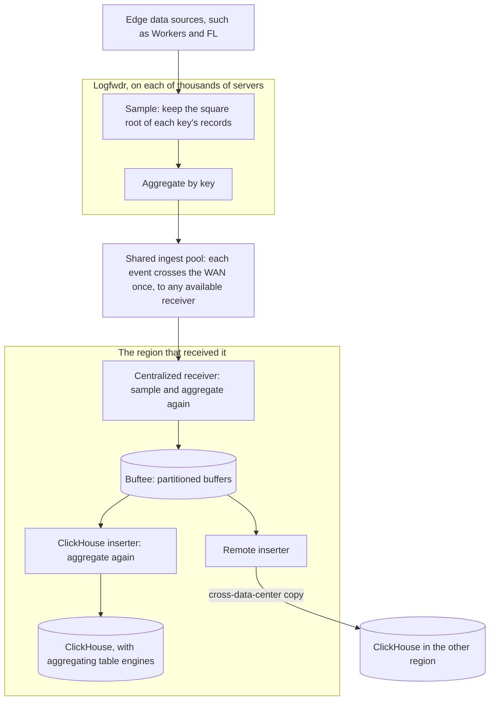

---
# Skeleton from Lead 5ioyfowa (Cloudflare blog), picked 2026-10-30.
# Follows docs/editorial/case-study-writing-guide.md; the Author's check list
# is in the pull request. published and reviewed are the pick time, provisional: set them
# when you publish. verified: is the Author's alone (ADR-0007).
title: "Logfwdr and Buftee: how Cloudflare keeps analytics on linear hardware"
description: "How Cloudflare's Logfwdr-to-ClickHouse pipeline sends each event once, samples at the source and aggregates early, trading detail on busy keys."
kind: case-study
vertical: distributed-systems
tags: ["data-pipelines", "sampling", "aggregation", "clickhouse", "cloudflare"]
published: "2026-10-30T10:42:23Z"
verified: 2026-10-30
reviewed: "2026-10-30T10:42:23Z"
author: mira-vance
# Optional: an image HastCode may use, beside this file, replaces the
# generated title card. Never a Source's image.
# hero: system-name.png
# hero_alt: "What the image shows"
# Optional: related Explainer slugs and extra sources (title + url).
# related: [metastable-failures]
---

In May 2026 Cloudflare's data pipeline was delivering [roughly two billion events per second](https://blog.cloudflare.com/rewinding-the-exponential/), and the traffic behind it grows exponentially while the hardware grows linearly. Cloudflare's Data team says five years of changes have been [equivalent to deferring two and a half years of hardware expansion](https://blog.cloudflare.com/rewinding-the-exponential/), and in 2026 alone it removed about 70 GB/s of compressed traffic by sending less, not by compressing harder.

> Drafted with AI assistance, researched, verified and edited by the HastCode editorial team. We publish only as many pieces as the Author can verify this way.

## TL;DR

- Cloudflare's analytics pipeline carries events [from Logfwdr to centralized receivers, into the Buftee buffering system and on to consumers such as ClickHouse](https://blog.cloudflare.com/rewinding-the-exponential/), feeding Cloudflare Logs, the SQL API, observability and internal analytics.
- It was rebuilt because Logfwdr sent [two full copies of every non-regional analytics event](https://blog.cloudflare.com/rewinding-the-exponential/) across wide-area transit, one per region, which Cloudflare calls "unsustainable against our exponential traffic growth".
- In 2026 three changes cut the bytes themselves: Logfwdr samples each key by the square root of its count and pre-aggregates, sends each event once to a shared pool of receivers, and replication moves after Buftee; aggregation repeats at four stages.
- The price is detail on the busiest keys and questions fixed in advance. The surprise: replicating late added about 7 GB/s but [removed about 43 GB/s](https://blog.cloudflare.com/rewinding-the-exponential/), because the copy is now made of sampled, better-compressed data.

## One send, two samples, four aggregations

The diagram is ours, redrawn from the text of Cloudflare's post; Cloudflare's own figures are in [the original](https://blog.cloudflare.com/rewinding-the-exponential/). Two placements are our reading, not the post's: sampling before aggregation inside Logfwdr, and Buftee with the first inserter in the region that received the event. It follows one non-regional event from a server at the edge to ClickHouse in both central regions.

The sections walk it top to bottom: Step 1 is Logfwdr's sampling, Step 2 its aggregation, Step 3 the single send to a shared pool, Step 4 the receivers and Buftee, and Step 5 replication after the buffer.

## Why sending every event twice stopped scaling

Cloudflare had already cut bytes twice. In 2022 it broke up a [single stream with "one and only schema"](https://blog.cloudflare.com/rewinding-the-exponential/) that every internal consumer had to ingest and filter, into product-specific schemas; backbone bandwidth fell 35 to 40%, "knocking out roughly a year's worth of compressed traffic growth". In 2024, with congestion [occurring daily](https://blog.cloudflare.com/rewinding-the-exponential/), it moved from LZ4 to zstd and cut compressed throughput by nearly 40%, with no noticeable difference in CPU usage.

Compression has a ceiling, though. The post notes that [uncompressed bytes kept the same growth](https://blog.cloudflare.com/rewinding-the-exponential/), so in 2026 the team went after uncompressed bytes.

The biggest target was disaster resilience. Logfwdr sent [a full copy of every non-regional analytics event to each of two centralized regions](https://blog.cloudflare.com/rewinding-the-exponential/), and each region processed its copy through to ClickHouse independently, sampling included. Double-writing was historically the simplest way to survive losing a region. That was manageable while only a handful of streams used secondary regions; as disaster resilience expanded to almost all analytics streams, Logfwdr traffic doubled across the board.

"Non-regional" is the post's term; it does not define it. It does say that data under [Customer Metadata Boundaries](https://developers.cloudflare.com/data-localization/metadata-boundary/) is stored strictly within its designated region, and we infer that is the regional data excluded from double-sending.

## The options: write twice, send once, or keep fewer rows

Cloudflare had a precedent inside its own pipeline. For [Logpush](https://developers.cloudflare.com/logs/logpush/), Logfwdr already [treats the centralized data centers as one shared pool of receivers](https://blog.cloudflare.com/rewinding-the-exponential/): each message goes to one region, failing over if a machine or facility is unreachable. That works because Logpush delivery is stateless; a customer's destination does not care which data center pushes the logs.

Analytics could not copy it as is. ClickHouse clusters in both regions still need a full copy of non-regional data, for ["instant, independent query failover"](https://blog.cloudflare.com/rewinding-the-exponential/). So the choice was not one copy or two, but where the second copy is made. Double-writing makes it at the source, before anything shrinks the data; the new design makes it [after the receivers have sampled](https://blog.cloudflare.com/rewinding-the-exponential/).

For shrinking the data, the post sets two tools against each other. Aggregation answers [a fixed set of questions exactly](https://blog.cloudflare.com/rewinding-the-exponential/), but only if the dimensions and metrics are chosen up front; sampling answers any question approximately. Cloudflare uses both, and offers producer teams aggregation as another option besides sampling.

We infer the deciding argument from the order of the work: every byte removed at the source is removed from every stage after it, including the replica. The post names no rejected design beyond double-writing.

## Step 1: Logfwdr keeps the square root of each key

Sampling already ran [in the centralized receivers](https://blog.cloudflare.com/rewinding-the-exponential/). In 2026 Cloudflare added it in Logfwdr too, and calls the result double sampling. Each dataset has a key, chosen by its producer team, that the data is indexed and sampled by.

For each key, Logfwdr shuffles the records ["to eliminate bias"](https://blog.cloudflare.com/rewinding-the-exponential/), then keeps a sample whose size is the square root of the group's record count. A query scales its estimate by the sample rate: in the post's example, 10 kept out of 100 gives a rate of 10/100, and the estimate of the original count is 10 × 10 = 100. An [earlier Cloudflare post](https://blog.cloudflare.com/how-we-make-sense-of-too-much-data) stores each row's `_sample_interval`, the reciprocal of its inclusion probability, and multiplies intervals when data is downsampled again. We infer double sampling relies on the same bookkeeping; the Lead does not say how the rate is stored.

Cloudflare fitted stored rows against traffic per key: about [x^0.485 sampled once and x^0.319 sampled twice](https://blog.cloudflare.com/rewinding-the-exponential/). By our arithmetic, a key with 100 times more data stores about 9 times the rows sampled once, about 4 times sampled twice. The post says x^0.25 was not observed, because double sampling happens separately across machines and batches.

Our own arithmetic, not Cloudflare's: with about √n rows kept, the relative error on a slice of a key shrinks roughly as one over the square root of the rows in that slice, so big keys stay well estimated while their storage grows far slower than their traffic.

## Step 2: aggregation starts on the same machine

The second tool also starts in Logfwdr. Records are [grouped by a key, and the key decides which records can be combined](https://blog.cloudflare.com/rewinding-the-exponential/). The post's HTTP examples: unique IP address occurrences per minute rather than individual IPs, and total requests per domain per minute, grouped by HTTP method.

Aggregation then repeats at [four stages](https://blog.cloudflare.com/rewinding-the-exponential/): in each Logfwdr instance; in the receivers, which re-aggregate partially aggregated events before writing to dedicated partitioned buffers; in the ClickHouse inserters, after they read batches from those buffers; and in ClickHouse itself, through aggregating table engines.

We infer why it repeats. One Logfwdr sees only its own server's slice of a minute, so it can merge only what it saw; each later stage sees more servers' partial results for the same key and minute, and can merge further. Counts and sums merge cleanly, which fits the post's note that aggregation is powerful for [datasets that can collapse easily](https://blog.cloudflare.com/rewinding-the-exponential/), such as usage metrics.

Moving aggregation earlier was the change that paid. The HTTP rollup dataset, the highest-cardinality one, fell [from 9+ GB/s to under 2 GB/s](https://blog.cloudflare.com/rewinding-the-exponential/) of compressed traffic, about 80% on the wire, once aggregation stopped waiting for the inserters.

## Step 3: each event crosses the WAN once

With less to send, Logfwdr now sends it once. Under the [shared ingest pool](https://blog.cloudflare.com/rewinding-the-exponential/), each event crosses wide-area transit exactly once, to whichever centralized receiver is available. If a centralized region goes down, Logfwdrs route all non-regional traffic to the surviving region.

The first cutovers were two datasets. HTTP analytics [saw a ~20 GB/s (50+%) reduction](https://blog.cloudflare.com/rewinding-the-exponential/). [Ready-Analytics](https://blog.cloudflare.com/clickhouse-query-plan-contention/), a Cloudflare system that lets internal teams stream data into a single shared table, dropped by 43%, from about 28 GB/s to about 16 GB/s in the post's chart caption. More datasets have moved since spring.

## Step 4: receivers sample again, and Buftee holds the result

A receiver gets a stream already shrunk at the source. It [samples before buffering into Buftee](https://blog.cloudflare.com/rewinding-the-exponential/) and re-aggregates into partitioned buffers. The post's account of the asymmetry rests here: the receivers' output is partitioned into uniform batches over wider time windows, which compress better than Logfwdr's batches.

Buftee is Cloudflare's buffer between ingest and consumers. An earlier incident report calls it [a highly distributed system supporting a large number of named buffers](https://blog.cloudflare.com/cloudflare-incident-on-november-14-2024-resulting-in-lost-logs/), typically over one million globally; for Cloudflare Logs it gives each Logpush job its own buffer, so failing to process one customer's job does not affect another's. Consumers fetch from it and [deliver to destinations such as ClickHouse](https://blog.cloudflare.com/rewinding-the-exponential/).

Its role in the new design is to hold data long enough to replicate. We infer that the buffer turns a cross-region copy from a synchronous duty of the sender into an asynchronous job for a reader.

## Step 5: replication moves after the buffer

Under [late replication](https://blog.cloudflare.com/rewinding-the-exponential/), data lands in Buftee, and remote inserters stream cross-data-center copies downstream: a remote inserter makes the second ClickHouse copy after Buftee.

Failure handling follows from the buffer. If the link between data centers blips, each cluster [keeps ingesting its local share without backpressure](https://blog.cloudflare.com/rewinding-the-exponential/), and remote inserters catch up from Buftee's retention buffer once the backbone recovers.

The arithmetic is the surprise. The cutover eliminated [43 GB/s of compressed transit](https://blog.cloudflare.com/rewinding-the-exponential/) for the migrated datasets and added about 7 GB/s of cross-data-center replication, a net 36 GB/s. The replica costs about a sixth of what it saved (our arithmetic), and the post gives two reasons: it is made after sampling, so only a compacted stream is copied where two raw, unsampled copies used to cross the WAN; and it is built from the receivers' uniform batches, which compress better.

We infer the general rule: replicate at the narrowest point of a pipeline, not at its mouth.

## What it costs: detail, fixed questions and a lagging replica

Sampling costs detail where traffic is highest. Cloudflare says double sampling [attenuates storage of the "most seen" keys](https://blog.cloudflare.com/rewinding-the-exponential/) while keeping the same detail per event for "least seen" keys, and that it is "not compromising the quality of data delivered". We read that as a claim about estimates, which the post backs with its chart; rare events inside a hot key are what a sample is most likely to miss.

Aggregation costs flexibility. It answers only the questions [whose dimensions and metrics were chosen up front](https://blog.cloudflare.com/rewinding-the-exponential/), so a question nobody planned for has no rows to read.

Late replication costs freshness in the second region. During a backbone blip the remote copy [falls behind and catches up from Buftee's retention buffer](https://blog.cloudflare.com/rewinding-the-exponential/); the post does not say how long an outage that buffer covers. We infer the shared pool has a capacity cost too: if a region goes down, the survivor takes all non-regional traffic, so each region must be able to ingest it alone.

## The evidence: about 70 GB/s, and two figures that differ

Cloudflare's [spring-to-fall tally](https://blog.cloudflare.com/rewinding-the-exponential/): about 38 GB/s from load balancing, about 25 GB/s from sampling and about 7+ GB/s from aggregation so far, about 70 GB/s of compressed traffic off the backbone. Sampling's 25 GB/s, over 2 PB a day, came from three top datasets that each at least halved their compressed bytes.

Ready-Analytics shows the interplay. Load balancing in mid-May cut it [from about 26 GB/s to about 13 GB/s](https://blog.cloudflare.com/rewinding-the-exponential/); two months of growth took it back to about 20 GB/s; sampling then brought it to about 8 GB/s. Cloudflare estimates that without both it would have breached 60 GB/s by September. Its receivers' CPU and memory use fell by about 50%, about 750 CPUs and 3.5 TiB of memory regained.

For sampling's accuracy, Cloudflare compared [rows written to ClickHouse against the estimated total count](https://blog.cloudflare.com/rewinding-the-exponential/) across keys from least to most seen, and reports the same estimate with fewer rows.

The gaps: the load balancing section gives a net 36 GB/s while the tally says about 38, and Ready-Analytics' drop appears as 28 to 16 GB/s and 26 to 13 GB/s; the post does not reconcile either. It publishes no error bounds, does not name the three sampled datasets, and gives no Buftee retention window or dollar cost.

## What sending less makes possible

The headline result is time. Pipeline throughput is now [about eight months behind its previously projected growth](https://blog.cloudflare.com/rewinding-the-exponential/), and the 2026 work cut projected data volume for 2031 in half. Cloudflare expects the savings to keep mounting.

The lesson travels to any team whose event volume outruns its budget. Compression bought Cloudflare 40% once; the bigger wins came from changing what is sent. Shrink data where it is born, with a sample that grows as the square root of traffic or an aggregate that answers a known question. Then make durability copies after the data has shrunk, behind a buffer that lets one region fall behind and catch up.

The cost is a pipeline that keeps less: fewer rows for its busiest keys and only the planned questions for aggregated data. What could go right is a fleet whose hardware curve stays a line while its traffic stays an exponential, with each byte removed at the source paying again at every stage after it.

## Sources

- [Rewinding the exponential: How we keep hardware usage down](https://blog.cloudflare.com/rewinding-the-exponential/), Cloudflare blog, 13 October 2026
- [Over 700 million events/second: How we make sense of too much data](https://blog.cloudflare.com/how-we-make-sense-of-too-much-data), Cloudflare blog, 27 January 2025
- [Cloudflare incident on November 14, 2024, resulting in lost logs](https://blog.cloudflare.com/cloudflare-incident-on-november-14-2024-resulting-in-lost-logs/), Cloudflare blog, 26 November 2024
- [Our billing pipeline was suddenly slow. The culprit was a hidden bottleneck in ClickHouse](https://blog.cloudflare.com/clickhouse-query-plan-contention/), Cloudflare blog, 14 May 2026
- [Customer Metadata Boundary](https://developers.cloudflare.com/data-localization/metadata-boundary/), Cloudflare documentation
- [Logpush](https://developers.cloudflare.com/logs/logpush/), Cloudflare documentation
