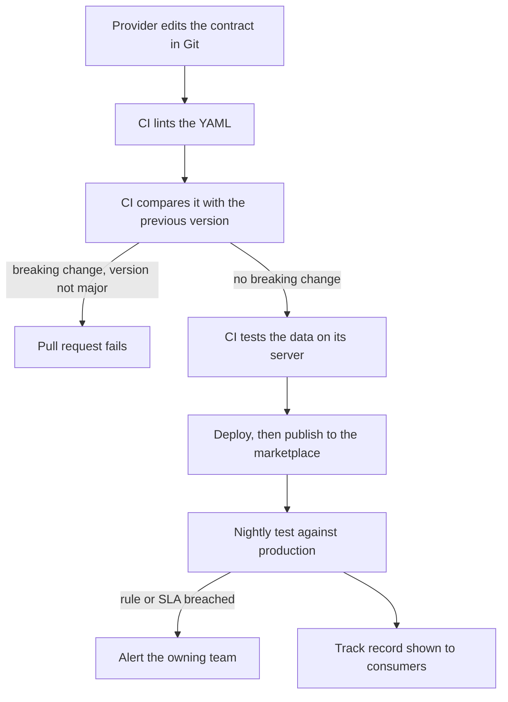

---
# Skeleton from Lead cfynwzse (Martin Fowler), picked 2026-11-23, drafted
# per docs/editorial/concept-writing-guide.md. published and reviewed are the pick time (make daily may move them to a Gap Day);
# make release keeps it (ADR-0012). verified: is the Author's alone (ADR-0007).
title: "Data contracts: an API spec for a dataset, tested in CI"
description: "A data contract states a dataset's schema, quality rules, SLAs and owner in versioned YAML, so CI catches a breaking change before consumers do."
kind: concept
vertical: distributed-systems
tags: ["data-contracts", "odcs", "data-quality", "schema-evolution", "data-mesh"]
published: "2026-11-20T09:31:06Z"
verified: 2026-11-23
reviewed: "2026-11-23T10:10:31Z"
author: mira-vance
# Optional: an image HastCode may use, beside this file, replaces the
# generated title card. Never a Source's image.
# hero: concept-name.png
# hero_alt: "What the image shows"
# Optional: related Explainer slugs and extra sources (title + url).
# related: [http-connection-reuse]
---

In November 2026 the Thoughtworks Technology Radar put the Open Data Contract Standard (ODCS) in its Adopt ring, calling it ["a sensible default for teams building data products"](https://www.thoughtworks.com/en-de/radar/languages-and-frameworks/summary/open-data-contract-standard-odcs). The same month, Simon Harrer and Arif Wider [showed what such a file does](https://martinfowler.com/articles/data-contracts.html). A provider publishes a contract for its `customers` table: [fewer than 1% empty names](https://martinfowler.com/articles/data-contracts.html#SchemaAndDataQuality), and a [freshness promise of 24 hours](https://martinfowler.com/articles/data-contracts.html#TermsOfUseAndSlas). Later, someone renames a column. Nobody regenerates the contract to match. ["The contract test fails instead"](https://martinfowler.com/articles/data-contracts.html#Data-firstVs.Contract-first), and the rename has to be handled as a breaking change. This piece shows what goes into that file, how a pipeline enforces it like an API spec, and where it ends: at the access agreement a consumer gets on approval.

## TL;DR

- A **data contract** is ["a description of the shape of the data that a data provider is offering"](https://martinfowler.com/articles/data-contracts.html#ASimpleExampleDataContract), in a machine-readable file. In ODCS, one versioned YAML file carries the schema, quality rules, service levels, owner, servers and access roles.
- The provider publishes it [one-sidedly, for any consumer](https://martinfowler.com/articles/data-contracts.html#IsntAContractABilateralAgreement), and treats it like an API spec. It lives in Git and follows semantic versioning, and a pipeline lints it, blocks breaking changes and tests the real data against it.
- It is becoming the default: ODCS sits in [Adopt in the Radar's November 2026 volume](https://www.thoughtworks.com/en-de/radar/languages-and-frameworks/summary/open-data-contract-standard-odcs). Data Contract CLI, the open-source tool that tests ODCS files, had [over 1 million downloads per month](https://martinfowler.com/articles/data-contracts.html#AutomateAllTheThings) in November 2026, by its makers' count.
- Start [where it hurts](https://martinfowler.com/articles/data-contracts.html#TheCost), not everywhere. The cost is writing and upkeep, and a stale contract misleads: ["an agent acts on an outdated contract just as confidently as on a correct one"](https://martinfowler.com/articles/data-contracts.html#TheCost).
- It is not an access agreement, which is [bilateral, names a consumer and a purpose, and takes effect on approval](https://martinfowler.com/articles/data-contracts.html#DataContractsAreThex201cproductDetailsPagex201dInADataMarketplace), with a start date and an optional expiry.

## A data contract is a provider's published promise about a dataset

[Simon Harrer co-founded Entropy Data and sits on the ODCS technical steering committee; Arif Wider is a professor of software engineering at HTW Berlin](https://martinfowler.com/articles/data-contracts.html). They define a data contract as ["a description of the shape of the data that a data provider is offering"](https://martinfowler.com/articles/data-contracts.html#ASimpleExampleDataContract). A **provider** is the team that produces a dataset; a **consumer** is any team, application or agent that reads it. Shape means more than a schema here. Their example adds quality rules and service levels, because ["actual trust comes when these guarantees are verified automatically"](https://martinfowler.com/articles/data-contracts.html#ASimpleExampleDataContract).

They list [six properties](https://martinfowler.com/articles/data-contracts.html#WhatsInADataContract): machine-readable, verifiable, versioned, provider-driven, consumer-oriented, and the source of truth for metadata. Such a contract, they write, ["is typically defined using the Open Data Contract Standard"](https://martinfowler.com/articles/data-contracts.html#WhatsInADataContract).

The word "contract" misleads. In law a contract binds two or more parties, but here ["a data contract is published one-sidedly by the provider, describing its promises and terms of use towards any consumer"](https://martinfowler.com/articles/data-contracts.html#IsntAContractABilateralAgreement). The authors compare it to Bertrand Meyer's [Design by Contract](https://se.inf.ethz.ch/~meyer/publications/old/dbc_chapter.pdf), not to a signed deal.

What does not count follows from those six properties, we infer. A wiki page about a table is not a data contract, because no tool can verify it. Nor is a table's own schema, such as the one an [Iceberg table keeps in its metadata file](/databases-storage/apache-iceberg-table-format/). That schema tells engines how to read the files, not what the provider promises about them.

## What goes in the file: the customers contract, section by section

The ODCS spec ["describes the keys and values expected in a YAML data contract"](https://bitol-io.github.io/open-data-contract-standard/latest/). Its current version is [v3.2.0](https://github.com/bitol-io/open-data-contract-standard), and Harrer and Wider walk through its main sections with a `customers` table.

- **Fundamentals** [identify the contract](https://bitol-io.github.io/open-data-contract-standard/latest/fundamentals/): `kind: DataContract`, an `id`, a `version` such as 1.0.0, and a `status` such as draft, active, deprecated or retired.
- **Schema** lists [objects and their properties](https://bitol-io.github.io/open-data-contract-standard/latest/schema/) with logical types. The example [stores premiums as integer cents and tags `customer_name` with `pii:true`, personal data](https://martinfowler.com/articles/data-contracts.html#SchemaAndDataQuality).
- **Quality** rules are [library metrics, SQL, text or custom checks](https://bitol-io.github.io/open-data-contract-standard/latest/data-quality/). The example [expects](https://martinfowler.com/articles/data-contracts.html#SchemaAndDataQuality) more than 100,000 rows (an SQL count, `mustBeGreaterThan: 100000`) and under 1% empty names (an SQL rule, `mustBeLessThan: 0.01`). It also expects zero values of `customer_status` outside "active", "lapsed" and "cancelled" (the `invalidValues` library metric, `mustBe: 0`).
- **Service levels** (service-level agreements, SLAs) are [measurable properties](https://bitol-io.github.io/open-data-contract-standard/latest/service-level-agreement/): a value, a unit and the column they apply to. The example promises [freshness of 24 hours on `last_updated_at` and retention of 5 years](https://martinfowler.com/articles/data-contracts.html#TermsOfUseAndSlas). The spec's own list calls this property `latency`, ["preferred to freshness"](https://bitol-io.github.io/open-data-contract-standard/latest/service-level-agreement/#valid-values-for-sla-properties).
- **Team** and support name [the owner and a Slack channel](https://martinfowler.com/articles/data-contracts.html#OwnershipAndSupportChannels).
- **Servers** say [where the data lives](https://bitol-io.github.io/open-data-contract-standard/latest/infrastructure-servers/): Snowflake, BigQuery, Kafka and S3 are among the listed types. Credentials stay out; v3.0.0 [dropped the `password` field](https://bitol-io.github.io/open-data-contract-standard/latest/changelog/).
- **Roles** list [the roles that a consumer may need to access the dataset](https://bitol-io.github.io/open-data-contract-standard/latest/roles/). Each names [an IAM role on the data platform, such as a Snowflake role](https://martinfowler.com/articles/data-contracts.html#RolesampSecurity), and the access it grants.

## How a contract is enforced, from commit to nightly test

Walk it from the top. A contract's [natural habitat is the Git repository](https://martinfowler.com/articles/data-contracts.html#ItsNaturalHabitatIsAGitRepository), beside the pipeline code and the CI configuration, so every change is a pull request. [Data Contract CLI supplies each check](https://martinfowler.com/articles/data-contracts.html#DataContractsBelongInYourCicdPipeline). `datacontract lint` [validates the file's format](https://cli.datacontract.com/commands). `datacontract breaking` compares two versions and grades each change; a change that breaks consumers is an `ERROR`, and the command [exits with status 1](https://cli.datacontract.com/compare-contract-versions#severity-levels). The authors' rule: [fail the pull request](https://martinfowler.com/articles/data-contracts.html#AutomateAllTheThings) when a breaking change arrives as only a minor or patch version.

Next, `datacontract test` [runs schema and quality tests on configured servers](https://cli.datacontract.com/commands/test). It [connects to the data source](https://cli.datacontract.com/), Snowflake say, and counts the empty names. `datacontract ci` runs the same tests inside a pipeline and can write [JUnit results](https://cli.datacontract.com/commands/ci). Only when every stage passes does the pipeline [deploy and publish](https://martinfowler.com/articles/data-contracts.html#DataContractsBelongInYourCicdPipeline).

The last box runs on a schedule: `datacontract test --server prod` [on a cron](https://martinfowler.com/articles/data-contracts.html#TestingDatasetsVsTestingCode). Each run checks freshness against `last_updated_at`, and ["a breach alerts the owning team"](https://martinfowler.com/articles/data-contracts.html#TermsOfUseAndSlas). Published results become a track record, such as freshness met ["on 29 of the last 30 days"](https://martinfowler.com/articles/data-contracts.html#DataContractsAreThex201cproductDetailsPagex201dInADataMarketplace).

The comparison with an API spec stops at behaviour. Datasets have ["no logic or behavior, but they have characteristics"](https://martinfowler.com/articles/data-contracts.html#TestingDatasetsVsTestingCode), such as row and null counts. So the tests measure the data, not code paths.

## Where data contracts run today

PayPal is where ODCS started: it wrote the YAML format and [open-sourced it in 2023](https://martinfowler.com/articles/data-contracts.html#TheOriginOfTheOpenDataContractStandard). Its template repository describes ["the data contract being used in the implementation of Data Mesh at PayPal"](https://github.com/paypal/data-contract-template). A **data mesh** gives domain teams ownership of their data and asks them to [serve it as a product](https://martinfowler.com/articles/data-contracts.html#DataContractsAndTheDataMeshPrinciples), on a self-serve platform with federated governance.

A few months later the format [became ODCS, the founding standard of the Bitol project](https://martinfowler.com/articles/data-contracts.html#TheOriginOfTheOpenDataContractStandard), now [a Graduated project of LF AI & Data under the Apache 2.0 licence](https://bitol.io/). ODCS 3.1, in 2025, brought it together with the Data Contract Specification, another format by Jochen Christ and Harrer. Data Contract CLI gained native ODCS 3.1 support, and the Data Contract Specification was [retired](https://martinfowler.com/articles/data-contracts.html#TheOriginOfTheOpenDataContractStandard).

Bitol's [Open Data Product Standard](https://github.com/bitol-io/open-data-product-standard) [builds on ODCS](https://martinfowler.com/articles/data-contracts.html#DataProductsBuildUponDataContracts). It describes a **data product**, a dataset a domain team serves as a product, by its input and output ports. Each output port, the interface a consumer reads from, is [described by a data contract](https://martinfowler.com/articles/data-contracts.html#DataProductsBuildUponDataContracts). In the authors' words, contracts are ["the interface description language that makes the ports of a data product explicit and verifiable"](https://martinfowler.com/articles/data-contracts.html#DataProductsBuildUponDataContracts).

The tooling is open source too. Data Contract CLI tests contracts against [Snowflake, Databricks, BigQuery, Kafka, Postgres and S3, among others](https://cli.datacontract.com/#frequently-asked-questions). Its MIT licence names [Entropy Data GmbH](https://github.com/datacontract/datacontract-cli/blob/main/LICENSE), the company Harrer co-founded. Read the download figure in the TL;DR with that in mind: it comes from the people who make the tool.

## Why datasets need an interface like an API

Data gets combined across teams, and [trust in combined data](https://martinfowler.com/articles/data-contracts.html#WhyWeNeedDataContracts) decides whether analytics can use it. The authors' example engineer, Alex, works at ["a multinational insurance company"](https://martinfowler.com/articles/data-contracts.html#WhyWeNeedDataContracts) and asks eight questions before using a dataset. One asks: ["How fresh and complete is the data, and of what quality?"](https://martinfowler.com/articles/data-contracts.html#WhyWeNeedDataContracts) Another asks: ["Can I rely on its structure remaining stable so my application won't break in the future?"](https://martinfowler.com/articles/data-contracts.html#WhyWeNeedDataContracts) Contracts answer them ["not just once, but to ensure the trustworthy processing of data continuously"](https://martinfowler.com/articles/data-contracts.html#WhyWeNeedDataContracts).

Structure is the fragile part. Adding a column is non-breaking only if consumers [select the columns they need instead of `SELECT *`](https://martinfowler.com/articles/data-contracts.html#TheProblemWithx201cselectx201d), acting as a [Tolerant Reader](https://martinfowler.com/bliki/TolerantReader.html). A contract makes the remaining promise explicit: which columns stay, and in what form.

Agents make bad metadata costlier. They ["treat every value as truth"](https://martinfowler.com/articles/data-contracts.html#WhatDoesThisMeanForAiAgents), a point the authors credit to Pramod Sadalage and Prem Chandrasekaran. Descriptions and terms of use count too: an agent ["takes those prose fields at their word"](https://martinfowler.com/articles/data-contracts.html#InTheAgeOfAgentsTheIncentivePointsTheRightWay).

The force pulling the other way is incentives. Contracts ["shift ownership towards data providers"](https://martinfowler.com/articles/data-contracts.html#TheBenefits), yet providers are ["usually measured on shipping features"](https://martinfowler.com/articles/data-contracts.html#TheCost). So, to the team that writes it, a contract can feel like ["friction with little payoff"](https://martinfowler.com/articles/data-contracts.html#TheCost).

## Practice one: version with SemVer and run major versions side by side

Contracts follow [Semantic Versioning](https://semver.org/) (SemVer: major.minor.patch). The authors [map it to data](https://martinfowler.com/articles/data-contracts.html#TheStoryOfVersioningAndBreakingChanges). Removing or renaming a column is a major change. Adding a column is minor. Fixing a typo or updating the support channels is a patch.

A new major version is phased in next to the old one. In the authors' Git layout, `customers_pii_snowflake_v1.odcs.yaml` and `customers_pii_snowflake_v2.odcs.yaml` [sit side by side](https://martinfowler.com/articles/data-contracts.html#ItsNaturalHabitatIsAGitRepository), and the contract's ID stays the same across major versions. Each version starts as draft, becomes active, and is later [marked deprecated and then retired](https://martinfowler.com/articles/data-contracts.html#TheStoryOfVersioningAndBreakingChanges).

Event streams need extra care. A schema registry checks each new schema version against the last. The authors warn that its default check is the wrong one: ["backward compatibility permits deleting a field, which is exactly the change that breaks existing consumers"](https://martinfowler.com/articles/data-contracts.html#TheStoryOfVersioningAndBreakingChanges). They require each minor version to be forward compatible, so consumers on the old schema can read the new data, and ideally fully compatible.

The cost: a major version is a migration. Each one runs as [its own output port, in parallel](https://martinfowler.com/articles/data-contracts.html#TheStoryOfVersioningAndBreakingChanges). We infer that the provider feeds both ports until consumers move, so the slower the consumers, the longer it runs both.

## Practice two: start where it hurts, data-first or contract-first

The authors' rollout advice is plain: ["you should not introduce data contracts for all the data in your company"](https://martinfowler.com/articles/data-contracts.html#TheCost), and ["don't roll out data contracts all at once"](https://martinfowler.com/articles/data-contracts.html#TheCost). Their starting point: ["Start where it hurts: data quality issues, broken pipelines, or a lot of miscommunication."](https://martinfowler.com/articles/data-contracts.html#TheCost)

They describe two ways in. **Data-first** puts existing data under contract. Data Contract CLI drafts a first version [from metadata such as SQL DDL, JSON Schema or Avro Schema](https://martinfowler.com/articles/data-contracts.html#Data-firstVs.Contract-first), for example with `datacontract import sql --source ddl.sql --dialect postgres --output datacontract.yaml` ([CLI docs](https://cli.datacontract.com/commands)). From then on, ["the data has to follow it"](https://martinfowler.com/articles/data-contracts.html#Data-firstVs.Contract-first). **Contract-first** starts with a facilitated workshop: providers and consumers [draft the contract together](https://martinfowler.com/articles/data-contracts.html#Data-firstVs.Contract-first), on a whiteboard, a Data Product Canvas or the Data Contract Editor, among other tools.

The cost is ongoing time. Contracts take [time to write and to maintain](https://martinfowler.com/articles/data-contracts.html#TheCost), and an outdated one misleads any agent that reads it. The authors' mitigations are [platform templates, workshops with consumers, reliability shown in the marketplace, and clear ownership of alerts](https://martinfowler.com/articles/data-contracts.html#TheCost). Their bar for doing it well: ["treating a data contract with the same rigor as an API"](https://martinfowler.com/articles/data-contracts.html#WorkingWithDataContracts).

## A data contract is not an access agreement

The contract describes the data for everyone; the access agreement grants it to someone. In a data marketplace, the contract is the [product details page](https://martinfowler.com/articles/data-contracts.html#DataContractsAreThex201cproductDetailsPagex201dInADataMarketplace). A consumer requests access there, and ["The request creates an access agreement"](https://martinfowler.com/articles/data-contracts.html#DataContractsAreThex201cproductDetailsPagex201dInADataMarketplace) with three main parts: the contract, the stated processing purpose and the requesting consumer. It ["only becomes effective when the provider approves the request"](https://martinfowler.com/articles/data-contracts.html#DataContractsAreThex201cproductDetailsPagex201dInADataMarketplace).

A data contract ["is published one-sidedly by the provider, refers to no specific consumer, and has no notion of time"](https://martinfowler.com/articles/data-contracts.html#DataContractsAreThex201cproductDetailsPagex201dInADataMarketplace). The agreement is bilateral and ["always has a start date and, optionally, an expiration date"](https://martinfowler.com/articles/data-contracts.html#DataContractsAreThex201cproductDetailsPagex201dInADataMarketplace); for AI agents, the period ["can be as short as a few minutes"](https://martinfowler.com/articles/data-contracts.html#DataContractsAreThex201cproductDetailsPagex201dInADataMarketplace).

Roles show where the two meet. The contract names the roles but ["doesn't list who holds a role"](https://martinfowler.com/articles/data-contracts.html#RolesampSecurity); that is decided per consumer on approval. We infer the benefit of the split: grants can come and go each day without a new contract version.

Agreements [have no standard yet](https://martinfowler.com/articles/data-contracts.html#DataContractsAreThex201cproductDetailsPagex201dInADataMarketplace). Harrer's [Bitol RFC for an Open Access Agreement Standard](https://github.com/bitol-io/tsc/blob/main/rfcs/0056-oaas.md) proposes `kind: AccessAgreement`, which ["records a 1:1 agreement between a data provider and a data consumer"](https://github.com/bitol-io/tsc/blob/main/rfcs/0056-oaas.md). It [carries](https://github.com/bitol-io/tsc/blob/main/rfcs/0056-oaas.md) a purpose, the governing contract's ID, a `status` of requested, approved or rejected, and an `endTimestamp`. The RFC records no decision yet.

Nor is a data contract a **consumer-driven contract**, which uses the same ODCS structure from the other side. In the provider's contract a schema ["states a promise"](https://martinfowler.com/articles/data-contracts.html#Consumer-drivenDataContractsAddTheMissingPerspective); in the consumer's, it ["states an expectation"](https://martinfowler.com/articles/data-contracts.html#Consumer-drivenDataContractsAddTheMissingPerspective).

## What data contracts make possible

Start with a test you can run today. Take your most-used dataset and Alex's eight questions. If a file in Git answers them, and a nightly job checks the answers, you have a data contract. If the answers live in people's heads, you know where to start.

Once the file exists, you can measure the promise. Track how often each rule and service level held, as a marketplace's freshness record does. Count the changes CI stopped as breaking before any consumer saw them. The same file can [generate DDL, documentation, and masking and access policies](https://martinfowler.com/articles/data-contracts.html#AutomateAllTheThings) for columns tagged `pii:true`. It can also [hold back violating data](https://martinfowler.com/articles/data-contracts.html#AutomateAllTheThings) before it reaches consumers, as in the quarantine pattern.

The authors' test for portability is worth keeping: ["can you export all your contracts as plain files into git and rebuild your catalog elsewhere from them alone?"](https://martinfowler.com/articles/data-contracts.html#OpenStandardsEnableMetadataSovereignty)

You can try it on a laptop. `datacontract init` writes a [v3.2.0 contract](https://cli.datacontract.com/open-data-contract-standard), and `datacontract test` runs against [local Parquet, JSON, CSV or Delta files](https://cli.datacontract.com/#frequently-asked-questions). The optimistic part: a dataset can carry the same kind of promise an API does, with a shape, a version and a test that fails before consumers do. An agent reading it then acts on facts the provider checked last night.

## Sources

- Simon Harrer, Arif Wider, ["Data Contracts"](https://martinfowler.com/articles/data-contracts.html), martinfowler.com, 18 November 2026.
- Bitol, ["Open Data Contract Standard (ODCS)"](https://bitol-io.github.io/open-data-contract-standard/latest/), specification: [Fundamentals](https://bitol-io.github.io/open-data-contract-standard/latest/fundamentals/), [Schema](https://bitol-io.github.io/open-data-contract-standard/latest/schema/), [Data Quality](https://bitol-io.github.io/open-data-contract-standard/latest/data-quality/), [Service-Level Agreement](https://bitol-io.github.io/open-data-contract-standard/latest/service-level-agreement/), [Infrastructure & Servers](https://bitol-io.github.io/open-data-contract-standard/latest/infrastructure-servers/), [Roles](https://bitol-io.github.io/open-data-contract-standard/latest/roles/), [Changelog](https://bitol-io.github.io/open-data-contract-standard/latest/changelog/).
- Bitol, [open-data-contract-standard](https://github.com/bitol-io/open-data-contract-standard), GitHub repository (Apache 2.0).
- Bitol, [project home page](https://bitol.io/).
- Bitol, [Open Data Product Standard](https://github.com/bitol-io/open-data-product-standard), GitHub repository.
- Simon Harrer, ["Open Access Agreement Standard (OAAS)"](https://github.com/bitol-io/tsc/blob/main/rfcs/0056-oaas.md), Bitol TSC RFC 0056.
- PayPal, [data-contract-template](https://github.com/paypal/data-contract-template), GitHub repository.
- Thoughtworks, ["Open Data Contract Standard (ODCS)"](https://www.thoughtworks.com/en-de/radar/languages-and-frameworks/summary/open-data-contract-standard-odcs), Technology Radar Vol 35, November 2026.
- Data Contract CLI, [documentation](https://cli.datacontract.com/): [commands](https://cli.datacontract.com/commands), [`test`](https://cli.datacontract.com/commands/test), [`ci`](https://cli.datacontract.com/commands/ci), ["Compare contract versions"](https://cli.datacontract.com/compare-contract-versions), ["Open Data Contract Standard"](https://cli.datacontract.com/open-data-contract-standard); [licence](https://github.com/datacontract/datacontract-cli/blob/main/LICENSE) (MIT).
- Bertrand Meyer, [Design by Contract](https://se.inf.ethz.ch/~meyer/publications/old/dbc_chapter.pdf), the chapter the Lead links.
- Martin Fowler, ["Tolerant Reader"](https://martinfowler.com/bliki/TolerantReader.html), bliki.
- ["Semantic Versioning 2.0.0"](https://semver.org/).
