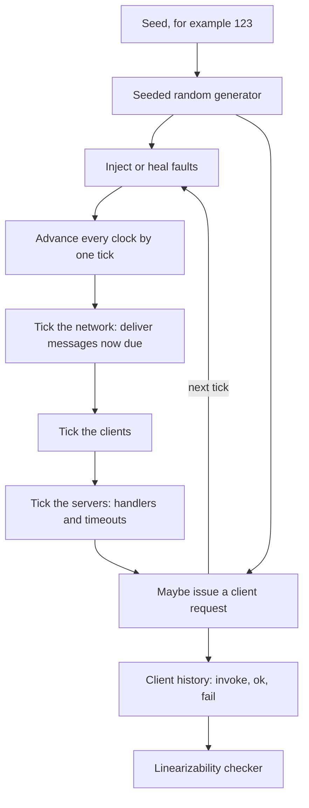

---
# Skeleton from Lead qyijcaep (Martin Fowler), picked 2026-11-18.
# Drafted per docs/editorial/concept-writing-guide.md. published and
# reviewed are the pick time (make daily may move them to a Gap Day);
# make release keeps it (ADR-0012). verified: is the Author's alone (ADR-0007).
title: "Deterministic simulation testing: replay any failure from a seed"
description: "Deterministic simulation testing runs a cluster on one thread with a simulated clock, network and disk, so rare bugs rerun identically."
kind: concept
vertical: distributed-systems
tags: ["deterministic-simulation", "testing", "fault-injection", "linearizability", "determinism"]
published: "2026-11-18T06:32:28Z"
verified: 2026-11-18
reviewed: "2026-11-18T09:57:43Z"
author: mira-vance
# Optional: an image HastCode may use, beside this file, replaces the
# generated title card. Never a Source's image.
# hero: concept-name.png
# hero_alt: "What the image shows"
# Optional: related Explainer slugs and extra sources (title + url).
# related: [http-connection-reuse]
---

When the FoundationDB team sat down in 2010 to build a distributed database with ACID transactions, the first thing they wrote was not a database. In Antithesis co-founder Will Wilson's account, ["we first wrote a fully-deterministic event-based network simulation"](https://antithesis.com/blog/is_something_bugging_you/) that the database could plug into. FoundationDB's engineering page says the team built the database [exclusively in simulation for its first 18 months](https://apple.github.io/foundationdb/engineering.html#simulation). A whole cluster ran in [a single-threaded process](https://apple.github.io/foundationdb/testing.html#simulation), with every event [driven by the same random number generator](https://antithesis.com/blog/is_something_bugging_you/). A failing run could be [run again with the same seed](https://antithesis.com/blog/is_something_bugging_you/), and it failed the same way. The project's documentation estimates it has since run ["roughly one trillion CPU-hours of simulation"](https://apple.github.io/foundationdb/testing.html#simulation). Wilson recalls only [one or two bugs reported by a customer](https://antithesis.com/blog/is_something_bugging_you/) in the company's history. This is how a simulator makes a distributed bug repeat from a single number, what your code must give up to allow it, and what it still misses.

## TL;DR

- **Deterministic simulation testing** (DST) means ["placing software under test in a simulated, deterministic environment"](https://antithesis.com/docs/resources/deterministic_simulation_testing/#what-is-deterministic-simulation-testing): a whole cluster runs on one thread against a simulated clock, network and disk.
- Nothing moves until the test calls `tick()`, and a seeded random generator picks every fault, so [the same seed gives the same faults and the same client-visible results](https://martinfowler.com/articles/deterministic-simulation-testing.html#SeededFaultInjection).
- Teams that use it run it constantly: FoundationDB runs [tens of thousands of simulations every night](https://apple.github.io/foundationdb/testing.html#simulation), and TigerBeetle's simulator runs [24/7 on 1024 cores](https://docs.tigerbeetle.com/concepts/safety/#software-reliability).
- The cost is architectural. It [cannot be added as an afterthought](https://martinfowler.com/articles/deterministic-simulation-testing.html#Trade-offs), the core must obey six coding rules, and a message-level simulator [never runs the code that turns bytes into messages](https://martinfowler.com/articles/deterministic-simulation-testing.html#DecidingTheBoundaryMessagesOrBytes).

## A test that decides when everything makes progress

Antithesis, the company Wilson co-founded [in 2018](https://antithesis.com/blog/is_something_bugging_you/), defines the idea: ["Deterministic simulation testing (DST) involves placing software under test in a simulated, deterministic environment."](https://antithesis.com/docs/resources/deterministic_simulation_testing/#what-is-deterministic-simulation-testing) Its docs date practical adoption to [FoundationDB and Amazon Web Services around 2010](https://antithesis.com/docs/resources/deterministic_simulation_testing/#what-is-deterministic-simulation-testing).

Unmesh Joshi's November 2026 article on martinfowler.com states the rule behind that environment. ["To repeat a run, the test must decide when the clock, the processes, the network, and the disk make progress."](https://martinfowler.com/articles/deterministic-simulation-testing.html#MakingProgressExplicit)

In our words: the whole cluster, servers and clients, runs on one thread. The clock, the network and the disk are stand-ins that the test owns. Progress happens in **ticks**. One tick is one pass of a loop that calls `tick()` on each component [in a fixed order](https://martinfowler.com/articles/deterministic-simulation-testing.html#Single-threadedExecution). A **seed** is the starting number of a pseudo-random generator, and the same seed yields the same sequence of choices.

A seeded fault schedule on a live cluster does not count. Rerunning with the same seed repeats the fault decisions. The software still runs on [wall-clock time, operating-system thread scheduling and real buffers](https://martinfowler.com/articles/deterministic-simulation-testing.html#TheNondeterminismProblem), so the outcome can differ.

## One loop advances the clock, the network, the clients and the servers

The diagram is ours, drawn from the code Joshi walks through; his own figures are in [the original](https://martinfowler.com/articles/deterministic-simulation-testing.html#MakingProgressExplicit).

Walk the loop with his [worked test](https://martinfowler.com/articles/deterministic-simulation-testing.html#TestingWithASimulatedCluster). Three replicas, Athens, Byzantium and Cyrene, form a key-value store where a write needs a majority of two. The request timeout is 10 ticks. The test isolates Cyrene and delays the link from Byzantium to Athens by 20 ticks (**faults**). Alice then sends a write to Athens (**client request**).

On each pass the cluster [advances every clock by one, then ticks the network, the clients and the servers](https://martinfowler.com/articles/deterministic-simulation-testing.html#TestingWithASimulatedCluster) (**the four middle boxes**). Athens stores its own copy within a few ticks. Byzantium's acknowledgement spends 20 ticks in transit, and the timeout counts ticks, not milliseconds: ["A timeout of 10 expires after exactly 10 calls to `tick()`."](https://martinfowler.com/articles/deterministic-simulation-testing.html#TimeoutsInTicks) The write times out first. Joshi's verdict: ["It fails on every run."](https://martinfowler.com/articles/deterministic-simulation-testing.html#TestingWithASimulatedCluster) Set the delay to one tick and it succeeds on every run.

On a live cluster the same write [could go either way](https://martinfowler.com/articles/deterministic-simulation-testing.html#SourcesOfNondeterminism), depending on whether the acknowledgement beats the timer. Here the test decides. The seed and the checker, the outer boxes, come after the network and the disk.

## The simulated network is a queue ordered by delivery tick

Protocol code talks only to a `Network` interface, so it [runs unchanged](https://martinfowler.com/articles/deterministic-simulation-testing.html#SimulatingTheNetwork) against the simulated network in tests and real sockets in production. That interface is the **seam**: deterministic code on one side, real threads, sockets and clocks on the other.

Sending is where faults apply. The simulated network [drops the message](https://martinfowler.com/articles/deterministic-simulation-testing.html#SimulatingTheNetwork) if the link is partitioned, if a fault rule matches, or if a packet-loss roll says so. Otherwise it computes a delivery tick and puts the message in a priority queue ordered by that tick. Each entry also carries a rising sequence number, so two messages due at the same tick leave in the order they were sent.

Then the queue waits. ["Nothing in the queue moves until the network is ticked."](https://martinfowler.com/articles/deterministic-simulation-testing.html#SimulatingTheNetwork) On each tick the network raises its counter and hands the messages now due to their destinations.

That one structure covers both faults in the worked test. The slow link is a later delivery tick. The partition is a drop at send time. It also reaches **gray failures**, where a component is degraded but not dead, such as [a delay that times out on one node but not on another](https://martinfowler.com/articles/deterministic-simulation-testing.html#GrayFailures). In simulation a slowdown is [a delay of a few ticks](https://martinfowler.com/articles/deterministic-simulation-testing.html#MakingProgressExplicit).

## The simulated disk keeps two copies: visible and durable

A real write returns once the bytes reach the operating system's page cache. They become durable only [after `fsync` or a kernel flush](https://martinfowler.com/articles/deterministic-simulation-testing.html#SourcesOfNondeterminism). A crash in between loses them, and a live test cannot choose that moment.

Joshi's `SimulatedFile` models the gap with [two byte arrays](https://martinfowler.com/articles/deterministic-simulation-testing.html#SimulatingTheFileSystem). `visible` holds everything written, synced or not, and serves reads. `durable` holds what the last `sync()` copied across. A simulated crash resets `visible` back to `durable`, which discards every unsynced write. The contract, in his words: ["Only a completed `sync()` guarantees that previous writes are durable across a crash."](https://martinfowler.com/articles/deterministic-simulation-testing.html#SimulatingTheFileSystem)

Disk operations wait for ticks too. Each call returns a future, and the simulated disk's `tick()` completes [only the operations queued before that tick](https://martinfowler.com/articles/deterministic-simulation-testing.html#SimulatingTheFileSystem). So a test can crash a replica between a write and its sync, then restart it. The test then sees whether the write-ahead log, the append-only file a database replays after a crash, recovers correctly.

TigerBeetle's simulator faults the disk as well: it may [corrupt reads and writes to the "disk"](https://github.com/tigerbeetle/tigerbeetle/blob/main/docs/internals/vopr.md).

## A seed picks every fault, and the loop outruns real time

Scripted tests cover the cases you thought of. For the rest, Joshi's runner [creates one generator from the seed](https://martinfowler.com/articles/deterministic-simulation-testing.html#SeededFaultInjection) and uses it for every decision (**the top two boxes**). On each tick it injects a fault with probability 0.08: isolate a node, partition a pair, delay a link or drop one. It issues a client request with probability 0.4. Every 40 ticks it heals the network instead.

The generator is the only source of chance, so: ["The same seed produces the same sequence of faults, and the same sequence of faults produces the same client visible results."](https://martinfowler.com/articles/deterministic-simulation-testing.html#SeededFaultInjection) A failure report shrinks to one number. TigerBeetle adds the code version, and replays a failure from [the seed and the Git commit hash](https://github.com/tigerbeetle/tigerbeetle/blob/main/docs/internals/vopr.md).

Simulated time also runs faster than real time. In production a tick maps to a real interval: TigerBeetle fixes it at [10 ms](https://martinfowler.com/articles/deterministic-simulation-testing.html#Fast-forwardExecution), and etcd typically ticks every 100 ms with a 10-tick election timeout. A live test must wait those intervals out. A simulation does not: ["The loop runs as fast as the CPU can execute it, so a run that would take hours on a live cluster takes seconds."](https://martinfowler.com/articles/deterministic-simulation-testing.html#Fast-forwardExecution) TigerBeetle's docs put its simulator ["at 1000x speed"](https://docs.tigerbeetle.com/concepts/safety/#software-reliability). Replay helps after a bug is found. Speed helps find it.

## A checker reads the client history for linearizability

A run without a crash proves little, because a system can answer every request and still return wrong data. Joshi's example: a partition isolates Cyrene, and Alice's write of "After Dawn" succeeds on Athens and Byzantium. Bob then [reads "Before Dawn" from Cyrene](https://martinfowler.com/articles/deterministic-simulation-testing.html#FromChaosEngineeringToCorrectnessChecking). Every request got a response. The answer was stale.

So the simulation records what clients saw. Following [Jepsen's approach](https://martinfowler.com/articles/deterministic-simulation-testing.html#CorrectnessChecking), each operation logs an invoke event, then ok, fail or a timeout. After the run, a checker tests that history for **linearizability** (**the last two boxes**). Under Jepsen's definition, ["every operation appears to take place atomically, in some order"](https://jepsen.io/consistency/models/linearizable). That order respects real time: ["if operation A completes before operation B begins, then B should logically take effect after A"](https://jepsen.io/consistency/models/linearizable). Bob's read began after Alice's write completed, so no valid order explains it.

Joshi's [seeded test](https://martinfowler.com/articles/deterministic-simulation-testing.html#CorrectnessChecking) runs seed 123 for 500 ticks. It then asserts that at least one fault was injected and that the history is linearizable. If the checker objects, the seed replays the exact run, and you can step through it tick by tick. The article does not describe the checker's algorithm, and we do not guess at it.

## Where FoundationDB, TigerBeetle, etcd-raft and Antithesis draw the boundary

**FoundationDB** built the simulator into its runtime. Flow, its asynchronous C++ coroutine runtime, ["supports both production execution and deterministic simulated execution."](https://apple.github.io/foundationdb/testing.html#simulation) Its simulated connection works [at the byte-stream level](https://martinfowler.com/articles/deterministic-simulation-testing.html#DecidingTheBoundaryMessagesOrBytes): reads and writes can move fewer bytes than asked, and the real transport code runs on top.

**TigerBeetle** calls its simulator the [VOPR](https://github.com/tigerbeetle/tigerbeetle/blob/main/docs/internals/vopr.md). It stubs out the clock, the network and the disk, and its page credits FoundationDB and Antithesis as inspiration. Its packet simulator [works on whole messages](https://martinfowler.com/articles/deterministic-simulation-testing.html#DecidingTheBoundaryMessagesOrBytes).

**etcd-raft**, the Raft library inside [etcd](/distributed-systems/etcd/), takes only the deterministic core. It ["only implements the Raft algorithm; both network and disk IO are left to the user"](https://github.com/etcd-io/raft). Inside the package time is an abstract tick, advanced when the application calls `Node.Tick()`. The README gives the reason: ["In order to easily test the Raft library, its behavior should be deterministic."](https://github.com/etcd-io/raft)

**Antithesis** moves the boundary under the operating system. Rather than ask teams to rewrite their software, Wilson's team chose to ["write a hypervisor which emulates a deterministic computer"](https://antithesis.com/blog/is_something_bugging_you/). [Unmodified applications in any language](https://martinfowler.com/articles/deterministic-simulation-testing.html#Application-levelVs.Hypervisor-levelSimulation) can then be tested deterministically. Each hypervisor instance ["runs on just one physical CPU core"](https://antithesis.com/blog/deterministic_hypervisor/#cpu-parallelism).

## Why a live cluster never fails the same way twice

Tools such as Jepsen already [inject faults into a live system and check the client history](https://martinfowler.com/articles/deterministic-simulation-testing.html#FromChaosEngineeringToCorrectnessChecking). They find real bugs. Reproducing one is the hard part, because a live cluster hides four decisions from the test. Joshi [names each](https://martinfowler.com/articles/deterministic-simulation-testing.html#SourcesOfNondeterminism).

- **The clock.** Timeouts and retries compare against it. The same operation can take 40 ms in one run and 120 ms in the next.
- **Thread scheduling.** The operating system picks which thread runs. A read and a write can reach one replica's handlers in either order.
- **Network timing.** Buffering, congestion and retransmission decide when a message lands. Injecting the same partition does not fix the timing around it.
- **Disk timing.** A crash at the same point can leave different bytes on disk, depending on what the kernel had flushed.

Two more sources sit inside the program: random choices and the [iteration order of its data structures](https://martinfowler.com/articles/deterministic-simulation-testing.html#SourcesOfNondeterminism). A simulator cannot replace those, so coding rules handle them.

## Practice one: hold the core to six coding rules

The simulator controls only what passes through it. One call to the system clock breaks replay. Joshi's code ["must follow six strict coding rules"](https://martinfowler.com/articles/deterministic-simulation-testing.html#StrictCodingRules):

- **No system clock calls.** Time comes from the simulated clock or the tick counter.
- **No unseeded randomness.** Random decisions and IDs come from the seeded generator.
- **No threads or standard futures.** The core never uses `Thread`, `Executor` or `CompletableFuture` directly.
- **No direct network or disk I/O.** Everything goes through the `Network` and `FileIO` interfaces.
- **No iteration over unordered collections.** Hash-based collections can iterate in a different order on each run, so core state uses insertion-ordered ones.
- **No cross-thread callbacks across the seam.** Production background threads never complete a future on the deterministic side.

The build enforces them, so they do not rest on discipline. A test suite written with [ArchUnit](https://www.archunit.org/), a library for checking Java architecture rules, runs on every build and checks the first five statically. The sixth needs a runtime check: ["Static bytecode analysis like ArchUnit cannot tell which thread executes a lambda at runtime"](https://martinfowler.com/articles/deterministic-simulation-testing.html#StrictCodingRules). The library's future records the thread that created it and rejects completion from any other.

We infer a family resemblance with [durable execution](/distributed-systems/durable-execution/), which demands deterministic workflow code for the same reason: replay must take the same path.

We infer the cost falls on dependencies: a library that spawns threads or reads the clock has to stay [behind the seam](https://martinfowler.com/articles/deterministic-simulation-testing.html#Trade-offs), outside the core.

## Practice two: know what the simulation costs and what it misses

**It has to be designed in.** Joshi is blunt: ["Deterministic simulation testing cannot be added as an afterthought; it requires upfront architectural investment."](https://martinfowler.com/articles/deterministic-simulation-testing.html#Trade-offs) Antithesis's docs call the designed-in approach [generally impractical for systems already in production](https://antithesis.com/docs/resources/deterministic_simulation_testing/#how-do-i-implement-deterministic-simulation-testing). That is where the hypervisor route fits.

**The logic runs on one core.** Handlers on the tick thread [must never block or do long CPU work](https://martinfowler.com/articles/deterministic-simulation-testing.html#ProductionCost), and scaling across cores means running several independent processes. Joshi argues this suits I/O-bound work, which most distributed systems are. He names Redis, FoundationDB and TigerBeetle as systems built this way.

**The simulator tests only the code that runs inside it.** A message-level simulator delivers whole messages, so it ["never runs the code that turns bytes into messages"](https://martinfowler.com/articles/deterministic-simulation-testing.html#DecidingTheBoundaryMessagesOrBytes). In Joshi's library the framing code runs only on the real network. A frame split across two reads cannot show up in simulation. A byte-level simulator such as FoundationDB's catches those bugs; the message-level kind is simpler.

**A run checks only what its faults and checker reach.** TigerBeetle found that its simulator's first mode ["does not check all liveness properties"](https://tigerbeetle.com/blog/2023-07-06-simulation-testing-for-liveness/), the ones that say a healthy enough cluster stays available. Partitions always healed in that mode, so the team added a second one. FoundationDB pairs simulation with [live performance testing and hardware-based failure testing](https://apple.github.io/foundationdb/testing.html#correctness-and-performance).

## What it is not: chaos engineering, or a Jepsen run

Chaos engineering is the nearest neighbour, and it asks a different question. ["Chaos engineering tests whether a system stays available under fault."](https://martinfowler.com/articles/deterministic-simulation-testing.html#FromChaosEngineeringToCorrectnessChecking) It runs against real infrastructure, as in [AWS Resilience Hub's generated fault experiments](/infrastructure-cloud/aws-resilience-hub-testing/), and it judges availability. A system can pass while returning stale data.

A Jepsen-style test is closer, because it checks correctness from the client's side. It faults a live cluster, though, so a failing history may not come back on the next run. DST keeps the history check and swaps the live cluster for a simulated one. We infer the trade: an application-level simulation never touches a real kernel, disk or network stack, because those are what it replaces.

DST is also not a proof. We infer this from how the tools are used. A passing run says that the seeds tried, under the faults modelled, produced no history the checker rejects. Antithesis's docs say simulation tests are [run multiple times with different seeds](https://antithesis.com/docs/resources/deterministic_simulation_testing/#what-is-deterministic-simulation-testing). They add that [exploring the state space efficiently](https://antithesis.com/docs/resources/deterministic_simulation_testing/#how-do-i-implement-deterministic-simulation-testing) is hard in its own right.

We also infer that tick-based timeouts alone are not DST. etcd-raft's core is deterministic, and the network and disk around it remain the application's to test.

## What understanding it makes possible

The bug report changes first. "It failed once in CI" becomes a seed and a commit, and anyone can [replay the exact simulation and bug](https://github.com/tigerbeetle/tigerbeetle/blob/main/docs/internals/vopr.md). Debugging changes with it. FoundationDB's engineers describe being able to [reproduce problems and add instrumentation after the fact](https://apple.github.io/foundationdb/engineering.html#simulation): the new log line appears in the same run.

You can also ask a sharper design question of any system: where is the seam? Find the clock reads, the threads, the sockets and the file calls. If they sit behind a few interfaces, a simulator is a project you can scope. If they are spread through the code, the hypervisor route is the realistic one. Then decide how deep the simulation goes, messages or bytes, knowing what each leaves untested.

The cheapest piece is available today. Counting timeouts in ticks, as etcd-raft does, means the time a process spends paused [does not affect its timeouts](https://martinfowler.com/articles/deterministic-simulation-testing.html#Tick-basedTimeoutsInEtcd), and a test can drive them without sleeping.

To try the whole loop, clone [Tickloom](https://github.com/unmeshjoshi/tickloom), Joshi's Java library, and change the seed in its simulation tests. Or inject faults by hand in [TigerBeetle's browser simulator](https://sim.tigerbeetle.com). The optimistic part: the bug that appears once and never again becomes one you can rerun in seconds. The price is paid up front, in architecture.

## Sources

- Unmesh Joshi, ["Deterministic Simulation Testing"](https://martinfowler.com/articles/deterministic-simulation-testing.html), martinfowler.com, 17 November 2026.
- Unmesh Joshi, [Tickloom](https://github.com/unmeshjoshi/tickloom), source repository.
- FoundationDB, ["Simulation and Testing"](https://apple.github.io/foundationdb/testing.html), documentation.
- FoundationDB, ["Engineering"](https://apple.github.io/foundationdb/engineering.html), documentation.
- Will Wilson, ["Is something bugging you?"](https://antithesis.com/blog/is_something_bugging_you/), Antithesis blog, 13 February 2024.
- Antithesis, ["Deterministic simulation testing"](https://antithesis.com/docs/resources/deterministic_simulation_testing/), documentation.
- Alex Pshenichkin, ["So you think you want to write a deterministic hypervisor?"](https://antithesis.com/blog/deterministic_hypervisor/), Antithesis blog, 20 March 2024.
- TigerBeetle, ["Safety"](https://docs.tigerbeetle.com/concepts/safety/), documentation.
- TigerBeetle, ["VOPR"](https://github.com/tigerbeetle/tigerbeetle/blob/main/docs/internals/vopr.md), internals documentation.
- matklad, ["Simulation Testing For Liveness"](https://tigerbeetle.com/blog/2023-07-06-simulation-testing-for-liveness/), TigerBeetle blog, 6 July 2023.
- TigerBeetle, [browser simulator](https://sim.tigerbeetle.com).
- etcd-io, [raft README](https://github.com/etcd-io/raft).
- Jepsen, ["Linearizability"](https://jepsen.io/consistency/models/linearizable).
- ArchUnit, [project site](https://www.archunit.org/).
