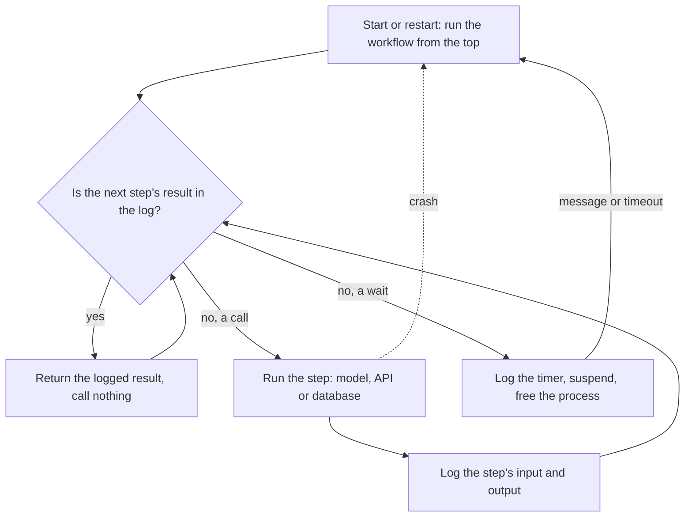

---
# Skeleton from Lead wtamray2 (Martin Fowler), picked 2026-11-16, drafted
# per docs/editorial/concept-writing-guide.md. published and reviewed are the
# pick time (make daily may move them to a Gap Day); make release keeps it
# (ADR-0012). verified: is the Author's alone (ADR-0007).
title: "Durable execution: how workflows survive crashes by replaying a log"
description: "Durable execution logs each step's result and replays a crashed program from that log, so workflows and agents can wait days without a process."
kind: concept
vertical: distributed-systems
tags: ["durable-execution", "workflows", "idempotency", "temporal", "ai-agents"]
published: "2026-11-16T09:41:23Z"
reviewed: "2026-11-16T09:41:23Z"
author: mira-vance
# Optional: an image HastCode may use, beside this file, replaces the
# generated title card. Never a Source's image.
# hero: concept-name.png
# hero_alt: "What the image shows"
# Optional: related Explainer slugs and extra sources (title + url).
related: [metastable-failures, agentic-development]
draft: true
---

In a [10 November 2026 article](https://martinfowler.com/articles/durable-execution-agents.html) on Martin Fowler's site, Kiran Prakash of Thoughtworks builds an agent called Stock Replenisher. When a part drops below safety stock, it [gets quotes, picks a supplier, asks the procurement manager to approve the price, places the order and follows it to delivery](https://martinfowler.com/articles/durable-execution-agents.html#running-example). In one run the agent asked the manager for approval, and [while it waited, the process crashed](https://martinfowler.com/articles/durable-execution-agents.html#making-the-loop-durable). It stayed down for a day. When it came back, nothing before the outage ran again: ["no new quotes, no second purchase order, no second request to the manager."](https://martinfowler.com/articles/durable-execution-agents.html#making-the-loop-durable) When the approval arrived, the agent placed the order. The crash had wiped everything the process held in memory. What carried the agent across that day was a log of every step it had already taken.

> Drafted with AI assistance, researched, verified and edited by the HastCode editorial team. We publish only as many pieces as the Author can verify this way.

## TL;DR

- **Durable execution** is a programming model in which the runtime [records the result of each step that interacts with the outside world](https://martinfowler.com/articles/durable-execution-agents.html#durable-execution), so that after a failure the program runs again and rebuilds its state from that record.
- On restart the runtime **replays** the code from the top: a step with a logged result [returns it from the log rather than running again](https://martinfowler.com/articles/durable-execution-agents.html#durable-execution), and real work resumes at the first unrecorded step. Waits are logged too, so a workflow can [wait for days using no CPU](https://martinfowler.com/articles/durable-execution-agents.html#waiting).
- Replay has rules and limits: workflow code [must be deterministic](https://docs.temporal.io/workflow-definition#deterministic-constraints), and Temporal [caps a run's history at 51,200 events or 50 MB](https://docs.temporal.io/workflow-execution/limits).
- It does not fix everything: retries are [at-least-once, so side effects need idempotency keys](https://martinfowler.com/articles/durable-execution-agents.html#retries); history needs bounding with [continue-as-new](https://docs.temporal.io/workflow-execution/continue-as-new) or snapshots; and code changes under running workflows [need versioning](https://martinfowler.com/articles/durable-execution-agents.html#change). Each is work you own.

## A log of every step that touches the outside world

Prakash defines durable execution as ["a programming model in which the runtime keeps a record of the result of each step that interacts with the outside world"](https://martinfowler.com/articles/durable-execution-agents.html#durable-execution). After a failure, the program runs again, completed steps are skipped, and its state is rebuilt from the record. Restate, one of the runtimes, describes the goal as making code fault-tolerant ["without changing how you write business logic"](https://docs.restate.dev/concepts/durable_execution).

Three terms. A **step** is any call to the outside world: a supplier's API, a database, a model. In Temporal a step is an **activity**, and Prakash's version [records the input and output of each one](https://martinfowler.com/articles/durable-execution-agents.html#making-the-loop-durable). The **workflow** is the code that calls the steps in order. The **log** is where results go: Temporal's Event History is ["an append-only log"](https://docs.temporal.io/workflow-execution/event#event-history) persisted by the Temporal Service, and Restate calls its log a [journal](https://docs.restate.dev/concepts/durable_execution).

The idea is old. Prakash points to the [write-ahead log](https://martinfowler.com/articles/durable-execution-agents.html#durable-execution): a database logs each change before applying it, so it can recover by reading the log, and durable execution does the same for a program's steps.

What does not count: a loop that survives only while its process does. Prakash's first, plain Python agent loop is correct, but it [works only while its process stays up](https://martinfowler.com/articles/durable-execution-agents.html#agentic-loop). Durable execution is the difference between that loop and one a crash cannot erase.

## Replay: run from the top, return what the log already knows

Walk Prakash's Temporal run through the diagram. Two kinds of call in his loop are steps: [the model's choice of the next tool and each tool's `execute`](https://martinfowler.com/articles/durable-execution-agents.html#making-the-loop-durable). Each goes through `execute_activity`, and the wait for the manager goes through `wait_condition`, which is recorded too.

On the first run, every step takes the **no** branch: the model chooses, quotes come back, a purchase order is drafted, the manager is asked, and each result is logged. Then the workflow reaches the approval wait and suspends. The process crashes and stays down for a day.

On restart the program [runs again from the top](https://martinfowler.com/articles/durable-execution-agents.html#durable-execution). Each recorded step takes the **yes** branch: the model is not asked again, no supplier is called, and each tool's `allowed` and `apply` rerun to rebuild the state. The first step with no record is the wait, so the workflow suspends again. When the approval arrives, `place_order` is the first unrecorded call, and it runs for real.

Waking costs little. In Prakash's measurements a waiting workflow [used no CPU](https://martinfowler.com/articles/durable-execution-agents.html#waiting). One still in memory woke in 14 ms on Temporal and about 0.1 s on Cloudflare; one rebuilt from its log took about two seconds on Cloudflare and under a tenth of a second on Temporal, growing with the log's length.

## The rule replay depends on: deterministic workflow code

Replay works only if the code asks for the same steps in the same order each time. Temporal's docs are direct: ["A Workflow Definition must be deterministic to support replay."](https://docs.temporal.io/workflow-definition#deterministic-constraints) On replay, the commands the code emits are compared with the existing Event History. If one does not match, the execution fails with a nondeterminism error; the docs' example is a timer and an activity swapped in a running workflow. Branching on local time or a random number can do the same, so the SDKs provide APIs that store those values in the history.

DBOS states the same contract: the workflow function [must be deterministic](https://docs.dbos.dev/architecture#how-workflow-recovery-works), invoking the same steps with the same inputs in the same order, with API calls and reads of the clock moved into steps.

Cloudflare Workflows keys its log by name. [Steps should be named deterministically](https://developers.cloudflare.com/workflows/build/rules-of-workflows/#name-steps-deterministically), because ["Step names act as the "cache key" in your Workflow."](https://developers.cloudflare.com/workflows/build/rules-of-workflows/#name-steps-deterministically) Workflows [may hibernate and lose all in-memory state](https://developers.cloudflare.com/workflows/build/rules-of-workflows/#do-not-rely-on-state-outside-of-a-step), so state must be built from the values steps return, and `Math.random()` or `Date.now()` outside a step [can cause unexpected behavior](https://developers.cloudflare.com/workflows/build/rules-of-workflows/#use-conditional-logic-carefully).

We infer the shared reason: the log answers "what did step N return?" If replay asks a different question, the log has no answer to give.

## Four runtimes, one log

Prakash names [Temporal, Restate, Inngest, DBOS and Cloudflare Workflows](https://martinfowler.com/articles/durable-execution-agents.html#durable-execution) as implementations, and builds his agent on two of them.

**Temporal** runs a workflow's steps as activities and records them in the Event History. Messages arrive as signals: the manager's approval is [a signal sent to the workflow by its ID](https://martinfowler.com/articles/durable-execution-agents.html#entity-and-workflow), `agent-SKU-123`.

**Cloudflare Workflows** uses [`step.do` for a step and `step.waitForEvent` for a wait](https://martinfowler.com/articles/durable-execution-agents.html#making-the-loop-durable). In Prakash's design the long-lived part of the agent is a [Durable Object reached by name](https://martinfowler.com/articles/durable-execution-agents.html#entity-and-workflow), and each replenishment is a Cloudflare Workflow.

**Restate** tracks every step in its journal, and if a function crashes it ["replays the journal, skipping completed steps and resuming from exactly where it left off."](https://docs.restate.dev/concepts/durable_execution)

**DBOS** stores [every workflow input and step output](https://docs.dbos.dev/architecture#how-workflow-recovery-works) in its system database and recovers workflows from their last completed step; a re-executed step with a checkpoint returns the checkpointed output instead of running.

Prakash splits his agent into two kinds of workflow. A **process workflow** does one piece of work and finishes: one replenishment. An **entity workflow** [represents one business entity for its lifetime](https://martinfowler.com/articles/durable-execution-agents.html#entity-and-workflow): one per SKU, checking stock and starting replenishments one at a time, and the stable address that replies come back to.

## Why long-running work ends up here

Agents, Prakash notes, [spend much of their time waiting](https://martinfowler.com/articles/durable-execution-agents.html#waiting): for the manager, the supplier, the delivery. With one agent per SKU, a manufacturer with thousands of parts has thousands of agents, almost all idle. Holding a process open for each one, for days, is the expensive way to wait.

Durable waits remove that cost. In his run, `WaitForSupplierReply` waits [seven days](https://martinfowler.com/articles/durable-execution-agents.html#waiting) for the supplier; it times out, the agent chases, and a reply arrives a day later. The timer and the message are both logged, so the wait survives a crash, and nothing runs while it lasts.

The other force is the glue you would write otherwise. Prakash tabulates [what can go wrong](https://martinfowler.com/articles/durable-execution-agents.html#what-can-go-wrong) for the agent. The first four, a process that does not survive, failed remote calls, a retry that repeats work and concurrency, are generic, and a durable runtime handles them. Without one, you write the code for recording, retries, timers and resuming yourself.

The model is what makes agents different. It [can decide how to recover](https://martinfowler.com/articles/durable-execution-agents.html#what-can-go-wrong), but only if the harness gives it the right input after a failure. We cover harnesses in [our harness engineering Explainer](/languages-runtimes/agentic-development/).

## Practice one: give every side effect an idempotency key

A durable runtime retries a failed step for you. Prakash's policy allows [six attempts, starting two seconds apart and doubling](https://martinfowler.com/articles/durable-execution-agents.html#retries), so a struggling supplier is not hammered; our [metastable failures Explainer](/distributed-systems/metastable-failures/) covers why that backoff matters.

What the runtime cannot do is make a retry safe. If the supplier accepts an order and the reply is lost, the step looks failed, and the retry orders again. That is [**at-least-once**, not **exactly-once**](https://martinfowler.com/articles/durable-execution-agents.html#retries). The fix is the [Idempotent Receiver](https://martinfowler.com/articles/patterns-of-distributed-systems/idempotent-receiver.html): the receiver ignores duplicate requests. In Prakash's harness it spots them by an [**idempotency key**](https://martinfowler.com/articles/durable-execution-agents.html#retries), which the harness keeps the same across attempts and replays. For `place_order`, the key is the purchase order number. In the run, the supplier is down on the first attempt; the retry reuses the number, and the supplier ends up with one order after two attempts.

The runtimes agree: Cloudflare says your steps [should (ideally) be idempotent](https://developers.cloudflare.com/workflows/build/rules-of-workflows/#ensure-apibinding-calls-are-idempotent), and DBOS that it should be [safe to retry them multiple times](https://docs.dbos.dev/architecture#how-workflow-recovery-works).

The cost: every receiver must honour the key, and a key only helps if the other system checks it. When retries run out, the agent still may not know what happened. Prakash's answer is a [`cancel_order` tool](https://martinfowler.com/articles/durable-execution-agents.html#unseen-outcomes), a compensating action in the style of a saga.

## Practice two: bound the history with continue-as-new or snapshots

Every step adds to the log, and replay reads all of it. Prakash warns that [rebuilding takes longer as the log grows](https://martinfowler.com/articles/durable-execution-agents.html#waiting). Temporal sets hard limits: a run's Event History is [limited to 51,200 events or 50 MB](https://docs.temporal.io/workflow-execution/limits), with a warning after 10,240 events or 10 MB, and the run is [terminated past the limit](https://docs.temporal.io/workflow-execution/event#event-history-limits).

**Continue-as-new** resets the count. It lets you ["checkpoint your Workflow's state and start a fresh Workflow"](https://docs.temporal.io/workflow-execution/continue-as-new): the new run keeps the Workflow Id, gets a new Run Id and its own Event History, and receives the state as arguments. Repeat it and a workflow can run forever. Temporal tells the code when it is time, through a [Continue-As-New Suggested](https://docs.temporal.io/workflow-execution/continue-as-new#when) check. Prakash's per-SKU entity workflow [calls `continue_as_new`](https://martinfowler.com/articles/durable-execution-agents.html#entity-and-workflow) after each cycle, carrying the SKU and past outcomes.

The general pattern is a [snapshot](https://martinfowler.com/articles/durable-execution-agents.html#waiting): save the state, drop the events behind it. Cloudflare's Durable Objects read their state from storage and keep no log. Process workflows mostly avoid the problem, because a replenishment ends.

The cost: you choose what crosses the boundary, and anything you leave out is gone from the new run. The model's view is a separate budget again; Prakash points to [tiered memory such as MemGPT and Letta](https://martinfowler.com/articles/durable-execution-agents.html#memory) for what the model sees.

## Practice three: version the code under running workflows

A suspended workflow was written by yesterday's code. In Prakash's words, ["Replay runs the new code against a log the old code wrote."](https://martinfowler.com/articles/durable-execution-agents.html#EssentialAndAccidentalComplexity)

His example: SKU-123 is waiting for approval of PO 4471, drafted after three quotes, when the team deploys a rule requiring four. On Temporal, the workflow [silently continued under the old rule](https://martinfowler.com/articles/durable-execution-agents.html#change). On Cloudflare, the loop checked each recorded decision against current rules, so the order failed and PO 4471 stayed a draft. Same change, two behaviours; he says teams must know which one their runtime has before they deploy.

His fix is to treat the log as a [published interface](https://martinfowler.com/bliki/PublishedInterface.html), as he [puts it](https://martinfowler.com/articles/durable-execution-agents.html#change), and use [Parallel Change](https://martinfowler.com/bliki/ParallelChange.html): add the new rule beside the old one, start new workflows on it while old ones finish under the old one, then remove the old one. Each replenishment records the `rules_version` it started under.

The runtimes give you tools for this. Temporal offers [Worker Versioning](https://docs.temporal.io/workflow-definition#worker-versioning), which it calls ["the recommended way to handle versioning"](https://docs.temporal.io/workflow-definition#worker-versioning), and [patching](https://docs.temporal.io/workflow-definition#workflow-patching). DBOS versions applications so that [workflows only recover to processes running compatible code](https://docs.dbos.dev/architecture#upgrading-workflow-code). Continue-as-new helps here too: Temporal suggests it [to avoid running on stale code](https://docs.temporal.io/workflow-execution/continue-as-new#when).

The cost: old code paths live until the last old workflow finishes.

## What durable execution is not

It is not correctness. Prakash's section title says it: [durable is not the same as correct](https://martinfowler.com/articles/durable-execution-agents.html#durable-is-not-correct). In one run, supplier A accepts an order and goes quiet; `place_order` fails after six attempts, the agent orders from supplier C, and A later confirms the first order by email. ["A persistent log records what the agent saw, not what actually happened."](https://martinfowler.com/articles/durable-execution-agents.html#unseen-outcomes)

It does not keep facts fresh. An approval can go stale during a wait, so Prakash's manager [approves a price with a ceiling](https://martinfowler.com/articles/durable-execution-agents.html#world-moves), $4.20 up to $4.41, and `place_order` re-fetches the quote before ordering.

It is not an actor restart. Erlang processes have an address and a mailbox, but they [are not durable](https://martinfowler.com/articles/durable-execution-agents.html#entity-and-workflow): a supervisor restarts one with fresh state. Durable execution restarts it with its history.

It is not a security boundary. A supplier email that steers the model is prompt injection, and durable execution [does not help with it per se](https://martinfowler.com/articles/durable-execution-agents.html#untrusted-text); the harness's allowed tools and approval rules do.

## What understanding durable execution makes possible

Once you see the log, a long workflow stops being a process you must keep alive and becomes a record you can resume. You can ask sharper questions of any design: which calls are steps, which steps have idempotency keys, what crosses a continue-as-new, and which version of the code will replay each running workflow.

You can measure it too. Watch event counts against Temporal's [10,240-event warning](https://docs.temporal.io/workflow-execution/limits), time how long a rebuilt workflow takes to wake, and count duplicates your receivers rejected by key.

Prakash's conclusion is that these agents are distributed systems, with the usual problems ["plus others that arise from non-determinism"](https://martinfowler.com/articles/durable-execution-agents.html#conclusion), and that domain expertise and architecture matter more than ever. The optimistic part: an agent can wait a week for a supplier, using no CPU, survive a day-long crash, and still place exactly one order, as long as you own the keys, the history and the versions. His article builds the same agent on [Temporal and Cloudflare Workflows](https://martinfowler.com/articles/durable-execution-agents.html#durable-execution), a good place to start.

## Sources

- Kiran Prakash, ["Long-horizon agents and durable execution"](https://martinfowler.com/articles/durable-execution-agents.html), martinfowler.com, 10 November 2026.
- Danilo Sato, ["Parallel Change"](https://martinfowler.com/bliki/ParallelChange.html), martinfowler.com bliki, 13 May 2014.
- Unmesh Joshi, ["Idempotent Receiver"](https://martinfowler.com/articles/patterns-of-distributed-systems/idempotent-receiver.html), Patterns of Distributed Systems, 23 November 2023.
- Martin Fowler, ["Published Interface"](https://martinfowler.com/bliki/PublishedInterface.html), martinfowler.com bliki, 26 December 2003.
- Temporal, ["Workflow Definition"](https://docs.temporal.io/workflow-definition), documentation.
- Temporal, ["Events and Event History"](https://docs.temporal.io/workflow-execution/event), documentation.
- Temporal, ["Workflow Execution limits"](https://docs.temporal.io/workflow-execution/limits), documentation.
- Temporal, ["Continue-As-New"](https://docs.temporal.io/workflow-execution/continue-as-new), documentation.
- Cloudflare, ["Rules of Workflows"](https://developers.cloudflare.com/workflows/build/rules-of-workflows/), Cloudflare Workflows documentation.
- Restate, ["Key Concepts"](https://docs.restate.dev/concepts/durable_execution), documentation.
- DBOS, ["DBOS Architecture"](https://docs.dbos.dev/architecture), documentation.
