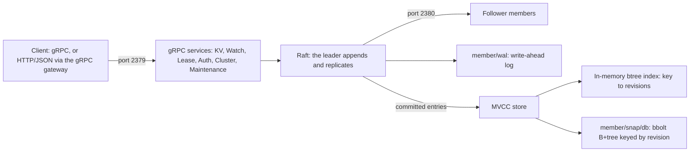

TODO(author): verify every claim against its source, then remove draft: true and this line.

etcd 3.7.0 [boots entirely from the v3 store](https://etcd.io/blog/2026/announcing-etcd-3.7/) and [removes the v2 store outright](https://etcd.io/docs/v3.7/upgrades/upgrade_3_7/); the only way there is a rolling upgrade from a cluster already on [v3.6.11 or later](https://etcd.io/docs/v3.7/upgrades/upgrade_3_7/), because etcd [upgrades one minor version at a time](https://etcd.io/docs/v3.7/upgrades/upgrade_3_7/).

> Drafted with AI assistance, researched, verified and edited by the HastCode editorial team. We publish only as many pieces as the Author can verify this way.

## TL;DR

- etcd is a [distributed, reliable key-value store for the most critical data of a distributed system](https://github.com/etcd-io/etcd#readme): a Go server that uses [Raft](https://github.com/etcd-io/etcd#readme) to keep one replicated log across an odd number of members.
- Writes are [linearizable and durable by default](https://etcd.io/docs/v3.7/learning/api_guarantees/), every key keeps its history under [multi-version concurrency control](https://etcd.io/docs/v3.7/learning/data_model/), and watches are [ordered, reliable and resumable](https://etcd.io/docs/v3.7/learning/api_guarantees/): the three things the project's own [comparison page](https://etcd.io/docs/v3.7/learning/why/) says ZooKeeper and Consul lack.
- It is sized for coordination data, not for a database: a [2 GiB default quota, 8 GiB suggested maximum and 1.5 MiB per request](https://etcd.io/docs/v3.7/dev-guide/limit/).
- Adopt it, with or without Kubernetes, for configuration, service discovery, locks and leader election on dedicated SSD-backed machines. [Past a few gigabytes, or when you need SQL](https://etcd.io/docs/v3.7/learning/why/), the project itself points you to a NewSQL database.

## In 60 seconds

These commands from the README's [Running etcd](https://github.com/etcd-io/etcd#running-etcd) section assume a [release binary](https://github.com/etcd-io/etcd/releases/tag/v3.7.0) unpacked to `/tmp/etcd-download-test`. They move it onto the path, start a single member listening on [2379 for clients and 2380 for peers](https://github.com/etcd-io/etcd#etcd-tcp-ports), then write and read one key with `etcdctl`. The Go client is a separate [`go get`](https://github.com/etcd-io/etcd#install-etcd-client-v3).

```sh
mv /tmp/etcd-download-test/etcd /usr/local/bin/
etcd

etcdctl put mykey "this is awesome"
etcdctl get mykey
```

## Architecture

Walk the diagram left to right. A client talks [gRPC](https://etcd.io/docs/v3.7/learning/api/) on port 2379 to six services: KV, Watch, Lease, Auth, Cluster and Maintenance. Anything without gRPC uses the [gRPC gateway](https://etcd.io/docs/v3.7/dev-guide/api_grpc_gateway/), which turns HTTP/JSON under `/v3/` into the same calls. The client [does not need to know which member leads](https://etcd.io/docs/v3.7/faq/): followers forward writes to the leader.

A write enters Raft. The leader appends the proposal to its write-ahead log under [`member/wal/`](https://etcd.io/docs/v3.7/learning/persistent-storage-files/) and replicates it to peers on port 2380; it commits once [a majority of members has persisted it](https://etcd.io/docs/v3.7/op-guide/hardware/). Each write is fsynced to the log, which is why the FAQ treats [disk latency as part of leader liveness](https://etcd.io/docs/v3.7/faq/).

Committed entries are applied to the MVCC store. Its physical form is [`member/snap/db`, a bbolt B+tree](https://etcd.io/docs/v3.7/learning/persistent-storage-files/) whose entries are [keyed by revision, not by user key](https://etcd.io/docs/v3.7/learning/data_model/), so old versions stay readable until [compaction](https://etcd.io/docs/v3.7/learning/data_model/) removes them; a [`consistent_index`](https://etcd.io/docs/v3.7/learning/persistent-storage-files/) in the file records how far the log has been applied. A secondary [in-memory btree index](https://etcd.io/docs/v3.7/learning/data_model/) maps each key to its revisions.

Reads are [linearizable by default](https://etcd.io/docs/v3.7/learning/api_guarantees/) and go through quorum; a `serializable` read is [served locally by any member](https://etcd.io/docs/v3.7/learning/api/) and may be stale. Watches stream [PUT and DELETE events by revision](https://etcd.io/docs/v3.7/learning/api/), and leases [delete their keys when a client stops sending keep-alives](https://etcd.io/docs/v3.7/learning/api/).



## Use it if

- You need a small, strongly consistent store for configuration, service discovery, locks or leader election: the [comparison page](https://etcd.io/docs/v3.7/learning/why/) frames etcd as "distributed system coordination and metadata storage", and the server ships [Lock and Election RPCs](https://etcd.io/docs/v3.7/dev-guide/api_concurrency_reference_v3/) whose keys and revisions you can check inside a transaction.
- You want to run it without Kubernetes and wonder whether anyone does: the project's [adopters list](https://github.com/etcd-io/etcd/blob/main/ADOPTERS.md) has Vonage on "vault backend, system configuration for microservices, scheduling, locks", Grab and Yandex on "system configuration for services, service discovery", and PingCAP's PD, which embeds it.
- You want history you can trust: MVCC keeps [every revision until compaction](https://etcd.io/docs/v3.7/learning/data_model/), and watches are [ordered, unique, reliable and resumable](https://etcd.io/docs/v3.7/learning/api_guarantees/) within that history.
- You can give it dedicated, SSD-backed machines: the [hardware guide](https://etcd.io/docs/v3.7/op-guide/hardware/) calls fast disks the most critical factor and starts its sizing table at two vCPUs and 8 GB for under 200 requests a second.

## Don't use it if

- You are storing more than a few gigabytes or need SQL: the project says [choose a NewSQL database](https://etcd.io/docs/v3.7/learning/why/) such as CockroachDB or TiDB. The default quota is [2 GiB, 8 GiB the suggested maximum](https://etcd.io/docs/v3.7/dev-guide/limit/); past it, etcd [raises a NOSPACE alarm and accepts only reads and deletes](https://etcd.io/docs/v3.7/op-guide/maintenance/).
- You want the whole service-discovery product: Consul bundles [health checks, failure detection and DNS](https://etcd.io/docs/v3.7/learning/why/), which etcd leaves to you; use Consul, and keep etcd for the consistent store underneath.
- You expect `Lock` alone to fence an external resource: the Jepsen write-up says the etcd lock [only safely guarantees mutual exclusion inside etcd's own keyspace and transactions with revision checking](https://etcd.io/blog/2020/jepsen-343-results/); carry the lock key's revision into the resource as a fencing token, or let the resource lock itself.
- Your members must span regions or share slow disks: the FAQ says [disk latency is part of leader liveness, by design](https://etcd.io/docs/v3.7/faq/), and cross-region clusters [pay in consensus latency and retuned timeouts](https://etcd.io/docs/v3.7/faq/). The NewSQL class is [built to scale across data centers](https://etcd.io/docs/v3.7/learning/why/); use it there.

## Alternatives

- [Apache ZooKeeper](https://zookeeper.apache.org): solves [the same coordination problem](https://etcd.io/docs/v3.7/learning/why/) on the JVM with its own Jute RPC protocol; no multi-version data model, no linearizable reads, and membership reconfiguration only in versions above 3.5.0.
- [HashiCorp Consul](https://www.consul.io): an [end-to-end service discovery framework](https://etcd.io/docs/v3.7/learning/why/) with health checks and DNS, whose key-value API lacks multi-version keys, conditional transactions and reliable streaming watches.
- [CockroachDB](https://www.cockroachlabs.com): the [NewSQL](https://etcd.io/docs/v3.7/learning/why/) answer, SQL over terabytes across data centers, with read linearization that rests on clock barriers rather than one network round trip.
- [TiDB](https://github.com/pingcap/tidb): the other [NewSQL](https://etcd.io/docs/v3.7/learning/why/) database etcd names; its placement driver, PD, [embeds etcd](https://github.com/etcd-io/etcd/blob/main/ADOPTERS.md) for its own metadata.

## FAQ

### Is etcd production ready?

Yes. etcd [patches three minor branches at once](https://etcd.io/blog/2026/sep-21-patch-release/), and its consistency has been checked by [Jepsen](https://etcd.io/blog/2020/jepsen-343-results/) and by [deterministic fault injection](https://etcd.io/blog/2025/autonomus_testing_with_antithesis/); Linux on AMD64 and ARM64 are its [Tier 1 platforms](https://etcd.io/docs/v3.7/op-guide/supported-platform/).

### Can I use etcd without Kubernetes?

Yes. etcd's [adopters list](https://github.com/etcd-io/etcd/blob/main/ADOPTERS.md) names Vonage, Grab, Yandex and Qiniu using it for configuration, discovery and locks, and [Patroni, Apache APISIX, CoreDNS and Vitess](https://etcd.io/docs/v3.7/integrations/) build on it.

### How much data can etcd store?

A few gigabytes. etcd's default quota is [2 GiB, 8 GiB the suggested maximum, 1.5 MiB per request](https://etcd.io/docs/v3.7/dev-guide/limit/); past the quota it [stops accepting writes](https://etcd.io/docs/v3.7/op-guide/maintenance/) until you compact, defragment and disarm.

### How many etcd members do I need?

Three or five. etcd needs a majority: [three members tolerate one failure, five tolerate two](https://etcd.io/docs/v3.7/faq/), an even count adds nothing, and the FAQ suggests [no more than seven](https://etcd.io/docs/v3.7/faq/).

### What are the alternatives to etcd?

etcd's own [comparison](https://etcd.io/docs/v3.7/learning/why/) names Apache ZooKeeper (same problem, JVM, no MVCC), HashiCorp Consul (a discovery framework with a weaker key-value API) and NewSQL databases such as CockroachDB and TiDB (SQL, terabytes).

### How does etcd compare to Consul?

etcd's [comparison page](https://etcd.io/docs/v3.7/learning/why/) says Consul's key-value API "lacks multi-version keys, conditional transactions, and reliable streaming watches" and calls etcd "a better choice over Consul" for a consistent store; Consul wins when you want health checks and DNS.

### Who maintains etcd, and how is it licensed?

etcd is [Apache 2.0](https://github.com/etcd-io/etcd#license), a [CNCF project](https://etcd.io/) and a [Kubernetes Special Interest Group, SIG-etcd](https://etcd.io/blog/2025/announcing-etcd-3.6/); Signals has its contributors and releases.

## Verdict

Adopt etcd outside Kubernetes when the data is coordination-sized and the guarantees are the point: configuration, service discovery, locks and leader election for a few gigabytes at most, on three or five dedicated, SSD-backed members in one data center. You get linearizable writes, revision history, reliable watches and a release train that patches three minor branches at once, in one Go binary that the Kubernetes project now maintains as [SIG-etcd](https://etcd.io/blog/2025/announcing-etcd-3.6/). We would not adopt it as a general database, for anything near the 8 GiB ceiling, or with a bare `Lock` guarding an external resource. A supported storage ceiling well past 8 GiB would widen that recommendation; a slip in the three-branch patch cadence, visible in Changelog, would narrow it.

## Sources

- [etcd README](https://github.com/etcd-io/etcd#readme)
- [etcd ADOPTERS](https://github.com/etcd-io/etcd/blob/main/ADOPTERS.md)
- [v3.7.0 release page](https://github.com/etcd-io/etcd/releases/tag/v3.7.0)
- [Announcing etcd v3.7.0](https://etcd.io/blog/2026/announcing-etcd-3.7/)
- [Upgrade etcd from v3.6 to v3.7](https://etcd.io/docs/v3.7/upgrades/upgrade_3_7/)
- [etcd patch releases v3.7.2, v3.6.15 and v3.5.34](https://etcd.io/blog/2026/sep-21-patch-release/)
- [Announcing etcd v3.6.0](https://etcd.io/blog/2025/announcing-etcd-3.6/)
- [etcd versus other key-value stores](https://etcd.io/docs/v3.7/learning/why/)
- [etcd data model](https://etcd.io/docs/v3.7/learning/data_model/)
- [etcd API](https://etcd.io/docs/v3.7/learning/api/)
- [etcd API guarantees](https://etcd.io/docs/v3.7/learning/api_guarantees/)
- [etcd persistent storage files](https://etcd.io/docs/v3.7/learning/persistent-storage-files/)
- [etcd system limits](https://etcd.io/docs/v3.7/dev-guide/limit/)
- [etcd gRPC gateway](https://etcd.io/docs/v3.7/dev-guide/api_grpc_gateway/)
- [etcd concurrency API reference](https://etcd.io/docs/v3.7/dev-guide/api_concurrency_reference_v3/)
- [etcd maintenance guide](https://etcd.io/docs/v3.7/op-guide/maintenance/)
- [etcd hardware recommendations](https://etcd.io/docs/v3.7/op-guide/hardware/)
- [etcd supported platforms](https://etcd.io/docs/v3.7/op-guide/supported-platform/)
- [etcd FAQ](https://etcd.io/docs/v3.7/faq/)
- [etcd integrations](https://etcd.io/docs/v3.7/integrations/)
- [Latest Jepsen results against etcd 3.4.3](https://etcd.io/blog/2020/jepsen-343-results/)
- [Autonomous testing of etcd's robustness](https://etcd.io/blog/2025/autonomus_testing_with_antithesis/)
- [etcd.io](https://etcd.io/)
