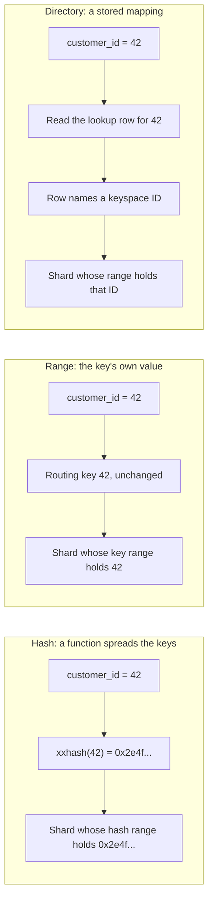

---
# Skeleton from Lead oqyj2tvr (PlanetScale blog), picked 2026-10-27.
# Follow docs/editorial/comparison-writing-guide.md (placeholders
# replaced). published and reviewed are the pick time, provisional: set them
# when you publish. verified: is the Author's alone (ADR-0007).
title: "Hash, range and directory sharding: which queries stay on one shard"
description: "How hash, range and directory sharding route a key to a shard, which queries each keeps on one shard, and how to choose from your access patterns."
kind: comparison
vertical: distributed-systems
tags: ["sharding", "postgres", "vitess", "mongodb", "shard-keys"]
published: "2026-10-27T17:47:19Z"
reviewed: "2026-10-27T17:47:19Z"
author: mira-vance
# Optional: an image HastCode may use, beside this file, replaces the
# generated title card. Never a Source's image.
# hero: option-a-vs-option-b.png
# hero_alt: "What the image shows"
# Optional: related Explainer slugs and extra sources (title + url).
# related: [metastable-failures]
draft: true
---

In PlanetScale's storefront example, `customers` and `orders` were each sharded by a hash of their own `id`, so a customer's orders could be spread across all four shards and the router had to join them itself. Sharding `orders` by `customer_id` instead let each shard run the join locally: [four shard requests instead of eight](https://planetscale.com/blog/the-lifecycle-of-a-sharded-postgres-query#title-a-better-topology). The stakes are more than speed. In Neki, PlanetScale's sharded Postgres, a transaction that stays on one shard keeps full Postgres semantics, while one that reaches two shards gets [no atomic commit and no shared snapshot](https://planetscale.com/blog/shard-groups-the-unit-of-co-location#co-locating-related-tables). Rohit Nayak's conclusion is the principle this piece builds on: "[Shard group design starts from your queries, not your tables](https://planetscale.com/blog/shard-groups-the-unit-of-co-location#putting-it-all-together)." So once you know your queries, which scheme should map a key to a shard: a hash, a range, or a directory? We answer the same questions for all three, from Neki's, Vitess's and MongoDB's own documentation.

> Drafted with AI assistance, researched, verified and edited by the HastCode editorial team. We publish only as many pieces as the Author can verify this way.

## TL;DR

- **Hash sharding** runs the shard key through a hash function and gives each shard a range of hash values, so rows spread evenly, but neighbouring keys land on different shards.
- **Range sharding** uses the key's own value, so neighbouring keys share a shard and range queries stay targeted, but a key that only grows sends every new insert to one shard.
- **Directory sharding** stores the key-to-shard mapping in a table, so a column other than the shard key can route a query, at the price of an extra read on lookups and an extra write on inserts and deletes.
- They differ most on which queries stay on one shard: hash keeps equality on the key, range keeps scans over the key, and a directory keeps lookups on whatever it indexes.
- We infer: start with a hash on the key your most important transactions share, use range only when your queries scan that key's order, and add a directory for the few access paths the shard key cannot serve.

## Three ways to turn one key into one shard

All three schemes answer the same routing question. In Neki, a [shard index](https://planetscale.com/blog/what-is-a-data-topology#what-is-a-data-topology) turns the shard key into a routing key, and a shard group assigns each shard a range of routing keys. Vitess works the same way: a Vindex maps a column value to a keyspace ID, and [each shard covers a range of keyspace IDs](https://vitess.io/docs/24.0/reference/features/vindexes/#a-vindex-maps-column-values-to-keyspace-ids). The schemes differ only in how the key becomes a routing key.

The diagram follows `customer_id = 42` through each. With xxhash, 42 becomes `0x2e4fe982b68910ac`, which falls in shard 1's range; with a range index, 42 is used directly and also falls in shard 1's range ([PlanetScale's worked example](https://planetscale.com/blog/what-is-a-data-topology#shard-indexes), whose own figure draws the hash and range paths beside a modulo one). A directory reads a stored row instead. In Vitess, a [lookup Vindex is a table](https://vitess.io/docs/24.0/reference/features/vindexes/#functional-and-lookup-vindex) that maps a column value to keyspace IDs.

## Hash sharding: a function spreads the keys

Neki's recommended index is xxhash, which [distributes rows uniformly across the 64-bit keyspace](https://planetscale.com/blog/shard-groups-the-unit-of-co-location#beyond-xxhash). A shard group splits that keyspace with [hexadecimal prefixes](https://planetscale.com/blog/what-is-a-data-topology#shard-groups): `80` expands to `0x8000000000000000`, the midpoint, so a two-shard group gives each shard half. Vitess offers [`xxhash`, `hash` and `binary_md5`](https://vitess.io/docs/24.0/reference/features/vindexes/#predefined-vindexes) among its functional Vindexes, and MongoDB a [hashed shard key](https://www.mongodb.com/docs/manual/core/hashed-sharding/#hashed-sharding) that the server hashes for you.

The hash can run on an expression, not just a column. Neki's catalog example hashes [`lower(sku)`](https://planetscale.com/blog/shard-groups-the-unit-of-co-location#sql-expressions-in-shard-indexes), so `AB-1042` and `ab-1042` land on the same shard, and, where the store ID is the order ID's first four characters, hashing `left(order_id, 4)` keeps every order of one store together.

Co-location follows from using the same function. When two tables in one Neki shard group [hash their shard keys the same way](https://planetscale.com/blog/shard-groups-the-unit-of-co-location), rows with the same key value always land on the same shard. That is how a customer's orders, items and addresses end up beside the customer row.

Modulo is the textbook cousin. It maps a key to a [fixed number of buckets with `value % modulus`](https://planetscale.com/blog/shard-groups-the-unit-of-co-location#beyond-xxhash), and PlanetScale does not recommend it for most systems at scale, for reasons we come to under resharding.

## Range sharding: the key's own order decides

A Neki range index [uses an integer value directly, without hashing it](https://planetscale.com/blog/what-is-a-data-topology#shard-indexes), and the shard group maps key ranges straight to shards. PlanetScale's example allots merchant IDs by geography: [IDs 0 to 10,000 go to `eu-1` and 10,000 to 20,000 to `us-1`](https://planetscale.com/blog/shard-groups-the-unit-of-co-location#beyond-xxhash). PlanetScale calls range and modulo [less common](https://planetscale.com/blog/shard-groups-the-unit-of-co-location#beyond-xxhash), supported so that applications already sharded that way can move to Neki.

MongoDB makes range the default: range-based sharding is [the default methodology](https://www.mongodb.com/docs/manual/core/ranged-sharding/#ranged-sharding) unless hashed sharding or zones are configured. Documents with close shard key values are likely to share a chunk or shard, which makes reads over a contiguous range efficient.

MongoDB's guidance says when range works: the shard key should have [large cardinality, low frequency, and values that do not change monotonically](https://www.mongodb.com/docs/manual/core/ranged-sharding/#shard-key-selection). Each condition guards against a different hot spot, and we take them in turn below.

Vitess has no range Vindex by that name, but its [`numeric` Vindex is an identity function](https://vitess.io/docs/24.0/reference/features/vindexes/#predefined-vindexes): the number itself becomes the keyspace ID, which we infer gives the same contiguous placement as a range index.

## Directory sharding: a table remembers where each key lives

A directory replaces the function with a stored mapping. Vitess's [lookup Vindex](https://vitess.io/docs/24.0/reference/features/vindexes/#functional-and-lookup-vindex) is a MySQL table that maps a column value to keyspace IDs; when a row is inserted, its computed keyspace ID is stored against the column value. The lookup table can itself be sharded, and the lookup row is [most likely not on the same shard](https://vitess.io/docs/24.0/reference/features/vindexes/#lookup-vindex-types) as the row it points to. A static map, [`numeric_static_map`](https://vitess.io/docs/24.0/reference/features/vindexes/#predefined-vindexes), maps numbers to keyspace IDs from a JSON document; Vitess classes it as a functional Vindex at cost 1, not a lookup, but we file it here because the mapping is stored rather than computed. It can fall back to a functional Vindex such as `xxhash` for keys not in the map.

Neki's version is the [global secondary index (GSI)](https://planetscale.com/blog/shard-groups-the-unit-of-co-location#queries-without-shard-keys): a lookup table Neki maintains that maps one or more columns to the table's shard key. In the storefront, `orders` is hashed on `customer_id`, so `WHERE id = 84213` would fan out to every shard. With a GSI on the order `id`, the lookup table, itself hashed on the order `id`, returns the `customer_id`, and the hash of that finds the order.

A directory usually sits beside a hash, not instead of one. Vitess's docs say it is [generally not recommended to use a lookup Vindex as the Primary Vindex](https://vitess.io/docs/24.0/reference/features/vindexes/#independence), the one that decides where a row is stored, and Neki's GSI points to a shard key, not to a shard.

## Which queries stay on one shard

This is the question the Lead puts first, and each scheme answers it differently.

**Hash** keeps equality on the shard key. MongoDB [can target equality matches to a single shard](https://www.mongodb.com/docs/manual/core/hashed-sharding/#hashed-sharding), but close key values are unlikely to share a shard, so a ranged query is more likely to be broadcast. With co-located tables, a single customer's joins and transactions [never leave the shard](https://planetscale.com/blog/shard-groups-the-unit-of-co-location#co-locating-related-tables).

**Range** keeps scans over the shard key as well as equality, because [close values are likely to share a chunk](https://www.mongodb.com/docs/manual/core/ranged-sharding/#ranged-sharding). We infer that a query for merchants 100 to 200 in PlanetScale's example touches only `eu-1`.

**Directory** keeps lookups on a column that is not the shard key. Without a secondary Vindex, Vitess's router would have to [scatter the query to all shards](https://vitess.io/docs/24.0/reference/features/vindexes/#secondary-vindexes); with Neki's GSI, the order lookup costs [two single-shard reads](https://planetscale.com/blog/shard-groups-the-unit-of-co-location#queries-without-shard-keys).

Any scheme broadcasts a query that carries none of its keys. MongoDB calls these scatter-gather queries, which [do not scale linearly as shards are added](https://www.mongodb.com/docs/manual/core/sharding-choose-a-shard-key/#sharding-query-patterns), though they can suit large aggregations that run in parallel.

## Where hot spots come from

A hot spot is one shard taking more than its share of data or traffic.

**Hash** spreads keys evenly, which is why MongoDB calls hashed keys [ideal for fields that change monotonically](https://www.mongodb.com/docs/manual/core/hashed-sharding/#hashed-sharding-shard-key), like ObjectId values or timestamps. It cannot spread one popular value: [each unique shard key value lives in a single chunk](https://www.mongodb.com/docs/manual/core/sharding-choose-a-shard-key/#shard-key-cardinality), and we infer that a hash moves a hot key, never splits it.

**Range** is exposed to all three of MongoDB's conditions. With an always-increasing key, [all new inserts go to the chunk bounded by `maxKey`](https://www.mongodb.com/docs/manual/core/sharding-choose-a-shard-key/#monotonically-changing-shard-keys), and that shard becomes the write bottleneck. Low cardinality caps the cluster: sharding on a continent field allows [no more than 7 chunks, so no more than 7 effective shards](https://www.mongodb.com/docs/manual/core/sharding-choose-a-shard-key/#shard-key-cardinality). And if most documents share a few values, [those chunks become bottlenecks](https://www.mongodb.com/docs/manual/core/sharding-choose-a-shard-key/#shard-key-frequency) that may grow too large to split.

**Directory** places keys wherever its rows say. None of our Sources describes how a directory balances load; we infer that balance is then your job, and that a static map such as `numeric_static_map` is a way to place a few known-heavy keys by hand while the fallback hash spreads the rest. The lookup table is also a table that every routed query reads, so it needs its own shard key: in Neki, the GSI's lookup table [has its own shard index on the order `id`](https://planetscale.com/blog/shard-groups-the-unit-of-co-location#queries-without-shard-keys).

## What a lookup costs on every read and write

**Hash and range** compute the shard from the key. Nothing extra is stored, and Vitess's planner rates a [functional Vindex at cost 1 and an identity Vindex at 0](https://vitess.io/docs/24.0/reference/features/vindexes/#cost), the cheapest routes it can choose.

**Directory** pays on both sides. Vitess lists the price of an owned unique lookup as [an extra write to the lookup table on insert and delete, and an extra lookup on reads](https://vitess.io/docs/24.0/reference/features/vindexes/#independence), and rates lookup Vindexes at cost 10 (unique) and 20 (non-unique). It also says the price may be worth paying to keep high-QPS reads from going to every shard, and that the overhead is amortized as the number of shards grows.

Consistency is the harder cost. Because the lookup row usually sits on another shard, Vitess says maintaining it [essentially results in distributed transactions, which traditionally require 2PC](https://vitess.io/docs/24.0/reference/features/vindexes/#lookup-vindex-types). Its `consistent_lookup` Vindexes avoid two-phase commit with careful locking and ordered commits, with one limit: they [cannot support an insert followed by an update or delete](https://vitess.io/docs/24.0/reference/features/vindexes/#consistent-lookup-usage) of the same lookup value in one transaction. Neki [writes the GSI's lookup row in the same request](https://planetscale.com/blog/shard-groups-the-unit-of-co-location#queries-without-shard-keys) as the `orders` row, and only writes to `orders` change it. The post does not say what happens if one of those two shard commits fails; given Neki's [per-shard commits](https://planetscale.com/blog/shard-groups-the-unit-of-co-location#co-locating-related-tables), we infer that this is the case to test.

## Changing the shard count or the shard key later

PlanetScale's advice is not to treat the first design as final: the [Reshard workflow](https://planetscale.com/blog/shard-groups-the-unit-of-co-location) can change a table's shard key or shard count, which "you'll likely need to do as your queries evolve."

**Hash** with key ranges grows by splitting ranges. We infer that splitting `00–80` into two halves only divides the rows of that range, whereas modulo, by PlanetScale's account, [moves nearly every row](https://planetscale.com/blog/shard-groups-the-unit-of-co-location#beyond-xxhash) when the modulus changes. Neki's Reshard copies the declared tables into a new shard group, [streams new writes, then switches traffic](https://planetscale.com/docs/neki/data-migration#from-copy-to-streaming), so the application stays online either way.

**Range** rebalances by moving ranges. In MongoDB, [the balancer migrates ranges between shards](https://www.mongodb.com/docs/manual/core/ranged-sharding/#shard-a-populated-collection), and since MongoDB 5.0 [`reshardCollection` changes a collection's shard key](https://www.mongodb.com/docs/manual/core/sharding-choose-a-shard-key/#choose-a-shard-key).

**Directory** is the slowest to reshard as a primary. Vitess says a lookup Primary Vindex is ["too slow for resharding"](https://vitess.io/docs/24.0/reference/features/vindexes/#independence) and, if unavoidable, recommends storing a keyspace ID column in the tables so the target shard can be computed. A secondary directory has its own migration step: Neki [backfills the GSI's lookup table](https://planetscale.com/blog/shard-groups-the-unit-of-co-location#queries-without-shard-keys) before it is enabled on a table with rows, and Vitess has a [`write_only` mode](https://vitess.io/docs/24.0/reference/features/vindexes/#predefined-vindexes) for the backfill.

A row's own key matters too: Vitess [cannot update a Primary Vindex column](https://vitess.io/docs/24.0/reference/features/vindexes/#the-primary-vindex), because that would move the row to another shard.

## Trade-offs

Each cell summarises a section above, where its source is linked.

| Question | Hash | Range | Directory |
|---|---|---|---|
| How the key becomes a shard | A hash function, then a range of hash values | The key's own value, then a key range | A stored row maps the value to a keyspace ID or shard key |
| Stays on one shard | Equality on the shard key | Equality and scans over the shard key | Lookups on the indexed column, in two single-shard reads (Neki GSI) |
| Spread of data | Even; one hot key still lands on one shard | Uneven for monotonic, low-cardinality or high-frequency keys | Whatever the rows say; not described in our Sources |
| Extra cost per operation | None (Vitess cost 1) | None (Vitess identity cost 0) | Extra write on insert and delete, extra read on lookup (cost 10 or 20) |
| Consistency of the routing data | Nothing stored | Nothing stored | A cross-shard write; Vitess offers `consistent_lookup` without 2PC |
| Changing the layout | Split key ranges; modulo moves nearly every row | Move or split ranges | "Too slow for resharding" as a Primary Vindex; backfill as a secondary |
| Where you meet it | Neki `xxhash`, Vitess `xxhash`, MongoDB hashed | Neki `range`, MongoDB default, Vitess `numeric` | Vitess lookup Vindexes and `numeric_static_map`, Neki GSI |

## When to use hash, range or a directory

Everything in this section is our inference from the Sources above, not a benchmark.

**Use a hash when your most important transactions share one key**, such as a customer, a tenant or an account, and they read it by equality. Put every table that carries the key in one group, as PlanetScale does with the storefront, and those transactions keep single-shard semantics. Watch for queries that scan across key values, and for one key so busy that a shard of its own would not hold it.

**Use a range when your queries walk the key's order**, or when placement itself carries meaning, like PlanetScale's merchant IDs allotted by region. Avoid it for keys that only grow, such as timestamps or sequence IDs, and for keys with few distinct values; MongoDB's own fix for the first is a hash, and for the second a key with higher cardinality.

**Use a directory for the access paths your shard key cannot serve**, like the support ticket that arrives with only an order ID, or to pin a few known keys while a hash places the rest. Add it per query pattern, not per column: each one adds a write to every insert and delete, and a consistency question to test.

The encouraging part is that none of this is a one-way door. Neki's Reshard changes a shard key while the source keeps serving traffic, and MongoDB's `reshardCollection` changes one too, so you can start from today's queries and reshard when they change.

## Sources

- Rohit Nayak, [Shard design doesn't start from your tables](https://planetscale.com/blog/shard-groups-the-unit-of-co-location), PlanetScale blog, 23 October 2026: Co-locating related tables, SQL expressions in shard indexes, Beyond xxhash, Queries without shard keys, Changing data placement, Putting it all together.
- Harshit Gangal and Ahmed Darwich, [What is a data topology?](https://planetscale.com/blog/what-is-a-data-topology), PlanetScale blog, 17 August 2026: Shard indexes, Shard groups.
- PlanetScale Engineering, [The lifecycle of a sharded Postgres query](https://planetscale.com/blog/the-lifecycle-of-a-sharded-postgres-query), PlanetScale blog, 10 September 2026: A better topology.
- PlanetScale, [Neki data migration](https://planetscale.com/docs/neki/data-migration) documentation: From copy to streaming, Moving traffic.
- Vitess, [Vindexes](https://vitess.io/docs/24.0/reference/features/vindexes/), v24.0 reference documentation: The Primary Vindex, Secondary Vindexes, Functional and Lookup Vindex, Lookup Vindex types, Consistent Lookup usage, Independence, Cost, Predefined Vindexes.
- MongoDB, [Hashed Sharding](https://www.mongodb.com/docs/manual/core/hashed-sharding/), [Ranged Sharding](https://www.mongodb.com/docs/manual/core/ranged-sharding/) and [Choose a Shard Key](https://www.mongodb.com/docs/manual/core/sharding-choose-a-shard-key/), MongoDB 9.0 manual.
