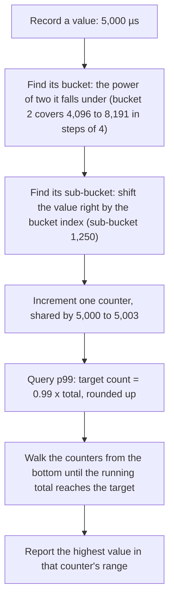

---
# Skeleton from Lead ttnqkebn (PostgreSQL news), picked 2026-10-27.
# published and reviewed are the pick time, provisional: set them
# when you publish. verified: is the Author's alone (ADR-0007).
title: "HDR histograms: measuring tail latency with bounded error"
description: "An HDR histogram records latency to a fixed number of significant digits, so tail percentiles stay accurate and histograms merge without loss."
kind: concept
vertical: distributed-systems
tags: ["latency", "percentiles", "histograms", "observability", "benchmarking"]
published: "2026-10-27T17:47:18Z"
reviewed: "2026-10-27T17:47:18Z"
author: mira-vance
# Optional: an image HastCode may use, beside this file, replaces the
# generated title card. Never a Source's image.
# hero: concept-name.png
# hero_alt: "What the image shows"
# Optional: related Explainer slugs and extra sources (title + url).
related: [metastable-failures]
draft: true
---

In a 30-second benchmark against a local Apache server, Gil Tene [suspended the server for 1.4 seconds](https://github.com/giltene/wrk2/blob/master/README.md) by pressing ^Z on its process. His load generator, wrk2, sent 2,000 requests per second throughout and recorded every response in two histograms. Measured the way many load generators do, from the moment each request was actually sent, the run had a median of 3.02 ms, a 99th percentile of 6.04 ms and a mean of 6.588 ms. Measured from the moment each request [should have been sent](https://github.com/giltene/wrk2/blob/master/README.md), the same run had a median of 8.61 ms, a 99th percentile of 1.27 s and a mean of 63.66 ms. Tene's README calls that 99th percentile ["200x (!!!) larger"](https://github.com/giltene/wrk2/blob/master/README.md). Same server, same requests, same data structure underneath both columns: an HdrHistogram. On 26 October 2026, PostgreSQL's news page announced [pg_hdr_histogram 1.0.0](https://www.postgresql.org/about/news/pg_hdr_histogram-100-exact-percentiles-in-postgresql-3418/), which puts that data structure in a database column.

> Drafted with AI assistance, researched, verified and edited by the HastCode editorial team. We publish only as many pieces as the Author can verify this way.

## TL;DR

- An **HDR (high dynamic range) histogram** counts values across a wide range while keeping each one to a fixed number of significant digits: with three, quantization is ["no larger than 1/1,000th (or 0.1%) of any value"](https://github.com/HdrHistogram/HdrHistogram), from microseconds to an hour.
- It works like a floating-point number: [buckets that double in range](https://github.com/HdrHistogram/HdrHistogram#histogram-variants-and-internal-representation), each split into the same number of linear sub-buckets. Recording a value increments one counter at a computed index, and memory is [fixed by range and precision](https://github.com/HdrHistogram/HdrHistogram), not by how many values you record.
- It matters because the usual shortcuts hide the tail. In Prometheus's own example, a fixed-bucket histogram [estimates a 95th percentile of 443 ms](https://prometheus.io/docs/practices/histograms/#errors-of-quantile-estimation) when the true value is close to 320 ms, and per-instance percentiles [cannot be averaged](https://prometheus.io/docs/practices/histograms/#quantiles) into a fleet-wide one.
- What to do: record into histograms sized for your range, merge histograms rather than percentiles, and measure from when each request should have started. The costs: range and precision are chosen up front, memory grows with precision, and correcting the measurement needs a [known expected interval](https://github.com/HdrHistogram/HdrHistogram#corrected-vs-raw-value-recording-calls) or a load plan.

## An HDR histogram keeps every value to a fixed number of digits

HdrHistogram is Gil Tene's library, [placed in the public domain](https://hdrhistogram.github.io/HdrHistogram/). Its documentation defines it as recording value counts ["across a configurable integer value range with configurable value precision within the range"](https://github.com/HdrHistogram/HdrHistogram). Precision is set as a number of significant digits. The docs' example tracks response times from 1 microsecond to 1 hour at three digits: resolution of 1 µs up to 1 ms, 1 ms or better up to a second, and 1 second or better up to 1,000 seconds. They sum it up as ["always accurate to 3 decimal points."](https://github.com/HdrHistogram/HdrHistogram)

In our words: the error is relative. A 2 ms request and a 2 s request are each recorded to within about 0.1% of themselves, so the tail is measured as carefully as the middle.

Three terms recur. A **percentile** such as p99 is the value that 99% of recorded values are at or below. **Tail latency** means the high percentiles and the maximum. **Dynamic range** is the span from the smallest value you need to resolve to the largest you need to hold.

What does not count: a histogram with fixed bucket boundaries, where the error is ["limited by the width of the bucket the quantile is located in"](https://prometheus.io/docs/practices/histograms/#quantiles), however wide that is. And it is not exact. Values that land in the same slot are, in the library's term, ["equivalent"](https://github.com/HdrHistogram/HdrHistogram#equivalent-values-and-value-ranges): counted together and no longer told apart.

## Buckets that double, sub-buckets that stay linear



The docs compare the layout to [floating-point representation](https://github.com/HdrHistogram/HdrHistogram#histogram-variants-and-internal-representation): exponentially growing buckets play the exponent, and a fixed set of linear sub-buckets in each plays the mantissa. The Java source shows the numbers for three digits. To stay within one unit up to 1,999, it keeps [single-unit resolution up to 2 x 10³ = 2,000](https://github.com/HdrHistogram/HdrHistogram/blob/de84b0a7de2378abfc405da503bf4898e84ea98e/src/main/java/org/HdrHistogram/AbstractHistogram.java#L318-L333), rounded up to a power of two: 2,048 sub-buckets. wrk2's output prints that shape, ["SubBuckets = 2048"](https://github.com/giltene/wrk2/blob/master/README.md).

[Bucket 0 covers 0 to 2,047 in steps of 1](https://github.com/HdrHistogram/HdrHistogram/blob/de84b0a7de2378abfc405da503bf4898e84ea98e/src/main/java/org/HdrHistogram/AbstractHistogram.java#L359-L372), bucket 1 covers 2,048 to 4,095 in steps of 2, and bucket 2 covers 4,096 to 8,191 in steps of 4. Each later bucket uses only its top 1,024 sub-buckets, because its bottom half is already covered, more finely, by the buckets below.

Walk the diagram with our own value, 5,000 µs. It falls in bucket 2; shifting it right by two bits gives sub-bucket 1,250, whose counter holds 5,000 to 5,003. That step is 0.08% of the value; the worst case, a step of 4 at 4,096, is about 0.098% (our arithmetic). Finding the slot is a [leading-zero count and a shift](https://github.com/HdrHistogram/HdrHistogram/blob/de84b0a7de2378abfc405da503bf4898e84ea98e/src/main/java/org/HdrHistogram/AbstractHistogram.java#L2420-L2437), with ["no iteration or searching"](https://github.com/HdrHistogram/HdrHistogram).

Reading p99 back, [`getValueAtPercentile`](https://github.com/HdrHistogram/HdrHistogram/blob/de84b0a7de2378abfc405da503bf4898e84ea98e/src/main/java/org/HdrHistogram/AbstractHistogram.java#L1432-L1454) walks the counters and returns the highest equivalent value of the slot that reaches the target. We read the code as reporting a percentile that is never below the true value, and at most one step above it.

## Where HDR histograms show up

**wrk2.** Tene's fork of the wrk HTTP benchmark [replaces wrk's per-request sample buffers with HdrHistograms](https://github.com/giltene/wrk2/blob/master/README.md), uses Michael Barker's C port, and claims it can produce an accurate 99.9999th percentile "when run long enough". Its `--latency` output prints a full percentile spectrum, not just a handful of points.

**pg_hdr_histogram.** Vladimir Pavliv's PostgreSQL extension [stores a serialized HDR histogram as a first-class type](https://github.com/vovcke/pg_hdr_histogram#pg_hdr_histogram), built on a vendored copy of [HdrHistogram_c 0.11.10](https://github.com/vovcke/pg_hdr_histogram#credits). The `hdr_add` aggregate builds a histogram from raw values, by default over [0 to 10⁹ at three significant figures](https://github.com/vovcke/pg_hdr_histogram#build-a-histogram-from-raw-values), and `hdr_merge` combines stored ones. The README's own measurements put a stored histogram at [about 42 bytes for one value and about 12 KB](https://github.com/vovcke/pg_hdr_histogram#size--performance) for skewed, long-tailed latency, because the blob stores bucket counts, not values. It supports PostgreSQL 14 to 18 and is marked [`trusted = true`](https://github.com/vovcke/pg_hdr_histogram#design-notes), so non-superusers on managed providers can install it. Version 1.0.0 was [released on GitHub on 17 October 2026](https://github.com/vovcke/pg_hdr_histogram/releases/tag/v1.0.0).

**The ports.** The project page lists implementations in [Java, JavaScript, C, C#, Python, Erlang, Rust, Go and Swift](https://hdrhistogram.github.io/HdrHistogram/), which [share "common concepts and data representation capabilities"](https://github.com/HdrHistogram/HdrHistogram). That shared format is what lets pg_hdr_histogram accept a histogram that ["your application code, a telemetry agent, another HdrHistogram port"](https://github.com/vovcke/pg_hdr_histogram#store--merge-serialized-histograms) produced, straight into a column.

## Why dashboards end up with the wrong number

Each shortcut is cheap on a normal day, and that is why it spreads.

**Averages.** Prometheus collects [the count and the sum of observations](https://prometheus.io/docs/practices/histograms/#count-and-sum-of-observations) alongside every histogram or summary, so a mean is always one division away. In Tene's paused run, the corrected mean was 63.66 ms, while [the median was 8.61 ms and the 99th percentile 1.27 s](https://github.com/giltene/wrk2/blob/master/README.md). We infer the mean described almost no request: far above what most saw, far below what the unlucky ones did.

**Fixed buckets.** A classic Prometheus histogram uses bucket boundaries [you configure in advance](https://prometheus.io/docs/practices/histograms/#bucketing), and each bucket becomes its own series, a cost the docs call "quite significant". The PromQL function `histogram_quantile` then interpolates inside a bucket. In the docs' example, with request durations in a sharp spike at 320 ms and the nearest bucket boundaries at 300 ms and 450 ms, the 95th percentile is [estimated at 443 ms, "far away from the correct value close to 320ms"](https://prometheus.io/docs/practices/histograms/#errors-of-quantile-estimation). The pg_hdr_histogram announcement opens on the same complaint: [most monitoring tools approximate percentiles from fixed buckets](https://www.postgresql.org/about/news/pg_hdr_histogram-100-exact-percentiles-in-postgresql-3418/).

**Precomputed percentiles.** A Prometheus summary computes quantiles inside each process, which is accurate per instance, but [averaging them across instances](https://prometheus.io/docs/practices/histograms/#quantiles) "yields statistically nonsensical values". Tene's tip is blunter: ["You can't average percentiles. Period."](https://latencytipoftheday.blogspot.com/2014/06/latencytipoftheday-you-cant-average.html) From a set of interval p99s, he writes, all you can deduce is that the overall p99 lies somewhere between their minimum and maximum.

## Why load generators miss the worst moments

Even a perfect histogram records only what it is given. Tene's name for the gap is **coordinated omission**. In wrk's model, which he says is [similar to many load generators](https://github.com/giltene/wrk2/blob/master/README.md), latency runs from sending a request to receiving its response, and each connection sends its next request only after the previous response arrives. So when the server stalls, the load generator stops sending. In his words, it ends up ["coordinating with the server to avoid measurement during high latency periods."](https://github.com/giltene/wrk2/blob/master/README.md)

The stall still hit every user who would have arrived during it; they are simply missing from the data. That is how the paused run's uncorrected 99th percentile stayed at 6.04 ms while a 1.4-second pause sat inside it.

HdrHistogram's docs work the same effect through with numbers. A system sampled every 10 ms behaves perfectly for 100 seconds, giving 10,000 samples at 1 ms, then [pauses for 100 seconds](https://github.com/HdrHistogram/HdrHistogram#corrected-vs-raw-value-recording-calls), during which only one sample is recorded, at 100 s. The raw histogram shows about 99.99% of results at 1 ms or below, which the docs call "obviously 'not right'". Corrected for the missing samples, only about 50% are.

Tene notes he was himself ["just as oblivious to the effects of Coordinated Omission"](https://github.com/giltene/wrk2/blob/master/README.md) two or three years before writing the README. We infer the force is the closed loop itself: it is the simplest way to write a client, and it looks correct on any run where the server never stalls.

## Practice one: size the histogram for your range and precision

Choose two numbers up front: the highest value to track and the significant digits. HdrHistogram's docs suggest a starting point for response times: record in microseconds from 1 µs to an hour at three digits, which takes a ["fixed, unchanging memory footprint of around 185KB"](https://github.com/HdrHistogram/HdrHistogram). Recording costs ["as low as 3-6 nanoseconds"](https://github.com/HdrHistogram/HdrHistogram) on circa-2012 Intel CPUs, by the docs' own measurement, with no allocation.

pg_hdr_histogram exposes the same two knobs as session settings. Raising `hdr_histogram.highest` to 10¹² tracks [about 16 minutes of nanoseconds](https://github.com/vovcke/pg_hdr_histogram#build-a-histogram-from-raw-values), and `hdr_histogram.sig_figs = 4` gives about 0.01% precision.

The costs are concrete. Memory grows with precision: the docs' [footprint estimate](https://github.com/HdrHistogram/HdrHistogram#footprint-estimation) is driven by the sub-bucket count, which is set by the digits, times the number of doublings needed to reach the highest value. A value past the range is not clamped: pg_hdr_histogram [raises an error for out-of-range and non-finite values](https://github.com/vovcke/pg_hdr_histogram#build-a-histogram-from-raw-values). And the basic Java `Histogram` is [not internally synchronized](https://github.com/HdrHistogram/HdrHistogram#synchronization-and-concurrent-access); concurrent writers need external synchronization, one of the concurrent variants, or a `Recorder`, which the docs say keeps recording wait-free while another thread reads intervals.

## Practice two: merge histograms, never percentiles

Histograms add; percentiles do not. HdrHistogram's docs call histograms [additive](https://github.com/HdrHistogram/HdrHistogram#synchronization-and-concurrent-access) and describe the common pattern: one unsynchronized histogram per thread, and a reporting thread that does the aggregation math across time and threads. When two histograms share a layout, the Java `add` method [simply adds their counts array slot by slot](https://github.com/HdrHistogram/HdrHistogram/blob/de84b0a7de2378abfc405da503bf4898e84ea98e/src/main/java/org/HdrHistogram/AbstractHistogram.java#L725-L748). Nothing is estimated, so the merged histogram is the one you would have got by recording everything in one place.

In PostgreSQL, that turns any window into a query. Our example, against the functions in the pg_hdr_histogram README:

```sql
-- One histogram per service per minute, built from raw request rows
INSERT INTO latency_minutes (service, minute, hist)
SELECT service, date_trunc('minute', ts), hdr_add(latency_us)
FROM requests
GROUP BY 1, 2;

-- p99.9 for the last hour: merge 60 histograms, then ask
SELECT hdr_percentile(hdr_merge(hist), 99.9)
FROM latency_minutes
WHERE service = 'checkout' AND minute >= now() - interval '1 hour';
```

Prometheus gives the same advice for its histograms: sum the buckets, then compute the quantile, which its docs mark ["GOOD"](https://prometheus.io/docs/practices/histograms/#quantiles) against averaging summaries.

The costs: merging histograms with different range or precision needs a policy, and pg_hdr_histogram's [`merge_mode`](https://github.com/vovcke/pg_hdr_histogram#merge-policy) offers four, one of which, `left`, silently drops values that don't fit. Each merge also decompresses and recompresses, about [110 µs per realistic frame](https://github.com/vovcke/pg_hdr_histogram#size--performance) on the author's dev machine.

## Practice three: measure from when the request should have started

The fix for coordinated omission is upstream of the histogram. wrk2's approach is to send at a [constant rate and measure each request from its planned send time](https://github.com/giltene/wrk2/blob/master/README.md), so a stall shows up in the latency of every request queued behind it. Tene notes the technique works for variable-rate loaders too, given a model that says when each request was meant to start.

When you cannot change the client, HdrHistogram can compensate after the fact. [`recordValueWithExpectedInterval()`](https://github.com/HdrHistogram/HdrHistogram#corrected-vs-raw-value-recording-calls) takes the expected gap between samples, and when a value exceeds it, adds the missing samples, linearly decreasing by that gap. The C port has the same call as [`hdr_record_corrected_value`](https://github.com/HdrHistogram/HdrHistogram_c). The docs say the corrected data ["would much more accurately reflect the response time distribution that a random, uncoordinated request would have experienced."](https://github.com/HdrHistogram/HdrHistogram#corrected-vs-raw-value-recording-calls)

The costs: correction needs a known interval, which open, bursty traffic does not have. wrk2's constant-rate loop is accurate only to [about ±1 ms, because of OS sleep behaviour](https://github.com/giltene/wrk2/blob/master/README.md), and it extends calibration to 10 seconds, so short runs say little. And storage does not correct anything: pg_hdr_histogram's [function list](https://github.com/vovcke/pg_hdr_histogram#scalar-functions) has no corrected-recording call, so we infer the correction has to happen before a histogram reaches the column.

## What an HDR histogram is not

**It is not exact.** The announcement's title says ["exact percentiles"](https://www.postgresql.org/about/news/pg_hdr_histogram-100-exact-percentiles-in-postgresql-3418/), but its body gives "~0.1% relative precision", and the README's first line says [bounded-error](https://github.com/vovcke/pg_hdr_histogram#pg_hdr_histogram). The precise claim is a guaranteed bound on relative error, which for latency is usually the one you want.

**It is not a rank-error sketch.** Many streaming quantile algorithms bound the error in the percentile itself. Prometheus's docs show why that is risky in a tail: a summary configured as 0.95 ± 0.01 could report anything [between 270 ms and 330 ms](https://prometheus.io/docs/practices/histograms/#errors-of-quantile-estimation) on its example distribution, "all the difference between clearly within the SLO vs. clearly outside the SLO". The DDSketch paper, whose sketch Datadog uses at wide scale, makes the same point formally: [rank-error guarantees "do not preclude arbitrarily large relative errors"](https://arxiv.org/abs/1908.10693).

**It is not the only relative-error structure.** pg_hdr_histogram's README names its neighbours: [t-digest, without a fixed relative-error guarantee](https://github.com/vovcke/pg_hdr_histogram#related-work), and DDSketch, a log-bucketed sketch it calls conceptually closest. Prometheus's native histograms also use [exponential buckets set by a resolution](https://prometheus.io/docs/practices/histograms/#bucketing) rather than fixed boundaries. Choosing between them deserves its own Comparison.

**It does not fix measurement.** A histogram fed by a closed-loop client faithfully records the wrong data, as the 6.04 ms column shows.

## What it makes possible: asking the tail questions after the fact

The first gain is that you stop choosing percentiles in advance. A stored histogram answers p50, p99, p99.9 or the maximum later, for any window you can merge, to a precision you set. pg_hdr_histogram's README puts it as ["any period is just a merge over a time range"](https://github.com/vovcke/pg_hdr_histogram#store--merge-serialized-histograms).

The second is the whole shape. wrk2's [detailed percentile spectrum](https://github.com/giltene/wrk2/blob/master/README.md) prints values past 99.99%, up to the maximum, and the HdrHistogram project hosts a [plotter for histogram files](https://hdrhistogram.github.io/HdrHistogram/plotFiles.html). A tail that bends sharply at 99% looks nothing like one that bends at 99.99%, and a mean cannot tell them apart.

The third is fleet-wide truth. Because per-host histograms merge without loss, the p99 of a whole service is computed from every request, not averaged from a dozen per-host guesses.

You can try both halves today. Run wrk2 with `--u_latency` against a test server and suspend it for a second mid-run, and you will see the two columns from the opening. Then `CREATE EXTENSION hdr_histogram;` on PostgreSQL 14 to 18 and [check it works](https://github.com/vovcke/pg_hdr_histogram#install) with one `hdr_percentile` call. Measured from the right start time and kept to three digits, the tail stops being a guess and becomes a number you can act on.

## Sources

- [pg_hdr_histogram 1.0.0 - exact percentiles in PostgreSQL](https://www.postgresql.org/about/news/pg_hdr_histogram-100-exact-percentiles-in-postgresql-3418/), PostgreSQL news, posted by pg_hdr_histogram, 26 October 2026.
- Vladimir Pavliv, [pg_hdr_histogram README](https://github.com/vovcke/pg_hdr_histogram), GitHub, MIT licence; [release v1.0.0](https://github.com/vovcke/pg_hdr_histogram/releases/tag/v1.0.0), 17 October 2026.
- Gil Tene and contributors, [HdrHistogram README](https://github.com/HdrHistogram/HdrHistogram) (an excerpt of the `Histogram` Javadoc), GitHub, public domain (CC0) or BSD 2-Clause.
- [HdrHistogram project page](https://hdrhistogram.github.io/HdrHistogram/), HdrHistogram organisation.
- [`AbstractHistogram.java`](https://github.com/HdrHistogram/HdrHistogram/blob/de84b0a7de2378abfc405da503bf4898e84ea98e/src/main/java/org/HdrHistogram/AbstractHistogram.java), HdrHistogram Java source at commit de84b0a.
- Michael Barker and contributors, [HdrHistogram_c README](https://github.com/HdrHistogram/HdrHistogram_c), GitHub.
- Gil Tene, [wrk2 README](https://github.com/giltene/wrk2/blob/master/README.md), including "A note about wrk2's latency measurement technique", GitHub.
- Gil Tene, ["#LatencyTipOfTheDay: You can't average percentiles. Period."](https://latencytipoftheday.blogspot.com/2014/06/latencytipoftheday-you-cant-average.html), Latency Tip Of The Day, 18 June 2014.
- Prometheus, ["Histograms and summaries"](https://prometheus.io/docs/practices/histograms/), Prometheus documentation, best practices.
- Charles Masson, Jee E. Rim, Homin K. Lee, ["DDSketch: A Fast and Fully-Mergeable Quantile Sketch with Relative-Error Guarantees"](https://arxiv.org/abs/1908.10693), PVLDB, 2019, arXiv.
