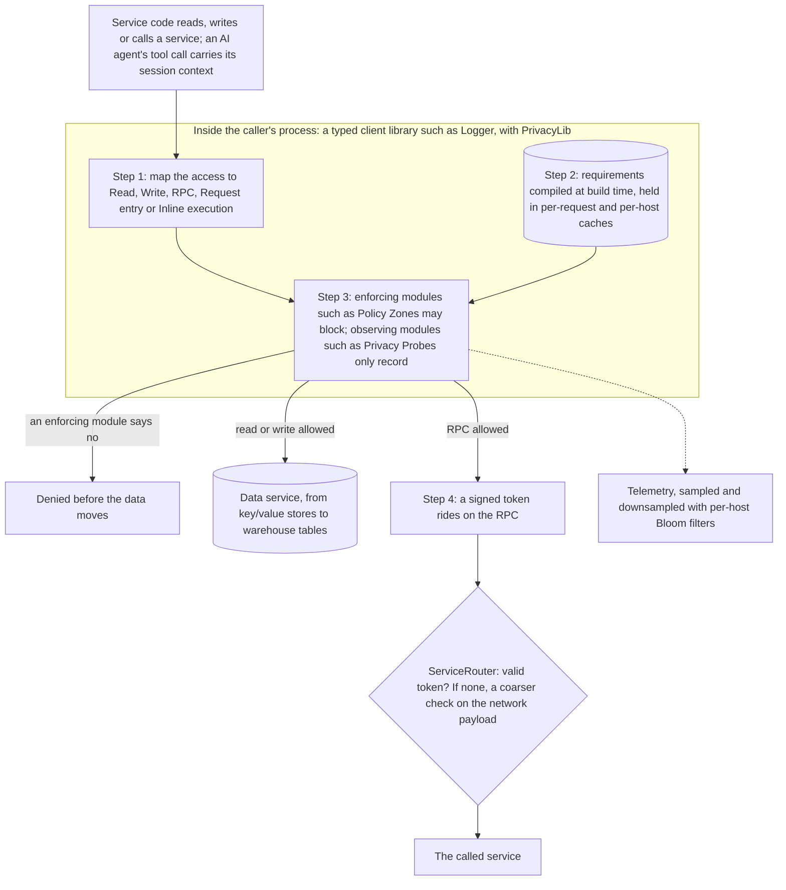

---
# Skeleton from Lead iau4bamz (Meta Engineering, ML Applications), picked 2026-10-30.
# Follow docs/editorial/case-study-writing-guide.md; the Author's check list
# is in the pull request. published and reviewed are the pick time, provisional: set them
# when you publish. verified: is the Author's alone (ADR-0007).
title: "PrivacyLib: how Meta checks privacy policy at every data access"
description: "How Meta's PrivacyLib checks privacy rules in-process on every data access, trading instant fleet-wide updates for safer per-service rollouts."
kind: case-study
vertical: distributed-systems
tags: ["privacy", "policy-enforcement", "client-libraries", "rpc", "meta"]
published: "2026-10-31T00:09:56+05:30"
verified: 2026-10-31
reviewed: "2026-10-31T00:09:56+05:30"
author: mira-vance
# Optional: an image HastCode may use, beside this file, replaces the
# generated title card. Never a Source's image.
# hero: system-name.png
# hero_alt: "What the image shows"
# Optional: related Explainer slugs and extra sources (title + url).
# related: [metastable-failures]
---

Meta's PrivacyLib performs [billions of privacy checks every second](https://engineering.fb.com/2026/10/27/security/privacylib/), inside the clients of hundreds of data and processing systems, while consuming ["only a small fraction of Meta's total compute capacity"](https://engineering.fb.com/2026/10/27/security/privacylib/). It manages that by not being a service at all: the check runs in the caller's own process, and the common path [avoids a network call](https://engineering.fb.com/2026/10/27/security/privacylib/).

> Drafted with AI assistance, researched, verified and edited by the HastCode editorial team. We publish only as many pieces as the Author can verify this way.

## TL;DR

- PrivacyLib is [a common library that runs inside the clients](https://engineering.fb.com/2026/10/27/security/privacylib/) of Meta's data and processing systems and checks privacy requirements at the moment data is read, written or sent on.
- Meta built it because each new requirement used to be [implemented separately in each system](https://engineering.fb.com/2026/10/27/security/privacylib/), which could take months; now a system integrates once and requirements arrive as modules.
- Each access maps to one of five operations; requirements compiled at build time are answered from in-process caches; enforcing modules can block while observing modules only record; RPCs carry a signed token that ServiceRouter checks.
- The price is the speed of change: enforcement ships with each service's own deployments, so a change [does not reach the whole fleet at once](https://engineering.fb.com/2026/10/27/security/privacylib/). The surprise: Policy Zones now blocks AI agents' disallowed accesses [without modification](https://engineering.fb.com/2026/10/27/security/privacylib/).

## One library in every client, one decision per access

The diagram is ours, redrawn from the text of Meta's post; Meta's own figures are in [the original](https://engineering.fb.com/2026/10/27/security/privacylib/). A service's code reaches for data at the top. Everything inside the middle box runs in that service's process, inside a client library such as Logger. Only the token path at the bottom crosses the network with something PrivacyLib produced.

Step 1 below maps the access to an operation, Step 2 is the compiled requirement and its caches, Step 3 is the modules that decide, and Step 4 is the token for RPCs. A section on rollouts follows, then the costs. Agents enter at the top like any other caller; their section comes near the end.

## Why one privacy requirement used to take months

Many privacy requirements come down to one question, in Meta's words: ["Can we prove that a piece of data goes only where it is allowed?"](https://engineering.fb.com/2026/10/27/security/privacylib/) Manual audits answer it, but they ["can go out of sync as systems change."](https://engineering.fb.com/2026/10/27/security/privacylib/) Earlier posts on Meta's [Privacy Aware Infrastructure](https://about.fb.com/news/2024/01/investing-in-privacy/) (PAI) covered how Meta [understands data](https://engineering.fb.com/2025/04/28/security/how-meta-understands-data-at-scale/), [traces its lineage](https://engineering.fb.com/2025/01/22/security/how-meta-discovers-data-flows-via-lineage-at-scale/) and enforces [purpose limitation](https://engineering.fb.com/2024/08/27/security/privacy-aware-infrastructure-purpose-limitation-meta/). PrivacyLib is ["the final stage of the broader PAI workflow"](https://engineering.fb.com/2026/10/27/security/privacylib/): the check at the moment of access.

Before it, supporting a new requirement meant [implementing the same enforcement logic separately in each system](https://engineering.fb.com/2026/10/27/security/privacylib/), and implementing a new requirement across systems could take months. The surface is large: [more than a hundred libraries used to access data services](https://engineering.fb.com/2026/10/27/security/privacylib/), from key/value stores to AI features, thousands of production services running versions of them, and millions of assets accessed daily.

Meta's lessons name the deeper failure. With controls added at each call site, new systems and processing paths meant more integration work, and [new access paths sometimes appeared faster than they could be covered](https://engineering.fb.com/2026/10/27/security/privacylib/). We infer the cost was multiplicative: every requirement times every system, each pairing its own project with its own bugs, and coverage always one step behind.

## The designs PrivacyLib moved away from

The post does not set out a formal comparison, but it names four designs it left behind, and each explains one choice.

- **Per-system, per-requirement code.** The old way, above. Now [a system integrates once, and new capabilities arrive as modules](https://engineering.fb.com/2026/10/27/security/privacylib/).
- **A remote policy lookup.** An earlier design fetched configuration remotely, and [that fetch alone was "thousands of times slower than the in-process path"](https://engineering.fb.com/2026/10/27/security/privacylib/).
- **Checking only at the network.** The RPC layer can check requests, but it [sees far less context than the client does](https://engineering.fb.com/2026/10/27/security/privacylib/). It survives as a backstop (Step 4), not the main check.
- **A fleet-wide config push.** Enforcement is [deployed as part of the service that owns it](https://engineering.fb.com/2026/10/27/security/privacylib/), so a change reaches production through that service's pipeline "instead of a fleet-wide config push."

The deciding argument, in Meta's lessons, is stability: [integrate at a stable data access boundary](https://engineering.fb.com/2026/10/27/security/privacylib/), define a small set of shared operations, and keep annotations with the data. Running in-process adds two things. PrivacyLib can use the caller's identity, endpoint and purpose ["while that information is still available"](https://engineering.fb.com/2026/10/27/security/privacylib/), without passing it across a process boundary. And a faulty change is contained to the service running that version of the code.

## Step 1: every access becomes one of five operations

Each integration [maps its access points to one of five common operations](https://engineering.fb.com/2026/10/27/security/privacylib/), and PrivacyLib invokes its modules at each:

| Operation | When it runs |
|---|---|
| Read | When fetching data |
| Write | When storing data |
| RPC | When calling another service |
| Request entry | Once, when a service begins handling a request |
| Inline execution | Around one computation inside a larger request, such as evaluating a feature |

Read, Write and RPC also have [post-operation variants](https://engineering.fb.com/2026/10/27/security/privacylib/), so observing modules can run after the access decision. Data accesses made during an inline execution are evaluated using that computation's own inline privacy context.

This small vocabulary is the point. A module is written against five verbs, not against a hundred client APIs, so enabling an additional module on an already-integrated system [takes "only days."](https://engineering.fb.com/2026/10/27/security/privacylib/) We infer Request entry is where context such as caller and purpose is fixed once, for the Reads and Writes that follow in the same request; the post does not spell out what each module does there.

Where the mapping happens matters too. Meta integrates [at typed client libraries, where PrivacyLib has full request context](https://engineering.fb.com/2026/10/27/security/privacylib/), and at lower network boundaries on remaining RPC paths to get full coverage. We infer why: the typed client knows it is writing to a named table on behalf of a named caller; a raw network packet does not.

## Step 2: requirements compiled at build time, answered from cache

Billions of checks a second cannot each wait on a network round trip. Meta [compiles requirements at build time "into their simplest evaluable form"](https://engineering.fb.com/2026/10/27/security/privacylib/), and most checks are answered from in-process caches. There are two: [per-request caches eliminate repeated checks within a request, and per-host caches retain frequently used configuration and results](https://engineering.fb.com/2026/10/27/security/privacylib/).

The post's walkthrough shows the build step. Messenger [supports end-to-end encryption](https://engineering.fb.com/2023/12/06/security/building-end-to-end-security-for-messenger/), and its backend processes [non-content messaging metadata](https://engineering.fb.com/2026/10/27/security/privacylib/), such as when messages are sent or delivered, and services write it to warehouse tables through Logger, a client library. The destination's config, MetadataTraceLoggerConfig, carries the table-level annotation MESSAGING_TRAFFIC_METADATA. Logger's code generation turns that config into a PrivacyLib artifact: a generated class for the [Hack](https://engineering.fb.com/2014/03/20/developer-tools/hack-a-new-programming-language-for-hhvm/) client, and for C++ and Python a central catalog from which PrivacyLib generates language-specific artifacts.

The annotation [belongs to the destination rather than to each writer](https://engineering.fb.com/2026/10/27/security/privacylib/), so every writer shares one description of the data. We infer that is what makes build-time compilation possible: a destination's policy is known before any request arrives, so evaluating it reduces to combining a precomputed artifact with the context of the request in hand.

## Step 3: enforcing modules decide, observing modules watch

Modules come in [two kinds](https://engineering.fb.com/2026/10/27/security/privacylib/). Enforcing modules can block a data access; Policy Zones, which enforces purpose limitation, is one. Observing modules only record; Privacy Probes, which collects signals for data-flow discovery, is another. PrivacyLib [combines the enforcing modules' results into one response](https://engineering.fb.com/2026/10/27/security/privacylib/); observing modules emit telemetry without affecting it.

On a Logger write, Logger's Hack integration declares a write operation. Policy Zones runs as an enforcing module with propagation enabled, and a Telemetry Logging module observes. Policy Zones checks two conditions: [that the context is an allowed use of messaging metadata, and that the destination carries the MESSAGING_TRAFFIC_METADATA annotation](https://engineering.fb.com/2026/10/27/security/privacylib/). If either fails while enforcement is enabled, the write is denied before it reaches downstream systems.

Policy Zones itself [applies information flow control](https://engineering.fb.com/2025/07/23/security/policy-zones-meta-purpose-limitation-batch-processing-systems/): labels on datasets carry restrictions into downstream processing, and derived data must be at least as restrictive as its source. Adding a module to Logger [needs no change to individual destinations or call sites](https://engineering.fb.com/2026/10/27/security/privacylib/).

Watching has its own cost, so telemetry is thinned. Each module's status, sampled latency and errors are recorded; [Bloom filters on each host downsample high-volume patterns at a fixed rate](https://engineering.fb.com/2026/10/27/security/privacylib/), and fine-grained sampling rates adjust as traffic changes.

## Step 4: a signed token for RPCs below the client

Not every request passes through a typed client. For those, PrivacyLib relies on [ServiceRouter](https://www.usenix.org/conference/osdi23/presentation/saokar), Meta's global service mesh. The RPC layer can check those requests, but it [sees far less context than the client does](https://engineering.fb.com/2026/10/27/security/privacylib/).

PrivacyLib bridges the gap with a cryptographically signed token. When a client-side check succeeds, PrivacyLib [attaches the token to the request](https://engineering.fb.com/2026/10/27/security/privacylib/), and ServiceRouter validates it at a lower boundary for supported RPC traffic, confirming that the request already passed the richer check.

A request that arrives without a token gets [a coarser check based only on the context visible in the network payload](https://engineering.fb.com/2026/10/27/security/privacylib/), and that layer applies "the strictest interpretation, choosing false positives over gaps." We infer the token is what lets the network layer afford to be strict: well-behaved callers carry proof and skip the coarse guess, so false positives fall mostly on paths that bypass the typed clients, which nudges their owners to integrate.

The post does not say what the token signs, how its keys rotate or how long it lives. Paths outside these boundaries [are not covered by this mechanism and need their own PrivacyLib integration](https://engineering.fb.com/2026/10/27/security/privacylib/).

## How a change reaches production without a fleet-wide push

There are two kinds of change, with two safety nets.

An annotation change can be a two-line edit to a LoggerConfig, but because a destination can have many writers it [can begin blocking writes from many services at once](https://engineering.fb.com/2026/10/27/security/privacylib/). During code review, Logger's code generation updates the artifact, and simulations replay observed data flows against both the new and the existing artifact; any flow whose result changes is reported. Reviewers see the edit, the generated artifact and the simulation together, and hold the artifact if a change is unexpected. Once approved, it ships through each service's normal pipeline, so a problem found later is limited to services running that build.

A module change touches every destination at once. Policy Zones first went into Logger's write path as `rollingOut()`, behind a runtime control with the key `logger.input.write.zones`, and Meta [moved it from 0 to 100% in stages](https://engineering.fb.com/2026/10/27/security/privacylib/) while watching denials, errors and latency. If valid writes had begun failing, the percentage could be lowered without rebuilding or redeploying the service. Once stable, the configuration became `enabled()`, which stops consulting the percentage.

## What it costs: slower changes, strict fallbacks and shared fate

**Slower propagation.** Because enforcement ships per service, changes [do not reach the whole fleet at once](https://engineering.fb.com/2026/10/27/security/privacylib/), and propagation is slower than a global configuration update. Meta manages it with explicit tracking, so requirement owners update in-scope services by the deadline, and a service that needs a change sooner can use its emergency deployment process. The lesson Meta titles "Coverage includes deployment": a new requirement can force [older services to deploy versions with updated PrivacyLib](https://engineering.fb.com/2026/10/27/security/privacylib/).

**False positives by design.** Token-less RPCs get the strictest reading. The post accepts false positives over gaps and does not say how many it sees.

**Gaps outside the boundary.** Anything that neither uses a typed client nor travels as supported RPC traffic needs its own integration.

**Shared fate.** A library inside every client is part of every client. ["Early on, an invalid config crashed processes across the fleet, breaking our own safe rollout principles,"](https://engineering.fb.com/2026/10/27/security/privacylib/) Meta writes. Other incidents came from annotation changes that compiled but changed access decisions and caused product failures. Meta's conclusion is that service owners trust PrivacyLib only when they can see a change's effect before release and recover without a fleet-wide rollback; we infer the replay simulation and the runtime dial exist for exactly those two incidents.

## The evidence: scale and days, with no latency numbers

Meta reports PrivacyLib running in [hundreds of data and processing systems](https://engineering.fb.com/2026/10/27/security/privacylib/), evaluating billions of checks every second, on a small fraction of Meta's compute. Enabling a module on systems already covered takes days rather than the months bespoke integrations used to take, and a failed change stays inside the service running it. The one comparative figure is the old remote fetch, "thousands of times slower" than the in-process path.

The gaps are wide. The post gives no per-check latency, only ["low per-check latency"](https://engineering.fb.com/2026/10/27/security/privacylib/); no cache hit rate; no share of compute beyond "a small fraction"; no sampling rates. It does not say whether a check that errors allows or denies the access, how much traffic arrives at ServiceRouter without a token, how often the coarse check is wrong, or how many accesses Policy Zones has denied.

The post shows how the boundary is built and that integration got faster. It does not show, in numbers, what a check costs a request.

## The same boundary, applied to AI agents

Agents are harder to reason about because their behaviour is dynamic and the data they touch is [decided at run time](https://engineering.fb.com/2026/10/27/security/privacylib/). A single tool call can cross several services before reaching data.

AgentLib, a common runtime based on PrivacyLib's design principles, [associates each tool call on supported paths with its agent session](https://engineering.fb.com/2026/10/27/security/privacylib/). Downstream clients and services propagate that context until the call reaches a system integrated with PrivacyLib, where PrivacyLib combines the context, the operation and the destination's annotations, and hands them to the modules.

Two modules did the work, and neither needed new integration. Agent Observability records [session and tool-call identifiers alongside the destination, client API, integration point and any errors](https://engineering.fb.com/2026/10/27/security/privacylib/), queryable by session; it was deployed by instrumenting systems already integrated, not by integrating into hundreds of systems by hand. Policy Zones ran unmodified, because it relies on the same inputs, and a block propagates back through the call chain to the agent. It applies even when an agent picks a tool its developer did not anticipate. We infer this is the strongest argument for the design: a check at the data does not need to predict the caller.

## What a check at the data boundary makes possible

Next, Meta is extending PrivacyLib-style approaches to [AI training data](https://transparency.meta.com/features/ai-at-meta-training-data/), which is produced and transformed in many places. For agents, observing and blocking is ["just the starting point"](https://engineering.fb.com/2026/10/27/security/privacylib/): the harder problems are evaluating internal agent behaviour while it happens and reasoning about communication between agents, where one access may be several agents removed from the requester.

The lesson travels to any team enforcing a rule across many services: authorisation, data residency, tenant isolation. Put the check in the client libraries everyone already uses. Give it a small vocabulary of operations. Keep the label with the data, compile it ahead of time and cache it in-process. Back the paths you do not own with a strict, coarse check, and give well-behaved callers a signed way past it. Make every change simulated before release and dialable after.

The cost, in our view, is real: changes move at the speed of the slowest service's deploy, and a library in every process can crash every process. What could go right is a rule written once that holds for every caller, including callers nobody designed for.

## Sources

- [PrivacyLib: Privacy Controls at the Data Access Boundary](https://engineering.fb.com/2026/10/27/security/privacylib/), Sai Nagabhairava, Hannes Roth, Na Chen, Peter Prelich and Jonathan Bergeron, Meta Engineering, 27 October 2026
- [Policy Zones: How Meta enforces purpose limitation at scale in batch processing systems](https://engineering.fb.com/2025/07/23/security/policy-zones-meta-purpose-limitation-batch-processing-systems/), Lucas Waye, Wenlong Dong, Boris Shulman, Yizhou Yan and Yuxuan Zhang, Meta Engineering, 23 July 2025
- [How Meta discovers data flows via lineage at scale](https://engineering.fb.com/2025/01/22/security/how-meta-discovers-data-flows-via-lineage-at-scale/), Meta Engineering, 22 January 2025
- [How Meta understands data at scale](https://engineering.fb.com/2025/04/28/security/how-meta-understands-data-at-scale/), Meta Engineering, 28 April 2025
- [How Meta enforces purpose limitation via Privacy Aware Infrastructure at scale](https://engineering.fb.com/2024/08/27/security/privacy-aware-infrastructure-purpose-limitation-meta/), Wenlong Dong and others, Meta Engineering, 27 August 2024
- [Investing in Privacy](https://about.fb.com/news/2024/01/investing-in-privacy/), Michel Protti, Meta, 25 January 2024
- [Building end-to-end security for Messenger](https://engineering.fb.com/2023/12/06/security/building-end-to-end-security-for-messenger/), Meta Engineering, 6 December 2023
- [Hack: a new programming language for HHVM](https://engineering.fb.com/2014/03/20/developer-tools/hack-a-new-programming-language-for-hhvm/), Meta Engineering, 20 March 2014
- [ServiceRouter: Hyperscale and Minimal Cost Service Mesh at Meta](https://www.usenix.org/conference/osdi23/presentation/saokar), Harshit Saokar and others, OSDI 2023
- [AI at Meta: transparency about our training data](https://transparency.meta.com/features/ai-at-meta-training-data/), Meta
