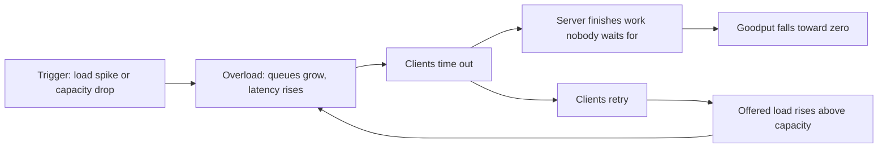

At 2:19am PDT on 20 September 2015, a [brief network disruption](https://aws.amazon.com/message/5467D2/) hit some of DynamoDB's storage servers in US-East. Networks blip all the time, and this one should have passed unnoticed. Instead, by 2:37am the error rate on customer requests was ["finally stabilizing at approximately 55%"](https://aws.amazon.com/message/5467D2/), and it stayed there. Engineers [could not even add capacity](https://aws.amazon.com/message/5467D2/) to the overloaded metadata service, because it was too busy to accept their administrative requests. Recovery began only at 5:06am, when they [paused requests to the metadata service](https://aws.amazon.com/message/5467D2/), and DynamoDB was back to normal error rates at 7:10am. The disruption had been brief. What held DynamoDB down for hours was its own retry traffic.

> Drafted with AI assistance, researched, verified and edited by the HastCode editorial team. We publish only as many pieces as the Author can verify this way.

## TL;DR

- A **metastable failure** is a bad state that [outlives the trigger that caused it](https://sigops.org/s/conferences/hotos/2021/papers/hotos21-s11-bronson.pdf): a brief spike or blip overloads the system, and a **sustaining effect**, most often retries, keeps it overloaded after the trigger is gone.
- The root cause is that [feedback loop, not the trigger](https://sigops.org/s/conferences/hotos/2021/papers/hotos21-s11-bronson.pdf). Many triggers lead to the same stuck state, so fixing only the trigger leaves you exposed to the next one.
- It is common: retries sustained [more than half of the public incidents](https://www.usenix.org/system/files/osdi22-huang-lexiang.pdf) one study examined, and [at least 4 of 15 major AWS outages](https://www.usenix.org/system/files/osdi22-huang-lexiang.pdf) in a decade were metastable.
- The defences cap amplification and protect useful work: [retry budgets](https://aws.amazon.com/builders-library/timeouts-retries-and-backoff-with-jitter/), [backoff with jitter](https://brooker.co.za/blog/2022/08/11/backoff.html), and [load shedding with admission control](https://aws.amazon.com/builders-library/using-load-shedding-to-avoid-overload/). Each has a cost.
- Once stuck, the way out is to [cut load or raise capacity](https://www.usenix.org/system/files/osdi22-huang-lexiang.pdf) until the loop can no longer sustain itself, as DynamoDB did by pausing requests.

## What makes a failure metastable

TODO(author): verify every claim against its source, replace the placeholder hero, then set verified: and remove draft: true and this line.

Nathan Bronson and colleagues named the pattern in their HotOS 2021 paper. Metastable failures, they write, ["occur in open systems with an uncontrolled source of load where a trigger causes the system to enter a bad state that persists even when the trigger is removed"](https://sigops.org/s/conferences/hotos/2021/papers/hotos21-s11-bronson.pdf). In that state **goodput**, the throughput of useful work, is unusably low.

The paper describes [three states](https://sigops.org/s/conferences/hotos/2021/papers/hotos21-s11-bronson.pdf). In the **stable** state, a trigger does no lasting damage. Above a load threshold that is "implicit and invisible", the system is **vulnerable**: healthy, but one trigger can tip it into the **metastable** failure state. A system can sit in the vulnerable state for months or years, and many production systems choose to, because it is far more efficient. Getting out takes ["a strong corrective push"](https://sigops.org/s/conferences/hotos/2021/papers/hotos21-s11-bronson.pdf), such as a reboot or a dramatic cut in load. A failure that ends when its trigger ends, such as a denial-of-service attack, is not metastable.

Marc Brooker, an AWS engineer, [describes the stuck state](https://brooker.co.za/blog/2021/05/24/metastable.html) from the outside. Clients time out, yet keep sending work, and the server keeps finishing it. Throughput looks fine, but nobody is waiting for the answers, so goodput is zero. ["Up, but down. Working, but broken."](https://brooker.co.za/blog/2021/05/24/metastable.html)

## The loop that keeps it down

Walk the diagram from the left. The HotOS paper's [worked example](https://sigops.org/s/conferences/hotos/2021/papers/hotos21-s11-bronson.pdf) puts numbers on each box. A web application sends one query per user request to a database that answers in under 100 ms below 300 queries per second (QPS), and an order of magnitude slower above it. If a query takes longer than 1 s, the application sends one retry.

The application is serving 280 QPS when a 10-second network outage hits (the **trigger**). When the network returns, the requests and retries sent during the outage are retransmitted at once and overload the database (**overload**). Latency rises past the 1 s timeout, so every request now sends two queries: 560 QPS (**time out, retry**). Every query times out, so goodput is zero, and the doubled load keeps latency high (**the loop closes**).

The trigger is long gone, but the system stays here. In this example it recovers only if [load falls below 150 QPS or retries fall below 20 QPS](https://sigops.org/s/conferences/hotos/2021/papers/hotos21-s11-bronson.pdf). That 150 QPS line is the edge between stable and vulnerable: below it, even doubled load fits under 300.

## Retries are only one sustaining effect

Huang and colleagues, in their OSDI 2022 study of [22 metastable failures from 11 organisations](https://www.usenix.org/system/files/osdi22-huang-lexiang.pdf), split sustaining effects into two kinds. **Workload amplification** raises the load, as retries do. **Capacity degradation amplification** lowers what the system can do, as background work such as garbage collection does.

The HotOS paper gives [a cache example](https://sigops.org/s/conferences/hotos/2021/papers/hotos21-s11-bronson.pdf) of the first kind. With a 90% hit rate, the same 300 QPS database can back an application serving 3,000 QPS. If the cache is lost, every miss goes to the database, which slows down; the application times out, so it never refills the cache, and the empty cache keeps the database slow.

**Slow error handling** works the same way. Failure paths often [capture stack traces, do DNS lookups and write logs](https://sigops.org/s/conferences/hotos/2021/papers/hotos21-s11-bronson.pdf), so more errors consume more of the scarce resource and cause more errors.

**Garbage collection** is the second kind. Brooker [traces the loop](https://brooker.co.za/blog/2024/08/14/gc-metastable.html): memory pressure makes collection slower and each request costlier, so throughput falls, more requests are in flight, and memory pressure rises further. He notes that a system which limits concurrency is unlikely to enter this loop. The OSDI paper reports [a case at Twitter](https://www.usenix.org/system/files/osdi22-huang-lexiang.pdf) where garbage collection acted as the amplifier.

## It happens in production-proven software

Brooker's October 2026 post, ["Animations for System Builders"](https://brooker.co.za/blog/2026/10/23/animations.html), answers a doubt he still hears: if these loops were real, wouldn't years of production use have shaken them out? He built animations from traces captured in a real test environment.

- **Postgres 16** in a MicroVM handles 20 queries per second easily while its working set sits in the page cache. A load spike fills memory with running queries, each taking 12 MB, and afterwards the same queries are [served from disk and run slower](https://brooker.co.za/blog/2026/10/23/animations.html). He notes that even a simple, non-distributed system behaves this way.
- **etcd** under a write spike: overloaded peers [look unavailable](https://brooker.co.za/blog/2026/10/23/animations.html), which triggers a storm of application-level resends.
- **etcd** under a read spike from 500 to 1,000 reads per second: time spent in garbage collection rises and leaves less CPU for reads, which Brooker calls ["a self-reinforcing loop"](https://brooker.co.za/blog/2026/10/23/animations.html) that does not recover without intervention.

His verdict on etcd, "widely-used quality software": ["Operational experience doesn't seem to effectively shake out these kinds of issues."](https://brooker.co.za/blog/2026/10/23/animations.html) You can trigger a retry-driven metastable state yourself in his browser simulator, [Stability Sim](https://stability-sim.systems/?example=metastable-retry).

## Why healthy systems drift toward the edge

The features that sustain these failures are usually ones that make the system better on a normal day. The HotOS authors call this a [paradox](https://sigops.org/s/conferences/hotos/2021/papers/hotos21-s11-bronson.pdf): the root cause is often a feature that improves efficiency or reliability. A cache lets you run fewer databases. Retries lower the everyday error rate.

They also name an organisational force: ["Optimizations that apply only to the common case exacerbate feedback loops"](https://sigops.org/s/conferences/hotos/2021/papers/hotos21-s11-bronson.pdf), because they let a system run at a larger multiple of its stable threshold. A better cache eviction policy cuts database load, and reclaiming the spare databases looks like a win until the cache is lost.

Brooker makes the [same point about retries](https://brooker.co.za/blog/2021/05/24/metastable.html). If you watch only the daily error rate, adding retries looks like pure improvement, yet the same change can turn a small outage into a metastable retry storm.

Fixes can drift the wrong way too. The OSDI paper calls it ["fix to break"](https://www.usenix.org/system/files/osdi22-huang-lexiang.pdf). After AWS's 2014 SimpleDB outage, engineers decided storage servers should keep retrying the locking service rather than give up. About a year later a similar incident hit DynamoDB, whose storage nodes did not back out of retrying.

## Defence one: give retries a budget

Retries, in the words of Brooker's Builders' Library article, are ["selfish"](https://aws.amazon.com/builders-library/timeouts-retries-and-backoff-with-jitter/): the client spends more of the server's time to raise its own chance of success. When the failure is overload, that is exactly the wrong trade.

The first rule is to retry in one place. In a call stack five services deep with three tries at each layer, a failing database sees [243 times the load](https://aws.amazon.com/builders-library/timeouts-retries-and-backoff-with-jitter/). For low-cost operations, AWS's practice is to retry at a single point in the stack.

The second is a **retry budget**. AWS [limits retries locally with a token bucket](https://aws.amazon.com/builders-library/timeouts-retries-and-backoff-with-jitter/), and added it to the AWS SDK in 2016. In Brooker's [version](https://brooker.co.za/blog/2022/02/28/retries.html), each success deposits part of a token, say 0.1, and each retry spends a whole one. When failures are rare it behaves like ordinary retries; when well above 10% of calls fail, it behaves like roughly 0.1 retries per call.

The trade-offs: each client estimates the failure rate from its own traffic, and Brooker's simulation shows that with many small clients the buckets [drain too slowly and converge on plain retries](https://brooker.co.za/blog/2022/02/28/retries.html). A circuit breaker on retries adds no load at high failure rates, but it is modal, switching between retrying and not, and the Builders' Library warns that modes are [hard to test and can slow recovery](https://aws.amazon.com/builders-library/timeouts-retries-and-backoff-with-jitter/).

## Defence two: back off, with jitter

**Backoff** means waiting longer between attempts; **jitter** randomises the wait. Brooker's summary: ["Backoff helps in the short term. It is only valuable in the long term if it reduces total work."](https://brooker.co.za/blog/2022/08/11/backoff.html)

During a short spike, backing off [spreads the load out](https://brooker.co.za/blog/2022/08/11/backoff.html). During a long overload it helps only when clients are few and serial, such as workers polling a queue, because waiting delays their next first try. With many independent clients, each new client sends its first try anyway, so backoff only defers retries. Those deferred retries are [an implicit queue](https://brooker.co.za/blog/2022/08/11/backoff.html) that can even delay recovery. Backoff, he concludes, is not a substitute for a good retry policy; a good approach combines backoff, jitter and a retry policy.

Jitter matters because clients that back off on the same schedule retry together. In Brooker's 2015 simulation on the AWS Architecture Blog, plain exponential backoff [still produced clusters of calls](https://aws.amazon.com/blogs/architecture/exponential-backoff-and-jitter/); with jitter added, the call count in the 100-client case fell by more than half. The Builders' Library suggests [jitter on timers and periodic jobs](https://aws.amazon.com/builders-library/timeouts-retries-and-backoff-with-jitter/) too, not just on retries.

## Defence three: shed load, admit only what you can finish

The server's side of the loop is wasted work. David Yanacek's Builders' Library article explains that a timed-out request wastes everything the server already did on it, and retries multiply the load, until ["an overload creates its own feedback loop that results in overload as a steady state"](https://aws.amazon.com/builders-library/using-load-shedding-to-avoid-overload/).

**Load shedding** breaks it by [rejecting excess requests early](https://aws.amazon.com/builders-library/using-load-shedding-to-avoid-overload/), so the requests the server accepts finish before their clients time out. **Admission control** decides what to accept. AWS designs APIs to do [bounded work](https://aws.amazon.com/builders-library/using-load-shedding-to-avoid-overload/), such as paginated lists, because admission is hard when the server cannot tell what a request will cost. It caps how long a request may wait in a queue, propagates client deadlines between services, and drops requests that can no longer finish in time. The HotOS paper adds [giving retries lower priority](https://sigops.org/s/conferences/hotos/2021/papers/hotos21-s11-bronson.pdf) than first tries.

The costs are real. Rejecting is [not free](https://aws.amazon.com/builders-library/using-load-shedding-to-avoid-overload/): a stray log statement can make it expensive, and past some load goodput falls anyway. Rejecting early is cheapest but shows you least about what you dropped, so AWS protects in layers. Priorities also have limits: the HotOS authors describe a system with an end-to-end priority scheme that still [fell into a metastable failure](https://sigops.org/s/conferences/hotos/2021/papers/hotos21-s11-bronson.pdf) after retries and failover raised its worst-case amplification above 100 times.

## Getting out once you are stuck

The OSDI study found that engineers usually [start by fixing the trigger](https://www.usenix.org/system/files/osdi22-huang-lexiang.pdf): rolling back the configuration, hot-fixing the bug. That is necessary but not enough, because the sustaining effect is still running. Recovery means one of two things: shed load until it falls below the level the system can recover from, or raise that level.

Load shedding was the [most common mitigation](https://www.usenix.org/system/files/osdi22-huang-lexiang.pdf), used in over half of the incidents. Without understanding the loop, though, it is hard to know how much load to cut, which led to long mitigations and extra steps such as reboots. Raising the level means adding capacity or changing policy: a cap of two retries means work can [never be amplified more than three times](https://www.usenix.org/system/files/osdi22-huang-lexiang.pdf), while uncapped retries leave no stable region at all. Autoscaling helps, but the paper notes losing a cache with a 99% hit rate can mean 100 times the load, more than scaling may absorb in time.

DynamoDB did both, in order. It [paused requests to the metadata service](https://aws.amazon.com/message/5467D2/), which cut retry load, then added capacity. Besides more capacity, AWS's [corrective actions](https://aws.amazon.com/message/5467D2/) target the loop itself: storage nodes requesting membership data less often, more time allowed to answer, and the metadata service split into many instances that each serve part of the fleet.

## Where lost writes fit

Brooker's post opens on a different failure: a Raft cluster can [lose writes if even one member's storage lies about `fsync()`](https://brooker.co.za/blog/2026/10/23/animations.html). Raft requires each server's log to be [updated on stable storage before responding to RPCs](https://raft.github.io/raft.pdf), and an entry is [committed once it is on a majority](https://raft.github.io/raft.pdf) of servers.

We infer the mechanism from those two rules. A member that acknowledges an entry it has not made durable still counts toward that majority. If it crashes and restarts without the entry, the entry may now sit on fewer than a majority, and a leader elected from the servers that lack it can overwrite it. The client was told the write succeeded.

This is not a metastable failure. A lost write breaks correctness once; a metastable failure is a stuck state that destroys goodput. We infer the reason Brooker pairs them: both are behaviours that pass normal operation unnoticed, and both become visible once you replay real traces and watch them happen. This piece stays with metastability; lost writes deserve their own Explainer.

## What understanding it makes possible

Once you see the loop, a postmortem asks a sharper question: not only what triggered the outage, but what kept the system down. The HotOS authors put the [root cause in the sustaining effect](https://sigops.org/s/conferences/hotos/2021/papers/hotos21-s11-bronson.pdf) because it is the part that will return with a different trigger.

It also changes what you measure. Every retry policy, cache and error path has an amplification factor, and you can write it down: three tries per layer, ten times the database load on a cold cache. The HotOS authors call for a [characteristic metric](https://sigops.org/s/conferences/hotos/2021/papers/hotos21-s11-bronson.pdf) that shows the state of the feedback loop, and Brooker sees in this the start of treating large systems as [control systems](https://brooker.co.za/blog/2021/05/24/metastable.html).

The optimistic part: running in the vulnerable state is a reasonable choice for efficiency, as long as you know where the edge is and have a way back. A retry budget, a queue that drops stale work and a server that sheds load early are how you keep that way back open. You can try it before production: the OSDI authors published [reproductions of retry, cache and GC loops](https://github.com/lexiangh/Metastability), and [Stability Sim](https://stability-sim.systems/) runs one in a browser.

## Sources

- Marc Brooker, ["Animations for System Builders: Metastability and Lost Writes"](https://brooker.co.za/blog/2026/10/23/animations.html), 23 October 2026.
- Nathan Bronson, Abutalib Aghayev, Aleksey Charapko, Timothy Zhu, ["Metastable Failures in Distributed Systems"](https://sigops.org/s/conferences/hotos/2021/papers/hotos21-s11-bronson.pdf), HotOS 2021.
- Lexiang Huang, Matthew Magnusson, Abishek Bangalore Muralikrishna, Salman Estyak, Rebecca Isaacs, Abutalib Aghayev, Timothy Zhu, Aleksey Charapko, ["Metastable Failures in the Wild"](https://www.usenix.org/system/files/osdi22-huang-lexiang.pdf), OSDI 2022 ([conference page](https://www.usenix.org/conference/osdi22/presentation/huang-lexiang), [reproductions](https://github.com/lexiangh/Metastability)).
- Amazon Web Services, ["Summary of the Amazon DynamoDB Service Disruption and Related Impacts in the US-East Region"](https://aws.amazon.com/message/5467D2/), September 2015.
- Marc Brooker, ["Metastability and Distributed Systems"](https://brooker.co.za/blog/2021/05/24/metastable.html), 24 May 2021.
- Marc Brooker, ["Fixing retries with token buckets and circuit breakers"](https://brooker.co.za/blog/2022/02/28/retries.html), 28 February 2022.
- Marc Brooker, ["What is Backoff For?"](https://brooker.co.za/blog/2022/08/11/backoff.html), 11 August 2022.
- Marc Brooker, ["Garbage Collection and Metastability"](https://brooker.co.za/blog/2024/08/14/gc-metastable.html), 14 August 2024.
- Marc Brooker, ["Exponential Backoff And Jitter"](https://aws.amazon.com/blogs/architecture/exponential-backoff-and-jitter/), AWS Architecture Blog, 4 March 2015.
- Marc Brooker, ["Timeouts, retries, and backoff with jitter"](https://aws.amazon.com/builders-library/timeouts-retries-and-backoff-with-jitter/), Amazon Builders' Library.
- David Yanacek, ["Using load shedding to avoid overload"](https://aws.amazon.com/builders-library/using-load-shedding-to-avoid-overload/), Amazon Builders' Library, December 2019.
- Diego Ongaro, John Ousterhout, ["In Search of an Understandable Consensus Algorithm (Extended Version)"](https://raft.github.io/raft.pdf).
- Marc Brooker, [Stability Sim](https://stability-sim.systems/).
