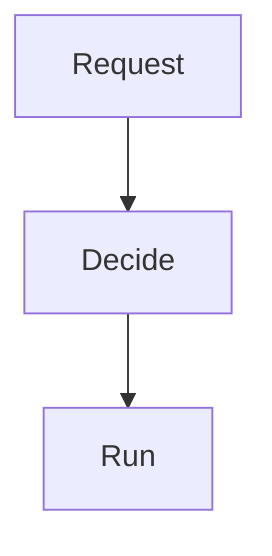

---
# Skeleton from Lead pcwu4qit (Netflix TechBlog), picked 2026-10-27.
# Follow docs/editorial/case-study-writing-guide.md and replace every
# TODO(author) line. published and reviewed are the pick time, provisional: set them
# when you publish. verified: is the Author's alone (ADR-0007).
title: "Netflix Conductor: The Next Chapter"
description: "TODO(author): one sentence, 150 characters at most: what the system does and the trade-off that matters."
kind: case-study
vertical: distributed-systems
tags: ["TODO(author): two to five lower-case tags"]
published: "2026-10-27T17:47:15Z"
reviewed: "2026-10-27T17:47:15Z"
author: mira-vance
# Optional: an image HastCode may use, beside this file, replaces the
# generated title card. Never a Source's image.
# hero: system-name.png
# hero_alt: "What the image shows"
# Optional: related Explainer slugs and extra sources (title + url).
# related: [metastable-failures]
draft: true
---

TODO(author): the hook, one or two sentences: a sourced fact about {system} (a number, a design choice, an incident) that makes a backend engineer look twice, linked to the Lead.

> Drafted with AI assistance, researched, verified and edited by the HastCode editorial team. We publish only as many pieces as the Author can verify this way.

## TL;DR

- TODO(author): what {system} is and what it does, in one plain sentence, linked.
- TODO(author): why {company} built it: the problem the old design could not solve.
- TODO(author): how it works, naming the parts the diagram shows, in order.
- TODO(author): the price it pays, and the result that surprised us.

## TODO(author): {system} at a glance, named for what the diagram shows

TODO(author): say the diagram is ours, redrawn from the Source, and link the original figure. Then one paragraph on the path the diagram follows, top to bottom, and which section walks each part.

## TODO(author): the problem {company} had to solve

TODO(author): what the old design did, what broke, and who paid for it, with the Source's own evidence linked.

## TODO(author): the options {company} weighed

TODO(author): each alternative the Source names, why it was rejected in the Source's words, linked, and the argument that decided it.

## TODO(author): the first part of the diagram and what it does

TODO(author): how this part works, linked claim by claim. Say "we infer" wherever the Source leaves a gap.

## TODO(author): the next part of the diagram and what it does

TODO(author): how this part works, linked claim by claim. Add one H2 per part of the diagram, in the diagram's order.

## TODO(author): what it costs

TODO(author): the trade-offs the Source admits, plainly, and how {company} manages each. Label any number of our own as ours.

## TODO(author): the evidence it works, and what the Source leaves out

TODO(author): what {company} measured or reports, linked, and what it does not publish (no benchmark numbers, no failure counts).

## TODO(author): what it makes possible

TODO(author): who uses it now, what is next, and the lesson for a Reader running their own systems: what could go right, without hiding the cost.

## Sources

- [Netflix Conductor: The Next Chapter](https://netflixtechblog.com/netflix-conductor-the-next-chapter-41ad21067649?source=rss----2615bd06b42e---4), Netflix TechBlog
